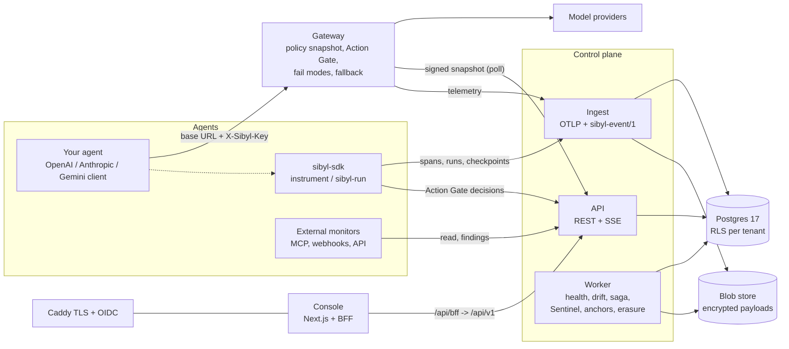

# Sibyl

Sibyl is a self-hosted control plane for an organisation's AI agents. It keeps a registry of every
agent, model and provider, watches each agent's traffic and health, and stops unauthorised actions
before they execute: the **Action Gate** decides every proposed tool call (allow, block, or escalate
to a person) at the SDK and at the gateway. When a model or provider fails, or drifts, Sibyl moves
traffic to an approved fallback or hands the work to a person, and every decision lands in a
tamper-evident audit log that an auditor can verify offline. Agents connect with one line
(`sibyl.instrument()`), no code (`sibyl-run`), or a base-URL change to the gateway; Sentinel and
external monitor agents add advisory findings on top.

## Try it

**Live demo (no sign-up, dummy data): https://sibyl-demo.onrender.com.** Pick any persona on the
sign-in page. Everyone shares one demo world, and it restarts after 15 idle minutes (the first visit
after that takes about a minute to wake up).


| Demo, dummy data | Real deployment, your agents |
|---|---|
| [](https://codespaces.new/MK-JKC/sibyl?devcontainer_path=.devcontainer/demo/devcontainer.json) | [](https://codespaces.new/MK-JKC/sibyl?devcontainer_path=.devcontainer/real/devcontainer.json) |
| The console with a scripted outage scenario; every screen clickable. Node only. | Postgres, API, ingest, worker, gateway, console, Caddy TLS and OIDC; no simulator; first workspace and admin bootstrapped. |
| [docs/setup/DEMO.md](docs/setup/DEMO.md) | [docs/setup/REAL.md](docs/setup/REAL.md) |

Links: `https://codespaces.new/MK-JKC/sibyl?devcontainer_path=.devcontainer/demo/devcontainer.json`
and `https://codespaces.new/MK-JKC/sibyl?devcontainer_path=.devcontainer/real/devcontainer.json`.

## Quick start on your machine

```bash
git clone https://github.com/MK-JKC/sibyl.git && cd sibyl

# Demo: console with dummy data (Node.js 20.18+)
make demo                         # http://localhost:3000

# Real deployment (Docker + Compose 2.24.4+)
make up                           # builds, bootstraps, prints the console URL and admin login
make ca && make password          # trust Caddy's local CA; show the admin password
make key NAME=my-agent            # an SDK key for your agent (shown once)
make status | make logs | make down
```

`make demo-stack` runs the full stack seeded with the simulator's demo world for
[the 10-minute quickstart](docs/quickstart.md). Behind a TLS-inspection proxy, set
`SIBYL_EXTRA_CA_FILE` first; never turn verification off.

**[docs/setup/SETUP.md](docs/setup/SETUP.md)** is the complete guide: prerequisites per OS, ports,
corporate proxies, connecting agents three ways, the first Action Gate policy, external monitors,
Sentinel, production hardening (your own OIDC provider, certificates, secrets, backups, upgrades) and
troubleshooting.

## Plug in your own monitor agents

Any outside agent can watch the fleet and report advisory findings: register it on the console's
**Monitors** page (its key is shown once), then connect it through the MCP server, signed webhooks
or the REST API. Ready-to-run examples for Claude (MCP and the Agent SDK), the OpenAI Agents SDK,
Gemini, a webhook receiver and a plain script are in [examples/monitors](examples/monitors/README.md):

```bash
pip install ./packages/sibyl-schemas ./packages/sibyl-sdk ./packages/sibyl-mcp   # from this repo
export SIBYL_API_URL=https://localhost:8443 SIBYL_MONITOR_KEY=<monitor key>
claude mcp add sibyl --env SIBYL_API_URL="$SIBYL_API_URL" --env SIBYL_MONITOR_KEY="$SIBYL_MONITOR_KEY" -- sibyl-mcp
```

Monitors read metadata only, within the agent groups they are given, and can never allow, block,
approve, fail over or change policy.

## Documents

Everything a new owner needs is collected in **[handover/](handover/README.md)**: what each file contains, the handover guide, and the PDFs.


| | |
|---|---|
| [Sibyl-Product.pdf](handover/pdf/Sibyl-Product.pdf) | what Sibyl does and for whom |
| [Sibyl-Technical.pdf](handover/pdf/Sibyl-Technical.pdf) | architecture, data model, every subsystem, with build status ([markdown](docs/pdf/technical.md)) |
| [Sibyl-Technical-Thesis.pdf](handover/pdf/Sibyl-Technical-Thesis.pdf) | why it is built this way |
| [Sibyl-Sales-GTM.pdf](handover/pdf/Sibyl-Sales-GTM.pdf) | positioning and go-to-market |

Guides: [concepts](docs/guide/concepts.md), [Python SDK](docs/guide/sdk.md), [API](docs/guide/api.md),
[operations](docs/guide/operations.md), [governance](docs/guide/governance.md),
[security](docs/guide/security.md); runbooks in [ops/runbooks](ops/runbooks/README.md); release notes
in [CHANGELOG.md](CHANGELOG.md).

## Architecture



- **Gateway** (`services/gateway`): OpenAI-compatible, native Anthropic Messages and native Gemini
  protocols. Runs from the last signed policy snapshot and never waits on the control plane; applies
  kill switches, fail-open or fail-closed per agent, inline fallback and the Action Gate on tool calls.
- **Control plane** (`services/control`): `api`, `ingest`, `worker` and `migrate` from one image.
  Postgres is the only stateful service; payloads are envelope-encrypted per tenant.
- **SDK** (`packages/sibyl-sdk`): plug-and-play instrumentation, run trees, checkpoints and handoff
  packets, Action Gate enforcement for framework tools, and `sibyl audit verify`.
- **Console** (`console/`): fleet, incidents, approvals, the operator queue, alerts, action policies
  and held actions, drift, Sentinel, discovered agents, runs, audit and settings, with a demo-data mode.
- **Deployment** (`deploy/`): Docker Compose behind Caddy; demo and real variants; release images on
  GHCR (`ghcr.io/mk-jkc/sibyl-{control,gateway,console,sim}`) for `SIBYL_IMAGE_TAG=x.y.z make up`.

## Repository layout

| Path | What it is | Licence |
|---|---|---|
| `packages/sibyl-schemas/` | wire contracts: value sets, JSON Schemas, models, canonicaliser, scrubber, Action Gate evaluator | Apache-2.0 |
| `packages/sibyl-sdk/` | Python SDK (`import sibyl`), `sibyl-run`, the `sibyl` CLI | Apache-2.0 |
| `services/control/` | control plane: api, ingest, worker, migrate, operator CLI, SQL migrations | proprietary |
| `services/gateway/` | the gateway | proprietary |
| `sibyl-sim/` | provider doubles, chaos knobs and the scenario harness (development only) | proprietary |
| `console/` | web console (Next.js, TypeScript, Tailwind) | proprietary |
| `openapi/` | the OpenAPI 3.1 contract | proprietary |
| `rules/` | default health and prediction rules | proprietary |
| `deploy/compose/`, `deploy/docker/` | Compose stack (demo and real), Caddy, dex, Dockerfiles | proprietary |
| `.devcontainer/` | Codespaces: `demo/` and `real/` | proprietary |
| `.github/workflows/` | CI and the release workflow | proprietary |
| `ci/` | local CI pipeline (`ci/run.sh`), licence gate, deployment tests | proprietary |
| `ops/` | demo scripts, backup and restore, runbooks | proprietary |
| `docs/` | setup, quickstart, guides, PDFs, the design record (`docs/council/`) | |

## Development

```bash
make sync                 # uv sync --all-packages (UV_SYSTEM_CERTS=1 is set by the Makefile)
make db-up                # Postgres 17 on :5433 for the tests (PGBIN=... to point at your install)
make ci                   # ruff, format, import contracts, mypy, pytest + coverage (80%), licences
cd console && npm ci && npm run typecheck && npm run lint && npm run test:unit
```

GitHub Actions runs the same gates on every pull request (`.github/workflows/ci.yml`); a `v*` tag
builds and publishes the images and the GitHub Release (`.github/workflows/release.yml`).

## Licence

The SDK (`sibyl-sdk`) and the shared contracts (`sibyl-schemas`) are **Apache-2.0**, so they can be
embedded in your agents freely. The core (control plane, gateway, console, simulator, deployment) is
**proprietary** (D15). Runtime dependencies must be permissive (MIT, BSD, Apache-2.0, ISC, PSF); the
licence gate (`ci/licences.py`) blocks AGPL, SSPL, BUSL, GPL and unknown licences, with recorded
waivers in `ci/licence-waivers.toml`. Sibyl has not yet had an external security assessment (D18);
treat a deployment as pre-production until it has.
