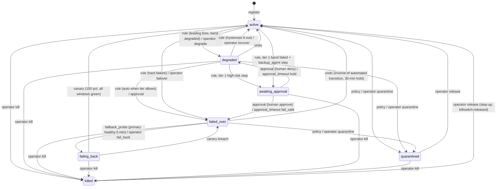
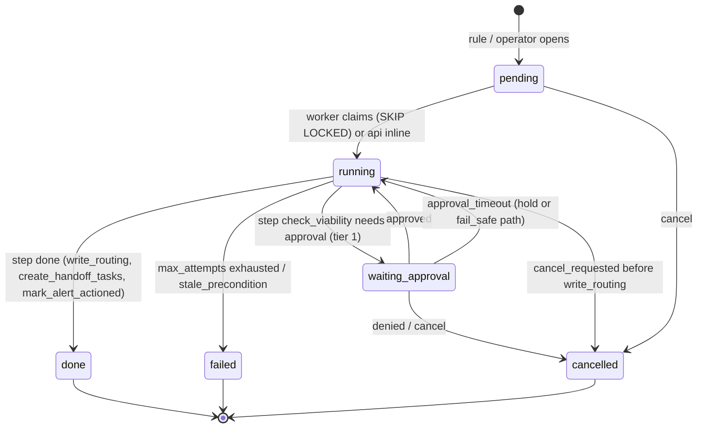

# Sibyl — Step 4 consolidated contract: APIs + SDK

Chair's consolidation · 2026-10-10 · Phase 1 scope only. Sources: `backend-architect.md` (control plane, gateway, OpenAPI), `ai-engineer.md` (ingest, SDK, handoff schema), `security-auditor.md` (scopes, authn, per-route authz, STRIDE, scrub), `technical-writer.md` (quickstart, conventions, glossary). Where members disagreed, `SYNTHESIS.md` rulings R21–R36 apply and are cited inline as "(R2x)". Every identifier is `sibyl*` per D19.

Governing rules carried from Steps 2–3: OTel GenAI is the sole wire contract (ADR-11); Postgres is the only durability point and the event bus (ADR-4); the gateway runs on an Ed25519-signed TTL snapshot and never calls the control plane on the hot path (ADR-9); every request runs one transaction whose first statement is `set_tenant()` (ADR-7); kill beats fail-open.

---

## 1. Overview: surfaces and base URLs

| Surface | Base | Dialect | Principals | Owner |
|---|---|---|---|---|
| **Gateway data plane** | `https://<gateway>/v1` | OpenAI-compatible only (D16): `/v1/chat/completions`, `/v1/embeddings`, `/v1/models`. Sibyl behaviour via `X-Sibyl-*` headers, never new JSON fields | API key with `gateway:proxy` | gateway container |
| **Ingest** | `https://<ingest>/v1/otlp/{traces,logs}`, `/v1/events` | OTLP/HTTP (protobuf + JSON) and `sibyl-event/1` JSON batch | API key with `ingest:write` (+ `handoff:write` for `handoff.requested`) | ingest container |
| **Control plane** | `https://<api>/api/v1` | Tenant-scoped REST + one SSE stream; RFC 9457 problems | OIDC humans (session via BFF, or JWT) and API keys by scope | api container |
| Gateway control routes | `https://<api>/api/v1/policy/*`, `/api/v1/kill-switches/{id}/acks` | REST | API keys only (`routing:read`, `gateway:proxy`) | api container |

`/v1` on the api host is **not** used for Sibyl-native routes (B5): `/v1/*` stays OpenAI-shaped on the gateway; the snapshot route is `/api/v1/policy/snapshot`. Public verification keys are additionally published at `/.well-known/sibyl-keys.json` (R33).

Document schemas, versioned independently in `sibyl-schemas` (ADR-13): `sibyl-event/1`, `sibyl-health/1`, `sibyl-handoff/1`, `sibyl-checkpoint/1`, `sibyl.policy_snapshot/1`, `sibyl-ingest-response/1`.

No `/v1/messages`, no notification routes, no ML routes beyond `GET …/health` and `GET …/risk`, no tenant lifecycle routes (CLI only, `sibyl tenant create <slug>`), no DELETE on content resources.

---

## 2. Conventions

### 2.1 Principals and authentication

**Humans (OIDC, Sibyl is RP only, dex in dev/demo).** Console uses a server-side session cookie `__Host-sibyl_session` (256-bit, `Secure; HttpOnly; SameSite=Lax`, absolute 8 h, idle 30 min) held by the Next.js BFF, which forwards `Authorization: Bearer sibyl_sess_<value>` to api. CLI and scripts present the tenant issuer's JWT (`aud=sibyl-api`, ≤ 1 h). api resolves the tenant **first** (slug in host or `X-Sibyl-Tenant`, which may only select among the caller's own memberships) and validates `iss` against that tenant's `oidc_issuer`, so a shared issuer cannot cross tenants. Login: `GET /api/v1/auth/login?tenant=` → PKCE code flow → `GET /api/v1/auth/callback` → `session` row, `access.login` audit. Step-up (↑): `POST /api/v1/auth/step-up` re-runs the flow with `prompt=login max_age=0`; ↑ routes return 403 `step_up_required` with `step_up_url` when `session.step_up_at` is older than 5 min; the console retries with the same `Idempotency-Key`. CSRF lives in the BFF (`Origin`/`Sec-Fetch-Site` + `X-Sibyl-CSRF`); api is bearer-only.

**Machines (API keys).** Format `sbl_<env>_<prefix12>_<secret>` (R22), `env ∈ {live, test}`, 65 chars, regex `^sbl_(live|test)_[A-Za-z0-9]{12}_[A-Za-z0-9_-]{43}$` published for secret scanners. Stored as `HMAC-SHA-256(SIBYL_KEY_PEPPER, secret)`; shown once at creation. Lookup by `prefix12` via `api_key_lookup(prefix)` SECURITY DEFINER (the only pre-tenant read); constant-time compare; identical 401 for unknown prefix, bad secret, expired, revoked. `expires_at` mandatory, default 365 d, max 400 d. Rotation with grace ≤ 24 h (both verify; snapshot carries both hashes). Revocation emits `outbox(policy_changed)` in the same transaction (gateway drops the key in < 2 s). Binding: `agent_id` set → key acts only as that agent; `X-Sibyl-Agent` may **narrow** a tenant-level key, never widen (R13). `test` keys are refused by `live` gateways/ingest and vice versa. Query-string keys → 400 `credential_in_url`. Keys presented from a browser `Origin` → 403 `key_from_browser`.

**Gateway identity (R26).** No platform-level gateway credential exists. A Sibyl-hosted gateway fronting N tenants holds one tenant key per tenant (scopes `gateway:proxy routing:read`) and one snapshot block per key. Revisit at sidecar packaging (Phase 2).

### 2.2 Scope catalogue (R21: one `<resource>:<verb>` grammar for OIDC roles and API keys)

OIDC scopes are derived live from `role_permission` on every request; API-key scopes are the `api_key.scopes[]` column, fixed at creation, narrowable on rotation. `authorize()` is deny-by-default: `(scope ∈ principal.scopes) ∧ object_rule ∧ step_up_rule`. Step 3 machine-scope names are **amended** (not aliased): `telemetry:write → ingest:write`, `registry:* → agents:*`, `route:read → routing:read`.

Legend: ✓ tenant-wide · G within the membership's agent group · A allowed and itself audited · ↑ step-up · M grantable to an API key.

| Scope | Covers (Step 3 permission) | owner | admin | security_admin | engineer | operator | auditor | viewer | M |
|---|---|---|---|---|---|---|---|---|---|
| `tenant:read` | tenant.settings.read | ✓ | ✓ | ✓ | ✓ | ✓ | ✓ | ✓ | |
| `tenant:write` | tenant.settings.write | ✓↑ | | | | | | | |
| `users:manage` | users.manage, membership.manage | ✓ | ✓ | | | | | | |
| `oidc:manage` | oidc_issuer.manage | ✓↑ | ✓↑ | | | | | | |
| `apikeys:manage` | api_key.manage (tenant-level) | ✓ | ✓ | | | | | | |
| `apikeys:manage_agent` | api_key.manage (agent-bound) | ✓ | ✓ | | G | | | | |
| `agents:read` | agent.read (registry, health, risk, graph) | ✓ | ✓ | ✓ | ✓ | ✓ | ✓ | ✓ | M |
| `agents:write` | agent.register, agent.edit, versions, BOM | ✓ | ✓ | | G | | | | M (bound) |
| `agents:approve` | agent.approve_lifecycle | ✓ | ✓ | ✓ | | | | | |
| `identity:write` | agent_identity.edit | ✓ | ✓ | ✓ | G (narrow only) | | | | |
| `capture:write` | capture_policy.set, redaction.manage | ✓ | ✓ | ✓ | | | | | |
| `credentials:manage` | credential.manage | ✓↑ | ✓↑ | ✓↑ | | | | | |
| `credentials:read` | credential.read_metadata | ✓ | ✓ | ✓ | G | | ✓ | | |
| `keys:rotate` | tenant_key.rotate | ✓↑ | | ✓↑ | | | | | |
| `routing:read` | routing state, continuity plan, chains, snapshot | ✓ | ✓ | ✓ | ✓ | ✓ | ✓ | ✓ | M |
| `routing:write` | continuity_plan, fallback_chain draft/approve, alert rules | ✓ | ✓ | ✓ | G | | | | |
| `incidents:act` | base scope for `POST …/actions` (never sufficient alone) | ✓ | | ✓ | G | ✓ (alert/queue only) | | | |
| `routing:override` | incident create: failover, degrade, recover, handoff, fail_back; actions undo, clear_hold, cancel | ✓ | | ✓ | G | | | | |
| `approvals:decide` | actions approve, deny; four-eyes approver | ✓ | | ✓ | | | | | |
| `quarantine:act` | incident create quarantine; action release (from quarantined) | ✓ | | ✓ | | | | | |
| `killswitch:pull` | `POST /kill-switches`; break-glass | ✓↑ | | ✓↑ | | | | | M (exclusive) |
| `killswitch:release` | `POST /kill-switches/{id}/release`; action release (from killed) | ✓↑ | | ✓↑ | | | | | |
| `queue:act` | handoff-task claim/complete/return | ✓ | | | | ✓ | | | |
| `packets:read` | handoff packet body | ✓ | | ✓ | G | ✓ | A | | |
| `payloads:read` | payload.read (own agents) | ✓ | | ✓ | G | | A | | |
| `payloads:reveal` | payload.reveal (any payload, reason required) | ✓A | | ✓A | | | A | | |
| `alerts:act` | ack, silence, close+verdict | ✓ | | ✓ | G | ✓ | | | |
| `audit:read` | audit.read | ✓ | ✓ | ✓ | G | | ✓ | | |
| `audit:verify` | audit.verify | ✓ | ✓ | ✓ | | | ✓ | | |
| `audit:export` | audit.export | ✓A | | ✓A | | | A | | |
| `data:export` | data.export | ✓A | | ✓A | | | A | | |
| `erasure:request` | erasure.request | ✓ | ✓ | ✓ | | | | | |
| `erasure:approve` | erasure.approve (≠ requester) | ✓↑ | | ✓↑ | | | | | |
| `holds:manage` | hold.place, hold.release | ✓↑ | | ✓↑ | | | | | |
| `gateway:proxy` | data-plane calls, snapshot, credential bundle, kill acks | | | | | | | | M only |
| `ingest:write` | OTLP, `/v1/events`, checkpoints | | | | | | | | M only |
| `handoff:write` | SDK `handoff.requested` events | | | | | | | | M only |

Contract rules: (1) every OpenAPI route declares `x-sibyl-scope` and `x-sibyl-audit`; an undeclared route fails the authz test; (2) `POST /api/v1/api-keys` accepts only M scopes (400 `invalid_scope` otherwise); (3) `killswitch:pull` on a key is exclusive: `scopes = {killswitch:pull}`, `agent_id IS NULL`, `env = live`, ≤ 2 active per tenant; (4) G is an object rule (resource's `agent.agent_group_id` ∈ caller's groups), and out-of-group resources are 404, never 403; (5) A-marked scopes emit their own audit row (`data.revealed`, `audit.exported`, `data.exported`). Default scopes on an agent-bound SDK key: `ingest:write routing:read handoff:write`. `sibyl.init()` refuses a key carrying `gateway:proxy` or `killswitch:pull`.

### 2.3 Errors: RFC 9457 problem details (control plane and ingest)

`Content-Type: application/problem+json`; `type = https://sibyl.dev/problems/<code>` where `<code>` (snake_case) is the stable identifier used in every status column below; `title`, `status`, `detail` (specific, safe: no secrets, no cross-tenant ids, no upstream `base_url`), `instance`. Extensions: `request_id`, `errors[]` (`{pointer, code, message}` on 422), `current` (on 409 `stale_precondition`), `retry_after_s`, `step_up_url`. The gateway returns the OpenAI error envelope instead (§3.5).

```json
{ "type": "https://sibyl.dev/problems/invalid_transition", "title": "Transition not allowed", "status": 409,
  "detail": "Agent billing-agent is 'killed'; 'undo' is not an allowed trigger from 'killed'. Release the kill switch first.",
  "instance": "/api/v1/incidents/0192f3c3-…/actions", "request_id": "0192f3c5-…", "from_state": "killed", "action": "undo" }
```

Status codes not repeated per row: 401 (no/invalid principal), 403 (`access.denied` audited), 404 (unknown id **within the tenant**; cross-tenant ids are 404, never 403), 422 (validation), 429 (§2.8).

### 2.4 Pagination

Cursor only. `?limit=` (default 50, max 200; 422 above), `?cursor=`. Envelope `{ "data": [...], "next_cursor": "…" | null, "has_more": true }` plus `Link: <…>; rel="next"`. Cursor = opaque base64url of the keyset tuple (`(created_at, id)` default; `(ts, event_id)` for events; `seq` for audit; `(priority, deadline_at, id)` for the queue) plus a hash of the filter set; replay with different filters → 400 `cursor_filter_mismatch`. Ordering is stated per route and stable.

### 2.5 Concurrency: ETag / If-Match

Every mutable single resource returns a strong `ETag` = `"<row_version>"` (`continuity_plan.row_version`, `agent_identity.identity_version`, `capture_policy.version_no`) or `"<sha256(updated_at ∥ id)[:16]>"`. `PATCH`/`PUT` on policy objects **require** `If-Match` (428 `precondition_required`; 412 `precondition_failed` with the current representation in the body). `If-Match: *` only on create-on-first-write routes. Reads honour `If-None-Match` → 304.

### 2.6 Idempotency-Key

Required on every POST that creates or transitions state (≤ 128 chars, UUID recommended; absent → 428 `idempotency_key_required`). Stored for 24 h in `idempotency_record` keyed `(tenant_id, principal_id, route, key)`. Same key + same body → stored response with `Idempotency-Replayed: true`; same key + different body → 422 `idempotency_key_reuse`; same key while in flight → 409 `idempotency_in_progress`; another principal's key → 404. Routing actions also pass the key into `routing_apply(p_idempotency_key)` so a replay past the TTL cannot double-transition.

### 2.7 Versioning

Path-versioned `/api/v1`; only additive changes within v1 (new optional fields, new routes, new enum values only where the schema says `x-extensible-enum`). Breaking change → `/api/v2` alongside v1 with `Deprecation` and `Sunset` headers for ≥ 180 days. `X-Sibyl-Api-Version: v1.<migration>` on every response.

### 2.8 Rate limits (token bucket; IETF `RateLimit`/`RateLimit-Policy` headers; 429 + `Retry-After`; counters per replica in Phase 1)

| Surface | Key | Limit |
|---|---|---|
| Gateway `/v1/chat/completions`, `/v1/embeddings` | per key; per agent | tenant default 50 rps burst 200 per key; `continuity_plan.rps_limit` (burst 2×) and `max_inflight` per agent; `budget_usd_month` hard-stop → 429 `sibyl_budget_exhausted` |
| Gateway 401s | per source IP | 60/min |
| Ingest | per tenant; per key | 500 events/s sustained, burst 5,000 (`tenant.ingest_rate_limit`); 20 batches/s per key; 4 MiB gz / 16 MiB raw per batch |
| Control plane reads | per principal | 600/min; SSE 20 streams/session, 5/key |
| Control plane mutations | per principal | 60/min; `POST /api-keys` 10/h; `POST /provider-credentials` 10/h; `POST /erasure-requests` 5/day/tenant; `/payloads/{id}` reveals 10/min |
| Tenant-scope kill by OIDC principal | per tenant | **no numeric cap; a second tenant-scope kill within 10 min must come from a different owner** (R31); agent/provider kills 30/min |
| Break-glass key `POST /kill-switches` | per key; per tenant | 3 / 10 min; 6 / h; attempts counted, every 429 audited |
| `POST /audit/verifications`, `/audit/exports`, `/exports` | per tenant | 10/h; one running export at a time |
| Auth routes | per IP; per tenant | 30/min; 300/min |
| `GET /api/v1/policy/snapshot` | per key | 2/s |

### 2.9 Other conventions

RFC 3339 UTC µs timestamps; lowercase UUIDv7 ids; money as 4-dp decimal strings; hashes lowercase hex; enums as DATAMODEL §4.0 strings. `X-Request-Id` echoed, `traceparent` honoured, both on the audit row. `X-Sibyl-Audit-Receipt: <tenant>:<seq>:<hash>` on every 2xx that wrote an audit row. Security headers: HSTS, `nosniff`, `X-Frame-Options: DENY`, `Referrer-Policy: no-referrer`, `Cache-Control: no-store` (except `/api/v1/policy/keys`: `max-age=300`), `Server` removed; api CSP `default-src 'none'; frame-ancestors 'none'`; console nonce CSP. CORS: **none** on gateway and ingest; api allows only `SIBYL_CONSOLE_ORIGINS` with `Allow-Credentials: false`.

---

## 3. Gateway data plane

### 3.1 Routes

| Method | Path | Behaviour |
|---|---|---|
| POST | `/v1/chat/completions` | OpenAI Chat Completions, streaming and non-streaming. Byte-for-byte passthrough when the resolved provider's `dialect = openai_compatible`; translated by the `Dialect` adapter when `anthropic` (ADR-2). |
| POST | `/v1/embeddings` | Passthrough; never falls back across providers (embedding spaces differ); inline retry only. |
| GET | `/v1/models` | `model.is_allowed ∩ agent_identity.allowed_models` from the snapshot; never proxied upstream (prevents provider enumeration). |
| GET | `/healthz` · `/readyz` | Liveness · readiness = "a verified snapshot is loaded" (any age); else 503 `{"snapshot":"none"}`. |

### 3.2 Credentials on the data plane (R23, D11)

The caller's **provider** credential travels in `Authorization` (or `x-api-key` for the Anthropic dialect) exactly as the OpenAI client sends it. The **Sibyl** key travels in `X-Sibyl-Key: sbl_…` with scope `gateway:proxy`. If `Authorization` itself holds an `sbl_` key and no provider credential is present, the call is Sibyl-only and must resolve to a vaulted credential. The gateway verifies the HMAC locally against the snapshot's `prefix → secret_hash` map; no control-plane call. Contract: (1) the provider credential is forwarded byte-for-byte to the resolved `base_url` and nowhere else, never into a span, payload, log, metric or error body; (2) all `X-Sibyl-*` request headers are stripped before forwarding, `traceparent` is forwarded; (3) on failover to a step with `credential_id`, the vaulted secret is substituted for that upstream request only; the client's credential is never sent to a fallback provider; a cross-provider step without `credential_id` is skipped; (4) vaulted secrets arrive sealed to the gateway's X25519 key, live in memory ≤ 300 s, never on disk.

### 3.3 `X-Sibyl-*` request headers

| Header | Values | Semantics |
|---|---|---|
| `X-Sibyl-Key` | `sbl_…` | Sibyl API key (R23). |
| `X-Sibyl-Agent` | slug or uuid | Selects the agent. Bound key: must match or be absent (403 `sibyl_agent_mismatch`). Tenant-level key: any agent of the tenant; absent → tenant defaults and `agent.discovered` auto-registration (`unclaimed/<hash8>`, `tenant.unknown_agent_fail_mode`). |
| `X-Sibyl-Task-Id` | uuid | Correlates calls of one task; SDK sets it. |
| `X-Sibyl-Call-Id` | uuid | SDK-minted `call_merge` key; gateway reuses it instead of minting (§8.6). |
| `X-Sibyl-Capture` | `redacted` \| `metadata` | Per-request **tightening** of the effective capture mode; looser values ignored and stamped `sibyl.capture_override_rejected=true`. |
| `X-Sibyl-Capture-Owner` | `sdk` \| `gateway` | Which side ships the body (§8.6). |
| `X-Sibyl-Fallback` | `inherit` (default) \| `none` \| `inline` | `none` disables inline tactical fallback for this request; `inline` cannot enable it where plan or tier forbids. |
| `X-Sibyl-Policy-Version` | int | SDK's last-seen version; divergence recorded as an `ingest.warnings` entry, no enforcement. |
| `X-Sibyl-Idempotency-Key` | ≤ 128 chars | Retries before the first byte reuse the upstream idempotency header where the dialect supports it. |
| `traceparent` / `tracestate`, `X-Request-Id` | W3C / ≤ 128 chars | Honoured; gateway becomes a child span. Echoed. |

`X-Sibyl-Fail-Mode` is **not accepted** (fail mode is an agent property, ADR-9) → 400 `sibyl_header_not_allowed`. Headers not on `capture_policy.header_allowlist` are stripped from captured payloads; `authorization`, `cookie`, `x-api-key`, `api-key` are never captured.

### 3.4 `X-Sibyl-*` response headers (all sent before the first streamed chunk)

| Header | Always | Meaning |
|---|---|---|
| `X-Sibyl-Request-Id` | yes | = `events.call_id` for this call |
| `X-Sibyl-Agent-Id` | yes | Resolved agent uuid (or `unclaimed/<hash8>`) |
| `X-Sibyl-Policy-Version` / `X-Sibyl-Policy-State` | yes | Snapshot version used; `fresh` \| `stale` \| `expired` \| `unavailable` |
| `X-Sibyl-Route` | yes | `primary` \| `failover` \| `inline_fallback` \| `canary` \| `stale_primary` |
| `X-Sibyl-Provider` / `X-Sibyl-Model` | yes | What actually served (body `model` is left as upstream returned it) |
| `X-Sibyl-Routing-State` | yes | `routing_state.state` at decision time |
| `X-Sibyl-Capture-Mode` | yes | Effective capture mode applied |
| `X-Sibyl-Fallback-Attempts` | when > 0 | Inline attempts before this response (retries only before first byte) |
| `X-Sibyl-Degraded-Mode` | when degraded | `continue` \| `safe_no_tools` \| `queue_only` |
| `X-Sibyl-Gateway-Id` | yes | Replica identity for kill acks and gap detection |
| `X-Sibyl-Error`, `X-Sibyl-Origin: gateway` | on error | Sibyl error code; marks gateway-originated errors |
| `RateLimit`, `RateLimit-Policy`, `Retry-After` | on limits | Agent-level limits from the plan |

Never on a response: key ids, tenant ids, snapshot hashes, upstream `base_url`.

### 3.5 Routing decision, fail modes, error map

Decision order: (1) key → tenant block → agent → `route` from snapshot; `killed` → 403 `sibyl_agent_killed` on **any** snapshot state; `quarantined` → 403 `sibyl_agent_quarantined`; `failed_over` to `human_queue` → 503 `sibyl_agent_handed_off` (`Retry-After: 300`). (2) `agent_identity`: `block` → 403 `sibyl_policy_blocked` + `policy.blocked`; `observe` → serve, stamp `sibyl.policy_violation=true`. (3) `degraded_mode`: `safe_no_tools` strips `tools`/`tool_choice`; `queue_only` → 503 `sibyl_agent_queued`. (4) `canary_pct < 100` → deterministic split on `hash(X-Sibyl-Task-Id ∥ request id)`. (5) Forward; retries and inline fallback only on connect error, 429, 5xx or timeout **before the first byte**; after that the stream is relayed byte-for-byte. (6) Flush, then enqueue the `gen_ai.request` span, payload ref and any `policy.decision` event; telemetry never blocks the response.

| Snapshot state | fail_mode=open | fail_mode=closed | killed | no snapshot ever |
|---|---|---|---|---|
| fresh (≤ ttl 60 s) | serve | serve | 403 | — |
| stale (≤ ttl + grace 300 s) | serve, `policy_state=stale` | serve, `policy_state=stale` | 403 | — |
| expired | serve, `policy_state=expired`, audit `policy.stale_bypass` (windowed) | 503 `sibyl_policy_expired`, audit `policy.fail_closed_block` | 403 | 503 `sibyl_no_snapshot`, audit `policy.no_snapshot_refusal` |

Snapshot verification order (each failure keeps the held snapshot and emits `snapshot.rejected` with `cause`): `kid` ∈ pinned set (`unknown_kid`) → Ed25519 over RFC 8785 canonical body (`bad_signature`) → `version > held` strictly (`non_monotonic`) → `issued_at ≤ now + 30 s` (`future_issued`) → `expires_at`/`grace_s` within bounds (`bad_ttl`).

Error envelope (OpenAI `{"error": {message, type, code}}`, `X-Sibyl-Error` carries the code):

| HTTP | `error.type` | `error.code` |
|---|---|---|
| 400 | `invalid_request_error` | `sibyl_header_not_allowed`, `sibyl_bad_request` |
| 401 | `authentication_error` | `sibyl_key_invalid`, `sibyl_key_revoked`, `sibyl_key_expired` (identical bodies) |
| 403 | `permission_error` | `sibyl_agent_mismatch`, `sibyl_scope_missing`, `sibyl_agent_killed`, `sibyl_agent_quarantined`, `sibyl_policy_blocked`, `sibyl_model_not_allowed` |
| 404 | `not_found_error` | `sibyl_agent_unknown` |
| 429 | `rate_limit_error` | `sibyl_rate_limited`, `sibyl_inflight_limit`, `sibyl_budget_exhausted`; upstream 429 relayed with `X-Sibyl-Error: upstream_rate_limited` |
| 502 | `api_error` | `upstream_error` |
| 503 | `api_error` | `sibyl_policy_expired`, `sibyl_no_snapshot`, `sibyl_agent_handed_off`, `sibyl_agent_queued`, `sibyl_breaker_open` |
| 504 | `api_error` | `upstream_timeout` (TTFB default 60 s) |

Every error is also a `gen_ai.request` event with `status=error` and `route_decision`, so refusals count in the health score.

---

## 4. Ingest

### 4.1 Routes (only these three; no metrics endpoint; `GET` is 405)

| Route | Body | Scope | Success | Who sends |
|---|---|---|---|---|
| `POST /v1/otlp/traces` | OTLP `ExportTraceServiceRequest` (protobuf or JSON; gzip ok) | `ingest:write` | **200** (R27) with empty body or `partial_success` | sibyl-sdk, gateway, any OTel collector / GenAI instrumentor |
| `POST /v1/otlp/logs` | OTLP `ExportLogsServiceRequest` | `ingest:write` | 200 | sibyl-sdk buffer/replay reports; legacy content-as-log instrumentors. Accepted `event.name`s only: `gen_ai.client.inference.operation.details`, `gen_ai.content.prompt`/`completion` (legacy, warned), `sibyl.sdk.buffer`, `sibyl.sdk.replay`; everything else raw-only `dead_letter` |
| `POST /v1/events` | `{"schema":"sibyl-event/1","events":[…]}` | `ingest:write` (+ `handoff:write` for `handoff.requested`) | **202** `sibyl-ingest-response/1` | sibyl-sdk for checkpoints, handoff requests, feedback, outcomes; shells, cron, languages without OTel |

Checkpoints and handoff packets ride `/v1/events` as `payload_inline` (`application/vnd.sibyl.checkpoint+json`, `application/vnd.sibyl.handoff+json`); there are no separate `/v1/checkpoints` or `/v1/handoff` routes. Ingest also owns the heartbeat (R28): idle gateways/SDKs send an empty OTLP batch every 10 s; `observation.gap` is synthesised from its absence. No heartbeat route exists.

### 4.2 Identity, headers, limits, backpressure

Identity resolution order per span: `sibyl.agent_id` → `gen_ai.agent.id` → `X-Sibyl-Agent` → key's bound agent → auto-register provisional `unclaimed/<hash8>` with `agent.discovered`. Any widening beyond the key → `403 agent_not_permitted` (batch rejected, `access.denied` audited). `sibyl.tenant_id` is never trusted. `env` mismatch is a per-event rejection. Tenant gates: `status=erasing` → 429 `tenant_erasing` (`Retry-After: 3600`); no tenant `capture_policy` → 403 `capture_policy_missing`. Key revocation reaches ingest within one snapshot refresh (≤ 2 s).

Headers: `X-Sibyl-Batch-Id` (uuidv7, recommended; SDK and gateway always send), `X-Sibyl-Schema: sibyl-event/1` (`/v1/events` only; unsupported → 400 `unsupported_schema`), `X-Sibyl-Agent`, `X-Sibyl-Capture-Owner` (gateway only), `User-Agent` (`sibyl-sdk/<ver> python/<ver>`, `sibyl-gateway/<ver>`).

| Limit | Value |
|---|---|
| Body compressed / decompressed | 4 MiB / 16 MiB (streaming decompressor aborts past cap → 413 `payload_too_large`) |
| Spans per traces request / log records / events | 2,000 / 1,000 / 1,000 (→ 400 `batch_too_large`) |
| Attributes per span; single string attribute | 256; 64 KiB |
| Content parts per span after scrub | 4 MiB; above → tail-first truncation, `sibyl.payload.truncated=true`, `bytes_original` kept |
| Server-side timeout | 10 s; on breach 503 + `Retry-After`, **nothing stored** (ack after commit only) |

| Condition | Status | Headers | Client |
|---|---|---|---|
| Tenant bucket empty | 429 | `Retry-After` 1–30, `X-Sibyl-Backpressure: tenant_rate_limit` | keep batch, retry exactly after `Retry-After` |
| Ingest saturated (pool wait > 2 s or in-flight > 64) | 429 | `X-Sibyl-Backpressure: ingest_saturated` | same |
| Tenant erasing | 429 | `Retry-After: 3600`, `X-Sibyl-Backpressure: tenant_erasing` | SDK stops for this tenant until restart |
| Postgres unavailable | 503 | `Retry-After: 5` | retry with jitter |
| Malformed / unsupported schema / widening | 400 / 403 | RFC 9457 | never retried; dropped and counted |

Retryable: 429, 502, 503, 504 (OTLP/HTTP spec). The SDK emits `observation.gap(cause=ingest_backpressure)` once its spool is non-empty > 60 s.

### 4.3 Idempotency (three layers, all `ON CONFLICT DO NOTHING`)

1. **Batch**: `X-Sibyl-Batch-Id` cached 24 h in `ingest_batch_seen(tenant_id, batch_id, response_sha256, received_at)`; replay returns the cached response with `X-Sibyl-Replayed: true` and writes nothing. This makes spool replay after a timeout safe.
2. **Event**: `event_id` is the `events` PK; for spans it is derived deterministically (uuidv7 with random bits = `sha256(tenant ‖ trace_id ‖ span_id ‖ source)[0:10]`, time bits from span end) so a replayed span yields the same id. Per-type keys from Step 3 unchanged.
3. **Call**: `gen_ai.request` merges on `(tenant_id, call_id)` in `call_merge`; contribution after flush → `events_rejected('late_contribution')`, raw span kept.

### 4.4 Partial success

OTLP: 200 with `partial_success = {rejected_spans: N, error_message: "<json array of {trace_id, span_id, reason}, max 100 then '+K more'>"}`. `/v1/events`: 202

```json
{ "schema": "sibyl-ingest-response/1", "batch_id": "019276c0-…", "accepted": 412,
  "rejected": [ { "index": 17, "event_id": "…", "reason": "schema_invalid", "detail": "attrs.latency_ms: -3 is less than the minimum of 0" } ],
  "warnings": ["semconv 1.36 attribute gen_ai.system mapped to gen_ai.provider.name on 3 events"], "replayed": false }
```

`reason` ∈ `events_rejected.reason`: `schema_invalid, missing_required, unknown_type, late_contribution, outside_retention, no_partition, capture_policy_missing, tenant_erasing, env_mismatch, agent_not_permitted` (last two are Step 4 additions). Responses never echo content.

### 4.5 Normaliser (ordered, versioned `normaliser/1.x`; semconv pinned v1.37.0 per D25, bump at freeze)

1 decode and write the raw batch object (`payload_refs.kind=raw_batch`) → 2 classify by `gen_ai.operation.name` after the legacy map (`gen_ai.system`, OpenLLMetry `gen_ai.prompt.N.*`, OpenInference `llm.*`) → 3 resolve identity (above) → 4 nullable `agent_id` only for `provider.status` / `observation.gap` (U1, additive) → 5 **unconditional secrets scrub** then tenant redaction profile (idempotent on already-replaced tokens; late hits recorded as `sibyl.redaction.late_hits`) → 6 capture policy = most restrictive of span `sibyl.capture.mode` and tenant/agent policy (`metadata` → hashes + `output_chars` only) → 7 hash post-redaction plaintext, encrypt under tenant payload DEK, write `payload_refs`, emit `PayloadRef` → 8 derive `latency_ms`, `error_class`, `context.utilisation`, `ratelimit.headroom`, `cost_usd` from the tenant price table (cost is never on the wire) → 9 build envelope (deterministic `event_id`, `observed_at`, `ingest{normaliser_version, semconv_version, instrumentor, warnings}`) → 10 validate against `sibyl-event/1` (`additionalProperties: false`) → 11 route: `gen_ai.request` → `call_merge` upsert; everything else → multi-row `events` insert; commit; respond.

Span → row mapping: `trace_id`/`span_id`/`parent_span_id` byte-identical; `end_time` → `ts` (partition key; `is_late` if `received_at − ts > 120 s`); `gen_ai.provider.name`/`request.model`/`response.model` → `provider`, `model`, `response_model` (unseen pairs → `model.is_discovered`); `gen_ai.usage.*` → `tokens_in/out`; content attributes (`gen_ai.input.messages`, `output.messages`, `system_instructions`, `tool.*` bodies) → `payload_ref_id`, `payload_sha256`, `payload_bytes`; everything else → `attrs jsonb ≤ 4 KB` with no content keys (R19 CHECK).

### 4.6 `sibyl.*` attribute namespace (renamed from Step 3; + = new)

`sibyl.tenant_id` (ignored for authority), `sibyl.agent_id`, `sibyl.task_id`, `sibyl.call_id`, `sibyl.source` (`sdk|gateway|otel`), `sibyl.emitter_id`, `sibyl.seq`, `sibyl.env`+ (`live|test`), `sibyl.capture.mode`, `sibyl.redaction.{profile,version,rules,secrets_scrubbed,profile_hash,emitter_profile_hash,late_hits}`, `sibyl.policy.{state,version,fail_mode,snapshot_age_s}`, `sibyl.route.{decision,reason,from.*,to.*,transition_id}`, `sibyl.retry.{attempt,inline_fallback_used,breaker_state}`, `sibyl.ratelimit.{limit,remaining,reset}_{requests,tokens}`, `sibyl.ttfb_ms`, `sibyl.streamed`, `sibyl.model.context_limit`, `sibyl.checkpoint.{id,seq,step_index,step_name,state_bytes,state_schema,ref}`, `sibyl.tool.side_effect_class`, `sibyl.mcp.server`, `sibyl.prompt.version`, `sibyl.task.outcome`, `sibyl.feedback.{score,scale}`, `sibyl.eval.sample`, `sibyl.payload.truncated`+, `sibyl.payload.bytes_original`+, `sibyl.sdk.version`+; scope attributes `sibyl.schema.version`, `sibyl.semconv.version`; log attributes `sibyl.sdk.{dropped_spans,buffer_bytes,spool_bytes}`. Unknown `sibyl.*` attributes are dropped and counted. Required GenAI 1.37 attributes for a span to become an event: `gen_ai.operation.name`, `gen_ai.provider.name`, `gen_ai.request.model`, valid ids, start+end.

---

## 5. Control plane route tables

Reading the tables: **Scope** = required scope from §2.2 (`G`/`A`/`↑` as there; `M` marks that an API key holding the scope may call it, otherwise session-only). **Idem.** `req` = `Idempotency-Key` required; `etag` = `If-Match` required. **Page** `cursor` = §2.4. **Audit** = taxonomy action written in the same transaction (`—` = read, no row). Shapes reference DATAMODEL entities; writable fields are listed; every list takes `?limit=&cursor=` plus the filters shown.

### 5.1 Auth, session, tenant

| Method | Path | Scope | Request → Response | Codes | Idem. | Audit |
|---|---|---|---|---|---|---|
| GET | `/auth/login?tenant=&return_to=` | public | → 302 to the tenant's issuer (PKCE, state, nonce) | 302, 404 `tenant_unknown` | — | — |
| GET | `/auth/callback` | public | code → session; 302 | 302, 401 `oidc_failed` | — | `access.login` / `access.login_failed` |
| POST | `/auth/step-up` · `/auth/logout` | any | `{return_to}` → 302 / → 204 | 302 / 204 | — | `access.step_up` / `access.logout` |
| GET | `/auth/me` | any | → `Principal {user, tenant, memberships[], scopes[], step_up_valid_until}` | 200 | — | — |
| GET | `/tenant` | `tenant:read` | → `Tenant` (slug, name, status, region_declared, unknown_agent_fail_mode, hold_on_incident, raw_retention_days, audit_retention_days, backup_retention_days (default 7, R30), routing_version, graph_version, limits) | 200 | — | — |
| PATCH | `/tenant` | `tenant:write`↑ | name, region_declared, unknown_agent_fail_mode, hold_on_incident, raw_retention_days 1..30, audit_retention_days ≥ 400 (D27), backup_retention_days | 200, 412, 422 | etag | `config.changed` per field |
| GET/DELETE | `/sessions` · `/sessions/{id}` | self or `users:manage` | | 200 / 204 | — | `session.revoked` |

### 5.2 Users, memberships, OIDC issuers, agent groups

| Method | Path | Scope | Request → Response | Codes | Idem. | Audit |
|---|---|---|---|---|---|---|
| GET | `/users?status=&q=` · `/users/{id}` | `users:manage` or self | → `[AppUser]`; single adds `memberships[]` | 200 | — | — |
| POST | `/users/invitations` | `users:manage` (role ≤ caller's rank; `owner`/`security_admin` grants need owner) | `{email, oidc_issuer_id, role_name, scope_kind, scope_id?}` → `AppUser` (`invited`) + `Membership` | 201, 409 `user_exists`, 422 `role_requires_tenant_scope` | req | `user.provisioned`, `membership.granted` |
| PATCH | `/users/{id}` | `users:manage` | status (`active↔disabled`, `→deprovisioned` hashes email), display_name; revokes sessions | 200, 409 `last_owner` | etag | `user.disabled` / `user.deprovisioned` |
| POST / DELETE | `/memberships` · `/memberships/{id}?reason=` | `users:manage` | `{user_id, role_name, scope_kind, scope_id?, expires_at?, reason}` → `Membership` / → 204 | 201 / 204, 409 `membership_exists`, 409 `last_owner` | req | `membership.granted` / `membership.revoked` |
| GET / POST / PATCH | `/oidc-issuers` · `/oidc-issuers/{id}` | `tenant:read` / `oidc:manage`↑ | `{issuer_url (https), client_id, client_secret (write-only, envelope-encrypted), allowed_email_domains[], role_claim?, role_claim_map? (values checked against `jit_default_role NOT IN (owner, admin, security_admin)`), jit_default_role?}` → `OidcIssuer` (never `client_secret_ct`) | 200/201, 409 `issuer_exists`, 409 `last_active_issuer`, 422 `jit_role_forbidden` | req / etag | `oidc_issuer.configured` / `changed` / `disabled` |
| GET / POST / PATCH | `/agent-groups` · `/agent-groups/{id}` | `agents:read` / `users:manage` | `AgentGroup {slug, name, description?, parent_group_id?, owner_user_id?}` | 200/201, 409 `slug_exists`, 409 `group_cycle` | req / etag | `config.changed` |

### 5.3 API keys

| Method | Path | Scope | Request → Response | Codes | Idem. | Audit |
|---|---|---|---|---|---|---|
| GET | `/api-keys?agent_id=&status=&env=` · `/api-keys/{id}` | `apikeys:manage` · `apikeys:manage_agent` G | → `[ApiKey]` (id, name, env, prefix, scopes, agent_id, status, expires_at, last_used_at, last_used_ip_hash, rotation_grace_until; never hash or secret) | 200 | — | — |
| POST | `/api-keys` | `apikeys:manage` (tenant-level) · `apikeys:manage_agent` G (agent-bound, `agent_id` required) · + `killswitch:pull`↑ for break-glass | `{name, env, scopes[] ⊆ M, agent_id?, expires_at (default 365 d, max 400 d)}` → `ApiKeyCreated` (`secret` shown once). Break-glass keys: `scopes = [killswitch:pull]` exactly, tenant-level, `live`, ≤ 2 active/tenant; audited at **warning**. Tenant `capture_policy` must exist (D12) | 201, 400 `invalid_scope`, 409 `capture_policy_missing`, 422 `break_glass_scope_exclusive`, 403 | req | `api_key.created` |
| POST | `/api-keys/{id}/rotate` | as create | `{grace_s ≤ 86400 (default 3600), scopes? (narrow only)}` → `ApiKeyCreated`; old row `rotating`; snapshot bumped in-transaction | 201, 409 `key_not_active` | req | `api_key.rotated` |
| POST | `/api-keys/{id}/revoke` | as create | `{reason}` → `ApiKey` (`revoked`); `outbox(policy_changed)` same transaction | 200, 409 `already_revoked` | req | `api_key.revoked` |

### 5.4 Agents registry, identity, versions, graph

| Method | Path | Scope | Request → Response | Codes | Idem. | Audit |
|---|---|---|---|---|---|---|
| GET | `/agents?lifecycle=&tier=&risk_class=&group_id=&routing_state=&band=&q=` | `agents:read` G, M (bound agent only) | → `[AgentSummary]` (agent + `routing.state` + latest `health.band/score` + `continuity.rto_s`) | 200 | — | — |
| POST | `/agents` | `agents:write` G; M tenant-level key only, or bound key registering itself | `{slug, name, kind, framework?, tier (default 3), risk_class?, fail_mode (required), agent_group_id?, owner_user_id?, business_process_id?, tags[]?, version?: {primary_model_id, config?, prompt_sha256?, declared_tool_ids[], declared_data_source_ids[]}}` → `Agent`. One transaction: `agent`, `agent_version` v1, `agent_identity`, `routing_apply(register)`, `lifecycle_transition(→proposed)` | 201, 409 `slug_exists`, 422 `fail_mode_required`, 422 `max_agents_reached` | req | `asset.created` |
| GET | `/agents/{id}` | `agents:read` G, M | → `Agent` (row + current_version + identity + continuity_plan ref + routing + latest health) | 200 | — | — |
| PATCH | `/agents/{id}` | `agents:write` G, M (bound); `tier`/`risk_class` changes need `agents:approve` | name, description, kind, framework, tier, risk_class, fail_mode, agent_group_id, owner_user_id, business_process_id, cost_center, tags; tier/fail_mode bump the snapshot | 200, 412 | etag | `asset.updated` (`fields_changed[]`) |
| POST | `/agents/{id}/claim` | `agents:write` | converts a provisional `unclaimed/<hash8>` agent into a declared one | 200, 409 `not_provisional` | req | `asset.updated` |
| GET / POST | `/agents/{id}/lifecycle` | `agents:read` / `agents:approve` (`→approved/deployed/retired`), `agents:write` (`→proposed/monitored`) | `{to_stage, reason}` → `Agent`; `retired` closes open edges; tier-1 agents leaving `proposed` require `agents:approve` and **an agent-bound key** (409 `tier1_requires_bound_key`, R35) | 200, 409 `invalid_transition`, 409 `tier1_requires_bound_key` | req | `asset.approved` / `asset.retired` |
| GET / PUT | `/agents/{id}/identity` | `agents:read` / `identity:write` (engineer G narrowing only → 403 `identity_widen_forbidden`; ↑ when `enforcement` changes) | `AgentIdentity {allowed_tools, allowed_models, allowed_providers, enforcement, identity_version, tools_hash}`; `identity_version+1` | 200, 412 | etag (`identity_version`) | `agent_identity.changed` (`widened` flag) |
| GET / POST | `/agents/{id}/versions` | `agents:read` / `agents:write` G, M (bound) | `{primary_model_id, config?, prompt? (→ payload_refs kind=prompt), declared_tool_ids[], declared_data_source_ids[]}` → `AgentVersion`; immutable | 200/201 | req | `asset.updated` |
| GET / POST | `/agents/{id}/versions/{n}/bom` | `agents:read` / `agents:write` | → latest `AiBom` (`Accept: application/vnd.cyclonedx+json` for raw) / → 202 `{job_id}` CycloneDX 1.6 generation | 200, 404 `bom_not_generated` / 202 | req | — |
| GET | `/agents/{id}/dependencies?direction=&as_of=` · `/agents/{id}/blast-radius` · `/blast-radius/{node_kind}/{node_id}` | `agents:read` | → `[DependencyEdge]` (temporal) / → `BlastRadius {graph_version, affected_agent_ids, affected_process_ids, by_depth}` | 200 | — | — |
| POST / DELETE | `/dependency-edges` · `/dependency-edges/{id}?reason=` | `agents:write` G | `{src_kind, src_id, dst_kind, dst_id, edge_type, origin='declared', attrs?}` → `DependencyEdge` / → edge with `valid_to` set (edges close, never delete) | 201, 409 `edge_exists`, 422 `node_unknown` / 200 | req | `asset.updated` |
| GET / POST / PATCH | `/tools`, `/data-sources`, `/business-processes` (+`/{id}`) | `agents:read` / `agents:write` (tenant-wide roles; `tool.is_approved` needs `agents:approve`) | `Tool {slug, name, kind, parent_tool_id, endpoint, permissions, is_approved}` · `DataSource {slug, name, kind, classification, residency_region, attrs}` · `BusinessProcess {slug, name, owner_user_id, criticality}` | 200/201, 409 `slug_exists` | req / etag | `config.changed` |

### 5.5 Providers, models, provider credentials

| Method | Path | Scope | Request → Response | Codes | Idem. | Audit |
|---|---|---|---|---|---|---|
| GET | `/providers` · `/providers/{id}/status?from=&to=` | `agents:read` | → `[Provider]` + latest `provider_status` / history | 200 | — | — |
| POST / PATCH | `/providers` · `/providers/{id}` | `agents:write` (tenant-wide) | `{slug, name, provider_kind, dialect, base_url, status_feed_url?}`; `base_url` and `status_feed_url` pass `is_allowlisted_base_url()` **and** a handler-side DNS resolution check recording `allowlist_basis` (T1); PATCH: name, base_url, status_feed_url, is_enabled | 201/200, 422 `base_url_not_allowlisted`, 409 `provider_in_use` | req / etag | `config.changed` |
| GET | `/models?provider_id=&is_allowed=&is_discovered=` · `/model-catalog?provider_kind=&q=` | `agents:read` | → `[Model]` / `[ModelCatalogEntry]` from the vendored price JSON | 200 | — | — |
| POST / PATCH | `/models` · `/models/{id}` | `agents:write` | `{provider_id, model_name, catalog_id?, input_usd_per_1m?, output_usd_per_1m?}`; PATCH: is_allowed, prices, deprecated_on, retires_on | 201/200, 409 `model_exists` | req / etag | `config.changed` |
| GET | `/provider-credentials?provider_id=&status=` | `credentials:read` G | → `[ProviderCredentialMeta]` (id, name, provider_id, purpose, base_url, allowlist_basis, auth_scheme, secret_hint, status, key_version, expires_at, last_used_at, last_verified_at; **never** ciphertext, nonce, hash) | 200 | — | — |
| POST | `/provider-credentials` | `credentials:manage`↑ | `{provider_id, name, purpose='fallback', base_url, auth_scheme, secret}` → meta; envelope-encrypted under `tenant_key(credential)`; refused when `SIBYL_DEMO=1` | 201, 422 `base_url_not_allowlisted`, 409 `demo_mode` | req | `credential.created` |
| POST | `/provider-credentials/{id}/rotate` · `/revoke` | `credentials:manage`↑ | `{secret, grace_s ≤ 86400}` → new meta / `{reason}` → `revoked` (ciphertext nulled; dependent fallback steps `viable=false`) | 201 / 200, 409 `not_active` / `already_revoked` | req | `credential.rotated` / `credential.revoked` |
| POST | `/provider-credentials/{id}/verify` | `credentials:manage` | → 202 `{job_id}`; **worker** probes `GET {base_url}/models` (re-resolves DNS; refuses private ranges); never inline in api | 202 | req | `credential.verified` / `credential.probe_failed` |

### 5.6 Policies: capture, redaction, continuity plans, fallback chains, alert rules

| Method | Path | Scope | Request → Response | Codes | Idem. | Audit |
|---|---|---|---|---|---|---|
| GET | `/capture-policies?scope_kind=&agent_id=&include_superseded=` · `/capture-policies/effective?agent_id=` | `tenant:read` / `agents:read` | → `[CapturePolicy]` / resolved policy + `redaction_profile` | 200, 404 `capture_policy_missing` | — | — |
| POST | `/capture-policies` | `capture:write` | `{scope_kind, agent_id?, capture_mode (required, no default: D12), redaction_profile_id, payload_retention_days 1..365 (D28), max_payload_bytes?, header_allowlist[]?, consequences_version, acknowledged: true}` → `CapturePolicy` (new `version_no`; previous `superseded_by`). `If-Match` = ETag of the row being superseded, or `*` for the first row | 201, 412, 422 `capture_mode_required`, 422 `agent_policy_looser_than_tenant`, 422 `header_forbidden`, 428 | req + etag | `capture.policy_set` |
| GET / POST | `/redaction-profiles` | `tenant:read` / `capture:write` | `{name, detectors ⊇ secrets_only baseline, replacement_format?}` → `RedactionProfile` (immutable; `content_hash` computed by `sibyl-schemas`) | 200/201, 422 `below_secrets_baseline` | req | `redaction.profile_created` |
| GET | `/agents/{id}/continuity-plan` | `routing:read` | → `ContinuityPlan` (ETag = `row_version`) | 200, 404 `plan_missing` | — | — |
| PUT | `/agents/{id}/continuity-plan` (sub-resource, R34) | `routing:write` G | `{rto_s (silent → 15 min / 1 h / 4 h by tier, D23), rpo_s, credential_mode, degraded_mode, inline_fallback, preemptive_mode, approval_timeout_s (default 600), approval_timeout_policy (hold \| fail_safe), fallback_chain_id?, on_call_user_id?, on_call_ref?, budget_usd_month?, max_inflight?, rps_limit?, drill_schedule?}` → `ContinuityPlan`; create with `If-Match: *`. Tier-1 `inline_fallback=true` needs an approver ≠ editor with `agents:approve`. `fail_safe` refused on tier-1 agents with PII/residency exposure (D22; predicate = open `reads_data`/`writes_data` edge to a data source with `classification ∈ {pii, restricted}` or `residency_region` set, or tag `pii`) | 200/201, 412, 422 `chain_not_approved`, 422 `chain_agent_mismatch`, 422 `fail_safe_forbidden`, 403 `tier1_inline_fallback_needs_approver` | etag | `config.changed` |
| GET / POST | `/agents/{id}/fallback-chains?status=` | `routing:read` / `routing:write` G | `{steps: [{kind, provider_id?, model_id?, backup_agent_id?, credential_id?, risk, max_attempts?, params?}], note?, clone_from_chain_id?}` → `FallbackChain` (`draft`) | 200/201, 422 `step_rank_order`, 422 `alt_provider_requires_credential`, 422 `backup_is_self`, 422 `step_after_human_queue` | req | `config.changed` |
| PUT | `/fallback-chains/{id}` | `routing:write` G | replace `steps[]` + `note` | 200, 409 `chain_immutable`, 412 | etag | `config.changed` |
| POST | `/fallback-chains/{id}/actions` | `approve`: `agents:approve` (tier 1: approver ≠ requester → 409 `self_approval`; four-eyes) · `retire`: `routing:write` | `{action: approve \| retire, reason}`; approve retires the previous chain and points the plan at this one; snapshot bump | 200, 409 `invalid_transition`, 409 `self_approval` | req | `config.changed` |
| GET / POST / PATCH | `/alert-rules?kind=&scope=&enabled=` · `/alert-rules/{id}` · `POST …/{id}/reset` | `agents:read` / `routing:write` | custom rule (`origin=custom`) / thresholds, window_s, min_samples, hysteresis, cooldown_s, severity, penalty, horizon_s, tier_applicability, what_to_do_template, enabled (`overridden=true`) / restore from `rules/v1/defaults.yaml` | 200/201, 409 `code_exists`, 409 `custom_rule`, 422 `code_pattern` | req / etag | `config.changed` |

### 5.7 Routing, incidents, approvals, kill switches (state machines in §6)

| Method | Path | Scope | Request → Response | Codes | Idem. | Audit |
|---|---|---|---|---|---|---|
| GET | `/agents/{id}/routing` · `/agents/{id}/routing/transitions` | `routing:read` M (bound) | → `RoutingState {state, target, current_step, canary_pct, routing_version, operator_hold_until, state_since, last_transition, pending_approval?}` / → `[RoutingTransition]` expanded with alerts, health_snapshot, approval, inverse_of | 200 | — | — |
| GET | `/incidents?agent_id=&state=&kind=&since=&open=` · `/incidents/{id}` | `agents:read` G | → `[Incident]` / `Incident` (failover + transition + approval + alert + health evidence + handoff_tasks[] + undo_plan + step_results + `available_actions[]`). Incident = failover saga row (R24); alerts are a separate list cross-linked by `alert.failover_id` | 200 | — | — |
| POST | `/incidents` | `incidents:act` + per-action scope (§6.3) | `IncidentCreate {agent_id, action: failover \| degrade \| recover \| handoff \| quarantine \| kill, target?, reason (≥ 10 chars), evidence_refs?}` → `Incident` (201 when `done`, 202 when `pending`/`waiting_approval`) | 201, 202, 403, 409 (§6.4) | req | per action |
| POST | `/incidents/{id}/actions` | `incidents:act` + per-action scope (§6.3) | `IncidentAction {action: approve \| deny \| undo \| clear_hold \| release \| fail_back \| cancel, reason, expected_routing_version?}` → `Incident`. **The only write path for approvals and routing transitions**; `POST /agents/{id}/actions` does not exist (R24) | 200, 202, 403, 409 (§6.4) | req | per action |
| GET | `/approvals?state=&agent_id=&tier=` · `/approvals/{id}` | `agents:read` G | → `[Approval]` with `incident_id` (read-only; decided via incident actions) | 200 | — | — |
| GET | `/kill-switches?state=` | `agents:read` | → `[KillSwitch]` with `acks[]` | 200 | — | — |
| POST | `/kill-switches` | `killswitch:pull`↑ session · **K:`killswitch:pull` — the single break-glass route (D20)** | `{scope_kind: tenant \| agent \| provider, scope_id?, reason ≥ 20 chars}` → `KillSwitch` (201). One transaction: `kill_switch` row, `routing_apply(to='killed', trigger='operator')` + `failover(kind=kill, priority=immediate)` per affected agent, audit `killswitch.pulled` (critical); break-glass additionally `access.break_glass` and `outbox('audit.anchor_now')` → `audit_anchors(kind='break_glass')` within 10 s. No OIDC or membership read on the break-glass path (IdP-down proof). Rate limits §2.8 / R31 | 201, 409 `already_pulled`, 429 `break_glass_rate_limited` | req | `killswitch.pulled` (+ `access.break_glass`) |
| POST | `/kill-switches/{id}/release` | `killswitch:release`↑ session only (**a key can never release**) | `{reason}` → `KillSwitch` (`released`); `routing_apply(to='active')` per agent; detail records `pulled_via` | 200, 409 `not_pulled` | req | `killswitch.released` |
| POST | `/kill-switches/{id}/acks` | K:`gateway:proxy` | `{gateway_id, snapshot_version}` → `KillSwitchAck` | 201 (idempotent 200 on duplicate) | req | `killswitch.applied` |

### 5.8 Operator queue and handoff packets

| Method | Path | Scope | Request → Response | Codes | Idem. | Audit |
|---|---|---|---|---|---|---|
| GET | `/queue?state=&priority=&agent_id=&mine=` | `queue:act` · `agents:read` (summary only) | → `[HandoffTaskSummary]` ordered `(priority, deadline_at)`; `summary`, `failure_mode`, `fidelity`, `deadline_at`, `claimed_by`; **never the packet** | 200 | — | — |
| GET | `/handoff-tasks/{id}` | `agents:read` | → `HandoffTask` (metadata, outcome, timings; no packet) | 200 | — | — |
| GET | `/handoff-tasks/{id}/packet` | `packets:read` (G engineer; A auditor → `data.revealed`) | → `HandoffPacket` (`sibyl-handoff/1`, §9); `ETag` = `packet_sha256`; payload refs resolved server-side | 200, 404 `packet_shredded` | — | auditor: `data.revealed` |
| POST | `/handoff-tasks/{id}/actions` | `queue:act` (`claim`, `extend_lock`, `release_claim`, `complete`, `return`); `reassign` needs `users:manage` | `claim` (`queued/expired → claimed`, lock 30 min, 409 `claimed_by_other`) · `complete {outcome: resolved \| escalated \| abandoned, outcome_note, next_action, rating?}` · `return` (only from `queued`) · `reassign {accountable_user_id}` | 200, 409 `invalid_transition`, 409 `claimed_by_other`, 409 `lock_lapsed` | req | `handoff.claimed` / `.completed` / `.returned` / `.reassigned` |
| GET | `/agents/{id}/checkpoints?task_id=&limit=` | `payloads:read` G | → `[Checkpoint]` (`state` inline ≤ 64 KB or `state_ref_id`) | 200 | — | — |

Handoff tasks are created by the worker (`failover.step = create_handoff_tasks`) or by ingest from an SDK `handoff.requested` event (`handoff:write`). The control plane never accepts a packet body over REST.

### 5.9 Alerts, verdicts, provider incidents

| Method | Path | Scope | Request → Response | Codes | Idem. | Audit |
|---|---|---|---|---|---|---|
| GET | `/alerts?state=&severity=&agent_id=&provider_id=&rule_code=&include_suppressed=&since=` · `/alerts/{id}` | `agents:read` G | → `[Alert]` / `Alert` + health_snapshot + provider_incident? + incident_id? + verdict | 200 | — | — |
| POST | `/alerts/{id}/actions` | `alerts:act` G | `{action: ack \| silence \| close, reason?, until? (silence), verdict? (close: tp \| fp \| unsure, **required**, D24), verdict_note?}`. `close` writes `label(kind=alert_verdict)` + `alert.verdict` in one transaction. A hysteresis-resolved alert carries `verdict=null` (R29); `close` with a verdict is allowed on it exactly once; the console keeps an "unverdicted" queue and the SLI counts them | 200, 409 `invalid_transition`, 422 `verdict_required`, 409 `already_resolved` | req | `alert.acked` / `alert.silenced` / `alert.labelled` |
| GET | `/provider-incidents?state=&provider_id=` · `/provider-incidents/{id}` | `agents:read` | → `[ProviderIncident]` with `affected_agent_ids`, `legal_hold_id?`; single adds member `alerts[]` | 200 | — | — |

### 5.10 Health, risk, metrics, events, payloads

| Method | Path | Scope | Request → Response | Codes | Page |
|---|---|---|---|---|---|
| GET | `/fleet/health?group_id=&tier=&band=` | `agents:read` | → `FleetHealth {counts_by_band, counts_by_routing_state, open_alerts, open_incidents, pending_approvals, queue_depth, provider_incidents[]}` | 200 | — |
| GET | `/agents/{id}/health` · `/agents/{id}/health/history?from=&to=&step=` | `agents:read` M (bound) | → `HealthDocument` (`sibyl-health/1`: score, band, provisional, factors[], window, routing_state_at, policy_version, observation_coverage) / `[HealthPoint]` (3-day window) | 200, 404 `no_snapshot_yet`, 422 `range_too_wide` | cursor |
| GET | `/agents/{id}/risk` | `agents:read` | → `RiskDocument {horizons: {15m, 1h, 24h}, predicted_failure_mode, recommended_action, leading_rules_firing[], rules_source}` | 200, 404 | — |
| GET | `/agents/{id}/metrics?grain=1m\|5m\|15m\|1h&from=&to=&provider=&model=` | `agents:read` | → `[MetricBucket]` (counters, tokens, cost, p50/p95/p99) | 200, 422 `grain_range` | cursor |
| GET | `/events?agent_id=&event_type=&status=&trace_id=&task_id=&call_id=&from=&to=` · `/events/{event_id}` · `/traces/{trace_id}` | `payloads:read` G | → `[Event]` metadata only, never bodies / `Event` + payload_ref metadata / `Trace {spans[]}` | 200 | cursor `(ts, event_id)` |
| GET | `/payloads/{ref_id}` | `payloads:read` G (own agents) · `payloads:reveal` A (`X-Sibyl-Reveal-Reason` required → `data.revealed`); packet/checkpoint kinds also `packets:read` | → decrypted body (`Content-Type` from `payload_refs`); `ETag` = sha256; `X-Sibyl-Capture-Mode`, `X-Sibyl-Redaction-Profile` headers; nothing is scrubbed at read (what is stored is what is served) | 200, 404 `payload_swept`, 410 `payload_shredded`, 428 `reveal_reason_required` | — |

### 5.11 Audit log, anchors, verification, export

| Method | Path | Scope | Request → Response | Codes | Idem. | Audit |
|---|---|---|---|---|---|---|
| GET | `/audit/events?from_seq=&to_seq=&action=&actor_type=&actor_id=&resource_type=&resource_id=&is_evidence=&from=&to=` · `/audit/events/{seq}` | `audit:read` (G: rows whose resource is an agent in the group) | → `[AuditEvent]` by `seq` (envelope + detail + hashes; `detail` can never contain content: `audit_append()` rejects content keys) | 200 | — | — |
| GET | `/audit/anchors?kind=&from=&to=` · `/audit/signing-keys` | `audit:read` | → `[AuditAnchor]` (seq_from, seq_to, head_hash, signing_kid, signature, anchored_at, prev_anchor_id, kind ∈ {hourly, export, erasure, break_glass}) / `[SigningKeyPublic]` | 200 | — | — |
| POST | `/audit/verifications` | `audit:verify` | `{from_seq?, to_seq?}` → `VerificationResult {ok, rows, anchors_checked, first_break_seq?, kind?}` sync ≤ 100k rows, else 202 `{job_id}` | 200, 202 | req | `audit.verified` / `audit.verify_failed` |
| POST / GET | `/audit/exports` · `/audit/exports/{id}` | `audit:export` A | `{from_seq, to_seq, format: jsonl \| csv, include_anchors: true}` → 202 `AuditExport`; worker writes `audit_anchors(kind=export)` first, then the object (`payload_refs kind=anchor_export`); GET → `state`, `export_sha256`, signed `download_url` (15 min). Offline check: `sibyl audit verify <export.jsonl> --anchor <anchor.json> --public-key <key>` (SDK CLI, R33) | 202 / 200 | req | `audit.exported` |
| POST | `/exports` | `data:export` A | `{kind, filter}` → 202 + job; object encrypted under tenant DEK; link 1 h | 202 | req | `data.exported` |
| GET | `/jobs/{id}` | any (job owner) | → `Job {id, kind, state: queued \| running \| done \| failed, result?, error?}` | 200 | — | — |

### 5.12 Erasure and legal hold (D17, D26)

| Method | Path | Scope | Request → Response | Codes | Idem. | Audit |
|---|---|---|---|---|---|---|
| GET | `/erasure-requests?state=` · `/erasure-requests/{id}` | `erasure:request` · `audit:read` | → `[ErasureRequest]`; single adds `execution_log`, `affected_objects`, `blocking_hold_ids[]`, `retained_tables[]`; subject `scope_ref` is the stored hash | 200 | — | — |
| POST | `/erasure-requests` | `erasure:request` (tenant scope: owner) | `{scope_kind: tenant \| agent \| subject, scope_ref? (subject identifier taken once, hashed with `SIBYL_SUBJECT_SALT`, never echoed), legal_basis, reason}` → `ErasureRequest` (`requested` or `hold_blocked`); Phase 1 subject resolution = `agent_window` (operator-supplied `agent_ids` + time window) | 201, 422 `scope_ref_required`, 409 `erasure_in_progress`, 409 `second_owner_required` | req | `erasure.requested` / `erasure.blocked_by_hold` |
| POST | `/erasure-requests/{id}/actions` | `approve`/`reject`: `erasure:approve`↑, approver ≠ requester, owner for tenant scope · `cancel`: requester or owner, before `executing` | `{action: approve \| reject \| cancel, reason}`; `hold_blocked → approved` only after a successful re-check | 200, 409 `invalid_transition`, 409 `self_approval`, 409 `hold_blocked` | req | `erasure.approved` / `erasure.rejected` |
| GET | `/erasure-requests/{id}/certificate` | `audit:read` | → `ErasureCertificate` (JCS JSON + sha256; `Accept: application/pdf` renders): scope, legal basis, hashed actor refs, `affected_objects` counts, shredded `tenant_key (purpose, version)` list, `erasure` anchor id + signature, `backups_expire_at = completed_at + tenant.backup_retention_days` (**default 7**, R30), `retained_tables[]`, statement on inline rows (U3) | 200, 409 `not_completed` | — | — |
| GET / POST | `/legal-holds?state=` · `/legal-holds` | `audit:read` / `holds:manage`↑ | `{scope_kind: tenant \| agent \| incident \| subject, scope_ref?, provider_incident_id?, agent_ids[]?, window_from, window_to?, reason, expires_at ≤ now + 2 y or incident ref}` → `LegalHold` (`agent_ids` materialised) | 200 / 201, 422 `scope_mismatch` | req | `hold.placed` |
| POST | `/legal-holds/{id}/release` | `holds:manage`↑ | `{reason}` → `released`; re-evaluates `hold_blocked` erasures immediately (no retention sweep is triggered) | 200, 409 `not_active` | req | `hold.released` |

During erasure: ingest returns 429 `tenant_erasing`; the gateway keeps proxying but the snapshot flips the tenant's agents to `capture_mode=metadata`. A hold never widens read access. No bulk DELETE route exists on content resources (CI-checked).

### 5.13 Gateway control routes (API-key principals only)

| Method | Path | Scope | Request → Response | Codes |
|---|---|---|---|---|
| GET | `/policy/snapshot` | K:`routing:read` · K:`gateway:proxy` | `If-None-Match: "<version>"` → `PolicySnapshot` (`sibyl.policy_snapshot/1`, Ed25519-signed via `X-Sibyl-Snapshot-Kid` + `X-Sibyl-Snapshot-Signature`, `ETag: "<version>"`, `Cache-Control: max-age=60`): the tenant block for the key's tenant only (R26); SDKs pass `?agent_id=` for a one-agent filter | 200, 304, 503 `snapshot_unavailable` |
| GET | `/policy/credentials?ids=` | K:`gateway:proxy` | → `CredentialBundle {expires_in_s: 300, items: {id: {auth_scheme, secret (sealed), base_url, key_version}}}` for `fallback_step.credential_id`s in the key's snapshot; memory-only in gateway; unusual volume → `api_key.anomaly` | 200, 403 `credential_not_in_snapshot`, 409 `demo_mode` |
| GET | `/policy/keys` · `/.well-known/sibyl-keys.json` | **unauthenticated**, read-only, `max-age=300` (R33) | → JWKS-shaped set of Ed25519 public keys (snapshot and audit-anchor kids, `state`, `next_key`) | 200 |
| GET | `/events/stream` | K:`routing:read` (sees `policy_changed`, `snapshot.issued`, `killswitch.*` only) · session `agents:read` | SSE, §7 | 200 |

---

## 6. Incident and routing state machines

### 6.1 Routing state machine (per agent; edges = `state_edge(machine='routing')`)



Edge labels are `routing_transition.trigger` values: `register, rule, approval, approval_timeout, operator, policy, failback_probe, canary, undo, system`. `killed` is terminal for every actor except a step-up human release. A 30-minute `operator_hold_until` after `undo` blocks every `rule` and `policy` actor on that agent (D21); humans and kill bypass.

### 6.2 Failover saga (one `failover` row = one incident, R24)



Steps `validate → check_viability → write_routing → create_handoff_tasks → mark_alert_actioned → done`, each idempotent and recorded in `step_results`; only `write_routing` calls `routing_apply()`.

### 6.3 Action contract (R25 vocabulary; also the audit taxonomy verb)

`POST /api/v1/incidents` opens a saga; `POST /api/v1/incidents/{id}/actions` transitions one. Both require `Idempotency-Key` and `incidents:act` plus the per-action scope, return the `Incident`, and audit in the same transaction.

```json
// POST /api/v1/incidents
{ "agent_id": "0192f0a1-…", "action": "failover", "target": { "step_id": "0192f0b2-…" },
  "reason": "OpenAI status page shows major outage in eu-west; moving billing-agent ahead of the rule engine.",
  "evidence_refs": { "alert_ids": ["…"], "health_snapshot_id": "…" } }
// POST /api/v1/incidents/{id}/actions
{ "action": "approve", "reason": "Verified provider incident; approving alt-provider shift for tier-1 agent." }
```

| `action` | Where | Second scope | ↑ | Pre-state (routing / saga) | Effect | Audit |
|---|---|---|---|---|---|---|
| `failover` | create | `routing:override` G | | routing ∈ {active, degraded}; no live saga | `target` = `{step_id}` from the approved chain or ad hoc `{kind: model \| agent, provider_id?, model_id?, agent_id?}` (must satisfy `agent_identity`). Inline `routing_apply(to='failed_over')`. Tier-1 + `backup_agent` → `waiting_approval`, `approval(requested_by_kind=human)`, 202; a **second human** with `approvals:decide` must approve (four-eyes, R36) | `override.by_human` (+ `approval.requested`) |
| `degrade` / `recover` | create | `routing:override` G | | active / degraded | `routing_apply(to='degraded')` (gateway applies `degraded_mode`) / `routing_apply(to='active')` | `override.by_human` |
| `handoff` | create | `routing:override` G | | any non-killed | Saga whose step is `human_queue`; worker builds a `handoff_task` from the latest checkpoint (`checkpoint`) or trace tail (`request_only`); routing → `failed_over`, `target_kind=human_queue` | `handoff.created` |
| `quarantine` | create | `quarantine:act` | | ∈ {active, degraded, failed_over} | `routing_apply(to='quarantined')`; gateway 403 `sibyl_agent_quarantined` | `quarantine.applied` |
| `kill` | create | `killswitch:pull` | ↑ | any except killed | Sugar for `POST /kill-switches {scope_kind: agent}`; same transaction shape | `killswitch.pulled` |
| `approve` / `deny` | transition | `approvals:decide`; decider ≠ requester | | saga `waiting_approval`, approval `pending`, not expired | `approved` → continue at `write_routing`, routing `awaiting_approval → failed_over` / `denied` → saga `cancelled`, routing → `degraded` | `approval.granted` / `approval.denied` |
| `undo` | transition | `routing:override` G; `reason` mandatory | | incident's transition `T` is the newest non-undone **automated** transition (`actor_kind ∈ {rule, policy}`) | Cancels any live saga; `failover(kind=undo, priority=immediate)`; `routing_apply(to=T.from_state, trigger='undo', inverse_of=T.id, operator_hold_until=now()+30 min)`; the saga's `handoff_task`s `queued → returned`; response carries `operator_hold_until` | `failover.undone` |
| `clear_hold` | transition | `routing:override`, role owner/security_admin | | `operator_hold_until > now()` | `routing_apply(same state, operator_hold_until=NULL)` | `override.by_human` |
| `release` | transition | `quarantine:act` (from quarantined) · `killswitch:release` (from killed) | ↑ for killed | ∈ {quarantined, killed} | `routing_apply(to='active')`; for killed also `kill_switch.state=released` | `quarantine.released` / `killswitch.released` |
| `fail_back` | transition | `routing:override` G | | failed_over, saga done | `failover(kind=failback)`; `routing_apply(to='failing_back', canary_pct=10)`; worker ramps 10→100 on green windows or reverts on breach | `failback.started` |
| `cancel` | transition | `routing:override` G or the requester | | saga ∈ {pending, running before write_routing, waiting_approval} | `cancel_requested=true`; approval `cancelled` | `failover.rolled_back` (`operator_cancel`) |

Automation (`rule`, `policy`, `approval_timeout`, `failback_probe`, `canary`, `system`) never calls this API; the worker writes the same rows. One legality source: `state_edge` + `routing_apply()` preconditions. Alert actions (`ack`, `silence`, `close`+verdict) live on `POST /alerts/{id}/actions` (§5.9); queue actions on `POST /handoff-tasks/{id}/actions` (§5.8).

### 6.4 409 vocabulary for `/incidents`

| Code | When |
|---|---|
| `invalid_transition` | `(from_state, to_state, trigger)` not in `state_edge`; `detail.from_state`, `detail.action` |
| `stale_precondition` | `routing_state` changed between read and apply; `detail.current` carries the current `RoutingState` |
| `saga_in_flight` | another failover is `pending/running/waiting_approval` for the agent; `detail.incident_id` |
| `approval_not_pending` · `self_approval` | decided/expired/cancelled approval · decider = requester (`trg_requester_not_approver`) |
| `nothing_to_undo` · `already_undone` | no non-undone automated transition · targeted transition already inverted |
| `operator_hold` | rule/policy actor during the D21 hold (never returned to humans) |
| `target_not_viable` | step credential revoked, model `is_allowed=false`, provider disabled, or `agent_identity` violation |
| `already_pulled` · `not_pulled` · `demo_mode` | kill-switch duplicates · `SIBYL_DEMO=1` and a vaulted credential is needed |

### 6.5 Approval gating (D13, D21, D22), kill switch (D20, R31), verdicts (D24, R29)

- **Who needs an approval.** Only rule/policy actors create approvals: `alt_provider_failover` and `preemptive_failover` on tier 1 when the trigger is leading-only; `backup_agent_failover` on tier 1 always (even on detected failure); `quarantine` on tiers 1–2 when policy-driven; `inline_fallback_enable` on tier 1. Alternate-model-same-provider failover and human handoff are automatic on every tier.
- **Timeout.** `approval.expires_at = requested_at + continuity_plan.approval_timeout_s` (default 600). `hold` → `awaiting_approval → degraded`, saga `cancelled`, `approval.expired`. `fail_safe` → `awaiting_approval → failed_over`, `approval.expired` + `failover.completed`.
- **D22, two layers.** (a) `PUT …/continuity-plan` rejects `fail_safe` with 422 `fail_safe_forbidden` for tier-1 agents with PII/residency exposure (predicate in §5.6); (b) the worker re-evaluates at timeout and forces `hold` regardless of the stored value, auditing `timeout_policy_applied: hold_forced_d22`.
- **Operator hold (D21).** `routing_state.operator_hold_until` set by `undo`; `routing_apply()` raises `operator_hold` for `actor_kind ∈ {rule, policy}` (detected and predicted alike); the evaluator still writes `health_snapshot` and `alert` rows and increments `alert.hold_suppressed_count`. `Incident` and `RoutingState` expose `operator_hold_until` so the console shows "automation paused until …". Undo within a prior hold extends it.
- **Kill beats everything.** `killed` is reachable from every state by `operator` only; while killed no rule, approval or failback fires; the gateway refuses the agent on any snapshot, fresh or stale, and the SDK raises `SibylKilled` on a cached `killed` even after cache expiry. Break-glass: one route, pull-only, ≤ 2 keys/tenant, 3/10 min per key, 6/h per tenant, misuse ×3 in 10 min auto-revokes, forced `break_glass` anchor within 10 s, release only by a step-up human. Tenant-scope kills by OIDC principals carry no numeric cap; a second within 10 min must come from a different owner (R31).
- **Verdicts (D24, R29).** A human can never close an alert without `verdict ∈ {tp, fp, unsure}` (422 `verdict_required`). Hysteresis may resolve an alert with `verdict=null`; the console surfaces an "unverdicted resolved alerts" queue, a one-time `close` with a verdict is allowed on a resolved alert, and the SLI counts the backlog. The Step 5 training set uses verdicted alerts only.

---

## 7. SSE stream: `GET /api/v1/events/stream`

One long-lived channel for console and gateway; everything on it is a projection of the Postgres `outbox` (ADR-4), nothing is emitted before commit. Request: `Accept: text/event-stream`, `topics=` (comma list), `agent_id=`, `since=` (ISO, max 7 days back), header `Last-Event-ID` to resume. Auth: session `agents:read` (group-filtered) or key `routing:read` (sees `policy_changed`, `snapshot.issued`, `killswitch.*` only). Human permissions for stream and reference pages come from §2.2.

**Event id = outbox cursor** `id: <outbox.created_at RFC3339 µs>|<outbox.id>` (daily-partitioned PK; UUIDv7 keeps the tuple monotonic per tenant). Resume: `WHERE tenant_id = $t AND (created_at, id) > ($ts, $id) ORDER BY created_at, id`. Outbox retained 7 days; an older `Last-Event-ID` yields `event: reset` with `{"reason":"cursor_expired","oldest":"<cursor>"}` and the client reloads via REST. Delivery: api holds one `LISTEN policy_changed, outbox` connection per process, fans out from `consumer_offsets(consumer_group='sse:<process>')`, 2 s poll covers missed NOTIFY; `: ping` every 15 s; `retry: 3000`; per-connection buffer 1,000 events, overflow closes with `event: reset` (`slow_consumer`) rather than dropping silently.

| event | data (JSON ≤ 8 KB, refs only) | Emitted by |
|---|---|---|
| `policy_changed` | `{tenant_id, routing_version, agent_id}` | `routing_apply()`, key revoke/rotate, plan/chain/identity edits |
| `snapshot.issued` | `{version, sha256, expires_at, agents_count}` | api after signing; gateway re-fetches on this |
| `graph.changed` | `{tenant_id, graph_version}` | edge trigger |
| `health.transition` | `{agent_id, from_band, to_band, score, health_snapshot_id}` | worker on band change only |
| `alert.fired` / `.resolved` / `.updated` | `{alert_id, agent_id?, provider_id?, rule_code, severity, state, provider_incident_id?}` | worker, api |
| `provider_incident.opened` / `.resolved` | `{provider_incident_id, provider_id, affected_agent_ids}` | worker |
| `incident.updated` | `{incident_id, agent_id, kind, state, step, routing_state, transition_id?}` | worker saga steps, api actions |
| `approval.requested` / `.decided` / `.expired` | `{approval_id, incident_id, agent_id, tier, requested_action, expires_at, state}` | worker, api |
| `handoff.queued` / `.claimed` / `.completed` / `.returned` / `.expired` | `{task_id, agent_id, priority, deadline_at, state, claimed_by_user_id?}` | worker, api |
| `killswitch.pulled` / `.released` / `.applied` | `{kill_switch_id, scope_kind, scope_id, snapshot_version?, gateway_id?}` | api |
| `erasure.step` | `{request_id, state}` | api/worker |
| `reset` | `{reason, oldest?}` | api control event (no outbox row) |

```
id: 2026-10-10T09:14:02.118334Z|0192f3c4-9a1e-7c5d-8b2f-1a2b3c4d5e6f
event: approval.requested
data: {"approval_id":"0192f3c4-…","incident_id":"0192f3c3-…","agent_id":"0192f0a1-…","tier":1,"requested_action":"alt_provider_failover","expires_at":"2026-10-10T09:24:02Z","state":"pending"}
```

---

## 8. SDK

### 8.1 Principles

`sibyl-sdk` (Python ≥ 3.10, Apache-2 per D15, sync + asyncio) is a thin layer on `opentelemetry-sdk` with an OTLP/HTTP exporter to `/v1/otlp/traces` and a JSON client for `/v1/events`. Dependencies: `opentelemetry-sdk`, `opentelemetry-exporter-otlp-proto-http`, `httpx`, `pydantic>=2`, `cryptography`, `sibyl-schemas` (the only shared package). Env vars `SIBYL_API_KEY`, `SIBYL_ENDPOINT`, `SIBYL_AGENT_ID`, `SIBYL_CAPTURE_MODE`, `SIBYL_ENV`. Never raises into application code except `SibylKilled`, `SibylPolicyUnavailable` (fail-closed agents only) and `SibylConfigError` at `init()`. `init()` refuses keys carrying `gateway:proxy` or `killswitch:pull`; the quickstart issues agent-bound keys with `ingest:write routing:read handoff:write`. The SDK does **not** route (no inline fallback; the gateway does that). Python ships in Phase 1; TypeScript is an interface sketch (§8.5).

### 8.2 Public API stub (`sibyl/__init__.pyi`, Phase 1)

```python
from __future__ import annotations
from contextlib import AbstractContextManager, AbstractAsyncContextManager
from datetime import datetime, timedelta
from typing import Any, Callable, Literal, Mapping, ParamSpec, Sequence, TypeVar, overload
from uuid import UUID

__version__: str
CaptureMode = Literal["full", "redacted", "metadata"]
FailMode = Literal["open", "closed"]
SideEffectClass = Literal["none", "read", "write", "external", "unknown"]
ToolType = Literal["function", "mcp", "a2a", "http", "retrieval", "code", "extension", "datastore"]
Outcome = Literal["success", "partial", "failure", "abandoned", "handed_off"]
FailureMode = Literal[
    "provider_outage",
    "latency_degradation",
    "quality_collapse",
    "prompt_injection",
    "policy_violation",
    "tool_failure",
    "data_source_failure",
    "infinite_loop",
    "cost_runaway",
    "permission_error",
    "model_deprecation",
    "silent_drift",
]
P = ParamSpec("P")
R = TypeVar("R")


class SibylError(Exception): ...


class SibylConfigError(SibylError): ...


class SibylKilled(SibylError):
    """Raised by wrapped clients when policy state is `killed` (kill beats fail-open)."""

    agent_id: UUID
    policy_version: int
    reason: str


class SibylPolicyUnavailable(SibylError):
    """Raised only for fail-closed agents when no snapshot is fresh within max_stale."""


class ScrubContext:
    part: Literal[
        "input_messages",
        "output_messages",
        "system_instructions",
        "tool_definitions",
        "tool_args",
        "tool_result",
        "state",
        "comment",
    ]
    agent_id: UUID
    task_id: UUID | None
    call_id: UUID | None


ScrubHook = Callable[[str, ScrubContext], str]


class ExporterConfig:
    def __init__(
        self,
        *,
        max_queue_spans: int = 10_000,
        max_queue_bytes: int = 32 * 1024 * 1024,
        batch_size: int = 512,
        schedule_delay: timedelta = ...,  # 2 s
        export_timeout: timedelta = ...,  # 10 s
        spool_dir: str | None = None,
        spool_max_bytes: int = 256 * 1024 * 1024,
        spool_max_age: timedelta = ...,  # 7 d
        critical_lane: bool = True,
        shutdown_flush_timeout: timedelta = ...,
    ) -> None: ...  # 2 s


class PolicyConfig:
    def __init__(
        self,
        *,
        poll_interval: timedelta = ...,  # ttl/3 → 20 s
        max_stale: timedelta = ...,  # 15 min
        public_key: str
        | None = None,  # None → fetched once from /.well-known/sibyl-keys.json and pinned (R33)
        cache_dir: str | None = None,  # ~/.sibyl/policy/<agent_id>.json
        enforce_kill_switch: bool = True,
    ) -> None: ...


class ExporterStats:
    queued_spans: int
    queued_bytes: int
    dropped_spans: int
    spooled_bytes: int
    last_export_at: datetime | None
    last_error: str | None
    backpressure_until: datetime | None


class Client:
    agent_id: UUID
    tenant_id: UUID | None
    capture_mode: CaptureMode
    endpoint: str

    def flush(self, timeout: timedelta | None = None) -> bool: ...
    def shutdown(self, timeout: timedelta | None = None) -> None: ...
    def stats(self) -> ExporterStats: ...


def init(
    api_key: str | None = None,
    *,
    endpoint: str | None = None,
    agent_id: str | UUID | None = None,
    capture_mode: CaptureMode = "full",  # D12: explicit; tenant policy may restrict further
    env: Literal["live", "test"] | None = None,
    instrument: Sequence[Literal["openai", "anthropic", "mcp", "httpx"]] | Literal["auto"] = "auto",
    scrub: ScrubHook
    | Sequence[ScrubHook]
    | None = None,  # runs AFTER the unconditional secrets scrubber
    exporter: ExporterConfig | None = None,
    policy: PolicyConfig | None = None,
    resource_attributes: Mapping[str, str] | None = None,
    tracer_provider: Any | None = None,
    fail_mode: FailMode | None = None,
) -> Client: ...  # local-dev override only; registry wins
def get_client() -> Client: ...
def flush(timeout: timedelta | None = None) -> bool: ...
def shutdown(timeout: timedelta | None = None) -> None: ...


class AgentRun(AbstractContextManager["AgentRun"], AbstractAsyncContextManager["AgentRun"]):
    agent_id: UUID
    task_id: UUID
    parent_task_id: UUID | None
    trace_id: str
    goal: str | None
    steps: int
    tool_calls: int
    model_calls: int
    cost_usd: float

    def set_goal(self, goal: str) -> None: ...
    def outcome(
        self, outcome: Outcome, *, reason: str | None = None, rework: bool | None = None
    ) -> None: ...
    def handoff(
        self, packet: HandoffPacket
    ) -> UUID: ...  # emits handoff.requested; returns packet_id
    def cancel(self, reason: str | None = None) -> None: ...


def agent(
    name: str | None = None,
    *,
    agent_id: str | UUID | None = None,
    task_id: str | UUID | None = None,
    goal: str | None = None,
    conversation_id: str | None = None,
    attributes: Mapping[str, Any] | None = None,
) -> AgentRun: ...


"""Opens an `invoke_agent` span: agent.invoke(phase=start) on enter, phase=end on exit with
status ok|error|handed_off|cancelled. Nested use sets parent_task_id."""


def current_run() -> AgentRun | None: ...


@overload
def tool(fn: Callable[P, R], /) -> Callable[P, R]: ...
@overload
def tool(
    *,
    name: str | None = None,
    tool_type: ToolType = "function",
    side_effect: SideEffectClass = "unknown",
    capture_args: bool | None = None,
    capture_result: bool | None = None,
    mcp_server: str | None = None,
) -> Callable[[Callable[P, R]], Callable[P, R]]: ...


"""Wraps sync/async callables in an `execute_tool` span (tool.call). Exceptions propagate unchanged."""


def instrument(client: Any, *, capture_mode: CaptureMode | None = None) -> Any: ...


"""Explicitly wrap openai / anthropic / mcp client instances. Idempotent with existing OTel instrumentation."""


class Step:
    def __init__(
        self,
        step: str,
        *,
        index: int | None = None,
        description: str | None = None,
        output: Any | None = None,
        inputs_needed: Sequence[str] = (),
        blocked_on: str | None = None,
        tool_name: str | None = None,
    ) -> None: ...


class SideEffect:
    def __init__(
        self,
        kind: Literal[
            "external_write",
            "message_sent",
            "payment",
            "file_written",
            "db_write",
            "ticket_created",
            "api_call",
            "unknown",
        ],
        *,
        target: str | None = None,
        idempotency_key: str | None = None,
        reversible: bool | None = None,
    ) -> None: ...


def checkpoint(
    state: Mapping[str, Any] | Any,
    *,
    step: str | None = None,
    step_index: int | None = None,
    completed: Sequence[Step | str] = (),
    pending: Sequence[Step | str] = (),
    side_effects: Sequence[SideEffect] = (),
    state_schema: str | None = None,
    run: AgentRun | None = None,
) -> UUID: ...


"""Phase 1 (explicit API only). Emits a sibyl-checkpoint/1 document via /v1/events (critical lane) and a
`checkpoint` span. State ≤ 64 KiB post-scrub inline; larger ships as payload_inline. Returns checkpoint_id."""


class HandoffPacket:  # pydantic model generated from sibyl-handoff/1; validates on construction
    packet_id: UUID
    fidelity: Literal["checkpoint", "request_only"]

    def model_dump_json(self) -> str: ...


class handoff:
    @staticmethod
    def packet(
        *,
        reason: str,
        failure_mode: FailureMode,
        next_action: str,
        goal: str | None = None,
        pending: Sequence[Step | str] | None = None,
        deadline: datetime | None = None,  # None → tier RTO (D23)
        run: AgentRun | None = None,
        from_checkpoint: UUID | Literal["latest", None] = "latest",
    ) -> HandoffPacket: ...
    @staticmethod
    def request(packet: HandoffPacket, *, run: AgentRun | None = None) -> UUID: ...

    """Emits handoff.requested(trigger=sdk_explicit, assembled_by=sdk). Needs handoff:write; otherwise logs once."""


def feedback(
    score: float,
    *,
    scale: str = "thumbs",
    target: Literal["trace", "task", "call", "packet"] = "task",
    target_id: str | UUID | None = None,
    rater: Literal["end_user", "operator"] = "end_user",
    comment: str | None = None,
    tags: Sequence[str] = (),
) -> UUID: ...
def outcome(
    outcome: Outcome,
    *,
    reason: str | None = None,
    rework: bool | None = None,
    run: AgentRun | None = None,
) -> None: ...


class PolicySnapshot:
    agent_id: UUID
    policy_version: int
    issued_at: datetime
    ttl_s: int
    state: Literal["active", "degraded", "failover", "quarantined", "killed", "held"]
    fail_mode: FailMode
    capture_mode: CaptureMode
    tier: int
    primary: dict[str, str]
    fallback_chain: list[dict[str, str]]

    @property
    def freshness(self) -> Literal["fresh", "stale", "expired", "unavailable"]: ...


class policy:
    @staticmethod
    def current(agent_id: str | UUID | None = None) -> PolicySnapshot | None: ...
    @staticmethod
    def check(agent_id: str | UUID | None = None) -> None: ...

    """Raises SibylKilled if state == killed (any freshness). Raises SibylPolicyUnavailable only when
    fail_mode == closed and freshness == unavailable. Called before every wrapped provider call."""

    @staticmethod
    def on_change(callback: Callable[[PolicySnapshot], None]) -> Callable[[], None]: ...
```

### 8.3 Usage example

```python
import os, sibyl
from openai import OpenAI

sibyl.init(
    os.environ["SIBYL_API_KEY"],
    endpoint="https://ingest.meridian.example",
    agent_id="quote-assistant",
    capture_mode="full",
    scrub=lambda text, ctx: text.replace(os.environ.get("CRM_TENANT", "\0"), "[CRM]"),
)
client = OpenAI()  # auto-instrumented: X-Sibyl-* headers + gen_ai span on every call


@sibyl.tool(side_effect="read")
def lookup_order(order_id: str) -> dict:
    return crm.get_order(order_id)


@sibyl.tool(side_effect="external", name="send_email")
def send_email(to: str, body: str) -> None:
    mailer.send(to, body)


def run_quote(rfq: dict) -> None:
    with sibyl.agent(goal=f"Quote order {rfq['order_id']}") as run:
        order = lookup_order(rfq["order_id"])
        sibyl.checkpoint(
            {"rfq": rfq, "order": order},
            step="lookup_order",
            completed=["parse_rfq", "lookup_order"],
            pending=["price_quote", "send_quote"],
        )
        try:
            draft = client.chat.completions.create(
                model="gpt-5-mini",
                messages=[{"role": "user", "content": f"Draft a quote for {order}"}],
            )
        except sibyl.SibylKilled:
            run.cancel("kill switch")
            raise
        except Exception as e:
            pkt = sibyl.handoff.packet(
                reason=f"Provider call failed while drafting the quote: {e}",
                failure_mode="provider_outage",
                next_action="Review the order and send the quote manually.",
            )
            run.handoff(pkt)
            return
        send_email(order["contact"], draft.choices[0].message.content)
        run.outcome("success")
```

### 8.4 Auto-instrumentation, scrub pipeline, exporter, kill-switch poll

**Auto-instrumentation.** `instrument="auto"` patches, if importable: `openai` (chat/embeddings/responses, sync/async, streaming), `anthropic` (messages, stream), `mcp` (`call_tool/list_tools/read_resource`) and the `httpx` transport they use. Each wrapped call: `policy.check()` → `gen_ai.*` span with 1.37 attributes → inject `X-Sibyl-*` + `traceparent` → on completion set usage/finish reasons/content per capture mode → end span. Streaming content reassembled; `sibyl.ttfb_ms` = first-chunk latency. Already instrumented by OpenLLMetry/OpenInference → add only the span processor and header hook. Frameworks (LangGraph, CrewAI, OpenAI Agents SDK) via their OTel exporters pointed at the Sibyl tracer provider; no framework code in Phase 1.

**Scrub pipeline per content part.** (1) unconditional secrets scrubber from `sibyl-schemas` (same detector registry as gateway and ingest, §10.2; `[{kind}:{hash8}]`; cannot be disabled or reordered) → (2) user hooks in order → (3) capture-mode gate (`metadata` → hashes + `output_chars` only). A hook exception is caught, counted (`scrub_hook_errors`), and that part is downgraded to `metadata` (never ship unscrubbed on hook failure). `sibyl.redaction.rules = ["secrets.*", "sdk.hook:<name>"]`; `sibyl.redaction.profile_hash` stamped. Ingest scrubs again (idempotent).

**Bounded non-blocking exporter.** Two lanes: telemetry (ring buffer, `max_queue_spans`/`max_queue_bytes`, drop-oldest, `dropped_spans{reason=overflow}`) and critical (checkpoints, `handoff.requested`, `policy.decision`, `agent.invoke(end)`; bounded 1,000; spooled first if a spool exists; drains first). Export every `schedule_delay` or `batch_size`, gzip, `X-Sibyl-Batch-Id`; 429/503 honour `Retry-After` and pause both lanes; 4xx drop and count; timeout keeps the batch for replay (safe via §4.3 batch dedupe). Optional disk spool: segment files `<ts>-<batch_id>.otlp.gz` capped by bytes and age, replay oldest-first with original timestamps, emitting `sibyl.sdk.replay` so ingest closes the gap. `sibyl.sdk.buffer` log every 60 s or on ≥ 100 new drops. O(1) work on the app thread per span end; `shutdown()` bounded at 2 s; `atexit` hook; fork-safe via `os.register_at_fork`.

**Kill-switch check.** Poll `GET /api/v1/policy/snapshot?agent_id=<id>` with `If-None-Match` every 20 s (ttl/3) using the same key (`routing:read`). Verify Ed25519 against the pinned public key (fetched once from `/.well-known/sibyl-keys.json` over TLS and pinned to disk, rotation via `next_key`; explicit `public_key` optional; R33), reject lower `policy_version`, cache to `cache_dir`, derive freshness from `issued_at + ttl` (60 s), grace 300 s, then `max_stale` 15 min.

| Snapshot `state` | freshness | fail_mode | Result |
|---|---|---|---|
| `killed` | any (incl. expired/unavailable after killed) | any | `SibylKilled`; no provider request; cached `killed` persists until a fresh snapshot says otherwise |
| `quarantined` | any | any | proceed; spans stamped; gateway rejects |
| other | fresh/stale | any | proceed; `sibyl.policy.*` stamped |
| other | expired | open | proceed; `policy.decision(action=forward_stale)` once per minute per agent |
| other | expired/unavailable | closed | `SibylPolicyUnavailable` |
| none ever | — | open | proceed with `policy_state=unavailable`; one warning log |

### 8.5 TypeScript interface sketch (`@sibyl/sdk`, types only; implementation Phase 2)

```ts
// on @opentelemetry/sdk-node; AsyncLocalStorage context; Node ≥ 20; no browser target
export type CaptureMode = "full" | "redacted" | "metadata";
export type FailMode = "open" | "closed";
export type SideEffectClass = "none" | "read" | "write" | "external" | "unknown";
export type Outcome = "success" | "partial" | "failure" | "abandoned" | "handed_off";
export type FailureMode = "provider_outage" | "latency_degradation" | "quality_collapse" | "prompt_injection"
  | "policy_violation" | "tool_failure" | "data_source_failure" | "infinite_loop" | "cost_runaway"
  | "permission_error" | "model_deprecation" | "silent_drift";
export interface ScrubContext { part: string; agentId: string; taskId?: string; callId?: string }
export type ScrubHook = (text: string, ctx: ScrubContext) => string;
export interface ExporterOptions { maxQueueSpans?: number; maxQueueBytes?: number; batchSize?: number; scheduleDelayMs?: number;
  exportTimeoutMs?: number; spoolDir?: string; spoolMaxBytes?: number; spoolMaxAgeMs?: number; shutdownFlushTimeoutMs?: number }
export interface PolicyOptions { pollIntervalMs?: number; maxStaleMs?: number; publicKey?: string; cacheDir?: string; enforceKillSwitch?: boolean }
export interface InitOptions { apiKey?: string; endpoint?: string; agentId?: string; captureMode?: CaptureMode; env?: "live" | "test";
  instrument?: Array<"openai" | "anthropic" | "mcp" | "fetch"> | "auto"; scrub?: ScrubHook | ScrubHook[];
  exporter?: ExporterOptions; policy?: PolicyOptions; resourceAttributes?: Record<string, string>; tracerProvider?: unknown }
export interface ExporterStats { queuedSpans: number; queuedBytes: number; droppedSpans: number; spooledBytes: number; lastExportAt?: Date; lastError?: string }
export interface SibylClient { readonly agentId: string; readonly captureMode: CaptureMode;
  flush(timeoutMs?: number): Promise<boolean>; shutdown(timeoutMs?: number): Promise<void>; stats(): ExporterStats }
export function init(options?: InitOptions): SibylClient;
export function instrument<T>(client: T, opts?: { captureMode?: CaptureMode }): T;
export interface AgentRun { readonly agentId: string; readonly taskId: string; readonly parentTaskId?: string; readonly traceId: string;
  setGoal(goal: string): void; outcome(o: Outcome, opts?: { reason?: string; rework?: boolean }): void;
  handoff(packet: HandoffPacket): Promise<string>; cancel(reason?: string): void }
export interface AgentOptions { name?: string; agentId?: string; taskId?: string; goal?: string; conversationId?: string; attributes?: Record<string, unknown> }
export function agent<T>(opts: AgentOptions, fn: (run: AgentRun) => Promise<T> | T): Promise<T>;
export function currentRun(): AgentRun | undefined;
export interface ToolOptions { name?: string; toolType?: string; sideEffect?: SideEffectClass; captureArgs?: boolean; captureResult?: boolean; mcpServer?: string }
export function tool<F extends (...a: any[]) => any>(fn: F, opts?: ToolOptions): F;
export interface Step { step: string; index?: number; description?: string; output?: unknown; inputsNeeded?: string[]; blockedOn?: string; toolName?: string }
export interface SideEffect { kind: string; target?: string; idempotencyKey?: string; reversible?: boolean }
export function checkpoint(state: unknown, opts?: { step?: string; stepIndex?: number; completed?: (Step | string)[]; pending?: (Step | string)[];
  sideEffects?: SideEffect[]; stateSchema?: string; run?: AgentRun }): Promise<string>;
export interface HandoffPacket { readonly packetId: string; readonly fidelity: "checkpoint" | "request_only"; toJSON(): object }
export const handoff: {
  packet(opts: { reason: string; failureMode: FailureMode; nextAction: string; goal?: string; pending?: (Step | string)[]; deadline?: Date;
    run?: AgentRun; fromCheckpoint?: string | "latest" | null }): HandoffPacket;
  request(packet: HandoffPacket, opts?: { run?: AgentRun }): Promise<string> };
export function feedback(score: number, opts?: { scale?: string; target?: "trace" | "task" | "call" | "packet"; targetId?: string;
  rater?: "end_user" | "operator"; comment?: string; tags?: string[] }): Promise<string>;
export interface PolicySnapshot { agentId: string; policyVersion: number; issuedAt: Date; ttlS: number;
  state: "active" | "degraded" | "failover" | "quarantined" | "killed" | "held"; failMode: FailMode; captureMode: CaptureMode; tier: 1 | 2 | 3;
  freshness: "fresh" | "stale" | "expired" | "unavailable" }
export const policy: { current(agentId?: string): PolicySnapshot | undefined; check(agentId?: string): void; onChange(cb: (s: PolicySnapshot) => void): () => void };
export class SibylKilled extends Error { agentId: string; policyVersion: number }
export class SibylPolicyUnavailable extends Error {}
```

### 8.6 SDK ↔ gateway interplay (no double capture)

An agent may run SDK-only, gateway-only, or both; "both" costs one event and one body. The SDK injects on every wrapped provider request (and the gateway strips before forwarding): `traceparent` (gateway span becomes a **child**, same `trace_id`), `X-Sibyl-Call-Id` (SDK-minted `call_merge` key; gateway reuses it), `X-Sibyl-Agent`, `X-Sibyl-Task-Id`, `X-Sibyl-Capture-Owner` (`sdk` when SDK mode ∈ {full, redacted}, else `gateway`), `X-Sibyl-Policy-Version`. The gateway emits its span with `sibyl.call_id` from the header and `sibyl.source=gateway`; when owner is `sdk` it still records `content_hashes` so ingest can verify both sides saw the same bytes (mismatch → `ingest.warnings: content_hash_mismatch`, SDK body wins); when owner is `gateway` it ships the body.

Merge authority (Step 3 table, unchanged): SDK owns `task_id`, hierarchy, `conversation_id`, `prompt_version`; gateway owns `latency_ms`, `ttfb_ms`, `http_status`, `ratelimit.*`, `route.*`, `retry.*`, `server.*`, `response_id`, `usage.*`, `response_model`, `finish_reasons`, `error_type`; `capture_mode` and `redaction_profile` = the more restrictive; policy state = the gateway's (it enforced), SDK's version kept as `attrs.policy_sdk_version`. Health counts one call; a single-author call completes after the 5 s merge window. Without headers each side is a single author and no duplication is possible. Third-party instrumentor + gateway: linked by `(tenant_id, trace_id)` and parent/child when `traceparent` propagates (OpenLLMetry and OpenInference do); otherwise both stored with `ingest.warnings: possible_duplicate` and request counts use `source=gateway` rows for agents flagged `agent.via_gateway`. This is the one heuristic in the system; it is logged and visible.

### 8.7 SDK test plan

Target 85 % line coverage; contract tests gate the release; everything offline (D10). **Unit**: `init()` env fallback and `SibylConfigError` paths; `agent()` nesting, status mapping, counters; `tool()` sync/async/generator, MCP attrs; auto-instrumentation for openai/anthropic incl. streaming, `ttfb_ms`, idempotence when already instrumented; header injection; scrubber against a 60-secret corpus plus a false-positive corpus, hook ordering and failure downgrade; capture modes incl. tenant override; exporter overflow, lane priority, `Retry-After` pause, 400 drop, timeout replay with the **same** batch id, bounded shutdown, fork safety; spool rotate/cap/replay/corrupt-segment; checkpoint size and scrub ordering; handoff builder validates against `sibyl-handoff/1` (+12 negative mutations); policy verify/monotonic/freshness boundaries, sticky `killed`, fail-closed semantics, `on_change`. **Contract** (recorded fixtures in `sibyl-schemas/fixtures/ingest/`, `pytest-httpserver`): golden OTLP → normaliser → `sibyl-event/1` equality modulo ids/timestamps; every ingest response shape; batch replay returns `X-Sibyl-Replayed`; schema conformance for events (`sibyl-event-wire/1` allows `payload_inline`), packets, checkpoints; merge contract; semconv pin diff (D25). **Integration** (compose, nightly): simulator agents at 200 calls/s for 10 min with chaos knobs (ingest paused → spool → replay closes `observation.gap`; kill → `SibylKilled` within 20 s; snapshot server down → fail-open proceeds, fail-closed stops); no duplicate `call_id`, empty `events_rejected`, SDK wrapper p99 < 1 ms.

---

## 9. Handoff packet schema `sibyl-handoff/1`

Renamed from the Step 3 packet schema with step and side-effect `$defs` inlined so the document validates standalone (contract tests load one file). Two `allOf` rules: `request_only` packets carry no pending steps; SDK-assembled packets must have `trigger.kind = sdk_explicit`. SDK packets: `assembled_by=sdk`; `deadline` either explicit or placeholder `derived_from=tier_rto` with `at = created_at`, which the control plane rewrites to `created_at + RTO` (D23) when storing the `handoff_task` (keeping the SDK's `packet_id`); `accountability` is filled by the control plane from the registry; `original_input` is the run's first `input_messages` payload (preview ≤ 4 KiB + ref). Content stays `PayloadRef`s so the erasure cascade covers packets (D17).

```json schema:sibyl-handoff
{
  "$schema": "https://json-schema.org/draft/2020-12/schema",
  "$id": "https://sibyl.dev/schemas/sibyl-handoff/1",
  "title": "sibyl-handoff/1",
  "type": "object",
  "additionalProperties": false,
  "required": ["schema", "packet_id", "tenant_id", "agent_id", "task_id", "created_at", "fidelity", "goal", "original_input", "completed_steps", "pending_steps", "reason", "next_action", "deadline", "accountability", "redaction", "provenance"],
  "properties": {
    "schema": { "const": "sibyl-handoff/1" },
    "packet_id": { "$ref": "#/$defs/uuidv7" },
    "tenant_id": { "$ref": "#/$defs/uuid" },
    "agent_id": { "$ref": "#/$defs/uuid" },
    "agent_name": { "type": "string", "maxLength": 128 },
    "task_id": { "$ref": "#/$defs/uuid" },
    "created_at": { "type": "string", "format": "date-time" },
    "fidelity": { "enum": ["checkpoint", "request_only"] },
    "goal": { "type": "string", "minLength": 1, "maxLength": 2000 },
    "original_input": { "$ref": "#/$defs/output_ref" },
    "completed_steps": { "type": "array", "items": { "$ref": "#/$defs/completed_step" } },
    "pending_steps": { "type": "array", "items": { "$ref": "#/$defs/pending_step" } },
    "side_effects": { "type": "array", "items": { "$ref": "#/$defs/side_effect" } },
    "reason": {
      "type": "object", "additionalProperties": false,
      "required": ["plain_language", "trigger", "failure_mode"],
      "properties": {
        "plain_language": { "type": "string", "minLength": 20, "maxLength": 1000 },
        "failure_mode": { "$ref": "#/$defs/failure_mode" },
        "trigger": {
          "type": "object", "additionalProperties": false, "required": ["kind"],
          "properties": {
            "kind": { "enum": ["sdk_explicit", "rule", "a2a_state", "operator", "approval_timeout"] },
            "rule_id": { "type": "string", "pattern": "^[a-z][a-z0-9_]{2,40}$" },
            "alert_id": { "$ref": "#/$defs/uuid" },
            "health_snapshot_id": { "$ref": "#/$defs/uuidv7" },
            "factors": { "type": "array", "items": { "$ref": "https://sibyl.dev/schemas/sibyl-health/1#/$defs/factor" } },
            "span_ids": { "type": "array", "items": { "$ref": "#/$defs/span_id" } },
            "call_ids": { "type": "array", "items": { "$ref": "#/$defs/uuid" } }
          }
        }
      }
    },
    "next_action": { "type": "string", "minLength": 5, "maxLength": 300 },
    "deadline": {
      "type": "object", "additionalProperties": false, "required": ["at", "derived_from"],
      "properties": {
        "at": { "type": "string", "format": "date-time" },
        "derived_from": { "enum": ["task_deadline", "tier_rto", "operator"] },
        "tier": { "type": "integer", "minimum": 1, "maximum": 3 },
        "rto_s": { "type": "integer", "minimum": 0 }
      }
    },
    "accountability": {
      "type": "object", "additionalProperties": false, "required": ["owner", "line"],
      "properties": {
        "owner": { "type": "string" }, "on_call": { "type": "string" }, "escalation": { "type": "string" },
        "business_process": { "type": "string" },
        "line": { "type": "string", "maxLength": 300 }
      }
    },
    "redaction": {
      "type": "object", "additionalProperties": false, "required": ["capture_mode", "profile"],
      "properties": {
        "capture_mode": { "enum": ["full", "redacted", "metadata"] },
        "profile": { "$ref": "https://sibyl.dev/schemas/sibyl-event/1#/$defs/redaction_profile" },
        "fields_redacted": { "type": "array", "items": { "type": "string" } }
      }
    },
    "provenance": {
      "type": "object", "additionalProperties": false, "required": ["assembled_by", "policy_version", "trace_ids"],
      "properties": {
        "assembled_by": { "enum": ["sdk", "control_plane"] },
        "sdk_version": { "type": "string" },
        "checkpoint_id": { "$ref": "#/$defs/uuidv7" },
        "checkpoint_seq": { "type": "integer", "minimum": 0 },
        "checkpoint_age_s": { "type": "number", "minimum": 0 },
        "trace_ids": { "type": "array", "items": { "type": "string", "pattern": "^[0-9a-f]{32}$" } },
        "policy_version": { "type": "integer", "minimum": 0 },
        "transition_id": { "$ref": "#/$defs/uuid" },
        "normaliser_version": { "type": "string" }
      }
    },
    "sidecar": {
      "type": "object", "additionalProperties": false,
      "properties": {
        "route_history": { "type": "array", "items": { "type": "object", "required": ["at", "to"], "properties": { "at": { "type": "string", "format": "date-time" }, "to": { "$ref": "#/$defs/target" }, "decision": { "type": "string" } } } },
        "cost_so_far_usd": { "type": "number", "minimum": 0 },
        "attempts": { "type": "integer", "minimum": 0 },
        "model_calls": { "type": "integer", "minimum": 0 },
        "tool_calls": { "type": "integer", "minimum": 0 }
      }
    },
    "summary": { "type": "string", "maxLength": 500 }
  },
  "allOf": [
    { "if": { "properties": { "fidelity": { "const": "request_only" } } }, "then": { "properties": { "pending_steps": { "maxItems": 0 } } } },
    { "if": { "properties": { "provenance": { "properties": { "assembled_by": { "const": "sdk" } }, "required": ["assembled_by"] } } }, "then": { "properties": { "reason": { "properties": { "trigger": { "properties": { "kind": { "const": "sdk_explicit" } } } } } } } }
  ],
  "$defs": {
    "uuid": { "type": "string", "pattern": "^[0-9a-f]{8}-[0-9a-f]{4}-[0-9a-f]{4}-[0-9a-f]{4}-[0-9a-f]{12}$" },
    "uuidv7": { "type": "string", "pattern": "^[0-9a-f]{8}-[0-9a-f]{4}-7[0-9a-f]{3}-[89ab][0-9a-f]{3}-[0-9a-f]{12}$" },
    "span_id": { "type": "string", "pattern": "^[0-9a-f]{16}$" },
    "failure_mode": { "enum": ["provider_outage", "latency_degradation", "quality_collapse", "prompt_injection", "policy_violation", "tool_failure", "data_source_failure", "infinite_loop", "cost_runaway", "permission_error", "model_deprecation", "silent_drift"] },
    "target": {
      "type": "object", "additionalProperties": false, "required": ["provider", "model"],
      "properties": { "provider": { "type": "string" }, "model": { "type": "string" }, "base_url_hash": { "type": "string" }, "agent_id": { "$ref": "#/$defs/uuid" } }
    },
    "payload_ref": { "$ref": "https://sibyl.dev/schemas/sibyl-event/1#/$defs/payload_ref" },
    "output_ref": {
      "type": "object", "additionalProperties": false,
      "properties": {
        "preview": { "type": "string", "maxLength": 4096 },
        "ref": { "$ref": "#/$defs/payload_ref" },
        "content_type": { "type": "string" }
      }
    },
    "completed_step": {
      "type": "object", "additionalProperties": false,
      "required": ["index", "step", "started_at", "ended_at", "assumed"],
      "properties": {
        "index": { "type": "integer", "minimum": 0 },
        "step": { "type": "string", "maxLength": 128 },
        "started_at": { "type": "string", "format": "date-time" },
        "ended_at": { "type": "string", "format": "date-time" },
        "tool_name": { "type": "string" },
        "call_id": { "$ref": "#/$defs/uuid" },
        "span_id": { "$ref": "#/$defs/span_id" },
        "output": { "$ref": "#/$defs/output_ref" },
        "assumed": { "type": "boolean" }
      }
    },
    "pending_step": {
      "type": "object", "additionalProperties": false, "required": ["index", "step"],
      "properties": {
        "index": { "type": "integer", "minimum": 0 },
        "step": { "type": "string", "maxLength": 128 },
        "description": { "type": "string", "maxLength": 1000 },
        "inputs_needed": { "type": "array", "items": { "type": "string" } },
        "blocked_on": { "type": "string" }
      }
    },
    "side_effect": {
      "type": "object", "additionalProperties": false, "required": ["kind", "at", "assumed"],
      "properties": {
        "kind": { "enum": ["external_write", "message_sent", "payment", "file_written", "db_write", "ticket_created", "api_call", "unknown"] },
        "target": { "type": "string", "maxLength": 256 },
        "at": { "type": "string", "format": "date-time" },
        "idempotency_key": { "type": "string", "maxLength": 256 },
        "reversible": { "type": "boolean" },
        "assumed": { "type": "boolean" },
        "evidence_span_id": { "$ref": "#/$defs/span_id" }
      }
    }
  }
}
```

---

## 10. Security contract

### 10.1 Tenant isolation (every route)

1. Principal resolution before any tenant-scoped read: OIDC → `(tenant_id from slug/claim, user_id)` with a live `membership` read; API key → `api_key_lookup(prefix)`.
2. One transaction per request; **first statement `SELECT set_tenant($tenant_id)`** (transaction-local; `current_tenant()` NULL otherwise and every RLS policy fails closed). Poolers in transaction mode; session-level `SET` forbidden and detected by the pooler test.
3. Path ids never select the tenant: a foreign id yields zero rows under RLS → uniform 404.
4. Snapshot assembly iterates tenants with one `set_tenant()` per tenant transaction; never a cross-tenant query (R26).
5. One ingest request = one key = one tenant; events naming another tenant's agent are rejected per event.
6. `X-Sibyl-Tenant` selects among the caller's own memberships only (OIDC), after a constant-time check; ignored for keys.

### 10.2 STRIDE top 15 (DP gateway, CP control plane, IN ingest, SDK)

| # | Surface | Threat | Mitigation visible in the contract |
|---|---|---|---|
| T1 | CP, DP | **SSRF via `provider.base_url`, credential `base_url`, `status_feed_url`** (169.254.169.254, internal api) | `is_allowlisted_base_url()` CHECK (https only outside dev-ollama; no loopback/link-local/RFC 1918/CGNAT/ULA) **plus** handler-side DNS resolution at write recording `allowlist_basis`; worker re-resolves before every probe and refuses private ranges (rebinding); gateway outbound has redirects disabled and a connect-time IP filter; probes only in the worker; 422 names the rule, not the IP |
| T2 | CP | **Prompt exfiltration through `audit:read`** | `audit_append()` rejects `detail` keys in `{prompt, completion, messages, body, content, headers, input, output}`; `detail ≤ 8 KB`; refs still need `payloads:read`; no expand parameter; canary tests |
| T3 | CP, IN | **Idempotency replay / cross-principal reuse** | Store keyed `(tenant, principal, route, key)`, 24 h; other principal → 404; different body → 422; `routing_apply(p_idempotency_key)` dedupes past the TTL |
| T4 | DP | **Token leakage in streams, spans, spill files** | `X-Sibyl-*` stripped; only `header_allowlist` headers captured, never `authorization/cookie/x-api-key/api-key`; scrubber runs over every chunk before enqueue; gateway error bodies are fixed templates; spill holds already-scrubbed documents |
| T5 | IN | **OTLP amplification** | Per-tenant/key buckets (§2.8) with 429 + `Retry-After`; 4 MiB gz / 16 MiB raw with streaming abort; ≤ 2,000 spans; `max_payload_bytes`; `events_rejected` has its own 3-day retention |
| T6 | DP | **Key brute force at the gateway** | 256-bit secrets, constant-time HMAC; prefix hash-map so unknown prefix costs the same; 60/min 401s per IP; identical 401 bodies |
| T7 | DP | **Agent-binding widening** (tenant key + forged `X-Sibyl-Agent` impersonates tier 1) | Header narrows only; bound keys ignore it (403 + `access.denied`); snapshot carries `key → agent_id`; **tier-1 agents require agent-bound keys** (snapshot builder refuses otherwise; 409 `tier1_requires_bound_key`; R35) |
| T8 | DP, CP | **Stale or forged snapshot** (rollback, MITM) | Ed25519 over JCS; `kid` pinning; strict monotonic version; sticky `killed`; `snapshot.rejected` (critical); optional `SIBYL_API_CA` pinning |
| T9 | CP | **Approval self-dealing** | `trg_requester_not_approver()` on `approval`, `erasure_request`, `fallback_chain`; 409 `self_approval`; tier-1 backup-agent failover needs a second human even for owners (R36) |
| T10 | CP | **Unattributable actions / audit gaps** | Every route declares `x-sibyl-audit`; test asserts `max(seq)` rises by exactly one per handler; `actor_type ∈ {human, rule, policy, system, agent}` with ids required; `X-Sibyl-Audit-Receipt` on every audited response |
| T11 | CP | **Cross-tenant existence oracle** | Uniform 404; constant-time `X-Sibyl-Tenant` check; identical 401 on prefix lookup; generated isolation test over every table |
| T12 | CP | **Role escalation via memberships or JIT** | Grants ≤ caller's rank; `owner`/`security_admin` need owner; `jit_default_role NOT IN (owner, admin, security_admin)` CHECK applied to `role_claim_map` too; break-glass key creation needs `killswitch:pull`↑ |
| T13 | SDK | **SDK as exfil/injection path** | Agent-bound keys by default; ingest rejects widening per event; scrub before buffering; `attrs ≤ 4 KB`; checkpoint `state ≤ 64 KB` inline; `sibyl.*` allowlist, unknown attrs dropped; SDK refuses `gateway:proxy` keys |
| T14 | CP | **Kill/hold abuse to freeze a fleet** | `kill`/`release` need ↑; tenant-scope kill needs a *different owner* within 10 min (R31); every kill emits `policy.decision` + SSE so other owners see it in seconds; release is ↑ and audited |
| T15 | IN, CP | **Retention/erasure bypass** (inline rows outlive shred; silent hold) | Erasure cascade hard-deletes inline rows; certificate states inline rows and pre-shred backups expire at `backups_expire_at` (7 d default, D26/R30); `blocking_hold_ids` visible; `hold.placed` is ↑ and evidence-grade |

Residual, documented: an attacker with DB write **and** the anchor signing key can rewrite the current hour (ADR-12); the hosted gateway holds all fronted tenants' fallback credentials in one process (keyless sidecar is Phase 2); no per-object keys, so subject-level erasure is deletion by reference (U3).

### 10.3 Unconditional secrets scrub (D12)

Runs regardless of `capture_mode` or tenant, before any byte is buffered for storage; the database refuses a redaction profile lacking it (`trg_redaction_profile_baseline()`). Stages: **SDK** (content attributes, tool args/results, checkpoint state, packet fields, before the buffer) → **gateway** (request body, response chunks assembled for capture, allowlisted headers; never the forwarded request itself) → **ingest** (every string leaf of every event and payload, again; records `sibyl.redaction.late_hits`) → **api** (audit `detail`, `reason`, `outcome_note`, `summary`, exports). Nothing runs at read time.

Baseline detectors (`secrets_only`, registry v1 in `sibyl-schemas`, shared by both SDKs): `sibyl_key` (`sbl_(live|test)_…`), `openai_key`, `anthropic_key`, `aws_access_key`, `aws_secret_key` (context-gated), `gcp_sa_key`, `azure_conn_string`, `github_token`, `slack_token`, `stripe_key`, `jwt`, `bearer_header`, `basic_auth_url`, `dsn` (with password), `pem_block`, `ssh_key` (private only), `generic_secret_kv` (value only), `high_entropy` (≥ 32 chars, entropy ≥ 4.5, only in headers, tool args and state, never prose). Replacement `[{kind}:{hash8}]`, `hash8 = sha256(SIBYL_SCRUB_SALT ‖ match)[:8]` (platform salt: recognisable across a tenant's traces, not recoverable; not length-preserving). PII detectors (`pii_standard`) are conditional on `capture_mode=redacted` and outside the unconditional set.

Profile recording: `payload_refs.redaction_profile_hash` + `capture_mode` on every stored object; `sibyl.redaction.profile_hash` on every event (ingest overwrites with its own if stricter, keeping the emitter's as `emitter_profile_hash`); `content_hash = sha256(JCS(detectors ‖ replacement_format))` is tenant-independent; `audit_events.detail.redaction_profile_hash` on `capture.policy_set`, `data.revealed`, `data.exported`, `audit.exported`; gateway and SDK receive the effective profile in the snapshot and refuse to run with a profile that is not a superset of the baseline; `GET /payloads/{id}` returns `X-Sibyl-Redaction-Profile` and `X-Sibyl-Capture-Mode`.

### 10.4 Erasure and legal-hold safety (D17, D26)

1. Two humans, two sessions: requester ≠ approver (CHECK), approve is ↑; tenant scope needs two owners (409 `second_owner_required`).
2. Hold check is server-side and visible (`blocking_hold_ids[]`); `hold_blocked → approved` only after a successful re-check; re-evaluated on every `hold.released`.
3. No erasure of the erasure: `audit_events`, `audit_anchors`, `erasure_request`, `legal_hold`, shredded `tenant_key` rows, `tenant` identity survive and are listed as `retained_tables[]`.
4. Certificate: JCS JSON + sha256 (PDF render on `Accept`), hashed actor refs, counts, shredded key versions, `erasure` anchor, `backups_expire_at = completed_at + 7 d` by default (R30), inline-row statement; encrypted under the `config` DEK for agent/subject scope, plaintext-signed for tenant offboarding.
5. During erasure ingest 429s; gateway keeps proxying with `capture_mode=metadata` forced by the snapshot.
6. Subject identifiers hashed once with `SIBYL_SUBJECT_SALT`, never echoed; resolution `agent_window` in Phase 1.
7. Legal holds are ↑, reasoned, explicitly scoped, bounded (`expires_at ≤ now + 2 y` or incident-bound); auto-holds (`tenant.hold_on_incident`) carry `actor_type = system`.
8. Hold release re-opens erasure, not retention; a hold never widens read access; no bulk DELETE on content resources (CI-checked).

---

## 11. OpenAPI 3.1 skeleton (control plane)

Scope names follow §2.2 (R21). Component schemas project DATAMODEL rows; server-owned fields are `readOnly`; the full document is generated from `sibyl-schemas` so enums stay frozen in one place.

```yaml
openapi: 3.1.0
info:
  title: Sibyl Control Plane API
  version: 1.0.0-phase1
  description: Tenant-scoped REST + SSE. Errors are RFC 9457 problem details. Enums are generated from sibyl-schemas (DATAMODEL §4.0).
servers:
  - url: https://{host}/api/v1
    variables: { host: { default: sibyl.local } }
security: [ { sessionCookie: [] }, { apiKey: [] } ]
tags: [ { name: agents }, { name: incidents }, { name: api-keys }, { name: events } ]

paths:
  /agents:
    get:
      tags: [agents]
      operationId: listAgents
      x-sibyl-scope: agents:read
      x-sibyl-key-scope: agents:read
      parameters:
        - $ref: '#/components/parameters/Limit'
        - $ref: '#/components/parameters/Cursor'
        - { name: lifecycle, in: query, schema: { $ref: '#/components/schemas/Lifecycle' } }
        - { name: tier, in: query, schema: { type: integer, minimum: 1, maximum: 3 } }
        - { name: routing_state, in: query, schema: { $ref: '#/components/schemas/RoutingStateEnum' } }
        - { name: band, in: query, schema: { $ref: '#/components/schemas/Band' } }
        - { name: group_id, in: query, schema: { $ref: '#/components/schemas/Uuid' } }
        - { name: q, in: query, schema: { type: string, maxLength: 120 } }
      responses:
        '200': { $ref: '#/components/responses/AgentPage' }
        '401': { $ref: '#/components/responses/Problem' }
        '403': { $ref: '#/components/responses/Problem' }
    post:
      tags: [agents]
      operationId: registerAgent
      x-sibyl-scope: agents:write
      x-sibyl-key-scope: agents:write
      parameters: [ { $ref: '#/components/parameters/IdempotencyKey' } ]
      requestBody: { required: true, content: { application/json: { schema: { $ref: '#/components/schemas/AgentCreate' } } } }
      responses:
        '201':
          description: Registered; routing_state active/primary written via routing_apply(register); audits asset.created
          headers: { ETag: { $ref: '#/components/headers/ETag' }, X-Sibyl-Audit-Receipt: { $ref: '#/components/headers/AuditReceipt' } }
          content: { application/json: { schema: { $ref: '#/components/schemas/Agent' } } }
        '409': { $ref: '#/components/responses/Problem' }   # slug_exists
        '422': { $ref: '#/components/responses/Problem' }   # fail_mode_required, max_agents_reached
        '428': { $ref: '#/components/responses/Problem' }   # idempotency_key_required

  /agents/{agent_id}:
    parameters: [ { $ref: '#/components/parameters/AgentId' } ]
    get:
      tags: [agents]
      operationId: getAgent
      x-sibyl-scope: agents:read
      responses:
        '200': { description: Agent, headers: { ETag: { $ref: '#/components/headers/ETag' } }, content: { application/json: { schema: { $ref: '#/components/schemas/Agent' } } } }
        '404': { $ref: '#/components/responses/Problem' }
    patch:
      tags: [agents]
      operationId: updateAgent
      x-sibyl-scope: agents:write
      parameters: [ { $ref: '#/components/parameters/IfMatch' } ]
      requestBody: { content: { application/json: { schema: { $ref: '#/components/schemas/AgentPatch' } } } }
      responses:
        '200': { description: Updated; audits asset.updated, content: { application/json: { schema: { $ref: '#/components/schemas/Agent' } } } }
        '412': { $ref: '#/components/responses/Problem' }
        '428': { $ref: '#/components/responses/Problem' }

  /incidents:
    get:
      tags: [incidents]
      operationId: listIncidents
      x-sibyl-scope: agents:read
      parameters:
        - $ref: '#/components/parameters/Limit'
        - $ref: '#/components/parameters/Cursor'
        - { name: agent_id, in: query, schema: { $ref: '#/components/schemas/Uuid' } }
        - { name: state, in: query, schema: { $ref: '#/components/schemas/FailoverState' } }
        - { name: kind, in: query, schema: { $ref: '#/components/schemas/FailoverKind' } }
        - { name: open, in: query, schema: { type: boolean } }
      responses:
        '200': { $ref: '#/components/responses/IncidentPage' }
    post:
      tags: [incidents]
      operationId: openIncident
      description: Operator-initiated saga on an agent (failover, degrade, recover, handoff, quarantine, kill). Permission depends on action (§2.3).
      parameters: [ { $ref: '#/components/parameters/IdempotencyKey' } ]
      requestBody: { required: true, content: { application/json: { schema: { $ref: '#/components/schemas/IncidentCreate' } } } }
      responses:
        '201': { description: Saga completed inline, content: { application/json: { schema: { $ref: '#/components/schemas/Incident' } } } }
        '202': { description: Pending or waiting_approval (tier-1 backup_agent four-eyes), content: { application/json: { schema: { $ref: '#/components/schemas/Incident' } } } }
        '403': { $ref: '#/components/responses/Problem' }
        '409': { $ref: '#/components/responses/Problem' }   # saga_in_flight, invalid_transition, target_not_viable
        '422': { $ref: '#/components/responses/Problem' }

  /incidents/{incident_id}/actions:
    parameters: [ { $ref: '#/components/parameters/IncidentId' } ]
    post:
      tags: [incidents]
      operationId: actOnIncident
      description: |
        State-machine transition. Legality = state_edge(machine='routing') + routing_apply() preconditions.
        409 codes: invalid_transition, stale_precondition, saga_in_flight, approval_not_pending, self_approval,
        nothing_to_undo, already_undone, target_not_viable. Permission per action (§2.3).
      parameters: [ { $ref: '#/components/parameters/IdempotencyKey' } ]
      requestBody: { required: true, content: { application/json: { schema: { $ref: '#/components/schemas/IncidentAction' } } } }
      responses:
        '200':
          description: Transition applied
          headers: { X-Sibyl-Audit-Receipt: { $ref: '#/components/headers/AuditReceipt' } }
          content: { application/json: { schema: { $ref: '#/components/schemas/Incident' } } }
        '202': { description: Accepted; worker continues the saga, content: { application/json: { schema: { $ref: '#/components/schemas/Incident' } } } }
        '403': { $ref: '#/components/responses/Problem' }
        '409': { $ref: '#/components/responses/Problem' }
        '428': { $ref: '#/components/responses/Problem' }

  /kill-switches:
    post:
      tags: [incidents]
      operationId: pullKillSwitch
      description: The only route the break-glass key (scope killswitch:pull) may call (D20). Sessions need killswitch.pull + step-up.
      security: [ { sessionCookie: [] }, { apiKey: [ 'killswitch:pull' ] } ]
      parameters: [ { $ref: '#/components/parameters/IdempotencyKey' } ]
      requestBody: { required: true, content: { application/json: { schema: { $ref: '#/components/schemas/KillSwitchCreate' } } } }
      responses:
        '201': { description: Pulled; one routing_apply(killed) per affected agent; audits killswitch.pulled (+ access.break_glass), content: { application/json: { schema: { $ref: '#/components/schemas/KillSwitch' } } } }
        '409': { $ref: '#/components/responses/Problem' }   # already_pulled

  /api-keys:
    get:
      tags: [api-keys]
      operationId: listApiKeys
      x-sibyl-scope: apikeys:manage
      parameters:
        - $ref: '#/components/parameters/Limit'
        - $ref: '#/components/parameters/Cursor'
        - { name: agent_id, in: query, schema: { $ref: '#/components/schemas/Uuid' } }
        - { name: status, in: query, schema: { $ref: '#/components/schemas/ApiKeyStatus' } }
      responses:
        '200': { $ref: '#/components/responses/ApiKeyPage' }
    post:
      tags: [api-keys]
      operationId: createApiKey
      x-sibyl-scope: apikeys:manage
      parameters: [ { $ref: '#/components/parameters/IdempotencyKey' } ]
      requestBody: { required: true, content: { application/json: { schema: { $ref: '#/components/schemas/ApiKeyCreate' } } } }
      responses:
        '201': { description: Created; secret shown once; audits api_key.created, content: { application/json: { schema: { $ref: '#/components/schemas/ApiKeyCreated' } } } }
        '422': { $ref: '#/components/responses/Problem' }   # scope_invalid, break_glass_scope_exclusive

  # /api-keys/{key_id}/rotate ({grace_s} -> ApiKeyCreated, 201) and /revoke ({reason} -> ApiKey, 200) follow the same shape; see §1.3.

  /events/stream:
    get:
      tags: [events]
      operationId: streamEvents
      description: 'Server-Sent Events projected from the Postgres outbox. Resume with Last-Event-ID (outbox cursor, 7-day retention); an `event: reset` frame is sent when the cursor expired.'
      parameters:
        - { name: Last-Event-ID, in: header, schema: { type: string, pattern: '^\d{4}-\d{2}-\d{2}T.*Z\|[0-9a-f-]{36}$' } }
        - { name: topics, in: query, style: form, explode: false, schema: { type: array, items: { $ref: '#/components/schemas/StreamTopic' } } }
        - { name: agent_id, in: query, schema: { $ref: '#/components/schemas/Uuid' } }
        - { name: since, in: query, schema: { type: string, format: date-time } }
      responses:
        '200': { description: 'text/event-stream; event = topic, id = outbox cursor, data = JSON refs (≤ 8 KB)', content: { text/event-stream: { schema: { type: string } } } }
        '429': { $ref: '#/components/responses/Problem' }   # stream_limit

components:
  securitySchemes:
    sessionCookie: { type: apiKey, in: cookie, name: __Host-sibyl_session }
    apiKey: { type: http, scheme: bearer, bearerFormat: 'sbl_<env>_<prefix12>_<secret>' }

  parameters:
    AgentId: { name: agent_id, in: path, required: true, schema: { $ref: '#/components/schemas/Uuid' } }
    IncidentId: { name: incident_id, in: path, required: true, schema: { $ref: '#/components/schemas/Uuid' } }
    Limit: { name: limit, in: query, schema: { type: integer, minimum: 1, maximum: 200, default: 50 } }
    Cursor: { name: cursor, in: query, schema: { type: string } }
    IdempotencyKey: { name: Idempotency-Key, in: header, required: true, schema: { type: string, maxLength: 128 } }
    IfMatch: { name: If-Match, in: header, required: true, schema: { type: string } }

  headers:
    ETag: { schema: { type: string }, description: Strong validator (row_version or derived) }
    AuditReceipt: { schema: { type: string, pattern: '^[0-9a-f-]{36}:\d+:[0-9a-f]{64}$' }, description: '<tenant>:<seq>:<hash>' }

  responses:
    Problem:
      description: RFC 9457 problem details
      content: { application/problem+json: { schema: { $ref: '#/components/schemas/Problem' } } }
    AgentPage:
      description: Page of agents
      content: { application/json: { schema: { allOf: [ { $ref: '#/components/schemas/Page' }, { properties: { data: { type: array, items: { $ref: '#/components/schemas/AgentSummary' } } } } ] } } }
    IncidentPage:
      description: Page of incidents
      content: { application/json: { schema: { allOf: [ { $ref: '#/components/schemas/Page' }, { properties: { data: { type: array, items: { $ref: '#/components/schemas/Incident' } } } } ] } } }
    ApiKeyPage:
      description: Page of keys (never secrets)
      content: { application/json: { schema: { allOf: [ { $ref: '#/components/schemas/Page' }, { properties: { data: { type: array, items: { $ref: '#/components/schemas/ApiKey' } } } } ] } } }

  schemas:
    Uuid: { type: string, format: uuid }
    Timestamp: { type: string, format: date-time }
    NullableUuid: { type: [string, 'null'], format: uuid }
    NullableTimestamp: { type: [string, 'null'], format: date-time }
    Sha256Hex: { type: string, pattern: '^[0-9a-f]{64}$' }

    Problem:
      type: object
      required: [type, title, status]
      properties:
        type: { type: string, format: uri, description: 'https://sibyl.dev/problems/<code>' }
        title: { type: string }
        status: { type: integer }
        detail: { type: string }
        instance: { type: string }
        request_id: { $ref: '#/components/schemas/Uuid' }
        errors: { type: array, items: { type: object, properties: { pointer: { type: string }, code: { type: string }, message: { type: string } } } }
        current: { description: Current representation on 409 stale_precondition }
        retry_after_s: { type: integer }
        step_up_url: { type: string, format: uri }
      additionalProperties: true

    Page:
      type: object
      required: [data, has_more]
      properties: { data: { type: array }, next_cursor: { type: [string, 'null'] }, has_more: { type: boolean } }

    # Frozen value sets (DATAMODEL §4.0)
    Lifecycle: { type: string, enum: [discovered, proposed, approved, deployed, monitored, retired] }
    AgentKind: { type: string, enum: [chatbot, copilot, autonomous_agent, multi_agent, rag_pipeline, mcp_server, model_endpoint, workflow] }
    RiskClass: { type: string, enum: [unclassified, minimal, limited, high, unacceptable] }
    FailMode: { type: string, enum: [open, closed] }
    Band: { type: string, enum: [healthy, watch, degraded, failed] }
    RoutingStateEnum: { type: string, enum: [active, degraded, awaiting_approval, failed_over, failing_back, quarantined, killed] }
    TargetKind: { type: string, enum: [primary, model, agent, human_queue] }
    TransitionTrigger: { type: string, enum: [register, rule, approval, approval_timeout, operator, policy, failback_probe, canary, undo, system] }
    ActorKind: { type: string, enum: [human, rule, policy, system] }
    FailoverKind: { type: string, enum: [failover, preemptive, failback, undo, quarantine, release, kill, degrade, recover] }
    FailoverState: { type: string, enum: [pending, running, waiting_approval, done, cancelled, failed] }
    FailoverStep: { type: string, enum: [validate, check_viability, write_routing, create_handoff_tasks, mark_alert_actioned, done] }
    ApprovalAction: { type: string, enum: [alt_provider_failover, backup_agent_failover, preemptive_failover, quarantine, inline_fallback_enable] }
    ApprovalState: { type: string, enum: [pending, approved, denied, expired, cancelled] }
    ApiKeyStatus: { type: string, enum: [active, rotating, revoked, expired] }
    ApiKeyScope: { type: string, enum: ['ingest:write', 'gateway:proxy', 'routing:read', 'handoff:write', 'agents:read', 'agents:write', 'killswitch:pull'] }
    StreamTopic: { type: string, description: 'outbox topic; the 22 values are listed in §3', pattern: '^[a-z_]+(\.[a-z_]+)?$' }

    AgentCreate:
      type: object
      required: [slug, name, kind, tier, fail_mode]
      properties:
        slug: { type: string, pattern: '^[a-z0-9][a-z0-9-]{1,62}$' }
        name: { type: string, maxLength: 120 }
        description: { type: string, maxLength: 2000 }
        kind: { $ref: '#/components/schemas/AgentKind' }
        framework: { type: string, maxLength: 60 }
        tier: { type: integer, minimum: 1, maximum: 3 }
        risk_class: { $ref: '#/components/schemas/RiskClass' }
        fail_mode: { $ref: '#/components/schemas/FailMode' }
        agent_group_id: { $ref: '#/components/schemas/Uuid' }
        owner_user_id: { $ref: '#/components/schemas/Uuid' }
        business_process_id: { $ref: '#/components/schemas/Uuid' }
        cost_center: { type: string }
        tags: { type: array, items: { type: string }, maxItems: 32 }
        version:
          type: object
          required: [primary_model_id]
          description: 'initial agent_version: primary_model_id, config (≤ 4 KB), prompt_sha256, declared_tool_ids[], declared_data_source_ids[]'
          properties: { primary_model_id: { $ref: '#/components/schemas/Uuid' } }

    AgentPatch:
      type: object
      minProperties: 1
      description: Writable subset of AgentCreate (no slug, no version); nullable FKs accept null to clear.
      properties:
        name: { type: string }
        description: { type: string }
        kind: { $ref: '#/components/schemas/AgentKind' }
        framework: { type: string }
        tier: { type: integer, minimum: 1, maximum: 3 }
        risk_class: { $ref: '#/components/schemas/RiskClass' }
        fail_mode: { $ref: '#/components/schemas/FailMode' }
        agent_group_id: { $ref: '#/components/schemas/NullableUuid' }
        owner_user_id: { $ref: '#/components/schemas/NullableUuid' }
        business_process_id: { $ref: '#/components/schemas/NullableUuid' }
        cost_center: { type: string }
        tags: { type: array, items: { type: string } }

    AgentSummary:
      type: object
      required: [id, slug, name, kind, tier, lifecycle, fail_mode, is_provisional, routing, health]
      properties:
        id: { $ref: '#/components/schemas/Uuid', readOnly: true }
        slug: { type: string }
        name: { type: string }
        kind: { $ref: '#/components/schemas/AgentKind' }
        tier: { type: integer }
        risk_class: { $ref: '#/components/schemas/RiskClass' }
        lifecycle: { $ref: '#/components/schemas/Lifecycle' }
        fail_mode: { $ref: '#/components/schemas/FailMode' }
        is_provisional: { type: boolean }
        agent_group_id: { $ref: '#/components/schemas/NullableUuid' }
        routing:
          type: object
          properties:
            state: { $ref: '#/components/schemas/RoutingStateEnum' }
            target_kind: { $ref: '#/components/schemas/TargetKind' }
            operator_hold_until: { $ref: '#/components/schemas/NullableTimestamp' }
        health:
          type: object
          description: From the latest health_snapshot; nulls before the first tick
          properties:
            band: { type: [string, 'null'] }
            score: { type: [integer, 'null'] }
            provisional: { type: boolean }
            evaluated_at: { $ref: '#/components/schemas/NullableTimestamp' }
        continuity: { type: object, properties: { rto_s: { type: integer }, has_plan: { type: boolean } } }

    Agent:
      allOf:
        - $ref: '#/components/schemas/AgentSummary'
        - type: object
          description: adds description, framework, owner_user_id, business_process_id, cost_center, tags, created_at, updated_at
          properties:
            current_version: { type: object, description: 'AgentVersion (sibyl-schemas): version_no, primary_model_id, prompt_sha256, config, declared_*_ids, source' }
            identity: { type: object, description: 'AgentIdentity (sibyl-schemas): allowed_tools, allowed_models, allowed_providers, enforcement, identity_version, tools_hash' }
            continuity_plan_etag: { type: [string, 'null'] }
    RoutingState:
      type: object
      required: [agent_id, state, target_kind, routing_version, state_since]
      description: routing_state row; target_provider_id / target_model_id / target_agent_id / current_step_id present per target_kind
      properties:
        agent_id: { $ref: '#/components/schemas/Uuid' }
        state: { $ref: '#/components/schemas/RoutingStateEnum' }
        target_kind: { $ref: '#/components/schemas/TargetKind' }
        canary_pct: { type: integer, minimum: 0, maximum: 100 }
        routing_version: { type: integer, format: int64 }
        operator_hold_until: { $ref: '#/components/schemas/NullableTimestamp' }
        state_since: { $ref: '#/components/schemas/Timestamp' }
        last_transition: { $ref: '#/components/schemas/RoutingTransition' }
        pending_approval: { oneOf: [ { $ref: '#/components/schemas/Approval' }, { type: 'null' } ] }
    RoutingTransition:
      type: object
      description: |
        routing_transition row. to_target = {kind, provider_id, model_id, agent_id, step_id}. Also carries failover_id,
        from_target, actor_user_id, rule_codes[], alert_ids[], health_snapshot_id, approval_id, operator_hold_until, audit_seq.
      properties:
        id: { $ref: '#/components/schemas/Uuid' }
        from_state: { type: [string, 'null'] }
        to_state: { $ref: '#/components/schemas/RoutingStateEnum' }
        to_target: { type: object }
        trigger: { $ref: '#/components/schemas/TransitionTrigger' }
        actor_kind: { $ref: '#/components/schemas/ActorKind' }
        inverse_of: { $ref: '#/components/schemas/NullableUuid' }
        undone_by: { $ref: '#/components/schemas/NullableUuid', readOnly: true }
        routing_version: { type: integer, format: int64 }
        reason: { type: [string, 'null'] }
        created_at: { $ref: '#/components/schemas/Timestamp' }
    Approval:
      type: object
      description: approval row (D13); also carries requested_by_user_id, alert_id, decided_at, decision_reason, risk
      properties:
        id: { $ref: '#/components/schemas/Uuid' }
        incident_id: { $ref: '#/components/schemas/Uuid' }
        agent_id: { $ref: '#/components/schemas/Uuid' }
        requested_action: { $ref: '#/components/schemas/ApprovalAction' }
        tier: { type: integer }
        requested_by_kind: { type: string, enum: [rule, human] }
        evidence: { type: object, description: refs and stats only, ≤ 8 KB }
        expires_at: { $ref: '#/components/schemas/Timestamp' }
        timeout_policy: { type: string, enum: [hold, fail_safe] }
        state: { $ref: '#/components/schemas/ApprovalState' }
        decided_by_user_id: { $ref: '#/components/schemas/NullableUuid' }
    Incident:
      type: object
      required: [id, agent_id, kind, state, step, actor_kind, routing, created_at]
      description: |
        failover row joined with its transition, approval, triggering alert, health evidence and handoff tasks.
        Also carries: priority, requested_by_user_id, trigger_alert_id, rule_codes, from_state, to_state, chosen_step,
        alert (summary), health_evidence (factors at trigger), handoff_tasks[], undo_plan, step_results, error, finished_at.
      properties:
        id: { $ref: '#/components/schemas/Uuid', description: '= failover.id' }
        agent_id: { $ref: '#/components/schemas/Uuid' }
        kind: { $ref: '#/components/schemas/FailoverKind' }
        state: { $ref: '#/components/schemas/FailoverState' }
        step: { $ref: '#/components/schemas/FailoverStep' }
        actor_kind: { $ref: '#/components/schemas/ActorKind' }
        approval: { oneOf: [ { $ref: '#/components/schemas/Approval' }, { type: 'null' } ] }
        transition: { oneOf: [ { $ref: '#/components/schemas/RoutingTransition' }, { type: 'null' } ] }
        routing: { $ref: '#/components/schemas/RoutingState' }
        available_actions: { type: array, items: { type: string }, readOnly: true, description: actions legal for this caller now }
        created_at: { $ref: '#/components/schemas/Timestamp' }
    IncidentCreate:
      type: object
      required: [agent_id, action, reason]
      properties:
        agent_id: { $ref: '#/components/schemas/Uuid' }
        action: { type: string, enum: [failover, degrade, recover, handoff, quarantine, kill] }
        target:
          type: object
          description: For failover; either step_id (approved chain) or an ad hoc target.
          properties:
            step_id: { $ref: '#/components/schemas/Uuid' }
            kind: { type: string, enum: [model, agent] }
            provider_id: { $ref: '#/components/schemas/Uuid' }
            model_id: { $ref: '#/components/schemas/Uuid' }
            agent_id: { $ref: '#/components/schemas/Uuid' }
        reason: { type: string, minLength: 10, maxLength: 2000 }
        evidence_refs:
          type: object
          properties:
            alert_ids: { type: array, items: { $ref: '#/components/schemas/Uuid' } }
            health_snapshot_id: { $ref: '#/components/schemas/Uuid' }

    IncidentAction:
      type: object
      required: [action, reason]
      properties:
        action: { type: string, enum: [approve, deny, undo, clear_hold, release, fail_back, cancel] }
        reason: { type: string, minLength: 10, maxLength: 2000 }
        expected_routing_version: { type: integer, format: int64, description: optional optimistic guard; 409 stale_precondition on mismatch }

    KillSwitchCreate:
      type: object
      required: [scope_kind, reason]
      properties:
        scope_kind: { type: string, enum: [tenant, agent, provider] }
        scope_id: { $ref: '#/components/schemas/Uuid' }
        reason: { type: string, minLength: 10 }

    KillSwitch:
      type: object
      properties:
        id: { $ref: '#/components/schemas/Uuid' }
        scope_kind: { type: string, enum: [tenant, agent, provider] }
        scope_id: { $ref: '#/components/schemas/NullableUuid' }
        state: { type: string, enum: [pulled, released] }
        reason: { type: string }
        pulled_by: { $ref: '#/components/schemas/NullableUuid' }
        pulled_via_break_glass: { type: boolean }
        pulled_at: { $ref: '#/components/schemas/Timestamp' }
        routing_version_at_pull: { type: integer, format: int64 }
        affected_agent_ids: { type: array, items: { $ref: '#/components/schemas/Uuid' } }
        acks: { type: array, items: { type: object, description: 'kill_switch_ack: gateway_id, snapshot_version, applied_at' } }
        released_by: { $ref: '#/components/schemas/NullableUuid' }
        released_at: { $ref: '#/components/schemas/NullableTimestamp' }

    ApiKeyCreate:
      type: object
      required: [name, env, scopes]
      properties:
        name: { type: string, maxLength: 80 }
        env: { type: string, enum: [live, test] }
        scopes: { type: array, minItems: 1, uniqueItems: true, items: { $ref: '#/components/schemas/ApiKeyScope' } }
        agent_id: { $ref: '#/components/schemas/Uuid', description: bound agent; null = tenant-level }
        expires_at: { $ref: '#/components/schemas/Timestamp' }

    ApiKey:
      type: object
      properties:
        id: { $ref: '#/components/schemas/Uuid' }
        name: { type: string }
        env: { type: string, enum: [live, test] }
        prefix: { type: string, minLength: 12, maxLength: 12 }
        scopes: { type: array, items: { $ref: '#/components/schemas/ApiKeyScope' } }
        agent_id: { $ref: '#/components/schemas/NullableUuid' }
        status: { $ref: '#/components/schemas/ApiKeyStatus' }
        expires_at: { $ref: '#/components/schemas/NullableTimestamp' }
        last_used_at: { $ref: '#/components/schemas/NullableTimestamp' }
        rotated_from_id: { $ref: '#/components/schemas/NullableUuid' }
        rotation_grace_until: { $ref: '#/components/schemas/NullableTimestamp' }
        created_by: { $ref: '#/components/schemas/Uuid' }
        created_at: { $ref: '#/components/schemas/Timestamp' }

    ApiKeyCreated:
      allOf:
        - $ref: '#/components/schemas/ApiKey'
        - type: object
          required: [secret]
          properties:
            secret: { type: string, pattern: '^sbl_(live|test)_[A-Za-z0-9]{12}_[A-Za-z0-9_-]{43}$', description: shown exactly once }

    # HealthDocument, HandoffPacket, PolicySnapshot, Alert, HandoffTask, AuditEvent, ErasureRequest, LegalHold, CapturePolicy,
    # ContinuityPlan, FallbackChain: generated from sibyl-schemas; fields = DATAMODEL §4 entities, server-owned columns readOnly.
```

---

## 12. DATAMODEL amendments (database-architect applies at Step 7 start)

1. `idempotency_record` table (63rd), 24 h retention, keyed `(tenant_id, principal_id, route, key)`.
2. `ingest_batch_seen(tenant_id, batch_id, response_sha256, received_at)` table, 3-day partitions; `tenant.ingest_rate_limit` column; `events_rejected.reason` += `env_mismatch`, `agent_not_permitted`.
3. `audit_anchors.kind` += `break_glass`; outbox topic `audit.anchor_now`.
4. `api_key.scopes` CHECK re-enumerated to the §2.2 catalogue (`ingest:write`, `agents:read`, `agents:write`, `routing:read`, `handoff:write`, `gateway:proxy`, `killswitch:pull`); key prefix `sbl_`; `expires_at NOT NULL`; break-glass partial UK ≤ 2 active per tenant.
5. `tenant.backup_retention_days` default 35 → 7 (R30). OTLP ingest response 202 → 200 (R27).
6. `agent_id` nullable on `provider.status` / `observation.gap` events (additive in `sibyl-event/1`).
7. `agent.via_gateway` flag (duplicate-heuristic input, §8.6); `payload_refs.redaction_profile_hash` + `capture_mode` confirmed on checkpoint and inline packet rows.
8. All `vigil*` identifiers in DATAMODEL and schemas renamed `sibyl*` (D19): `sibyl-event/1`, `sibyl-health/1`, `sibyl-handoff/1`, `sibyl-checkpoint/1`, `sibyl.policy_snapshot/1`, roles `sibyl_app`/`sibyl_ingest`/`sibyl_audit`/`sibyl_migrate`, env `SIBYL_*`.
