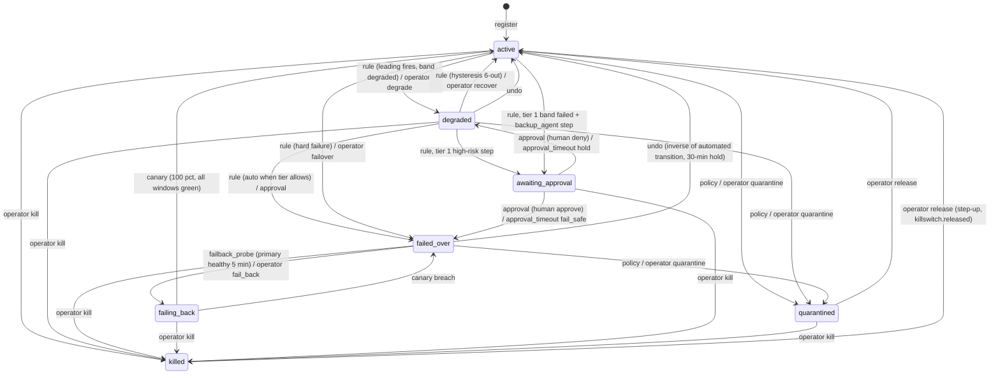
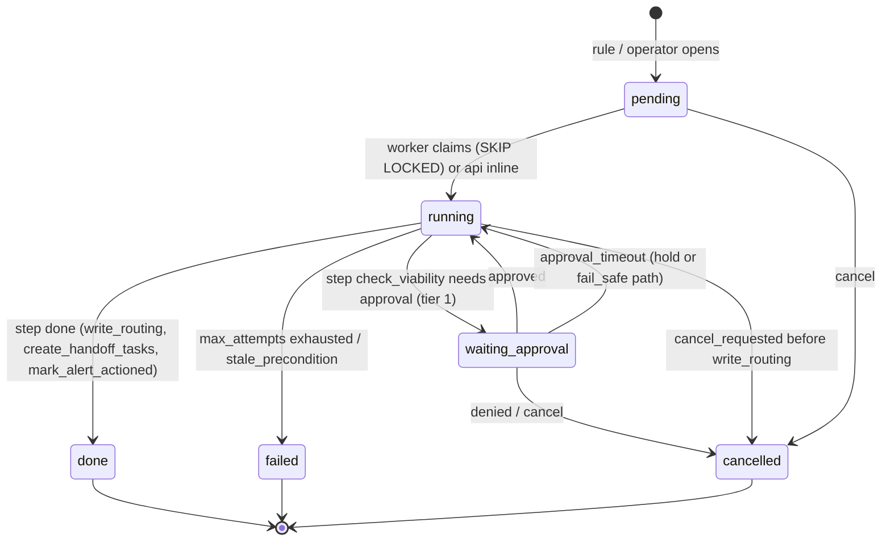

# Sibyl — Step 4: control-plane and gateway API design (backend-architect)

Member slice · 2026-10-10 · Inputs: `api/CHAIR-INITIAL.md` (followed), `DECISIONS.md` D1–D29, `architect/ARCHITECTURE.md` (ADR-1..13, §4 hot path, §5 state machine), `datamodel/DATAMODEL.md` (62 tables, §4.0 frozen value sets, §5 `routing_apply()` / `audit_append()`), `datamodel/backend-architect.md` §3–§5, `datamodel/security-auditor.md` §3 (audit taxonomy), §6 (RBAC matrix, API-key scopes).

Scope: the **control plane** (`/api/v1/...`, REST + SSE) and the **gateway data plane** (`/v1/chat/completions`, `/v1/embeddings`, `/v1/models`). Ingest (`/v1/otlp/*`, `/v1/events`) and the SDK are ai-engineer's slice; this document only names the seams. Phase 1 only: no `/v1/messages`, no notification routes, no ML routes beyond `GET .../health` and `GET .../risk`.

Every `vigil*` identifier is renamed here per D19: `sibyl-event/1`, `sibyl.policy_snapshot/1`, `sibyl-health/1`, `sibyl.*` OTel attributes, header prefix `X-Sibyl-`, key prefix `sbl_`, problem-type namespace `https://sibyl.dev/problems/`.

---

## 0. Decisions this slice makes (summary)

| # | Decision | Why |
|---|---|---|
| B1 | **An `incident` is the API name for a `failover` saga row** plus its joined `routing_transition`, `approval`, triggering `alert`, `health_snapshot` evidence and `handoff_task`s. There is no new table. `POST /incidents` opens an operator-initiated saga on an agent; `POST /incidents/{id}/actions` transitions an existing one. | DATAMODEL §6.3 already makes api insert a `failover(kind=kill|quarantine|release|undo, priority='immediate')` row for every operator action, so the saga row is the natural incident record and the audit/undo trail hangs off it. |
| B2 | **Approvals are decided only through `POST /incidents/{id}/actions {action: approve\|deny}`**; `/approvals` is read-only. | One transition path, one 409 vocabulary, one audit row (`approval.granted/denied`). |
| B3 | **Human actions never wait for the automation approval table**, with one exception: a human-initiated `backup_agent` failover on a tier-1 agent requires a second human with `approval.decide` (four-eyes, mirrors `fallback_chain` four-eyes). | D13 clarification: backup-agent failover on tier 1 has a different blast radius. Everything else a human does with `routing.override` is direct and audited as `override.by_human`. |
| B4 | **Queue, alert, erasure and handoff transitions use the same `/{id}/actions` pattern** with a per-resource enum and `state_edge`-derived 409s. | Chair position §5 generalised; the DB trigger `trg_state_edge` is the single source of legality. |
| B5 | **Gateway control routes live under `/api/v1/policy/*` and `/api/v1/kill-switches/{id}/acks`**, authenticated by API key scope, not session. ARCHITECTURE §4's `/v1/policy/snapshot` is renamed to keep `/v1/*` purely OpenAI-shaped. | D16: `/v1` is the OpenAI-compatible surface only. |
| B6 | **Human sessions and API keys are distinct principals** on the control plane: sessions (cookie, OIDC) carry roles; API keys (`Authorization: Bearer sbl_…`) carry scopes and may only hit routes whose scope column lists a key scope. | security-auditor §6: agent principals are authorised by scopes, not roles. |

---

## 1. Control-plane REST surface

### 1.0 Reading the tables

- **Auth** column: `S:<permission>` = human session needs that RBAC permission (G = within the membership's agent_group; A = allowed and self-audited; ↑ = step-up within 5 min, `session.step_up_at`). `K:<scope>` = an API key with that scope may call it. A route with only `S:` entries is session-only.
- **Idem.** column: `req` = `Idempotency-Key` header required (428 if absent); `etag` = `If-Match` required (428 if absent, 412 on mismatch); `—` = safe/idempotent by method.
- **Page** column: `cursor` = cursor pagination (§5.2); `—` = single resource.
- Shapes reference DATAMODEL entities ("`Agent`" = the schema projecting the `agent` row, §6); writable fields are listed explicitly. Every list accepts `?limit=` (default 50, max 200), `?cursor=` and the filters shown; every state-changing response carries `X-Sibyl-Audit-Receipt: <tenant>:<seq>:<hash>` (DATAMODEL §6.4).
- Status codes not repeated per row: `401` (no/invalid principal), `403` (`access.denied` audited), `404` (unknown id **within the tenant**, never 403 for cross-tenant ids), `422` (schema/semantic validation), `429` (§5.6). Problem codes are `type` suffixes (§5.1).

### 1.1 Auth, session, tenant

| Method | Path | Auth | Request → Response | Codes | Idem. | Page |
|---|---|---|---|---|---|---|
| GET | `/api/v1/auth/login?tenant={slug}&return_to=` | public | → 302 to the tenant's `oidc_issuer` (PKCE, `state`, nonce) | 302, 404 `tenant_unknown` | — | — |
| GET | `/api/v1/auth/callback` | public | OIDC code → sets `sibyl_session` cookie (`session` row), audits `access.login` | 302, 401 `oidc_failed` (audits `access.login_failed`) | — | — |
| POST | `/api/v1/auth/step-up` | S:any | `{return_to}` → 302 to issuer with `max_age=0`, `acr_values`; callback stamps `session.step_up_at`, audits `access.step_up`. `POST /api/v1/auth/logout` → 204, `session.revoked_at`, audits `access.logout` | 302 / 204 | — | — |
| GET | `/api/v1/auth/me` | S:any | → `Principal {user, tenant, memberships[], permissions[], step_up_valid_until}` | 200 | — | — |
| GET | `/api/v1/tenant` | S:tenant.settings.read | → `Tenant` (slug, name, status, region_declared, unknown_agent_fail_mode, hold_on_incident, raw_retention_days, audit_retention_days, backup_retention_days, routing_version, graph_version, limits) | 200 | — | — |
| PATCH | `/api/v1/tenant` | S:tenant.settings.write↑ | writable: name, region_declared, unknown_agent_fail_mode, hold_on_incident, raw_retention_days (1..30), audit_retention_days (≥400), backup_retention_days → `Tenant`; audits `config.changed` per field | 200, 412, 422 | etag | — |

Tenant creation and suspension are not routes in Phase 1: `sibyl tenant create <slug>` (operator CLI as `sibyl_migrate`) performs the one-transaction bootstrap of DATAMODEL §4.1 (keys, system redaction profiles, rule seeds, genesis audit row). No platform tenant exists (R10); see Q1.

### 1.2 Users, memberships, OIDC issuers, agent groups

| Method | Path | Auth | Request → Response | Codes | Idem. | Page |
|---|---|---|---|---|---|---|
| GET | `/api/v1/users?status=&q=` · `/api/v1/users/{id}` | S:users.manage | → `[AppUser]` (id, email, display_name, status, issuer_id, last_login_at); single form adds `memberships[]` | 200 | — | cursor |
| POST | `/api/v1/users/invitations` | S:users.manage | `{email, oidc_issuer_id, role_name, scope_kind, scope_id?}` → `AppUser` (status `invited`) + `Membership`; audits `user.provisioned`, `membership.granted` | 201, 409 `user_exists`, 422 `role_requires_tenant_scope` (R16) | req | — |
| PATCH | `/api/v1/users/{id}` | S:users.manage | writable: status (`active→disabled`, `disabled→active`, `→deprovisioned`), display_name → `AppUser`; `deprovisioned` hashes email (DATAMODEL §4.1); audits `user.disabled/deprovisioned`; revokes sessions | 200, 409 `last_owner` | etag | — |
| POST | `/api/v1/memberships` | S:membership.manage | `{user_id, role_name, scope_kind, scope_id?, expires_at?, reason}` → `Membership`; audits `membership.granted` | 201, 409 `membership_exists`, 422 `role_requires_tenant_scope` | req | — |
| DELETE | `/api/v1/memberships/{id}` | S:membership.manage | `?reason=` → 204; sets `revoked_at`; audits `membership.revoked` | 204, 409 `last_owner` | — | — |
| GET | `/api/v1/oidc-issuers` | S:tenant.settings.read | → `[OidcIssuer]` (never `client_secret_ct`) | 200 | — | cursor |
| POST | `/api/v1/oidc-issuers` | S:oidc_issuer.manage↑ | `{issuer_url, client_id, client_secret, allowed_email_domains[], role_claim?, role_claim_map?, jit_default_role?}` → `OidcIssuer`; secret envelope-encrypted under `tenant_key(purpose=config)`; audits `oidc_issuer.configured` | 201, 409 `issuer_exists`, 422 `jit_role_forbidden` | req | — |
| PATCH | `/api/v1/oidc-issuers/{id}` | S:oidc_issuer.manage↑ | writable: client_secret, allowed_email_domains, role_claim, role_claim_map, jit_default_role, status → `OidcIssuer`; audits `oidc_issuer.changed/disabled` | 200, 409 `last_active_issuer` | etag | — |
| GET/POST/PATCH | `/api/v1/agent-groups`, `/api/v1/agent-groups/{id}` | S:agent.read / S:membership.manage | `AgentGroup {slug, name, description?, parent_group_id?, owner_user_id?}` | 200/201, 409 `slug_exists`, 409 `group_cycle` | req/etag | cursor |

### 1.3 API keys

| Method | Path | Auth | Request → Response | Codes | Idem. | Page |
|---|---|---|---|---|---|---|
| GET | `/api/v1/api-keys?agent_id=&status=&env=` · `/api/v1/api-keys/{id}` | S:api_key.manage (G: only keys bound to agents in the group) | → `[ApiKey]` (id, name, env, prefix, scopes, agent_id, status, expires_at, last_used_at, rotation_grace_until; never the secret) | 200 | — | cursor |
| POST | `/api/v1/api-keys` | S:api_key.manage (G: `agent_id` required and in group) | `{name, env, scopes[], agent_id?, expires_at?}` → `ApiKeyCreated` = `ApiKey` + `secret` (`sbl_<env>_<prefix12>_<secret>`, shown once); audits `api_key.created`. `killswitch:pull` keys must be tenant-level (`agent_id` null) and carry **only** that scope (D20) | 201, 422 `scope_invalid`, 422 `break_glass_scope_exclusive`, 403 (engineer requesting tenant-level) | req | — |
| POST | `/api/v1/api-keys/{id}/rotate` | S:api_key.manage | `{grace_s?=3600}` → `ApiKeyCreated` (new row, `rotated_from_id`; old row `status=rotating`, `rotation_grace_until`); snapshot bumped in-transaction; audits `api_key.rotated` | 201, 409 `key_not_active` | req | — |
| POST | `/api/v1/api-keys/{id}/revoke` | S:api_key.manage | `{reason}` → `ApiKey` (`status=revoked`); outbox `policy_changed` same transaction; audits `api_key.revoked` | 200, 409 `already_revoked` | req | — |

### 1.4 Agents registry, identity, versions, graph

| Method | Path | Auth | Request → Response | Codes | Idem. | Page |
|---|---|---|---|---|---|---|
| GET | `/api/v1/agents?lifecycle=&tier=&risk_class=&group_id=&routing_state=&band=&q=` | S:agent.read · K:registry:read (bound agent only) | → `[AgentSummary]` (agent + `routing.state` + latest `health.band/score` + `continuity.rto_s`) | 200 | — | cursor |
| POST | `/api/v1/agents` | S:agent.register · K:registry:write (tenant-level key; agent-bound key → 403) | `{slug, name, kind, framework?, tier, risk_class?, fail_mode, agent_group_id?, owner_user_id?, business_process_id?, tags[]?, version?: {primary_model_id, config?, prompt_sha256?, declared_tool_ids[], declared_data_source_ids[]}}` → `Agent`. One transaction: `agent`, `agent_version` v1, `agent_identity`, `routing_apply(trigger='register')`, `lifecycle_transition(''→proposed)`, audits `asset.created` | 201, 409 `slug_exists`, 422 `fail_mode_required`, 422 `max_agents_reached` | req | — |
| GET | `/api/v1/agents/{id}` | S:agent.read · K:registry:read | → `Agent` (full row + current_version + identity + continuity_plan ref + routing + latest health) | 200 | — | — |
| PATCH | `/api/v1/agents/{id}` | S:agent.edit · K:registry:write (bound) | writable: name, description, kind, framework, tier, risk_class, fail_mode, agent_group_id, owner_user_id, business_process_id, cost_center, tags → `Agent`; audits `asset.updated` with `fields_changed[]`. Tier/fail_mode changes bump the snapshot | 200, 412 | etag | — |
| POST | `/api/v1/agents/{id}/claim` | S:agent.edit | `{slug, name, tier, fail_mode, ...}` → `Agent`: converts an auto-registered `is_provisional` agent (`unclaimed/<hash8>`) into a declared one; audits `asset.updated` | 200, 409 `not_provisional` | req | — |
| GET/POST | `/api/v1/agents/{id}/lifecycle` | S:agent.read / S:agent.approve_lifecycle (`→approved/deployed/retired`) · S:agent.edit (`→proposed/monitored`) | GET → `[LifecycleTransition]`. POST `{to_stage, reason}` → `Agent`; `lifecycle_transition` + `audit_append('asset.approved'/'asset.retired')` in one transaction; `retired` closes open dependency edges | 200, 409 `invalid_transition` (state_edge `lifecycle`) | req | — |
| GET | `/api/v1/agents/{id}/identity` | S:agent.read | → `AgentIdentity` (allowed_tools, allowed_models, allowed_providers, enforcement, identity_version, tools_hash) | 200 | — | — |
| PUT | `/api/v1/agents/{id}/identity` | S:agent_identity.edit (G: narrowing only; widening → 403 `widening_requires_admin`) | full `AgentIdentity` writable fields → `AgentIdentity` (`identity_version+1`); audits `agent_identity.changed` with `widened` | 200, 412 | etag (`identity_version`) | — |
| GET | `/api/v1/agents/{id}/versions` | S:agent.read | → `[AgentVersion]` | 200 | — | cursor |
| POST | `/api/v1/agents/{id}/versions` | S:agent.edit · K:registry:write (bound) | `{primary_model_id, config?, prompt?: string (stored to payload_refs kind=prompt), declared_tool_ids[], declared_data_source_ids[], source='api'}` → `AgentVersion`; sets `agent.current_version_id`; opens/closes `uses_model` edges | 201 | req | — |
| GET | `/api/v1/agents/{id}/versions/{version_no}/bom` | S:agent.read | → latest `AiBom` (`format`, `content`, `content_sha256`) ; `Accept: application/vnd.cyclonedx+json` returns the raw document | 200, 404 `bom_not_generated` | — | — |
| POST | `/api/v1/agents/{id}/versions/{version_no}/bom` | S:agent.edit | → 202 `{job_id}`: worker generates CycloneDX 1.6 from registry + observed edges | 202 | req | — |
| GET | `/api/v1/agents/{id}/dependencies?direction=out\|in&as_of=` | S:agent.read | → `[DependencyEdge]` (temporal, open edges by default) | 200 | — | cursor |
| POST | `/api/v1/dependency-edges` | S:agent.edit | `{src_kind, src_id, dst_kind, dst_id, edge_type, origin='declared', attrs?}` → `DependencyEdge` | 201, 409 `edge_exists`, 422 `node_unknown` | req | — |
| DELETE | `/api/v1/dependency-edges/{id}` | S:agent.edit | `?reason=` → `DependencyEdge` with `valid_to` set (edges close, never delete) | 200 | — | — |
| GET | `/api/v1/agents/{id}/blast-radius` · `/api/v1/blast-radius/{node_kind}/{node_id}` | S:agent.read | → `BlastRadius` (`graph_version`, affected_agent_ids, affected_process_ids, by_depth); computed on miss; second form for provider/model/tool/data_source nodes | 200 | — | — |
| GET/POST/PATCH | `/api/v1/tools`, `/api/v1/tools/{id}` | S:agent.read / S:agent.edit | `Tool` (slug, name, kind, parent_tool_id, endpoint, permissions, is_approved); `is_approved` needs `agent.approve_lifecycle` | 200/201, 409 `slug_exists` | req/etag | cursor |
| GET/POST/PATCH | `/api/v1/data-sources`, `/api/v1/data-sources/{id}` | S:agent.read / S:agent.edit | `DataSource` (slug, name, kind, classification, residency_region, attrs) | 200/201 | req/etag | cursor |
| GET/POST/PATCH | `/api/v1/business-processes`, `/api/v1/business-processes/{id}` | S:agent.read / S:agent.edit | `BusinessProcess` (slug, name, owner_user_id, criticality) | 200/201 | req/etag | cursor |

### 1.5 Providers, models, catalog, provider credentials

| Method | Path | Auth | Request → Response | Codes | Idem. | Page |
|---|---|---|---|---|---|---|
| GET | `/api/v1/providers` · `/api/v1/providers/{id}/status?from=&to=` | S:agent.read | → `[Provider]` + latest `provider_status`; status route → `[ProviderStatus]` history | 200 | — | cursor |
| POST | `/api/v1/providers` | S:agent.edit | `{slug, name, provider_kind, dialect, base_url, status_feed_url?}` → `Provider`; `base_url` passes `is_allowlisted_base_url()` | 201, 422 `base_url_not_allowlisted` | req | — |
| PATCH | `/api/v1/providers/{id}` | S:agent.edit | writable: name, base_url, status_feed_url, is_enabled → `Provider`; snapshot bump | 200, 409 `provider_in_use` (disable with open edges) | etag | — |
| GET | `/api/v1/models?provider_id=&is_allowed=&is_discovered=` · `/api/v1/model-catalog?provider_kind=&q=` | S:agent.read | → `[Model]` (catalog defaults merged); catalog form → `[ModelCatalogEntry]` from the vendored price JSON | 200 | — | cursor |
| POST | `/api/v1/models` | S:agent.edit | `{provider_id, model_name, catalog_id?, input_usd_per_1m?, output_usd_per_1m?}` → `Model`; writes the `served_by` edge | 201, 409 `model_exists` | req | — |
| PATCH | `/api/v1/models/{id}` | S:agent.edit | writable: is_allowed, input_usd_per_1m, output_usd_per_1m, deprecated_on, retires_on | 200 | etag | — |
| GET | `/api/v1/provider-credentials?provider_id=&status=` | S:credential.read_metadata | → `[ProviderCredentialMeta]` (id, name, provider_id, purpose, base_url, allowlist_basis, auth_scheme, secret_hint, status, key_version, expires_at, last_used_at, last_verified_at; never ciphertext) | 200 | — | cursor |
| POST | `/api/v1/provider-credentials` | S:credential.manage↑ | `{provider_id, name, purpose='fallback', base_url, auth_scheme, secret}` → `ProviderCredentialMeta`; envelope-encrypted under `tenant_key(purpose=credential)`; refused when `SIBYL_DEMO=1`; audits `credential.created` | 201, 422 `base_url_not_allowlisted`, 409 `demo_mode` | req | — |
| POST | `/api/v1/provider-credentials/{id}/rotate` | S:credential.manage↑ | `{secret, grace_s?=900}` → new `ProviderCredentialMeta` (`rotated_from_id`); audits `credential.rotated` | 201, 409 `not_active` | req | — |
| POST | `/api/v1/provider-credentials/{id}/revoke` | S:credential.manage↑ | `{reason}` → `ProviderCredentialMeta` (`status=revoked`, ciphertext nulled); fallback steps referencing it become non-viable (snapshot marks `step.viable=false`); audits `credential.revoked` | 200, 409 `already_revoked` | req | — |
| POST | `/api/v1/provider-credentials/{id}/verify` | S:credential.manage | → 202 `{job_id}`; worker probes `GET {base_url}/models`; sets `last_verified_at` or audits `credential.probe_failed` | 202 | req | — |

### 1.6 Policies: capture, redaction, continuity plans, fallback chains, alert rules

| Method | Path | Auth | Request → Response | Codes | Idem. | Page |
|---|---|---|---|---|---|---|
| GET | `/api/v1/capture-policies?scope_kind=&agent_id=&include_superseded=` | S:tenant.settings.read | → `[CapturePolicy]` (current rows by default) | 200 | — | cursor |
| GET | `/api/v1/capture-policies/effective?agent_id=` | S:agent.read | → `CapturePolicy` resolved (agent row if present else tenant row) + `redaction_profile` | 200, 404 `capture_policy_missing` | — | — |
| POST | `/api/v1/capture-policies` | S:capture_policy.set | `{scope_kind, agent_id?, capture_mode, redaction_profile_id, payload_retention_days (1..365, D28), max_payload_bytes?, header_allowlist[]?, consequences_version, acknowledged: true}` → `CapturePolicy` (new `version_no`; previous row gets `superseded_by`). **`If-Match` carries the ETag of the row being superseded**, or `*` when creating the first row for the scope. Audits `capture.policy_set` | 201, 412, 422 `capture_mode_required`, 422 `agent_policy_looser_than_tenant`, 422 `header_forbidden`, 428 | req + etag | — |
| GET/POST | `/api/v1/redaction-profiles` | S:tenant.settings.read / S:redaction.manage | → `[RedactionProfile]`; POST `{name, detectors, replacement_format?}` → `RedactionProfile` (`content_hash` computed by `sibyl-schemas`); audits `redaction.profile_created` | 200/201, 422 `below_secrets_baseline` | req | cursor |
| GET | `/api/v1/agents/{id}/continuity-plan` | S:agent.read | → `ContinuityPlan` (ETag = `row_version`) | 200, 404 `plan_missing` (agent is provisional / tenant defaults) | — | — |
| PUT | `/api/v1/agents/{id}/continuity-plan` | S:agent.edit (G) | `{rto_s, rpo_s, credential_mode, degraded_mode, inline_fallback, preemptive_mode, approval_timeout_s, approval_timeout_policy, fallback_chain_id?, on_call_user_id?, on_call_ref?, budget_usd_month?, max_inflight?, rps_limit?, drill_schedule?}` → `ContinuityPlan`. Creates on first PUT with `If-Match: *`. Tier-1 `inline_fallback=true` requires `approved_by_user_id` (caller must hold `approval.decide`); `approval_timeout_policy=fail_safe` is refused on tier-1 agents with PII/residency exposure (D22, §2.4) | 200/201, 412, 422 `chain_not_approved`, 422 `chain_agent_mismatch`, 422 `fail_safe_forbidden`, 403 `tier1_inline_fallback_needs_approver` | etag | — |
| GET | `/api/v1/agents/{id}/fallback-chains?status=` | S:agent.read | → `[FallbackChain]` with `steps[]` | 200 | — | cursor |
| POST | `/api/v1/agents/{id}/fallback-chains` | S:agent.edit (G) | `{steps: [{kind, provider_id?, model_id?, backup_agent_id?, credential_id?, risk, max_attempts?, params?}], note?, clone_from_chain_id?}` → `FallbackChain` (`status=draft`, next `version_no`) | 201, 422 `step_rank_order`, 422 `alt_provider_requires_credential`, 422 `backup_is_self`, 422 `step_after_human_queue` | req | — |
| PUT | `/api/v1/fallback-chains/{id}` | S:agent.edit (G) | replace `steps[]` + `note` → `FallbackChain` | 200, 409 `chain_immutable` (approved/retired), 412 | etag | — |
| POST | `/api/v1/fallback-chains/{id}/actions` | see enum | `{action: approve\|retire, reason}`. `approve`: S:agent.approve_lifecycle; tier 1 four-eyes (`approved_by ≠ requested_by` → 409 `self_approval`); retires the previously approved chain and points the plan at this one in the same transaction; snapshot bump. `retire`: S:agent.edit | 200, 409 `invalid_transition`, 409 `self_approval` | req | — |
| GET/POST | `/api/v1/alert-rules?kind=&scope=&enabled=` | S:agent.read / S:tenant.settings.write | → `[AlertRule]`; POST custom rule (`origin=custom`) → `AlertRule` | 200/201, 409 `code_exists`, 422 `code_pattern` | req | cursor |
| PATCH | `/api/v1/alert-rules/{id}` | S:tenant.settings.write | writable: thresholds, window_s, min_samples, hysteresis_in/out, cooldown_s, severity, penalty, horizon_s, tier_applicability, what_to_do_template, enabled → `AlertRule` (`overridden=true`); audits `config.changed` | 200, 412 | etag | — |
| POST | `/api/v1/alert-rules/{id}/reset` | S:tenant.settings.write | → `AlertRule` restored from `rules/v1/defaults.yaml` (`overridden=false`) | 200, 409 `custom_rule` | req | — |

### 1.7 Routing, incidents, approvals, kill switches (state machine; contract in §2)

| Method | Path | Auth | Request → Response | Codes | Idem. | Page |
|---|---|---|---|---|---|---|
| GET | `/api/v1/agents/{id}/routing` | S:agent.read · K:route:read (bound) | → `RoutingState` (state, target, current_step, canary_pct, routing_version, operator_hold_until, state_since, last_transition, pending_approval?) | 200 | — | — |
| GET | `/api/v1/agents/{id}/routing/transitions` | S:agent.read | → `[RoutingTransition]` newest first, each expanded with alerts, health_snapshot, approval, inverse_of ("why am I failed over") | 200 | — | cursor |
| GET | `/api/v1/incidents?agent_id=&state=&kind=&since=&open=true` | S:agent.read | → `[Incident]` | 200 | — | cursor |
| GET | `/api/v1/incidents/{id}` | S:agent.read | → `Incident` (failover + transition + approval + alert + health evidence + handoff_tasks[] + undo_plan + step_results) | 200 | — | — |
| POST | `/api/v1/incidents` | per action, §2.3 | `IncidentCreate {agent_id, action, target?, reason, evidence_refs?}` → `Incident` (201 when `done`, 202 when `pending/waiting_approval`) | 201, 202, 409 (§2.5), 403 | req | — |
| POST | `/api/v1/incidents/{id}/actions` | per action, §2.3 | `IncidentAction {action, reason, ...}` → `Incident` | 200, 202, 409 (§2.5), 403 | req | — |
| GET | `/api/v1/approvals?state=pending&agent_id=&tier=` · `/api/v1/approvals/{id}` | S:agent.read | → `[Approval]` with `incident_id` (read-only; decide via incident actions, B2) | 200 | — | cursor |
| GET | `/api/v1/kill-switches?state=` | S:agent.read | → `[KillSwitch]` with `acks[]` | 200 | — | cursor |
| POST | `/api/v1/kill-switches` | S:killswitch.pull↑ · **K:killswitch:pull (the single break-glass route, D20)** | `{scope_kind: tenant\|agent\|provider, scope_id?, reason}` → `KillSwitch` (201). One transaction: `kill_switch` row, one `routing_apply(to='killed', trigger='operator')` per affected agent, `failover(kind=kill, priority=immediate)` per agent, audit `killswitch.pulled` (critical); break-glass additionally audits `access.break_glass`. Snapshot pushed within the same NOTIFY cycle | 201, 409 `already_pulled` | req | — |
| POST | `/api/v1/kill-switches/{id}/release` | S:killswitch.release↑ (session only; **a key can never release**) | `{reason}` → `KillSwitch` (`released`); `routing_apply(to='active', trigger='operator')` per agent; audits `killswitch.released` | 200, 409 `not_pulled` | req | — |
| POST | `/api/v1/kill-switches/{id}/acks` | K:gateway:proxy | `{gateway_id, snapshot_version}` → 201 `KillSwitchAck`; audits `killswitch.applied` | 201, 409 `duplicate_ack` (idempotent 200 instead) | req | — |

### 1.8 Operator queue and handoff packets

| Method | Path | Auth | Request → Response | Codes | Idem. | Page |
|---|---|---|---|---|---|---|
| GET | `/api/v1/queue?state=queued,claimed&priority=&agent_id=&mine=true` | S:queue.claim · S:agent.read (summary only) | → `[HandoffTaskSummary]` ordered `(priority, deadline_at)`; `summary`, `failure_mode`, `fidelity`, `deadline_at`, `claimed_by`, never the packet | 200 | — | cursor |
| GET | `/api/v1/handoff-tasks/{id}` | S:agent.read | → `HandoffTask` (metadata, outcome, timings; no packet) | 200 | — | — |
| GET | `/api/v1/handoff-tasks/{id}/packet` | S:packet.read (A for auditor → audits `data.revealed`; G for engineer) | → `HandoffPacket` (`sibyl-handoff/1`: fidelity, goal, completed_steps, pending_steps (empty for `request_only`), side_effects, trace_tail refs, triggering rule/alert, redaction); inline or fetched from BlobStore by `packet_ref_id`; `ETag` = `packet_sha256` | 200, 404 `packet_shredded` | — | — |
| POST | `/api/v1/handoff-tasks/{id}/actions` | see enum | `{action, reason?, ...}`: `claim` (S:queue.claim; `queued/expired → claimed`, lock 30 min; 409 `claimed_by_other`), `extend_lock` (claimant), `release_claim` (claimant or owner → `queued`, `reclaim_count+1`), `complete` (claimant; `{outcome: resolved\|escalated\|abandoned, outcome_note, next_action}` → `completed`), `return` (S:queue.return; only from `queued` → `returned`, `outcome=returned_to_agent`), `reassign` (S:users.manage; `{accountable_user_id}`); each audits `handoff.*` | 200, 409 `invalid_transition`, 409 `claimed_by_other`, 409 `lock_lapsed` | req | — |
| GET | `/api/v1/agents/{id}/checkpoints?task_id=&limit=` | S:payload.read (G) | → `[Checkpoint]` (metadata + `state` inline ≤64 KB or `state_ref_id`) | 200 | — | cursor |

Handoff tasks are **created** by the worker (`failover.step = create_handoff_tasks`) or by ingest from an SDK `handoff.requested` event (`K:handoff:write`, ai-engineer's `/v1/events`). The control plane never accepts a packet body over REST in Phase 1.

### 1.9 Alerts, verdicts, provider incidents

| Method | Path | Auth | Request → Response | Codes | Idem. | Page |
|---|---|---|---|---|---|---|
| GET | `/api/v1/alerts?state=&severity=&agent_id=&provider_id=&rule_code=&include_suppressed=false&since=` | S:agent.read | → `[Alert]` (suppressed-by-incident rows hidden unless asked) | 200 | — | cursor |
| GET | `/api/v1/alerts/{id}` | S:agent.read | → `Alert` + `health_snapshot` + `provider_incident?` + `incident_id?` + `verdict` | 200 | — | — |
| POST | `/api/v1/alerts/{id}/actions` | S:alert.ack (G) | `{action: ack \| silence \| close, reason?, until? (silence), verdict? (close: tp\|fp\|unsure, **required**, D24), verdict_note?}`. `close` on an `open/acked` alert: writes `label(kind=alert_verdict)` + projects `alert.verdict` in one transaction; `resolved_at` set; audits `alert.labelled`. `silence`: `cooldown_until = until` | 200, 409 `invalid_transition`, 422 `verdict_required`, 409 `already_resolved` | req | — |
| GET | `/api/v1/provider-incidents?state=&provider_id=` · `/api/v1/provider-incidents/{id}` | S:agent.read | → `[ProviderIncident]` with `affected_agent_ids`, member alert count, `legal_hold_id?`; single form adds member `alerts[]` | 200 | — | cursor |

A worker-resolved alert (`state=resolved` by hysteresis) still carries `verdict=null`; the console surfaces "unverdicted resolved alerts" and `POST .../actions {action: close, verdict}` is allowed on a resolved alert exactly once to attach the verdict (idempotent on verdict).

### 1.10 Health, risk, metrics, events, payloads

| Method | Path | Auth | Request → Response | Codes | Idem. | Page |
|---|---|---|---|---|---|---|
| GET | `/api/v1/fleet/health?group_id=&tier=&band=` | S:agent.read | → `FleetHealth {counts_by_band, counts_by_routing_state, open_alerts, open_incidents, pending_approvals, queue_depth, provider_incidents[]}` | 200 | — | — |
| GET | `/api/v1/agents/{id}/health` | S:agent.read · K:route:read (bound) | → `HealthDocument` (`sibyl-health/1`, assembled from the latest `health_snapshot`: score, band, provisional, factors[], window, routing_state_at, policy_version, observation_coverage) | 200, 404 `no_snapshot_yet` | — | — |
| GET | `/api/v1/agents/{id}/health/history?from=&to=&step=10s\|1m` | S:agent.read | → `[HealthPoint]` (3-day window, R17) | 200, 422 `range_too_wide` | — | cursor |
| GET | `/api/v1/agents/{id}/risk` | S:agent.read | → `RiskDocument {horizons: {15m,1h,24h}, predicted_failure_mode, recommended_action, leading_rules_firing[], rules_source}` from the latest `health_snapshot.horizons` | 200, 404 | — | — |
| GET | `/api/v1/agents/{id}/metrics?grain=1m\|5m\|15m\|1h&from=&to=&provider=&model=` | S:agent.read | → `[MetricBucket]` (counters, tokens, cost, p50/p95/p99 via `hist_quantile`) from `agent_metrics_1m/1h` | 200, 422 `grain_range` | — | cursor |
| GET | `/api/v1/events?agent_id=&event_type=&status=&trace_id=&task_id=&call_id=&from=&to=` | S:payload.read (G) | → `[Event]` (metadata columns of `events`; never payload bodies) | 200 | — | cursor (keyset on `(ts, event_id)`) |
| GET | `/api/v1/events/{event_id}` · `/api/v1/traces/{trace_id}` | S:payload.read (G) | → `Event` + `payload_ref` metadata; trace form → `Trace {spans[] ordered by parent_span_id}` | 200 | — | — |
| GET | `/api/v1/payloads/{ref_id}` | S:payload.read (G, own agents) · S:payload.reveal (A; `X-Sibyl-Reveal-Reason` header required → audits `data.revealed`) | → decrypted payload body (`Content-Type` from `payload_refs.content_type`); `ETag` = `sha256`; `X-Sibyl-Capture-Mode`, `X-Sibyl-Redaction-Profile` headers | 200, 404 `payload_swept`, 410 `payload_shredded`, 428 `reveal_reason_required` | — | — |

### 1.11 Audit log, anchors, verification, export

| Method | Path | Auth | Request → Response | Codes | Idem. | Page |
|---|---|---|---|---|---|---|
| GET | `/api/v1/audit/events?from_seq=&to_seq=&action=&actor_type=&actor_id=&resource_type=&resource_id=&is_evidence=&from=&to=` | S:audit.read (G: rows whose `resource_id` is an agent in the group, or whose detail names one) | → `[AuditEvent]` ordered by `seq` | 200 | — | cursor (keyset on `seq`) |
| GET | `/api/v1/audit/events/{seq}` | S:audit.read | → `AuditEvent` (envelope + detail + hashes) | 200 | — | — |
| GET | `/api/v1/audit/anchors?kind=&from=&to=` · `/api/v1/audit/signing-keys` | S:audit.read | → `[AuditAnchor]` (seq_from, seq_to, head_hash, signing_kid, signature, anchored_at, prev_anchor_id); signing-keys → `[SigningKeyPublic]` (kid, purpose, algorithm, public_key, state), what an offline verifier needs | 200 | — | cursor |
| POST | `/api/v1/audit/verifications` | S:audit.verify | `{from_seq?, to_seq?}` → sync `VerificationResult {ok, rows, anchors_checked, first_break_seq?, kind?}` when ≤ 100k rows, else 202 `{job_id}`; audits `audit.verified` / `audit.verify_failed` | 200, 202 | req | — |
| POST | `/api/v1/audit/exports` | S:audit.export (A) | `{from_seq, to_seq, format: jsonl\|csv, include_anchors: true}` → 202 `AuditExport {id, state}`; worker writes to BlobStore (`payload_refs kind=anchor_export`), writes an `audit_anchors(kind=export)` row first, audits `audit.exported`. `GET /api/v1/audit/exports/{id}` → `AuditExport` (`state`, `export_sha256`, signed `download_url`, 15 min) | 202 / 200 | req | — |
| GET | `/api/v1/jobs/{id}` | S:any (owner of the job) | → `Job {id, kind, state: queued\|running\|done\|failed, result?, error?}` for every 202 above | 200 | — | — |

### 1.12 Erasure and legal hold (D17, D26)

| Method | Path | Auth | Request → Response | Codes | Idem. | Page |
|---|---|---|---|---|---|---|
| GET | `/api/v1/erasure-requests?state=` · `/api/v1/erasure-requests/{id}` | S:erasure.request · S:audit.read | → `[ErasureRequest]`; single form adds `execution_log`, `affected_objects` | 200 | — | cursor |
| POST | `/api/v1/erasure-requests` | S:erasure.request | `{scope_kind: tenant\|agent\|subject, scope_ref?, legal_basis, reason}` → `ErasureRequest` (`requested` or `hold_blocked` with `blocking_hold_ids`); audits `erasure.requested` / `erasure.blocked_by_hold` | 201, 422 `scope_ref_required`, 409 `erasure_in_progress` | req | — |
| POST | `/api/v1/erasure-requests/{id}/actions` | see enum | `{action: approve \| reject \| cancel, reason}`. `approve`: S:erasure.approve↑, approver ≠ requester, `owner` for tenant scope; moves to `approved` and enqueues the worker. `reject`: S:erasure.approve↑. `cancel`: requester or owner, only before `executing` | 200, 409 `invalid_transition`, 409 `self_approval`, 409 `hold_blocked` | req | — |
| GET | `/api/v1/erasure-requests/{id}/certificate` | S:audit.read | → `ErasureCertificate` (JSON; `Accept: application/pdf` renders): counts, hashes, `completion_anchor_id`, `backups_expire_at`, statement on inline rows (U3) | 200, 409 `not_completed` | — | — |
| GET | `/api/v1/legal-holds?state=active` | S:audit.read | → `[LegalHold]` | 200 | — | cursor |
| POST | `/api/v1/legal-holds` | S:hold.place↑ | `{scope_kind: tenant\|agent\|incident\|subject, scope_ref?, provider_incident_id?, agent_ids[]?, window_from, window_to?, reason, expires_at?}` → `LegalHold` (`agent_ids` materialised); audits `hold.placed` | 201, 422 `scope_mismatch` | req | — |
| POST | `/api/v1/legal-holds/{id}/release` | S:hold.release↑ | `{reason}` → `LegalHold` (`released`); re-evaluates `hold_blocked` erasure requests; audits `hold.released` | 200, 409 `not_active` | req | — |

### 1.13 Gateway control routes (API-key principals only)

| Method | Path | Auth | Request → Response | Codes | Idem. | Page |
|---|---|---|---|---|---|---|
| GET | `/api/v1/policy/snapshot` | K:route:read (tenant-level or gateway key) · K:gateway:proxy | `If-None-Match: "<version>"` → `PolicySnapshot` (`sibyl.policy_snapshot/1`, Ed25519-signed, `ETag: "<version>"`, `Cache-Control: max-age=60`); the tenant block for the key's tenant only (a multi-tenant Sibyl-hosted gateway holds one key per tenant it serves, Q5) | 200, 304, 503 `snapshot_unavailable` (no active signing key) | — | — |
| GET | `/api/v1/policy/credentials?ids=a,b,c` | K:gateway:proxy | → `CredentialBundle {expires_in_s: 300, items: {id: {auth_scheme, secret, base_url, key_version}}}` for `fallback_step.credential_id`s present in the key's snapshot; decrypted in api, memory-only in gateway; never cached on disk; audits nothing per call (rate-limited; `credential.read_metadata` audit on unusual volume via `api_key.anomaly`) | 200, 403 `credential_not_in_snapshot`, 409 `demo_mode` | — | — |
| GET | `/api/v1/events/stream` | K:route:read · S:agent.read | SSE, §3 | 200 | — | — |

---

## 2. Incident and failover action state machine

### 2.1 Routing state machine (per agent; `routing_state.state`, edges = `state_edge(machine='routing')`)



Every edge label is a `routing_transition.trigger` value (`register, rule, approval, approval_timeout, operator, policy, failback_probe, canary, undo, system`). `killed` is terminal for every actor except a step-up human release. A 30-minute `operator_hold_until` after `undo` blocks every `rule` and `policy` actor on that agent (D21); `operator` and kill bypass it.

### 2.2 Failover saga (one `failover` row = one incident)



Steps are `validate → check_viability → write_routing → create_handoff_tasks → mark_alert_actioned → done`; each is idempotent and recorded in `step_results`. `write_routing` is the only step that calls `routing_apply()`.

### 2.3 Action contract

`POST /api/v1/incidents` opens a saga on an agent; `POST /api/v1/incidents/{id}/actions` transitions one. Both take `Idempotency-Key`, both return the `Incident` representation, both audit in the same transaction as the state change.

```json
// POST /api/v1/incidents
{ "agent_id": "0192f0a1-…", "action": "failover", "target": { "step_id": "0192f0b2-…" },
  "reason": "OpenAI status page shows major outage in eu-west; moving billing-agent to Anthropic ahead of the rule engine.",
  "evidence_refs": { "alert_ids": ["…"], "health_snapshot_id": "…" } }
// POST /api/v1/incidents/{id}/actions
{ "action": "approve", "reason": "Verified provider incident; approving alt-provider shift for tier-1 agent." }
```

| `action` | Where | Required auth | Pre-state (routing / saga) | Effect | Audit action |
|---|---|---|---|---|---|
| `failover` | create | S:routing.override (G) | routing ∈ {active, degraded}; no live saga for the agent | `target` = `{step_id}` from the approved chain, or `{kind: model\|agent, provider_id?, model_id?, agent_id?}` ad hoc (must satisfy `agent_identity.allowed_*`). Opens `failover(kind=failover, priority=immediate, actor_kind=human)`; api runs the saga inline through `routing_apply(to='failed_over')`. Tier-1 + `backup_agent` target → `waiting_approval` with an `approval(requested_by_kind=human)` and 202 (B3) | `override.by_human` (+ `approval.requested`) |
| `degrade` | create | S:routing.override (G) | active | `routing_apply(to='degraded')`; gateway applies `continuity_plan.degraded_mode` | `override.by_human` |
| `recover` | create | S:routing.override (G) | degraded | `routing_apply(to='active')` | `override.by_human` |
| `handoff` | create | S:routing.override (G) · S:queue.claim | any non-killed | Opens `failover(kind=failover)` whose chosen step is `human_queue`; worker assembles a `handoff_task` from the latest `checkpoint` (fidelity `checkpoint`) or the trace tail (`request_only`); routing moves to `failed_over` with `target_kind=human_queue` | `handoff.created` |
| `quarantine` | create | S:quarantine.apply | ∈ {active, degraded, failed_over} | `routing_apply(to='quarantined', trigger='operator')`; gateway returns 403 `sibyl_agent_quarantined` for the agent | `quarantine.applied` |
| `kill` | create | S:killswitch.pull↑ | any except killed | Sugar for `POST /kill-switches {scope_kind: agent}`; same transaction shape | `killswitch.pulled` |
| `approve` | transition | S:approval.decide; `decided_by ≠ requested_by_user_id` | saga `waiting_approval`, approval `pending`, `expires_at > now()` | `approval.state=approved`; worker (or api inline) continues at `write_routing`; routing `awaiting_approval → failed_over` | `approval.granted` |
| `deny` | transition | S:approval.decide | same | `approval.state=denied`; saga `cancelled`; routing `awaiting_approval → degraded` | `approval.denied` |
| `undo` | transition | S:failover.undo (G); `reason` mandatory | the incident's transition `T` is the newest non-undone **automated** transition for the agent (`actor_kind ∈ {rule, policy}`, no row with `inverse_of = T.id`) | Cancels any live saga (`cancel_requested`; waits ≤ 5 s if in `write_routing`); opens `failover(kind=undo, priority=immediate)`; `routing_apply(to=T.from_state, to_target=T.from_target, trigger='undo', inverse_of=T.id, operator_hold_until=now()+30 min)`; `handoff_task` rows of `T.failover_id` `queued → returned`; response includes `operator_hold_until` | `failover.undone` |
| `clear_hold` | transition | S:routing.override, role owner/security_admin | `routing_state.operator_hold_until > now()` | `routing_apply(same state, trigger='operator', operator_hold_until=NULL)` | `override.by_human` |
| `release` | transition | S:quarantine.release (quarantined) · S:killswitch.release↑ (killed) | ∈ {quarantined, killed} | `routing_apply(to='active', trigger='operator')`; for killed also `kill_switch.state=released` | `quarantine.released` / `killswitch.released` |
| `fail_back` | transition | S:routing.override (G) | failed_over, saga done | Opens `failover(kind=failback)`; `routing_apply(to='failing_back', canary_pct=10)`; worker ramps 10→100 on green windows, or reverts on breach | `failback.started` |
| `cancel` | transition | S:routing.override (G) or the requester | saga ∈ {pending, running before write_routing, waiting_approval} | `cancel_requested=true`; approval `cancelled` | `failover.rolled_back` (cause `operator_cancel`) |

Automation (`rule`, `policy`, `approval_timeout`, `failback_probe`, `canary`, `system`) never calls this API; the worker writes the same rows directly. The API and the worker share one legality source: `state_edge` plus `routing_apply()` preconditions.

### 2.4 Approval gating rules (D13, D21, D22)

- **Who needs an approval.** Only rule/policy actors create approvals: `alt_provider_failover` and `preemptive_failover` on tier 1 when the trigger is leading-only; `backup_agent_failover` on tier 1 always (even on detected failure, D13 clarification); `quarantine` on tiers 1–2 when policy-driven; `inline_fallback_enable` on tier 1. Alternate-model-same-provider failover and human handoff are automatic on every tier.
- **Timeout.** `approval.expires_at = requested_at + continuity_plan.approval_timeout_s` (default 600). `hold` → `awaiting_approval → degraded`, saga `cancelled`, audit `approval.expired`. `fail_safe` → `awaiting_approval → failed_over`, audit `approval.expired` + `failover.completed`.
- **D22 enforcement, two layers.** (a) `PUT /agents/{id}/continuity-plan` rejects `approval_timeout_policy=fail_safe` with 422 `fail_safe_forbidden` when the agent is tier 1 **and** has PII/residency exposure, defined as: any open `reads_data`/`writes_data` edge to a `data_source` with `classification ∈ {pii, restricted}` or a non-null `residency_region`, or `agent.tags` contains `pii`. (b) The worker re-evaluates the predicate at timeout and forces `hold` regardless of the stored value, auditing `approval.expired` with `timeout_policy_applied: hold_forced_d22`.
- **Operator hold (D21).** `routing_state.operator_hold_until` set by `undo`; `routing_apply()` raises `operator_hold` for `actor_kind ∈ {rule, policy}`; the evaluator still writes `health_snapshot` and `alert` rows and increments `alert.hold_suppressed_count`. The `Incident` and `RoutingState` representations expose `operator_hold_until` so the console can show "automation paused until …".
- **Kill beats everything.** `killed` is reachable from every state by `operator` only; while killed, no rule, approval, or failback fires; the gateway refuses the agent on any snapshot, fresh or stale.

### 2.5 409 vocabulary for `/incidents`

| Problem code | When |
|---|---|
| `invalid_transition` | `(from_state, to_state, trigger)` not in `state_edge`; `detail.from_state`, `detail.action` |
| `stale_precondition` | `routing_state.state` changed between read and apply (`routing_apply` raised); response carries the current `RoutingState` in `detail.current` |
| `saga_in_flight` | another `failover` is `pending/running/waiting_approval` for the agent (partial UK); `detail.incident_id` |
| `approval_not_pending` | approve/deny on an approval that is decided, expired or cancelled |
| `self_approval` | decider equals requester (trigger `trg_requester_not_approver`) |
| `nothing_to_undo` | no non-undone automated transition for the agent |
| `already_undone` | the targeted transition already has an `inverse_of` row |
| `target_not_viable` | fallback step's credential revoked, model `is_allowed=false`, provider disabled, or violates `agent_identity` |
| `already_pulled` / `not_pulled` / `demo_mode` | kill switch duplicates; `SIBYL_DEMO=1` and the action needs a vaulted credential |

---

## 3. SSE stream: `GET /api/v1/events/stream`

**Purpose.** One long-lived channel for the console and the gateway. Everything on it is a projection of the Postgres `outbox` (ADR-4); nothing is emitted that was not first committed.

**Request.** `Accept: text/event-stream`. Query `topics=` (comma list, default all the principal may see), `agent_id=` (filter), `since=` (ISO time; alternative to `Last-Event-ID` for a cold start, max 7 days back). Header `Last-Event-ID` for resume. Auth: session (`agent.read`, group-filtered) or key (`route:read` sees only `policy_changed`, `killswitch.*`, `snapshot.issued`).

**Event id = outbox cursor.** `id: <outbox.created_at as RFC3339 µs>|<outbox.id>`; both fields of the daily-partitioned outbox PK, so resume is `WHERE tenant_id = $t AND (created_at, id) > ($ts, $id) ORDER BY created_at, id`. UUIDv7 ids make the tuple monotonic per tenant. The outbox is retained 7 days: a `Last-Event-ID` older than the oldest retained row yields a first event `event: reset` with `data: {"reason": "cursor_expired", "oldest": "<cursor>"}` and the client must reload state via REST.

**Delivery.** api holds one `LISTEN policy_changed, outbox` connection per process; on NOTIFY it reads new outbox rows per tenant (from `consumer_offsets(consumer_group='sse:<process>')`) and fans out to connected clients; a 2 s poll of `max(created_at)` covers a missed NOTIFY. Heartbeat comment `: ping` every 15 s. `retry: 3000`. Per-connection buffer 1,000 events; overflow closes the stream with `event: reset` (`reason: slow_consumer`) rather than dropping silently. Max 20 concurrent streams per session, 5 per key (429 `stream_limit`).

**Event types** (`event:` field = outbox `topic`; `data:` = JSON, ≤ 8 KB, refs only):

| event | data | Emitted by |
|---|---|---|
| `policy_changed` | `{tenant_id, routing_version, agent_id}` | `routing_apply()`, api-key revoke/rotate, continuity/chain/identity edits |
| `snapshot.issued` | `{version, sha256, expires_at, agents_count}` | api after signing; gateway re-fetches `/policy/snapshot` on this, not on `policy_changed` |
| `graph.changed` | `{tenant_id, graph_version}` | edge trigger |
| `health.transition` | `{agent_id, from_band, to_band, score, health_snapshot_id}` | worker on band change only (not every tick) |
| `alert.fired` / `alert.resolved` / `alert.updated` | `{alert_id, agent_id?, provider_id?, rule_code, severity, state, provider_incident_id?}` | worker, api (ack/close) |
| `provider_incident.opened` / `.resolved` | `{provider_incident_id, provider_id, affected_agent_ids}` | worker |
| `incident.updated` | `{incident_id, agent_id, kind, state, step, routing_state, transition_id?}` | worker saga steps, api actions |
| `approval.requested` / `.decided` / `.expired` | `{approval_id, incident_id, agent_id, tier, requested_action, expires_at, state}` | worker, api |
| `handoff.queued` / `.claimed` / `.completed` / `.returned` / `.expired` | `{task_id, agent_id, priority, deadline_at, state, claimed_by_user_id?}` | worker, api |
| `killswitch.pulled` / `.released` / `.applied` | `{kill_switch_id, scope_kind, scope_id, snapshot_version?, gateway_id?}` | api |
| `erasure.step` | `{request_id, state}` | api/worker |
| `reset` | `{reason, oldest?}` | api (control event, no outbox row) |

Example frame:

```
id: 2026-10-10T09:14:02.118334Z|0192f3c4-9a1e-7c5d-8b2f-1a2b3c4d5e6f
event: approval.requested
data: {"approval_id":"0192f3c4-…","incident_id":"0192f3c3-…","agent_id":"0192f0a1-…","tier":1,"requested_action":"alt_provider_failover","expires_at":"2026-10-10T09:24:02Z","state":"pending"}
```

---

## 4. Gateway data plane

### 4.1 Routes

| Method | Path | Behaviour |
|---|---|---|
| POST | `/v1/chat/completions` | OpenAI Chat Completions request/response, streaming (`stream: true`) and non-streaming. Byte-for-byte passthrough when the resolved provider's `dialect = openai_compatible`; translated through the `Dialect` adapter when `anthropic` (ADR-2). |
| POST | `/v1/embeddings` | Passthrough; never falls back across providers (embedding spaces differ); inline retry only. |
| GET | `/v1/models` | Returns the models the agent may use: `model.is_allowed` ∩ `agent_identity.allowed_models` from the snapshot. Never proxied upstream. |
| GET | `/healthz` · `/readyz` | Liveness (process up) · readiness = "a verified snapshot is loaded" (any age); 503 `{"snapshot": "none"}` otherwise. |

Auth: `Authorization: Bearer sbl_<env>_<prefix12>_<secret>` with scope `gateway:proxy`. The gateway verifies HMAC locally against the snapshot's `prefix → secret_hash` map; no control-plane call. Unknown prefix → 401. `test`-env keys route to the simulator providers only.

### 4.2 `X-Sibyl-*` request headers

| Header | Values | Semantics |
|---|---|---|
| `X-Sibyl-Agent` | agent slug or uuid | Selects the agent. Key bound to an agent: must match or be absent (mismatch → 403 `sibyl_agent_mismatch`). Tenant-level key: any agent of the tenant; absent → the key's `default_agent` if set, else the request is served under tenant defaults and `agent.discovered` is enqueued (auto-registration, `unclaimed/<hash8>`). |
| `X-Sibyl-Task-Id` | uuid | Correlates calls of one task (`events.task_id`); SDK sets it; raw clients may. |
| `X-Sibyl-Capture` | `redacted` \| `metadata` | Per-request **tightening** of the effective `capture_policy.capture_mode`; a value looser than policy is ignored and stamped `sibyl.capture_override_rejected=true`. |
| `X-Sibyl-Fallback` | `inherit` (default) \| `none` \| `inline` | `none` disables inline tactical fallback for this request even if the plan allows it. `inline` cannot enable it where the plan or tier forbids it (tier 1 default off); ignored with the same stamp. |
| `X-Sibyl-Idempotency-Key` | ≤ 128 chars | Optional; retries before the first byte reuse the same upstream idempotency header where the dialect supports it. `X-Sibyl-Fail-Mode` is **not accepted** (fail mode is an agent property, ADR-9) → 400 `sibyl_header_not_allowed`. |
| `traceparent` / `tracestate` | W3C | Honoured; the gateway becomes a child span. Without it the gateway starts the trace. |
| `X-Request-Id` | ≤ 128 chars | Echoed; else generated. |

Headers not on `capture_policy.header_allowlist` are stripped from captured payloads; `authorization`, `cookie`, `x-api-key`, `api-key` are never captured (DATAMODEL §4.7).

### 4.3 `X-Sibyl-*` response headers

| Header | Always | Meaning |
|---|---|---|
| `X-Sibyl-Request-Id` | yes | Gateway request id = `events.call_id` for this call |
| `X-Sibyl-Agent-Id` | yes | Resolved agent uuid (or `unclaimed/<hash8>` slug when auto-registered) |
| `X-Sibyl-Policy-Version` | yes | `policy_snapshot_issue.version` the decision used |
| `X-Sibyl-Policy-State` | yes | `fresh` \| `stale` \| `expired` \| `unavailable` (ARCHITECTURE §4; stamped on the span as `sibyl.policy_state`) |
| `X-Sibyl-Route` | yes | `primary` \| `failover` \| `inline_fallback` \| `canary` \| `stale_primary` (`events.route_decision`) |
| `X-Sibyl-Provider` / `X-Sibyl-Model` | yes | Provider slug and the model actually served (may differ from the body's `model` on failover; the OpenAI body's `model` field is left as the upstream returned it) |
| `X-Sibyl-Routing-State` | yes | The agent's `routing_state.state` at decision time |
| `X-Sibyl-Fallback-Attempts` | when > 0 | Number of inline attempts before this response |
| `X-Sibyl-Capture-Mode` | yes | Effective capture mode applied to this call |
| `X-Sibyl-Degraded-Mode` | when degraded | `continue` \| `safe_no_tools` \| `queue_only` applied |
| `X-Sibyl-Gateway-Id` | yes | Replica identity for `kill_switch_ack` and gap detection |
| `RateLimit`, `RateLimit-Policy`, `Retry-After` | on limits | Agent-level `rps_limit` / `max_inflight` from the plan (§5.6) |

Streaming responses send all `X-Sibyl-*` headers before the first chunk; values that are only known at the end (`X-Sibyl-Fallback-Attempts`) are never promised mid-stream, so retries happen only before the first byte.

### 4.4 Routing decision and streaming rules

1. Resolve key → tenant block → agent (§4.2) → `route` from the snapshot (`routing_state` projection). `killed` → 403 `sibyl_agent_killed` on **any** snapshot state. `quarantined` → 403 `sibyl_agent_quarantined`. `failed_over` with `target_kind=human_queue` → 503 `sibyl_agent_handed_off` (body says a human owns the task; `Retry-After: 300`).
2. Enforce `agent_identity`: `enforcement=block` and the request's model (or a tool in `tools[]`) outside the allowlist → 403 `sibyl_policy_blocked` and `policy.blocked` audit via the span; `observe` → serve and stamp `sibyl.policy_violation=true`.
3. Apply `degraded_mode` when `routing_state.state=degraded`: `safe_no_tools` strips `tools`/`tool_choice` from the request (stamped), `queue_only` → 503 `sibyl_agent_queued`.
4. `canary_pct < 100` → route `canary_pct`% of requests to the primary, rest to the failover target; decision is deterministic on `hash(X-Sibyl-Task-Id ∥ request id)`.
5. Forward. Retries and inline fallback (plan `inline_fallback=true`, tier ≠ 1 unless approved, `X-Sibyl-Fallback ≠ none`) only on connect error, 429, 5xx or timeout **before the first response byte**; max attempts from the chain's `retry` step; each attempt stamps `sibyl.fallback_attempt`. After the first byte the stream is relayed byte-for-byte; an upstream break mid-stream is relayed as the upstream closed it plus a final `data: {"error": {...}}` chunk when the dialect allows.
6. Flush; then enqueue the `gen_ai.request` span (`sibyl-event/1`), payload ref, and any `policy.decision` event. Telemetry never blocks the response.

### 4.5 Fail-open / fail-closed

| Snapshot state | fail_mode=open | fail_mode=closed | killed | no snapshot ever loaded |
|---|---|---|---|---|
| fresh (age ≤ ttl 60 s) | serve | serve | 403 | — |
| stale (≤ ttl + grace 300 s) | serve, `policy_state=stale` | serve, `policy_state=stale` | 403 | — |
| expired (> grace) | serve, `policy_state=expired`, audit `policy.stale_bypass` (windowed) | 503 `sibyl_policy_expired`, audit `policy.fail_closed_block` | 403 | 503 `sibyl_no_snapshot`, audit `policy.no_snapshot_refusal` |
| unknown agent | tenant `unknown_agent_fail_mode` decides | | | |

The gateway never guesses: with no verified snapshot it refuses. Signature failure or a lower `version` than held → the offered snapshot is discarded, `snapshot.rejected` (critical) is emitted, the held snapshot stays in force.

### 4.6 Error mapping (OpenAI error envelope, `X-Sibyl-Error` header carries the code)

| HTTP | `error.type` | `error.code` | Cause |
|---|---|---|---|
| 400 | `invalid_request_error` | `sibyl_header_not_allowed`, `sibyl_bad_request` | Forbidden header, malformed body before forwarding |
| 401 | `authentication_error` | `sibyl_key_invalid`, `sibyl_key_revoked`, `sibyl_key_expired` | Key check against snapshot |
| 403 | `permission_error` | `sibyl_agent_mismatch`, `sibyl_scope_missing`, `sibyl_agent_killed`, `sibyl_agent_quarantined`, `sibyl_policy_blocked`, `sibyl_model_not_allowed` | Identity/policy refusals |
| 404 | `not_found_error` | `sibyl_agent_unknown` | Key is agent-bound and the agent no longer exists |
| 429 | `rate_limit_error` | `sibyl_rate_limited`, `sibyl_inflight_limit`, `sibyl_budget_exhausted` | Plan limits; `Retry-After` set. Upstream 429 after retries is relayed as the upstream's body with `X-Sibyl-Error: upstream_rate_limited` |
| 502 | `api_error` | `upstream_error` | Upstream 5xx / malformed response after retries; upstream body relayed when JSON |
| 503 | `api_error` | `sibyl_policy_expired`, `sibyl_no_snapshot`, `sibyl_agent_handed_off`, `sibyl_agent_queued`, `sibyl_breaker_open` | Fail-closed, no snapshot, degraded queue_only, breaker |
| 504 | `api_error` | `upstream_timeout` | Connect/TTFB timeout after retries (`continuity_plan` default 60 s TTFB) |

Every error response is also a `gen_ai.request` event with `status=error`, `error_class` derived per DATAMODEL §4.0, and `route_decision` set, so refusals count in `blocked_count` and the health score.

---

## 5. Cross-cutting conventions

### 5.1 Errors: RFC 9457 problem details

`Content-Type: application/problem+json`. `type` is `https://sibyl.dev/problems/<code>`; `<code>` is the stable identifier (snake_case) used in this document's status columns. `title` is human, `status` repeats the HTTP code, `detail` is specific and safe (no secrets, no cross-tenant ids), `instance` is the request path. Extensions: `request_id`, `tenant_id`, `errors[]` (`{pointer, code, message}` for 422), `current` (for 409 `stale_precondition`), `retry_after_s` (429/503), `step_up_url` (403 `step_up_required`).

```json
{
  "type": "https://sibyl.dev/problems/invalid_transition",
  "title": "Transition not allowed",
  "status": 409,
  "detail": "Agent billing-agent is 'killed'; 'undo' is not an allowed trigger from 'killed'. Release the kill switch first.",
  "instance": "/api/v1/incidents/0192f3c3-…/actions",
  "request_id": "0192f3c5-…",
  "from_state": "killed",
  "action": "undo"
}
```

The gateway `/v1/*` surface uses the OpenAI error envelope instead (§4.6), because clients there are OpenAI SDKs.

### 5.2 Pagination

Cursor only; no offsets. `?limit=` (default 50, max 200; 422 above), `?cursor=`. Every list returns the envelope `{ "data": [ … ], "next_cursor": "eyJ0cyI6…" | null, "has_more": true }`.

The cursor is an opaque base64url of the keyset tuple (`(created_at, id)` by default; `(ts, event_id)` for events; `seq` for audit; `(priority, deadline_at, id)` for the queue) plus a hash of the filter set; a cursor replayed with different filters → 400 `cursor_filter_mismatch`. Ordering is stated per route and is stable. `Link: <…>; rel="next"` is also emitted.

### 5.3 Concurrency: ETag / If-Match

Every mutable single resource returns a strong `ETag` = `"<row_version>"` where the table has one (`continuity_plan.row_version`, `agent_identity.identity_version`, `capture_policy.version_no`), else `"<sha256(updated_at ∥ id)[:16]>"`. `PATCH`/`PUT` on policy objects **require** `If-Match` (428 `precondition_required` when absent, 412 `precondition_failed` on mismatch with the current representation in the body). `If-Match: *` is accepted only on create-on-first-write routes. Reads honour `If-None-Match` → 304.

### 5.4 Idempotency-Key

Required on every `POST` that creates or transitions state (column "req"), ≤ 128 chars, unique per `(tenant, principal, route)`; absent → 428 `idempotency_key_required`. The api stores `(key, route, request_sha256, status, response_body, created_at)` for 24 h in `idempotency_record` (a new infrastructure table, Q4). Same key + same body → the stored response replayed with `Idempotency-Replayed: true`; same key + different body → 422 `idempotency_key_reuse`; same key while the first request is still executing → 409 `idempotency_in_progress`. Routing actions additionally pass the key into `routing_apply(p_idempotency_key)` so a retry after a crash returns the already-written transition.

### 5.5 Versioning

Path-versioned: `/api/v1`. Within v1 only additive changes (new optional fields, new enum values **only where the schema says `x-extensible-enum`**, new routes). Removal or semantic change → `/api/v2` alongside v1 with `Deprecation: @<unix>` and `Sunset:` headers on v1 for ≥ 180 days. Document schemas (`sibyl-event/1`, `sibyl-health/1`, `sibyl-handoff/1`, `sibyl.policy_snapshot/1`) version independently in `sibyl-schemas`; a response states its document version in a `schema` field. `X-Sibyl-Api-Version` response header carries the build (`v1.<migration>`) for support.

### 5.6 Rate limiting

IETF `RateLimit` / `RateLimit-Policy` headers (draft-ietf-httpapi-ratelimit-headers) on every response, `Retry-After` on 429. Control plane: 600 req/min per session, 1,200 per key, 60/min on `POST /api/v1/kill-switches` and the break-glass key (abuse brake), 10/min on `/payloads/{id}` reveals. Gateway: `continuity_plan.rps_limit` (token bucket, burst = 2×) and `max_inflight` per agent, plus `budget_usd_month` (429 `sibyl_budget_exhausted` when `spent ≥ budget` and the plan says hard-stop; else L4/R5 rules only). Counters are per gateway replica in Phase 1 (ADR-4 note: Valkey when replicas > 2).

### 5.7 Other conventions

- Timestamps RFC 3339 UTC with microseconds; ids lowercase UUIDv7; money as decimal strings with 4 dp (`"1500.0000"`), never floats; byte hashes as lowercase hex; enums as the DATAMODEL §4.0 strings.
- `X-Request-Id` accepted and echoed; `traceparent` honoured; both stored on the audit row (`request_id`).
- `X-Sibyl-Audit-Receipt: <tenant>:<seq>:<hash>` on every 2xx that wrote an audit row.
- Step-up: a route marked ↑ returns 403 `step_up_required` with `step_up_url` when `session.step_up_at` is older than 5 min; the console round-trips and retries with the same `Idempotency-Key`.
- Group scoping (G): the api applies `membership.scope_id` filters in SQL after `set_tenant()`; a resource outside the group is 404, not 403, to avoid existence leaks within a tenant.
- CORS: console origin only; API keys are rejected from browser origins (`Origin` present + `sbl_` → 403 `key_from_browser`).
- Every request runs one transaction with `set_tenant()` as the first statement (ADR-7); no cross-tenant route exists.

---

## 6. OpenAPI 3.1 skeleton (control plane)

Component schemas project DATAMODEL rows; server-owned fields are `readOnly`. Full document to be generated from `sibyl-schemas` so enums stay frozen in one place.

```yaml
openapi: 3.1.0
info:
  title: Sibyl Control Plane API
  version: 1.0.0-phase1
  description: Tenant-scoped REST + SSE. Errors are RFC 9457 problem details. Enums are generated from sibyl-schemas (DATAMODEL §4.0).
servers:
  - url: https://{host}/api/v1
    variables: { host: { default: sibyl.local } }
security: [ { sessionCookie: [] }, { apiKey: [] } ]
tags: [ { name: agents }, { name: incidents }, { name: api-keys }, { name: events } ]

paths:
  /agents:
    get:
      tags: [agents]
      operationId: listAgents
      x-required-permission: agent.read
      x-required-scope: registry:read
      parameters:
        - $ref: '#/components/parameters/Limit'
        - $ref: '#/components/parameters/Cursor'
        - { name: lifecycle, in: query, schema: { $ref: '#/components/schemas/Lifecycle' } }
        - { name: tier, in: query, schema: { type: integer, minimum: 1, maximum: 3 } }
        - { name: routing_state, in: query, schema: { $ref: '#/components/schemas/RoutingStateEnum' } }
        - { name: band, in: query, schema: { $ref: '#/components/schemas/Band' } }
        - { name: group_id, in: query, schema: { $ref: '#/components/schemas/Uuid' } }
        - { name: q, in: query, schema: { type: string, maxLength: 120 } }
      responses:
        '200': { $ref: '#/components/responses/AgentPage' }
        '401': { $ref: '#/components/responses/Problem' }
        '403': { $ref: '#/components/responses/Problem' }
    post:
      tags: [agents]
      operationId: registerAgent
      x-required-permission: agent.register
      x-required-scope: registry:write
      parameters: [ { $ref: '#/components/parameters/IdempotencyKey' } ]
      requestBody: { required: true, content: { application/json: { schema: { $ref: '#/components/schemas/AgentCreate' } } } }
      responses:
        '201':
          description: Registered; routing_state active/primary written via routing_apply(register); audits asset.created
          headers: { ETag: { $ref: '#/components/headers/ETag' }, X-Sibyl-Audit-Receipt: { $ref: '#/components/headers/AuditReceipt' } }
          content: { application/json: { schema: { $ref: '#/components/schemas/Agent' } } }
        '409': { $ref: '#/components/responses/Problem' }   # slug_exists
        '422': { $ref: '#/components/responses/Problem' }   # fail_mode_required, max_agents_reached
        '428': { $ref: '#/components/responses/Problem' }   # idempotency_key_required

  /agents/{agent_id}:
    parameters: [ { $ref: '#/components/parameters/AgentId' } ]
    get:
      tags: [agents]
      operationId: getAgent
      x-required-permission: agent.read
      responses:
        '200': { description: Agent, headers: { ETag: { $ref: '#/components/headers/ETag' } }, content: { application/json: { schema: { $ref: '#/components/schemas/Agent' } } } }
        '404': { $ref: '#/components/responses/Problem' }
    patch:
      tags: [agents]
      operationId: updateAgent
      x-required-permission: agent.edit
      parameters: [ { $ref: '#/components/parameters/IfMatch' } ]
      requestBody: { content: { application/json: { schema: { $ref: '#/components/schemas/AgentPatch' } } } }
      responses:
        '200': { description: Updated; audits asset.updated, content: { application/json: { schema: { $ref: '#/components/schemas/Agent' } } } }
        '412': { $ref: '#/components/responses/Problem' }
        '428': { $ref: '#/components/responses/Problem' }

  /incidents:
    get:
      tags: [incidents]
      operationId: listIncidents
      x-required-permission: agent.read
      parameters:
        - $ref: '#/components/parameters/Limit'
        - $ref: '#/components/parameters/Cursor'
        - { name: agent_id, in: query, schema: { $ref: '#/components/schemas/Uuid' } }
        - { name: state, in: query, schema: { $ref: '#/components/schemas/FailoverState' } }
        - { name: kind, in: query, schema: { $ref: '#/components/schemas/FailoverKind' } }
        - { name: open, in: query, schema: { type: boolean } }
      responses:
        '200': { $ref: '#/components/responses/IncidentPage' }
    post:
      tags: [incidents]
      operationId: openIncident
      description: Operator-initiated saga on an agent (failover, degrade, recover, handoff, quarantine, kill). Permission depends on action (§2.3).
      parameters: [ { $ref: '#/components/parameters/IdempotencyKey' } ]
      requestBody: { required: true, content: { application/json: { schema: { $ref: '#/components/schemas/IncidentCreate' } } } }
      responses:
        '201': { description: Saga completed inline, content: { application/json: { schema: { $ref: '#/components/schemas/Incident' } } } }
        '202': { description: Pending or waiting_approval (tier-1 backup_agent four-eyes), content: { application/json: { schema: { $ref: '#/components/schemas/Incident' } } } }
        '403': { $ref: '#/components/responses/Problem' }
        '409': { $ref: '#/components/responses/Problem' }   # saga_in_flight, invalid_transition, target_not_viable
        '422': { $ref: '#/components/responses/Problem' }

  /incidents/{incident_id}/actions:
    parameters: [ { $ref: '#/components/parameters/IncidentId' } ]
    post:
      tags: [incidents]
      operationId: actOnIncident
      description: |
        State-machine transition. Legality = state_edge(machine='routing') + routing_apply() preconditions.
        409 codes: invalid_transition, stale_precondition, saga_in_flight, approval_not_pending, self_approval,
        nothing_to_undo, already_undone, target_not_viable. Permission per action (§2.3).
      parameters: [ { $ref: '#/components/parameters/IdempotencyKey' } ]
      requestBody: { required: true, content: { application/json: { schema: { $ref: '#/components/schemas/IncidentAction' } } } }
      responses:
        '200':
          description: Transition applied
          headers: { X-Sibyl-Audit-Receipt: { $ref: '#/components/headers/AuditReceipt' } }
          content: { application/json: { schema: { $ref: '#/components/schemas/Incident' } } }
        '202': { description: Accepted; worker continues the saga, content: { application/json: { schema: { $ref: '#/components/schemas/Incident' } } } }
        '403': { $ref: '#/components/responses/Problem' }
        '409': { $ref: '#/components/responses/Problem' }
        '428': { $ref: '#/components/responses/Problem' }

  /kill-switches:
    post:
      tags: [incidents]
      operationId: pullKillSwitch
      description: The only route the break-glass key (scope killswitch:pull) may call (D20). Sessions need killswitch.pull + step-up.
      security: [ { sessionCookie: [] }, { apiKey: [ 'killswitch:pull' ] } ]
      parameters: [ { $ref: '#/components/parameters/IdempotencyKey' } ]
      requestBody: { required: true, content: { application/json: { schema: { $ref: '#/components/schemas/KillSwitchCreate' } } } }
      responses:
        '201': { description: Pulled; one routing_apply(killed) per affected agent; audits killswitch.pulled (+ access.break_glass), content: { application/json: { schema: { $ref: '#/components/schemas/KillSwitch' } } } }
        '409': { $ref: '#/components/responses/Problem' }   # already_pulled

  /api-keys:
    get:
      tags: [api-keys]
      operationId: listApiKeys
      x-required-permission: api_key.manage
      parameters:
        - $ref: '#/components/parameters/Limit'
        - $ref: '#/components/parameters/Cursor'
        - { name: agent_id, in: query, schema: { $ref: '#/components/schemas/Uuid' } }
        - { name: status, in: query, schema: { $ref: '#/components/schemas/ApiKeyStatus' } }
      responses:
        '200': { $ref: '#/components/responses/ApiKeyPage' }
    post:
      tags: [api-keys]
      operationId: createApiKey
      x-required-permission: api_key.manage
      parameters: [ { $ref: '#/components/parameters/IdempotencyKey' } ]
      requestBody: { required: true, content: { application/json: { schema: { $ref: '#/components/schemas/ApiKeyCreate' } } } }
      responses:
        '201': { description: Created; secret shown once; audits api_key.created, content: { application/json: { schema: { $ref: '#/components/schemas/ApiKeyCreated' } } } }
        '422': { $ref: '#/components/responses/Problem' }   # scope_invalid, break_glass_scope_exclusive

  # /api-keys/{key_id}/rotate ({grace_s} -> ApiKeyCreated, 201) and /revoke ({reason} -> ApiKey, 200) follow the same shape; see §1.3.

  /events/stream:
    get:
      tags: [events]
      operationId: streamEvents
      description: 'Server-Sent Events projected from the Postgres outbox. Resume with Last-Event-ID (outbox cursor, 7-day retention); an `event: reset` frame is sent when the cursor expired.'
      parameters:
        - { name: Last-Event-ID, in: header, schema: { type: string, pattern: '^\d{4}-\d{2}-\d{2}T.*Z\|[0-9a-f-]{36}$' } }
        - { name: topics, in: query, style: form, explode: false, schema: { type: array, items: { $ref: '#/components/schemas/StreamTopic' } } }
        - { name: agent_id, in: query, schema: { $ref: '#/components/schemas/Uuid' } }
        - { name: since, in: query, schema: { type: string, format: date-time } }
      responses:
        '200': { description: 'text/event-stream; event = topic, id = outbox cursor, data = JSON refs (≤ 8 KB)', content: { text/event-stream: { schema: { type: string } } } }
        '429': { $ref: '#/components/responses/Problem' }   # stream_limit

components:
  securitySchemes:
    sessionCookie: { type: apiKey, in: cookie, name: sibyl_session }
    apiKey: { type: http, scheme: bearer, bearerFormat: 'sbl_<env>_<prefix12>_<secret>' }

  parameters:
    AgentId: { name: agent_id, in: path, required: true, schema: { $ref: '#/components/schemas/Uuid' } }
    IncidentId: { name: incident_id, in: path, required: true, schema: { $ref: '#/components/schemas/Uuid' } }
    Limit: { name: limit, in: query, schema: { type: integer, minimum: 1, maximum: 200, default: 50 } }
    Cursor: { name: cursor, in: query, schema: { type: string } }
    IdempotencyKey: { name: Idempotency-Key, in: header, required: true, schema: { type: string, maxLength: 128 } }
    IfMatch: { name: If-Match, in: header, required: true, schema: { type: string } }

  headers:
    ETag: { schema: { type: string }, description: Strong validator (row_version or derived) }
    AuditReceipt: { schema: { type: string, pattern: '^[0-9a-f-]{36}:\d+:[0-9a-f]{64}$' }, description: '<tenant>:<seq>:<hash>' }

  responses:
    Problem:
      description: RFC 9457 problem details
      content: { application/problem+json: { schema: { $ref: '#/components/schemas/Problem' } } }
    AgentPage:
      description: Page of agents
      content: { application/json: { schema: { allOf: [ { $ref: '#/components/schemas/Page' }, { properties: { data: { type: array, items: { $ref: '#/components/schemas/AgentSummary' } } } } ] } } }
    IncidentPage:
      description: Page of incidents
      content: { application/json: { schema: { allOf: [ { $ref: '#/components/schemas/Page' }, { properties: { data: { type: array, items: { $ref: '#/components/schemas/Incident' } } } } ] } } }
    ApiKeyPage:
      description: Page of keys (never secrets)
      content: { application/json: { schema: { allOf: [ { $ref: '#/components/schemas/Page' }, { properties: { data: { type: array, items: { $ref: '#/components/schemas/ApiKey' } } } } ] } } }

  schemas:
    Uuid: { type: string, format: uuid }
    Timestamp: { type: string, format: date-time }
    NullableUuid: { type: [string, 'null'], format: uuid }
    NullableTimestamp: { type: [string, 'null'], format: date-time }
    Sha256Hex: { type: string, pattern: '^[0-9a-f]{64}$' }

    Problem:
      type: object
      required: [type, title, status]
      properties:
        type: { type: string, format: uri, description: 'https://sibyl.dev/problems/<code>' }
        title: { type: string }
        status: { type: integer }
        detail: { type: string }
        instance: { type: string }
        request_id: { $ref: '#/components/schemas/Uuid' }
        errors: { type: array, items: { type: object, properties: { pointer: { type: string }, code: { type: string }, message: { type: string } } } }
        current: { description: Current representation on 409 stale_precondition }
        retry_after_s: { type: integer }
        step_up_url: { type: string, format: uri }
      additionalProperties: true

    Page:
      type: object
      required: [data, has_more]
      properties: { data: { type: array }, next_cursor: { type: [string, 'null'] }, has_more: { type: boolean } }

    # Frozen value sets (DATAMODEL §4.0)
    Lifecycle: { type: string, enum: [discovered, proposed, approved, deployed, monitored, retired] }
    AgentKind: { type: string, enum: [chatbot, copilot, autonomous_agent, multi_agent, rag_pipeline, mcp_server, model_endpoint, workflow] }
    RiskClass: { type: string, enum: [unclassified, minimal, limited, high, unacceptable] }
    FailMode: { type: string, enum: [open, closed] }
    Band: { type: string, enum: [healthy, watch, degraded, failed] }
    RoutingStateEnum: { type: string, enum: [active, degraded, awaiting_approval, failed_over, failing_back, quarantined, killed] }
    TargetKind: { type: string, enum: [primary, model, agent, human_queue] }
    TransitionTrigger: { type: string, enum: [register, rule, approval, approval_timeout, operator, policy, failback_probe, canary, undo, system] }
    ActorKind: { type: string, enum: [human, rule, policy, system] }
    FailoverKind: { type: string, enum: [failover, preemptive, failback, undo, quarantine, release, kill, degrade, recover] }
    FailoverState: { type: string, enum: [pending, running, waiting_approval, done, cancelled, failed] }
    FailoverStep: { type: string, enum: [validate, check_viability, write_routing, create_handoff_tasks, mark_alert_actioned, done] }
    ApprovalAction: { type: string, enum: [alt_provider_failover, backup_agent_failover, preemptive_failover, quarantine, inline_fallback_enable] }
    ApprovalState: { type: string, enum: [pending, approved, denied, expired, cancelled] }
    ApiKeyStatus: { type: string, enum: [active, rotating, revoked, expired] }
    ApiKeyScope: { type: string, enum: ['telemetry:write', 'gateway:proxy', 'route:read', 'handoff:write', 'registry:read', 'registry:write', 'killswitch:pull'] }
    StreamTopic: { type: string, description: 'outbox topic; the 22 values are listed in §3', pattern: '^[a-z_]+(\.[a-z_]+)?$' }

    AgentCreate:
      type: object
      required: [slug, name, kind, tier, fail_mode]
      properties:
        slug: { type: string, pattern: '^[a-z0-9][a-z0-9-]{1,62}$' }
        name: { type: string, maxLength: 120 }
        description: { type: string, maxLength: 2000 }
        kind: { $ref: '#/components/schemas/AgentKind' }
        framework: { type: string, maxLength: 60 }
        tier: { type: integer, minimum: 1, maximum: 3 }
        risk_class: { $ref: '#/components/schemas/RiskClass' }
        fail_mode: { $ref: '#/components/schemas/FailMode' }
        agent_group_id: { $ref: '#/components/schemas/Uuid' }
        owner_user_id: { $ref: '#/components/schemas/Uuid' }
        business_process_id: { $ref: '#/components/schemas/Uuid' }
        cost_center: { type: string }
        tags: { type: array, items: { type: string }, maxItems: 32 }
        version:
          type: object
          required: [primary_model_id]
          description: 'initial agent_version: primary_model_id, config (≤ 4 KB), prompt_sha256, declared_tool_ids[], declared_data_source_ids[]'
          properties: { primary_model_id: { $ref: '#/components/schemas/Uuid' } }

    AgentPatch:
      type: object
      minProperties: 1
      description: Writable subset of AgentCreate (no slug, no version); nullable FKs accept null to clear.
      properties:
        name: { type: string }
        description: { type: string }
        kind: { $ref: '#/components/schemas/AgentKind' }
        framework: { type: string }
        tier: { type: integer, minimum: 1, maximum: 3 }
        risk_class: { $ref: '#/components/schemas/RiskClass' }
        fail_mode: { $ref: '#/components/schemas/FailMode' }
        agent_group_id: { $ref: '#/components/schemas/NullableUuid' }
        owner_user_id: { $ref: '#/components/schemas/NullableUuid' }
        business_process_id: { $ref: '#/components/schemas/NullableUuid' }
        cost_center: { type: string }
        tags: { type: array, items: { type: string } }

    AgentSummary:
      type: object
      required: [id, slug, name, kind, tier, lifecycle, fail_mode, is_provisional, routing, health]
      properties:
        id: { $ref: '#/components/schemas/Uuid', readOnly: true }
        slug: { type: string }
        name: { type: string }
        kind: { $ref: '#/components/schemas/AgentKind' }
        tier: { type: integer }
        risk_class: { $ref: '#/components/schemas/RiskClass' }
        lifecycle: { $ref: '#/components/schemas/Lifecycle' }
        fail_mode: { $ref: '#/components/schemas/FailMode' }
        is_provisional: { type: boolean }
        agent_group_id: { $ref: '#/components/schemas/NullableUuid' }
        routing:
          type: object
          properties:
            state: { $ref: '#/components/schemas/RoutingStateEnum' }
            target_kind: { $ref: '#/components/schemas/TargetKind' }
            operator_hold_until: { $ref: '#/components/schemas/NullableTimestamp' }
        health:
          type: object
          description: From the latest health_snapshot; nulls before the first tick
          properties:
            band: { type: [string, 'null'] }
            score: { type: [integer, 'null'] }
            provisional: { type: boolean }
            evaluated_at: { $ref: '#/components/schemas/NullableTimestamp' }
        continuity: { type: object, properties: { rto_s: { type: integer }, has_plan: { type: boolean } } }

    Agent:
      allOf:
        - $ref: '#/components/schemas/AgentSummary'
        - type: object
          description: adds description, framework, owner_user_id, business_process_id, cost_center, tags, created_at, updated_at
          properties:
            current_version: { type: object, description: 'AgentVersion (sibyl-schemas): version_no, primary_model_id, prompt_sha256, config, declared_*_ids, source' }
            identity: { type: object, description: 'AgentIdentity (sibyl-schemas): allowed_tools, allowed_models, allowed_providers, enforcement, identity_version, tools_hash' }
            continuity_plan_etag: { type: [string, 'null'] }
    RoutingState:
      type: object
      required: [agent_id, state, target_kind, routing_version, state_since]
      description: routing_state row; target_provider_id / target_model_id / target_agent_id / current_step_id present per target_kind
      properties:
        agent_id: { $ref: '#/components/schemas/Uuid' }
        state: { $ref: '#/components/schemas/RoutingStateEnum' }
        target_kind: { $ref: '#/components/schemas/TargetKind' }
        canary_pct: { type: integer, minimum: 0, maximum: 100 }
        routing_version: { type: integer, format: int64 }
        operator_hold_until: { $ref: '#/components/schemas/NullableTimestamp' }
        state_since: { $ref: '#/components/schemas/Timestamp' }
        last_transition: { $ref: '#/components/schemas/RoutingTransition' }
        pending_approval: { oneOf: [ { $ref: '#/components/schemas/Approval' }, { type: 'null' } ] }
    RoutingTransition:
      type: object
      description: |
        routing_transition row. to_target = {kind, provider_id, model_id, agent_id, step_id}. Also carries failover_id,
        from_target, actor_user_id, rule_codes[], alert_ids[], health_snapshot_id, approval_id, operator_hold_until, audit_seq.
      properties:
        id: { $ref: '#/components/schemas/Uuid' }
        from_state: { type: [string, 'null'] }
        to_state: { $ref: '#/components/schemas/RoutingStateEnum' }
        to_target: { type: object }
        trigger: { $ref: '#/components/schemas/TransitionTrigger' }
        actor_kind: { $ref: '#/components/schemas/ActorKind' }
        inverse_of: { $ref: '#/components/schemas/NullableUuid' }
        undone_by: { $ref: '#/components/schemas/NullableUuid', readOnly: true }
        routing_version: { type: integer, format: int64 }
        reason: { type: [string, 'null'] }
        created_at: { $ref: '#/components/schemas/Timestamp' }
    Approval:
      type: object
      description: approval row (D13); also carries requested_by_user_id, alert_id, decided_at, decision_reason, risk
      properties:
        id: { $ref: '#/components/schemas/Uuid' }
        incident_id: { $ref: '#/components/schemas/Uuid' }
        agent_id: { $ref: '#/components/schemas/Uuid' }
        requested_action: { $ref: '#/components/schemas/ApprovalAction' }
        tier: { type: integer }
        requested_by_kind: { type: string, enum: [rule, human] }
        evidence: { type: object, description: refs and stats only, ≤ 8 KB }
        expires_at: { $ref: '#/components/schemas/Timestamp' }
        timeout_policy: { type: string, enum: [hold, fail_safe] }
        state: { $ref: '#/components/schemas/ApprovalState' }
        decided_by_user_id: { $ref: '#/components/schemas/NullableUuid' }
    Incident:
      type: object
      required: [id, agent_id, kind, state, step, actor_kind, routing, created_at]
      description: |
        failover row joined with its transition, approval, triggering alert, health evidence and handoff tasks.
        Also carries: priority, requested_by_user_id, trigger_alert_id, rule_codes, from_state, to_state, chosen_step,
        alert (summary), health_evidence (factors at trigger), handoff_tasks[], undo_plan, step_results, error, finished_at.
      properties:
        id: { $ref: '#/components/schemas/Uuid', description: '= failover.id' }
        agent_id: { $ref: '#/components/schemas/Uuid' }
        kind: { $ref: '#/components/schemas/FailoverKind' }
        state: { $ref: '#/components/schemas/FailoverState' }
        step: { $ref: '#/components/schemas/FailoverStep' }
        actor_kind: { $ref: '#/components/schemas/ActorKind' }
        approval: { oneOf: [ { $ref: '#/components/schemas/Approval' }, { type: 'null' } ] }
        transition: { oneOf: [ { $ref: '#/components/schemas/RoutingTransition' }, { type: 'null' } ] }
        routing: { $ref: '#/components/schemas/RoutingState' }
        available_actions: { type: array, items: { type: string }, readOnly: true, description: actions legal for this caller now }
        created_at: { $ref: '#/components/schemas/Timestamp' }
    IncidentCreate:
      type: object
      required: [agent_id, action, reason]
      properties:
        agent_id: { $ref: '#/components/schemas/Uuid' }
        action: { type: string, enum: [failover, degrade, recover, handoff, quarantine, kill] }
        target:
          type: object
          description: For failover; either step_id (approved chain) or an ad hoc target.
          properties:
            step_id: { $ref: '#/components/schemas/Uuid' }
            kind: { type: string, enum: [model, agent] }
            provider_id: { $ref: '#/components/schemas/Uuid' }
            model_id: { $ref: '#/components/schemas/Uuid' }
            agent_id: { $ref: '#/components/schemas/Uuid' }
        reason: { type: string, minLength: 10, maxLength: 2000 }
        evidence_refs:
          type: object
          properties:
            alert_ids: { type: array, items: { $ref: '#/components/schemas/Uuid' } }
            health_snapshot_id: { $ref: '#/components/schemas/Uuid' }

    IncidentAction:
      type: object
      required: [action, reason]
      properties:
        action: { type: string, enum: [approve, deny, undo, clear_hold, release, fail_back, cancel] }
        reason: { type: string, minLength: 10, maxLength: 2000 }
        expected_routing_version: { type: integer, format: int64, description: optional optimistic guard; 409 stale_precondition on mismatch }

    KillSwitchCreate:
      type: object
      required: [scope_kind, reason]
      properties:
        scope_kind: { type: string, enum: [tenant, agent, provider] }
        scope_id: { $ref: '#/components/schemas/Uuid' }
        reason: { type: string, minLength: 10 }

    KillSwitch:
      type: object
      properties:
        id: { $ref: '#/components/schemas/Uuid' }
        scope_kind: { type: string, enum: [tenant, agent, provider] }
        scope_id: { $ref: '#/components/schemas/NullableUuid' }
        state: { type: string, enum: [pulled, released] }
        reason: { type: string }
        pulled_by: { $ref: '#/components/schemas/NullableUuid' }
        pulled_via_break_glass: { type: boolean }
        pulled_at: { $ref: '#/components/schemas/Timestamp' }
        routing_version_at_pull: { type: integer, format: int64 }
        affected_agent_ids: { type: array, items: { $ref: '#/components/schemas/Uuid' } }
        acks: { type: array, items: { type: object, description: 'kill_switch_ack: gateway_id, snapshot_version, applied_at' } }
        released_by: { $ref: '#/components/schemas/NullableUuid' }
        released_at: { $ref: '#/components/schemas/NullableTimestamp' }

    ApiKeyCreate:
      type: object
      required: [name, env, scopes]
      properties:
        name: { type: string, maxLength: 80 }
        env: { type: string, enum: [live, test] }
        scopes: { type: array, minItems: 1, uniqueItems: true, items: { $ref: '#/components/schemas/ApiKeyScope' } }
        agent_id: { $ref: '#/components/schemas/Uuid', description: bound agent; null = tenant-level }
        expires_at: { $ref: '#/components/schemas/Timestamp' }

    ApiKey:
      type: object
      properties:
        id: { $ref: '#/components/schemas/Uuid' }
        name: { type: string }
        env: { type: string, enum: [live, test] }
        prefix: { type: string, minLength: 12, maxLength: 12 }
        scopes: { type: array, items: { $ref: '#/components/schemas/ApiKeyScope' } }
        agent_id: { $ref: '#/components/schemas/NullableUuid' }
        status: { $ref: '#/components/schemas/ApiKeyStatus' }
        expires_at: { $ref: '#/components/schemas/NullableTimestamp' }
        last_used_at: { $ref: '#/components/schemas/NullableTimestamp' }
        rotated_from_id: { $ref: '#/components/schemas/NullableUuid' }
        rotation_grace_until: { $ref: '#/components/schemas/NullableTimestamp' }
        created_by: { $ref: '#/components/schemas/Uuid' }
        created_at: { $ref: '#/components/schemas/Timestamp' }

    ApiKeyCreated:
      allOf:
        - $ref: '#/components/schemas/ApiKey'
        - type: object
          required: [secret]
          properties:
            secret: { type: string, pattern: '^sbl_(live|test)_[A-Za-z0-9]{12}_[A-Za-z0-9_-]{43}$', description: shown exactly once }

    # HealthDocument, HandoffPacket, PolicySnapshot, Alert, HandoffTask, AuditEvent, ErasureRequest, LegalHold, CapturePolicy,
    # ContinuityPlan, FallbackChain: generated from sibyl-schemas; fields = DATAMODEL §4 entities, server-owned columns readOnly.
```

---

## 7. Open questions for the chair

| # | Question | My default if unanswered |
|---|---|---|
| Q1 | **Tenant lifecycle has no API.** With no platform tenant (R10), tenant create/suspend/reinstate is CLI-only in Phase 1. Is a signed-operator `/api/v1/admin/tenants` surface wanted before cloud, or does the CLI stand until a hosting control plane exists? | CLI only; `tenant.suspended` reachable via `PATCH /tenant` by an owner is **not** offered (self-suspension is a support call). |
| Q2 | **Incident = failover row (B1).** Alerts without an action (a leading alert that never triggered a saga) are therefore not "incidents". The console wants one timeline. Accept the split (alerts list + incidents list, cross-linked by `alert.failover_id`) or should `/incidents` be a union view? | Split; the agent detail page merges them client-side from `/alerts` and `/incidents`. |
| Q3 | **Human-initiated tier-1 backup-agent failover needs a second human (B3).** The RBAC matrix only gates `routing.override`; this adds a four-eyes rule by analogy with `fallback_chain`. Confirm, or let owner/security_admin act alone. | Four-eyes stays; owner acting alone on tier 1 is the exact blast radius D13 worried about. |
| Q4 | **`idempotency_record` is a 63rd table** (infrastructure, 24 h retention, no RLS exception needed). Database-architect to add it, or fold idempotent replay into per-resource unique keys only (`routing_transition.idempotency_key`, `failover.idempotency_key`) and accept non-replayable POSTs elsewhere? | Add the table; replay semantics everywhere is cheaper than per-route special cases. |
| Q5 | **Snapshot scoping for a Sibyl-hosted multi-tenant gateway.** `GET /policy/snapshot` returns one tenant block per key. A hosted gateway serving N tenants holds N keys and N snapshots (one SSE per key), or a gateway-level credential returns the multi-tenant document of ARCHITECTURE §3. Which? | N keys, N blocks: no gateway credential with cross-tenant reach exists, matching ADR-7's "no cross-tenant route". Revisit for sidecar packaging. |
| Q6 | **D22 predicate.** "PII/residency agent" is defined here as data-source edges with `classification ∈ {pii, restricted}` or `residency_region` set, or tag `pii`. Is a tag enough for the compliance persona, or should it be a first-class `agent.data_sensitivity` column (Step 3 change)? | Edge-derived plus tag; promote to a column when the compliance UI needs to filter on it. |
| Q7 | **Verdict on worker-resolved alerts (D24).** D24 says a verdict is mandatory "before an alert can close". Hysteresis resolves alerts without a human. I allow `resolved` with `verdict=null` and a one-time verdict afterwards, surfaced as a to-do. Alternative: hysteresis moves to `acked`-like `pending_verdict` and only the human closes. | Allow null verdict on auto-resolve with a console queue of unverdicted alerts; the SLI counts them. |
| Q8 | **Gateway heartbeat / observation-gap route.** `observation.gap` detection needs a gateway heartbeat; I did not add `POST /api/v1/gateways/heartbeat` because the OTLP batch itself is the heartbeat in ai-engineer's ingest. Confirm ingest owns it, or add a 10 s heartbeat route here. | Ingest owns it (an empty OTLP batch every 10 s when idle). |
