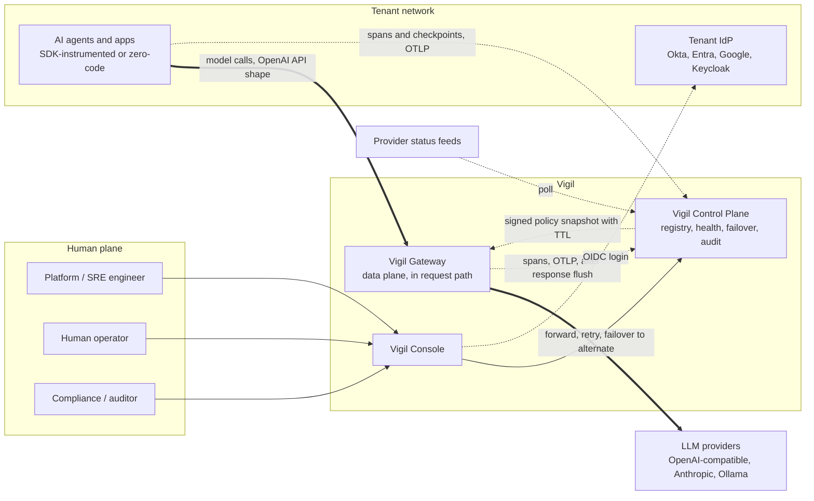
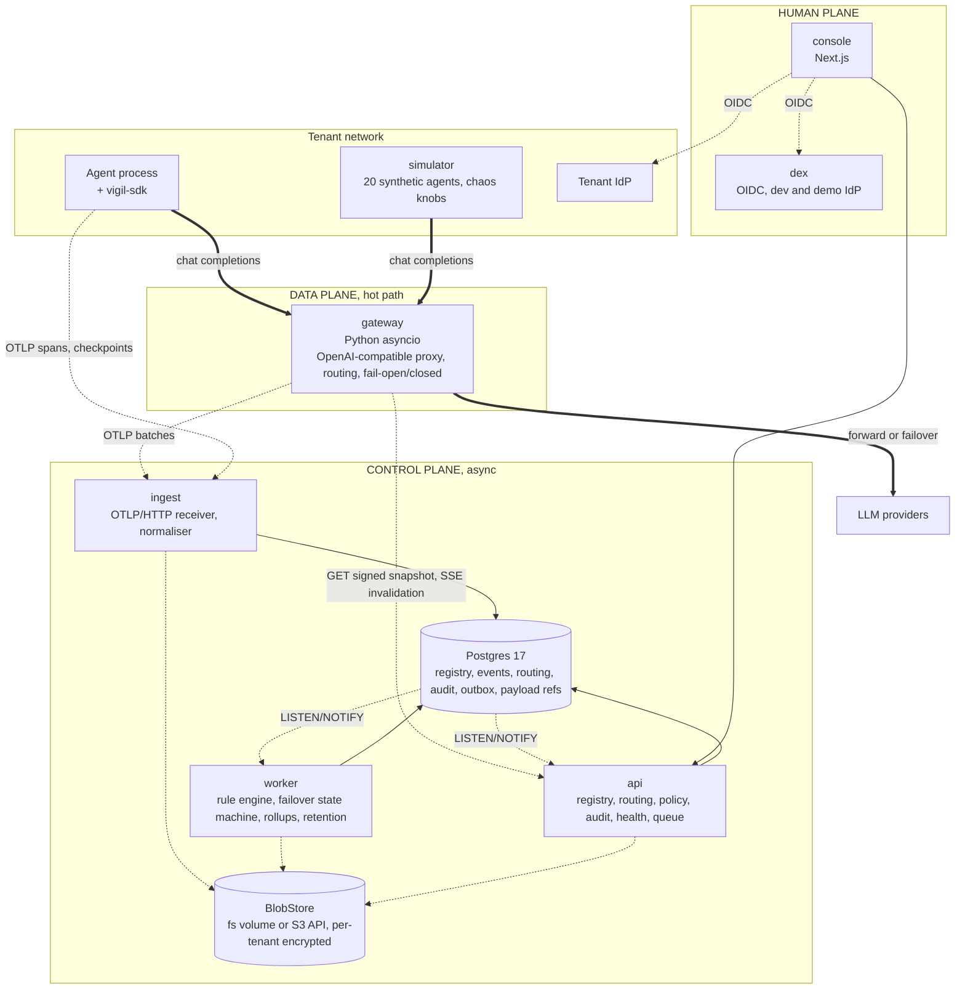
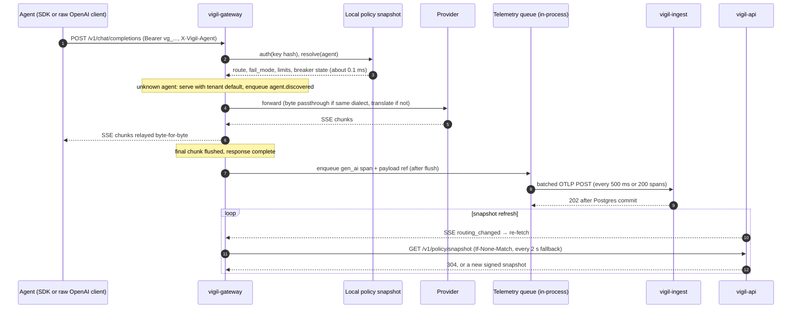
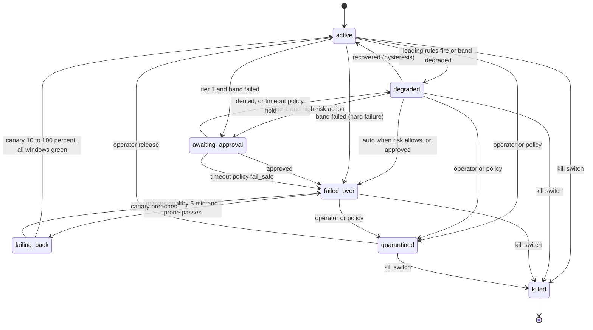

# Vigil — Step 2: Architecture

Council synthesis · 2026-10-09 · Inputs: DECISIONS.md (D1–D10), STEP1-UNDERSTANDING.md, six member reports in this directory (chief-architect, backend-architect, database-architect, security-auditor, sre-engineer, ai-engineer). Conflicts and how they were resolved: SYNTHESIS.md. Full ADR text: chief-architect.md §4.

## 1. The shape in one paragraph

One Postgres, one thin in-line gateway, one control-plane image run as three processes, one console, one dev identity provider, one object-store volume. The **data plane** (SDK in the agent process, gateway in front of providers) is the only thing in the request path and never performs synchronous I/O to the control plane: it reads a signed, TTL'd policy snapshot and emits telemetry after the response has flushed. The **control plane** (ingest, api, worker) is asynchronous and may lag by seconds. The **human plane** (console, operator queue, IdP) is where automatic decisions are seen, undone and overridden. Two trust boundaries: the tenant's network and Vigil's; the same gateway image can later run as a sidecar inside the tenant's network under the same snapshot contract.

Governing rule (sre-engineer): Vigil's control plane may fail; a customer's model call must never fail because of it unless that agent is explicitly fail-closed.

## 2. System context (C4 L1)

Thick = hot path. Thin solid = synchronous, not in the request path. Dotted = asynchronous.

## 3. Containers (C4 L2)

| Container | Language | Responsibility | State owned |
|---|---|---|---|
| gateway | Python asyncio (uvicorn, httpx) | OpenAI-compatible proxy; per-agent routing from snapshot; retry, breaker, rate limit; fail-open/closed; OTLP after flush; auto-register unknown agents | Snapshot + credential bundle in memory; telemetry queue with disk spill. No DB driver, no DB credentials |
| ingest | Python FastAPI | OTLP/HTTP receiver; API-key auth → tenant; GenAI normalisation (`vigil-event/1`); `gen_ai.request` staged in `call_merge`, multi-row INSERT … ON CONFLICT DO NOTHING into append-only partitioned events; payloads to BlobStore; 429 backpressure | None |
| api | Python FastAPI | Registry, routing, snapshot signing (Ed25519), SSE invalidation, audit read/verify, health read, operator queue, OIDC relying party, API keys | None |
| worker | Python asyncio | Rules + health score (10 s eval over 1 m buckets); failover state machine; provider status poller; rollups; partitions, retention; audit anchors | None |
| console | Next.js + TS | Fleet map, agent detail, operator queue, audit viewer with verify, admin; route handlers are the only BFF | Browser session |
| postgres | Postgres 17 | All durable state: registry, events, routing, failover, audit, outbox, rollups, payload refs | Everything durable |
| blobstore | `fs` adapter (compose default) or `s3` adapter | Encrypted payload bodies; anchor exports | Payload bytes |
| dex | Go | Dev/demo OIDC issuer with three demo personas | Static config |
| simulator | Python | 20 agents, 3 providers (OpenAI-compatible, Anthropic, Ollama stubs) with chaos knobs; real calls behind a flag | Scenario config |
| migrate | control image | Alembic upgrade, run once | None |

## 4. Hot path

Rules: the snapshot is verified (Ed25519), versioned (monotonic, lower versions rejected), and expiring (`ttl` 60 s, grace 300 s). Past grace, fail-open agents proceed with `vigil.policy_state=stale` stamped on every span; fail-closed agents receive a structured 503; killed agents stay killed on any stale or expired snapshot until an explicit audited release. A gateway with no snapshot at all refuses traffic rather than guessing; readiness means "a snapshot is loaded", never "fresh". Retries happen only before the first response byte. Telemetry never blocks the response.

## 5. Automatic failover: the state machine

Two mechanisms, deliberately separate (backend-architect):
- **Tactical**: the gateway may retry or fall back inline for a single request, from the fallback chain carried in the snapshot, tier-gated and off for tier 1. Repeated inline fallbacks feed the rule engine as a leading indicator. Continuity does not depend on the control plane being up.
- **Strategic**: only the transactional function `routing_apply()` changes an agent's routing state, called by the worker's saga step and inline by api for operator-immediate actions (kill, quarantine, release, undo). It writes `routing_state`, bumps the per-tenant routing version, appends the immutable `routing_transition`, writes audit via `audit_append()`, and NOTIFYs; api rebuilds and signs the snapshot and pushes an SSE invalidation. Target: gateway honours the new route in under 2 s (SLO p95 5 s); SDK `resolve_route()` within 10 s (SLO 30 s). Undo creates an inverse transition and a 30-minute operator hold.

Rules: five detected (error rate, p95 latency, consecutive failures, provider status, spend vs budget) and five leading (error trend, latency trend, rate-limit proximity, budget proximity, fallback pressure). Hysteresis 2-in/6-out, 10-minute cooldown, max transitions per window with flap escalation, provider-incident collapse so one outage yields one alert.

Risk tiers gate automation:

| Action | Tier 3 | Tier 2 | Tier 1 |
|---|---|---|---|
| Inline retry / fallback | auto | auto | off by default |
| Failover to alternate model, same provider | auto | auto | auto |
| Failover to alternate provider | auto | auto | auto on detected failure; approval on leading-only |
| Failover to backup agent | auto | auto | approval |
| Handoff to human queue | auto | auto | auto |
| Pre-emptive (leading-only) failover | auto | degrade, then auto after 2 windows | approval (recommended, see Q3) |
| Quarantine | auto on policy violation | approval | approval |
| Kill | operator only | operator only | operator only |

Handoff packets are assembled from the last SDK checkpoint plus the trace tail plus the triggering rule, with `fidelity: checkpoint | request_only`. Gateway-only (zero-code) agents can only get `request_only` packets; the console and the roadmap must say so. `handoff()` in the SDK is buffered-async and never blocks on the control plane, even at failure time.

## 6. Key design decisions and trade-offs (ADR index)

| ADR | Decision | We give up | We get |
|---|---|---|---|
| 1 | Python/FastAPI everywhere incl. the gateway; CI latency gate p95 < 15 ms, p99 < 50 ms at 200 streams on a reference runner | Go-level raw throughput per process | One language, one schema package; rewrite stays bounded by three frozen contracts |
| 2 | Own OpenAI-compatible gateway; no LiteLLM code in the request path (vendor its price JSON only); own `Dialect` adapters for OpenAI-compatible and Anthropic | Provider breadth sooner | A gateway that is ours: signed snapshot, fail mode, tenant keys, routing state below any plugin layer; no dependency whose paid tier is our product |
| 3 | Postgres 17 with plain daily partitions (`events`, `payload_refs`; spans are events with `parent_span_id`, raw OTel spans live in BlobStore) and worker-maintained rollups; no TimescaleDB | Compression, continuous aggregates | Runs on every managed Postgres (TSL features do not); ceiling ~5–10k events/s before ClickHouse behind `TimeSeriesStore` |
| 4 | EventBus on Postgres: partitioned outbox + LISTEN/NOTIFY; routing fan-out via api's SSE stream; no Redis/Valkey in Phase 1 | Sub-ms fan-out, consumer groups | Zero new infrastructure; one durability point. Reopen at > 5k events/s, replay needs, or shared counters across gateway replicas (Valkey first) |
| 5 | BlobStore interface; `fs` and `s3` adapters both in Phase 1; per-tenant envelope encryption (AES-256-GCM data key wrapped by a master key); payload bodies never inline in event or audit rows | A single stateful component | Mechanical cloud migration; crypto-shred erasure that covers backups; audit chain survives erasure |
| 6 | Postgres-backed failover state machine with idempotent `SKIP LOCKED` steps; Temporal deferred | Saga tooling | Survives worker restarts; steps are already activities for a Phase 2 Temporal port |
| 7 | Shared schema, `tenant_id` + RLS with FORCE, non-owner app role, `SET LOCAL app.tenant_id` per transaction, fail-closed when unset, one generated isolation test per table | Per-tenant physical isolation | Cheapest to operate; dedicated-DB tier stays possible (UUIDv7 keys, no cross-tenant FKs) |
| 8 | Vigil is an OIDC relying party only; never stores passwords; dex for dev/demo; Keycloak recommended to self-hosting tenants | Built-in username/password | SSO on day one; SAML and SCIM later through the same layer |
| 9 | Explicit per-agent `fail_mode`, tenant `unknown_agent_fail_mode`, signed monotonic expiring snapshot; kill beats fail-open | Synchronous policy checks | Control-plane outage freezes routing and degrades observability; never blocks a fail-open call |
| 10 | Provider credentials: passthrough for the primary call; vaulted (envelope-encrypted, memory-only in gateway, TTL) only for configured fallback targets; `base_url` allowlisted against SSRF | Zero custody of customer keys | Cross-provider failover actually works. Largest new security obligation; see Q1 |
| 11 | OpenTelemetry GenAI semantic conventions as the only wire contract (OTLP/HTTP); `vigil.*` extensions; versioned normaliser; raw spans kept | Our own event API | Every framework with GenAI instrumentation onboards without a connector |
| 12 | Audit: per-tenant hash chain computed in an in-DB `audit_append()` (SECURITY DEFINER, app role cannot write directly); envelope canonicalised in-DB, detail canonicalised by `vigil-schemas` (RFC 8785) and verified by jsonb equality before hashing; hourly Ed25519-signed anchors with the key outside the DB | Tamper-proofness against an attacker holding both DB and key | Tamper-evident against any DB edit; exports verify offline |
| 13 | `uv` monorepo: `vigil-schemas` is the only shared package; gateway and SDK import schemas only; import-linter enforced | Freedom to share code casually | Gateway independence is a build-time fact; SDK ships separately |

Also decided: secrets scrubbing (cloud keys, bearer tokens, private keys, connection strings) is unconditional in SDK and gateway even under full capture, replaced by `[SECRET:<hash8>]`; `capture_mode ∈ {full, redacted, metadata}` is the tenant's choice and every stored object records the redaction profile applied; API keys are hashed with a lookup prefix from migration 1; SLOs are stated per deployment shape (one gateway on one host ≈ 99.9%, two replicas + nginx ≈ 99.95%, 99.99% only as tenant sidecar or multi-AZ); Postgres is the only durability point (ingest acks after commit); pgBackRest/WAL-G PITR with a weekly automated restore test that also runs the next release's migrations.

## 7. Phase 1 → cloud

| Concern | compose (Phase 1) | Kubernetes + managed Postgres | Change |
|---|---|---|---|
| Postgres | `postgres:17` volume | RDS / Cloud SQL / Azure PG | `DATABASE_URL`; extension allowlist only (`pgcrypto`, `pg_trgm`, `btree_gin`, `pgvector`) |
| BlobStore | `fs` volume | S3 / GCS / S3-compatible | `BLOB_BACKEND=s3` |
| EventBus | Postgres outbox + NOTIFY | Same until > 5k events/s, then NATS or Valkey Streams | `EVENTBUS_BACKEND` |
| Identity | dex | Tenant IdP per OIDC issuer | Issuer per tenant |
| gateway | 1–2 replicas, nginx | Deployment + HPA, or tenant sidecar; Valkey counters | `RATELIMIT_BACKEND` |
| api / ingest / worker | 1 each | N replicas | None: `SKIP LOCKED`, advisory locks |
| Secrets, TLS | `.env`, Caddy | K8s Secrets, Ingress, KMS for master key | None in code |

## 8. Residual risks after Step 2

| # | Risk | Settled by |
|---|---|---|
| R1 | Credential custody (ADR-10): Vigil holds tenants' fallback provider keys | Founder Q1; Step 3 security key scheme, rotation, scoping, breach model; sidecar key-less mode |
| R2 | Python gateway under 200 concurrent streams may miss 15 ms p95 | Week-one CI benchmark on a reference runner; contracts frozen in `vigil-schemas` |
| R3 | Predicted auto-failover flaps; shifting a healthy agent is itself an incident | Tier-1 propose-and-approve default (Q3); hysteresis, cooldown, max shifts; Step 5 precision targets before auto becomes default |
| R4 | Full capture × multi-tenant × immutable audit: ~200 GB/day raw at 1k events/s, retention, erasure, residency | Founder Q2; Step 3 retention tiers and erasure procedure; per-tenant encryption |
| R5 | GenAI conventions churn; checkpoint semantics unvalidated with operators | Step 4 pins the conventions version; packet schema reviewed with the founder before code |
| R6 | Licensing of the self-hosted bundle (MinIO, Redis, Zitadel are AGPL/SSPL) and Vigil's own licence | Founder Q5; permissive-only dependency policy for the bundle |
| R7 | Zero-code agents over-promised: `request_only` packets cannot resume work | Console labelling; marketing copy says SDK is required for checkpoint-fidelity handoff |

## 9. Impact on the Step 1 lane plan

The gateway lane grows from 8 to 16–18 dev-days (streaming, routing, signed snapshot, fail modes, benchmark). New cut order if time runs short: cross-dialect translation first, then inline fallback, never the proxy itself. BlobStore, partitions and retention move from Phase 2 to Phase 1. Total Phase 1 estimate rises from ~56 to ~75 dev-days including tests; still six lanes, roughly 15–18 working days wall clock.
