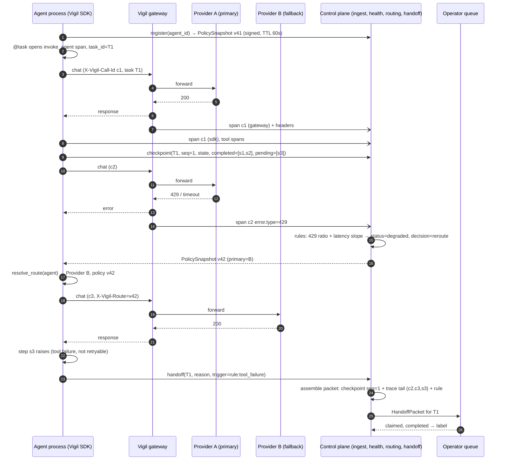

# AI Engineer: Architect (Step 2, agent-facing surface)

Codename: Vigil. Date: 2026-10-09. Scope: SDK, instrumentation, checkpoint/handoff, MCP/A2A, and the prediction contract Step 5 must fill. Inputs: BRIEF modules 1 to 5, DECISIONS D1 to D10, STEP1, chief-architect discover.

Governing decision: **the Vigil SDK is a thin layer on the OpenTelemetry SDK, and OTLP is the only wire format.** Gateway, SDK and third-party instrumentors all emit `gen_ai.*` spans; ingest normalises once. No parallel tracer, no bespoke event schema.

## 1. Instrumentation strategy

Three collection paths. **Gateway**: OpenAI-compatible proxy; sees every request and response byte, provider headers (rate-limit headroom), latency, retries; sees no application code, so no plans, hierarchy or tool execution (only the tool definitions and call requests the model emits). **SDK**: in-process; sees task boundaries, checkpoints, tool execution, hierarchy; sees provider payloads only for clients it wraps. **OTel auto-instrumentation** (OpenLLMetry, OpenInference, or a framework's own exporter): sees what the instrumentor author chose; quality varies by version.

Legend: F full, P partial, N none, D derived by Vigil (cost is never in the conventions; we price `gen_ai.usage.*` against a tenant price table).

| Source | Inputs/outputs | Tool calls | Reasoning steps | Agent hierarchy | Cost | Phase 1 path |
|---|---|---|---|---|---|---|
| Vigil gateway | F (incl. streaming reassembly) | P (requested, not executed) | P (if provider returns reasoning blocks) | N (needs `X-Vigil-*` headers) | D | **P1 core** |
| Vigil Python SDK | F for wrapped OpenAI/Anthropic/Ollama clients | F via `tool()` wrapper and MCP client hook | P (explicit `step()` spans) | F (`invoke_agent` nesting, `vigil.task_id`) | D | **P1 core** |
| LangChain / LangGraph | F via OpenLLMetry/OpenInference, or LangSmith OTLP export (LangChain 1.x) | F | P (graph node spans) | F | D | **P1 verified** (one demo agent on LangGraph + OTLP) |
| CrewAI | F via OpenInference/OpenLLMetry | F | P (task spans) | F (crew → agent → task) | D | P1 accepted, P2 verified |
| AutoGen 0.4+ / AG2 | P (native OTel; content opt-in) | F | P | F | D | P1 accepted, P2 verified |
| OpenAI Agents SDK | F via OpenInference or a custom `TracingProcessor` → OTLP | F | P (handoff spans) | F | D | P1 accepted, P2 verified |
| Bedrock Agents / AgentCore | P (AgentCore emits gen_ai OTLP via ADOT; classic Agents only via `enableTrace`) | F / P | P | P | D | P2 (no AWS account in P1) |
| Vertex AI / Google ADK | F (ADK native gen_ai OTel; contrib instrumentor for raw calls) | F | P | F | D | P2 |
| Azure AI Foundry / Semantic Kernel | F (`azure-ai-inference`, SK emit gen_ai; content via env flag) | F | P | F | D | P2; Azure OpenAI raw calls via gateway in P1 |
| Microsoft Copilot Studio | N (App Insights events only, no spans) | P (HTTP tools routed through our gateway) | N | N | N | P3: asset, synthetic probe, manual status. **Black box.** |
| Salesforce Agentforce | N (Data Cloud session logs, no OTel) | P (actions that hit our gateway) | N | N | N | P3: same. **Black box.** |
| ServiceNow Now Assist | N | P (outbound REST via our gateway) | N | N | N | P3: same. **Black box.** |
| MCP servers | n/a | F (SDK client hook P1; shim proxy P2) | n/a | P (server as dependency node) | n/a | P1 client-side, P2 shim |
| A2A agents | P (task messages/artifacts via a2a-sdk OTel) | n/a | P (task state transitions) | F (caller → callee edge) | D | P1 ingest + graph edge; P2 A2A gateway |

SaaS rows: Vigil cannot predict or fail over what it cannot see. For Copilot Studio, Agentforce and Now Assist, Phase 3 delivers governance (inventory, owner, tier, risk class, synthetic probe, dependency edges where their tools hit our gateway), not continuity. Say so in the pitch.

## 2. Event model at the ingest boundary

Wire contract: **OTLP/HTTP (protobuf and JSON) carrying OTel GenAI semantic conventions**, pinned at freeze to the newest published version (v1.37+; status "Development", not stable). Span kinds we consume: `chat`, `text_completion`, `embeddings`, `generate_content`, `execute_tool`, `create_agent`, `invoke_agent`. Span naming follows the conventions (`chat gpt-4.1`, `execute_tool lookup_order`, `invoke_agent Dispatcher`).

**Required in Phase 1** (ingest rejects the span to a dead-letter table and counts it if missing): `gen_ai.operation.name`, `gen_ai.provider.name`, `gen_ai.request.model`, `trace_id`, `span_id`, `start/end` timestamps, and tenant identity (from the API key, never from the payload). **Expected** (health rules degrade if absent): `gen_ai.response.model`, `gen_ai.usage.input_tokens`, `gen_ai.usage.output_tokens`, `gen_ai.response.finish_reasons`, `error.type`, `server.address`, `gen_ai.tool.name`, `gen_ai.tool.call.id`, `gen_ai.agent.id`, `gen_ai.agent.name`, `gen_ai.conversation.id`. **Content** (full capture per D7): `gen_ai.input.messages`, `gen_ai.output.messages`, `gen_ai.system_instructions`, tool definitions; payloads above 64 KB inline go to `BlobStore` with a `vigil.payload.ref`.

**Vigil extensions** (namespace `vigil.*`, all optional on the wire, resolved at ingest):

| Attribute | Meaning |
|---|---|
| `vigil.tenant_id` | Set by ingest from the key; a payload value that disagrees is an audit event |
| `vigil.agent_id` | Registry identity. Resolution order: explicit attribute → `gen_ai.agent.id` → `X-Vigil-Agent-Id` header (gateway) → API key default agent → auto-register as `unclaimed/<hash>` |
| `vigil.task_id` | Unit of continuity; one business task, many spans; propagated as W3C baggage |
| `vigil.call_id` | UUID per provider call, set by whoever sees it first; dedup key between SDK and gateway |
| `vigil.source` | `sdk` / `gateway` / `otel` |
| `vigil.checkpoint.seq`, `vigil.checkpoint.ref` | Checkpoint sequence and payload reference (on `vigil.checkpoint` spans) |
| `vigil.route.policy_version`, `vigil.route.decision`, `vigil.route.reason`, `vigil.route.from`, `vigil.route.to` | Routing applied to this call and why |
| `vigil.capture.mode` | `full` / `redacted` / `metadata`; `vigil.redaction.rules[]` lists rules that fired |
| `vigil.prompt.version`, `vigil.task.outcome`, `vigil.feedback.score` | Eval hooks (§7) |
| `vigil.semconv.version`, `vigil.schema.version` | Provenance for re-normalisation |

**Non-OTel JSON batches** (`POST /v1/events`, for shells, cron jobs, languages without an OTel SDK) are an adapter, not a second model: each JSON event is a flat dict of the same attribute names plus `ts`, `duration_ms`, `parent_id`; the adapter builds an OTLP span and feeds the same pipeline. One schema, two encodings.

**Versioning against moving conventions.** Ingest keys on the scope `schema_url` and `vigil.semconv.version` and applies a translation table into the canonical model `vigil-event/1`: `gen_ai.system` → `gen_ai.provider.name`; OpenLLMetry legacy `gen_ai.prompt.N.*` / `gen_ai.completion.N.*` and OpenInference `llm.input_messages.*` → `gen_ai.input.messages` / `gen_ai.output.messages`; `llm.token_count.*` → `gen_ai.usage.*`. Raw spans stay in `BlobStore`, so a convention change is a re-normalisation job, not data loss. The table is YAML, versioned with ingest, with a conformance test per supported instrumentor version.

## 3. Python SDK (Phase 1) and TypeScript shape (Phase 2)

Package `vigil-sdk`; dependencies: `opentelemetry-sdk`, `opentelemetry-exporter-otlp-proto-http`, `httpx`, `pydantic`, `cryptography`. Everything is OTel underneath: `vigil.*` attributes are added by a `VigilSpanProcessor` that reads the current context; export is an OTLP exporter wrapped in a disk buffer.

```python
vigil.register(agent_id: str, *, owner: str, tier: Tier, business_process: str,
               provider: str, model: str, fallback: list[Target] | None = None,
               fail_mode: Literal["open", "closed"], depends_on: list[str] = ()) -> Agent

@vigil.task(agent_id)                        # opens invoke_agent span, mints task_id, sets baggage
@vigil.traced(agent_id, kind="chat"|"tool"|"step")   # child span; sync, async, generator-aware
vigil.instrument(openai_client | anthropic_client | ollama_client)  # wraps; skips if already OTel-instrumented
vigil.tool(fn)                               # execute_tool span; records args/result per capture mode
vigil.checkpoint(task_id, state: dict, *, step: str | None, completed: list[Step] = (),
                 pending: list[Step] = ()) -> CheckpointRef
vigil.resolve_route(agent_id) -> Route       # local, never blocks on network
vigil.handoff(task_id, reason: str, *, trigger: Trigger, packet: HandoffPacket | None = None) -> HandoffRef
vigil.feedback(trace_id, score: float, comment: str | None)
vigil.shutdown(timeout_s=5)                  # flushes buffer
```

**Context propagation.** OTel context rides on `contextvars`, so `asyncio` is covered by default. Threads: `vigil.instrument_threading()` patches `ThreadPoolExecutor.submit` with `contextvars.copy_context()` (the OTel `ThreadingInstrumentor`). Processes and HTTP: W3C `traceparent` plus `baggage` carrying `vigil.agent_id` and `vigil.task_id`, injected into outbound provider calls, MCP `_meta`, and A2A requests.

**`resolve_route` and the policy snapshot.** A `PolicySnapshot` per agent is fetched at `register()` and refreshed in a background thread every `ttl/3` (default TTL 60 s): `{agent_id, policy_version, issued_at, ttl_s, primary, fallback_chain[], fail_mode, breaker_state, tier, sig}` signed Ed25519 by the control plane; the public key is pinned in SDK config. `resolve_route` reads only memory and `~/.vigil/policy/<agent_id>.json`. Semantics: fresh → apply; expired within `max_stale_s` (default 15 min) → apply and tag `vigil.route.reason=stale`; beyond that → fail-open agents get `primary` with `reason=policy_unavailable`, fail-closed agents raise `VigilPolicyUnavailable`. Every stale or unavailable decision is an audit span. A per-process local breaker (5 consecutive provider errors → prefer `fallback_chain[0]` for 30 s) covers the gap before the control plane's decision lands; the control plane is still the authority.

**Buffering and replay.** `BatchSpanProcessor` (2 s / 512 spans) → OTLP exporter → on failure, a disk queue (`~/.vigil/buffer/`, segment files, cap 256 MB, 7 days). Two queues: `critical` (checkpoints, handoffs, route decisions) drains first; `telemetry` drains after, drop-oldest when full. Replay keeps original timestamps; the SDK emits `vigil.sdk.dropped_spans` and `vigil.sdk.buffer_bytes`.

**Redaction hooks.** `capture_mode` defaults to `full` (D7) and is overridden by the tenant policy in the snapshot. Pipeline: `vigil.redactors = [SecretsRedactor (always on), PIIRedactor (policy), custom callables]`. Secrets (API keys, bearer tokens, connection strings) are redacted regardless of mode: storing credentials is a security hole, not a privacy preference. Redaction happens before the span leaves the process; `vigil.redaction.rules[]` records what fired.

**Avoiding double counting.** The SDK injects `X-Vigil-Call-Id`, `X-Vigil-Agent-Id`, `X-Vigil-Task-Id`, `traceparent` on outbound provider requests. When the gateway sees `X-Vigil-Call-Id` it emits its span with the same `vigil.call_id` and `vigil.source=gateway` as a child of the SDK span. Ingest merges on `(tenant, call_id)`: SDK span is authoritative for context, hierarchy and task; gateway span is authoritative for provider latency, headers, routing, and content if the SDK is in `metadata` mode. Health counts one call. Against third-party instrumentors, `vigil.instrument()` checks the client's `_is_instrumented_by_opentelemetry` flag and only adds the processor, never a second wrapper.

**TypeScript SDK (Phase 2).** Same surface on `@opentelemetry/sdk-node`: `register`, `task`, `traced`, `instrument(openaiClient)`, `checkpoint`, `resolveRoute`, `handoff`. `AsyncLocalStorage` for context; disk buffer in Node; memory-only on edge runtimes; no browser target.



## 4. Handoff packet

```yaml
HandoffPacket v1:
  packet_id, tenant_id, agent_id, task_id, created_at
  goal: str                                 # from task() name/description or checkpoint.state.goal
  original_input: {ref, preview, content_type}   # first gen_ai.input.messages of the task, or an explicit artifact
  completed_steps: [{step, started_at, output_preview, output_ref, tool_name?}]
  pending_steps: [{step, description, inputs_needed?}]
  reason: {plain_language: str, trigger: {rule_id, factors[], span_ids[]}, failure_mode: enum}
  next_action: str                          # single imperative sentence
  deadline: datetime                        # task deadline if known, else created_at + RTO of tier
  accountability: {owner, on_call, escalation}   # from registry and continuity plan
  redaction: {mode, rules_fired[], fields_redacted[]}
  provenance: {checkpoint_seq, trace_ids[], policy_version, assembled_by: sdk|control_plane}
  sidecar: {route_history[], cost_so_far, attempts}
```

Assembly: the **last checkpoint** supplies `goal`, `completed_steps`, `pending_steps` and app state; the **trace tail** (spans after it) adds tool spans as completed steps with `assumed=true` and the failing span as `reason.trigger.span_ids`; the **triggering rule** supplies `reason.plain_language` from a per-rule template ("Provider A returned rate-limit errors on 8 of the last 10 calls; the fallback also failed on step 'send_quote'") and `failure_mode` from the taxonomy. The SDK assembles when alive (richer state); otherwise the control plane assembles from its checkpoint store. Same schema; `provenance.assembled_by` says which.

We promise that an operator or backup agent can **restart the task from the packet as context**, with the original input and every completed step's output. We do not promise transparent resume of in-memory execution, replay of side effects, or semantic equivalence of a backup agent. Side effects inferred from the trace rather than confirmed by a checkpoint carry `assumed=true`. A Phase 2 spike wraps LangGraph's `BaseCheckpointSaver` so framework-native state mirrors into `vigil.checkpoint`.

## 5. MCP and A2A

**MCP, Phase 1 (SDK-side).** `vigil.instrument_mcp(session)` wraps `ClientSession.call_tool`, `list_tools`, `read_resource`: each call is an `execute_tool` span with `gen_ai.tool.type=mcp`, `gen_ai.tool.name`, `vigil.mcp.server`, and `traceparent` in `_meta` for servers that honour it. `list_tools()` results register the server and its tools as assets with `agent → mcp_server → tool` graph edges: the tool AI-BOM for free. **Phase 2 (shim).** `vigil-mcp-shim` is a proxying MCP server (stdio and streamable HTTP) wrapping an upstream: observes calls from any client language, applies the policy snapshot (deny, rate-limit, quarantine), emits the same spans. The shim is where "revoke a tool permission" (module 6) becomes enforceable.

**A2A.** Phase 1: ingest accepts `a2a-sdk` OTel spans; the Agent Card (`/.well-known/agent-card.json`) becomes a registry asset; each call is a `caller → callee` edge with `edge_type=a2a`, and the remote `task_id` maps to `vigil.task_id`. Task states map directly: `input-required` → human queue candidate, `failed`/`canceled` → handoff trigger. Phase 2: an A2A gateway proxies the callee so a failing remote agent is replaced by a backup with an equivalent card; the cleanest "backup agent" story in the brief, because A2A agents declare capabilities.

## 6. Prediction contract

`GET /agents/{id}/health` (also emitted as a `health_transition` event on status change):

```json
{
  "agent_id": "...", "as_of": "...", "window_s": 300,
  "score": 62, "status": "degraded",
  "provisional": false, "event_count": 1840, "min_events": 50,
  "factors": [
    {"rule_id": "error_rate", "weight": 0.30, "penalty": 18, "value": 0.12, "threshold": 0.05, "direction": "above", "evidence": "/traces?agent=...&error=true"},
    {"rule_id": "rate_limit_proximity", "weight": 0.15, "penalty": 10, "value": 0.08, "threshold": 0.15, "direction": "below"}
  ],
  "predictions": [
    {"horizon_s": 900,   "failure_probability": 0.60, "predicted_mode": "provider_outage",   "confidence": "low", "source": "rules/v1"},
    {"horizon_s": 3600,  "failure_probability": 0.45, "predicted_mode": "latency_degradation","confidence": "low", "source": "rules/v1"},
    {"horizon_s": 86400, "failure_probability": 0.20, "predicted_mode": "cost_runaway",       "confidence": "low", "source": "rules/v1"}
  ],
  "recommended_action": "reroute_to_fallback", "policy_version": 42,
  "feature_snapshot_ref": "fs_01J..."
}
```

States: `healthy` (≥ 80), `watch` (60–79), `degraded` (30–59), `failed` (< 30 or hard rule). `predicted_mode` uses the brief's twelve-value taxonomy. `source` is `rules/vN` or `model/<name>:<version>` and the console shows it, so nobody mistakes a banded rule for a calibrated model.

**Phase 1 rules.** State rules (score): error rate, p95 latency vs baseline, consecutive failures, provider status, spend vs budget. Leading-indicator rules (probability bands 0.05 / 0.25 / 0.60 / 0.90, satisfying D6 "looks like it would fail"): error-rate slope and latency slope over the last three windows; rate-limit proximity from `x-ratelimit-remaining-*` headers the gateway captures; 429 ratio and retry count rising; context-window saturation (`input_tokens / model_context_limit > 0.85` or `finish_reason=length` rising); budget burn rate projecting exhaustion inside the horizon; provider status feed (public statuspage JSON for OpenAI and Anthropic, Ollama host probe); credential expiry and model deprecation dates registered on the asset. Each rule maps to a `predicted_mode`.

**Phase 2 plug-in interface.** `HealthPredictor.predict(features: FeatureSnapshot, horizons: list[int]) -> list[Prediction]`, selected per tenant/agent by config, with the rules engine as the fallback when the model abstains or `provisional=true`. `FeatureSnapshot` is computed from the event model at 1 m / 5 m / 15 m / 1 h grains: request count, error rate by `error.type`, p50/p95/p99 latency, tokens in/out, cost, 429 ratio, retries, tool failure rate, tool-sequence n-gram entropy, output length stats, `finish_reason` mix, rate-limit headroom, provider status, breaker state, budget headroom, route changes, hour-of-day. Each snapshot is **frozen at prediction time** and referenced from the health response (`feature_snapshot_ref`), so training is point-in-time correct.

**Labels Phase 1 must collect from day one.** (1) `health_transition` events with the frozen feature snapshot and the rule that fired. (2) Operator verdicts: `POST /alerts/{id}/label {verdict: tp|fp|unsure, reason}`, one click, mandatory before an alert closes. (3) Failover outcomes: `{decision_id, fallback_succeeded, time_to_recover_s, failback_verified}`. (4) Handoff outcomes: `{packet_id, claimed_at, completed|returned|abandoned, rework, operator_rating}`. (5) Task outcomes independent of rules: `vigil.task.outcome` from the SDK and `vigil.feedback.score` from end users. (6) Provider incidents post-hoc from status feeds, labelling windows before real outages whether or not a rule fired. (5) and (6) matter most: without them the Phase 2 model imitates the Phase 1 rules.

## 7. Evaluation hooks

Phase 1 stores, per call under full capture: `gen_ai.input.messages`, `gen_ai.output.messages`, `gen_ai.system_instructions`, tool definitions and results, `gen_ai.request.*`, `gen_ai.response.model`, `vigil.prompt.version` (system-prompt hash if undeclared), retrieval references (`gen_ai.data_source.id`, document hashes), `vigil.task.outcome`, `vigil.feedback.*`, content hashes, and a deterministic `vigil.eval.sample` flag (reservoir, stratified by agent and outcome). Phase 3 can then build golden sets from sampled traces, replay any stored request against a judge or a new model without re-running the agent, and join judge scores to the feature store by `trace_id`. No schema change, only new tables keyed on `trace_id`.

## 8. Top 5 risks on this surface

| # | Risk | Settled by |
|---|---|---|
| 1 | Convention churn and instrumentor divergence (OpenLLMetry vs OpenInference vs native) corrupt the canonical model | Step 3: freeze `vigil-event/1` plus the translation table and conformance tests; keep raw spans |
| 2 | Agent identity and call dedup wrong: health counts one call twice or attributes it to `unclaimed/*` | Step 4: `X-Vigil-*` header contract, identity resolution order, merge rules as API spec |
| 3 | Checkpoint state is app-defined; packets arrive empty or unreadable | Step 3: packet schema validation, size caps, required fields; Step 4: operator paper test before code |
| 4 | Stale or unsigned policy snapshot routes traffic wrongly or flaps | Step 4: TTL, `max_stale_s`, signing, hysteresis on reroute/failback, audit of every stale decision |
| 5 | Phase 1 labels only mirror the rules, so Step 5 trains a model that imitates them | Step 5: require outcome labels (5) and (6) in §6 and define lead-time evaluation against provider incidents |
