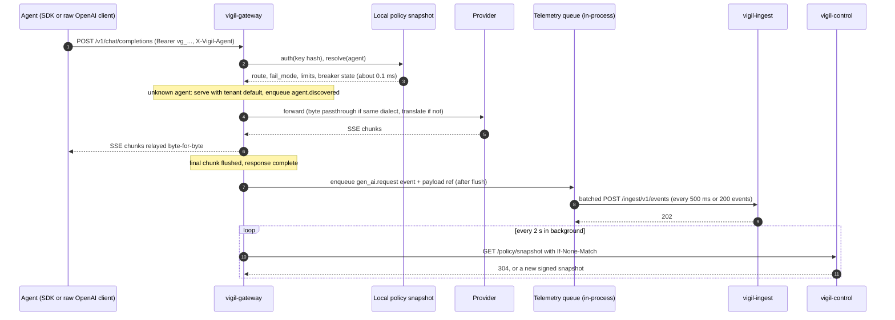
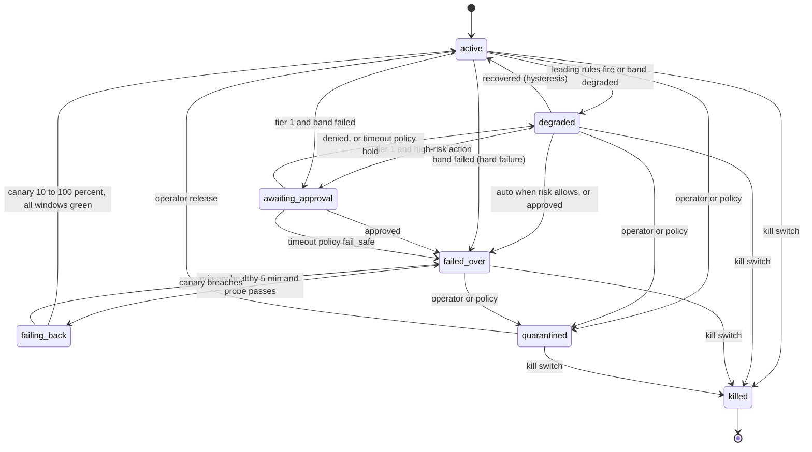

# Backend Architect — Architect (Step 2)

Codename: Vigil · 2026-10-09 · Lens: service decomposition, gateway, rule engine → failover state machine, ingest. C4 and ADRs: chief-architect. Storage: database-architect. Threats: security-auditor. SLOs: sre-engineer. SDK/OTel mapping: ai-engineer. Where I touch their ground I name the interface and stop.

Governing decisions: D2 (gateway in path, streaming), D4 (compose, Postgres the only stateful component), D6 (automatic, risk-tiered failover with undo), D7 (store everything), D10 (OSS only).

## 1. Service decomposition (Phase 1)

Six processes, 12-factor, stateless except Postgres.

| Service | Responsibility | Sync / async | Scaling unit | Must never |
|---|---|---|---|---|
| **vigil-gateway** (data plane) | OpenAI-compatible proxy: auth, agent identity, route from local snapshot, upstream call, streaming passthrough, inline retry/fallback, telemetry | Sync in request path; telemetry async | Stateless replica behind any L4 LB; breaker state per replica | Call the control plane synchronously; touch Postgres; block a response on telemetry; route in a way the snapshot does not permit |
| **vigil-ingest** | OTLP/HTTP + native batch intake, validation, tenant scoping, event and blob write, EventBus publish | Sync accept (202), async persist | Replica with bounded queue | Mutate registry or routing; evaluate rules; accept events outside the key's tenant |
| **vigil-control** | Registry, routing API, alerts, queue, audit append + verify, policy-snapshot build and sign, tenants/users/keys | Sync REST | Replica; snapshot cache rebuilt on NOTIFY | Execute a transition itself (it requests one); write audit rows outside `audit.append()` |
| **vigil-worker** | Rule engine (windows, health, alerts) and failover orchestrator (durable transitions). One image, `--role health\|orchestrator\|all` | Async consumer + 10 s loop | One per role in Phase 1; Phase 2 partitions by `hash(agent_id)`; `SKIP LOCKED` claims make extra replicas safe | Serve agent traffic; call providers except health probes; write routing without a transition row |
| **vigil-console** (Next.js) | Four ops screens; route handlers are the BFF (cookie → bearer, SSE alert fan-out) | Sync | Replica | Hold business logic; call Postgres |
| **vigil-sim** | 20 synthetic agents, 3 provider stubs, chaos knobs | — | Single | Ship in the production compose profile |

No separate BFF service: route handlers suffice and keep one OpenAPI source in `vigil-control`.

### Hot path



## 2. Gateway design

**Surface.** `POST /v1/chat/completions`, `POST /v1/embeddings`, `GET /v1/models` (models this agent may use, from the snapshot), `POST /v1/messages` (Anthropic-native), `/healthz`, `/readyz` (green only with a valid snapshot). Anything else: 404 in OpenAI error shape.

**Dialect policy.** If request dialect equals the upstream's dialect, the gateway is a byte passthrough: it parses the body once (orjson) for `model`, `stream`, message count and token accounting, then forwards the original bytes. Translation (OpenAI ↔ Anthropic, tool calls included) runs only when a fallback crosses dialects. Ollama speaks `/v1` OpenAI-compat, so it is passthrough. The common path stays cheap; translation risk is confined to the rare path.

**Build vs buy.** Use **LiteLLM as a library** (`litellm.acompletion`: translation, stream normalisation, token counting) on the cross-dialect path only, with `num_retries=0`, no fallbacks, callbacks or router. Do **not** adopt the LiteLLM Proxy: it is a second control plane (own DB, keys, budgets, UI), its callbacks sit in the hot path, and our rule engine would learn about failures second-hand through its router. We own the surface, auth, snapshot resolution, breakers, telemetry and passthrough. Cost: heavy import, version churn, translation edge cases, accepted for three providers × two dialects × streaming × tool calls. Exit: a `Dialect` interface; a hand-written OpenAI↔Anthropic adapter is roughly 400 lines.

**Auth and identity.** `Authorization: Bearer vg_<tenant_short>_<32 bytes>`. The snapshot carries `sha256(key)` and scopes per key; lookup is a dict hit. Agent = the key's default agent unless `X-Vigil-Agent: <slug>` overrides. Resolution happens inside the tenant's subtree of the snapshot, so a key can never address another tenant's agent.

**Auto-register.** Unknown slug: serve with the tenant default policy (primary = requested model, default `fail_mode`), tag the event `agent.discovered`. `vigil-control` creates the agent as lifecycle `discovered`, `provisional=true`, tier 3, owner null, shown as "unclaimed" on the fleet map; the next snapshot includes it. Nothing on the hot path waits.

**Policy snapshot.** Built by `vigil-control` from `agents`, `routing_state`, `api_keys`, `provider_configs`, `tenant_defaults`; cached per replica; invalidated by `NOTIFY policy_changed`. Ed25519-signed (private key in control env, public key in gateway env): `{version, issued_at, ttl_s=60, grace_s=300, tenants{...}}`. The gateway polls every 2 s with ETag, verifies before swapping, refuses older versions.

**Control plane unreachable.**

| Snapshot age | Behaviour |
|---|---|
| ≤ 60 s | Normal |
| 60 s to 6 min | Serve from last snapshot; `readyz` green; `snapshot_stale=1`; one `policy.stale` event |
| > 6 min | Per-agent `fail_mode`: **open** → last-known primary only, no failovers or inline fallbacks, audit `policy_stale_bypass` (batched); **closed** → 503 with `Retry-After`. Unknown keys always fail closed |

`fail_mode` is mandatory at registration (STEP1 A12).

**Latency budget: p95 < 15 ms, p99 < 50 ms added.** Allocation: auth and resolve 0.3 ms, parse 1 ms at 50 KB, warm upstream connection 2 ms, per-chunk relay 0.05 ms, telemetry enqueue 0.1 ms; the rest is headroom. Rules: no synchronous I/O except the upstream call; telemetry after final flush; hashing in a thread pool; uvloop; one keep-alive `httpx.AsyncClient` per provider.

**CI enforcement.** `bench/gateway_latency` on every PR: fake upstream replying in 0 ms (plus a 2 s streaming variant); `k6` at 200 rps for 60 s; the gateway stamps `Server-Timing: vigil;dur=<ms>` (request in → upstream out, plus relay overhead); the job fails on p95 ≥ 15 ms or p99 ≥ 50 ms and keeps results as a trend artifact. Nightly 15-minute soak at 1k rps guards memory.

**Retries, breakers, bulkheads** (own code, configured by snapshot):

- Retry only before any response byte is sent: connect error, 408, 429, 5xx; one same-target retry with full jitter (50 to 200 ms); honours `Retry-After`.
- Breaker per `(tenant, provider, model)`: opens on 5 failures in 30 s or 50% errors over ≥ 20 calls; half-open probe after 15 s. State is replica-local and reported in telemetry so the rule engine sees it fleet-wide.
- Bulkheads: per-provider pool cap (200 connections), per-agent `max_inflight` semaphore and token bucket, per-tenant inflight cap. Shedding returns 429, never queues.
- **Inline fallback** (tactical, per request): breaker open or retry failed and snapshot says `inline_fallback=true` (default on for tier 3, off for tier 1) → forward to `fallback_chain[0]`. Distinct from the **strategic** failover the orchestrator declares (§3); repeated inline fallbacks are themselves a leading indicator.

## 3. Rule engine → failover state machine

### Aggregation

`vigil-worker --role health` consumes the EventBus (§4) and folds each `gen_ai.request` into per-`(tenant, agent)` 1-minute buckets: `calls, errors by class, latency t-digest, tokens, cost, min ratelimit_remaining, inline_fallbacks, breaker_open_s`, upserted into `agent_metrics_1m` (database-architect picks Timescale vs plain partitions) so restarts lose nothing. Every 10 s the evaluator reads 5 m / 15 m / 1 h windows. A poller writes `provider_status` (statuspage.io JSON plus the simulator knob).

### Rules

| # | Rule | Fires when | Kind | Horizon |
|---|---|---|---|---|
| R1 | error_rate | 5 m error rate > threshold(tier), ≥ 10 calls | detected | now |
| R2 | p95_latency | 5 m p95 > threshold(model class) | detected | now |
| R3 | consecutive_failures | ≥ 3 in a row | detected | now |
| R4 | provider_status | primary provider not operational | detected / leading | now |
| R5 | budget_breach | spend ≥ budget | detected | now |
| L1 | error_trend | rising across last three 5 m windows, latest ≥ 50% of threshold | leading | 15 m |
| L2 | latency_trend | positive p95 slope over 3 windows, latest ≥ 80% of threshold | leading | 15 m |
| L3 | ratelimit_proximity | `x-ratelimit-remaining` < 10% or 429 share > 5% | leading | 15 m |
| L4 | budget_proximity | projected spend at 1 h burn hits budget inside horizon | leading | 1 h |
| L5 | fallback_pressure | inline fallbacks or breaker-open > 20% of calls | leading | 15 m |

Thresholds: one YAML per tenant with tier overrides. Each rule returns `RuleResult{rule, severity, penalty, factor_text, evidence[], horizon}`. Health = `max(0, 100 − Σ penalty)`; bands healthy ≥ 80, watch ≥ 60, degraded ≥ 30, failed < 30; `provisional` under 50 calls. Phase 2 ML fills the same `RuleResult` contract.

### Alerts

- Key `(tenant, scope, cause)`, scope `agent` or `provider`. When ≥ 2 agents on one provider trip provider-side rules (R2, R4, L2, L3) in the same evaluation they collapse into **one** `provider_incident` alert listing affected agents and business processes; per-agent alerts become suppressed children.
- Hysteresis: enter a band after 2 consecutive evaluations (20 s), leave after 6 consecutive (60 s) above `threshold + 10`.
- Cooldown: 10 min after resolve; a key firing 3× in 1 h escalates one severity and doubles its cooldown.
- Severity: `info` (watch), `warning` (degraded), `critical` (failed, or degraded on tier 1). Each alert carries `what_to_do` and a one-click true/false-positive label.

### Routing state machine



`failed_over` carries `target_kind ∈ {model, agent, human_queue}` and `target_ref`. `quarantined`: human queue only, no tool calls. `killed`: 503 for every call, terminal until an operator recreates the routing row. Every edge is one `routing_transition` row and one audit row.

### Risk tiers

| Action | Risk | Tier 3 | Tier 2 | Tier 1 |
|---|---|---|---|---|
| Inline retry / fallback | low | auto | auto | off by default |
| Failover to alternate model, same provider | low | auto | auto | auto |
| Failover to alternate provider | medium | auto | auto | auto on detected; approval on leading-only |
| Failover to backup agent | medium | auto | auto | approval |
| Handoff to human queue | medium | auto | auto | auto |
| Pre-emptive (leading-only) failover | medium | auto | degrade, then auto after 2 windows | approval |
| Quarantine | high | auto on policy violation | approval | approval |
| Kill | high | operator only | operator only | operator only |

Approval timeout default 10 min; per-agent policy `hold` or `fail_safe`.

### Transition → routing change within N seconds

Step `write_routing` updates `routing_state`, bumps `tenant.routing_version`, appends the audit row and fires `NOTIFY policy_changed` in one transaction. `vigil-control` rebuilds the snapshot (≤ 50 ms); the gateway polls every 2 s; the SDK's `resolve_route()` caches per agent for 5 s with ETag revalidation. Target **N = 5 s** gateway, **≤ 10 s** SDK, measured as `routing_propagation_seconds` from heartbeats carrying `snapshot_version`. Both read the same version, so a mixed agent sees one answer.

### Undo

Every automated transition stores `undo_plan = {prev_state, prev_target}`. `POST /routing/{agent}/undo` creates the inverse transition (audited, actor = operator) and sets `operator_hold_until = now + 30 min`; the engine keeps scoring and alerting but cannot transition that agent during the hold, so it cannot redo what a human undid. Undo does not recall claimed queue tasks; unclaimed ones become `returned_to_agent`.

### Handoff packet when nothing is viable

Viability: each `fallback_chain` entry needs health ≥ 60, breaker closed and, for agents, `lifecycle=deployed`. None viable → `target_kind=human_queue`. In-flight tasks = SDK tasks with a checkpoint inside `task_ttl` (30 min) and no `task.completed`. Per task:

```
HandoffPacket {
  task_id, agent, tenant, created_at, fidelity: "checkpoint" | "request_only",
  goal, original_input: blob_ref,
  steps_done: [{step, summary, output_ref}], pending: [...],
  reason: {alert_id, rules[], evidence[]} rendered in plain words,
  next_action: one imperative sentence (checkpoint.next or rule template),
  trace_tail: last 20 events for task_id, routing_transition_id
}
```

Gateway-only agents get `fidelity=request_only`: the last failed request body as context, no steps. The console must say so; this is the STEP1 A10 baseline.

### Durability

`routing_transition(id, tenant_id, agent_id, from_state, to_state, trigger, risk, status, lease_until, step_cursor, idempotency_key, undo_plan, created_by)` plus `transition_step(transition_id, name, status, attempt, result)`. Steps: `validate → check_viability → write_routing → create_queue_tasks → mark_alert_actioned → done`. The worker claims with `FOR UPDATE SKIP LOCKED` where `status='pending' OR lease_until < now()`, holds a 30 s lease renewed every 10 s, and upserts each step on `(transition_id, name)`. `UNIQUE (agent_id) WHERE status IN ('pending','running')` forbids concurrent transitions for one agent.

Worker dies mid-transition: nothing is half-visible, because `write_routing` is atomic with its audit row; the lease lapses; the restarted worker re-claims and resumes at `step_cursor`. Damage is delay (≤ lease) and, if death falls between `write_routing` and `create_queue_tasks`, a window where traffic is redirected before packets are queued; the console shows `in_progress`, and the in-flight query on resume finds every task.

## 4. Ingest pipeline

**Endpoints.** `POST /ingest/v1/events` (native batch, ≤ 1,000 events or 5 MB, gzip), `POST /v1/traces` (OTLP/HTTP protobuf and JSON; GenAI spans mapped to the native event via the ai-engineer's table), `POST /ingest/v1/checkpoints` (idempotent on `(task_id, seq)`). Returns 202 `{accepted, rejected[{index, reason}]}`; partial acceptance allowed.

**Validation.** Strict Pydantic; unknown attributes kept in `attributes` JSONB up to 16 KB; timestamps clamped to ±24 h; `agent_id` must exist in the key's tenant or be a slug (→ `agent.discovered`); events capped at 256 KB, payloads over 4 KB moved to the BlobStore as `{blob_ref, sha256, bytes}`. Tenant comes from the key, never the body.

**Write path.** Per-replica `asyncio.Queue(maxsize=5000)`; a writer drains every 200 ms or 500 events: `COPY` into `events` (daily partitions, RLS on), blobs to the BlobStore, then one `EventBus.publish`. `BlobStore`: `put(tenant, key, bytes, content_type) -> ref`, `get(ref)`, `delete_prefix(tenant, before)`. Phase 1 per D4: a Postgres `blobs` table (bytea, partitioned); Phase 2: MinIO/S3 adapter. Database-architect may overrule the Phase 1 choice; the interface stands.

**Backpressure.** Queue ≥ 80% → `Retry-After: 2`; full → 429 with `Retry-After: 5`, no partial accept. SDK and gateway buffer to disk (gateway: 50 MB ring, drop-oldest, `telemetry.dropped` counter). Accept never blocks on Postgres beyond the queue hand-off. Queue depth and accept rate are SLIs (sre-engineer).

**EventBus interface** (rule engine, discovery consumer, Phase 2 learners):

```
publish(topic, events[]) -> offsets
subscribe(topic, group) -> iterator[(offset, event)]
ack(topic, group, offset)
```

Phase 1: the `events` table *is* the log. `consumer_cursor(group, topic, last_received_at, last_id)` holds progress; consumers read `(received_at, id) > cursor AND received_at < now() − 2 s` (the watermark closes the commit-order gap on serial ids) and wake on `LISTEN events_appended`. No extra container; replay is a cursor rewind. Phase 2 swap: Redis Streams past ~3k events/s sustained, Redpanda when multi-region or long stream retention matters. Nothing above the interface changes.

## 5. API surface sketch (Step 4 designs it)

| Resource | Verbs |
|---|---|
| `/registry/agents` | list, create, get, patch, retire, claim, bom |
| `/registry/providers`, `/registry/models` | list, create, patch |
| `/routing/{agent}` | get; failover, failback, quarantine, release, kill, undo; transitions |
| `/approvals` | list, approve, deny |
| `/health/agents/{agent}`, `/health/fleet` | get |
| `/alerts` | list, get, ack, label, silence |
| `/queue/tasks` | list, get, claim, release, complete, return_to_agent |
| `/audit/events`, `/audit/verify` | list, export; verify range |
| `/policy/snapshot`, `/policy/keys` | get (ETag, signed); list, rotate |
| `/tenants`, `/tenants/{t}/users`, `/tenants/{t}/api-keys` | CRUD, rotate, revoke |
| `/ingest/v1/events`, `/v1/traces`, `/ingest/v1/checkpoints` | create |
| Gateway `/v1/chat/completions`, `/v1/embeddings`, `/v1/models`, `/v1/messages` | create, list |

## 6. Top 5 backend risks

| # | Risk | Settled by |
|---|---|---|
| 1 | Python gateway misses 15 ms p95 under streaming load | CI benchmark gate from day 1; `Dialect` and `Upstream` interfaces frozen in Step 4 so a Go rewrite replaces one process, not the contract |
| 2 | Leading-indicator rules flap without baselines; automation erodes trust | Hysteresis, cooldown and tier gating above; Step 5 ML behind `RuleResult`; founder answer on tier-1 pre-emptive default (open question 4) |
| 3 | Snapshot staleness or signature handling becomes a silent fail-open | Step 3: non-nullable `fail_mode`, `policy_stale_bypass` audit event; security-auditor reviews key rotation and the grace window |
| 4 | Full-payload capture (D7) swamps Postgres before Phase 2 | Step 3 with database-architect: blob partitioning, retention job, size caps; BlobStore interface makes MinIO a swap |
| 5 | Empty handoff packet for gateway-only agents | Step 4 SDK (ai-engineer) makes `checkpoint()` first-class; console labels `request_only`; roadmap says it plainly |
