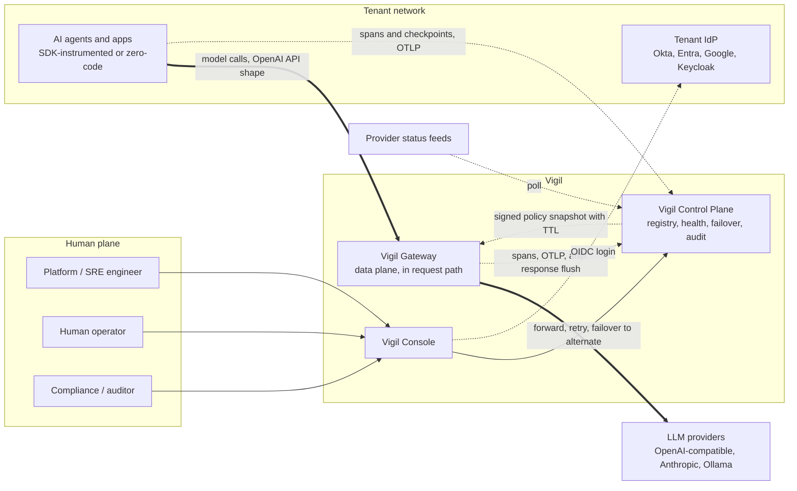
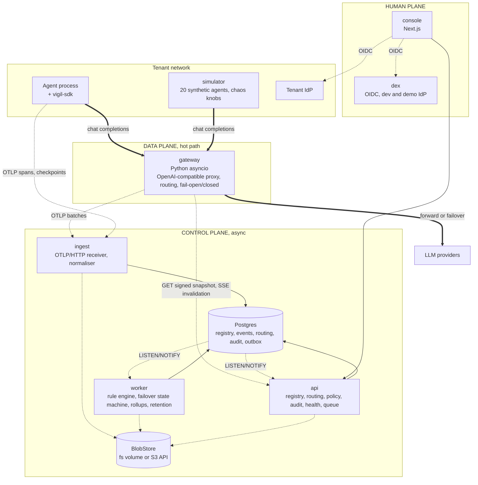

# Vigil — Step 2: Architecture and Decision Record

Chief architect · 2026-10-09 · Inputs: BRIEF.md, DECISIONS.md (D1–D10), STEP1-UNDERSTANDING.md, Step 1 report. Service internals (backend-architect), schema (database-architect), threat model (security-auditor), SLOs (sre-engineer), SDK and prediction contract (ai-engineer) are referenced, not repeated.

## 0. The shape in one paragraph

One Postgres, one thin in-line gateway, one control-plane image run as three processes, one console, one dev IdP. The **data plane** (SDK, gateway) is the only thing in the request path and never does synchronous I/O to the control plane. The **control plane** (ingest, api, worker) is asynchronous and may lag by seconds. The **human plane** (console, queue, IdP) is where automatic decisions are seen, undone and overridden. Two trust boundaries: the tenant's network and Vigil's. Crossing the first is OTLP or the OpenAI API shape; crossing the second is a signed policy snapshot or an authenticated, audited API call.

## 1. C4 Level 1: system context



Legend for both diagrams: thick = hot path, in the request path; thin solid = synchronous, not in the request path; dotted = asynchronous. In Phase 1 the gateway runs inside Vigil's boundary; in the cloud phase the same image can run as a sidecar inside the tenant network with the same snapshot contract.

## 2. C4 Level 2: containers



Rules the diagram encodes:

1. The gateway image has no DB driver and no DB credentials. It knows the control plane through `GET /v1/policy/snapshot` (signed, TTL) and `GET /v1/policy/stream` (SSE invalidation). Telemetry leaves after the response flushes, from a bounded queue with disk spill.
2. Postgres writers are role-separated: ingest writes events and payload refs; api writes registry, routing, audit, queue; worker writes health, failover, rollups, anchors.
3. Postgres carries the EventBus (outbox plus LISTEN/NOTIFY). No Redis, Kafka or Temporal in Phase 1.
4. The simulator is tenant-side: it uses the public SDK and gateway as a customer would.

## 3. Phase 1 → cloud: a packaging exercise

| Concern | compose (Phase 1) | Kubernetes + managed Postgres | Change |
|---|---|---|---|
| Postgres | `postgres:17`, volume | RDS / Cloud SQL / Azure PG | `DATABASE_URL`; no extensions (ADR-3) |
| BlobStore | fs volume | S3 / GCS / S3-compatible | `BLOB_BACKEND=s3` (ADR-5) |
| EventBus | Postgres outbox + NOTIFY | Same until > 5k events/s, then Redis Streams or NATS | `EVENTBUS_BACKEND` (ADR-4) |
| Identity | dex, static users | Tenant IdP by OIDC issuer | Issuer per tenant (ADR-8) |
| gateway | 1 replica, in-process counters | Deployment + HPA or tenant sidecar; Valkey counters | `RATELIMIT_BACKEND` |
| api / ingest / worker | 1 each, one image | Deployments, N replicas | None: `SKIP LOCKED`, `pg_advisory_lock` |
| Jobs, migrations | worker loop; `migrate` service | CronJob; Job, same entrypoints | None |
| Secrets, TLS | `.env`, Caddy | K8s Secrets, Ingress | None in code |

Why this is packaging, not re-architecture: 12-factor config via env only; stateless services (gateway caches only the snapshot; api and worker hold no sessions); each optional backend behind an interface with one Phase 1 implementation (`EventBus`, `BlobStore`, `RateLimitStore`, OIDC by discovery URL); logs to stdout; `/healthz` and `/readyz` everywhere; services self-instrument with OTel.

## 4. Architecture Decision Records

### ADR-1 · Python/FastAPI everywhere, including the gateway
**Context.** The gateway is in-line and core (D2); the brief suggests Go/TS. Team skill is Python; Pydantic models double as event, snapshot and OTel schemas.
**Decision.** Python 3.12, uvicorn, httpx streaming for the gateway as its own minimal image; FastAPI for api and ingest; asyncio for worker. CI benchmark gates p95 < 15 ms, p99 < 50 ms added at 200 concurrent streams.
**Alternatives.** Go now (second language and harness while the contract moves). Rust, Node (no gain).
**Consequences.** One language, one schema package. Asyncio handles > 1k rps per process; replicas beyond. A Go rewrite stays bounded because the gateway's three contracts (OpenAI shape in, OTLP out, snapshot) are language-neutral and frozen in `vigil-schemas`. CPU work stays off the request task; the benchmark catches it.

### ADR-2 · Own OpenAI-compatible gateway, not the LiteLLM proxy
**Context.** LiteLLM already solves adapters, fallbacks, streaming and cost tables.
**Decision.** Build a thin gateway for three provider families (OpenAI-compatible passthrough, Anthropic translation, Ollama). Vendor LiteLLM's model-price JSON as static data; no LiteLLM code in the request path.
**Alternatives.** LiteLLM proxy with plugins; LiteLLM as a library; Envoy AI Gateway or Kong AI.
**Consequences, weighed honestly.** Against LiteLLM: the repo is MIT but the proxy's `enterprise/` features (SSO, audit logs, guardrails) are commercially licensed and are exactly our governance surface, so we would compete with our dependency's paid tier; it is a very large dependency (hundreds of provider modules, heavy import, frequent breaking releases, several 2024–25 CVEs) in our most latency- and security-sensitive process; and our differentiators (signed snapshot, fail mode, tenant keys, routing state, checkpoint-aware handoff) must live below its plugin layer. For LiteLLM: provider breadth sooner. We accept slower expansion; three families cover most estates, the rest arrive by OTel (ADR-11). The most expensive build decision, and the one that makes the gateway ours.

### ADR-3 · Postgres with plain declarative partitioning, no TimescaleDB
**Context.** Events and rollups are time-series; Step 1 assumed Timescale.
**Decision.** Postgres 17; daily range partitions on `events`, `spans`, `payload_refs` managed by a worker job; 1 m and 1 h rollup tables; retention by dropping partitions.
**Alternatives.** TimescaleDB: compression and continuous aggregates are under the Timescale License and absent from RDS, Cloud SQL and Azure PG, which breaks D4's managed-Postgres migration. ClickHouse: second engine, unjustified below 50k events/s. pg_partman: adopt if the hand-rolled job annoys.
**Consequences.** Portable to any managed Postgres; we own small, boring rollup code. Ceiling roughly 5–10k events/s on one primary.

### ADR-4 · EventBus on Postgres: outbox table plus LISTEN/NOTIFY
**Context.** Auto-failover needs sub-second propagation of routing changes to gateways; ingest needs durable fan-out to the rule engine. D4 wants Postgres as the only stateful component; DECISIONS asks to reopen.
**Decision.** `EventBus` interface, Postgres implementation: durable events are rows in a partitioned outbox with per-consumer offsets; `NOTIFY` wakes consumers, 500 ms poll as fallback. Routing changes reach gateways via api's SSE stream (api listens on `routing_changed`, gateways re-fetch the snapshot). Target < 2 s end to end.
**Alternatives.** Redis Streams (sub-ms fan-out, consumer groups; Redis relicensed to RSALv2/SSPL/AGPL, Valkey is the clean fork; a second stateful component). NATS JetStream (Apache-2, one binary, excellent; a new operational concept, thin managed options). Kafka/Redpanda (Phase 3 scale).
**Consequences.** Zero new infrastructure; the hot path never touches the bus. Limits: NOTIFY payloads ≤ 8 KB (send ids), listeners need dedicated connections, one primary bounds throughput. Reopen at > 5k events/s, when a second consumer group needs replay, or when gateway replicas need shared counters (Valkey arrives for counters first).

### ADR-5 · BlobStore for full-capture payloads: fs adapter plus S3 adapter
**Context.** D7 stores every prompt, output and tool call: large, cold after days, needing per-tenant encryption and erasure.
**Decision.** `BlobStore` interface; Postgres holds `payload_refs` (tenant, sha256, size, key id, uri). Phase 1 ships `fs` (compose default) and `s3` (boto3: AWS, GCS interop, MinIO, SeaweedFS). No payload bodies inline in event rows. Envelope encryption with a per-tenant data key before write.
**Alternatives.** JSONB inline (bloats partitions and backups, couples payload retention to events, makes erasure a row rewrite). MinIO as default (AGPLv3, community edition stripped in 2025; fine as a tenant's choice).
**Consequences.** Mechanical cloud migration; payloads erasable independently of the audit chain (ADR-12). The fs volume is the only stateful thing besides Postgres.

### ADR-6 · Auto-failover as a Postgres-backed state machine; Temporal deferred
**Context.** Failover is automatic (D6) with undo, override and kill switch; it must survive worker restarts, timeouts and retries.
**Decision.** `failover` rows with explicit states (`proposed → approved → shifting → shifted → verifying → failed_back | rolled_back | killed`), `next_action_at`, attempt counters; worker claims steps with `SELECT … FOR UPDATE SKIP LOCKED`; each step is idempotent, keyed by `(failover_id, step, attempt)`; every transition writes audit. backend-architect owns transitions, hysteresis and approval gates.
**Alternatives.** Temporal (MIT; right for Phase 2 runbook sagas; four services plus schemas is too much now). Celery/Dramatiq (queues, not workflows).
**Consequences.** Mechanical port to Temporal later since steps are already activities. "Undo" for an already-shifted stream is a Step 3 design item.

### ADR-7 · Multi-tenancy: shared schema, `tenant_id` everywhere, Postgres RLS
**Context.** Commercial and multi-tenant from day one (D1).
**Decision.** Single schema; `tenant_id` and an RLS policy on every table; app roles non-superuser without `BYPASSRLS`; each transaction runs `SET LOCAL app.tenant_id`; API keys and OIDC subjects resolve to a tenant before any query; one isolation test per table in CI.
**Alternatives.** Schema-per-tenant (migration fan-out, pool per schema, no gain below thousands of tenants). Database-per-tenant (a later residency tier via per-tenant DSN routing).
**Consequences.** Cheapest to operate, RLS as last line of defence. Noisy neighbours handled by per-tenant ingest quotas. A query path that skips `SET LOCAL` is a CRITICAL defect.

### ADR-8 · Identity: Vigil is an OIDC relying party; dex for dev and demo
**Context.** Zero budget (D10); SSO expected by the compliance buyer (D1, D8).
**Decision.** Vigil never stores passwords. Human login is OIDC Authorization Code + PKCE against a per-tenant issuer; org, roles and RBAC live in Vigil tables keyed by `(iss, sub)`. Compose ships dex (Apache-2, one small container, static bcrypt users for the demo personas). Machine identity is Vigil-issued, tenant-scoped, hashed API keys.
**Alternatives.** Keycloak (standard, ~1 GB Java; recommended to tenants, too heavy as default). Authentik (four containers). Zitadel (now AGPL). Built-in passwords (hashing, reset, MFA for no buyer value).
**Consequences.** SSO on day one; onboarding is "paste issuer and client id". SAML-only and SCIM are Phase 2 through the same RP layer.

### ADR-9 · Fail-open/fail-closed per agent and the signed policy snapshot
**Context.** Vigil must not be a SPOF; the gateway must enforce policy with no synchronous control-plane call.
**Decision.** Each agent has explicit `fail_mode ∈ {open, closed}`, no implicit default; each tenant sets `unknown_agent_fail_mode` at setup for auto-registered agents. The snapshot is a per-tenant document (agents, tiers, fail modes, routing chains, budgets, rate limits, credential references) signed with Ed25519 by api, carrying `version`, `issued_at`, `ttl`. Gateway verifies, caches, refreshes on SSE invalidation and at `ttl/2`. Past `ttl`: fail-open agents proceed with `vigil.policy_state=stale` on every span; fail-closed agents get a structured 503 after 30 s grace. Every bypass and stale decision becomes an audit event when the control plane returns.
**Alternatives.** Synchronous policy check per call (SPOF). Unsigned snapshot (routing injection). Global fail-open default (unacceptable for agents holding payment, deletion or external-communication tools).
**Consequences.** Control-plane outage degrades observability and freezes routing; it never blocks a fail-open call. Signing-key custody is a Step 3 security item.

### ADR-10 · Provider credential custody: vaulted per tenant, passthrough as opt-out
**Context.** Cross-provider failover is impossible if the gateway only forwards the caller's own key.
**Decision.** Tenants register provider credentials in Vigil (encrypted with the per-tenant data key); the snapshot carries references; the gateway fetches the bundle over the same authenticated channel, holds it in memory only, never logs it. Per-agent `credential_mode=passthrough` disables cross-provider failover and the console says so.
**Alternatives.** Passthrough only (the continuity claim fails). Sidecar-only (right for high-security tenants; moves custody rather than removing it).
**Consequences.** Vigil becomes custodian of customer provider keys, the largest new security obligation from Step 2. security-auditor owns it in Step 3.

### ADR-11 · OpenTelemetry GenAI semantic conventions as the ingest contract
**Context.** The brief lists ten connectors; we can afford none.
**Decision.** Ingest accepts OTLP/HTTP (protobuf and JSON). SDK and gateway emit spans with `gen_ai.*` attributes at a pinned conventions version plus `vigil.*` extensions (agent id, task id, checkpoint, routing decision, policy state). Ingest normalises known renames and derives Vigil events from spans. Any framework with GenAI instrumentation (LangChain, OpenAI Agents SDK, Vertex, Bedrock, OpenLLMetry, OpenLIT) onboards without a connector.
**Alternatives.** Proprietary JSON event API (isolating later). Langfuse or OpenInference schemas (partial overlap, vendor gravity).
**Consequences.** The conventions are still in development; we carry a normaliser and a version pin. ai-engineer owns the attribute map and checkpoint span contract.

### ADR-12 · Audit tamper-evidence: per-tenant hash chain plus signed anchors
**Context.** The governance buyer must prove the chain degradation → alert → failover → handoff → completion is intact.
**Decision.** Append-only `audit_events` with `prev_hash` and `hash = sha256(prev_hash ‖ canonical_json(row))` per tenant; `UPDATE`/`DELETE` revoked and trigger-blocked; an hourly worker job writes a signed anchor (chain head, count, Ed25519 signature) to `audit_anchors` and exports it to BlobStore; `vigil audit verify` and `GET /v1/audit/verify` recompute. Audit rows hold payload hashes and references, never bodies, so erasure (ADR-5) cannot break the chain.
**Alternatives.** Hash chain alone (a writer rewrites the whole chain). Merkle tree per period (nicer proofs, more code). External anchoring to an RFC 3161 TSA or transparency log (Phase 2; the anchor format is built for it).
**Consequences.** Tamper-evident against DB edits lacking the signing key; not tamper-proof against an attacker holding both. The audit UI says so.

### ADR-13 · Monorepo layout and package boundaries
**Context.** Six parallel lanes against contracts frozen on day one.
**Decision.** `uv` workspace:
```
packages/vigil-schemas   Pydantic models: events, snapshot, OTel attribute constants, audit row. The only shared code.
packages/vigil-sdk       Public SDK; depends on schemas, httpx, opentelemetry-api/sdk only.
services/gateway         Own image; depends on schemas; no DB driver.
services/control         One image, three entrypoints: api, ingest, worker. Alembic lives here.
apps/console             Next.js, TypeScript, Tailwind.
apps/simulator           Uses vigil-sdk and the gateway as a customer would.
deploy/compose           Phase 1.   deploy/helm   Phase 2 skeleton.
docs/
```
import-linter enforces: nothing imports from `services/*`; gateway and sdk import schemas only.
**Alternatives.** Polyrepo (contract drift). Single package (the gateway inherits SQLAlchemy; the boundary erodes).
**Consequences.** The gateway's independence (ADR-1, ADR-2) is a build-time fact. The SDK can ship separately under its own licence.

## 5. Phase 1 containers

| Container | Language | Responsibility | State owned | Interface |
|---|---|---|---|---|
| gateway | Python asyncio | OpenAI-compatible proxy; routing per snapshot; retry, breaker, rate limit; fail-open/closed; OTLP after flush | Snapshot and credential bundle in memory; telemetry queue with disk spill | `POST /v1/chat/completions`, `/v1/messages`, `/v1/embeddings` |
| ingest | Python FastAPI | OTLP/HTTP receiver; API-key auth; GenAI normalisation; batched inserts; payloads to BlobStore | None | `POST /v1/traces`, `/v1/logs`, `/v1/metrics` |
| api | Python FastAPI | Registry, routing, snapshot signing, SSE, audit read/verify, health read, operator queue, OIDC RP, API keys | None | `/v1/*` REST, OpenAPI; `/v1/policy/snapshot`, `/v1/policy/stream` |
| worker | Python asyncio | Rules and health score; failover state machine; status poller; rollups; partitions, retention; anchors | None | `/healthz`; `vigil-worker run --once` |
| console | Next.js + TS | Fleet map, agent detail, queue, audit viewer with verify, admin | Browser session | HTTPS UI |
| postgres | Postgres 17 | Registry, partitioned events, routing, failover, audit, outbox, rollups, payload refs | All durable state | 5432; RLS roles per service |
| blobstore volume | fs or S3 adapter | Encrypted payload bodies; anchor exports | Payload bytes | `BlobStore` |
| dex | Go image | Dev/demo OIDC issuer, three personas | Static config | OIDC endpoints |
| simulator | Python | 20 agents, 3 providers, chaos knobs; real calls behind a flag | Scenario config | CLI; `POST /chaos/*` |
| migrate | control image | Alembic upgrade, run once | None | Exit code |

Ten containers, one run-once; Caddy optional for TLS.

## 6. Residual architectural risks

| # | Risk after these decisions | Settled by |
|---|---|---|
| R1 | **Credential custody (ADR-10).** Vigil holds tenants' provider keys; a gateway compromise leaks them. | Step 3: security-auditor's key scheme, rotation, scoping, breach model; database-architect's `provider_credential` entity; key-less mode for sidecar tenants. |
| R2 | **Python gateway under concurrent streaming (ADR-1).** The 15 ms p95 may fail at 200 streams; a late Go rewrite is costly. | Step 4: freeze the three gateway contracts in `vigil-schemas`; sre-engineer lands the CI benchmark gate in week one. |
| R3 | **Predicted auto-failover flaps (ADR-6, D6).** Rule-based "about to fail" has unknown precision; shifting a healthy agent is itself an incident; mid-stream undo is undefined. | Step 3: backend-architect's hysteresis, cooldown, max shifts per window, tier-1 propose-and-approve; Step 5: ai-engineer's precision targets before auto mode is default for tier-1. |
| R4 | **Full capture × multi-tenant × immutable audit (ADR-5, 7, 12).** The largest data liability; retention, erasure and residency interact with the chain. | Step 3: database-architect's retention plan; security-auditor's per-tenant encryption and erasure procedure; founder decision on default retention. |
| R5 | **Unstable ingest contract, unvalidated checkpoint semantics (ADR-11).** GenAI conventions keep renaming attributes; the handoff packet rests on a checkpoint API no operator has seen. | Step 4: ai-engineer pins the conventions version and `vigil.*` extension; packet schema reviewed with the founder before code. |
