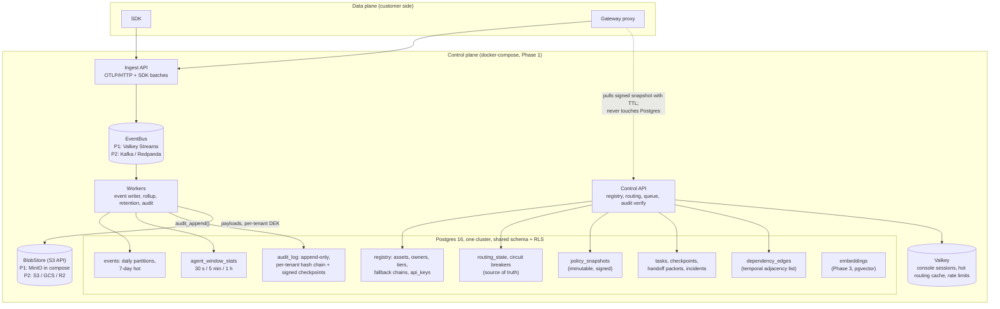
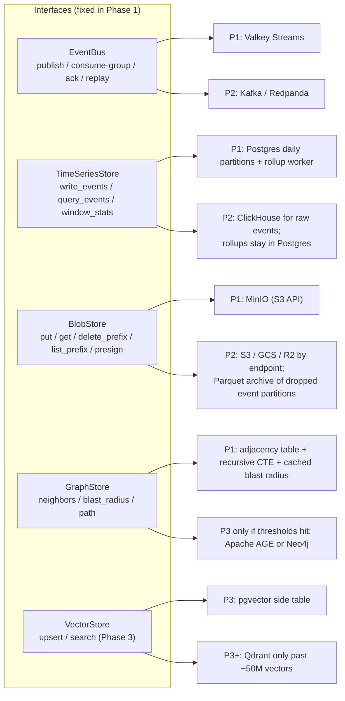

# Database Architect: Storage Architecture (Step 2)

Codename: Vigil. Date: 2026-10-09. Scope: where data lives, the interfaces that let it move, and the decisions that constrain Step 3. The entity model and event schemas are Step 3.

Inputs that change the Step 1 defaults: D1 (commercial), D4 (compose now, managed Postgres later), D7 (full capture), D10 (OSS only). D7 reshapes storage: payload bytes dominate everything else by two orders of magnitude.

## Sizing that drives the design

| Load | Raw event rows (~400 B) | Payload bytes (40% of events carry ~6 KB) | Payloads compressed (zstd ~5x) |
|---|---|---|---|
| Demo: 20 agents, ~10 ev/s | 350 MB/day | 2 GB/day | 0.4 GB/day |
| Phase 1 target: 1,000 ev/s | 35 GB/day (+ ~60% indexes) | 200 GB/day | 40 GB/day |
| Phase 2 target: 50,000 ev/s | 1.7 TB/day | 10 TB/day | 2 TB/day |

Two consequences. Payloads cannot live in Postgres past the demo: on managed Postgres they are the most expensive bytes we own and slow every backup, vacuum and migration, which defeats D4. Raw events at 50k/s are a columnar-store problem, so the event store sits behind an interface regardless of the Timescale decision.

## 1. Storage architecture





Beyond the diagram: routing state has Postgres as truth and Valkey as hot copy; the gateway reads only a signed snapshot. Policy snapshots are immutable JSONB rows with an Ed25519 signature. Handoff packet bodies over 64 KB spill to BlobStore. Valkey holds only data whose loss costs a re-login or a reset rate counter.

Licensing for a commercial, self-hostable product: **Valkey** (BSD) not Redis (RSAL/SSPL/AGPL since 7.4). MinIO is AGPLv3 with a shrinking community edition; we code to the S3 API only, so **SeaweedFS** (Apache 2) is a one-line compose swap. Postgres extensions are limited to what RDS, Cloud SQL and Azure all support: `pgcrypto`, `pg_trgm`, `btree_gin`, `pgvector`, optional `pg_partman`.

## 2. Multi-tenancy

| Model | Isolation | Ops cost at 100 tenants | Self-host fit | Verdict |
|---|---|---|---|---|
| Shared schema + `tenant_id` + RLS | Enforced by the database on every row; a missing `SET` fails closed | One schema, migration, backup | Same code; a self-host is a one-tenant install | **Recommended** |
| Schema per tenant | Strong, but 100 schemas × 40 tables × every migration; pool fragmentation | High; migrations are the bottleneck | Awkward | No |
| Database per tenant | Strongest; noisy-neighbour and residency solved | N backups, N upgrades | Natural "dedicated" enterprise tier | Not Phase 1; do not preclude |

Shared schema with RLS, designed so database-per-tenant stays possible as an enterprise tier: UUIDv7 primary keys, no cross-tenant foreign keys, no global business sequences, and a tenant-to-DSN catalog that in Phase 1 always returns the same DSN.

RLS pattern, applied by one migration helper to every tenant-scoped table:

```sql
ALTER TABLE agents ENABLE ROW LEVEL SECURITY;
ALTER TABLE agents FORCE ROW LEVEL SECURITY;          -- applies to the owner too
CREATE POLICY tenant_isolation ON agents
  USING      (tenant_id = current_setting('app.tenant_id', true)::uuid)
  WITH CHECK (tenant_id = current_setting('app.tenant_id', true)::uuid);
```

`current_setting(..., true)` returns NULL when unset, so a request that forgot the tenant sees zero rows, not every row. Every tenant-scoped index leads with `tenant_id`.

Role model:

| Role | Rights | Used by |
|---|---|---|
| `vigil_migrator` | Table owner, DDL | Alembic only |
| `vigil_app` | DML on tenant tables via parent only; EXECUTE `audit_append()`; SELECT on `audit_log`; NOBYPASSRLS, not the owner | Control API |
| `vigil_ingest` | INSERT on `events`; UPSERT on rollups | Writers |
| `vigil_admin` | BYPASSRLS, read-only | Support endpoints; every use writes an audit row |

Connection pattern: `SET LOCAL app.tenant_id = $1` as the first statement of every transaction, never session-level `SET`. `SET LOCAL` dies with the transaction, so a pooled connection (including PgBouncer transaction mode later) cannot leak a tenant to the next request. Ingest batches are grouped per tenant so the same rule holds on the write path.

The one isolation test every table gets, parametrised over `information_schema.tables` so a new table cannot escape it: insert as tenant A; switch to tenant B; assert SELECT returns 0, UPDATE and DELETE affect 0, INSERT carrying A's id raises an RLS violation; with no tenant set, SELECT returns 0; `relrowsecurity` and `relforcerowsecurity` are true and exactly one policy exists. Tables without `tenant_id` sit on an explicit allowlist (`tenants`, `alembic_version`).

## 3. Time-series and event storage

| Criterion | TimescaleDB | Plain declarative partitioning |
|---|---|---|
| Compression, continuous aggregates | Yes, under the Timescale License: **absent on RDS, Aurora, Cloud SQL; Azure ships only the Apache edition without them** | None; we own rollups and keep raw retention short |
| Managed-Postgres migration (D4) | Blocked, or Timescale Cloud (paid), or self-managed on Kubernetes | Works everywhere |
| 1k/s sustained, 5k burst | Comfortable | Comfortable; COPY on a laptop exceeds 50k rows/s |
| 50k/s sustained | 130B rows at 30 days is columnar territory | Not the end state either |
| Partition management | Automatic | Worker creates partitions 7 days ahead |

Decision: **plain declarative partitioning in Phase 1; ClickHouse for raw events behind TimeSeriesStore when sustained ingest passes ~5k/s or raw retention must exceed 14 days.** Rollups stay in Postgres permanently. Timescale is rejected because its useful features contradict the managed-Postgres migration, and at 50k/s the move to a columnar store happens either way.

Migration cost if a self-managed deployment later wants Timescale: same columns, `create_hypertable()` on a fresh table, copy day by day with `INSERT ... SELECT` (10 to 20 minutes per 35 GB partition), dual-write during the copy, swap names in one transaction, delete our partition job. About three dev-days, no API or schema change; the decision is about hosting, not code.

Event table shape: `events PARTITION BY RANGE (ts)`, daily partitions, `PRIMARY KEY (tenant_id, ts, event_id)` (UUIDv7 `event_id` keeps the index local), secondary index `(tenant_id, agent_id, ts DESC)`, hot scalar columns (`agent_id`, `trace_id`, `span_id`, `kind`, `status`, `latency_ms`, `tokens_in`, `tokens_out`, `cost_usd`, `model`, `provider`, `payload_ref`, `payload_sha256`) and a bounded `attrs JSONB` (≤ 4 KB, no captured content). Step 3 fixes which attributes are columns.

Write path: ingest validates and publishes to the EventBus; writers consume per tenant, batch 1,000 events or 200 ms, and write multi-row `INSERT ... ON CONFLICT DO NOTHING` (idempotent under at-least-once) at 20 to 30k rows/s per worker. If the CI ingest benchmark says that is short, switch to `COPY` into a per-batch temp table then `INSERT ... SELECT ... ON CONFLICT DO NOTHING`. No unlogged staging: the stream is the replay buffer. Ack only after commit. Payload bytes land in BlobStore before the event row, so a row never references a missing object.

Rollups: `agent_window_stats(tenant_id, agent_id, window_size, window_start, event_count, error_count, timeout_count, rate_limit_count, latency_hist int[], tokens_in, tokens_out, cost_usd)`. `latency_hist` is 40 fixed log-spaced buckets, so 5-minute and 1-hour rows are sums of 30-second rows and approximate p50/p95/p99 fall out of any window with no library. The worker runs every 10 s, closes 30-second windows behind a 60-second late-arrival watermark on `ingest_ts`, and upserts. The health engine reads ten 30-second rows per agent, one index range.

Retention tiers:

| Data | Default | Range | Mechanism |
|---|---|---|---|
| Raw events | 7 days | 1 to 30 | `DETACH PARTITION CONCURRENTLY`, Parquet export (Phase 2), `DROP` |
| 30 s rollups | 3 days | fixed | Daily partitions, dropped |
| 5 min rollups | 90 days | fixed | Monthly partitions |
| 1 h rollups | 13 months | up to 24 | Monthly partitions |
| Payloads | 30 days | 7 / 30 / 90 by plan | Sweeper by date prefix; legal hold skips objects referenced by an open incident |
| Audit log | 7 years | per contract | Never swept in Phase 1; chain re-anchored at partition boundaries (§5) |

## 4. Full-capture payload storage

| Option | Compose | Cloud migration | Encryption at rest | GDPR erasure | Verdict |
|---|---|---|---|---|---|
| Postgres JSONB with cap | One container | Payload bytes bloat the managed instance | Disk or `pgcrypto` | One DELETE; backups keep the bytes | A trap at the first tenant |
| Filesystem adapter | Simple | Persistent volume, no lifecycle, single node | Disk only | Prefix delete | Unit tests only |
| S3 API (MinIO in compose) | One more container | Endpoint and credentials change | SSE plus our envelope layer | Prefix delete plus crypto-shredding | **Recommended** |

Phase 1 ships the S3 adapter as the only production implementation, MinIO in compose. No Postgres blob adapter is written, so nobody can ship with it on. The swap to S3/GCS/R2 is configuration.

Encryption happens in the BlobStore layer, not the store: zstd, then AES-256-GCM with a per-tenant data-encryption key wrapped by a master key from the environment (Phase 1) or a cloud KMS (Phase 2). Per-tenant keys give erasure that deletion cannot: destroy the wrapped key and every payload, including those in backups, is unreadable. Tenant erasure is prefix delete, key destruction, and a deletion event that cascades to derived data. Object keys are `tenant/{tenant_id}/{yyyy-mm-dd}/{trace_id}/{span_id}.bin`, one per span, so the trace view fetches in parallel via presigned URLs and the sweeper works by date prefix. Event rows carry `payload_ref`, `payload_sha256`, `payload_bytes`, so audit can prove what was captured without holding it.

Redaction remains a data-plane capability in Phase 1 even though D7 makes capture the default: the toggle must exist before the first EU tenant asks, and each object records which redaction profile, if any, was applied.

## 5. Audit log

Append-only `audit_log`, partitioned by month, RLS as everywhere, `seq BIGINT` per tenant, `row_hash = sha256(prev_hash || canonical_payload)`. Canonical form is RFC 8785 (JCS) computed by the application and stored as `canonical_sha256` beside `payload JSONB`; `verify` recanonicalises and checks both hashes, so an auditor can run it on an export in any language, independent of Postgres's JSONB text format.

Per-tenant chains, not one global chain: exports are self-contained, verify never reads another tenant's rows, and one tenant's legal retention does not couple to another's. Rows hold hashes and references, never captured content, so erasing payloads leaves the chain intact.

Writes go through one function so no client can insert an unchained row:

```sql
CREATE FUNCTION audit_append(p_tenant uuid, p_payload jsonb, p_canonical bytea)
RETURNS bigint LANGUAGE plpgsql SECURITY DEFINER AS $$
DECLARE v_prev bytea; v_seq bigint;
BEGIN
  PERFORM pg_advisory_xact_lock(hashtext(p_tenant::text));      -- serialise per tenant
  SELECT row_hash, seq INTO v_prev, v_seq FROM audit_log
   WHERE tenant_id = p_tenant ORDER BY seq DESC LIMIT 1;
  INSERT INTO audit_log(tenant_id, seq, payload, canonical_sha256, prev_hash, row_hash)
  VALUES (p_tenant, coalesce(v_seq,0)+1, p_payload, digest(p_canonical,'sha256'),
          coalesce(v_prev,'\x00'), digest(coalesce(v_prev,'\x00') || p_canonical,'sha256'))
  RETURNING seq INTO v_seq;
  RETURN v_seq;
END $$;

REVOKE ALL ON audit_log FROM PUBLIC, vigil_app, vigil_ingest;
GRANT SELECT ON audit_log TO vigil_app;
GRANT EXECUTE ON FUNCTION audit_append TO vigil_app;
CREATE TRIGGER audit_immutable BEFORE UPDATE OR DELETE OR TRUNCATE ON audit_log
  FOR EACH STATEMENT EXECUTE FUNCTION raise_immutable();
```

The advisory lock serialises one tenant's appends (thousands per second per tenant; audit never approaches that). A NOLOGIN role owns the table and the function; `vigil_app` has no INSERT, UPDATE or DELETE; the trigger stops the owner too.

Verify at scale: `audit_checkpoints(tenant_id, seq, row_hash, created_at, signature)` every 10,000 rows or every hour, signed with an Ed25519 key held outside the database. A hash chain alone is recomputable by anyone with DB write access; the out-of-DB signature is what makes rewriting history detectable. `verify(tenant, from_seq, to_seq)` checks one segment between checkpoints, so full verification parallelises and an incident verify takes milliseconds. Checkpoints at partition boundaries act as genesis records, so an old partition can be exported to BlobStore and dropped after legal retention while the live chain still verifies. Phase 2/3 anchoring: publish each checkpoint hash to OpenTimestamps or an RFC 3161 timestamp authority (both free), or a customer-owned S3 bucket with Object Lock.

## 6. Dependency graph

`dependency_edges(tenant_id, src_type, src_id, dst_type, dst_id, edge_type, attrs, valid_from, valid_to)`, `valid_to IS NULL` for current edges. The validity interval answers "what depended on provider X at 14:02" and ties the graph to the audit log. Blast radius is a recursive CTE with the PostgreSQL 14 `CYCLE` clause, depth cap 6, plus `blast_radius_cache(tenant_id, node, affected_agents[], computed_at)` refreshed on edge change, so alert enrichment and the console read one row.

A graph database earns its place when any of these holds: more than ~5 million edges per tenant, routine queries deeper than 6 hops with property filters along the path, centrality or path-ranking algorithms (Phase 3 concentration risk), or cold blast-radius p95 above 500 ms. None applies before Phase 3. `GraphStore` (`neighbors`, `blast_radius`, `path`, `upsert_edge`, `close_edge`) hides the engine; Postgres stays the system of record and any graph engine is a projection fed from the event bus.

## 7. Semantic search path

Phase 3 uses `pgvector`: on every managed Postgres allowlist, RLS applies to the vector table like any other, and a tenant's incidents and log summaries sit far below the ~50 million vectors where a dedicated store (Qdrant, Weaviate) pays for its own operations. Embeddings live in a side table `embeddings(tenant_id, entity_type, entity_id, model, dims, vector)` with an HNSW index, so changing the model is a re-embed job, not a schema change.

What Phase 1 must do so this is additive: stable UUIDv7 identities on every searchable entity; a `summary TEXT` column on incidents, alerts and packets written at creation; payloads addressable by `payload_ref` so an embedding job reads them through BlobStore; a per-entity derived-data registry so erasure cascades to embeddings. Nothing else.

## 8. Operational

Backup and restore: nightly `pg_dump --format=custom` for schema snapshots and demo seed export; **WAL-G** (or pgBackRest) shipping base backups and WAL to a `vigil-backups` bucket in the same object store from the first external tenant, for point-in-time recovery with a 5-minute RPO. MinIO is mirrored with `mc mirror`. A weekly CI job restores the latest backup into a fresh container, runs `audit verify` for every tenant and compares row counts. On managed Postgres the provider's PITR replaces WAL-G.

Migrations: Alembic, single head, `alembic check` in CI, `upgrade -> downgrade -> upgrade` on an empty and a seeded database. RLS, partitioning, grants and the audit function are hand-written; autogenerate is not trusted for them. Partitions come from a worker 7 days ahead, never from Alembic.

Zero-downtime rules: expand/contract only; app version N runs against schema N and N+1, migrate before deploy; add columns nullable, backfill in worker batches, then `ADD CONSTRAINT ... NOT VALID` and `VALIDATE`; `CREATE INDEX CONCURRENTLY` in an `autocommit_block`; never rename or retype in place (add, dual-write, migrate readers, drop later); `lock_timeout = '5s'` and `statement_timeout` in every migration session; text plus CHECK or lookup tables instead of Postgres enums; `DETACH PARTITION CONCURRENTLY` before `DROP`; no Alembic data migration beyond a few thousand rows.

Seed data: deterministic generator (`vigil seed --profile demo --seed 42`) with fixed UUIDs: 20 agents across OpenAI-compatible, Anthropic and Ollama, 6 business processes, owners, tiers, fallback chains, dependency edges, plus 7 days of synthesised events and rollups so the fleet map has history on first boot. Events load through the real ingest path. Incidents, failovers and handoffs are never seeded; the chaos scripts produce them live so the audit chain is genuine. Idempotent CLI, not a migration.

## 9. Top 5 storage risks and the Step 3 decisions that settle them

| # | Risk | Mitigation in this design | Step 3 decision |
|---|---|---|---|
| 1 | Payload volume under full capture swamps Postgres and backups | S3 BlobStore from day one, no Postgres blob adapter, per-tenant DEK, legal hold | Payload object granularity (per span confirmed?), the 4 KB `attrs` cap, which span kinds carry payloads |
| 2 | Cross-tenant leakage via pooled connections or owner bypass | `SET LOCAL`, `FORCE ROW LEVEL SECURITY`, non-owner app role, per-table isolation test, no-tenant fails closed | Final grant matrix per table; which tables are tenant-free (allowlist) |
| 3 | Raw events outgrow Postgres before the ClickHouse swap | Daily partitions, 7-day hot, TimeSeriesStore interface, Parquet archive, CI ingest benchmark at 5k/s | Event row width (columns vs `attrs`), rollup schema with mergeable histograms, the exact swap trigger |
| 4 | Audit chain either blocks writers or breaks under erasure | Per-tenant chains, in-DB `audit_append` with advisory lock, hashes-not-content, signed checkpoints, genesis at partition boundary | Canonical audit event schema; which fields are hashed vs referenced; checkpoint cadence |
| 5 | Extension lock-in blocks the managed-Postgres migration | Allowlist: `pgcrypto`, `pg_trgm`, `btree_gin`, `pgvector`, optional `pg_partman`; Timescale and AGE excluded | Confirm target cloud; confirm no migration uses anything off the allowlist |

Also for Step 3: `ingest_ts` vs `ts` semantics for the rollup watermark, and per-tenant quota fields on `tenants` so one tenant cannot starve the writer.
