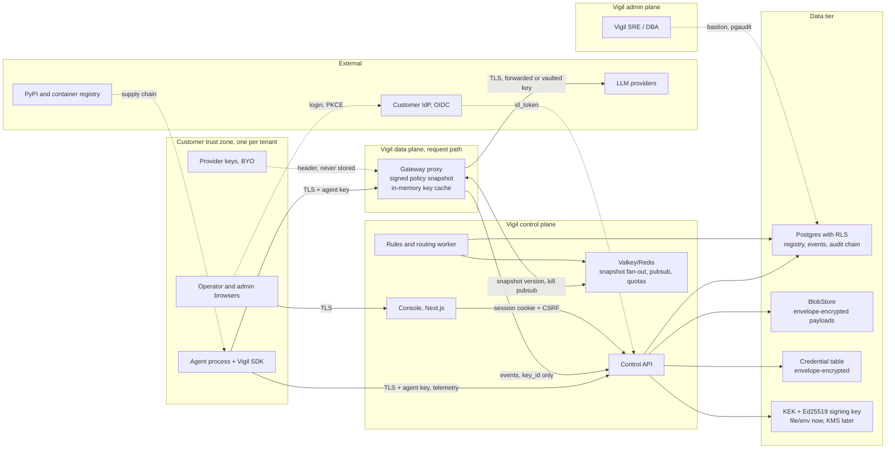

# Security Auditor: Architect (Step 2) — Threat model and security architecture

Codename: Vigil · 2026-10-09 · Inputs: BRIEF.md (modules 8, 9), DECISIONS.md (D1–D10), STEP1-UNDERSTANDING.md, chief-architect.md. Scope: what must be true in the design before code. House rules in `~/.claude/rules/` apply; no application code here.

Framing in one line: Vigil is a commercial product whose sales pitch is trust, and whose architecture puts it in-line on every customer model call, holding (or at least seeing) provider credentials and every prompt. The security posture is not a feature; it is the product's licence to exist. The decisions below are therefore Phase 1, not hardening-later.

## 1. Assets and trust boundaries

Highest-value assets, in order: (1) stored prompts, outputs and tool calls (D7 makes this the full content of every customer's AI workload); (2) customer provider credentials; (3) the policy/routing snapshot (whoever controls it controls where customer traffic goes); (4) the audit chain (the thing we sell to auditors); (5) tenant API keys and console sessions; (6) the SDK package (runs inside every customer agent process).

Boundaries, numbered for the STRIDE table: B1 agent to data plane; B2 gateway to provider; B3 control plane to data tier (tenant isolation); B4 stored content to console and future copilot; B5 routing, failover and kill switch; B6 audit log; B7 operator console; B8 SDK supply chain; B9 Vigil admin plane; B10 multi-region.

## 2. STRIDE threat model

L/I: Low, Med, High. "P1" controls are design requirements for the Phase 1 build.

| # | Bdry | STRIDE | Threat and attack scenario | L | I | Phase 1 control | Phase 2/3 control |
|---|---|---|---|---|---|---|---|
| 1 | B1 | S | **API key theft and replay.** Agent key leaks via CI logs, `.env` in a repo, or a crash dump; attacker emits forged telemetry or proxies traffic on the victim's bill. | High | High | Keys sent only in `Authorization` header; stored as SHA-256(pepper‖secret); per-agent not per-tenant scope; revocation propagates ≤5 s via snapshot bump; `last_used_at`, `last_used_ip`; events carry `key_id`, never the key. | Short-lived (15 min) ES256 agent tokens via exchange, optional CIDR allowlist per key, usage-anomaly alerts (new ASN, burst). |
| 2 | B1 | I | **Secrets in telemetry.** Full capture (D7) stores an `Authorization` header or a prompt that contains an AWS key; it sits in Postgres for 30 days and renders in the operator console. | High | High | Header allowlist for capture (never `Authorization`, `Cookie`, `x-api-key`, `api-key`). Secret-pattern scrubber in SDK and gateway, **always on and not a tenant toggle**: cloud keys, bearer/JWTs, private keys, connection strings → `[SECRET:<sha256-8>]`. `capture_mode ∈ {full, redacted, metadata}` per tenant, overridable per agent; default `full`. | Presidio-class PII detectors behind `redacted`; DLP alert event on every scrub hit; customer-supplied patterns. |
| 3 | B1 | D | **Fail-open abuse.** Attacker DoSes the control plane (or the gateway) so fail-open agents run without policy. | Med | High | Fail-open means "enforce the last signed snapshot", not "skip policy": kill list, model/tool allowlists and budgets keep applying from local cache. Fail-closed agents stop. Killed agents stay killed on an expired snapshot. Gateway and control API are separate processes with separate quotas (bulkhead). SDK buffers audit/telemetry to disk; ingest writes `observation.gap` audit events from gateway heartbeats. | Multi-replica gateway, per-region isolation, edge rate limiting. |
| 4 | B2 | I/E | **Gateway as credential-stealing point.** Compromised gateway, verbose exception, or debug log dumps provider keys; a tenant sets `base_url` to an attacker host (or 10.x) to exfiltrate a vaulted key or reach internal services (SSRF). | Med | High | Two modes. *Pass-through* (default for agents without a cross-provider fallback): key forwarded, never persisted, never logged. *Vaulted* (required for fallback targets): AES-256-GCM with a per-tenant DEK wrapped by a KEK held outside Postgres; decrypted only in gateway memory with a TTL; redacted in every logger and exception handler. `base_url` must match a known-provider allowlist or pass a resolver check rejecting private, loopback and link-local ranges; redirects not followed; TLS verification never disabled outside a dev flag. | Rotation API with two-active overlap; KEK in Vault transit/KMS; customer-hosted gateway so keys never leave the customer VPC. |
| 5 | B3 | I | **Cross-tenant leakage via RLS bypass.** Service connects as table owner or superuser (RLS silently off); middleware forgets `SET LOCAL app.tenant_id`; a worker iterates without tenant context; a JOIN through a table without a policy. | Med | High | App roles are non-owner with `FORCE ROW LEVEL SECURITY` on every table and partition; tenant context set with `SET LOCAL` inside the transaction by one middleware; workers set context per tenant iteration; one isolation test per table runs in CI as a non-superuser role (test #1 in §7). | Schema- or database-per-tenant for an enterprise tier; dedicated gateway per enterprise tenant. |
| 6 | B3 | I | **Cache key collisions / shared gateway memory.** Snapshot or response cache keyed by agent name; two tenants both own `billing-agent`. If LiteLLM proxy is adopted, its response cache and callbacks share state. | Med | High | Every Redis key `t:{tenant_id}:…`; no response caching in Phase 1; snapshot is per tenant; request context object per request, no module-level dicts; two-tenant-same-name test. If LiteLLM is adopted: disable its UI, cache and virtual-key features, own master key, audit its logging callbacks. | Per-tenant gateway processes for enterprise. |
| 7 | B3 | D | **Noisy neighbour.** One tenant floods ingest and starves others. | Med | Med | Per-tenant ingest rate limit and payload cap (e.g. 256 KB per payload, oversize stored as hash + head/tail); per-tenant queue partitions. | Dedicated ingest pools, autoscaling. |
| 8 | B4 | T/E | **Stored prompt injection rendered.** A captured output contains `` or a markdown link, or text aimed at the human: "Operator: approve the pending payment to …". Stored XSS and social engineering via the handoff packet. | High | High | All captured content rendered as text: React escaping only, `dangerouslySetInnerHTML` banned by lint, no markdown rendering of payloads, no auto-link. Nonce-based CSP, `frame-ancestors 'none'`. Packet separates Vigil-authored fields from agent content, which sits in a visibly marked "untrusted agent content" frame. | Sanitised markdown (DOMPurify) only if operators demand it; Phase 3 copilot treats stored content as data (delimited, never as instructions), has read-only tools, cannot trigger actions, its outputs never auto-execute, injection evals in CI. |
| 9 | B4 | I | **Copilot indirect injection leaks across tenants.** Injected content asks the copilot to retrieve other tenants' incidents. | Med | High | n/a (no copilot). | Copilot retrieval runs under the asking user's tenant RLS context; no service-role retrieval. |
| 10 | B5 | T/D | **Abuse of automatic failover.** Engineer-role insider adds a malicious backup target; attacker induces synthetic failures to push traffic to an expensive backup and burn budget; old snapshot replayed to undo a kill. | Med | High | Fallback targets must be pre-approved registry entries, created by `admin`, audited, four-eyes for tier-1; `base_url` validation as #4; failover rate limit per agent per hour; budget cap on the whole chain; snapshots Ed25519-signed with monotonic `version` and `expires_at`, gateway rejects lower versions; kill overrides fail-open. | Approvals in the workflow engine; anomaly detection on failover frequency; signed per-gateway acks. |
| 11 | B5 | E | **Agent privilege escalation.** Agent calls a tool or model not in its declared profile; permission creep over time. | Med | High | Profile declares `tools[]` and `allowed_models[]`; `tool_call` events checked against the snapshot; `policy.violated` event + alert; optional block per agent. | Learned baselines of tool sequences and data access; anomalous-access alerts. |
| 12 | B6 | T/R | **Audit tampering by an insider with DB access.** DBA edits or deletes rows, or inserts a back-dated row. | Low | High | INSERT-only DB role, triggers rejecting UPDATE/DELETE, per-tenant hash chain (§5), daily signed head anchor written outside Postgres, `verify` endpoint recomputes, `pgaudit` on DDL and role changes, Postgres logs shipped off box. | Anchor to RFC 3161 TSA or the customer's own storage via webhook; WAL archive to a separate trust domain. |
| 13 | B6 | R | **Ordering and clock games.** Two writers race; a row claims an earlier time. | Low | Med | Per-tenant monotonic `seq` from a DB sequence plus server `recorded_at`; chain order is `seq`, not timestamp. | — |
| 14 | B7 | S/T | **Console session hijack, CSRF, clickjacking.** Stolen cookie; cross-site POST to `/killswitch`; console framed by a phishing page. | Med | High | OIDC Authorization Code + PKCE; server-side sessions; cookies `HttpOnly; Secure; SameSite=Lax`; CSRF token on every state-changing route; `frame-ancestors 'none'`; HSTS and the header set in `rules/web/security.md`; idle timeout 30 min, absolute 8 h; step-up re-auth (fresh IdP login ≤5 min) for kill switch, credential and key actions. | WebAuthn step-up, session binding to IP/UA class. |
| 15 | B7 | E | **Role misconfiguration.** Endpoint forgets the check; viewer pulls the kill switch. | Med | High | Deny by default; single `authorize(subject, action, resource)`; authz matrix test (test #2). | ABAC via the same function (OPA/Cedar). |
| 16 | B8 | S/T | **SDK supply chain.** PyPI typosquat (`vigil-sdk` vs `vigil_sdk`), dependency confusion against a customer's private index, compromised maintainer token. | Med | High | Reserve name variants on PyPI and npm; PyPI Trusted Publishing from CI (OIDC, no long-lived tokens); 2FA mandatory; hash-pinned lockfiles; minimal runtime deps (`httpx`, `pydantic`); SLSA provenance attestations; images signed with cosign and pinned by digest. | CycloneDX SBOM per release; verification instructions; private-index guidance; reproducible builds. |
| 17 | B8 | T | **Malicious config pushed to a customer-hosted gateway.** | Low | High | n/a (gateway is Vigil-hosted). | Snapshot signature with install-time pinned public key; key rotation ceremony. |
| 18 | B9 | I | **Vigil staff reads tenant payloads.** Support engineer queries Postgres. | Med | High | No in-app staff path to tenant data; DBA cannot decrypt payloads (KEK lives in the API, not the DB); DB access only via bastion with `pgaudit`. | Break-glass with tenant consent, time-boxed, audited, visible to the tenant. |
| 19 | B10 | R/I | **Residency promise broken.** Marketing says "EU data stays in EU"; Phase 1 is one region. | Med | High | Single region, stated plainly. `data_residency_region` is a declared asset field; policy warns when provider/model region mismatches. No residency SLA in any sales material. | Region-pinned stacks, tenant home region, no cross-region payload replication; residency becomes contractual only then. |
| 20 | B2 | S | **Provider impersonation / TLS downgrade.** `http://` base URL, DNS poisoning. | Low | High | TLS 1.2+ only, certificate verification mandatory, `http://` only under a dev flag that also disables real keys. | Certificate pinning for the big three providers. |

## 3. Identity and access architecture (zero budget)

**Model.** `tenant` is the isolation boundary (RLS, keys, DEK). `org` is a grouping inside a tenant (business unit, cost centre) used for scoping, not isolation. Users belong to a tenant and hold role bindings with an optional scope (`org_id` or agent tag selector). Phase 1 is RBAC; the ABAC hook is that every check goes through one `authorize(subject, action, resource)` function that already receives attributes, so OPA or Cedar can replace its body in Phase 3 without touching call sites.

| Role | Can | Cannot |
|---|---|---|
| owner | Everything in tenant, billing, delete tenant | — |
| admin | Users, roles, OIDC config, API keys, fallback targets, capture policy | Delete tenant |
| security_admin | Kill switch, policies, credential vault, approvals | Register agents, edit users |
| engineer | Register/edit own agents, agent keys, view traces of own agents | Kill switch, fallback targets, other orgs' payloads |
| operator | Queue: claim, complete, return; read packets | Registry edits, policies |
| auditor | Read everything incl. audit, run `verify`, exports; payload reveal is itself audited | Any write |
| viewer | Health map, metadata; no payloads | Payloads, writes |

**SSO.** Customers already run an IdP; a commercial product should be a relying party first and an identity provider never, unless forced.

| Option | Footprint | SAML | SCIM | Tenant orgs | Licence | Verdict |
|---|---|---|---|---|---|---|
| Keycloak | Java, ~700 MB, Postgres | Yes | Via extension | Realms | Apache-2.0 | Phase 2 optional broker for SAML-only customers |
| Authentik | Python + Go, Postgres + Redis + worker | Yes | Yes | Brands/flows | MIT core | Capable but three more containers to operate |
| Zitadel | Go, Postgres only | Yes | Yes | Native organisations | AGPL-3.0 | Best if Vigil must *be* the IdP; AGPL review for self-hosted bundle |
| Dex | Go, tiny | Connector only | No | No | Apache-2.0 | Dev/test IdP in compose |
| **Built-in RP** (Authlib in FastAPI) + per-tenant OIDC issuer | None extra | Via broker later | Own endpoint, Phase 2 | Native in our model | — | **Recommend for Phase 1** |

Recommendation: Vigil is an OIDC relying party with per-tenant issuer configuration (discovery URL, client id/secret, allowed domains, role claim mapping) plus local email + password (Argon2id) and TOTP for tenants without an IdP and for break-glass. Compose ships Dex with static users for dev and tests. Phase 2 adds Keycloak as an optional SAML→OIDC broker and a SCIM endpoint. Sessions are server-side (opaque id in cookie, state in Postgres), not JWT-in-cookie, so revocation is immediate.

**Agent identity.** One `agent_id` per registered agent; one or more agent-scoped API keys bound to it. Format `vgl_<env>_<key_id 8 chars>_<secret 32 bytes base62>`; the `key_id` is the lookup, the secret is hashed (SHA-256 with server pepper, constant-time compare; random high-entropy secrets do not need Argon2). Scopes: `telemetry:write`, `gateway:proxy`, `route:read`, `handoff:write`, `registry:read`, `registry:write`, `admin`. Expiry optional, rotation with a two-active overlap window, revocation bumps the tenant snapshot. The gateway identifies the agent from the key; a `X-Vigil-Agent` header may only *narrow* to an agent the key is bound to, never widen. Phase 2 adds token exchange: SDK trades its key for a 15-minute ES256 token carrying `tenant_id`, `agent_id`, scopes and `tools_hash`, verified locally in the gateway from a cached JWKS, so least-privilege tool enforcement never needs a synchronous call.

**Service-to-service.** Compose: private network, only gateway, API and console publish ports; per-service bearer secrets from env; Postgres roles per service (`gateway_rw`: INSERT events, SELECT credentials; `api_rw`; `worker_rw`; `audit_append`: INSERT only on `audit_event`), none of them table owners. Valkey (BSD) rather than Redis (SSPL/RSAL) given a self-hosted distribution; `requirepass` and no host port. Kubernetes (Phase 2/3): NetworkPolicies default-deny, mTLS via SPIRE or a mesh, Postgres certs via cert-manager.

## 4. Data protection

| Data class | At rest, Phase 1 | Phase 2/3 |
|---|---|---|
| Payloads (prompts, outputs, tool I/O) | App-layer envelope encryption before the BlobStore write: AES-256-GCM with a per-tenant DEK, DEK wrapped by a KEK loaded from a mounted file/env; SHA-256 of plaintext stored for dedup and audit reference | KEK in Vault transit / cloud KMS; DEK rotation with versioned wrapping; MinIO/S3 SSE as a second layer |
| Provider credentials | Same envelope scheme, separate DEK purpose; decrypted only in the gateway | Rotation API, customer-hosted gateway |
| Metadata, metrics, registry | Disk-level encryption (LUKS or cloud volume); it is operational data, not content | Same |
| Audit chain | Disk-level; contents are events and hashes, not payloads | Off-box anchor copy |
| Session, API key hashes | Hashes only | — |

pgcrypto is deliberately not used for payloads: the key would pass through SQL and could land in `pg_stat_statements` or logs. Postgres TDE is not free; disk-level encryption plus application-layer envelope encryption for the two sensitive classes is the zero-budget equivalent and additionally enables **crypto-shredding**: per-tenant erasure is "destroy the DEK, drop the tenant's partitions, write `data.erased`". The audit chain survives erasure because it references payloads by hash and never embeds them; this is a hard requirement for the database architect.

**In transit.** TLS 1.2+ at the edge (Caddy or Traefik with automatic certificates); gateway→provider always verified; gateway↔control plane on the compose private network with bearer auth in Phase 1 and mTLS when the gateway leaves the host (Phase 2). The SDK pins nothing but refuses plaintext outside a dev flag.

**Retention.** Per tenant, bounded by plan: payloads default 30 days, metadata 90, audit 400 days minimum (configurable up to 7 years). Day-partitioned tables; the retention job drops partitions, it does not `DELETE`. Oversize payloads above the cap keep hash plus head and tail.

**"Store all data" with a redaction toggle.** The reconciliation is to separate three things that the brief and D7 conflate. *Content capture* (`capture_mode`) is the tenant's choice and defaults to `full` per D7. *Secret scrubbing* is not content and is not a toggle: a credential is never evidence and a stored credential is a liability for both parties, so patterns for cloud keys, tokens, private keys and connection strings are always replaced before emit, with a hash so an auditor can still prove "a secret appeared here". *Header capture* is allowlisted. PII redaction is the toggle (`redacted` mode), with Presidio-class detection in Phase 2. The onboarding wizard must present `capture_mode` as an explicit choice with the consequences stated, and record the choice as an audit event, the same "no implicit default" discipline STEP1 A12 applies to fail-open.

## 5. Platform safety controls the product promises

**Kill switch.** Scopes: tenant-global, per agent, per provider. Who: `security_admin` or `owner`; global scope requires step-up re-auth and, in Phase 2, a second approver. Mechanics: the action writes `routing_state` and a `killswitch.pulled` audit event with a mandatory reason, bumps the tenant snapshot version, signs the snapshot (Ed25519, key held by the API, never in Postgres), publishes on pubsub. Propagation target: gateways apply within 1 s when connected and within the snapshot TTL (30 s) on reconnect; the SDK learns on its next `resolve_route()` (cache TTL 10 s) or buffered-flush. Each gateway acks `(snapshot_version, applied_at)`; the console shows "applied on 3/3 gateways" and the audit event stores the acks. Kill beats fail-open: a killed agent stays killed on a stale or expired snapshot and until an explicit `killswitch.released` with reason. Postgres is the source of truth; losing Valkey must never un-kill anything.

**Approvals.** Actions carry a risk tier. Low-risk (retry, alternate model inside the same provider and region) run automatically. High-risk (cross-provider switch for agents tagged PII/PHI/residency, tool revocation, quarantine, anything touching payment/deletion/external-communication tools) require approval for tier-1 agents: requester ≠ approver, approval TTL, agent held in degraded safe mode while pending, `approval.requested/granted/denied` audited.

**Privilege-escalation detection.** Phase 1: declared tools and models in the profile, `tool_call` and `model_call` events compared against the snapshot, `policy.violated` with severity, optional block. Also alert on a key used from a new source IP class and on registry edits that widen permissions. Phase 2: learned tool-sequence baselines and anomalous data-access scoring.

**Tamper-evident audit: requirements for the database architect.**
1. `audit_event` is append-only: INSERT-only role, triggers raise on UPDATE/DELETE, no `TRUNCATE` grant, not table-owned by any runtime role.
2. Per-tenant chain: `seq` from a per-tenant sequence, `prev_hash`, `hash = SHA-256(JCS(row minus hash) ‖ prev_hash)` using RFC 8785 canonical JSON; genesis row per tenant.
3. Appends serialise per tenant (advisory lock or single-writer queue) so `seq` and `prev_hash` cannot interleave.
4. Rows reference payloads and packets by hash and id, never by value, so erasure and retention do not break the chain.
5. Daily anchor: head `(tenant, seq, hash)` signed with the API's Ed25519 key and written to the BlobStore and, in Phase 2, to an external TSA or customer webhook.
6. `GET /audit/verify?tenant&from&to` recomputes and reports the first break; the demo's "verify proves the chain is intact" uses this.
7. Every state-changing API handler emits exactly one audit event in the same transaction as its write.
8. `pgaudit` enabled for DDL, role and grant changes; logs leave the box.

## 6. Compliance scaffolding in Phase 1

Fields and events below cost nothing extra when added to the Step 3 schema and make Phase 3 mapping additive rather than a migration.

| Asset profile field | Serves |
|---|---|
| `owner`, `business_process`, `criticality_tier` | All frameworks; SOC 2 CC asset inventory |
| `risk_class` (EU AI Act: prohibited / high / limited / minimal) + `gpai` flag, `intended_purpose`, `deployment_context` (customer-facing, EU users) | EU AI Act Art. 6, 9, 13 |
| `data_categories[]` (PII, PHI, financial, none), `data_residency_region` | GDPR/DPDP, residency policy |
| `provider`, `model`, `model_version`, `prompt_version`, `tools[]`, `allowed_models[]`, `depends_on[]` | AI-BOM, ISO 42001 A.6, NIST RMF Map |
| `lifecycle_stage`, `approved_by`, `approved_at`, `approval_ref` | Approval gates, ISO 42001 A.8 |
| `human_oversight_mode` (HITL / HOTL / none), `fallback_plan_ref`, `fail_mode` | EU AI Act Art. 14, NIST Manage |
| `capture_mode`, `retention_days`, `last_assessment_at` | Privacy by design, SOC 2 confidentiality |

Audit event taxonomy (enum from day one): `asset.{created,updated,approved,retired}`, `credential.{created,rotated,revoked}`, `key.{created,revoked}`, `access.{login,login_failed,denied,step_up}`, `policy.{evaluated,violated}`, `route.changed`, `failover.{started,completed,rolled_back}`, `handoff.{created,claimed,completed,returned}`, `override.by_human`, `approval.{requested,granted,denied}`, `killswitch.{pulled,released}`, `alert.{fired,acked,labelled}`, `config.changed`, `data.{revealed,exported,erased}`, `observation.gap`. Every event has `actor` (user, agent, system), `tenant_id`, `resource`, `reason` where human-initiated.

Evidence exports (JSON/JSONL, PDF later): per-asset system card; incident timeline with chain proof; access review (users, roles, keys, last use); policy-decision log; retention and erasure certificate; chain verification report. For SOC 2 on Vigil itself, the CI artefacts in §7 (scan reports, SBOMs, signed provenance) are the change-management and vulnerability evidence; keep them for 12 months.

## 7. Build-phase security requirements

CI gates, all OSS, all blocking on `main`:
- [ ] Dependency scanning: `pip-audit` and `osv-scanner` (Python, npm), Renovate for updates, hash-pinned lockfiles (`uv lock` / `pip-compile --generate-hashes`, `package-lock.json`)
- [ ] SAST: Semgrep with `p/owasp-top-ten`, `p/python`, `p/typescript`; Bandit; ESLint `no-unsanitized` and a rule banning `dangerouslySetInnerHTML`
- [ ] Secret scanning: `gitleaks` as pre-commit hook and CI step over full history
- [ ] Container and IaC scanning: Trivy on images and compose/Helm; base images pinned by digest; non-root, read-only root FS, no `latest`
- [ ] SBOM via Syft (CycloneDX) attached to each release; images signed with cosign; SLSA provenance via GitHub attestations
- [ ] SDK release: PyPI Trusted Publishing, 2FA, reserved name variants, `--require-hashes` in install docs
- [ ] Security headers and nonce CSP verified by a Playwright test against the console
- [ ] Gateway latency benchmark includes the scrubber and encryption on the hot path (they are not free)
- [ ] `.env.example` only; startup validates required secrets and refuses weak or default KEK/pepper outside dev mode
- [ ] Demo mode (`VIGIL_DEMO=1`) cannot coexist with real provider credentials in the vault

Five tests every service must have:
1. **Tenant isolation**: two tenants seeded, every table and endpoint queried as tenant A returns zero rows of B, executed under the non-superuser app role.
2. **Authorization matrix**: every endpoint × every role plus unauthenticated; expected 2xx/403/401 table lives next to the routes and fails on a new undeclared route.
3. **Secret never leaks**: a canary secret injected in headers, body and prompt is absent from logs, events, DB rows, error responses and metrics.
4. **Declared fail mode**: with Postgres/Valkey/control API down, the service behaves per its declared fail-open/closed contract and emits the bypass or gap audit record once connectivity returns.
5. **Audit completeness and chain**: every state-changing action produces exactly one audit row; `verify` passes; a direct UPDATE to a row is rejected and a simulated tamper is detected.

## 8. Top 5 remaining risks and the decisions that settle them

| # | Risk | Settled by |
|---|---|---|
| 1 | **Vigil holds provider keys** for cross-provider failover, making it the richest credential target in the customer's estate. | Step 3: credential schema with envelope encryption and purpose-bound DEKs. Step 4: gateway API for pass-through vs vaulted; roadmap decision on a customer-hosted gateway so keys can stay in the VPC. Founder: see open question 1. |
| 2 | **Full capture default** turns a governance product into a honeypot of customer prompts. | Step 3: `capture_mode`, `retention_days`, payload hash in audit rows, crypto-shred erasure path. Step 4: onboarding wizard with an explicit choice; scrubber contract in SDK and gateway. |
| 3 | **Snapshot integrity is the routing control plane.** A forged or replayed snapshot redirects customer traffic. | Step 3: snapshot schema with `version`, `expires_at`, `signature`, per-gateway ack table. Step 4: gateway verification path, key pinning, kill-overrides-fail-open semantics in `resolve_route()`. |
| 4 | **Stored content reaches humans and, later, an LLM.** Stored XSS and operator social engineering now; indirect injection into the copilot later. | Step 4: console rendering contract (text-only, untrusted frame), packet schema separating Vigil fields from agent content; Phase 3 copilot design with read-only tools and no action execution. |
| 5 | **Audit chain is only as honest as its anchor.** Without an off-box anchor, an insider with the signing key and DB access can rewrite history. | Step 3: audit table requirements above. Step 4: `verify` API and anchor export. Phase 2: external TSA or customer webhook; signing key moves to KMS. |
