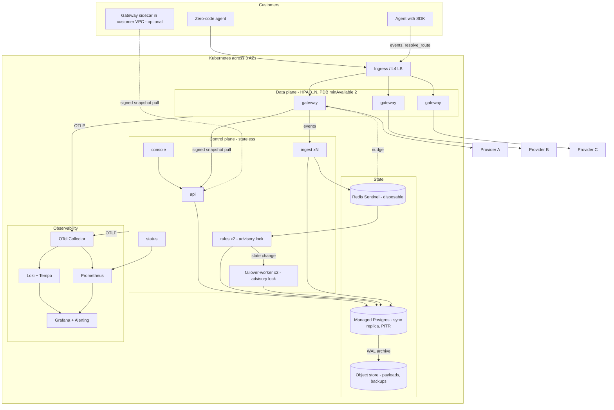

# SRE Engineer: Architect (Step 2) — Reliability and operations of Vigil itself

Date 2026-10-09. Inputs: BRIEF, DECISIONS D1–D10, STEP1-UNDERSTANDING, chief-architect discover. Scope: how Vigil stays up and provably safe while sitting in its customers' request path. No application code; config excerpts only.

Governing sentence: **Vigil's control plane may fail; a customer's model call must never fail because of it, unless that customer asked for exactly that (fail-closed).**

## 1. SLIs, SLOs, error budgets

Rolling 30-day window. "Promise" = stated to customers and shown on the in-product status page. "Internal" = tracked and alerted, not advertised.

| Component | SLI | Phase 1 SLO | Phase 2 | Promise? |
|---|---|---|---|---|
| Gateway | Added latency: `vigil_gateway_overhead_seconds` = gateway time minus upstream time; streaming = time to first byte plus per-chunk relay delay | p95 < 15 ms, p99 < 50 ms | p95 < 10 ms | Promise |
| Gateway | Availability: 1 − requests failed by the gateway itself (refused, or 5xx tagged `X-Vigil-Origin: gateway`) / all; upstream 5xx excluded; cross-checked by canary agents | 99.9% one container; 99.95% two replicas + nginx | 99.99% multi-AZ or sidecar | Promise, per deployment shape |
| Gateway | Fail-open correctness: during control-plane unreachability, requests handled per the agent's declared mode / all. `vigil_gateway_policy_decisions_total{mode,source}` plus canaries | 100%; any miss is Sev1 | same | Promise |
| Ingest | Acceptance latency: POST → 202, returned only after Postgres commit | p95 < 200 ms, p99 < 500 ms at 1k ev/s | same at 50k | Internal |
| Ingest | Loss: acked events never queryable, detected by `seq` gaps per emitter | < 0.01% | < 0.001% | Promise (audit depends on it) |
| Ingest | Freshness: accept → queryable | p95 < 5 s | < 2 s | Internal |
| Rule engine | Detection latency (MTTD): `observed_at` of first breaching event → health-state row changed | p95 < 90 s, p99 < 120 s (30 s window, two consecutive) | p95 < 60 s | Promise; the number the product sells |
| Rule engine | Freshness: every agent evaluated within 60 s | 99.9% of agent-minutes | same | Internal |
| Failover | Propagation: routing-state commit → gateway serving the new route (`snapshot_version` ≥ target) | p95 < 5 s gateway, < 30 s SDK | < 2 s | Promise |
| Failover | Completion: terminal state (rerouted, or packet queued) within 60 s | ≥ 95% | ≥ 99% | Promise (STEP1 §4) |
| Failover | Stuck: non-terminal > 5 min | 0 unalerted | same | Internal |
| Console + API | External probe of `/api/healthz`; page load p75 | 99.5%; < 2 s | 99.9% | Internal |
| Audit | Durability: audit row committed in the same transaction as the action, before the ack; `verify` pass rate | 100% / 100% | same | Promise |

Budgets (30 d): 99.5% = 3.6 h; 99.9% = 43 min; 99.95% = 22 min; 99.99% = 4.3 min. Consumers: deploys (single-replica gateway restart ≈ 10 s), Postgres restarts and vacuum stalls, host reboots, snapshot-expiry windows, our bugs. Policy: > 50% burned → gateway and ingest take only reliability changes until the budget recovers; 100% → deploy freeze, postmortem, fix is the next sprint's first item. Reviewed weekly with the alert-quality review (STEP1 R4).

## 2. Observability of Vigil itself

Pipeline (compose `observability` profile, on in demo and prod): every service → OTel SDK → OTel Collector (OTLP) → Prometheus (remote write), Tempo (traces), Loki (logs). Dashboards and alert rules live in `ops/grafana/` and `ops/prometheus/`; they are code and get PR review.

Rules:
- Self-telemetry never touches the hot path: bounded async exporter queues, drop on full. A dead collector costs metrics, not requests. Gateway traces sample 1% of successes, 100% of errors and policy decisions.
- Vigil does not dogfood its own ingest for self-observability in Phase 1; a broken ingest must not hide a broken ingest.
- Logs are JSON with `tenant_id`, `agent_id`, `trace_id`, `component`, `version`; never payloads.
- `agent_id` is never a Prometheus label; `tenant_id` only while tenants ≤ 100.

Golden dashboards, exactly four:
1. **Data plane**: gateway RED, overhead heatmap, policy-decision source, snapshot age, per-provider breaker state, in-flight streams.
2. **Pipeline**: ingest rate and latency, 202/429/503 split, stream depth and lag, Postgres commit latency, rule eval lag, detection-latency histogram, late-event rate.
3. **Control plane and state**: API RED, Postgres (connections, locks, WAL-archive lag, disk %), Redis memory, migration version, backup age, last restore-test age.
4. **Product promise**: MTTD p95, propagation p95, transitions in flight and stuck, tasks completed despite failure, audit `verify`, canary conformance.

No-noise rule. An alert may exist only if all four hold: it is on an SLI (symptom, not cause); it links a runbook; the on-call can act within the hour; it fired and was acted on in the last 90 days or in a drill. Anything that fires twice without action is deleted or demoted to a ticket at the weekly review. Pages use multi-window burn rates (fast 14.4× over 1 h and 5 m; slow 6× over 6 h and 30 m); 1× over 3 d is a ticket. Pager is Grafana Alerting → email and webhook (D10). Exactly three cause-based pages are permitted: snapshot stale, WAL archiving failing, disk > 85%.

```yaml
# ops/prometheus/rules/gateway.yml
groups:
- name: vigil-gateway
  rules:
  - alert: GatewayOverheadBudgetFastBurn
    expr: |
      (1 - sum(rate(vigil_gateway_overhead_seconds_bucket{le="0.015"}[5m]))
         / sum(rate(vigil_gateway_overhead_seconds_count[5m]))) > 14.4 * 0.05
      and
      (1 - sum(rate(vigil_gateway_overhead_seconds_bucket{le="0.015"}[1h]))
         / sum(rate(vigil_gateway_overhead_seconds_count[1h]))) > 14.4 * 0.05
    for: 2m
    labels: {severity: page, runbook: gateway-latency-regression}
    annotations: {summary: "Gateway p95 overhead SLO burning at 14x"}
  - alert: GatewayPolicySnapshotStale
    expr: time() - vigil_gateway_snapshot_issued_at_seconds > 300
    for: 2m
    labels: {severity: page, runbook: control-plane-down}
    annotations: {summary: "{{ $labels.instance }} has not refreshed policy for 5m; fail-closed agents block at TTL"}
```

Status inside the product. A `status` service (own container, no Postgres dependency) reads Prometheus and Redis heartbeats and serves `/status.json`: per component `operational | degraded | outage`, SLO attainment this month, 90-day bars, operator-set incident text. The console shows a header strip and a `/status` page. The gateway also serves `/vigil/status` locally (snapshot age, control-plane reachability, breakers), so a customer can see the gateway is fine while the console is not. Components are exactly the rows in §1; self-hosted customers get the same page.

## 3. Fail-open design verification

The artefact is a **policy snapshot** per tenant: `{schema_version, version, issued_at, expires_at, tenant_id, defaults: {unknown_agent_mode}, agents: {id: {mode, killed, route, fallback_chain[], rate_limit, budget_state}}}`, canonical JSON, Ed25519-signed; the gateway holds only the public key. TTL 15 min; refresh every 30 s by pull (ETag) with a Redis pub/sub nudge. The last good snapshot is persisted to `/var/lib/vigil/snapshot.json` (a volume), so a gateway restart during an outage still has policy.

| Snapshot state | Condition | Fail-open agent | Fail-closed agent | Killed | Unknown agent |
|---|---|---|---|---|---|
| live | refreshed < 60 s ago | forward per route | forward per route | 403 | tenant default (proposed: open, audited bypass) |
| stale | refresh failing, age < TTL | forward; status yellow | forward | 403 | tenant default |
| expired | age ≥ TTL | forward on last route; local breakers walk the fallback chain; bypass audit record queued | 503 `X-Vigil-Reason: policy-expired` | 403 | tenant default |
| none | nothing on disk at start | not ready; takes no traffic; never guesses | | | |

Two consequences. The fallback chain is in the snapshot, so the gateway executes retry → alternate provider locally with passive breakers while the control plane is down; the orchestrator changes *desired* state and records it, and is not needed for continuity. The kill switch is honoured in every state; an emergency kill without the control plane is a signed file dropped into the snapshot volume (runbook 6).

Readiness means "a snapshot is loaded", never "the snapshot is fresh"; otherwise expiry would pull the gateway from the balancer and defeat fail-open.

Proof in CI (`make test-failopen`, pytest + testcontainers, every PR touching gateway or policy):
1. Start gateway, stubs, control plane; register one open, one closed, one killed agent; assert 200/200/403.
2. `docker compose stop api`; assert 200/200/403 inside the TTL with `source=stale`.
3. Advance the gateway clock (`VIGIL_FAKE_NOW`) past TTL; assert 200/503/403; bypass audit record buffered.
4. Kill provider A's stub; assert the open agent walks its fallback chain within three failures.
5. Restart the gateway with the control plane still down; assert it serves from disk.
6. Flip one byte of the snapshot file; assert rejection, previous snapshot kept, `snapshot_rejected_total` increments.
7. Start the control plane; assert `source=live` within 60 s and buffered audit records land.

Proof in production: two **canary agents** per tenant (one open, one closed), driven every 60 s. `vigil_gateway_policy_conformance{mode}` is 1 when behaviour matched the table. It is the fail-open SLI and the evidence during the control-plane-down drill.

SDK buffering and replay. Events go to a local append-only segment queue (50 MB or 100k events; oldest dropped with a `vigil.sdk.dropped` counter). A flush thread sends batches ≤ 500 with exponential backoff and jitter (1 s → 60 s). Every event carries `event_id` (UUIDv7), `instance_id`, `seq`, `observed_at`; ingest dedupes on `(tenant_id, event_id)` with a unique index, so replay is idempotent and `seq` gaps give the loss SLI. The rule engine evaluates on `observed_at`, stores late events, and suppresses alerts for events older than two windows, so a reconnect after an hour pages nobody. `resolve_route()` caches with the same live/stale/expired semantics; expired plus unreachable means the agent's declared mode, and for an SDK agent "open" means calling the provider directly.

## 4. High-availability path

Phase 1, single host. Acceptable to lose for minutes: console, API, rule engine, orchestrator (that is the 99.5%). Never acceptable: a model call failing because Vigil is down (open agents), an acked event or audit row lost, a broken chain.

- Every service: `restart: unless-stopped`, healthcheck, `depends_on: condition: service_healthy`. The gateway depends on nothing and starts from disk.
- `prod-single-host` runs **two gateway replicas behind nginx** (~0.3 ms; buys zero-downtime deploys and single-crash tolerance). `dev` and `demo` run one.
- Postgres on its own volume with a `pgBackRest` sidecar: full nightly, differential 6-hourly, WAL archiving (`archive_timeout=60s`) to a local repo and, where one exists, MinIO on another machine. RPO 1 min; RTO 30 min same host, 60 min fresh host. **Weekly automated restore test** into a scratch container: migrations, audit `verify`, row counts; emits `vigil_backup_restore_test_success_timestamp`. A backup never restored is not a backup.
- Redis is disposable. Ingest commits to Postgres, then publishes; the rule engine keeps a Postgres cursor and catches up if the stream is gone. Losing Redis costs seconds of lag, zero events.
- Rule engine and orchestrator: one active instance under a Postgres advisory lock, a second as hot standby. This is what makes `replicas: 2` on Kubernetes a packaging change.
- Disk: warn 80%, page 85%; retention job (7-day raw, 30-day rollups, audit forever); WAL-archive-failure page, because a stuck archiver fills the disk.

```yaml
gateway:
  image: vigil/gateway:${VIGIL_VERSION}
  restart: unless-stopped
  volumes: ["gateway-snapshot:/var/lib/vigil"]
  healthcheck:
    test: ["CMD", "curl", "-fsS", "http://localhost:8080/readyz"]  # 200 iff a snapshot is loaded
    interval: 10s
    timeout: 2s
    retries: 3
    start_period: 10s
  stop_grace_period: 120s  # drain in-flight streams
```

Phase 2, Kubernetes (Helm chart in the same repo). Stateless Deployments for api, ingest, rules, failover-worker, console, status. Gateway: HPA (CPU 60% and `vigil_gateway_inflight` per pod), `minReplicas: 3`, PDB `minAvailable: 2`, topology spread across three zones, `terminationGracePeriodSeconds: 120`, preStop drain, readiness = snapshot loaded. Ingest HPA on stream lag. Rules and failover `replicas: 2` under the advisory lock. Managed Postgres (CloudNativePG when self-hosted) with a synchronous multi-AZ replica and PITR; Redis Sentinel, still disposable. Snapshot sources in order: control plane → Redis → local emptyDir; a new pod with none stays not-ready while peers serve.

What in Phase 1 code makes this a packaging change: 12-factor env config; stdout JSON logs; OTLP out; no local state except the re-fetchable snapshot cache; idempotent workers under the advisory lock; migrations as a separate one-shot step; `/healthz` and `/readyz` everywhere; SIGTERM drain; expand/contract schema discipline (§8).



## 5. Capacity and performance testing

| Profile | Agents | Gateway rps | Ingest ev/s | Where and when |
|---|---|---|---|---|
| CI smoke (PRs touching gateway or ingest) | synthetic | 200 for 60 s | 1,000 for 60 s; 5,000 burst for 20 s | self-hosted runner gates; shared runners warn-only |
| Demo (20 agents × 0.2 call/s × 5 spans) | 20 | 4 | 20 | laptop; nightly in `demo` |
| Phase 2 target (200 × 1 call/s × 5 spans) | 200 | 200 | 1,000 sustained; 5,000 burst | nightly on the reference host |
| Soak | 200 | 200 | 1,000 for 2 h | weekly; finds leaks and partition bloat |

Method. Provider stubs reply with a fixed delay (50 ms non-streaming; 20 chunks × 25 ms streaming), so overhead is measured two ways: k6 `http_req_duration` minus the stub constant, and the gateway's own `vigil_gateway_overhead_seconds` scraped after the run. Both must pass. Ingest: k6 POSTs batches of 50; afterwards a check waits ≤ 30 s and asserts Postgres count equals sent and `seq` is gap-free.

```js
// ops/k6/gateway.js (excerpt)
export const options = {
  scenarios: { steady: { executor: 'constant-arrival-rate', rate: 200, timeUnit: '1s',
                         duration: '60s', preAllocatedVUs: 50 } },
  thresholds: {
    'http_req_duration{kind:nonstream}': ['p(95)<65',  'p(99)<100'],  // 50 ms stub + 15 / 50 ms budget
    'http_req_duration{kind:stream}':    ['p(95)<565', 'p(99)<600'],  // 500 ms stub + budget
    'http_req_failed': ['rate<0.001'],
    'checks': ['rate>0.999'],
  },
};
```

Capacity under D7 (store all). At ~1.5 KB per event: demo ≈ 2.6 GB/day; Phase 2 at 1k ev/s ≈ 130 GB/day raw. Hence the BlobStore interface (filesystem adapter), an 8 KB inline payload cap with blob overflow, daily partitions and retention tiers are Phase 1 work. Reference `prod-single-host`: 4 vCPU, 16 GB, 500 GB SSD, separate WAL volume.

Go rewrite trigger (STEP1 A4), made precise: the Python gateway misses p95 < 15 ms at 200 rps streaming on the reference host on two consecutive nightly runs after the obvious fixes (uvloop, telemetry emitted post-flush, upstream connection pooling). Then the rewrite is scheduled, not debated.

## 6. Game days and chaos

Each drill is `make gameday-<name>`, run in `demo` under k6 load, writing a scorecard JSON (MTTD, propagation, error rate during drill, tasks completed, time to recover). The same code becomes the Phase 2 per-agent **failover-readiness score**: fallback configured, drilled within 30 days, MTTD and propagation within SLO, ≥ 90% tasks completed. Cadence: every drill nightly in CI; one per month by a human on `prod-single-host`, announced on the status page.

| Drill | Action | Expected | Fails if |
|---|---|---|---|
| Provider outage | stub B times out | B's agents degrade in < 90 s; one alert with blast radius; failover propagates in < 5 s; in-flight tasks become packets; failback only after verified recovery | > 1 alert; errors > 60 s after detection; flapping (> 2 transitions in 10 min) |
| Control plane down | stop `api rules failover-worker` 20 min | gateway serves (open 200; closed 200 until TTL then 503; killed 403); SDK buffers; status shows outage; on restart replay with zero loss and zero late alerts | any conformance miss; any late-event page |
| Postgres down | stop `postgres` 5 min | gateway unaffected; ingest 503, never a fake 202; replay drains in < 2 min; `verify` passes | an acked event missing; chain broken |
| Gateway crash | `kill -9` one replica (prod) or the only one (demo) | nginx 502s < 2 s, error rate < 0.1%; single replica restarts < 10 s and SDK agents go direct to provider | error rate ≥ 0.1% with two replicas |
| Redis loss | `rm -f redis` | zero loss; rule lag < 60 s after catch-up; gateway falls back to polling | any loss |
| Disk full | fill the Postgres volume | 85% page fired earlier; Postgres read-only; ingest 503; gateway fine; retention frees space | ingest 202 with nothing stored |
| Key rotation | rotate the signing key | both keys accepted during overlap; no 503s | any rejection in the overlap |

## 7. Runbooks Phase 1 ships (`docs/runbooks/`)

1. **Control plane down** — Confirm on status and `snapshot_issued_at`; note the TTL deadline for fail-closed agents. Restart `api rules failover-worker`; check `/readyz` and migration version. Watch replay drain and conformance return to `live`; open the incident.
2. **Gateway latency regression** — Compare the overhead heatmap against the last deploy marker; check breakers and in-flight count. Roll back the gateway image one replica at a time. Run `make bench-gateway`; file the bug with a flame graph.
3. **Ingest backlog** — Read stream depth, commit latency, 429 rate; find the noisy tenant or agent. Scale ingest or raise batch size; apply a tenant rate limit. Confirm `seq` gaps are zero after drain.
4. **Postgres full** — Check the WAL archiver first (usual cause), then partitions and bloat. Run retention manually, drop the oldest raw partitions per policy, extend the volume. Verify the archiver before closing.
5. **Stuck failover transition** — Find transitions > 5 min in `failover_transitions`; read last step and error. Retry the step, force to human queue with packet, or revert the route. Record the decision through the console, never SQL.
6. **Kill-switch invocation** — Console: agent → Kill (tier-1 approval if configured). Control plane down: `vigil-admin kill` signs an emergency snapshot into the gateway volume. Confirm 403s and the audit record; schedule the un-kill review.
7. **Restore from backup** — Choose the PITR target; `pgbackrest restore` into a fresh volume; migrations; audit `verify`. Start the control plane; confirm gateways report `source=live`. Publish the data-loss window on the status page.

## 8. Release and deploy

Compose profiles: `dev` (one of everything, hot reload, no TLS, simulator); `demo` (seeded 20 agents, chaos knobs, observability, one gateway); `prod-single-host` (two gateways + nginx with TLS, pgBackRest, observability, resource limits, log rotation, canaries on, simulator off).

Versioning: one semver for the platform; one git tag builds every image with that tag; the SDK has its own semver and a compatibility matrix; every event, snapshot and handoff packet carries `schema_version`, and servers accept N-1.

Migration-before-deploy: Alembic runs as a one-shot `migrate` service that everything else `depends_on` with `service_completed_successfully`. Expand/contract: a migration must work with the code already running; column removals ship one release after the code stopped reading them; no down-migrations, rollback is the previous image. Every migration also runs against last week's restored backup in CI (§4), which catches slow migrations on real data sizes. Host order: migrate → control plane → console → gateways one at a time behind nginx.

Kubernetes canary later: Argo Rollouts on the gateway with an AnalysisTemplate over Prometheus (overhead p95, gateway-origin error ratio, canary conformance), 5% → 25% → 100% with auto-abort. Control-plane services use rolling updates.

## 9. Top 5 reliability risks and the decisions that settle them

| # | Risk | Settled by |
|---|---|---|
| 1 | Gateway is the SPOF for zero-code agents on one host; "99.99% data plane" is not true there | Step 3: publish deployment shapes with honest SLOs (one container 99.9%; two + nginx 99.95%; sidecar or multi-AZ 99.99%). Step 4: gateway image runnable as a sidecar in the customer's network; SDK "open" = direct provider call |
| 2 | Snapshot semantics ambiguous (unknown agents, expiry, kill, no snapshot) | Step 3: snapshot schema with `defaults.unknown_agent_mode`, `expires_at`, `killed`; the §3 table becomes a contract test. Step 4: `vigil-admin kill`, gateway `/vigil/status` |
| 3 | Durability point confused: Redis Streams treated as a store | Step 3: Postgres is the only durability point; ingest acks after commit; rule engine keeps a Postgres cursor; Redis is cache plus nudge |
| 4 | Storage growth under D7 at 1k ev/s (130 GB/day) breaks single-host Postgres | Step 3: BlobStore with filesystem adapter, 8 KB inline cap with blob overflow, daily partitions, retention tiers. Step 4: payloads via `/events/{id}/payload`, never inline in lists |
| 5 | Replay after an outage causes an alert storm and corrupts MTTD | Step 3: `observed_at` and `received_at` on every event; detection latency defined on `observed_at`; alerts suppressed for events older than two windows. Step 4: ingest marks `late=true` |
