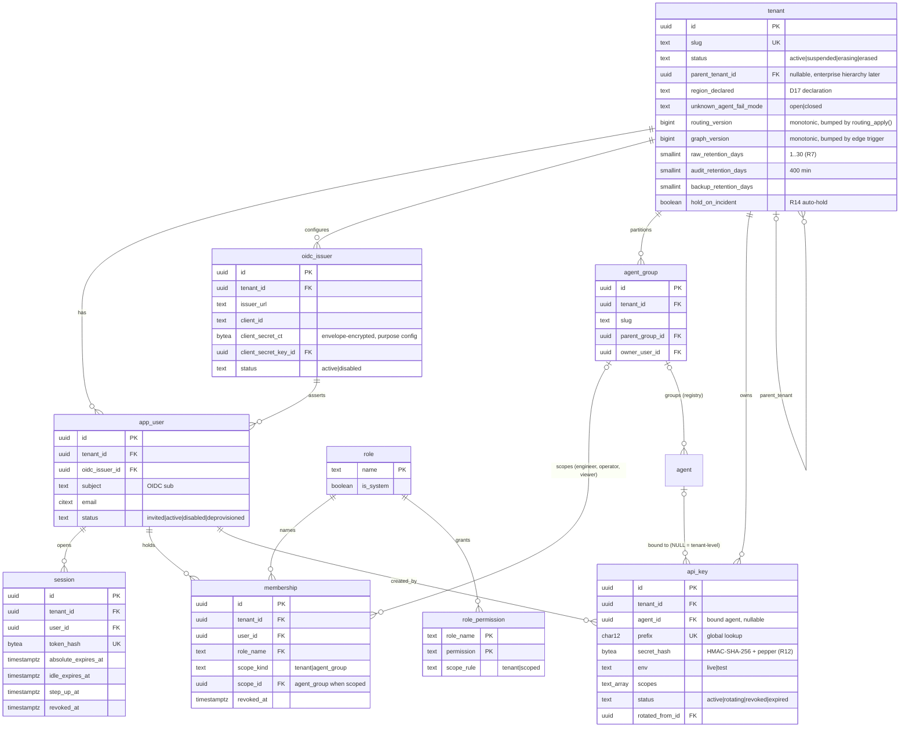
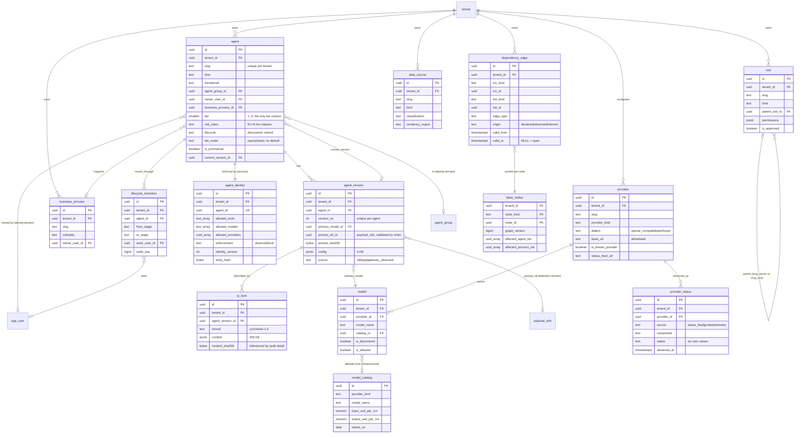
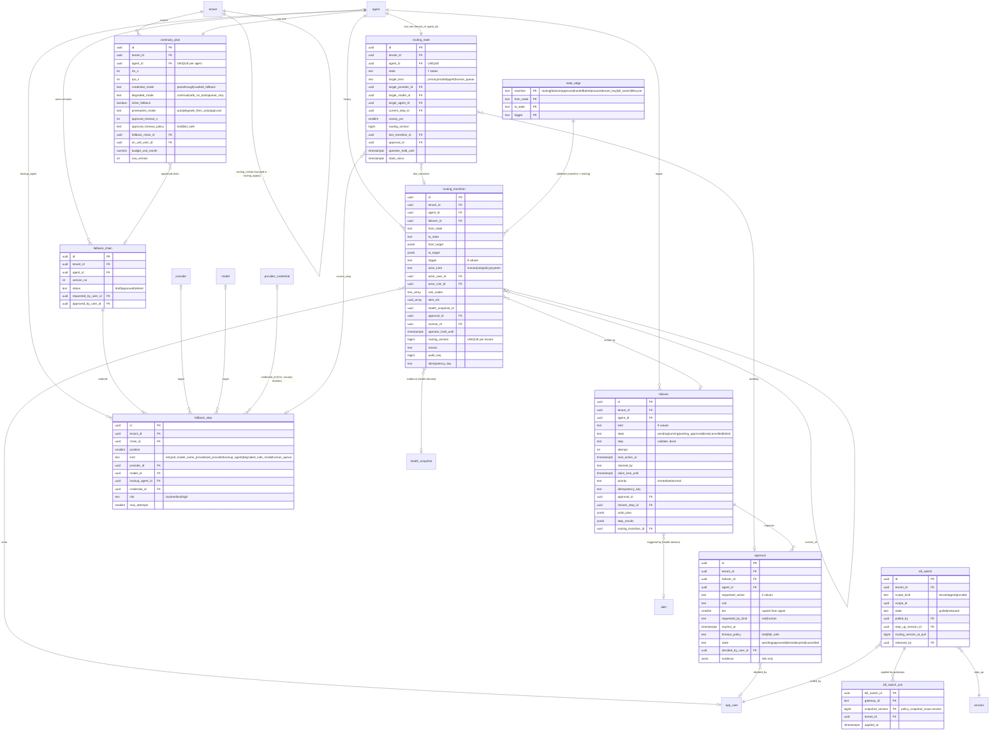
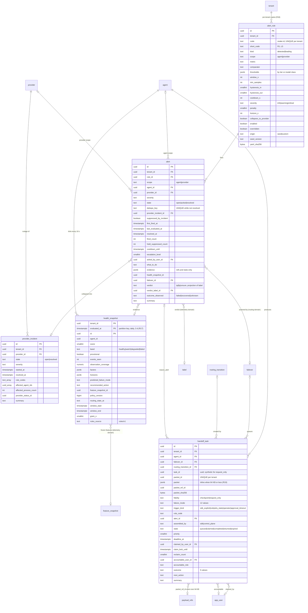
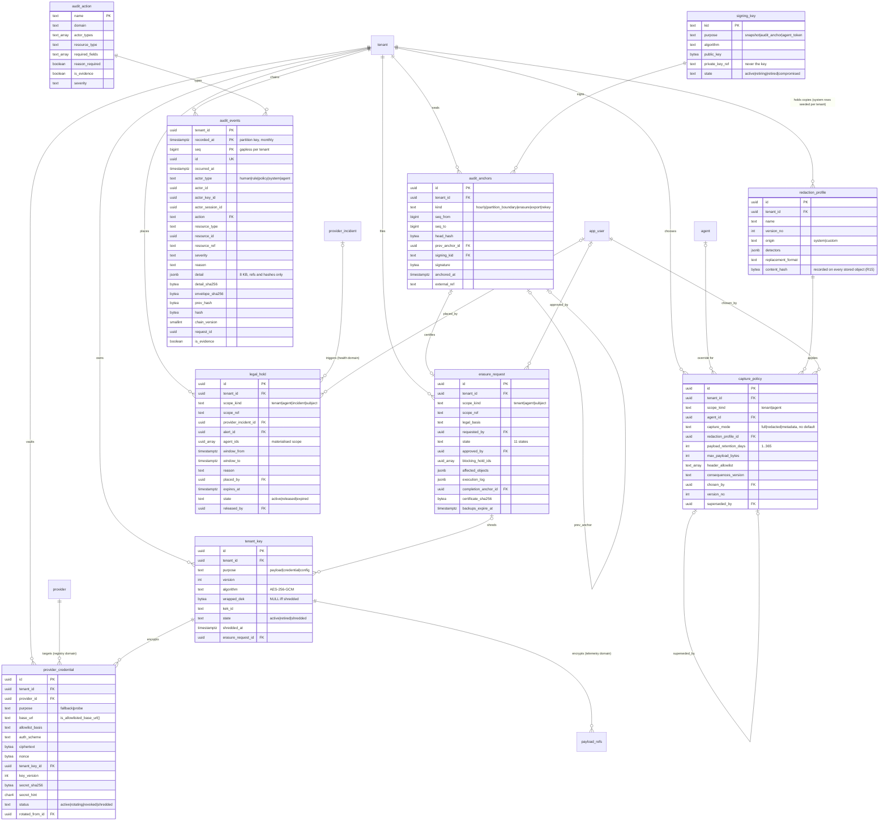
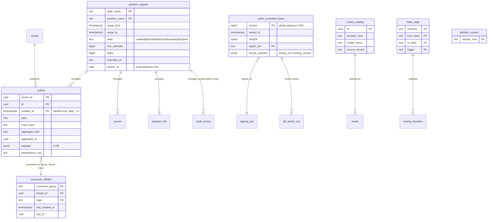

# Vigil — Step 3 deliverable: consolidated data model

Council synthesis by database-architect · wave 2 · 2026-10-10 · Inputs: CHAIR-RULINGS.md (R1–R20, applied, not relitigated), DECISIONS.md (D1–D18 + D13 clarification), the four wave-1 slices (database-architect, backend-architect, security-auditor, ai-engineer), ARCHITECTURE.md as amended. This document is the contract the build lanes code against: every table, column, CHECK set, function signature, write path and migration below is binding unless §9 marks it unresolved.

Notation used throughout. Postgres 17. `uuid` keys are UUIDv7 from `uuidv7()` (R20). Column lists are written `name type` with `?` = nullable, `=x` = default, `*` = part of the primary key, `→ table` = foreign key (composite `(tenant_id, x_id)` on every tenant-scoped target). `created_at timestamptz =now()` exists on every table and `updated_at` on every mutable table; both are omitted from the lists. Enums are `text` + `CHECK (col IN (...))` named `ck_<table>_<col>`; the value sets are frozen in §4.0 and mirrored in `vigil-schemas`. Roles: `vigil_app` (api), `vigil_ingest`, `vigil_worker`, `vigil_audit` and `vigil_routing` (NOLOGIN owners of privileged tables and SECURITY DEFINER functions), `vigil_migrate` (DDL). The gateway has no database role.

## 1. Overview

Nine domains, 62 tables.

| Domain | Tables | Owner (wave 1) |
|---|---|---|
| Tenancy & identity | `tenant`, `app_user`, `oidc_issuer`, `session`, `membership`, `role`, `role_permission`, `api_key`, `agent_group` | security-auditor (+ `agent_group`, `tenant` database-architect) |
| Registry & graph | `agent`, `agent_version`, `agent_identity`, `ai_bom`, `lifecycle_transition`, `provider`, `model`, `model_catalog`, `tool`, `data_source`, `business_process`, `dependency_edge`, `blast_radius`, `provider_status` | database-architect (`agent_identity` security-auditor) |
| Telemetry & rollups | `events`, `events_rejected`, `call_merge`, `payload_refs`, `checkpoint`, `agent_metrics_1m`, `agent_metrics_1h`, `feature_snapshot`, `label` | database-architect; documents by ai-engineer; `checkpoint`/`feature_snapshot`/`label` backend-architect |
| Routing & failover | `continuity_plan`, `fallback_chain`, `fallback_step`, `routing_state`, `routing_transition`, `failover`, `approval`, `kill_switch`, `kill_switch_ack`, `state_edge` | backend-architect (`kill_switch*` security-auditor) |
| Alerts & health | `alert_rule`, `alert`, `provider_incident`, `health_snapshot` | backend-architect |
| Queue & handoff | `handoff_task` | backend-architect |
| Policy & security | `tenant_key`, `provider_credential`, `capture_policy`, `redaction_profile`, `signing_key` | security-auditor |
| Audit & lifecycle | `audit_events`, `audit_action`, `audit_anchors`, `erasure_request`, `legal_hold` | security-auditor |
| Infrastructure | `outbox`, `consumer_offsets`, `partition_registry`, `policy_snapshot_issue`, `alembic_version` | database-architect (`policy_snapshot_issue` backend-architect) |

How data flows. The gateway and SDK emit `vigil-event/1` after the response has flushed; **ingest** authenticates the API key, resolves the agent (auto-registering a provisional one if needed), writes payload bodies to BlobStore and their metadata to `payload_refs`, stages the two-author `gen_ai.request` in `call_merge`, and appends everything else to `events` (append-only, daily partitions). The **worker** tails `events` by `received_at` every 10 s, recomputes dirty `agent_metrics_1m` buckets from scratch and the parent `agent_metrics_1h`, then the health engine reads ten 1-minute rows per agent (closed buckets plus the open partial minute under a `min_samples` guard, R6), writes a `health_snapshot` every tick (R17), fires or resolves `alert` rows (collapsing into `provider_incident`), and when a rule demands action opens a `failover` saga whose `write_routing` step calls `routing_apply()`: the only writer of `routing_state`, which also bumps `tenant.routing_version`, appends the immutable `routing_transition`, calls `audit_append()` and inserts an `outbox` row (R1). The **api** hears the NOTIFY, projects `agent ⋈ continuity_plan ⋈ routing_state ⋈ fallback_chain ⋈ api_key ⋈ provider` into the signed policy snapshot (`policy_snapshot_issue` records the issue), and pushes SSE to the gateway; operator actions (kill, quarantine, release, undo, approvals, queue claims) travel the same path inline. Every state change references what it saw rather than copying it: audit `detail` carries `event_id`, `payload_sha256`, `bom_sha256`, `transition_id`; `payload_refs.sha256` is the only bridge between content and evidence. **Erasure** walks a state machine in `erasure_request`: it checks `legal_hold` rows (R14), shreds the tenant's DEKs in `tenant_key` via `tenant_key_shred()`, deletes objects and rows in the cascade order of §6.5, and seals the chain with an `audit_anchors` row; `audit_events` and the hashes inside them survive, which is what makes the erasure certificate verifiable.

## 2. Entity-relationship diagrams

One diagram per domain. Entities from another domain appear by name only (no attributes) where a foreign key crosses the boundary. Composite `(tenant_id, id)` FKs are drawn as a single relationship line.

### 2.1 Tenancy & identity

### 2.2 Registry & graph

### 2.3 Telemetry & rollups

```mermaid
erDiagram
  tenant ||--o{ events : emits
  agent ||--o{ events : about
  api_key |o--o{ events : authenticated_by
  events }o--o| payload_refs : "payload_ref_id (join, no FK)"
  events }o--o| payload_refs : "raw_ref_id (OTLP batch)"
  call_merge ||--o| events : "flushes into (gen_ai.request)"
  events_rejected }o--|| tenant : rejected_for
  payload_refs }o--|| tenant_key : "encrypted by (security domain)"
  payload_refs }o--o| agent : "agent_id for erasure and holds"
  checkpoint }o--o| payload_refs : "state_ref_id when state over 64 KB"
  agent ||--o{ checkpoint : checkpoints
  events ||--o{ agent_metrics_1m : rolled_into
  agent_metrics_1m ||--o{ agent_metrics_1h : rolled_into
  agent ||--o{ feature_snapshot : frozen_for
  feature_snapshot |o--o{ label : "judged via"
  agent ||--o{ label : labelled

  events {
    uuid tenant_id PK
    uuid event_id PK
    timestamptz ts PK "partition key, daily"
    timestamptz observed_at
    timestamptz received_at
    boolean is_late "generated"
    text event_type "14 values"
    text source "sdk|gateway|ingest|worker|api"
    text schema_version "vigil-event/1"
    uuid agent_id "NULL only for provider.status and observation.gap"
    uuid agent_version_id
    uuid task_id
    uuid call_id
    uuid trace_id "16-byte OTel id"
    bytea span_id
    bytea parent_span_id
    text emitter_id
    bigint seq
    text provider
    text model
    text response_model
    text status "ok|error|handed_off|cancelled"
    text error_type "open, OTel error.type"
    text error_class "timeout|rate_limit|server_error|client_error|blocked|other"
    smallint http_status
    int latency_ms
    int ttfb_ms
    int tokens_in
    int tokens_out
    numeric cost_usd
    text policy_state "fresh|stale|expired|unavailable|not_applicable"
    bigint policy_version
    text route_decision
    text capture_mode
    bytea redaction_profile_hash "R15"
    uuid api_key_id
    int identity_version
    bytea tools_hash
    uuid payload_ref_id
    bytea payload_sha256
    bigint payload_bytes
    uuid raw_ref_id
    text normaliser_version
    text semconv_version
    jsonb ingest "1 KB, instrumentor and warnings"
    jsonb attrs "4 KB, never content (R19)"
  }
  events_rejected {
    uuid tenant_id PK
    uuid id PK
    timestamptz received_at PK "partition key, 3 d"
    text reason
    uuid raw_ref_id
    jsonb head "2 KB"
  }
  call_merge {
    uuid tenant_id PK
    uuid call_id PK
    timestamptz first_seen_at
    jsonb sdk_contribution
    jsonb gateway_contribution
    text state "partial|complete|flushed"
    timestamptz flush_due_at
  }
  payload_refs {
    uuid tenant_id PK
    uuid id PK
    timestamptz created_at PK "partition key, daily"
    text kind "span_content|raw_batch|prompt|checkpoint_state|handoff_packet|feature_snapshot|bom_export|anchor_export|comment"
    text uri
    text content_type
    text_array parts
    bytea sha256 "plaintext after redaction"
    bigint size_bytes
    bigint stored_bytes
    uuid tenant_key_id
    int key_version
    bytea nonce
    text capture_mode
    bytea redaction_profile_hash
    uuid api_key_id
    uuid agent_id
    text source_kind "event|checkpoint|packet|agent_version|bom|anchor"
    uuid source_id
    timestamptz expires_at
    text state "stored|swept|shredded"
  }
  checkpoint {
    uuid tenant_id PK
    uuid id PK "checkpoint_id from SDK"
    timestamptz created_at PK "partition key, daily"
    uuid agent_id
    uuid task_id
    int seq
    int step_index
    text step_name
    int state_bytes
    jsonb state "inline when 64 KB or less"
    uuid state_ref_id
    bytea state_sha256
    jsonb doc "steps, side effects, redaction, provenance"
  }
  agent_metrics_1m {
    uuid tenant_id PK
    uuid agent_id PK
    text provider PK
    text model PK
    timestamptz bucket_start PK "partition key, daily, 14 d"
    int request_count
    int error_count
    int timeout_count
    int rate_limit_count
    int server_error_count
    int blocked_count
    int inline_fallback_count
    int breaker_open_count
    int tool_call_count
    int late_count
    int policy_stale_count
    bigint tokens_in
    bigint tokens_out
    numeric cost_usd
    int ratelimit_remaining_min
    int_array latency_hist "40 log buckets"
    int_array ttfb_hist
  }
  agent_metrics_1h {
    uuid tenant_id PK
    uuid agent_id PK
    text provider PK
    text model PK
    timestamptz bucket_start PK "partition key, monthly, 13 months"
    int request_count
    int error_count
    int_array latency_hist
  }
  feature_snapshot {
    uuid id PK "ref is fs_ plus id"
    uuid tenant_id FK
    uuid agent_id FK
    timestamptz as_of
    text feature_set "features/vN"
    text reason "transition|alert|approval|sample"
    jsonb doc "FeatureSnapshot v1"
  }
  label {
    uuid id PK
    uuid tenant_id FK
    uuid agent_id FK
    text kind "six values"
    text judges_kind
    text judges_id
    uuid feature_snapshot_id FK
    timestamptz judged_as_of
    timestamptz labelled_at
    text labeller_kind
    text labeller_ref
    jsonb value
  }
```

### 2.4 Routing & failover

### 2.5 Alerts, health & queue

### 2.6 Policy, security, audit & lifecycle

### 2.7 Infrastructure

## 3. Table inventory: RLS allowlist and partition registry

Tenant-scoped = carries `tenant_id NOT NULL` first, `UNIQUE (tenant_id, id)`, `ENABLE` + `FORCE ROW LEVEL SECURITY`, exactly one policy named `rls_tenant_<table>` (`USING` and `WITH CHECK` on `tenant_id = current_tenant()`), every index leading with `tenant_id`. Tables marked N are the **infrastructure allowlist** (R2): no `tenant_id` column (or, for `consumer_offsets` and `policy_snapshot_issue`, a tenant column that is a cursor key, not business data), no RLS, SELECT-only for app roles except where the writer column says otherwise. Nullable `tenant_id` exists nowhere. Retention classes: **durable** (lives until erasure), **raw** (partition drop at `max(tenant.raw_retention_days)`, cap 30 d, per-tenant DELETE sweeper for shorter settings, R7), **payload** (objects swept at `expires_at` from the effective `capture_policy.payload_retention_days`, rows kept 400 d), **rollup** (14 d / 13 months), **short** (as stated), **audit** (`tenant.audit_retention_days`, 400 d minimum, partition dropped only after a sealed export), **training** (400 d or while referenced by a label), **revoked-400d** (revoked rows kept 400 d with secret material NULLed). Writer: the Postgres role(s) holding INSERT/UPDATE; **function-only** means no login role holds DML and the only path is the named SECURITY DEFINER function.

| # | Table | Owner | Tenant-scoped | Partitioned (key, grain) | Retention | Writer | RLS policy |
|---|---|---|---|---|---|---|---|
| 1 | tenant | database-architect | N (allowlist) | no | durable | api; `routing_apply()` bumps `routing_version`; edge trigger bumps `graph_version` | none (allowlist) |
| 2 | app_user | security-auditor | Y | no | durable, PII hashed on deprovision | api | rls_tenant_app_user |
| 3 | oidc_issuer | security-auditor | Y | no | durable | api | rls_tenant_oidc_issuer |
| 4 | session | security-auditor | Y | no | short: deleted 7 d after expiry | api; worker DELETE | rls_tenant_session |
| 5 | membership | security-auditor | Y | no | durable (revoked_at) | api | rls_tenant_membership |
| 6 | role | security-auditor | N (allowlist) | no | durable | migrate only | none |
| 7 | role_permission | security-auditor | N (allowlist) | no | durable | migrate only | none |
| 8 | api_key | security-auditor | Y | no | revoked-400d | api; ingest UPDATE on `last_used_at`, `last_used_ip_hash` only | rls_tenant_api_key |
| 9 | agent_group | database-architect | Y | no | durable | api | rls_tenant_agent_group |
| 10 | agent | database-architect | Y | no | durable | api; ingest INSERT (provisional auto-register) | rls_tenant_agent |
| 11 | agent_version | database-architect | Y | no | durable, immutable rows | api; ingest INSERT (`gateway_observed`) | rls_tenant_agent_version |
| 12 | agent_identity | security-auditor | Y | no | durable | api | rls_tenant_agent_identity |
| 13 | ai_bom | database-architect | Y | no | durable, immutable rows | worker | rls_tenant_ai_bom |
| 14 | lifecycle_transition | database-architect | Y | no | durable, append-only | api | rls_tenant_lifecycle_transition |
| 15 | provider | database-architect | Y | no | durable | api | rls_tenant_provider |
| 16 | model | database-architect | Y | no | durable | api; ingest INSERT (`is_discovered`) | rls_tenant_model |
| 17 | model_catalog | database-architect | N (allowlist) | no | durable | migrate; worker refresh job | none |
| 18 | tool | database-architect | Y | no | durable | api; ingest INSERT (unapproved auto-create) | rls_tenant_tool |
| 19 | data_source | database-architect | Y | no | durable | api | rls_tenant_data_source |
| 20 | business_process | database-architect | Y | no | durable | api | rls_tenant_business_process |
| 21 | dependency_edge | database-architect | Y | no | durable, temporal (valid_to) | api; ingest (observed); worker (inferred) | rls_tenant_dependency_edge |
| 22 | blast_radius | database-architect | Y | no | cache, version-invalidated | worker; api write-back on miss | rls_tenant_blast_radius |
| 23 | provider_status | database-architect | Y | no | short: 90 d DELETE sweeper | worker | rls_tenant_provider_status |
| 24 | events | database-architect | Y | yes (`ts`, daily) | raw | ingest; worker INSERT for `provider.status`, `health.transition`, `observation.gap`; api INSERT for `handoff.*`, `feedback`, `task.outcome` | rls_tenant_events |
| 25 | events_rejected | database-architect | Y | yes (`received_at`, daily) | short: 3 d | ingest | rls_tenant_events_rejected |
| 26 | call_merge | database-architect | Y | no | short: flushed rows deleted after 24 h | ingest | rls_tenant_call_merge |
| 27 | payload_refs | database-architect | Y | yes (`created_at`, daily) | payload | ingest; api (packets, notes, exports); worker (feature snapshots, anchors, BOM exports); worker UPDATE `state` | rls_tenant_payload_refs |
| 28 | checkpoint | backend-architect | Y | yes (`created_at`, daily) | payload | ingest | rls_tenant_checkpoint |
| 29 | agent_metrics_1m | database-architect | Y | yes (`bucket_start`, daily) | rollup: 14 d | worker | rls_tenant_agent_metrics_1m |
| 30 | agent_metrics_1h | database-architect | Y | yes (`bucket_start`, monthly) | rollup: 13 months | worker | rls_tenant_agent_metrics_1h |
| 31 | feature_snapshot | backend-architect | Y | no | training, immutable | worker | rls_tenant_feature_snapshot |
| 32 | label | backend-architect | Y | no | durable, immutable | api; worker | rls_tenant_label |
| 33 | continuity_plan | backend-architect | Y | no | durable | api | rls_tenant_continuity_plan |
| 34 | fallback_chain | backend-architect | Y | no | durable, immutable once approved | api | rls_tenant_fallback_chain |
| 35 | fallback_step | backend-architect | Y | no | durable, immutable once chain approved | api | rls_tenant_fallback_step |
| 36 | routing_state | backend-architect | Y | no | durable | function-only: `routing_apply()` | rls_tenant_routing_state |
| 37 | routing_transition | backend-architect | Y | no | durable, append-only | function-only: `routing_apply()` | rls_tenant_routing_transition |
| 38 | failover | backend-architect | Y | no | durable | worker; api (operator-immediate kinds) | rls_tenant_failover |
| 39 | approval | backend-architect | Y | no | durable | worker INSERT/expire; api decide | rls_tenant_approval |
| 40 | kill_switch | security-auditor | Y | no | durable | api | rls_tenant_kill_switch |
| 41 | kill_switch_ack | security-auditor | Y | no | durable, append-only | api (relays gateway acks) | rls_tenant_kill_switch_ack |
| 42 | state_edge | backend-architect | N (allowlist) | no | durable | migrate only | none |
| 43 | alert_rule | backend-architect | Y | no | durable | api; seed | rls_tenant_alert_rule |
| 44 | alert | backend-architect | Y | no | durable | worker; api (ack, verdict) | rls_tenant_alert |
| 45 | provider_incident | backend-architect | Y | no | durable | worker | rls_tenant_provider_incident |
| 46 | health_snapshot | backend-architect | Y | yes (`evaluated_at`, daily) | short: 3 d (R17) | worker | rls_tenant_health_snapshot |
| 47 | handoff_task | backend-architect | Y | no | durable | worker INSERT; api claim/complete | rls_tenant_handoff_task |
| 48 | tenant_key | security-auditor | Y | no | durable | api INSERT/retire; worker rotate; shred function-only `tenant_key_shred()` | rls_tenant_tenant_key |
| 49 | provider_credential | security-auditor | Y | no | revoked-400d, ciphertext NULLed on revoke | api | rls_tenant_provider_credential |
| 50 | capture_policy | security-auditor | Y | no | durable, immutable (supersede only) | api | rls_tenant_capture_policy |
| 51 | redaction_profile | security-auditor | Y | no | durable, immutable | api; tenant-creation seeds system rows | rls_tenant_redaction_profile |
| 52 | signing_key | security-auditor | N (allowlist) | no | durable | operator CLI as migrate role | none |
| 53 | audit_events | security-auditor | Y | yes (`recorded_at`, monthly) | audit | function-only: `audit_append()` | rls_tenant_audit_events |
| 54 | audit_action | security-auditor | N (allowlist) | no | durable | migrate only | none |
| 55 | audit_anchors | security-auditor | Y | no | audit | worker INSERT only | rls_tenant_audit_anchors |
| 56 | erasure_request | security-auditor | Y | no | durable | api (request, approve, reject); worker (execution states) | rls_tenant_erasure_request |
| 57 | legal_hold | security-auditor | Y | no | durable | api; worker (auto-create on incident, expire) | rls_tenant_legal_hold |
| 58 | outbox | database-architect | Y | yes (`created_at`, daily) | short: 7 d | api, worker, ingest (same tx as the state change) | rls_tenant_outbox |
| 59 | consumer_offsets | database-architect | N (allowlist; cursor key only) | no | durable | worker | none |
| 60 | partition_registry | database-architect | N (allowlist) | no | durable | worker | none |
| 61 | policy_snapshot_issue | backend-architect | N (allowlist, R2) | no | short: 30 d | api | none |
| 62 | alembic_version | database-architect | N (allowlist) | no | durable | migrate | none |

Sixty-two tables, `alembic_version` included. Allowlist, verbatim for the generated isolation test: `tenant, role, role_permission, model_catalog, state_edge, signing_key, audit_action, consumer_offsets, partition_registry, policy_snapshot_issue, alembic_version`. Every other table must pass the per-table isolation test (§7.4). Partition registry (worker-maintained, never Alembic): daily `events`, `events_rejected`, `payload_refs`, `checkpoint`, `health_snapshot`, `agent_metrics_1m`, `outbox`; monthly `agent_metrics_1h`, `audit_events`. Partitions are created 7 days (daily) or 2 months (monthly) ahead; dropped only from `detached|exported`, and `audit_events` partitions only from `exported` with an `anchor_id`.

## 4. Entity catalogue

### 4.0 Frozen value sets (every `CHECK` constraint; mirrored in `vigil-schemas`, migrations generated from it)

| Set | Values | Used by |
|---|---|---|
| event_type | `gen_ai.request, tool.call, agent.invoke, checkpoint, handoff.requested, handoff.completed, handoff.returned, feedback, task.outcome, agent.discovered, policy.decision, observation.gap, provider.status, health.transition` | events |
| source | `sdk, gateway, ingest, worker, api` (R9) | events |
| event status | `ok, error, handed_off, cancelled` | events.status (NULL for types without one) |
| error_class | `timeout, rate_limit, server_error, client_error, blocked, other` (derived at ingest from `error_type`/`http_status`; `error_type` itself is open text per OTel) | events, rollup counters |
| policy_state | `fresh, stale, expired, unavailable, not_applicable` | events |
| route_decision | `primary, failover, inline_fallback, canary, stale_primary` | events |
| capture_mode | `full, redacted, metadata` (D12; order `metadata < redacted < full`) | events, payload_refs, capture_policy, checkpoint |
| payload kind | `span_content, raw_batch, prompt, checkpoint_state, handoff_packet, feature_snapshot, bom_export, anchor_export, comment` | payload_refs |
| payload state | `stored, swept, shredded` | payload_refs |
| actor_type | `human, rule, policy, system, agent` (R9) | audit_events |
| actor_kind | `human, rule, policy, system` | routing_transition, failover |
| routing state | `active, degraded, awaiting_approval, failed_over, failing_back, quarantined, killed` | routing_state, routing_transition, state_edge(routing) |
| target_kind | `primary, model, agent, human_queue` | routing_state |
| transition trigger | `register, rule, approval, approval_timeout, operator, policy, failback_probe, canary, undo, system` | routing_transition |
| failover kind | `failover, preemptive, failback, undo, quarantine, release, kill, degrade, recover` | failover |
| failover state | `pending, running, waiting_approval, done, cancelled, failed` | failover |
| failover step | `validate, check_viability, write_routing, create_handoff_tasks, mark_alert_actioned, done` | failover |
| fallback kind | `retry, alt_model_same_provider, alt_provider, backup_agent, degraded_safe_mode, human_queue` (rank 0..5, non-decreasing by position) | fallback_step |
| approval action | `alt_provider_failover, backup_agent_failover, preemptive_failover, quarantine, inline_fallback_enable` | approval |
| approval state | `pending, approved, denied, expired, cancelled` | approval |
| handoff state | `queued, claimed, completed, returned, expired` | handoff_task |
| handoff outcome | `resolved, escalated, abandoned, returned_to_agent, expired_unclaimed` | handoff_task |
| fidelity | `checkpoint, request_only` | handoff_task |
| failure_mode | `provider_outage, latency_degradation, quality_collapse, prompt_injection, policy_violation, tool_failure, data_source_failure, infinite_loop, cost_runaway, permission_error, model_deprecation, silent_drift` | handoff_task, health_snapshot, label |
| alert state | `open, acked, resolved` | alert |
| severity | `info, warning, critical` (alerts); `info, notice, warning, critical` (audit) | alert_rule, alert, audit_action |
| band | `healthy, watch, degraded, failed` | health_snapshot |
| provider status | `operational, degraded_performance, partial_outage, major_outage, maintenance, unknown` (wire set; R4 thresholds map `degraded_performance`→degraded, `partial_outage`→partial, `major_outage`→major) | provider_status |
| erasure state | `requested, hold_blocked, approved, executing, keys_shredded, objects_deleted, derived_purged, verified, completed, rejected, cancelled` | erasure_request |
| hold state | `active, released, expired` | legal_hold |
| kill_switch state | `pulled, released` | kill_switch |
| tenant_key state | `active, retired, shredded` | tenant_key |
| lifecycle | `discovered, proposed, approved, deployed, monitored, retired` | agent, lifecycle_transition |
| risk_class | `unclassified, minimal, limited, high, unacceptable` | agent |
| agent kind | `chatbot, copilot, autonomous_agent, multi_agent, rag_pipeline, mcp_server, model_endpoint, workflow` | agent |
| fail_mode | `open, closed` | agent, tenant.unknown_agent_fail_mode |
| label kind | `alert_verdict, task_outcome, feedback, failover_outcome, handoff_outcome, provider_incident` | label |
| rule code | pattern `^[a-z][a-z0-9_]{2,40}$`; seeded `error_rate, p95_latency, consecutive_failures, provider_status, budget_breach, error_trend, latency_trend, ratelimit_proximity, budget_proximity, fallback_pressure` (short codes R1–R5, L1–L5) | alert_rule, routing_transition.rule_codes |

### 4.1 Tenancy & identity

**tenant** (global, allowlist). `id uuid*`, `slug text UK`, `name text`, `status text ='active'`, `parent_tenant_id uuid? → tenant`, `region_declared text?`, `unknown_agent_fail_mode text`, `hold_on_incident boolean =false`, `routing_version bigint =0`, `graph_version bigint =0`, `raw_retention_days smallint =7 CHECK 1..30`, `audit_retention_days smallint =400 CHECK ≥400`, `backup_retention_days smallint =35`, `ingest_events_per_s integer =1000`, `max_agents integer =500`. Dropped from wave 1: `payload_retention_days` (now `capture_policy`). Invariants: `erased` rows keep only id, slug, status, timestamps; `routing_version` and `graph_version` never decrease (only `routing_apply()` and the edge trigger touch them); `erasing` tenants get 429 on ingest; tenant creation is one transaction that also writes `tenant_key` v1 for `payload`, `credential`, `config`, the two system `redaction_profile` rows, the `alert_rule` seed copies (R18) and the genesis audit row; it never writes `capture_policy` (onboarding does).

**app_user** (security-auditor; `user` is reserved). `tenant_id uuid`, `id uuid*`, `oidc_issuer_id uuid → oidc_issuer`, `subject text`, `email citext`, `email_verified boolean =false`, `display_name text?`, `status text ='invited'`, `last_login_at timestamptz?`. UK `(tenant_id, oidc_issuer_id, subject)`; index `(tenant_id, email)`. Invariants: no column matching `password%|secret%|totp%` (schema test); deprovision or erasure replaces `email` and `display_name` with sha256 hex so audit actor references survive; one human at two tenants is two rows.

**oidc_issuer**. `tenant_id`, `id*`, `issuer_url text`, `client_id text`, `client_secret_ct bytea?`, `client_secret_key_id uuid? → tenant_key`, `allowed_email_domains text[] ='{}'`, `role_claim text?`, `role_claim_map jsonb ='{}'`, `jit_default_role text? → role CHECK NOT IN (owner, admin, security_admin)`, `status text ='active'`. UK `(tenant_id, issuer_url)`. Login starts from a tenant slug, so a shared issuer (dex) cannot cross tenants.

**session**. `tenant_id`, `id*`, `user_id → app_user`, `token_hash bytea UK`, `issued_at`, `absolute_expires_at` (issued + 8 h), `idle_expires_at` (last seen + 30 min), `last_seen_at`, `step_up_at timestamptz?`, `ip_hash bytea?`, `ua_class text?`, `revoked_at?`, `revoke_reason?`. Partial index `(tenant_id, idle_expires_at) WHERE revoked_at IS NULL`. Step-up actions require `step_up_at > now() − 5 min` and the audit row records `actor_session_id`.

**membership**. `tenant_id`, `id*`, `user_id → app_user`, `role_name → role`, `scope_kind text ='tenant'`, `scope_id uuid? → agent_group`, `granted_by → app_user`, `expires_at?`, `revoked_at?`, `revoked_by?`. UK `(tenant_id, user_id, role_name, scope_kind, coalesce(scope_id, nil_uuid()))`. CHECK: `role_name IN (owner, admin, security_admin, auditor) → scope_kind = 'tenant'` (R16); `scope_kind = 'agent_group' → scope_id NOT NULL`. Deferred constraint trigger keeps ≥ 1 active `owner` per tenant. Read live on every request, never cached in the session.

**role** / **role_permission** (allowlist). `role(name text*, description text, is_system boolean =true)` seeded with the seven roles; `role_permission(role_name* → role, permission text*, scope_rule text ='tenant' CHECK IN (tenant, scoped))`. CI diffs the table against security-auditor §6.

**api_key**. `tenant_id`, `id*`, `agent_id uuid? → agent` (**the key points at its bound agent; NULL = tenant-level; there is no `agent.default_key_id`**), `name text`, `env text CHECK IN (live, test)`, `prefix char(12) UK` (global, looked up before the tenant is known), `secret_hash bytea` (HMAC-SHA-256 with env pepper, R12), `scopes text[]` ⊆ `{telemetry:write, gateway:proxy, route:read, handoff:write, registry:read, registry:write, killswitch:pull}`, `status text ='active'`, `expires_at?`, `last_used_at?`, `last_used_ip_hash?`, `rotated_from_id? → api_key`, `rotation_grace_until?`, `created_by → app_user`, `revoked_at?`, `revoked_by?`, `revoke_reason?`. Indexes `(tenant_id, agent_id)`, partial `(tenant_id) WHERE status = 'active'`. Invariants: format `vgl_<env>_<prefix12>_<secret>` (R13); `X-Vigil-Agent` may only narrow to the bound agent, or for a tenant-level key to an agent of that tenant; revocation inserts an `outbox` `policy_changed` row in the same transaction; `secret_hash` is SELECTable by `vigil_app` and `vigil_ingest` only (ingest verifies telemetry keys locally; the gateway verifies from the snapshot).

**agent_group** (R16 replacement for `org`). `tenant_id`, `id*`, `slug text`, `name text`, `description text?`, `parent_group_id uuid? → agent_group`, `owner_user_id uuid? → app_user`. UK `(tenant_id, slug)`. A group is an authorization scope and a reporting unit, not an isolation boundary; billing separation is a second tenant.

### 4.2 Registry & graph

**agent**. `tenant_id`, `id*`, `slug text` (UK per tenant; `unclaimed/<hash8>` when auto-registered), `name text`, `description text?`, `kind text`, `framework text?`, `agent_group_id uuid? → agent_group`, `owner_user_id uuid? → app_user`, `business_process_id uuid? → business_process`, `tier smallint =3 CHECK 1..3` (**the only tier column; `continuity_plan.criticality_tier` and `approval.criticality_tier` are removed, `approval.tier` copies this at request time**), `risk_class text ='unclassified'`, `lifecycle text ='discovered'`, `is_provisional boolean =false`, `fail_mode text` (**no default; the only fail-mode column, `continuity_plan.fail_mode` is removed**), `current_version_id uuid? → agent_version` (deferred), `cost_center text?`, `tags text[] ='{}'`. Indexes `uq_agent_tenant_slug`, `(tenant_id, lifecycle, tier)`, `(tenant_id, business_process_id)`, `(tenant_id, owner_user_id)`, `(tenant_id, agent_group_id)`. Invariants: auto-registered agents copy `tenant.unknown_agent_fail_mode` at insert (trigger); `lifecycle` changes only via `lifecycle_transition` + `audit_append()` in one transaction; registration also inserts `routing_state` through `routing_apply(trigger='register')` and, for non-provisional agents, an `agent_identity` row; `retired` keeps rows and history and closes all open dependency edges.

**agent_version** (immutable rows). `tenant_id`, `id*`, `agent_id → agent`, `version_no integer` (UK per agent), `primary_model_id → model`, `prompt_ref_id uuid?` (→ `payload_refs` kind `prompt`, validated by the writer; no FK to a partitioned table), `prompt_sha256 bytea?`, `config jsonb ='{}' CHECK ≤ 4 KB`, `declared_tool_ids uuid[] ='{}'`, `declared_data_source_ids uuid[] ='{}'`, `source text CHECK IN (sdk, api, gateway_observed)`, `created_by_user_id uuid?`. UK `(tenant_id, agent_id, version_no)`. Rows never change (block trigger); a new prompt hash or model is a new version; gateway-observed model drift creates a `gateway_observed` version, never a silent mutation.

**agent_identity** (security-auditor). `tenant_id`, `id*`, `agent_id → agent UK`, `allowed_tools text[] ='{}'`, `allowed_models text[] ='{}'`, `allowed_providers uuid[] ='{}'`, `enforcement text ='observe' CHECK IN (observe, block)`, `token_ttl_seconds integer =900`, `identity_version integer =1`, `tools_hash bytea`, `updated_by → app_user`. A widening change emits `agent_identity.changed` with `widened = true`; `identity_version` and `tools_hash` are stamped on every event (`events.identity_version`, `events.tools_hash`) so a stale identity is detectable per span.

**ai_bom** (immutable rows). `tenant_id`, `id*`, `agent_version_id → agent_version`, `format text ='cyclonedx-1.6'`, `content jsonb CHECK ≤ 256 KB`, `content_sha256 bytea`, `generator_version text`, `generated_at timestamptz`. Index `(tenant_id, agent_version_id, generated_at DESC)`. Audit rows reference `content_sha256` as `detail.bom_sha256`; content holds hashes and ids, never prompt text.

**lifecycle_transition** (append-only). `tenant_id`, `id*`, `agent_id → agent`, `from_stage text`, `to_stage text`, `actor_user_id uuid? → app_user` (NULL = system), `reason text?`, `audit_seq bigint`. Index `(tenant_id, agent_id, created_at)`. Allowed edges live in `state_edge(machine='lifecycle')`; written in the same transaction as `agent.lifecycle` and `audit_append()`.

**provider**. `tenant_id`, `id*`, `slug text`, `name text`, `provider_kind text CHECK IN (openai, anthropic, azure_openai, bedrock, vertex, ollama, custom)`, `dialect text CHECK IN (openai_compatible, anthropic)`, `base_url text CHECK is_allowlisted_base_url(base_url)`, `is_known_provider boolean =false`, `status_feed_url text?`, `is_enabled boolean =true`. UK `(tenant_id, slug)`. Credentials never live here; deletion is refused while a `model` or open edge references it.

**model_catalog** (allowlist) and **model**. `model_catalog(id*, provider_kind, model_name, deprecated_on date?, retires_on date?, input_usd_per_1m numeric(12,6)?, output_usd_per_1m?, cached_input_usd_per_1m?, context_window integer?, max_output_tokens integer?, capabilities jsonb ='{}', source_version text)` UK `(provider_kind, model_name)`, refreshed from the vendored price JSON. `model(tenant_id, id*, provider_id → provider, model_name text, catalog_id uuid? → model_catalog, deprecated_on?, retires_on?, input_usd_per_1m?, output_usd_per_1m?, is_discovered boolean =false, is_allowed boolean =true)` UK `(tenant_id, provider_id, model_name)`. Events carry `provider`/`model` as text; an unseen name creates an `is_discovered` row at ingest; cost is priced at ingest from the tenant override, else the catalog, else NULL with `attrs.cost_unpriced = true`; `retires_on < now()` with open `uses_model` edges is a governance finding, not a deletion.

**tool**. `tenant_id`, `id*`, `slug`, `name`, `kind text CHECK IN (function, mcp_server, mcp_tool, http_api, code_interpreter, retrieval)`, `parent_tool_id uuid? → tool` (set iff `mcp_tool`), `endpoint text?`, `permissions jsonb ='{}'`, `owner_user_id?`, `is_approved boolean =false`. UK `(tenant_id, slug)`; `(tenant_id, parent_tool_id)`. An unknown tool named in a `tool.call` event is auto-created unapproved; undeclared use is `policy.violated`.

**data_source**. `tenant_id`, `id*`, `slug`, `name`, `kind text CHECK IN (vector_index, database, document_store, api, filesystem, saas, stream)`, `classification text CHECK IN (public, internal, confidential, restricted, pii)`, `residency_region text?`, `owner_user_id?`, `attrs jsonb ='{}'`. UK `(tenant_id, slug)`.

**business_process**. `tenant_id`, `id*`, `slug`, `name`, `owner_user_id?`, `criticality text CHECK IN (low, medium, high, critical)`, `description?`. UK `(tenant_id, slug)`. Blast radius reaches processes through `agent.business_process_id`.

**dependency_edge** (temporal). `tenant_id`, `id*`, `src_kind text`, `src_id uuid`, `dst_kind text`, `dst_id uuid`, `edge_type text CHECK IN (uses_model, calls_tool, reads_data, writes_data, delegates_to, fallback_to, served_by, exposes)`, `origin text CHECK IN (declared, observed, inferred)`, `confidence real =1`, `attrs jsonb ='{}' CHECK ≤ 2 KB`, `agent_version_id uuid?`, `valid_from timestamptz =now()`, `valid_to timestamptz?`, `created_by_user_id?`. Node kinds `agent|model|tool|data_source|provider`; direction is "src depends on dst". Indexes: partial UK `(tenant_id, src_kind, src_id, dst_kind, dst_id, edge_type) WHERE valid_to IS NULL`; `(tenant_id, dst_kind, dst_id) WHERE valid_to IS NULL`; src mirror; `(tenant_id, dst_kind, dst_id, valid_from, valid_to)`. A BEFORE INSERT trigger resolves each polymorphic end to its table and checks existence within the tenant; an AFTER statement trigger bumps `tenant.graph_version` once and inserts `outbox` `graph.changed`. Edges close, never delete, except erasure; every `model` has exactly one open `served_by` edge written with the model row.

**blast_radius** (cache). `tenant_id*`, `node_kind*`, `node_id*`, `graph_version bigint`, `max_depth smallint =3`, `affected_agent_ids uuid[]`, `affected_process_ids uuid[]`, `by_depth jsonb`, `computed_at`. Invalidation is version-based: the worker recomputes `provider` and `model` rows whose `graph_version` lags and deletes stale rows of other kinds; api computes live on a miss (p95 < 500 ms cold) and writes back.

**provider_status**. `tenant_id`, `id*`, `provider_id → provider`, `source text CHECK IN (status_feed, probe, telemetry)`, `component text?`, `status text` (wire set), `observed_at timestamptz`, `incident_ref text?`, `raw jsonb? CHECK ≤ 8 KB`. Index `(tenant_id, provider_id, observed_at DESC)`. The worker polls each distinct `status_feed_url` once and, **on change only**, writes one row per tenant holding that provider and one `provider.status` event per tenant into `events` (R10: no platform tenant, no RLS exception).

### 4.3 Telemetry & rollups

**events** (daily partitions by `ts`; append-only). Columns, applying ai-engineer §9 and security-auditor §8.3: `tenant_id*`, `event_id*`, `ts* timestamptz` (span end on the emitter's clock; partition key), `observed_at timestamptz` (emitter produced it), `received_at timestamptz =clock_timestamp()` (ingest commit), `is_late boolean GENERATED ALWAYS AS (received_at − ts > interval '120 s') STORED`, `event_type text`, `source text`, `schema_version text ='vigil-event/1'`, `agent_id uuid?` (CHECK `agent_id IS NOT NULL OR event_type IN ('provider.status','observation.gap')`, see §9), `agent_version_id uuid?`, `task_id uuid?`, `call_id uuid?`, `trace_id uuid?` (the 16-byte OTel trace id stored as uuid), `span_id bytea?` (8 bytes), `parent_span_id bytea?`, `emitter_id text`, `seq bigint`, `provider text?`, `model text?` (= `request_model`), `response_model text?`, `status text?`, `error_type text?`, `error_class text?`, `http_status smallint?`, `latency_ms integer?`, `ttfb_ms integer?`, `tokens_in integer?`, `tokens_out integer?`, `cost_usd numeric(18,8)?`, `policy_state text`, `policy_version bigint?`, `route_decision text?`, `capture_mode text`, `redaction_profile_hash bytea`, `api_key_id uuid?`, `identity_version integer?`, `tools_hash bytea?`, `payload_ref_id uuid?`, `payload_sha256 bytea?`, `payload_bytes bigint?`, `raw_ref_id uuid?`, `normaliser_version text`, `semconv_version text?`, `ingest jsonb? CHECK ≤ 1 KB` (instrumentor, warnings; raw span refs are not stored because their BlobStore path is derivable from `tenant_id/date/trace_id/span_id`), `attrs jsonb ='{}' CHECK ≤ 4 KB`. Dropped from wave 1: `merge_state` (constant `complete` once `call_merge` flushes; the `contributions` array stays in `attrs`), `instance_id` (now `emitter_id`), `redaction_profile_id` (now the hash, R15). PK `(tenant_id, event_id, ts)`. Indexes: `(tenant_id, agent_id, ts DESC)`, `(tenant_id, task_id, ts) WHERE task_id IS NOT NULL`, `(tenant_id, trace_id)`, partial UK `(tenant_id, call_id, ts) WHERE event_type = 'gen_ai.request'`, BRIN `(received_at)`; on partitions older than 48 h the worker drops the task and trace indexes. Invariants: append-only (`ON CONFLICT DO NOTHING` is the only write shape; no UPDATE grant exists); `attrs` never holds content (R19; CHECK that no key is named `prompt|completion|messages|body|content|headers|input_messages|output_messages`); a row with `payload_ref_id` has the matching `payload_refs` row committed first; rows older than the retention window on arrival go to `events_rejected`.

**events_rejected** (daily partitions by `received_at`, 3 d). `tenant_id*`, `id*`, `received_at*`, `reason text CHECK IN (schema_invalid, missing_required, unknown_type, late_contribution, outside_retention, no_partition, capture_policy_missing, tenant_erasing)`, `raw_ref_id uuid?`, `head jsonb CHECK ≤ 2 KB`. Counted into the loss SLI.

**call_merge** (R8 decision, see §6.1). `tenant_id*`, `call_id*`, `first_seen_at timestamptz`, `sdk_contribution jsonb?`, `gateway_contribution jsonb?`, `state text ='partial' CHECK IN (partial, complete, flushed)`, `flush_due_at timestamptz` (= first_seen + 5 s), `flushed_at timestamptz?`. Index `(tenant_id, state, flush_due_at)`. Rows are deleted 24 h after `flushed_at`. The two contributions are the already-normalised `vigil-event/1` documents from each side; the flusher merges them per ai-engineer's authority table.

**payload_refs** (daily partitions by `created_at`). `tenant_id*`, `id*`, `created_at*`, `kind text`, `uri text` (`tenant/{tenant_id}/{yyyy-mm-dd}/{kind}/{id}.bin`), `content_type text ='application/json'`, `parts text[] ='{}'`, `sha256 bytea` (plaintext after redaction, before compression and encryption; the hash the audit log references), `size_bytes bigint`, `stored_bytes bigint`, `tenant_key_id uuid`, `key_version integer`, `nonce bytea` (12 bytes, unique per object), `capture_mode text`, `redaction_profile_hash bytea`, `api_key_id uuid?`, `agent_id uuid?`, `source_kind text CHECK IN (event, checkpoint, packet, agent_version, bom, anchor, comment)`, `source_id uuid?`, `expires_at timestamptz`, `state text ='stored'`, `swept_at?`, `shredded_at?`. PK `(tenant_id, id, created_at)`; `(tenant_id, expires_at) WHERE state = 'stored'`; `(tenant_id, agent_id, created_at)`; BRIN `(created_at)`. Dropped from wave 1: `hold_count` and `redaction_profile_id`. **Legal-hold reference pattern (decided): predicate, not counter, not join table.** The sweeper and `tenant_key_shred()` evaluate `NOT EXISTS (SELECT 1 FROM legal_hold h WHERE h.tenant_id = p.tenant_id AND h.state = 'active' AND (h.scope_kind = 'tenant' OR p.agent_id = ANY (h.agent_ids)) AND p.created_at >= h.window_from AND (h.window_to IS NULL OR p.created_at < h.window_to))`. `legal_hold` is tiny, the predicate is exact, needs no second writer, and cannot drift; a hold placed after an object was swept is a finding, not a failure. `source_kind/source_id` plus `agent_id` are the derived-data registry for erasure (security-auditor §8.7 `derived_object` is not a table; see §6.5). Blob written before the row, row before any event that references it; sweeper deletes the object only when `expires_at < now()` and no hold matches, then sets `swept`; crypto-shred sets `shredded` without touching objects; rows outlive objects until their partition drops at 400 d.

**checkpoint** (daily partitions by `created_at`; retention = payload class). `tenant_id*`, `id*` (the SDK's `checkpoint_id`), `created_at*`, `agent_id uuid`, `task_id uuid`, `seq integer`, `step_index integer`, `step_name text?`, `state_bytes integer`, `state jsonb? CHECK ≤ 64 KB`, `state_ref_id uuid?`, `state_sha256 bytea?`, `state_schema text`, `doc jsonb CHECK ≤ 64 KB` (the rest of `vigil-checkpoint/1`: goal, completed_steps, pending_steps, side_effects, redaction, provenance), `capture_mode text`, `redaction_profile_hash bytea`, `api_key_id uuid?`. PK `(tenant_id, id, created_at)`; UK `(tenant_id, task_id, seq, created_at)`; `(tenant_id, agent_id, created_at DESC)`. CHECK `(state IS NULL) <> (state_ref_id IS NULL)` and `(state_bytes <= 65536) = (state IS NOT NULL)` (R19). Idempotency: SDK retries resend the same `id`; `(task_id, seq)` uniqueness holds within a partition, which covers every real retry window. The control plane never modifies a stored checkpoint; packet assembly overlays the trace tail at read time.

**agent_metrics_1m** (daily partitions, 14 d) / **agent_metrics_1h** (monthly, 13 months). Both keyed `(tenant_id*, agent_id*, provider*, model*, bucket_start*)`. Counters: `request_count, error_count, timeout_count, rate_limit_count, server_error_count, blocked_count, inline_fallback_count, breaker_open_count, tool_call_count, late_count, policy_stale_count integer =0`; `tokens_in, tokens_out bigint =0`; `cost_usd numeric(18,8) =0`; `ratelimit_remaining_min integer?` (merge with `least`); `latency_hist integer[40]`, `ttfb_hist integer[40]`; `computed_at`. Secondary `(tenant_id, bucket_start)`. Backend-architect's `agent_window_stats` is this table; `fallback_count` is renamed `inline_fallback_count` and `breaker_open_count` is added for L5. 5 m and 15 m grains are sums of 1 m rows at query time; `hist_sum` and `hist_quantile` (§5) give p50/p95/p99 within ±18 %.

**feature_snapshot** (immutable; training class). `tenant_id`, `id*`, `agent_id → agent`, `as_of timestamptz`, `feature_set text` (`features/vN`), `reason text CHECK IN (transition, alert, approval, sample)`, `observation_coverage numeric(4,3)`, `doc jsonb CHECK ≤ 32 KB` (`vigil-feature-snapshot/1`). The wire `feature_snapshot_ref` is `'fs_' || id`. Index `(tenant_id, agent_id, as_of DESC)`. Written by the worker on band transitions, alert fire/resolve, approval requests, and as a 1-in-30 tick sample per agent (≈ 5.7k rows/day/tenant at 20 agents) rather than every tick; `health_snapshot.feature_snapshot_id` is NULL on unsampled ticks. Sweeper deletes rows older than 400 d that no `label` references.

**label** (immutable). `tenant_id`, `id*`, `agent_id → agent`, `kind text`, `judges_kind text CHECK IN (health_snapshot, event, alert, packet, transition, window)`, `judges_id text`, `window_start timestamptz?`, `window_end timestamptz?`, `feature_snapshot_id uuid? → feature_snapshot`, `judged_as_of timestamptz`, `labelled_at timestamptz`, `labeller_kind text CHECK IN (operator, end_user, sdk, judge, worker)`, `labeller_ref text?`, `value jsonb`, `reason text?`. Index `(tenant_id, judges_kind, judges_id)`, `(tenant_id, kind, labelled_at)`. `alert.verdict` is a projection of the `alert_verdict` label written in the same transaction; the label is the truth.

### 4.4 Routing & failover

**continuity_plan**. `tenant_id`, `id*`, `agent_id → agent` (UK), `rto_s integer CHECK > 0`, `rpo_s integer CHECK > 0` (defaults by `agent.tier`: 300/60, 900/300, 3600/900), `credential_mode text ='passthrough' CHECK IN (passthrough, vaulted_fallback)`, `degraded_mode text ='safe_no_tools' CHECK IN (continue, safe_no_tools, queue_only)`, `inline_fallback boolean` (tier 1 → false unless approved), `preemptive_mode text CHECK IN (auto, degrade_then_auto, approval)` (by tier 3/2/1, D13), `approval_timeout_s integer =600`, `approval_timeout_policy text ='hold' CHECK IN (hold, fail_safe)`, `fallback_chain_id uuid? → fallback_chain`, `on_call_user_id uuid? → app_user`, `on_call_ref text?`, `budget_usd_month numeric(12,4)?`, `max_inflight integer?`, `rps_limit numeric(8,2)?`, `drill_schedule text?`, `last_drill_at?`, `next_drill_at?`, `approved_by_user_id uuid? → app_user`, `approved_at?`, `row_version integer =1`. Removed: `criticality_tier`, `fail_mode` (both on `agent`). Trigger: `fallback_chain_id` must point at a chain with the same `agent_id` and `status = 'approved'`; tier 1 with `inline_fallback = true` requires `approved_by_user_id`. The snapshot builder refuses an agent without a plan (it stays provisional with tenant defaults).

**fallback_chain**. `tenant_id`, `id*`, `agent_id → agent`, `version_no integer`, `status text ='draft' CHECK IN (draft, approved, retired)`, `requested_by_user_id → app_user`, `approved_by_user_id uuid?`, `approved_at?`, `retired_at?`, `note text?`. UK `(tenant_id, agent_id, version_no)`; partial UK `(tenant_id, agent_id) WHERE status = 'approved'`. Four-eyes for tier 1 (`approved_by <> requested_by`, trigger reads `agent.tier`); approved chains are immutable (block trigger on chain and its steps once approved; edits create a new draft version).

**fallback_step**. `tenant_id`, `id*`, `chain_id → fallback_chain`, `position smallint`, `kind text`, `provider_id uuid? → provider`, `model_id uuid? → model`, `backup_agent_id uuid? → agent`, `credential_id uuid? → provider_credential` (backend-architect's `credential_ref`, renamed to the convention), `risk text`, `max_attempts smallint =1`, `params jsonb ='{}'`. UK `(tenant_id, chain_id, position)`. Trigger: kind rank non-decreasing by position; `alt_provider` requires `provider_id` and, under `credential_mode = 'vaulted_fallback'`, `credential_id`; `backup_agent_id <> chain.agent_id`; nothing follows `human_queue`.

**routing_state** (function-only writer, R1). `tenant_id`, `id*`, `agent_id → agent` (UK `(tenant_id, agent_id)`), `state text ='active'`, `target_kind text ='primary'`, `target_provider_id uuid?`, `target_model_id uuid?`, `target_agent_id uuid?`, `current_step_id uuid? → fallback_step`, `canary_pct smallint =100 CHECK 0..100`, `routing_version bigint`, `last_transition_id uuid? → routing_transition`, `approval_id uuid? → approval`, `operator_hold_until timestamptz?`, `state_since timestamptz =now()`. Indexes `(tenant_id, state)`, `(tenant_id, operator_hold_until) WHERE operator_hold_until IS NOT NULL`. CHECKs: `state = 'active' → target_kind = 'primary'`; `state = 'failed_over' → target_kind <> 'primary'`; `state = 'awaiting_approval' → approval_id NOT NULL`; `state = 'failing_back' → canary_pct < 100`. `killed` is terminal: release is `routing_apply(trigger='operator', to_state='active')` with step-up, audited as `killswitch.released`.

**routing_transition** (append-only; function-only writer). `tenant_id`, `id*`, `agent_id → agent`, `failover_id uuid? → failover`, `from_state text?` (NULL only for `register`), `to_state text`, `from_target jsonb`, `to_target jsonb` (`{kind, provider_id, model_id, agent_id, step_id}`), `trigger text`, `actor_kind text`, `actor_user_id uuid? → app_user`, `actor_rule_id uuid? → alert_rule`, `rule_codes text[] ='{}'`, `alert_ids uuid[] ='{}'`, `health_snapshot_id uuid?`, `approval_id uuid? → approval`, `inverse_of uuid? → routing_transition`, `operator_hold_until timestamptz?`, `routing_version bigint`, `reason text?` (NOT NULL when `actor_kind = 'human'`, enforced in `routing_apply()`), `audit_seq bigint`, `idempotency_key text`. Indexes `(tenant_id, agent_id, created_at DESC)`, UK `(tenant_id, routing_version)`, UK `(tenant_id, idempotency_key)`, `(tenant_id, created_at DESC)`, `(tenant_id, inverse_of) WHERE inverse_of IS NOT NULL`. `(from_state, to_state, trigger)` must exist in `state_edge(machine='routing')`; a transition is undone iff a later row has `inverse_of = id`.

**failover** (saga, ADR-6). `tenant_id`, `id*`, `agent_id → agent`, `kind text`, `state text ='pending'`, `step text ='validate'`, `attempt integer =0`, `max_attempts integer =5`, `next_action_at timestamptz =now()`, `claimed_by text?`, `claim_lock_until timestamptz?`, `priority text ='normal' CHECK IN (immediate, normal)`, `idempotency_key text` (`{agent_id}:{kind}:{alert_id|request_id}`), `request_idempotency_key text?`, `trigger_alert_id uuid? → alert`, `rule_codes text[] ='{}'`, `health_snapshot_id uuid?`, `actor_kind text`, `requested_by_user_id uuid? → app_user`, `approval_id uuid? → approval`, `from_state text`, `to_state text?`, `chosen_step_id uuid? → fallback_step`, `undo_plan jsonb`, `step_results jsonb ='{}'`, `routing_transition_id uuid? → routing_transition`, `cancel_requested boolean =false`, `error text?`, `finished_at?`. Indexes: claim `(tenant_id, next_action_at) WHERE state IN ('pending','running')`; UK `(tenant_id, idempotency_key)`; partial UK `(tenant_id, agent_id) WHERE state IN ('pending','running','waiting_approval')`; `(tenant_id, state, created_at DESC)`. CHECK `state <> 'running' OR claimed_by IS NOT NULL`. Claim is `UPDATE … WHERE id = (SELECT … FOR UPDATE SKIP LOCKED LIMIT 1)` per tenant; a reaper marks `claim_lock_until < now() − 60 s` running rows reclaimable, never failed.

**approval** (D13). `tenant_id`, `id*`, `failover_id → failover`, `agent_id → agent`, `requested_action text`, `risk text`, `tier smallint` (copied from `agent.tier`), `requested_by_kind text CHECK IN (rule, human)`, `requested_by_rule_id uuid?`, `requested_by_user_id uuid?`, `alert_id uuid?`, `health_snapshot_id uuid?`, `evidence jsonb CHECK ≤ 8 KB` (refs and stats, never content), `expires_at timestamptz`, `timeout_policy text`, `state text ='pending'`, `decided_by_user_id uuid? → app_user`, `decided_at?`, `decision_reason text?`, `resolved_by_timeout boolean =false`. Partial UK `(tenant_id, failover_id) WHERE state = 'pending'`; `(tenant_id, state, expires_at)`; `(tenant_id, agent_id, created_at DESC)`. Requester ≠ approver (trigger); `state <> 'pending' → decided_at IS NOT NULL OR resolved_by_timeout`; the owning `failover.next_action_at = expires_at` so the worker resolves timeouts (`hold` → `awaiting_approval → degraded`; `fail_safe` → `failed_over`).

**kill_switch** / **kill_switch_ack** (security-auditor). `kill_switch(tenant_id, id*, scope_kind text CHECK IN (tenant, agent, provider), scope_id uuid?, state text ='pulled', reason text, pulled_by → app_user, pulled_at, step_up_session_id → session, routing_version_at_pull bigint, released_by uuid?, released_at?, release_reason?, release_session_id uuid?)`. Partial UK `(tenant_id, scope_kind, coalesce(scope_id, nil_uuid())) WHERE state = 'pulled'`. The pull, one `routing_apply(trigger='operator', to_state='killed')` per affected agent, and the audit row are one transaction executed by api (R1). `kill_switch_ack(kill_switch_id* → kill_switch, gateway_id text*, snapshot_version bigint*, tenant_id, applied_at)`: INSERT-only, written by api when a gateway acks; `snapshot_version` is `policy_snapshot_issue.version`, a loose reference across the allowlist boundary.

**state_edge** (allowlist; generalises backend-architect's `routing_edge`). `machine text*`, `from_state text*` (`''` for creation), `to_state text*`, `trigger text*`, `note text?`. Seeded by migration for machines `routing` (ARCHITECTURE §5 plus `register`), `failover`, `approval`, `handoff`, `alert`, `erasure`, `tenant_key`, `kill_switch`, `lifecycle`. The shared trigger `trg_state_edge` consults it on INSERT of `routing_transition` and on UPDATE of the `state`/`lifecycle` column of the other machines.

### 4.5 Alerts & health

**alert_rule** (per-tenant copies, R18). `tenant_id`, `id*`, `code text` (snake id, UK per tenant), `short_code text?` (R1..L5), `kind text CHECK IN (detected, leading)`, `scope text ='agent' CHECK IN (agent, provider)`, `metric text`, `comparator text`, `thresholds jsonb`, `window_s integer`, `min_samples integer`, `trend_windows smallint?`, `hysteresis_in smallint =2`, `hysteresis_out smallint =6`, `cooldown_s integer =600`, `escalate_after_fires integer =3`, `escalate_window_s integer =3600`, `severity text`, `penalty smallint`, `horizon_s integer =0`, `tier_applicability smallint[] ='{1,2,3}'`, `collapses_to_provider boolean =false`, `what_to_do_template text`, `enabled boolean =true`, `overridden boolean =false`, `origin text ='seed' CHECK IN (seed, custom)`, `seed_version text?`, `yaml_sha256 bytea?`. Re-seeding touches only `origin = 'seed' AND overridden = false` rows.

**alert**. `tenant_id`, `id*`, `rule_id → alert_rule`, `scope text`, `agent_id uuid? → agent`, `provider_id uuid? → provider` (CHECK exactly one per scope), `severity text`, `state text ='open'`, `dedupe_key text`, `provider_incident_id uuid? → provider_incident`, `suppressed_by_incident boolean =false`, `first_fired_at`, `last_evaluated_at`, `resolved_at?`, `fired_count integer =1`, `hold_suppressed_count integer =0`, `cooldown_until?`, `escalation_level smallint =0`, `acked_by_user_id uuid?`, `acked_at?`, `what_to_do text`, `evidence jsonb CHECK ≤ 8 KB`, `health_snapshot_id uuid?`, `failover_id uuid? → failover`, `verdict text? CHECK IN (tp, fp, unsure)`, `verdict_label_id uuid? → label`, `outcome_observed text? CHECK IN (failed, recovered, unknown)`, `outcome_at?`, `summary text`. Indexes: partial UK `(tenant_id, dedupe_key) WHERE state <> 'resolved'`; `(tenant_id, state, severity, first_fired_at DESC)`; `(tenant_id, agent_id, first_fired_at DESC)`; `(tenant_id, dedupe_key, resolved_at DESC)`; `(tenant_id, provider_incident_id)`; `(tenant_id, verdict, first_fired_at) WHERE verdict IS NOT NULL`. Backend-architect's `label/labelled_by/labelled_at/label_note` columns are replaced by the `label` row plus the `verdict` projection.

**provider_incident**. `tenant_id`, `id*`, `provider_id → provider`, `state text ='open' CHECK IN (open, resolved)`, `severity text`, `started_at`, `resolved_at?`, `rule_codes text[]`, `affected_agent_ids uuid[]`, `affected_process_count integer`, `provider_status_id uuid?`, `summary text`. Partial UK `(tenant_id, provider_id) WHERE state = 'open'`; `(tenant_id, state, started_at DESC)`. Opening one with `tenant.hold_on_incident = true` inserts a `legal_hold(scope_kind='incident')` in the same transaction (R14).

**health_snapshot** (daily partitions by `evaluated_at`, 3 d, R17; append-only). `tenant_id*`, `evaluated_at*`, `id*`, `agent_id uuid`, `score smallint CHECK 0..100`, `band text`, `provisional boolean`, `events_seen integer`, `observation_coverage numeric(4,3)`, `factors jsonb CHECK ≤ 8 KB` (`health/1#factor[]` plus `consecutive_in/out` for hysteresis resume), `horizons jsonb` (`15m/1h/24h` predictions), `predicted_failure_mode text?`, `recommended_action text?`, `feature_snapshot_id uuid?`, `policy_version bigint`, `routing_state_at text`, `window_start`, `window_end`, `grain_s smallint`, `rules_source text ='rules/v1'`. Index `(tenant_id, agent_id, evaluated_at DESC)`. **Read contract against `agent_metrics_1m` (R6):** one query per tenant per tick, `WHERE tenant_id = $1 AND bucket_start >= date_trunc('minute', now()) − interval '10 minutes'`, grouped by `(agent_id, bucket_start)` with `sum(...)` and `hist_sum(...)`; the open minute and the previous one are "partial" and feed **detected** rules only when `request_count >= alert_rule.min_samples`; **leading** rules read closed buckets only (`bucket_start < date_trunc('minute', now()) − interval '1 minute'`). The health response document (`vigil-health/1`) is assembled from this row at read time, not stored.

### 4.6 Queue & handoff

**handoff_task**. `tenant_id`, `id*`, `agent_id → agent`, `failover_id uuid? → failover`, `routing_transition_id uuid? → routing_transition`, `task_id uuid` (synthetic uuidv7 for `request_only`), `packet_id uuid` (UK per tenant), `packet jsonb? CHECK ≤ 64 KB`, `packet_ref_id uuid?`, `packet_sha256 bytea`, `fidelity text`, `failure_mode text`, `trigger_kind text`, `rule_code text?`, `alert_id uuid? → alert`, `assembled_by text CHECK IN (sdk, control_plane)`, `state text ='queued'`, `priority smallint` (1 = tier 1), `deadline_at timestamptz` (created + `continuity_plan.rto_s`), `claimed_by_user_id uuid? → app_user`, `claimed_at?`, `claim_lock_until?`, `reclaim_count smallint =0`, `accountable_user_id uuid? → app_user`, `accountable_role text?`, `outcome text?`, `outcome_note text?`, `completed_at?`, `next_action text`, `summary text`. CHECK `(packet IS NULL) <> (packet_ref_id IS NULL)` (R19: inline ≤ 64 KB in its own row, else BlobStore). Indexes: `(tenant_id, state, priority, deadline_at) WHERE state IN ('queued','claimed','expired')`; `(tenant_id, priority, deadline_at) WHERE state = 'queued'` (claim with `FOR UPDATE SKIP LOCKED`); `(tenant_id, claimed_by_user_id, state)`; UK `(tenant_id, failover_id, task_id)`. `claimed → claimed_by_user_id AND claim_lock_until NOT NULL`; lapsed lock returns to `queued` with `reclaim_count + 1`; `returned` only from `queued`; `expired` stays claimable and counts against the RTO SLI; `request_only` packets carry no `pending_steps`.

### 4.7 Policy & security

**tenant_key**. `tenant_id`, `id*`, `purpose text CHECK IN (payload, credential, config)`, `version integer`, `algorithm text ='AES-256-GCM'`, `wrapped_dek bytea?`, `kek_id text`, `state text ='active'`, `activated_at`, `retired_at?`, `shredded_at?`, `erasure_request_id uuid? → erasure_request`. UK `(tenant_id, purpose, version)`; partial UK `(tenant_id, purpose) WHERE state = 'active'`. CHECK `(state = 'shredded') = (wrapped_dek IS NULL)` and `(state = 'shredded') = (erasure_request_id IS NOT NULL)`; `shredded` is reachable only through `tenant_key_shred()`.

**provider_credential** (D11). `tenant_id`, `id*`, `provider_id → provider`, `name text`, `purpose text ='fallback' CHECK IN (fallback, probe)`, `base_url text CHECK is_allowlisted_base_url(base_url)`, `allowlist_basis text CHECK IN (known_provider, resolver_checked)`, `auth_scheme text`, `ciphertext bytea?`, `nonce bytea?`, `tenant_key_id → tenant_key`, `key_version integer`, `secret_sha256 bytea`, `secret_hint char(4)?`, `status text ='active'`, `rotated_from_id uuid? → provider_credential`, `rotation_grace_until?`, `expires_at?`, `last_used_at?`, `last_verified_at?`, `created_by → app_user`, `revoked_at?`, `revoke_reason?`. CHECK `(status IN ('revoked','shredded')) = (ciphertext IS NULL)`. Index `(tenant_id, provider_id)`; partial `(tenant_id) WHERE status = 'active'`. Column grants: `ciphertext`, `nonce` SELECT by `vigil_app` only; worker and ingest read the view `provider_credential_meta`. AAD = `tenant_id ‖ id ‖ key_version`. `VIGIL_DEMO=1` forbids active rows.

**capture_policy** (D12; immutable, supersede only). `tenant_id`, `id*`, `scope_kind text CHECK IN (tenant, agent)`, `agent_id uuid? → agent` (NOT NULL iff agent scope), `capture_mode text` (**no default**), `redaction_profile_id → redaction_profile`, `payload_retention_days integer =30 CHECK 1..365`, `max_payload_bytes integer =262144`, `header_allowlist text[]` (CHECK excludes `authorization, cookie, x-api-key, api-key`), `consequences_version text`, `chosen_by → app_user`, `chosen_at`, `version_no integer`, `superseded_by uuid? → capture_policy`. Partial UK `(tenant_id, scope_kind, coalesce(agent_id, nil_uuid())) WHERE superseded_by IS NULL`. Dropped: `metadata_retention_days` (events retention is `tenant.raw_retention_days`, R7). An agent row may be stricter than the tenant row, never looser (trigger). Ingest answers `403 capture_policy_missing` until the tenant-scope row exists; the effective policy is resolved into the snapshot.

**redaction_profile** (immutable). `tenant_id`, `id*`, `name text`, `version_no integer`, `origin text CHECK IN (system, custom)`, `detectors jsonb`, `replacement_format text ='[{kind}:{hash8}]'`, `content_hash bytea` (sha256 of JCS(`detectors ‖ replacement_format`), computed by `vigil-schemas` and verified by a jsonb-equality trigger like R11), `created_by uuid?`. UK `(tenant_id, name, version_no)`. **Decision:** no NULL-tenant system rows (my convention forbids nullable `tenant_id`); the `secrets_only` and `pii_standard` system profiles are copied per tenant at tenant creation with `origin = 'system'` (the R18 pattern), and because `content_hash` is tenant-independent, `payload_refs.redaction_profile_hash` identifies the same profile across tenants. Trigger: every profile's `detectors` is a superset of the `secrets_only` baseline.

**signing_key** (allowlist). `kid text*`, `purpose text CHECK IN (snapshot, audit_anchor, agent_token)`, `algorithm text`, `public_key bytea`, `private_key_ref text`, `state text ='active'`, `activated_at`, `retiring_until?`, `retired_at?`, `custody_note text`. Partial UK `(purpose) WHERE state = 'active'`. The only `bytea` is the public key; written only by the operator CLI running as `vigil_migrate`.

### 4.8 Audit & lifecycle

**audit_events** (monthly partitions by `recorded_at`; function-only writer; renamed from wave-1 `audit_log`). `tenant_id*`, `recorded_at*`, `seq* bigint`, `id uuid` (uuidv7, UK per partition), `occurred_at timestamptz?`, `actor_type text`, `actor_id uuid?`, `actor_key_id uuid?`, `actor_session_id uuid?`, `action text → audit_action`, `resource_type text`, `resource_id uuid?`, `resource_ref text?`, `severity text`, `reason text?`, `detail jsonb CHECK ≤ 8 KB`, `detail_sha256 bytea`, `envelope_sha256 bytea`, `prev_hash bytea`, `hash bytea`, `chain_version smallint =1`, `request_id uuid?`, `is_evidence boolean`. Indexes `(tenant_id, seq)`, `(tenant_id, resource_type, resource_id, seq)`, `(tenant_id, action, recorded_at)`, partial `(tenant_id, seq) WHERE is_evidence`. **Cross-references into other domains are detail keys, never FKs** (partitioned tables cannot be FK targets and the chain must survive erasure): `detail.event_id` (events), `detail.payload_ref_id` + `detail.payload_sha256` (payload_refs), `detail.bom_sha256` (ai_bom.content_sha256), `detail.transition_id`, `detail.alert_id`, `detail.approval_id`, `detail.packet_sha256`, `detail.snapshot_sha256`. Genesis row `seq = 0`, `action = 'audit.genesis'`, `prev_hash` = 32 zero bytes. No login role holds INSERT/UPDATE/DELETE/TRUNCATE; the block trigger raises for the owner too.

**audit_action** (allowlist). `name text*`, `domain text`, `actor_types text[]`, `resource_type text`, `required_fields text[]`, `reason_required boolean`, `is_evidence boolean`, `severity text`. Seeded from security-auditor §3; `audit_append()` refuses an undeclared action, so a new action is a seed row, not a migration.

**audit_anchors** (append-only). `tenant_id`, `id*`, `kind text`, `seq_from bigint`, `seq_to bigint`, `head_hash bytea`, `prev_anchor_id uuid? → audit_anchors`, `signing_kid text → signing_key`, `signature bytea`, `anchored_at`, `external_ref text?`. UK `(tenant_id, seq_to)`. Written hourly when `seq_to` advanced, at every partition boundary, at `erasure.completed`, before any export, after a signing-key change.

**erasure_request** (D17). `tenant_id`, `id*`, `scope_kind text CHECK IN (tenant, agent, subject)`, `scope_ref text?` (agent id or sha256 of the subject identifier; NOT NULL unless tenant), `legal_basis text CHECK IN (gdpr_art17, dpdp_s12, contract_end, tenant_offboarding, other)`, `requested_by uuid? → app_user`, `requested_at`, `state text ='requested'`, `approved_by uuid? → app_user CHECK approved_by <> requested_by`, `approved_at?`, `hold_check_at?`, `blocking_hold_ids uuid[] ='{}'`, `affected_objects jsonb?`, `execution_log jsonb ='[]'`, `completion_anchor_id uuid? → audit_anchors`, `certificate_sha256 bytea?`, `backups_expire_at timestamptz?`, `completed_at?`, `error text?`. Index `(tenant_id, state)`. Transitions follow `state_edge(machine='erasure')` only.

**legal_hold** (R14 explicit rows). `tenant_id`, `id*`, `scope_kind text CHECK IN (tenant, agent, incident, subject)`, `scope_ref text?`, `provider_incident_id uuid? → provider_incident` (NOT NULL iff incident scope; security-auditor's `incident` is this table), `alert_id uuid? → alert`, `agent_ids uuid[] ='{}'` (materialised at placement: the agent for agent scope, `provider_incident.affected_agent_ids` for incident scope, operator-supplied for subject scope), `window_from timestamptz`, `window_to timestamptz?` (incident scope: `started_at − 1 h` to `resolved_at`, extended by the worker while open), `reason text`, `placed_by uuid? → app_user` (NULL = system auto-hold), `placed_at`, `expires_at?`, `state text ='active'`, `released_by uuid?`, `released_at?`, `release_reason?`. Partial index `(tenant_id) WHERE state = 'active'`. While active: the sweeper predicate (§4.3) skips matching `payload_refs`, `tenant_key_shred()` refuses, and erasure enters `hold_blocked`; release requires step-up and a reason.

### 4.9 Infrastructure

**outbox** (daily partitions, 7 d). `tenant_id*`, `id*`, `created_at*`, `topic text` (`policy_changed, graph.changed, agent.discovered, alert.created, handoff.created, erasure.step`), `event_type text`, `aggregate_kind text`, `aggregate_id uuid`, `payload jsonb CHECK ≤ 8 KB`, `idempotency_key text`. Index `(tenant_id, topic, created_at)`; UK `(tenant_id, idempotency_key, created_at)`. AFTER INSERT trigger `pg_notify(topic, tenant_id || ':' || id)`. Telemetry consumers do not use it (R5): the rollup tails `events` by `(received_at, event_id)`.

**consumer_offsets** (allowlist; cursor key only). `consumer_group text*`, `tenant_id uuid*`, `topic text*`, `last_created_at timestamptz`, `last_id uuid`. Groups: `rollup_1m` (topic `events`), `failover_worker`, `snapshot_builder`, `graph_refresh`, `anchor_writer`. Offsets only move forward, advanced in the consuming transaction after `SET LOCAL app.tenant_id`.

**partition_registry** (allowlist). `table_name*`, `partition_name*`, `range_from`, `range_to`, `state text`, `row_estimate bigint?`, `bytes bigint?`, `exported_uri text?`, `anchor_id uuid?`, `state_changed_at`. Dropped only from `detached|exported`; `audit_events` partitions require `exported` plus `anchor_id`.

**policy_snapshot_issue** (allowlist, R2). `version bigint*` (from the global sequence `policy_snapshot_issue_version_seq`), `issued_at`, `sha256 bytea`, `signer_kid → signing_key`, `tenant_versions jsonb` (`tenant_id → routing_version`), `agents_count integer`. The snapshot body is never stored; it is a projection, and `audit_events` `snapshot.issued` carries `snapshot_sha256`. Rows older than 30 d are deleted.

**alembic_version** (allowlist). Alembic's own.

## 5. Functions and triggers that are part of the model

All functions live in schema `vigil`, `SET search_path = vigil, pg_temp`. Signatures are binding; bodies are the build lane's.

**`uuidv7() RETURNS uuid`** (R20; `LANGUAGE sql VOLATILE`, owned by `vigil_migrate`). 48-bit unix milliseconds from `clock_timestamp()`, version nibble 7, variant 10, 74 random bits from `gen_random_bytes(10)`. Column default on every `id`. Note for the Postgres 18 upgrade: replace the body with the native function behind the same name; no migration touches defaults.

**`current_tenant() RETURNS uuid STABLE`** = `current_setting('app.tenant_id', true)::uuid` (NULL when unset, so every RLS policy fails closed). **`set_tenant(p_tenant uuid) RETURNS void`** = `set_config('app.tenant_id', p_tenant::text, true)`: transaction-local, the first statement of every transaction; a session-level `SET` is forbidden by a `pgaudit`-logged convention and the pooler test. **`nil_uuid() RETURNS uuid IMMUTABLE`** for `coalesce` in partial unique keys.

**`audit_append(p_tenant uuid, p_actor_type text, p_actor_id uuid, p_actor_key_id uuid, p_actor_session_id uuid, p_action text, p_resource_type text, p_resource_id uuid, p_resource_ref text, p_reason text, p_detail jsonb, p_detail_canonical bytea, p_occurred_at timestamptz, p_request_id uuid) RETURNS TABLE (seq bigint, hash bytea, recorded_at timestamptz)`** (`plpgsql SECURITY DEFINER`, owner `vigil_audit`; EXECUTE to `vigil_app`, `vigil_worker`, `vigil_ingest`, `vigil_routing`). Raises unless `p_tenant = current_tenant()`; validates `p_action` against `audit_action` (actor type allowed, `required_fields` present in `detail`, `reason` present when required for a human, `detail ≤ 8 KB` with no body keys); requires `p_detail_canonical::jsonb = p_detail` (R11: JCS is computed by `vigil-schemas`, verified here) and sets `detail_sha256 = sha256(p_detail_canonical)`; takes `pg_advisory_xact_lock(hashtextextended('audit:' || p_tenant, 0))`; `seq = max(seq) + 1`, `prev_hash` = previous row's hash; `recorded_at = clock_timestamp()`; builds the envelope in-DB as a flat object with sorted keys (`action, actor_id, actor_key_id, actor_session_id, actor_type, chain_version, occurred_at, reason, recorded_at, request_id, resource_id, resource_ref, resource_type, seq, tenant_id`), RFC 3339 microsecond UTC timestamps, lowercase uuids, literal nulls; `envelope_sha256 = sha256(envelope)`; `hash = sha256(prev_hash ‖ envelope_sha256 ‖ detail_sha256)`; inserts; returns. One call per state-changing handler, same transaction.

**`routing_apply(p_tenant uuid, p_agent uuid, p_failover_id uuid, p_expected_from_state text, p_to_state text, p_to_target jsonb, p_trigger text, p_actor_kind text, p_actor_user_id uuid, p_actor_rule_id uuid, p_rule_codes text[], p_alert_ids uuid[], p_health_snapshot_id uuid, p_approval_id uuid, p_inverse_of uuid, p_operator_hold_until timestamptz, p_canary_pct smallint, p_reason text, p_idempotency_key text, p_audit_action text, p_audit_detail jsonb, p_audit_detail_canonical bytea, p_actor_session_id uuid, p_request_id uuid) RETURNS TABLE (transition_id uuid, routing_version bigint, audit_seq bigint)`** (`plpgsql SECURITY DEFINER`, owner `vigil_routing`, the only role with DML on `routing_state` and `routing_transition`; EXECUTE to `vigil_app` and `vigil_worker`, R1). Semantics: asserts `p_tenant = current_tenant()`; on `p_idempotency_key` collision returns the existing row (idempotent); locks `routing_state FOR UPDATE` (inserting the `active/primary` row when `p_trigger = 'register'`); asserts `state = p_expected_from_state` else raises `stale_precondition`; asserts `operator_hold_until IS NULL OR < now()` unless `p_actor_kind = 'human'` else raises `operator_hold`; asserts `(from, to, trigger)` exists in `state_edge('routing')`; requires `p_reason` when human; `UPDATE tenant SET routing_version = routing_version + 1 WHERE id = p_tenant RETURNING routing_version` under the tenant row lock (serialises a tenant's transitions); calls `audit_append()` with `p_audit_action` (`route.changed`, `failover.completed`, `override.by_human`, `killswitch.pulled`, `quarantine.*`, `failback.*`, `failover.undone`) and `detail ∪ {transition_id, routing_version}`; inserts `routing_transition`; updates `routing_state` (state, target_*, current_step_id, canary_pct, routing_version, last_transition_id, approval_id, operator_hold_until, state_since); inserts `outbox('policy_changed', {tenant_id, routing_version, agent_id})`. Nothing is half-visible: any raise rolls back everything.

**`hist_bucket(ms integer) RETURNS smallint IMMUTABLE`**, **`hist_add(a integer[], b integer[]) RETURNS integer[] IMMUTABLE`**, **`AGGREGATE hist_sum(integer[])`**, **`hist_quantile(h integer[], q real) RETURNS integer IMMUTABLE`**: forty log-spaced buckets, bucket `i` covers `[e^(i/3), e^((i+1)/3))` ms (1 ms to ~10 min); `hist_add` is element-wise; `hist_quantile` returns the geometric midpoint of the bucket where the running total crosses `q`, error ≤ ±18 %. Bodies as in wave 1 §4.

**`tenant_key_shred(p_erasure_request_id uuid) RETURNS integer`** (`SECURITY DEFINER`, owner `vigil_audit`; EXECUTE to `vigil_worker`). Refuses unless the request is `executing` and `scope_kind = 'tenant'` and no active `legal_hold` exists for the tenant; sets every non-shredded `tenant_key` row of purpose `payload` (plus `credential`, `config` when `legal_basis = 'tenant_offboarding'`) to `shredded`, `wrapped_dek = NULL`, `shredded_at`, `erasure_request_id`; calls `audit_append('tenant_key.shredded')` per key (critical); marks `payload_refs.state = 'shredded'` for the tenant by partition; returns the key count. The only path to the `shredded` state (grant matrix plus the state-edge trigger).

**`is_allowlisted_base_url(url text) RETURNS boolean STABLE`**: `https://` (or `http://` to RFC 1918 only when `provider_kind = 'ollama'` and `VIGIL_DEV_HTTP=1`), host not loopback/link-local/private unless `allowlist_basis = 'known_provider'` resolves it; re-checked by the daily probe.

**Trigger functions** (one shared body each, attached per table in the domain migration):
- `trg_block_mutation()` BEFORE UPDATE OR DELETE OR TRUNCATE, raises unconditionally. Attached to `audit_events`, `audit_anchors`, `routing_transition`, `lifecycle_transition`, `agent_version`, `ai_bom`, `redaction_profile`, `health_snapshot`, `kill_switch_ack`, `feature_snapshot`, `label`, `checkpoint`; and to `capture_policy` with one exception: an UPDATE whose only change is `superseded_by` from NULL to a value; and to `fallback_chain`/`fallback_step` WHEN `status = 'approved'`.
- `trg_set_updated_at()` BEFORE UPDATE on every mutable table.
- `trg_state_edge()` BEFORE INSERT on `routing_transition`; BEFORE UPDATE OF `state` on `failover`, `approval`, `handoff_task`, `alert`, `erasure_request`, `tenant_key`, `kill_switch`; BEFORE UPDATE OF `lifecycle` on `agent`. Looks up `state_edge(machine, old, new, trigger)` where the trigger name comes from `current_setting('app.transition_trigger', true)` (set by the handler) and raises `invalid_transition` otherwise.
- `trg_dependency_edge_check()` BEFORE INSERT on `dependency_edge` (polymorphic existence within tenant) and `trg_graph_version_bump()` AFTER INSERT OR UPDATE OF `valid_to` FOR EACH STATEMENT (bump `tenant.graph_version` once, insert `outbox('graph.changed')`).
- `trg_outbox_notify()` AFTER INSERT on `outbox`.
- `trg_agent_defaults()` BEFORE INSERT on `agent`: `is_provisional = true` rows take `fail_mode` from `tenant.unknown_agent_fail_mode` when NULL; any other NULL `fail_mode` raises.
- `trg_fallback_chain_rules()` on `fallback_step` (rank, credential, backup ≠ self, terminal) and `fallback_chain` (four-eyes for tier 1, one approved per agent).
- `trg_membership_owner_guard()` deferred constraint trigger on `membership`.
- `trg_capture_policy_strictness()` and `trg_redaction_profile_baseline()` as described in §4.7.
- `trg_requester_not_approver()` on `approval`, `erasure_request`, `fallback_chain`.

**`blast_radius_refresh(p_tenant uuid, p_node_kind text, p_node_id uuid) RETURNS void`** (`vigil_worker`, `vigil_app`): runs the recursive impact CTE of wave 1 §5 (depth ≤ 3, `CYCLE` guarded), upserts the `blast_radius` row stamped with the current `tenant.graph_version`, and is called by the worker for lagging `provider`/`model` rows and by api on a read miss.

## 6. Write paths

### 6.1 Ingest (R8 decided: `call_merge` staging; `events` stays append-only; multi-row `INSERT … ON CONFLICT DO NOTHING` replaces `COPY`)

`COPY` cannot express `ON CONFLICT`, so replay idempotency would move to the application. Multi-row `INSERT` of ≤ 1,000 rows per statement is within 20 % of `COPY` at the Phase 1 rate (35 GB/day) and keeps dedup in the database; ARCHITECTURE §3's "COPY into partitioned events" is amended to this. Per API-key batch, grouped by tenant, one transaction:

1. `BEGIN; SELECT set_tenant($tenant)` where `$tenant` came from the `api_key` prefix lookup (`vigil_ingest` SELECT on `api_key.secret_hash`) and HMAC verification; reject the batch with 401 otherwise; 429 `tenant_erasing` if `tenant.status = 'erasing'`; 403 `capture_policy_missing` if no tenant-scope `capture_policy` row.
2. Validate every event against `vigil-event/1`; invalid or outside-retention events are collected for `events_rejected` (`reason`), never block the batch.
3. Resolve `agent_id` from the key's bound agent or the narrowed `X-Vigil-Agent`/`vigil.agent_id`; unknown → `INSERT agent (… is_provisional = true, slug = 'unclaimed/<hash8>') ON CONFLICT (tenant_id, slug) DO NOTHING`, `routing_apply(trigger='register')`, `audit_append('asset.discovered')`, and an `agent.discovered` event in this batch.
4. Resolve unseen `(provider, model)` text to `model` rows (`INSERT … ON CONFLICT DO NOTHING`, `is_discovered = true`, plus the `served_by` edge) and unseen tools to `tool` rows (`is_approved = false`).
5. Write every payload body to BlobStore (encrypted under the tenant's active `payload` DEK, per-object nonce), then `INSERT INTO payload_refs (…) VALUES … ON CONFLICT DO NOTHING` (multi-row). The raw OTLP batch is one `raw_batch` object shared by its events.
6. `gen_ai.request` contributions: `INSERT INTO call_merge (tenant_id, call_id, first_seen_at, sdk_contribution | gateway_contribution, state, flush_due_at) VALUES … ON CONFLICT (tenant_id, call_id) DO UPDATE SET <side>_contribution = EXCLUDED.<side>_contribution, state = CASE WHEN call_merge.sdk_contribution IS NOT NULL AND EXCLUDED.gateway_contribution IS NOT NULL (or vice versa) THEN 'complete' ELSE 'partial' END WHERE call_merge.state <> 'flushed'`; a contribution for an already-flushed call goes to `events_rejected('late_contribution')` (the raw span is in BlobStore regardless).
7. Every other event type: `INSERT INTO events (…) VALUES … ON CONFLICT (tenant_id, event_id, ts) DO NOTHING`, ≤ 1,000 rows per statement, `received_at = clock_timestamp()`.
8. `INSERT INTO events_rejected …` for step 2's rejects; `UPDATE api_key SET last_used_at = now() WHERE id = $k AND last_used_at < now() − interval '1 minute'`.
9. `COMMIT`; respond 202 `{accepted, rejected[]}`. Nothing is acknowledged before commit.

Flusher (ingest, every 1 s, per tenant): `SELECT … FROM call_merge WHERE tenant_id = $t AND (state = 'complete' OR flush_due_at <= now()) AND state <> 'flushed' FOR UPDATE SKIP LOCKED LIMIT 1000`; merge per the authority table (sdk owns ids and conversation, gateway owns latency/usage/ratelimit/route/retry, payload from whichever side the capture policy allows, the more restrictive `capture_mode` wins); price `usage` against `model`/`model_catalog`; `INSERT INTO events … ON CONFLICT DO NOTHING`; `UPDATE call_merge SET state = 'flushed', flushed_at = now()`; commit. A nightly sweeper deletes `flushed` rows older than 24 h.

### 6.2 Rollup recomputation (worker, every 10 s, per tenant, one transaction)

1. `set_tenant($t)`; read `(last_created_at, last_id)` from `consumer_offsets('rollup_1m', $t, 'events')`; `watermark = now() − 2 s`.
2. Dirty set: `SELECT DISTINCT agent_id, provider, model, date_trunc('minute', ts) FROM events WHERE tenant_id = $t AND received_at > $cursor AND received_at <= $watermark` (BRIN range scan).
3. For each dirty bucket, recompute **from scratch** over `ix_events_agent_ts`: counts by `status`/`error_class`, `inline_fallback_count` from `route_decision = 'inline_fallback'`, `breaker_open_count` from `policy.decision` rows with `attrs.action = 'breaker_open'`, `policy_stale_count` from `policy_state <> 'fresh'`, `late_count` from `is_late`, `ratelimit_remaining_min = min(attrs.ratelimit.headroom)`, `latency_hist` via `hist_bucket`; `INSERT INTO agent_metrics_1m … ON CONFLICT (pk) DO UPDATE SET col = EXCLUDED.col` (replace, never add).
4. Recompute each affected parent hour from its 1 m rows the same way into `agent_metrics_1h`.
5. Advance the offset to `(watermark, max event_id seen)`; `COMMIT`. Replace-not-add makes crashes, replays and late events harmless; the open minute is recomputed every tick.

### 6.3 Routing transition transaction (worker at `step = 'write_routing'`, or api inline for operator-immediate actions, R1)

1. `BEGIN; set_tenant($t); SET LOCAL app.transition_trigger = $trigger`.
2. Worker path: `SELECT … FROM failover WHERE id = $f AND claimed_by = $me AND claim_lock_until > now() FOR UPDATE` (lease still ours) else abort. Api path: `INSERT failover (kind = kill|quarantine|release|undo, priority = 'immediate', state = 'running', claimed_by = 'api:' || request_id)`.
3. `SELECT * FROM routing_apply($t, $agent, $f, expected_from, to_state, to_target, trigger, actor_kind, …, idempotency_key, audit_action, detail, detail_canonical, session, request_id)` → `(transition_id, routing_version, audit_seq)`.
4. `UPDATE failover SET step = 'create_handoff_tasks', routing_transition_id = $transition_id, step_results = step_results || …`; for kill: `INSERT kill_switch …` (before step 3 in the same transaction so `routing_version_at_pull` is the returned version); for undo: `UPDATE handoff_task SET state = 'returned', outcome = 'returned_to_agent' WHERE failover_id = $undone.failover_id AND state = 'queued'`.
5. `COMMIT`. The `outbox` trigger fires `NOTIFY policy_changed`; api rebuilds and signs the snapshot, inserts `policy_snapshot_issue`, `audit_append('snapshot.issued')`, and pushes SSE.

### 6.4 Audit append (every state-changing handler and worker step)

1. Build `detail` (refs and hashes only), canonicalise with `vigil-schemas` JCS → `detail_canonical`.
2. Inside the handler's transaction, after `set_tenant`: `SELECT seq, hash FROM audit_append($t, actor_type, actor_id, key_id, session_id, action, resource_type, resource_id, resource_ref, reason, detail, detail_canonical, occurred_at, request_id)`.
3. Store `seq` where the model keeps it (`routing_transition.audit_seq`, `lifecycle_transition.audit_seq`); api returns `X-Vigil-Audit-Receipt: <tenant>:<seq>:<hash>`.
4. Hourly, the worker's `anchor_writer` signs `(tenant_id, seq_from, seq_to, head_hash, anchored_at, prev_anchor_id)` with the active `audit_anchor` key and inserts `audit_anchors`, then `audit_append('audit.anchored')`.

### 6.5 Erasure state machine (api for the human steps, worker for execution; every step `audit_append('erasure.*')` and an `outbox('erasure.step')` row)

1. `requested`: api inserts `erasure_request`; `hold_check`: if any active `legal_hold` matches the scope → `hold_blocked` (`blocking_hold_ids`), re-evaluated on every hold release; else stays `requested`.
2. `approved`: api, approver ≠ requester, step-up session, `owner` for tenant scope.
3. `executing`: worker claims; `tenant` scope only → `tenant.status = 'erasing'` (ingest returns 429).
4. `keys_shredded` (tenant scope only): `SELECT tenant_key_shred($request)`; `audit_anchors(kind='erasure')`.
5. `objects_deleted`: BlobStore prefix delete (`tenant/{id}/` or the `payload_refs` filter `agent_id = $a` / operator-resolved subject set); `DELETE FROM payload_refs`, `checkpoint`, `events`, `events_rejected`, `call_merge` by partition for the scope; counts into `affected_objects`.
6. `derived_purged`, cascade order (each `WHERE tenant_id = $t` for tenant scope, `AND agent_id = $a` for agent scope; subject scope stops at step 5): `handoff_task`, `label`, `feature_snapshot`, `health_snapshot`, `alert`, `approval`, `failover`, `routing_transition` (tenant scope only; a function-only table, so the worker calls `erasure_purge_routing($t)` owned by `vigil_routing`), `routing_state`, `provider_incident`, `blast_radius`, `agent_metrics_1m/1h`, `dependency_edge`, `ai_bom`, `agent_version`, `agent_identity`, `continuity_plan`, `fallback_step`, `fallback_chain`, `api_key`, `capture_policy(agent)`, `lifecycle_transition`, `agent`; for tenant scope additionally `tool`, `data_source`, `business_process`, `provider_credential` (ciphertext already NULLed by shred), `provider`, `model`, `alert_rule`, `redaction_profile`, `capture_policy`, `membership`, `session`, `oidc_issuer`, `app_user` (emails hashed, rows kept only if referenced by `audit_events.actor_id`; otherwise deleted), `outbox`, `kill_switch_ack`, `kill_switch`, `agent_group`.
7. `verified`: re-read asserts zero rows in every tenant-scoped table except `audit_events`, `audit_anchors`, `erasure_request`, `legal_hold`, `tenant_key`, `tenant` (tenant scope), or zero rows with `agent_id = $a` (agent scope); zero objects under the prefix; every `payload` key shredded.
8. `completed`: export the certificate (hashes, counts, anchor, `backups_expire_at = now() + tenant.backup_retention_days`), `audit_anchors(kind='erasure')`, `audit_append('erasure.completed')` (critical), `tenant.status = 'erased'` with non-key columns nulled.

### 6.6 Partition create/drop job (worker, hourly)

1. For each registered table, ensure partitions exist 7 days (daily) or 2 months (monthly) ahead: `CREATE TABLE … PARTITION OF … FOR VALUES FROM (…) TO (…)` with `fillfactor = 100` for `events`, then `INSERT partition_registry (state = 'attached')`.
2. Per-tenant DELETE sweeper (R7): `DELETE FROM events WHERE tenant_id = $t AND ts < now() − tenant.raw_retention_days` in 10k-row batches by partition, only for tenants whose setting is below the global maximum; `payload_refs` object sweep by `expires_at` with the hold predicate, then `state = 'swept'`.
3. Drop candidates: `events`/`events_rejected`/`outbox`/`health_snapshot`/`agent_metrics_*`/`checkpoint`/`payload_refs` partitions past their class retention: `ALTER TABLE … DETACH PARTITION … CONCURRENTLY` → `state = 'detached'` → `DROP TABLE` → `state = 'dropped'` → `audit_append('retention.partition_dropped')` per tenant present in the partition. On partitions older than 48 h drop `ix_events_task` and `ix_events_trace` first.
4. `audit_events` partitions past `max(tenant.audit_retention_days)`: export to BlobStore (`anchor_export`), `audit_anchors(kind='partition_boundary')`, `state = 'exported'` with `anchor_id`, then detach and drop; `audit.partition_sealed` is appended for every tenant in the partition.

## 7. Migration plan

Alembic, hand-written SQL for RLS, partitions, grants and functions; `lock_timeout = '5s'` and `statement_timeout` in every migration session; `CREATE INDEX CONCURRENTLY` in autocommit blocks; expand/contract only: add columns nullable → backfill in worker batches → `ADD CONSTRAINT … NOT VALID` → `VALIDATE`; never rename or retype in place (add, dual-write, migrate readers, drop two releases later); app version N runs against schema N and N+1; partitions come from the worker, never from Alembic; no Alembic data migration beyond a few thousand rows. Every migration ends by re-running the grant matrix for any new table.

| # | Migration | Contents |
|---|---|---|
| 0 | `infrastructure` | `CREATE SCHEMA vigil`; extension allowlist `pgcrypto`, `btree_gin`, `pg_trgm`, `citext` (`pgvector` reserved for Phase 3); roles `vigil_app`, `vigil_ingest`, `vigil_worker` (LOGIN, NOBYPASSRLS, not owners), `vigil_audit`, `vigil_routing` (NOLOGIN), `vigil_migrate` (owner of everything else); `uuidv7()`, `nil_uuid()`, `current_tenant()`, `set_tenant()`, `is_allowlisted_base_url()`, `hist_*`, trigger function bodies; the RLS helper `vigil.enable_tenant_rls(regclass)` (enable + force + create `rls_tenant_<table>`); tables `tenant`, `partition_registry`, `consumer_offsets`, `state_edge` (seeded), `role` + `role_permission` (seeded from §6 matrix), `audit_action` (seeded from the taxonomy), `signing_key`, `model_catalog` (seeded from the vendored price JSON), `policy_snapshot_issue` + its sequence; `alembic_version` is Alembic's |
| 1 | `identity` | `agent_group`, `app_user`, `oidc_issuer`, `session`, `membership`, `api_key` (`agent` FK added in 2 as `NOT VALID` then validated) |
| 2 | `registry_graph` | `provider`, `model` + `served_by` trigger, `agent`, `agent_version` (deferred `agent.current_version_id`), `agent_identity`, `lifecycle_transition`, `ai_bom`, `tool`, `data_source`, `business_process`, `dependency_edge` + triggers, `blast_radius`, `provider_status`, `blast_radius_refresh()` |
| 3 | `policy_security` | `tenant_key`, `redaction_profile` + baseline trigger, `capture_policy` + strictness trigger, `provider_credential` + `provider_credential_meta` view + column grants |
| 4 | `audit` | `audit_events` (partitioned, first two monthly partitions created here only), `audit_anchors`, `audit_append()`, `tenant_key_shred()`, block triggers, grants (no DML to any login role); tenant-creation function `tenant_create()` that writes tenant, keys, system profiles, rule copies and the genesis row |
| 5 | `telemetry` | `events`, `events_rejected`, `payload_refs`, `checkpoint`, `call_merge`, `agent_metrics_1m`, `agent_metrics_1h`, `feature_snapshot`, `label`; first 7 daily partitions; `vigil_ingest` INSERT grants; `vigil_worker` INSERT on `events` |
| 6 | `routing_failover` | `continuity_plan`, `fallback_chain`, `fallback_step`, `failover`, `approval`, `routing_state`, `routing_transition` (owned by `vigil_routing`), `kill_switch`, `kill_switch_ack`, `routing_apply()`, `erasure_purge_routing()`, chain triggers |
| 7 | `alerts_health_queue` | `alert_rule` (seed copies written by `tenant_create()` from `rules/v1/defaults.yaml`), `alert`, `provider_incident`, `health_snapshot` (partitioned), `handoff_task` |
| 8 | `lifecycle` | `erasure_request`, `legal_hold`, incident auto-hold trigger, `tenant.hold_on_incident` wiring |
| 9 | `outbox_grants` | `outbox` + notify trigger; final grant matrix: `vigil_app` DML on api-writer tables, `vigil_worker` DML on worker-writer tables, `vigil_ingest` INSERT on ingest tables plus the `api_key` column UPDATE, SELECT on the allowlist to all three, EXECUTE on `audit_append`/`routing_apply` as stated; `REVOKE ALL ON SCHEMA public FROM PUBLIC` |

CI gates, run against a disposable Postgres on every migration change:
1. **Generated per-table isolation test** (ADR-7): iterate `information_schema.tables` in schema `vigil` minus the allowlist literal in §3; for each table, as `vigil_app` with `app.tenant_id = A` insert a minimal row (fixtures generated from `information_schema.columns` and CHECK sets); as B assert SELECT returns 0, UPDATE and DELETE affect 0, INSERT with `tenant_id = A` raises; with no tenant set SELECT returns 0; `relrowsecurity` and `relforcerowsecurity` true and exactly one policy named `rls_tenant_<table>`; every index's first column is `tenant_id`; a `UNIQUE (tenant_id, id)` constraint exists where `id` exists. A new table that is neither tested nor allowlisted fails the suite.
2. **Audit completeness and chain test**: for every state-changing api handler and worker step in the registry, run once and assert the tenant's `max(seq)` rose by exactly one with the taxonomy's action; `verify(from 0)` returns ok; UPDATE/DELETE/TRUNCATE on `audit_events` and `audit_anchors` raise for every role including the owner; direct INSERT by any login role is denied; a superuser edit of one byte of `detail` yields `content_mismatch`, a deleted row `gap`, a re-signed anchor with a wrong key `signature_invalid`; `audit_append(p_tenant = A)` under `app.tenant_id = B` raises.
3. **Schema invariants**: every `CHECK (col IN (...))` set equals the `vigil-schemas` value set (§4.0); no column named `password%|secret%|totp%` outside `api_key.secret_hash`, `provider_credential.secret_sha256/secret_hint`; `routing_state` and `routing_transition` have no DML grant to any login role; `capture_policy.capture_mode` has no default; every partitioned table is in `partition_registry` with partitions 7 days ahead after one worker tick.

## 8. Seed data contract (20-agent demo, D3)

The seed CLI (`vigil seed`) **calls the service layer**, never raw SQL, for anything that audits or transitions state, so the demo's audit chain, routing history and alerts are genuine products of the running system. Idempotent: re-running updates `origin = 'seed'` rows and leaves operator edits alone.

Writes, through the service layer: `tenant` ×3 via `tenant_create()` (which itself writes `tenant_key`, system `redaction_profile` rows, `alert_rule` copies and the genesis `audit_events` row); `oidc_issuer` (dex, one per tenant); `app_user` ×3 and `membership`; `capture_policy` (tenant scope, `full`, through the onboarding path so `capture.policy_set` precedes the first `api_key.created`, test 5); `agent_group` ×2; `provider` ×3 (openai-compatible, anthropic, ollama stubs; `is_known_provider`); `model` rows and their `served_by` edges; `agent` ×20 with `agent_version`, `agent_identity`, `continuity_plan`, one approved `fallback_chain` + steps each (tier mix 3/7/10; four-eyes recorded for the tier-1 chains); `api_key` ×20 agent-bound + 1 tenant-level per tenant; declared `tool`, `data_source`, `business_process`, `dependency_edge` rows; `model_catalog` from the vendored price JSON. Registration goes through the api service, so `routing_state`, the `register` `routing_transition`, `lifecycle_transition` and the `asset.created`/`api_key.created` audit rows are produced by the system, not inserted.

Must never write: `events`, `events_rejected`, `call_merge`, `payload_refs`, `checkpoint`, `agent_metrics_*`, `feature_snapshot`, `label`, `health_snapshot`, `alert`, `provider_incident`, `provider_status`, `failover`, `approval`, `handoff_task`, `routing_state`, `routing_transition`, `kill_switch*`, `audit_events`, `audit_anchors`, `erasure_request`, `legal_hold`, `provider_credential` (`VIGIL_DEMO=1` forbids active rows), `session`, `policy_snapshot_issue`, `outbox`, `blast_radius`, `consumer_offsets`, `partition_registry`. All of these come from the simulator's traffic through the gateway and SDK and from the worker's reaction to it.

Demo tenants and personas (dex static users; names from the discover-phase personas):

| Tenant slug | Purpose | Agents | Personas (dex) |
|---|---|---|---|
| `meridian` | Primary demo: the logistics tenant from ai-engineer's examples; 20 agents, chaos knobs, failover and handoff story | 20 | `admin@meridian.example` engineer (group-scoped to `sales-ops`), `operator@meridian.example` operator, `auditor@meridian.example` auditor; `owner` is the seed's `founder@meridian.example` |
| `northstar` | Isolation proof and provider-status fan-out proof (R10): shares the `openai` feed, sees its own `provider_status` rows and nothing of meridian's | 3 | `auditor@meridian.example` also holds `auditor` at `northstar` (same human, second `app_user` row) |
| `sandbox` | Onboarding-wizard demo: no `capture_policy`, so ingest answers `403 capture_policy_missing` until the wizard runs | 0 | `admin@meridian.example` as `owner` |

## 9. Unresolved items for the chair

| # | Item | What I did | Recommendation |
|---|---|---|---|
| U1 | `vigil-event/1` requires `agent_id`, but `provider.status` and `observation.gap` have no agent (R10 removed the platform tenant that hid this) | `events.agent_id` nullable with a CHECK restricting NULL to those two types | ai-engineer loosens `agent_id` to nullable for those two types; additive within `/1` |
| U2 | FeatureSnapshot "one per health computation" (ai-engineer) would be ~340 MB/day/tenant if kept 400 d for training | Persisted on transitions, alert fire/resolve, approval requests, and a 1-in-30 tick sample | Accept; the provider-incident label window recomputes features from `agent_metrics_1m` when no snapshot exists |
| U3 | Inline `checkpoint.state` and `handoff_task.packet` (≤ 64 KB, R19) are tenant content inside Postgres rows, outside crypto-shred | Hard delete in the erasure cascade; the certificate's `backups_expire_at` governs them | Say so in the erasure certificate text; revisit per-object keys if subject-level crypto-shred becomes contractual |
| U4 | `legal_hold` → `payload_refs`: `hold_count` (my wave 1) vs join table vs predicate | Predicate over materialised `agent_ids` + window; `hold_count` dropped | Accept; subject-scope holds are agent-set + window in Phase 1 (no subject→payload index yet) |
| U5 | `redaction_profile.tenant_id NULL` for system rows (security-auditor §2.13) violates "no nullable tenant_id" | System profiles copied per tenant at creation with `origin='system'`, identity by `content_hash` (R15, R18 pattern) | Accept |
| U6 | `tier` and `fail_mode` duplicated on `agent` and `continuity_plan` | Kept on `agent`; removed from the plan; `approval.tier` copies at request time | Accept; backend-architect's chain triggers read `agent.tier` |
| U7 | `capture_policy.metadata_retention_days` (90) vs R7's 30-day cap on `events` partitions | Dropped; events retention is `tenant.raw_retention_days` (1..30) | Accept, or raise the R7 cap if the compliance persona needs 90 d of metadata |
| U8 | ARCHITECTURE §3 says `COPY` into `events` | Multi-row `INSERT … ON CONFLICT DO NOTHING`, ≤ 1,000 rows/statement (§6.1) | Amend ARCHITECTURE §3 ingest row |
| U9 | `provider_status.status` wire set (six values, ai-engineer) vs backend's R4 names (`degraded/partial/major`) | Wire set in the column; R4 thresholds keyed by the wire values | backend-architect updates `rules/v1/defaults.yaml` keys |
| U10 | `alert_rule.code`: R1..L5 (backend) vs snake ids (ai-engineer's `rule_id` pattern) | Snake ids are the key; `short_code` holds R1..L5 for display | Accept |
| U11 | `events.merge_state` (ai-engineer §9) | Dropped; with staging every stored row is complete; `contributions` stays in `attrs` | Accept |
| U12 | Health score history beyond `health_snapshot`'s 3 days (backend expected a 5-minute score rollup in `agent_window_stats`) | Not modelled; `agent_metrics_1h` holds no score | Phase 2: add `health_1h(tenant_id, agent_id, bucket_start, score_min/max/avg, band_counts)` when baselines need it |
| U13 | `payload_retention_days` ceiling: security 1..365, my wave 1 7..90 | 1..365 | Founder question Q1 below |
| U14 | `kill_switch_ack.snapshot_version` references the global `policy_snapshot_issue.version` across the allowlist boundary (loose, no FK) | Documented as loose | Accept |
| U15 | `checkpoint` `(task_id, seq)` uniqueness is per partition, not global | Partial UK including `created_at`; idempotency on `id` | Accept; a midnight retry straddling partitions is a duplicate the packet assembler dedupes by `id` |

Escalations already with the founder per CHAIR-RULINGS (not re-raised here): break-glass key with IdP down, operator-hold scope after undo, `fail_safe` on PII/residency-tagged tier-1 agents, tier RTO defaults, forced alert verdict on close, semconv bump at freeze, erasure vs pre-shred backups and `backup_retention_days`, audit retention 400 d vs 7 y.
