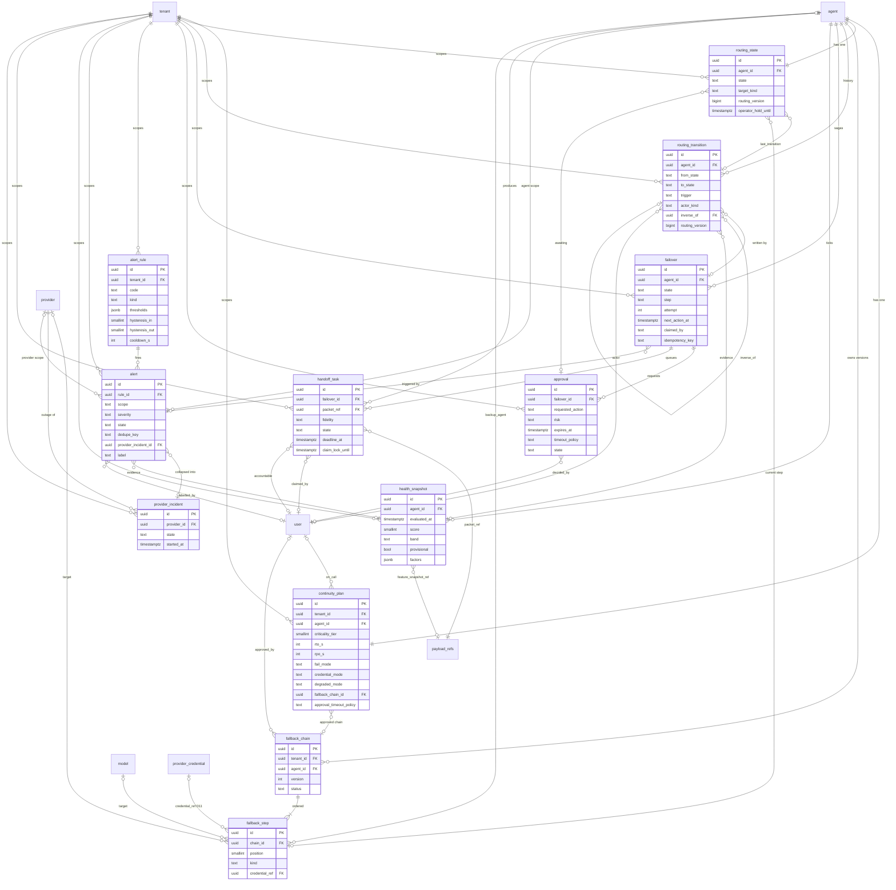

# Backend Architect — Data model (Step 3, wave 1)

Codename: Vigil · 2026-10-09 · Owns: continuity, routing, failover, approval, alerting, health, handoff queue, provider incidents, and the signed policy snapshot. References `tenant`, `agent`, `provider`, `model`, `payload_refs`, `outbox` (database-architect), `user`, `provider_credential`, `api_key` (security-auditor). Governed by D2, D6, D11, D13, D16, ARCHITECTURE §4–5, ADR-4/6/7/9/12.

## 0. Conventions assumed

- PK `id uuid` (UUIDv7, app-generated so a row id can be referenced before commit). Every table has `tenant_id uuid NOT NULL`, RLS with FORCE, indexes lead with `tenant_id`.
- Enums: `text` + `CHECK`, never `CREATE TYPE`. State machines use a seeded lookup table `routing_edge(from_state, to_state, trigger)`; a BEFORE INSERT trigger on `routing_transition` consults it.
- FKs to another tenant-scoped table are composite `(tenant_id, x_id) REFERENCES x(tenant_id, id)` so a cross-tenant reference is impossible at the constraint level, not just via RLS. Requires `UNIQUE (tenant_id, id)` on `agent`, `provider`, `model`, `user`, `payload_refs`, `provider_credential` (request to owners).
- Append-only tables (`routing_transition`, `health_snapshot`) get the same UPDATE/DELETE-rejecting trigger as `audit_log`.
- Worker claims run per tenant: the `outbox`/NOTIFY payload carries `tenant_id`, the worker does `SET LOCAL app.tenant_id` and claims with `FOR UPDATE SKIP LOCKED`. No cross-tenant scan, no BYPASSRLS.
- `created_at timestamptz NOT NULL DEFAULT now()`, `updated_at` on mutable rows; omitted from the column tables below.

## 1. ERD



## 2. Entities

### 2.1 `continuity_plan` — one per agent; the governance contract the snapshot is built from

| Column | Type | Null | Default |
|---|---|---|---|
| agent_id | uuid FK agent | no | — ; `UNIQUE (tenant_id, agent_id)` |
| criticality_tier | smallint `CHECK 1..3` | no | 3 |
| rto_s / rpo_s | int `CHECK > 0` | no | by tier: 300/60, 900/300, 3600/900 |
| fail_mode | text `open\|closed` | no | **none** (mandatory at registration, STEP1 A12) |
| credential_mode | text `passthrough\|vaulted_fallback` | no | passthrough |
| degraded_mode | text `continue\|safe_no_tools\|queue_only` | no | safe_no_tools |
| inline_fallback | bool | no | set by app: tier 1 → false |
| preemptive_mode | text `auto\|degrade_then_auto\|approval` | no | by tier: 3→auto, 2→degrade_then_auto, 1→approval (D13) |
| approval_timeout_s | int | no | 600 |
| approval_timeout_policy | text `hold\|fail_safe` | no | hold |
| fallback_chain_id | uuid FK fallback_chain | yes | null = human queue only |
| on_call_user_id | uuid FK user | yes | |
| on_call_ref | text | yes | free text (email, rota URL); D9 no ITSM |
| budget_usd_month | numeric(12,4) | yes | |
| max_inflight / rps_limit | int / numeric(8,2) | yes | |
| drill_schedule | text | yes | cron placeholder, Phase 2 |
| last_drill_at / next_drill_at | timestamptz | yes | |
| approved_by_user_id / approved_at | uuid FK user / timestamptz | yes | admin approval of the plan |
| row_version | int | no | 1 (optimistic lock) |

Invariants: exactly one plan per agent; `fallback_chain_id` must point at a chain with `agent_id` = this agent and `status='approved'` (trigger); tier 1 with `inline_fallback=true` requires `approved_by_user_id` not null; snapshot builder refuses an agent with no plan (agent stays `provisional` with tenant defaults).

### 2.2 `fallback_chain` + `fallback_step` — versioned, approved, ordered

`fallback_chain`: `agent_id` FK, `version int`, `status text CHECK draft|approved|retired`, `requested_by_user_id`, `approved_by_user_id`, `approved_at`, `retired_at`, `note`. `UNIQUE (tenant_id, agent_id, version)`; partial `UNIQUE (tenant_id, agent_id) WHERE status='approved'`. Approval is four-eyes for tier 1: `approved_by ≠ requested_by` (trigger reads the plan's tier). Editing an approved chain creates a new draft version; chains are never mutated once approved.

`fallback_step`: `chain_id` FK, `position smallint`, `kind text CHECK retry|alt_model_same_provider|alt_provider|backup_agent|degraded_safe_mode|human_queue`, `provider_id`, `model_id`, `backup_agent_id` (FKs, nullable), `credential_ref uuid FK provider_credential` (nullable), `risk text CHECK low|medium|high`, `max_attempts smallint`, `params jsonb` (`{}`), `UNIQUE (tenant_id, chain_id, position)`.

Invariants: kind rank is non-decreasing with position (retry=0 … human_queue=5), enforced by a trigger over the chain; `alt_provider` requires `provider_id` and, when the plan's `credential_mode='vaulted_fallback'`, `credential_ref` (D11); `backup_agent_id` is same-tenant via composite FK and must not equal the owning agent; `human_queue` is the implicit terminal of every chain and if present as a step nothing may follow it; `risk` is derived from kind (`retry`/`alt_model`=low, `alt_provider`/`backup_agent`/`human_queue`=medium, `degraded_safe_mode`=low).

### 2.3 `routing_state` — the one current desired route per agent

| Column | Type | Null | Default |
|---|---|---|---|
| agent_id | uuid FK | no | `UNIQUE (tenant_id, agent_id)` |
| state | text `active\|degraded\|awaiting_approval\|failed_over\|failing_back\|quarantined\|killed` | no | active |
| target_kind | text `primary\|model\|agent\|human_queue` | no | primary |
| target_provider_id / target_model_id / target_agent_id | uuid FK | yes | |
| current_step_id | uuid FK fallback_step | yes | which chain step is in effect |
| canary_pct | smallint `CHECK 0..100` | no | 100 |
| routing_version | bigint | no | tenant version at last change |
| last_transition_id | uuid FK routing_transition | yes | |
| approval_id | uuid FK approval | yes | |
| operator_hold_until | timestamptz | yes | |
| state_since | timestamptz | no | now() |

Indexes: `(tenant_id, agent_id)` unique; `(tenant_id, state)`; `(tenant_id, operator_hold_until) WHERE operator_hold_until IS NOT NULL`.

Invariants: `state='active'` ⇒ `target_kind='primary'`; `failed_over` ⇒ `target_kind<>'primary'`; `awaiting_approval` ⇒ `approval_id` not null and that approval is `pending`; `failing_back` ⇒ `canary_pct < 100`; `killed` is terminal — only `DELETE`+recreate by an operator, audited; `routing_version` strictly increasing per tenant, guaranteed by `UPDATE tenant SET routing_version = routing_version + 1 … RETURNING` under the tenant row lock inside the transition transaction (serialises a tenant's transitions, which are rare by design). Request to database-architect: `tenant.routing_version bigint NOT NULL DEFAULT 0`.

### 2.4 `routing_transition` — immutable log, one row per edge

| Column | Type | Null |
|---|---|---|
| agent_id | uuid FK | no |
| failover_id | uuid FK failover | yes (null for operator-immediate actions executed by api) |
| from_state / to_state | text | no |
| from_target / to_target | jsonb `{kind, provider_id, model_id, agent_id, step_id}` | no |
| trigger | text `rule\|approval\|approval_timeout\|operator\|policy\|failback_probe\|canary\|undo\|system` | no |
| actor_kind | text `human\|rule\|policy\|system` | no |
| actor_user_id / actor_rule_id | uuid FK user / alert_rule | yes |
| rule_codes | text[] | no `'{}'` |
| alert_ids | uuid[] | no `'{}'` |
| health_snapshot_id | uuid FK | yes |
| approval_id | uuid FK | yes |
| inverse_of | uuid FK routing_transition (same tenant, same agent) | yes |
| operator_hold_until | timestamptz | yes |
| routing_version | bigint | no |
| reason | text | yes (mandatory when `actor_kind='human'`, trigger) |
| audit_seq | bigint | no (returned by `audit_append`) |
| idempotency_key | text | no |

Indexes: `(tenant_id, agent_id, created_at DESC)`; `UNIQUE (tenant_id, routing_version)`; `UNIQUE (tenant_id, idempotency_key)`; `(tenant_id, created_at DESC)`; `(tenant_id, inverse_of) WHERE inverse_of IS NOT NULL`.

Invariants: append-only; `(from_state, to_state, trigger)` must exist in `routing_edge`; `from_state` must equal `routing_state.state` at write time (checked under `FOR UPDATE`, otherwise the failover fails with `stale_precondition`); a transition is "undone" iff a later row has `inverse_of = id` (derived, never stored on the original).

### 2.5 `failover` — durable saga row (ADR-6)

| Column | Type | Null | Default |
|---|---|---|---|
| agent_id | uuid FK | no | |
| kind | text `failover\|preemptive\|failback\|undo\|quarantine\|release\|kill\|degrade\|recover` | no | |
| state | text `pending\|running\|waiting_approval\|done\|cancelled\|failed` | no | pending |
| step | text `validate\|check_viability\|write_routing\|create_handoff_tasks\|mark_alert_actioned\|done` | no | validate |
| attempt / max_attempts | int | no | 0 / 5 |
| next_action_at | timestamptz | no | now() |
| claimed_by | text (worker instance id) | yes | |
| claim_lock_until | timestamptz | yes | 30 s lease, renewed every 10 s |
| priority | text `immediate\|normal` | no | normal |
| idempotency_key | text | no | `{agent_id}:{kind}:{alert_id or request_id}` |
| request_idempotency_key | text | yes | caller's `Idempotency-Key` header |
| trigger_alert_id / rule_codes / health_snapshot_id | uuid FK / text[] / uuid FK | yes | |
| actor_kind / requested_by_user_id | text / uuid FK | no / yes | |
| approval_id | uuid FK | yes | |
| from_state / to_state | text | no / yes (chosen at `check_viability`) | |
| chosen_step_id | uuid FK fallback_step | yes | |
| undo_plan | jsonb `{prev_state, prev_target}` | no | |
| step_results | jsonb `{step: {status, attempt, result, at}}` | no | `'{}'` |
| routing_transition_id | uuid FK | yes | set by `write_routing` |
| cancel_requested | bool | no | false |
| error | text | yes | |
| finished_at | timestamptz | yes | |

Indexes: claim `(tenant_id, next_action_at) WHERE state IN ('pending','running')`; `UNIQUE (tenant_id, idempotency_key)`; partial `UNIQUE (tenant_id, agent_id) WHERE state IN ('pending','running','waiting_approval')`; console `(tenant_id, state, created_at DESC)`.

Claim: `UPDATE failover SET claimed_by=$w, claim_lock_until=now()+30s, state='running' WHERE id = (SELECT id FROM failover WHERE tenant_id=$t AND state IN ('pending','running') AND next_action_at <= now() AND (claim_lock_until IS NULL OR claim_lock_until < now()) ORDER BY priority='immediate' DESC, next_action_at FOR UPDATE SKIP LOCKED LIMIT 1) RETURNING *`.

Invariants: `CHECK (state <> 'running' OR claimed_by IS NOT NULL)`; a row at `step='write_routing'` (shifting) must hold a live lease — the claim query is the only writer and a reaper marks `claim_lock_until < now() − 60 s AND state='running'` as reclaimable, never as failed; `waiting_approval` ⇒ `approval_id` not null and `next_action_at = approval.expires_at`; `attempt > max_attempts` ⇒ `failed` with `error`, alert `failover_stuck` raised; at most one live saga per agent (partial unique).

### 2.6 `approval` — D13 propose-and-approve

| Column | Type | Null | Default |
|---|---|---|---|
| failover_id | uuid FK | no | `UNIQUE (tenant_id, failover_id) WHERE state='pending'` |
| agent_id | uuid FK | no | |
| requested_action | text `alt_provider_failover\|backup_agent_failover\|preemptive_failover\|quarantine\|inline_fallback_enable` | no | |
| risk | text `low\|medium\|high` | no | |
| criticality_tier | smallint | no | copied from plan at request time |
| requested_by_kind | text `rule\|human` | no | |
| requested_by_rule_id / requested_by_user_id | uuid FK | yes | |
| alert_id / health_snapshot_id | uuid FK | yes | |
| evidence | jsonb | no | rule results, plain-words summary |
| expires_at | timestamptz | no | `created_at + plan.approval_timeout_s` |
| timeout_policy | text `hold\|fail_safe` | no | from plan |
| state | text `pending\|approved\|denied\|expired\|cancelled` | no | pending |
| decided_by_user_id / decided_at / decision_reason | uuid FK / timestamptz / text | yes | |
| resolved_by_timeout | bool | no | false |

Indexes: `(tenant_id, state, expires_at)` (console pending list and expiry sweep); `(tenant_id, agent_id, created_at DESC)`.

Invariants: requester ≠ approver when `requested_by_kind='human'` (trigger); `state <> 'pending'` ⇒ `decided_at` or `resolved_by_timeout`; a `pending` row with `expires_at < now()` is a breach — the owning `failover` row has `next_action_at = expires_at`, so the worker resolves it on the next claim: `hold` → `expired`, agent transitions `awaiting_approval → degraded` (stays in degraded safe mode); `fail_safe` → `expired`, `awaiting_approval → failed_over`. An SLI counts pending approvals older than `expires_at + 60 s`; it should be zero.

### 2.7 `alert_rule` — rules as data, tenant-scoped copies of the YAML

| Column | Type | Null | Default |
|---|---|---|---|
| code | text | no | `UNIQUE (tenant_id, code)` |
| kind | text `detected\|leading` | no | |
| scope | text `agent\|provider` | no | agent |
| metric / comparator | text | no | e.g. `error_rate_5m`, `gt` |
| thresholds | jsonb | no | keyed by tier `{"1":..,"2":..,"3":..}` or model class |
| window_s / min_samples | int | no | |
| trend_windows | smallint | yes | leading rules: 3 |
| hysteresis_in / hysteresis_out | smallint | no | 2 / 6 |
| cooldown_s / escalate_after_fires / escalate_window_s | int | no | 600 / 3 / 3600 |
| severity | text `info\|warning\|critical` | no | |
| penalty | smallint | no | health deduction |
| horizon_s | int | no | 0 for detected |
| tier_applicability | smallint[] | no | `{1,2,3}` |
| collapses_to_provider | bool | no | false (true: R2, R4, L2, L3) |
| what_to_do_template | text | no | |
| enabled / overridden | bool | no | true / false |
| origin | text `seed\|custom` | no | seed |
| source / seed_version / yaml_sha256 | text | no | `rules/v1` |

Global defaults have no row: the YAML is the template, copied per tenant at tenant creation and by `vigil seed`; re-seeding updates `origin='seed' AND overridden=false` rows only. This keeps RLS uniform (no nullable `tenant_id`).

### 2.8 `alert` — fired instance

| Column | Type | Null | Default |
|---|---|---|---|
| rule_id | uuid FK alert_rule | no | |
| scope | text `agent\|provider` | no | |
| agent_id / provider_id | uuid FK | scope-dependent | |
| severity | text `info\|warning\|critical` | no | |
| state | text `open\|acked\|resolved` | no | open |
| dedupe_key | text | no | `{scope}:{scope_ref}:{rule_code}` |
| provider_incident_id | uuid FK | yes | |
| suppressed_by_incident | bool | no | false |
| first_fired_at / last_evaluated_at / resolved_at | timestamptz | no / no / yes | |
| fired_count / hold_suppressed_count | int | no | 1 / 0 |
| cooldown_until | timestamptz | yes | set on resolve |
| escalation_level | smallint | no | 0 |
| acked_by_user_id / acked_at | uuid FK / timestamptz | yes | |
| what_to_do | text | no | rendered template |
| evidence | jsonb | no | `RuleResult.evidence[]`, window stats refs |
| health_snapshot_id | uuid FK | yes | |
| failover_id | uuid FK | yes | actioned by |
| label | text `true_positive\|false_positive\|unknown` | yes | |
| labelled_by_user_id / labelled_at / label_note | uuid FK / timestamptz / text | yes | |
| outcome_observed / outcome_at | text `failed\|recovered\|unknown` / timestamptz | yes | leading only; filled after `horizon_s` |
| summary | text | no | for pgvector (database-architect Phase 3 ask) |

Indexes: partial `UNIQUE (tenant_id, dedupe_key) WHERE state <> 'resolved'`; `(tenant_id, state, severity, first_fired_at DESC)`; `(tenant_id, agent_id, first_fired_at DESC)`; `(tenant_id, dedupe_key, resolved_at DESC)` (cooldown lookup); `(tenant_id, provider_incident_id)`; `(tenant_id, label, first_fired_at) WHERE label IS NOT NULL` (Step 5 export).

### 2.9 `provider_incident` — one row per provider outage per tenant

`provider_id` FK, `state text CHECK open|resolved`, `severity`, `started_at`, `resolved_at`, `rule_codes text[]`, `affected_agent_ids uuid[]`, `affected_process_count int`, `provider_status_id uuid` (loose ref to database-architect's `provider_status` row), `summary text`. Partial `UNIQUE (tenant_id, provider_id) WHERE state='open'`; index `(tenant_id, state, started_at DESC)`.

### 2.10 `health_snapshot` — append-only, one row per agent per 10 s tick

`agent_id`, `evaluated_at`, `score smallint CHECK 0..100`, `band text CHECK healthy|watch|degraded|failed`, `provisional bool`, `factors jsonb` (`[{rule_code, penalty, text}]`), `horizon_probs jsonb` (`{"15m": 0.12, "1h": 0.30}`; Phase 1 heuristic = clamp(Σ leading penalties / 100), Phase 2 ML fills the same keys), `feature_snapshot_ref uuid FK payload_refs` (nullable; ai-engineer's feature vector), `rules_source text DEFAULT 'rules/v1'`, `routing_state_at text`, `window_end timestamptz`, `call_count int`. `PRIMARY KEY (tenant_id, evaluated_at, id)`, partitioned daily by `evaluated_at`, 3-day retention (the 5-minute rollup of score lives in `agent_window_stats`). Index `(tenant_id, agent_id, evaluated_at DESC)`. Write cadence: every tick for 20 agents is ~170k rows/day/tenant, acceptable with partitions; write-on-change is the first optimisation if not.

### 2.11 `handoff_task` — operator queue item

| Column | Type | Null | Default |
|---|---|---|---|
| agent_id / failover_id / routing_transition_id | uuid FK | no / yes / yes | |
| task_id | text | no | SDK task id, or synthetic for `request_only` |
| packet_ref / packet_sha256 | uuid FK payload_refs / bytea | no | body per ai-engineer's HandoffPacket schema |
| fidelity | text `checkpoint\|request_only` | no | |
| state | text `queued\|claimed\|completed\|returned\|expired` | no | queued |
| priority | smallint | no | from tier (1 highest) |
| deadline_at | timestamptz | no | `created_at + plan.rto_s` |
| claimed_by_user_id / claimed_at / claim_lock_until | uuid FK / timestamptz / timestamptz | yes | lock 15 min, renewable |
| reclaim_count | smallint | no | 0 |
| accountable_user_id / accountable_role | uuid FK / text | yes | on-call from plan at creation |
| reason_alert_id | uuid FK | yes | |
| outcome | text `resolved\|escalated\|abandoned\|returned_to_agent\|expired_unclaimed` | yes | |
| outcome_note / completed_at | text / timestamptz | yes | |
| next_action / summary | text | no | one imperative sentence; pgvector summary |

Indexes: queue view `(tenant_id, state, priority, deadline_at) WHERE state IN ('queued','claimed','expired')`; claim `(tenant_id, priority, deadline_at) WHERE state='queued'` (console claim endpoint uses `FOR UPDATE SKIP LOCKED` so two operators never get one task); `(tenant_id, claimed_by_user_id, state)`; `UNIQUE (tenant_id, failover_id, task_id)` (idempotent `create_handoff_tasks`).

Invariants: `claimed` ⇒ `claimed_by_user_id` and `claim_lock_until` set; lapsed lock → back to `queued`, `reclaim_count+1`; `returned` only from `queued` (undo never recalls claimed work); `expired` = deadline passed while queued, stays visible and claimable, counts against the RTO SLI; `fidelity='request_only'` ⇒ packet has no `steps_done`, console labels it (R7).

## 3. Transition → snapshot pipeline

One transaction, executed by the worker at `step='write_routing'` (or by api inline for `priority='immediate'` operator actions — kill, quarantine, release, undo — through the same `routing_apply()` function):

1. `SET LOCAL app.tenant_id`. `SELECT … FROM failover WHERE id=$f FOR UPDATE` (lease still ours).
2. `SELECT … FROM routing_state WHERE agent_id=$a FOR UPDATE`; assert `state = failover.from_state`; assert `operator_hold_until IS NULL OR < now()` unless `actor_kind='human'`; else fail saga `stale_precondition`/`operator_hold`.
3. `UPDATE tenant SET routing_version = routing_version + 1 WHERE id=$t RETURNING routing_version` → `v`.
4. `audit_append(tenant, payload, canonical)` with `payload = {type: 'route.changed' | 'failover.completed' | 'override.by_human' | 'killswitch.pulled', transition_id, agent_id, from, to, actor, rule_codes, alert_ids, approval_id, reason, routing_version: v}` → `audit_seq`.
5. `INSERT routing_transition (id = pre-generated, …, routing_version = v, audit_seq)`.
6. `UPDATE routing_state SET state, target_*, current_step_id, canary_pct, routing_version = v, last_transition_id, approval_id, operator_hold_until, state_since = now()`.
7. `UPDATE failover SET step='create_handoff_tasks', routing_transition_id, step_results[...]`.
8. `INSERT outbox (topic='policy_changed', payload={tenant_id, routing_version: v, agent_id})`; the outbox trigger issues `NOTIFY policy_changed` on commit.

Nothing is half-visible: if the worker dies anywhere, the transaction rolls back and the lease lapses.

api on NOTIFY (or on its 2 s fallback poll of `max(tenant.routing_version)`): rebuild the tenant block from `agent` ⋈ `continuity_plan` ⋈ `routing_state` ⋈ approved `fallback_chain`/`fallback_step` ⋈ `api_key` (hash + scopes) ⋈ `provider`/`model` (base_url, dialect) ⋈ tenant defaults; assemble all tenant blocks; `version = nextval` of a `policy_snapshot_issue` row (`id, version, issued_at, sha256, signer_key_id, tenant_versions jsonb`) — an infrastructure sequence, not business data; sign the RFC 8785 canonical bytes with Ed25519; cache by ETag; push SSE `routing_changed {version}`. The gateway rejects a lower `version` or a lower `tenants[t].routing_version` than it holds. Credentials are **not** in the snapshot: `fallback_step.credential_ref` is an id, and the gateway fetches the memory-only credential bundle for those ids from a separate authenticated endpoint with its own TTL (D11). The snapshot is therefore safe to log and diff.

```json
{
  "schema": "vigil.policy_snapshot/1",
  "version": 4182,
  "issued_at": "2026-10-09T12:00:00.000Z",
  "ttl_s": 60,
  "grace_s": 300,
  "signer_key_id": "snap-2026-10",
  "tenants": {
    "0192f0a1-7b2c-7e3d-9a4b-5c6d7e8f9a01": {
      "routing_version": 917,
      "unknown_agent_fail_mode": "open",
      "api_keys": { "<sha256 hex>": { "key_id": "uuid", "default_agent": "billing-agent", "scopes": ["gateway"], "agent_ids": ["uuid"] } },
      "providers": { "<provider uuid>": { "slug": "openai", "dialect": "openai", "base_url": "https://api.openai.com/v1" } },
      "agents": {
        "<agent uuid>": {
          "slug": "billing-agent",
          "tier": 2,
          "fail_mode": "open",
          "credential_mode": "vaulted_fallback",
          "degraded_mode": "safe_no_tools",
          "inline_fallback": true,
          "primary": { "provider_id": "uuid-openai", "model": "gpt-4.1" },
          "route": { "state": "failed_over", "target_kind": "model", "provider_id": "uuid-openai", "model": "gpt-4.1-mini", "step_id": "uuid-s1", "canary_pct": 100, "since": "2026-10-09T11:58:40Z", "transition_id": "uuid-t" },
          "fallback_chain": {
            "chain_id": "uuid-c", "version": 3,
            "steps": [
              { "position": 1, "kind": "retry", "max_attempts": 1, "risk": "low" },
              { "position": 2, "kind": "alt_model_same_provider", "provider_id": "uuid-openai", "model": "gpt-4.1-mini", "risk": "low" },
              { "position": 3, "kind": "alt_provider", "provider_id": "uuid-anthropic", "model": "claude-sonnet-4-5", "credential_ref": "uuid-cred", "risk": "medium" }
            ],
            "terminal": "human_queue"
          },
          "limits": { "max_inflight": 50, "rps": 20.0, "budget_usd_month": 1500.0, "spent_usd_month": 812.4 },
          "tools_allowed": true
        }
      }
    }
  },
  "signature": "<base64 ed25519 over RFC8785(canonical body without this field)>"
}
```

Field types: `version` int64; `routing_version` int64; `ttl_s`, `grace_s` int; `tier` 1–3; all ids UUID strings; `fail_mode` `open|closed`; `route.state` one of the seven routing states; `canary_pct` 0–100; monetary values decimal-as-number with 4 dp.

## 4. Undo as data

`POST /routing/{agent}/undo` (actor human, reason mandatory) does, in api:

1. Find the newest non-undone automated transition `T` for the agent (`actor_kind IN ('rule','policy')` and no row with `inverse_of = T.id`). None → 409.
2. If a live `failover` exists for the agent: `cancel_requested=true`; if its `step < write_routing` the worker cancels it at the next step boundary (`cancelled`, reason `operator_undo`); if it is in `write_routing` the api waits up to 5 s for the row to leave `running`, then returns 409 with the saga id if it has not. `write_routing` itself is sub-second and atomic, so the wait is bounded.
3. Create `failover(kind='undo', priority='immediate', undo_plan = T.undo_plan)` and execute `routing_apply()` inline: `routing_transition(from = current, to = T.from_state, to_target = T.from_target, trigger='undo', actor_kind='human', inverse_of = T.id, operator_hold_until = now() + 30 min, reason)`; `routing_state.operator_hold_until` set likewise; audit `override.by_human`.
4. `handoff_task` rows created by `T.failover_id`: `queued → returned` (outcome `returned_to_agent`), `claimed` untouched.

During the hold the evaluator keeps writing `health_snapshot` and `alert` rows (so the operator sees whether the engine still disagrees) but `failover` creation for rule/policy actors is skipped and recorded as `alert.hold_suppressed_count += 1`. Human actions and kill bypass the hold. The hold is inspectable (`routing_state.operator_hold_until`) and clearable by an admin (another audited transition with `trigger='operator'`).

"Why am I failed over" is one query from `routing_state.last_transition_id`: `routing_transition` gives from/to/trigger/actor/`rule_codes`/`alert_ids`/`approval_id`/`reason`; `alert` rows give `what_to_do` and `evidence`; `health_snapshot_id` gives the score and `factors` at that instant; `failover` gives `step_results` with timings; `approval` gives who approved and when. The console renders the last 10 transitions for the agent, each expanded the same way, with `inverse_of` drawn as an undo arrow.

## 5. Alert dedupe as data

- **Dedupe key** `{scope}:{scope_ref}:{rule_code}` (tenant implicit). The partial unique index on open alerts makes "fire" an upsert: existing open row → `fired_count+1`, `last_evaluated_at`, severity raised if higher; else insert.
- **Hysteresis** is counted in the evaluator's in-memory window state and persisted in `health_snapshot.factors` (`consecutive_in`, `consecutive_out`) so a restart resumes from the last snapshot rather than from zero.
- **Cooldown**: on resolve set `cooldown_until = resolved_at + cooldown_s × 2^escalation_level`. Before inserting a new alert, read the latest resolved row for the key: if `cooldown_until > now()` do not insert; bump `fired_count` on that resolved row so flapping is visible. If three alerts for the key resolved within `escalate_window_s`, the new alert gets `escalation_level = prev + 1` and severity +1.
- **Provider collapse**: within one evaluation, agent-scope firings of rules with `collapses_to_provider=true` are grouped by the agent's primary provider. ≥ 2 agents → upsert the open `provider_incident`, insert/refresh one `scope='provider'` alert (`dedupe_key = provider:{id}:incident`, `rule_id` = R4 if present else the dominant rule) and mark each per-agent alert `provider_incident_id`, `suppressed_by_incident=true`. Suppressed alerts stay on the agent page and in the audit, not in the top-level list. Incident resolves when no member alert has been open for `hysteresis_out` ticks.
- **Labels for Step 5**: `label`, `labelled_by_user_id`, `labelled_at`, `label_note` (human); `outcome_observed`/`outcome_at` (machine: for a leading alert, did a detected alert or `band='failed'` occur for the same agent within `horizon_s`); `health_snapshot_id → feature_snapshot_ref` gives the feature vector at fire time. Precision/recall per rule and tier is a GROUP BY over this table.

## 6. Seed strategy

`rules/v1/defaults.yaml` is the source; `vigil seed` and tenant creation copy it into `alert_rule` (`origin='seed'`, `seed_version`, `yaml_sha256`). Operators edit through the console, which sets `overridden=true`; later seeds skip those rows. Bands: healthy ≥ 80, watch ≥ 60, degraded ≥ 30, failed < 30; `provisional` under 50 calls in 1 h.

| code | kind | metric / window | thresholds (tier 1 / 2 / 3, or class) | min_samples | severity | penalty | horizon | collapses |
|---|---|---|---|---|---|---|---|---|
| R1 error_rate | detected | error_rate / 300 s | 0.05 / 0.10 / 0.20 | 10 | warning→critical by band | 40 | 0 | no |
| R2 p95_latency | detected | p95_ms / 300 s | small 5000, large 20000, reasoning 60000 | 10 | warning | 25 | 0 | yes |
| R3 consecutive_failures | detected | consecutive_errors | 3 / 3 / 5 | 3 | critical | 50 | 0 | no |
| R4 provider_status | detected | provider_status | degraded 20, partial 35, major 60 (penalty by status) | 0 | warning/critical | per status | 0 | yes |
| R5 budget_breach | detected | spend_ratio_month | ≥ 1.0 | 0 | critical | 70 | 0 | no |
| L1 error_trend | leading | error_rate slope / 3×300 s | latest ≥ 0.5 × R1 threshold, rising ×3 | 10 | info | 15 | 900 | no |
| L2 latency_trend | leading | p95 slope / 3×300 s | latest ≥ 0.8 × R2 threshold, slope > 0 | 10 | info | 10 | 900 | yes |
| L3 ratelimit_proximity | leading | min_ratelimit_remaining_ratio, share_429 / 300 s | remaining < 0.10 or 429 share > 0.05 | 5 | warning | 20 | 900 | yes |
| L4 budget_proximity | leading | projected_spend_ratio at 1 h burn | ≥ 0.9 inside 3600 s | 0 | info | 15 | 3600 | no |
| L5 fallback_pressure | leading | inline_fallback_share + breaker_open_share / 300 s | > 0.20 | 10 | warning | 25 | 900 | no |

All rows: `hysteresis_in=2`, `hysteresis_out=6`, `cooldown_s=600`, `escalate_after_fires=3`, `escalate_window_s=3600`, `tier_applicability={1,2,3}`; `what_to_do_template` per rule with `{agent}`, `{provider}`, `{value}`, `{threshold}` placeholders. Severity for tier 1 is bumped one level at render time (degraded on tier 1 = critical).

## 7. For the database-architect

- Enum strategy: `text` + `CHECK`; `routing_edge(from_state, to_state, trigger)` lookup table seeded by migration; append-only trigger reused from `audit_log`.
- Please add: `tenant.routing_version bigint NOT NULL DEFAULT 0`; `tenant.unknown_agent_fail_mode text CHECK open|closed`; `UNIQUE (tenant_id, id)` on `agent`, `provider`, `model`, `user`, `payload_refs`, `provider_credential` for composite FKs; `outbox.topic='policy_changed'` with `tenant_id` in payload and a NOTIFY-on-commit trigger; `payload_refs` must accept kinds `handoff_packet` and `feature_snapshot`.
- `health_snapshot` is partitioned daily like `events` (same PK shape, 3-day retention); `routing_transition` and `alert` are not partitioned in Phase 1 (low volume) but keep `created_at` leading in secondary indexes so they can be.
- `policy_snapshot_issue` is a global, non-tenant table (allowlist with `tenants`, `alembic_version`); security-auditor's per-gateway `snapshot_ack` should reference its `version`.
- Cross-entity constraints I rely on: `agent.lifecycle` exists and `'deployed'` is a value (viability check); `provider.dialect` and `provider.base_url` exist (snapshot); `provider_status(provider_id, status, observed_at)` exists (R4); `agent_window_stats` exposes `error_count`, `rate_limit_count`, `latency_hist`, `cost_usd`, and I additionally need `inline_fallback_count` and `breaker_open_count` columns for L5.
- Erasure (D17): my tables hold no payload bodies; `handoff_task.packet_ref` and `health_snapshot.feature_snapshot_ref` point at `payload_refs`, so crypto-shred covers them; `alert.evidence` and `approval.evidence` carry stats and refs only, never content — please add that to the per-entity derived-data registry.
