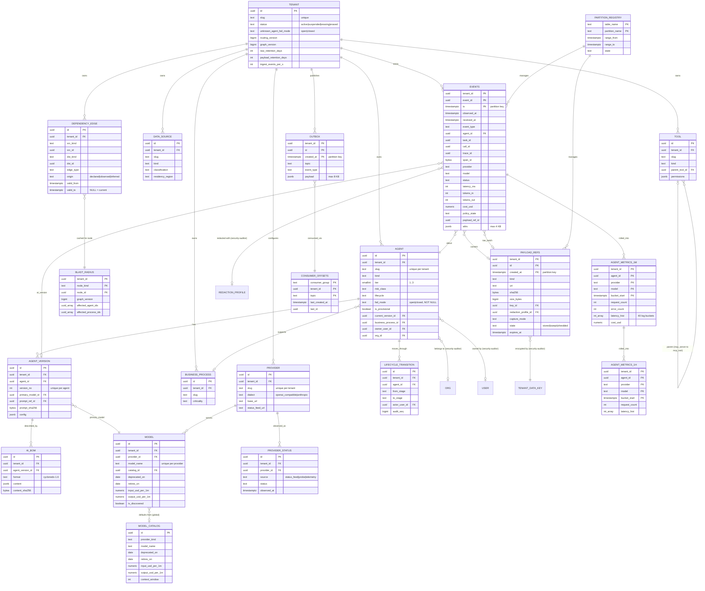

# Database Architect: Registry, Telemetry and Graph Entities (Step 3, wave 1)

Codename: Vigil. Date: 2026-10-09. Scope: my owned entities plus the DDL conventions for wave 2. Other members' entities appear only as FK targets. Postgres 17, shared schema + RLS (ADR-7), UUIDv7, no Timescale (ADR-3), outbox + NOTIFY (ADR-4), BlobStore refs only (ADR-5).

## 1. ERD



## 2. Entities

Shared rules (stated once, detailed in section 6): PK `id uuid` UUIDv7; `tenant_id` first; composite FKs; indexes lead with `tenant_id`; RLS with `FORCE`. "Durable" rows die only by erasure. **Global** tables carry no `tenant_id`, sit on the RLS allowlist and are SELECT-only for app roles.

### tenant (global, durable)

The isolation unit; orgs, users, keys and policies (security-auditor) hang off it.

| column | type | null | default |
|---|---|---|---|
| id | uuid | no | uuidv7() |
| slug, name | text | no | |
| status | text | no | 'active' · `active|suspended|erasing|erased` |
| region_declared | text | yes | · D17, a declaration not a promise |
| unknown_agent_fail_mode | text | no | · `open|closed`, set at onboarding |
| routing_version, graph_version | bigint | no | 0 · monotonic, bumped in the writing tx |
| raw_retention_days | smallint | no | 7 · 1..30 |
| payload_retention_days | smallint | no | 30 · 7..90 |
| ingest_events_per_s, max_agents | integer | no | 1000, 500 |
| created_at, updated_at | timestamptz | no | now() |

Indexes: `uq_tenant_slug`. Invariants: (1) `status='erased'` rows keep only id, slug, status and timestamps; (2) `routing_version` and `graph_version` never decrease; (3) a tenant in `erasing` accepts no ingest (429 with reason).

### agent (durable)

One registered AI asset.

| column | type | null | default |
|---|---|---|---|
| tenant_id, id | uuid | no | |
| slug | text | no | · unique per tenant; `unclaimed/<hash8>` when auto-registered |
| name, description | text | name no | |
| kind | text | no | · `chatbot|copilot|autonomous_agent|multi_agent|rag_pipeline|mcp_server|model_endpoint|workflow` |
| framework | text | yes | · `langgraph|crewai|autogen|openai_agents|custom|...` |
| org_id, owner_user_id | uuid | yes | → security-auditor's org, user |
| business_process_id | uuid | yes | → business_process |
| tier | smallint | no | 3 · `1..3`, 1 = most critical |
| risk_class | text | no | 'unclassified' · `unclassified|minimal|limited|high|unacceptable` (EU AI Act) |
| lifecycle | text | no | 'discovered' · `discovered|proposed|approved|deployed|monitored|retired` |
| is_provisional | boolean | no | false · true until claimed |
| fail_mode | text | no | · `open|closed`, **no default**: the writer must choose |
| current_version_id | uuid | yes | → agent_version (deferred FK) |
| cost_center | text | yes | |
| tags | text[] | no | '{}' |
| created_at, updated_at | timestamptz | no | now() |

Indexes: `uq_agent_tenant_slug`, `ix_agent_tenant_lifecycle_tier`, `ix_agent_tenant_business_process`, `ix_agent_tenant_owner`. Invariants: (1) `fail_mode` is non-nullable and auto-registered agents copy `tenant.unknown_agent_fail_mode` at insert; (2) `lifecycle` changes only via `lifecycle_transition` + `audit_append` in one tx; (3) `retired` agents keep their rows and history; retire closes all open dependency edges.

### agent_version (durable, immutable rows)

What the agent *is* at a point in time; events reference it, the AI-BOM describes it.

| column | type | null | default |
|---|---|---|---|
| tenant_id, id, agent_id | uuid | no | |
| version_no | integer | no | · unique per agent, monotonic |
| primary_model_id | uuid | no | → model |
| prompt_ref_id | uuid | yes | → payload_refs (kind `prompt`); prompt text is tenant content, never inline |
| prompt_sha256 | bytea | yes | |
| config | jsonb | no | '{}' · temperature, max_tokens, response_format; ≤ 4 KB |
| declared_tool_ids, declared_data_source_ids | uuid[] | no | '{}' · snapshot for the BOM; the live graph is `dependency_edge` |
| source | text | no | · `sdk|api|gateway_observed` |
| created_by_user_id | uuid | yes | |
| created_at | timestamptz | no | now() |

Indexes: `uq_agent_version_agent_no (tenant_id, agent_id, version_no)`. No `updated_at`. Invariants: (1) rows never change; a new prompt hash or model is a new version; (2) `agent.current_version_id` points at the highest `version_no` unless an operator pins; (3) gateway-observed changes (`model` differs from current version) create a version with `source='gateway_observed'`, never silently mutate.

### provider (durable)

A tenant's endpoint for a model provider; two tenants' `openai` rows are different rows.

| column | type | null | default |
|---|---|---|---|
| tenant_id, id | uuid | no | |
| slug, name | text | no | |
| provider_kind | text | no | · `openai|anthropic|azure_openai|bedrock|vertex|ollama|custom` joins `model_catalog` |
| dialect | text | no | · `openai_compatible|anthropic` (D16) |
| base_url | text | no | · allowlisted by security-auditor's SSRF check |
| status_feed_url | text | yes | |
| is_enabled | boolean | no | true |
| created_at, updated_at | timestamptz | no | |

Indexes: `uq_provider_tenant_slug`. Credentials are **not** here (→ `provider_credential`). Invariants: (1) `base_url` is https except for RFC1918 `ollama`; (2) deleting a provider is refused while any open edge or `model` references it.

### model_catalog (global, durable) and model (durable)

`model_catalog` is Vigil's knowledge: one row per `(provider_kind, model_name)` from the vendored LiteLLM price JSON, carrying `deprecated_on`, `retires_on`, `input_usd_per_1m`, `output_usd_per_1m`, `cached_input_usd_per_1m`, `context_window`, `max_output_tokens`, `capabilities jsonb`, `source_version`, `updated_at`. `model` is the tenant's instance under a `provider`: `tenant_id, id, provider_id, model_name, catalog_id (nullable), deprecated_on, retires_on, input_usd_per_1m, output_usd_per_1m (NULL = inherit catalog), is_discovered, is_allowed, created_at, updated_at`. Unique `(tenant_id, provider_id, model_name)`. Invariants: (1) events store `provider` and `model` as text and resolve to `model` rows lazily, so an unseen model name creates an `is_discovered=true` row rather than dropping the event; (2) cost on events is computed at ingest from the tenant override, else the catalog, else NULL with `attrs.cost_unpriced=true`; (3) `retires_on < now()` with open `uses_model` edges is a governance finding, not a deletion.

### tool (durable)

`tenant_id, id, slug, name, kind (function|mcp_server|mcp_tool|http_api|code_interpreter|retrieval), parent_tool_id (mcp_tool → mcp_server), endpoint, permissions jsonb (scopes, writes_external, pii_access), owner_user_id, is_approved, created_at, updated_at`. Unique `(tenant_id, slug)`; `ix_tool_tenant_parent`. Invariants: (1) `parent_tool_id` is set iff `kind='mcp_tool'`; (2) an unknown tool named in a tool-call event is auto-created with `is_approved=false`; undeclared use is security-auditor's `policy.violated` rule.

### data_source (durable)

`tenant_id, id, slug, name, kind (vector_index|database|document_store|api|filesystem|saas|stream), classification (public|internal|confidential|restricted|pii), residency_region, owner_user_id, attrs jsonb, created_at, updated_at`. Unique `(tenant_id, slug)`. Invariants: (1) `classification` is required; (2) an agent reading a `restricted|pii` source gets `risk_class` ≥ `high` suggested (finding, not enforcement).

### business_process (durable)

`tenant_id, id, org_id, slug, name, owner_user_id, criticality (low|medium|high|critical), description, created_at, updated_at`. Unique `(tenant_id, slug)`. Invariant: blast radius reaches processes through `agent.business_process_id`; no many-to-many in Phase 1.

### lifecycle_transition (durable, append-only)

`tenant_id, id, agent_id, from_stage, to_stage, actor_user_id (NULL = system), reason, audit_seq (the audit row's seq), created_at`. Index `(tenant_id, agent_id, created_at)`. Invariants: (1) only allowed transitions (`discovered→proposed|retired`, `proposed→approved|retired`, `approved→deployed|retired`, `deployed→monitored|retired`, `monitored→retired`, any→`retired`); (2) written in the same tx as the `agent.lifecycle` update and `audit_append`.

### ai_bom (durable, immutable rows)

CycloneDX 1.6 ML-BOM per `agent_version`: models, prompt hashes, tools, data sources, provider, SDK version, policies in force. `tenant_id, id, agent_version_id, format, content jsonb (≤ 256 KB), content_sha256, generator_version, generated_at`. Index `(tenant_id, agent_version_id, generated_at DESC)`. Invariants: (1) never updated, regenerate = new row; (2) `content_sha256` is what the audit row references; (3) content holds hashes and ids, never prompt text.

### dependency_edge (durable, temporal)

Section 5.

### blast_radius (rollup/cache)

Section 5.

### provider_status (rollup, 90 days)

`tenant_id, id, provider_id, source (status_feed|probe|telemetry), component, status (operational|degraded|partial_outage|major_outage|unknown), observed_at, incident_ref, raw jsonb (≤ 8 KB), created_at`. Index `(tenant_id, provider_id, observed_at DESC)`. The worker polls each distinct `status_feed_url` once and writes a row into every tenant holding that provider **only on status change**, so RLS stays clean and rows stay rare. Invariants: (1) one row per change, not per poll; (2) `telemetry` rows are written by the health engine, never by ingest.

### events (raw-event, daily partitions)

Section 3.

### payload_refs (payload metadata, daily partitions)

Metadata for every blob in BlobStore; no separate `blob_objects` (one table, one lifecycle, one partition job). Kinds: `span_content` (one per event under `full|redacted`), `raw_batch` (one OTLP batch, shared by its events), `prompt`, `checkpoint`, `handoff_packet`, `bom_export`, `anchor_export`.

| column | type | null | default |
|---|---|---|---|
| tenant_id, id | uuid | no | |
| created_at | timestamptz | no | now() · partition key |
| kind | text | no | |
| uri | text | no | · `tenant/{tenant_id}/{yyyy-mm-dd}/{kind}/{id}.bin` |
| sha256 | bytea | no | · plaintext hash, for audit and dedup |
| size_bytes, stored_bytes | bigint | no | · plaintext, post zstd+AES |
| content_type | text | no | 'application/json' |
| key_id | uuid | no | → `tenant_data_key` (security-auditor) |
| redaction_profile_id | uuid | yes | → `redaction_profile`; NULL only when `capture_mode='full'` |
| capture_mode | text | no | · `full|redacted|metadata` (D12) |
| expires_at | timestamptz | no | · created_at + tenant.payload_retention_days |
| hold_count | integer | no | 0 · legal holds referencing it (security-auditor increments) |
| state | text | no | 'stored' · `stored|swept|shredded` |
| swept_at | timestamptz | yes | |

PK `(tenant_id, id, created_at)`; `ix_payload_refs_tenant_expires (tenant_id, expires_at) WHERE state='stored'`; BRIN on `created_at`. Invariants: (1) the blob is written before the row, the row before any event that references it; (2) sweeper deletes the object only when `expires_at < now() AND hold_count = 0`, then sets `swept`; crypto-shred sets `shredded` without touching objects; (3) rows outlive objects until the partition drops (audit needs the hash).

### agent_metrics_1m / agent_metrics_1h (rollup; daily / monthly partitions)

Section 4.

### outbox (raw-event, daily partitions, 7 days) and consumer_offsets (global)

Domain events for control-plane fan-out (`agent.discovered`, `routing.changed`, `graph.changed`, `alert.created`...). Not telemetry: the rule engine tails `events` directly (section 4). `outbox(tenant_id, id, created_at, topic, event_type, aggregate_kind, aggregate_id, payload jsonb ≤ 8 KB, idempotency_key)`; PK `(tenant_id, id, created_at)`; `ix_outbox_tenant_topic_created`; unique `(tenant_id, idempotency_key)` per partition. Producers insert in the same tx as the state change and `NOTIFY outbox, '<tenant_id>:<topic>'`. `consumer_offsets(consumer_group, tenant_id, topic, last_created_at, last_id, updated_at)` PK on the first three; the worker iterates active tenants, `SET LOCAL app.tenant_id`, reads `(created_at, id) > (last_created_at, last_id) AND created_at < now() - interval '2 s'` (the watermark closes the commit-order gap), processes, advances the offset in the same tx. Invariants: (1) no outbox row without its state change in the same tx; (2) consumers are idempotent on `id`; (3) offsets only move forward.

### partition_registry (global, durable)

`table_name, partition_name, range_from, range_to, state (created|attached|detached|exported|dropped), row_estimate, bytes, exported_uri, created_at, state_changed_at`. The worker creates partitions 7 days ahead (daily: `events`, `payload_refs`, `outbox`, `agent_metrics_1m`; monthly: `agent_metrics_1h`) and detaches and drops by `state` transitions. Also `events_rejected(tenant_id, id, received_at, reason, raw jsonb)` (3-day retention) for spans failing ai-engineer's required-attribute check or landing outside attached partitions. Invariant: a partition is dropped only from `detached|exported`, never from `attached`.

## 3. The `events` table

**Decision: one wide partitioned table, no separate `spans`.** A span is an event with `latency_ms` and `parent_span_id`; point events (`vigil.checkpoint`, `policy.stale`, `agent.discovered`) have NULL latency. A separate `spans` table would make its join the hottest in the system and double the partition machinery for nothing: the trace view is `WHERE tenant_id=? AND trace_id=? ORDER BY ts`. ADR-3's three stream tables collapse to two.

**Three clocks.** `ts` = span start from the emitter's clock; `observed_at` = when the emitter produced the event (after response flush); `received_at` = ingest's clock at commit. `is_late` is `GENERATED ALWAYS AS (received_at - ts > interval '120 seconds') STORED`. A late event is stored in the partition its `ts` belongs to (older than the retention window → `events_rejected`), the bucket it dirties is recomputed (section 4), and the health engine never reads buckets older than its horizon, so replay after an outage cannot raise alerts. Detection latency (sre SLI) = health-row change minus `observed_at`.

| first-class column | why a column |
|---|---|
| `tenant_id, event_id, ts` (PK) | isolation, dedup, partition |
| `observed_at, received_at, is_late` | rollup watermark, lateness, SLIs |
| `event_type, source` | every consumer filters on them |
| `agent_id, agent_version_id` | the per-agent index |
| `task_id, call_id, trace_id, span_id, parent_span_id` | continuity, SDK/gateway merge, trace tree |
| `provider, model, response_model` (text) | rollup key; text because the wire says text |
| `status, error_type` | error counters |
| `latency_ms, ttft_ms, tokens_in, tokens_out, cost_usd` | histograms and sums |
| `policy_state, route_decision, routing_version` | `fresh|stale|expired|none`; fallback pressure rule |
| `capture_mode, redaction_profile_id, payload_ref_id, payload_sha256, raw_ref_id` | D12 provenance |
| `instance_id, seq` | emitter gap detection (loss SLI) |
| `schema_version` | `vigil-event/N` |
| `attrs jsonb` ≤ 4 KB | finish reasons, tool name and call id, conversation id, rate-limit headers, semconv version, feedback score: read per event, never aggregated |

Promotion rule: anything a rule, rollup or index touches becomes a column; `attrs` never holds captured content.

**Partitioning and indexes.** `PARTITION BY RANGE (ts)`, daily. PK `(tenant_id, event_id, ts)`: the first two columns are the dedup probe (`INSERT ... ON CONFLICT DO NOTHING`), and UUIDv7 keeps inserts local. Secondary: `ix_events_agent_ts (tenant_id, agent_id, ts DESC)`; `ix_events_task (tenant_id, task_id, ts) WHERE task_id IS NOT NULL`; `ix_events_trace (tenant_id, trace_id)`; `BRIN (received_at)` for the rollup cursor, which costs nothing because `received_at` is insert-ordered. No GIN on `attrs`.

At **1k events/s** (35 GB/day plus ~60 % indexes) this is comfortable: multi-row inserts of 1,000 rows or 200 ms per tenant. At **50k events/s** the index set is the cost, so the partition worker runs an index lifecycle: `ix_events_task` and `ix_events_trace` exist only on partitions younger than 48 h; `fillfactor=100`; insert-only autovacuum. Past ~5k/s sustained, raw events move to ClickHouse behind TimeSeriesStore (ADR-3) and rollups come from its materialised views; the rollup tables and every reader stay unchanged.

## 4. Rollups

Two tables, same columns, keyed `(tenant_id, agent_id, provider, model, bucket_start)`; `agent_metrics_1m` daily partitions, 14 days; `agent_metrics_1h` monthly partitions, 13 months. Counters: `request_count, error_count, timeout_count, rate_limit_count, server_error_count, blocked_count, fallback_count, tool_call_count, late_count, policy_stale_count` (integer), `tokens_in, tokens_out` (bigint), `cost_usd numeric(18,8)`, `ratelimit_remaining_min integer` (merge with `least`), `latency_hist integer[40]`, `ttft_hist integer[40]`, `computed_at`. Index beyond the PK: `(tenant_id, bucket_start)` for the engine's per-tenant sweep. 5 m and 15 m grains (ai-engineer's feature snapshot) are sums of 1 m rows at query time.

```sql
-- bucket i covers [e^(i/3), e^((i+1)/3)) ms: 1 ms to ~10 min, each ~40% wider than the last
CREATE FUNCTION hist_bucket(ms integer) RETURNS smallint IMMUTABLE LANGUAGE sql
  AS $$ SELECT least(39, greatest(0, floor(3 * ln(greatest(ms, 1)))))::smallint $$;
CREATE FUNCTION hist_add(a integer[], b integer[]) RETURNS integer[] IMMUTABLE LANGUAGE sql
  AS $$ SELECT array_agg(coalesce(x,0) + coalesce(y,0) ORDER BY i)
        FROM unnest(a, b) WITH ORDINALITY AS t(x, y, i) $$;
CREATE AGGREGATE hist_sum(integer[]) (SFUNC = hist_add, STYPE = integer[],
  INITCOND = '{0,0,0,0,0,0,0,0,0,0,0,0,0,0,0,0,0,0,0,0,0,0,0,0,0,0,0,0,0,0,0,0,0,0,0,0,0,0,0,0}');
-- quantile = geometric midpoint of the bucket where the running total crosses q
CREATE FUNCTION hist_quantile(h integer[], q real) RETURNS integer IMMUTABLE LANGUAGE sql AS $$
  SELECT round(exp((i - 0.5) / 3.0))::integer
  FROM (SELECT i, sum(c) OVER (ORDER BY i) AS cum, sum(c) OVER () AS total
        FROM unnest(h) WITH ORDINALITY AS t(c, i)) s
  WHERE cum >= q * total ORDER BY i LIMIT 1 $$;
```

Quantile error is at most half a bucket (about ±18 %), fine for bands and slopes; exact latency stays on the event row.

**Worker, every 10 s, per tenant, one transaction.** `SET LOCAL app.tenant_id`; read the cursor from `consumer_offsets('rollup_1m', tenant, 'events')`; `watermark = now() - 2 s`; dirty set = `SELECT DISTINCT agent_id, provider, model, date_trunc('minute', ts) FROM events WHERE tenant_id=$1 AND received_at > $cursor AND received_at <= $watermark` (BRIN range); for each dirty bucket **recompute from scratch** via `ix_events_agent_ts` and `INSERT ... ON CONFLICT (pk) DO UPDATE SET col = EXCLUDED.col` (replace, not add); recompute the parent hour from its 1 m rows the same way; advance the cursor; commit. Replace-not-add makes crashes, replays and late events harmless. The open minute is recomputed every tick, so the engine sees partial buckets with `request_count` as sample size. At 1k/s this re-reads ~360k rows a minute through an index, which is noise.

**Health engine read.** One query per tenant per 10 s: `SELECT agent_id, bucket_start, sum(request_count), sum(error_count), ..., hist_sum(latency_hist) FROM agent_metrics_1m WHERE tenant_id=$1 AND bucket_start >= now() - interval '10 minutes' GROUP BY 1, 2` — ten rows per agent; `hist_quantile(.., 0.95)` for the p95 rule, consecutive buckets for slopes, `fallback_count` and `ratelimit_remaining_min` for leading indicators. Provider-incident collapse groups the same rows by `provider`; Phase 2 baselines read `agent_metrics_1h`.

## 5. Dependency graph

`dependency_edge(tenant_id, id, src_kind, src_id, dst_kind, dst_id, edge_type, origin, confidence real, attrs jsonb ≤ 2 KB, agent_version_id, valid_from, valid_to, created_by_user_id, created_at)`. Node kinds `agent|model|tool|data_source|provider`; edge types `uses_model (agent→model) | calls_tool (agent→tool) | reads_data | writes_data (agent→data_source) | delegates_to (agent→agent, incl. A2A) | fallback_to (agent→model|agent) | served_by (model→provider) | exposes (mcp_server→mcp_tool)`. Direction is always "src depends on dst". Indexes: partial unique `uq_edge_open (tenant_id, src_kind, src_id, dst_kind, dst_id, edge_type) WHERE valid_to IS NULL`; `ix_edge_dst_open (tenant_id, dst_kind, dst_id) WHERE valid_to IS NULL`; `ix_edge_src_open` mirror; `ix_edge_dst_temporal (tenant_id, dst_kind, dst_id, valid_from, valid_to)` for "who depended on X at 14:02". Polymorphic ends cannot be FKs: a BEFORE INSERT trigger resolves `kind` to its table and checks existence within the tenant. Invariants: (1) at most one open edge per `(src, dst, edge_type)`; (2) edges close (`valid_to`), never delete, except erasure; (3) every `model` has exactly one open `served_by` edge, written when the model row is created, so provider blast radius is one uniform walk.

```sql
WITH RECURSIVE impact AS (
  SELECT e.src_kind AS kind, e.src_id AS id, 1 AS depth
  FROM dependency_edge e
  WHERE e.tenant_id = $1 AND e.dst_kind = $2 AND e.dst_id = $3 AND e.valid_to IS NULL
  UNION ALL
  SELECT e.src_kind, e.src_id, i.depth + 1
  FROM impact i
  JOIN dependency_edge e ON e.tenant_id = $1 AND e.dst_kind = i.kind AND e.dst_id = i.id
                        AND e.valid_to IS NULL
  WHERE i.depth < 3
) CYCLE kind, id SET is_cycle USING path
SELECT kind, id, min(depth) AS depth
FROM impact WHERE NOT is_cycle GROUP BY kind, id;
```

For a point in time replace `valid_to IS NULL` with `valid_from <= $t AND (valid_to IS NULL OR valid_to > $t)`.

`blast_radius(tenant_id, node_kind, node_id, graph_version, max_depth, affected_agent_ids uuid[], affected_process_ids uuid[], by_depth jsonb, computed_at)`, PK on the first three. Invalidation is version-based: the edge trigger bumps `tenant.graph_version` once per writing transaction and emits outbox `graph.changed`; the worker recomputes `provider` and `model` rows whose `graph_version` lags (alerts need them) and deletes stale rows of other kinds; the API compares versions on read and on a miss computes live (p95 < 500 ms cold) and writes back. Alert enrichment reads one row.

## 6. Conventions for wave 2

1. **Names.** `snake_case`; singular entity tables (`agent`, `provider`, `approval`); partitioned time-series streams keep the names listed in this brief (`events`, `payload_refs`, `outbox`, `agent_metrics_1m`). FKs `<entity>_id`; booleans `is_`/`has_`; counts `_count`; durations `_ms`; sizes `_bytes`; money `_usd`; hashes `_sha256 bytea`; blob references `_ref_id`; monotonic versions `_version bigint`; ordinal versions `version_no integer`. Constraints `pk_`, `fk_<table>_<col>`, `uq_<table>_<cols>`, `ck_<table>_<col>`, `ix_<table>_<cols>`.
2. **Keys.** `id uuid` UUIDv7, app-generated, with a `uuidv7()` SQL default from migration 0 (Postgres 17 has none). Tenant-scoped tables declare `UNIQUE (tenant_id, id)` and every FK to them is composite `(tenant_id, x_id)`, so a cross-tenant reference is a constraint violation. No FK to or from a partitioned table; join on `(tenant_id, id)` and validate at the writer.
3. **Tenancy.** `tenant_id uuid NOT NULL` first column, RLS with `FORCE` via the shared helper, every index leads with `tenant_id`. Tables without `tenant_id` go on the allowlist in the migration (`tenant`, `model_catalog`, `consumer_offsets`, `partition_registry`, `alembic_version`, plus whatever security-auditor allowlists); nullable `tenant_id` is forbidden.
4. **Time.** `timestamptz` only. `created_at NOT NULL DEFAULT now()`. `updated_at` only on mutable tables, maintained by one shared trigger; append-only tables have none. Validity intervals are `valid_from/valid_to`, revocations `revoked_at`, never `deleted_at`.
5. **No soft delete.** Rows carry a lifecycle or state column; telemetry is immutable and dies by partition drop; erasure is hard delete plus crypto-shred.
6. **Enums.** `text` plus `CHECK (col IN (...))` named `ck_<table>_<col>`; the allowed set lives in `vigil-schemas` and migrations are generated from it. No Postgres `ENUM` types (`ADD VALUE` is non-transactional, values cannot be removed). A lookup table only when values carry attributes (`model_catalog`).
7. **JSONB.** Allowed for bounded open attribute bags (`attrs`, `config`, `permissions`, each with `CHECK (pg_column_size(col) <= N)`) and immutable documents (snapshot, BOM, packet, `payload`) that carry `schema_version`. Anything filtered, joined or aggregated is a column. Captured content never enters JSONB; it goes to BlobStore via `payload_refs`. Keys `snake_case`. No GIN index without a measured query.
8. **Writes.** Registry mutations call `audit_append()` in the same transaction; domain events go through `outbox` in the same transaction; `SET LOCAL app.tenant_id` opens every transaction.
9. **Migrations.** Alembic, hand-written for RLS, partitions, grants, functions; expand/contract; `lock_timeout = '5s'`; `CREATE INDEX CONCURRENTLY`; partitions come from the worker, never from Alembic.

## 7. Needed from the other members for wave 2

- **security-auditor**: PKs and `(tenant_id, id)` uniqueness on `org`, `user`, `tenant_data_key`, `redaction_profile`, `capture_policy`, `legal_hold`; how `legal_hold` references `payload_refs` (my `hold_count` assumes a counter maintained by your tx); which `audit_event` fields point at `event_id`, `payload_sha256`, `ai_bom.content_sha256`; `erasure_request` steps that touch `events`, `payload_refs`, `agent_version.prompt_ref_id`; `api_key.default_agent_id` direction.
- **backend-architect**: `routing_state` keyed `(tenant_id, agent_id)` and whether `write_routing` bumps `tenant.routing_version` (my column) in its tx; the outbox topic list and payload caps; confirmation that `health_snapshot` reads `agent_metrics_1m` over a 10-minute horizon with partial buckets; `alert`, `approval`, `handoff_item` FKs into `agent`, `events.task_id` and `payload_refs` (packet > 64 KB).
- **ai-engineer**: the frozen `event_type` set, `status` and `error_type` taxonomies and `source` values for the CHECK constraints; the `attrs` key list with the ones you need promoted to columns; checkpoint payload kind and size cap; the `vigil-event/1` field list so I can verify every first-class column is in it and nothing in it is missing here.
- **all**: a one-line statement per table you own (name, tenant-scoped yes/no, partitioned yes/no, retention class) so the allowlist and the partition registry are complete on the first consolidated DDL.
