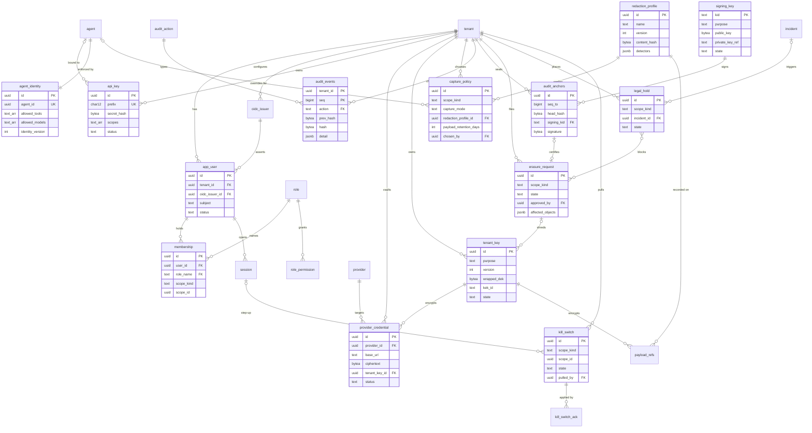

# Security Auditor: Data model (Step 3, wave 1) — identity, keys, capture policy, audit, lifecycle

Codename: Vigil · 2026-10-09 · Inputs: DECISIONS.md D1–D18 (D11, D12, D17 govern this slice), ARCHITECTURE.md ADR-7/8/9/10/12, architect/security-auditor.md §3–§7, architect/database-architect.md (RLS helper, role set, `audit_log` sketch). Consolidator: database-architect. No application code; DDL fragments and function signatures only.

Conventions. PK `id uuid DEFAULT uuidv7()` (helper; Postgres 17 has none native). Tenant-scoped tables carry `tenant_id uuid NOT NULL REFERENCES tenant(id)`, the standard `FORCE` RLS policy, and every index leads with `tenant_id`. `created_at timestamptz NOT NULL DEFAULT now()` everywhere. Postgres roles per database-architect §4: `vigil_app` (api), `vigil_ingest`, `vigil_worker`, `vigil_audit` (NOLOGIN; owns audit tables and `audit_append()`), `vigil_migrate` (DDL). The gateway has no database role: it receives keys, credentials and identities inside the signed snapshot and credential bundle that api builds. Rows that record a decision are immutable; a change inserts a new version and supersedes the old one (house immutability rule, and "what was the policy at 14:02" becomes a plain query).

## 1. Entity-relationship diagram



## 2. Entities

Column notation: `name type [NN] [= default]`; NN = NOT NULL. Writer, retention, uniqueness and indexes for every entity are in one governance table so the consolidator has a single source; the per-entity sections carry columns and invariants only. RLS is the standard tenant policy on every tenant-scoped table unless noted.

| Entity | Writer (Postgres role) | Uniques / indexes (all lead with tenant_id) | Retention |
|---|---|---|---|
| app_user | vigil_app | UK (tenant_id, oidc_issuer_id, subject); (tenant_id, email) | tenant lifetime; PII hashed on deprovision/erasure |
| role, role_permission | vigil_migrate only (tenant-free) | PK name; PK (role_name, permission) | forever |
| membership | vigil_app | UK (tenant_id, user_id, role_name, scope_kind, coalesce(scope_id, nil_uuid)) | forever (revoked_at, never deleted) |
| oidc_issuer | vigil_app | UK (tenant_id, issuer_url) | tenant lifetime |
| session | vigil_app; worker DELETE of expired | UK token_hash; (user_id); partial (idle_expires_at) WHERE revoked_at IS NULL | deleted 7 d after expiry |
| api_key | vigil_app; vigil_ingest column UPDATE on last_used_* | UK prefix (global); (tenant_id, agent_id); partial active | revoked rows 400 d, then secret_hash NULLed |
| agent_identity | vigil_app | UK agent_id | with the agent |
| provider_credential | vigil_app; ciphertext/nonce SELECT by vigil_app only | (tenant_id, provider_id); partial active | revoked 400 d with ciphertext NULLed on revoke |
| tenant_key | vigil_app INSERT, retire; shred only via `tenant_key_shred()` | UK (tenant_id, purpose, version); partial UK (tenant_id, purpose) WHERE active | forever |
| signing_key | vigil_app via operator CLI (tenant-free) | PK kid; one active per purpose | never deleted |
| capture_policy | vigil_app INSERT; UPDATE superseded_by only | partial UK (tenant_id, scope_kind, coalesce(agent_id, nil_uuid)) WHERE superseded_by IS NULL | forever |
| redaction_profile | vigil_app INSERT (tenant rows); vigil_migrate (system rows) | UK (coalesce(tenant_id, nil_uuid), name, version) | forever; FK RESTRICT |
| audit_action | vigil_migrate only (tenant-free) | PK name | forever |
| audit_events | none; `audit_append()` owned by vigil_audit | PK (tenant_id, recorded_at, seq); (tenant_id, seq); (tenant_id, resource_type, resource_id, seq); (tenant_id, action, recorded_at); partial WHERE is_evidence | 400 d min, ≤ 7 y per contract; partition dropped only after sealed export |
| audit_anchors | vigil_worker INSERT only | UK (tenant_id, seq_to) | as audit_events |
| erasure_request | vigil_app (request/approve/reject); vigil_worker (execution states) | (tenant_id, state) | forever |
| legal_hold | vigil_app; vigil_worker sets expired | partial (tenant_id) WHERE active | forever |
| kill_switch, kill_switch_ack | vigil_app | partial UK (tenant_id, scope_kind, scope_id) WHERE pulled; PK (kill_switch_id, gateway_id, snapshot_version) | forever |

### 2.1 `org` — decision: not a table in Phase 1

A grouping that is not an isolation boundary should not be a foreign key on every scoped table; it becomes a second authz dimension the RLS test cannot cover. Business units are `agent_group` (registry) plus `membership.scope_kind = 'agent_group'`; billing separation is a second tenant. Revisit for group-level admins (Phase 3, ReBAC).

### 2.2 `app_user` (`user` is reserved)

Purpose: a human principal, keyed by OIDC `iss`+`sub`. No credential material of any kind (ADR-8).

| Column | Type | Notes |
|---|---|---|
| id | uuid NN | PK |
| tenant_id | uuid NN | FK tenant |
| oidc_issuer_id | uuid NN | FK oidc_issuer |
| subject | text NN | OIDC `sub`, opaque |
| email | citext NN | from `email` claim; display and invite matching only, never a login key |
| email_verified | bool NN = false | |
| display_name | text | |
| status | text NN = 'invited' | `invited`, `active`, `disabled`, `deprovisioned` |
| last_login_at | timestamptz | |
| updated_at | timestamptz NN | |

Invariants: no column matching `password%|secret%|totp%`, asserted by a schema test; on deprovision or erasure `email` and `display_name` become sha256 hashes so audit actor references survive; the same human at two tenants is two rows.

### 2.3 `role` and `role_permission` (tenant-free, allowlisted)

Purpose: the seven system roles and the permission matrix of §6, as data so `authorize()` and the authz test read the same source.

`role(name text PK, description text NN, is_system bool NN = true)` seeded with the seven roles. `role_permission(role_name FK, permission text, scope_rule text NN = 'tenant', PK (role_name, permission))`; `scope_rule = 'scoped'` means the membership's `agent_group` bounds the resource. Invariant: CI diffs this table against §6.

### 2.4 `membership`

| Column | Type | Notes |
|---|---|---|
| id | uuid NN | PK |
| tenant_id | uuid NN | FK tenant |
| user_id | uuid NN | FK app_user |
| role_name | text NN | FK role |
| scope_kind | text NN = 'tenant' | `tenant`, `agent_group` |
| scope_id | uuid | FK agent_group; NN iff scope_kind = agent_group |
| granted_by | uuid NN | FK app_user |
| expires_at | timestamptz | |
| revoked_at | timestamptz | |
| revoked_by | uuid | FK app_user |

Invariants: CHECK `role_name IN ('owner','admin','security_admin','auditor') → scope_kind = 'tenant'`; a deferred constraint trigger keeps ≥ 1 active `owner` per tenant; revocation sets `revoked_at`, never deletes; membership is read live on every request, never cached in the session; every grant/revoke is `membership.granted/revoked`.

### 2.5 `oidc_issuer`

Purpose: per-tenant relying-party configuration. Login starts from a tenant slug, never from an issuer alone, so a shared issuer (dex in dev) cannot cross tenants.

| Column | Type | Notes |
|---|---|---|
| id | uuid NN | PK |
| tenant_id | uuid NN | FK tenant |
| issuer_url | text NN | must be `https://` outside dev mode |
| client_id | text NN | |
| client_secret_ct | bytea | envelope-encrypted, purpose `config`; NULL for public clients |
| client_secret_key_id | uuid | FK tenant_key |
| allowed_email_domains | text[] NN = '{}' | empty = any |
| role_claim | text | claim carrying group/role values |
| role_claim_map | jsonb NN = '{}' | claim value → role_name |
| jit_default_role | text | FK role; NULL = invite-only, no JIT provisioning |
| status | text NN = 'active' | `active`, `disabled` |
| updated_at | timestamptz NN | |

Invariants: no plaintext secret column; CHECK `jit_default_role NOT IN ('owner','admin','security_admin')`; changes emit `oidc_issuer.changed` with before/after of non-secret fields.

### 2.6 `session` (server-side)

| Column | Type | Notes |
|---|---|---|
| id | uuid NN | PK |
| tenant_id | uuid NN | FK tenant |
| user_id | uuid NN | FK app_user |
| token_hash | bytea NN | sha256 of the 256-bit random cookie value; UNIQUE |
| issued_at | timestamptz NN | |
| absolute_expires_at | timestamptz NN | issued_at + 8 h |
| idle_expires_at | timestamptz NN | last_seen + 30 min |
| last_seen_at | timestamptz NN | |
| step_up_at | timestamptz | last fresh IdP authentication; valid for 5 min |
| ip_hash | bytea | sha256(pepper ‖ ip) |
| ua_class | text | `desktop`, `mobile`, `cli` |
| revoked_at | timestamptz | |
| revoke_reason | text | |

Invariants: the raw token is never stored (plain DELETE of expired rows is fine; `access.login/logout` is the record); step-up actions (`killswitch.*`, `credential.*`, `tenant_key.*`, `erasure.approve`, `hold.release`, `oidc_issuer.*`) require `step_up_at > now() - 5 min` and the audit row records `actor_session_id`.

### 2.7 `api_key`

Purpose: machine credentials for SDKs, gateways and CI. Format `vgl_<env>_<prefix12>_<secret>`; `prefix12` is 12 chars base62 and the lookup key; `secret` is 32 random bytes base64url.

| Column | Type | Notes |
|---|---|---|
| id | uuid NN | PK |
| tenant_id | uuid NN | FK tenant |
| agent_id | uuid | FK agent; NULL = tenant-level key |
| name | text NN | |
| env | text NN | `live`, `test` |
| prefix | char(12) NN | UNIQUE globally (lookup before tenant is known) |
| secret_hash | bytea NN | HMAC-SHA-256(pepper, secret); high-entropy secret, so Argon2id is not needed and would cost 50 ms per gateway auth |
| scopes | text[] NN | subset of `telemetry:write gateway:proxy route:read handoff:write registry:read registry:write killswitch:pull` |
| status | text NN = 'active' | `active`, `rotating`, `revoked`, `expired` |
| expires_at | timestamptz | |
| last_used_at | timestamptz | updated by ingest at most once per minute |
| last_used_ip_hash | bytea | |
| rotated_from_id | uuid | FK api_key |
| rotation_grace_until | timestamptz | both keys valid until then |
| created_by | uuid NN | FK app_user |
| revoked_at | timestamptz | |
| revoked_by | uuid | FK app_user |
| revoke_reason | text | |

Invariants: `secret_hash` is selectable only by `vigil_app` building the snapshot; the pepper is an env secret shared by api and gateway, which verifies locally against the snapshot's `prefix → secret_hash` map; `X-Vigil-Agent` may only narrow to the bound agent (or, for a tenant-level key, to an agent of that tenant); revocation bumps the snapshot version in the same transaction; `killswitch:pull` is the break-glass scope (Q2) and its use is `access.break_glass`.

### 2.8 `agent_identity`

Purpose: the enforced permission set of one agent, 1:1 with the registry row; the registry's descriptive `tools[]` is documentation, this row is what the gateway checks.

| Column | Type | Notes |
|---|---|---|
| id | uuid NN | PK |
| tenant_id | uuid NN | FK tenant |
| agent_id | uuid NN | FK agent, UNIQUE |
| allowed_tools | text[] NN = '{}' | |
| allowed_models | text[] NN = '{}' | `provider/model` patterns |
| allowed_providers | uuid[] NN = '{}' | FK provider |
| enforcement | text NN = 'observe' | `observe` (emit `policy.violated`), `block` |
| token_ttl_seconds | int NN = 900 | Phase 2 token exchange |
| identity_version | int NN = 1 | bumped on every change; carried in snapshot and tokens so a stale token is rejected |
| tools_hash | bytea NN | sha256 of sorted `allowed_tools`, stamped on spans |
| updated_by | uuid NN | FK app_user |
| updated_at | timestamptz NN | |

Invariants: a change adding a tool, model or provider emits `agent_identity.changed` with `widened = true` (warning, alert-worthy); Phase 2 agent tokens are stateless ES256 signed by `signing_key(purpose = 'agent_token')`, never stored, carrying `tenant_id, agent_id, scopes, identity_version, tools_hash`.

### 2.9 `provider_credential` (D11, ADR-10)

Purpose: vaulted keys for configured fallback targets only; primary-call keys pass through the gateway and never touch this table.

| Column | Type | Notes |
|---|---|---|
| id | uuid NN | PK |
| tenant_id | uuid NN | FK tenant |
| provider_id | uuid NN | FK provider |
| name | text NN | |
| purpose | text NN = 'fallback' | `fallback`, `probe` |
| base_url | text NN | effective endpoint; CHECK `is_allowlisted_base_url(base_url)` |
| allowlist_basis | text NN | `known_provider`, `resolver_checked` (public IP, no redirects) |
| auth_scheme | text NN | `bearer`, `x-api-key`, `header:<name>` |
| ciphertext | bytea NN | AES-256-GCM of the secret |
| nonce | bytea NN | 12 random bytes, unique per row |
| tenant_key_id | uuid NN | FK tenant_key (purpose `credential`) |
| key_version | int NN | |
| secret_sha256 | bytea NN | sha256(secret) for rotation detection; never reversible |
| secret_hint | char(4) | last 4 chars for console display |
| status | text NN = 'active' | `active`, `rotating`, `revoked`, `shredded` |
| rotated_from_id | uuid | FK provider_credential |
| rotation_grace_until | timestamptz | |
| expires_at | timestamptz | |
| last_used_at | timestamptz | from gateway telemetry via ingest |
| last_verified_at | timestamptz | last successful probe |
| created_by | uuid NN | FK app_user |
| revoked_at | timestamptz | |
| revoke_reason | text | |

Invariants: no plaintext secret column exists (schema test); `vigil_worker`/`vigil_ingest` read only the view `provider_credential_meta`; AAD = `tenant_id ‖ id ‖ key_version`, so a ciphertext moved to another row fails to open; the gateway bundle is encrypted to the gateway's bundle key, held in memory ≤ 300 s and dropped on snapshot expiry; `http://` or private/loopback/link-local `base_url` is rejected at insert and re-checked by the daily probe; `VIGIL_DEMO=1` forbids active rows (startup check).

### 2.10 `tenant_key` (DEKs)

| Column | Type | Notes |
|---|---|---|
| id | uuid NN | PK |
| tenant_id | uuid NN | FK tenant |
| purpose | text NN | `payload`, `credential`, `config` |
| version | int NN | |
| algorithm | text NN = 'AES-256-GCM' | |
| wrapped_dek | bytea | DEK wrapped by the master KEK (AES-256-GCM, AAD = tenant_id ‖ purpose ‖ version); NULL iff shredded |
| kek_id | text NN | `env:<fp8>` now, `kms:<arn>` later |
| state | text NN = 'active' | `active`, `retired`, `shredded` |
| activated_at | timestamptz NN | |
| retired_at | timestamptz | |
| shredded_at | timestamptz | |
| erasure_request_id | uuid | FK erasure_request; NN iff shredded |

Invariants: CHECK `(state = 'shredded') = (wrapped_dek IS NULL)`; `shredded` is reachable only through `tenant_key_shred(erasure_request_id)` (SECURITY DEFINER, owned by `vigil_audit`), which refuses unless the request is `approved` and no active `legal_hold` covers the tenant; DEKs are unwrapped only by api and worker, cached in memory by `(id, version)` for 10 min.

### 2.11 `signing_key` (tenant-free, allowlisted)

| Column | Type | Notes |
|---|---|---|
| kid | text NN | PK, e.g. `snap-2026-10-v1` |
| purpose | text NN | `snapshot`, `audit_anchor`, `agent_token` |
| algorithm | text NN | `Ed25519`; `ES256` for agent_token |
| public_key | bytea NN | |
| private_key_ref | text NN | `env:VIGIL_SNAPSHOT_KEY`, `file:/run/secrets/...`, `kms:...`; never the key |
| state | text NN = 'active' | `active`, `retiring`, `retired`, `compromised` |
| activated_at | timestamptz NN | |
| retiring_until | timestamptz | overlap window |
| retired_at | timestamptz | |
| custody_note | text NN | who holds it, where, ceremony reference |

Invariants: written only by the Vigil-operator CLI, never a tenant endpoint; exactly one `active` per purpose; the only `bytea` column is `public_key`; `audit_anchor` keys stay verifiable for the full audit retention; `compromised` triggers a successor and re-anchoring of every tenant from its last trusted anchor.

### 2.12 `capture_policy` (D12)

Purpose: the explicit capture choice, versioned and immutable. No default row exists; onboarding inserts the tenant-scoped row before the first API key can be created, and ingest answers `403 capture_policy_missing` until then.

| Column | Type | Notes |
|---|---|---|
| id | uuid NN | PK |
| tenant_id | uuid NN | FK tenant |
| scope_kind | text NN | `tenant`, `agent` |
| agent_id | uuid | FK agent; NN iff scope_kind = agent |
| capture_mode | text NN | `full`, `redacted`, `metadata`; **no column default** |
| redaction_profile_id | uuid NN | FK redaction_profile; `full` → system `secrets_only`; `redacted` → tenant/system PII profile; `metadata` → `secrets_only` (nothing stored anyway) |
| payload_retention_days | int NN = 30 | CHECK 1..365 in Phase 1 |
| metadata_retention_days | int NN = 90 | |
| max_payload_bytes | int NN = 262144 | oversize → hash + head/tail |
| header_allowlist | text[] NN | never contains `authorization`, `cookie`, `x-api-key`, `api-key` (CHECK) |
| consequences_version | text NN | id of the wizard text the chooser saw |
| chosen_by | uuid NN | FK app_user |
| chosen_at | timestamptz NN | |
| version | int NN | |
| superseded_by | uuid | FK capture_policy |

Invariants: every insert emits `capture.policy_set` with `{capture_mode, retention_days, redaction_profile_hash, previous_version}`; an agent row may be stricter than the tenant row, never looser (`metadata < redacted < full`, CHECK via function); api resolves the effective policy into the snapshot so gateway and SDK apply it without a lookup.

### 2.13 `redaction_profile`

| Column | Type | Notes |
|---|---|---|
| id | uuid NN | PK |
| tenant_id | uuid | FK tenant; NULL = system profile (allowlisted rows) |
| name | text NN | |
| version | int NN | |
| detectors | jsonb NN | ordered list of `{id, params}`; ids from the `vigil-schemas` detector registry |
| replacement_format | text NN = '[{kind}:{hash8}]' | |
| content_hash | bytea NN | sha256(JCS(detectors ‖ replacement_format)); recorded on every stored object as `payload_refs.redaction_profile_hash` |
| created_by | uuid | FK app_user; NULL for system |

Invariants: versions are immutable; every profile's `detectors` is a superset of the `secrets_only` baseline (CHECK via function), which makes "secrets scrubbing is unconditional" a database fact rather than a code path.

### 2.14 `audit_events`

Purpose: the per-tenant append-only hash chain; supersedes database-architect's `audit_log` sketch with this column set.

| Column | Type | Notes |
|---|---|---|
| tenant_id | uuid NN | PK part |
| seq | bigint NN | PK part; per-tenant, gapless, from `audit_append()` |
| recorded_at | timestamptz NN | server clock inside the function; partition key (monthly) |
| id | uuid NN | uuidv7, for FK references from other tables |
| occurred_at | timestamptz | caller-claimed, informational, not in chain order |
| actor_type | text NN | `human`, `rule`, `policy`, `system`, `agent` |
| actor_id | uuid | app_user, rule id, policy id, agent id |
| actor_key_id | uuid | api_key used, if any |
| actor_session_id | uuid | session used, if any |
| action | text NN | FK `audit_action(name)` |
| resource_type | text NN | |
| resource_id | uuid | |
| resource_ref | text | human-readable, e.g. agent slug, snapshot version |
| severity | text NN | copied from taxonomy at write time |
| reason | text | NN when taxonomy says `reason_required` and actor_type = human (enforced in function) |
| detail | jsonb NN | ≤ 8 KB; references and hashes only |
| detail_sha256 | bytea NN | sha256 of the app-canonicalised (JCS) detail |
| envelope_sha256 | bytea NN | sha256 of the canonical envelope (§4) |
| prev_hash | bytea NN | 32 zero bytes on genesis |
| hash | bytea NN | §4 |
| chain_version | smallint NN = 1 | hash recipe version |
| request_id | uuid | correlation |
| is_evidence | bool NN | copied from taxonomy; index for Phase 3 export |

Invariants: the PK includes `recorded_at` only because the partition key must be in it; `(tenant_id, seq)` uniqueness comes from the function's advisory lock and is checked by verify. No login role holds INSERT, UPDATE, DELETE or TRUNCATE; `vigil_app`, `vigil_worker`, `vigil_ingest` hold EXECUTE on `audit_append()` and SELECT; a `BEFORE UPDATE OR DELETE OR TRUNCATE` trigger raises unconditionally, owner included; `pgaudit` logs DDL. `detail` contains no key named `prompt|completion|messages|body|content|headers` (CHECK via function; payloads are referenced by `payload_sha256` and `payload_ref`) and the scrubber runs on it. Genesis row `seq = 0`, `action = 'audit.genesis'`, written at tenant creation.

`audit_action(name PK, domain, actor_types text[], resource_type, required_fields text[], reason_required bool, is_evidence bool, severity)` is §3 as a tenant-free table seeded by migration; `audit_append()` validates against it, so an undeclared action cannot be written.

### 2.15 `audit_anchors`

| Column | Type | Notes |
|---|---|---|
| id | uuid NN | PK |
| tenant_id | uuid NN | FK tenant |
| kind | text NN | `hourly`, `partition_boundary`, `erasure`, `export`, `rekey` |
| seq_from | bigint NN | first seq covered since previous anchor |
| seq_to | bigint NN | head |
| head_hash | bytea NN | `audit_events.hash` at seq_to |
| prev_anchor_id | uuid | FK audit_anchors |
| signing_kid | text NN | FK signing_key |
| signature | bytea NN | Ed25519 over JCS(`{tenant_id, seq_from, seq_to, head_hash, anchored_at, prev_anchor_id}`) |
| anchored_at | timestamptz NN | |
| external_ref | text | BlobStore path of the anchor copy; Phase 2 TSA token / customer webhook receipt |

Invariants: same block-everything trigger as `audit_events`; written hourly when `seq_to` advanced, at every partition boundary, at `erasure.completed`, before any export and after a signing-key change; the private key never lives in Postgres (ADR-12), so an insider with DB write access can rewrite rows but not forge the anchor.

### 2.16 `erasure_request` (D17)

| Column | Type | Notes |
|---|---|---|
| id | uuid NN | PK |
| tenant_id | uuid NN | FK tenant |
| scope_kind | text NN | `tenant` (crypto-shred + purge), `agent`, `subject` (object deletion + derived purge) |
| scope_ref | text | agent id or sha256 of the subject identifier; NN unless tenant |
| legal_basis | text NN | `gdpr_art17`, `dpdp_s12`, `contract_end`, `tenant_offboarding`, `other` |
| requested_by | uuid | FK app_user; NULL for a DSAR entered by Vigil operator |
| requested_at | timestamptz NN | |
| state | text NN = 'requested' | `requested`, `hold_blocked`, `approved`, `executing`, `keys_shredded`, `objects_deleted`, `derived_purged`, `verified`, `completed`, `rejected`, `cancelled` |
| approved_by | uuid | FK app_user; CHECK `approved_by <> requested_by` |
| approved_at | timestamptz | |
| hold_check_at | timestamptz | |
| blocking_hold_ids | uuid[] NN = '{}' | |
| affected_objects | jsonb | counts: payload_refs, events, packets, checkpoints, embeddings, credentials, keys[] |
| execution_log | jsonb NN = '[]' | `[{step, started_at, finished_at, result}]` |
| completion_anchor_id | uuid | FK audit_anchors |
| certificate_sha256 | bytea | sha256 of the exported erasure certificate |
| backups_expire_at | timestamptz | when the last pre-shred backup ages out |
| completed_at | timestamptz | |
| error | text | |

Invariants: transitions follow the listed order only (CHECK trigger); `approved` requires step-up and a different approver; `tenant` scope requires `owner`; every transition emits an `erasure.*` event; `hold_blocked` re-evaluates when a hold is released; subject identifiers are stored hashed.

### 2.17 `legal_hold`

| Column | Type | Notes |
|---|---|---|
| id | uuid NN | PK |
| tenant_id | uuid NN | FK tenant |
| scope_kind | text NN | `tenant`, `agent`, `incident`, `subject` |
| scope_ref | text | as erasure_request |
| incident_id | uuid | FK incident; NN iff scope_kind = incident |
| alert_id | uuid | FK alert |
| reason | text NN | |
| placed_by | uuid NN | FK app_user (`security_admin`, `owner`) or system on incident open if tenant setting `hold_on_incident = true` |
| placed_at | timestamptz NN | |
| expires_at | timestamptz | |
| state | text NN = 'active' | `active`, `released`, `expired` |
| released_by | uuid | FK app_user |
| released_at | timestamptz | |
| release_reason | text | |

Invariants: while active, the retention sweeper skips every `payload_refs` row joined to the hold scope (explicit rows, not "any open incident"), `tenant_key_shred()` refuses, and erasure requests enter `hold_blocked`; release requires step-up and a reason.

### 2.18 `kill_switch` and `kill_switch_ack` (distinct from audit)

Distinct because "what is killed now" must be a point lookup, and gateway acks arrive after the immutable audit row exists.

`kill_switch(id, tenant_id, scope_kind ∈ {tenant, agent, provider}, scope_id uuid, state ∈ {pulled, released}, reason text NN, pulled_by uuid NN, pulled_at NN, step_up_session_id uuid NN, snapshot_version_at_pull bigint NN, released_by, released_at, release_reason, release_session_id)`. `kill_switch_ack(kill_switch_id FK, gateway_id text, snapshot_version bigint, applied_at timestamptz)`, INSERT-only from gateway acks; each ack also emits `killswitch.applied`. Invariants: the pull, the `routing_state` write (backend-architect), the snapshot version bump and `killswitch.pulled` are one transaction; a pulled scope stays killed on any stale or expired snapshot (ADR-9); `tenant` scope requires `owner` or `security_admin` with step-up.

**Audit shape of approvals and overrides** (entity is backend-architect's): `approval.*` carry `{approval_id, transition_id, agent_id, risk, action, requested_by_actor, timeout_policy, expires_at}`; `approval.granted/denied` add `{decided_by, decision_session_id, elapsed_s}` with `reason` required; `approval.expired` adds `{timeout_policy_applied}`. `override.by_human` carries `{agent_id, from_state, to_state, prev_target, new_target, transition_id, automated_decision_overridden: alert_id|null}` plus reason; `failover.undone` adds `{undo_of_transition_id, operator_hold_until}`. Requester ≠ approver is checked in api and asserted by test 5.

## 3. Audit event taxonomy

Actor types: H human, R rule, P policy, S system, A agent (SDK-originated via api_key). Evidence = included in the Phase 3 compliance export. Severity: info, notice, warning, critical. `reason` is required for every H-actor row marked †.

| action | actors | resource_type | required `detail` fields | evid. | sev |
|---|---|---|---|---|---|
| audit.genesis | S | tenant | chain_version | yes | info |
| audit.anchored | S | audit_anchor | anchor_id, seq_from, seq_to, kid | yes | info |
| audit.verified | H,S | tenant | from_seq, to_seq, anchors_checked | yes | info |
| audit.verify_failed | H,S | tenant | first_break_seq, kind | yes | critical |
| audit.exported | H | tenant | from_seq, to_seq, export_sha256, format | yes | notice |
| audit.partition_sealed | S | audit_partition | partition, seq_from, seq_to, export_ref, anchor_id | yes | info |
| tenant.created / suspended / reinstated | S,H† | tenant | slug, residency_region | yes | notice |
| config.changed | H† | tenant | field, before, after | yes | notice |
| residency.warning | P | agent | declared_region, provider_region, provider_id | yes | warning |
| asset.discovered | S | agent | slug, api_key_id, default_fail_mode | yes | notice |
| asset.created / updated | H,A | agent | fields_changed[], profile_hash | yes | info |
| asset.approved | H† | agent | lifecycle_from, lifecycle_to, approval_ref | yes | notice |
| asset.retired | H† | agent | lifecycle_from | yes | notice |
| agent_identity.changed | H† | agent_identity | identity_version, added[], removed[], widened | yes | warning if widened |
| snapshot.issued | S | policy_snapshot | version, snapshot_sha256, kid, expires_at, agents_count | yes | info |
| snapshot.rejected | S | gateway | gateway_id, offered_version, held_version, cause | yes | critical |
| policy.violated | P | agent | rule, tool_or_model, allowed_hash, span_id, enforcement | yes | warning |
| policy.blocked | P | agent | rule, span_id | yes | warning |
| policy.stale_bypass | S | agent | window_start, window_end, calls, snapshot_version, age_s | yes | warning |
| policy.fail_closed_block | S | agent | window_start, window_end, calls_refused | yes | warning |
| policy.no_snapshot_refusal | S | gateway | gateway_id, since | yes | critical |
| route.changed | R,H† | agent | transition_id, from_target, to_target, trigger | yes | notice |
| failover.proposed | R | agent | transition_id, rules[], evidence_hashes[], risk, approval_id | yes | notice |
| failover.started / completed | R,S | agent | transition_id, to_target, steps_ok | yes | notice |
| failover.rolled_back | R,S | agent | transition_id, cause | yes | warning |
| failover.undone | H† | agent | undo_of_transition_id, operator_hold_until | yes | notice |
| failback.started / completed | R | agent | transition_id, canary_pct | yes | info |
| quarantine.applied | R,H† | agent | cause, policy_violation_ids[] | yes | warning |
| quarantine.released | H† | agent | quarantined_for_s | yes | notice |
| approval.requested | R | approval | §2.18 shape | yes | notice |
| approval.granted / denied | H† | approval | §2.18 shape | yes | notice |
| approval.expired | S | approval | timeout_policy_applied | yes | warning |
| override.by_human | H† | agent | §2.18 shape | yes | warning |
| handoff.created | R,A | handoff_task | task_id, packet_sha256, fidelity, trigger | yes | notice |
| handoff.claimed / completed / returned / reassigned | H,S | handoff_task | task_id, operator_id, outcome | yes | info |
| handoff.expired | S | handoff_task | task_id, ttl_s | yes | warning |
| alert.fired | R | alert | alert_id, rules[], severity, scope | yes | per alert |
| alert.acked / labelled / silenced | H | alert | alert_id, label, until | no | info |
| capture.policy_set | H† | capture_policy | capture_mode, retention_days, redaction_profile_hash, previous_version, scope | yes | notice |
| redaction.profile_created | H | redaction_profile | profile_id, version, content_hash | yes | info |
| retention.partition_dropped | S | partition | table, partition, rows, anchor_id | yes | info |
| retention.objects_swept | S | tenant | date_prefix, objects, bytes, holds_skipped | yes | info |
| user.provisioned / disabled / deprovisioned | H,S | app_user | user_id, issuer_id, via (invite, jit) | yes | notice |
| membership.granted / revoked | H† | membership | user_id, role, scope_kind, scope_id | yes | notice |
| oidc_issuer.configured / changed / disabled | H† | oidc_issuer | issuer_url, fields_changed[] (non-secret) | yes | warning |
| access.login | H | session | session_id, issuer_id, amr[] | yes | info |
| access.login_failed | S | tenant | issuer_id, cause, ip_hash | yes | notice |
| access.logout / session.revoked | H,S | session | session_id, cause | no | info |
| access.denied | S | any | permission, resource_type, resource_id | yes | notice |
| access.step_up | H | session | session_id, for_action | yes | info |
| access.break_glass | S | tenant | api_key_id, action_taken, ip_hash | yes | critical |
| api_key.created / rotated / revoked / expired | H†,S | api_key | key_id, prefix, scopes, agent_id, grace_until | yes | notice |
| api_key.anomaly | R | api_key | key_id, prior_ip_class, new_ip_class | yes | warning |
| credential.created / rotated / revoked / verified | H†,S | provider_credential | credential_id, provider_id, base_url, allowlist_basis, key_version | yes | notice |
| credential.probe_failed | S | provider_credential | credential_id, http_status | yes | warning |
| tenant_key.created / rotated / retired | S,H | tenant_key | key_id, purpose, version, kek_id | yes | notice |
| tenant_key.shredded | S | tenant_key | key_id, purpose, version, erasure_request_id | yes | critical |
| kek.rotated | S | kek | old_kek_id, new_kek_id, keys_rewrapped | yes | warning |
| signing_key.activated / retired | S | signing_key | kid, purpose | yes | notice |
| signing_key.compromised | H† | signing_key | kid, successor_kid, reanchor_from_seq | yes | critical |
| killswitch.pulled | H† | kill_switch | scope_kind, scope_id, snapshot_version, session_id | yes | critical |
| killswitch.applied | S | kill_switch | gateway_id, snapshot_version, applied_at | yes | info |
| killswitch.released | H† | kill_switch | scope_kind, scope_id, killed_for_s | yes | warning |
| hold.placed / released | H†,S | legal_hold | hold_id, scope_kind, scope_ref, incident_id, expires_at | yes | notice |
| erasure.requested | H,S | erasure_request | request_id, scope_kind, legal_basis | yes | notice |
| erasure.approved / rejected | H† | erasure_request | request_id, approver_id | yes | warning |
| erasure.blocked_by_hold | S | erasure_request | request_id, hold_ids[] | yes | warning |
| erasure.keys_shredded / objects_deleted / derived_purged | S | erasure_request | request_id, counts | yes | warning |
| erasure.completed | S | erasure_request | request_id, certificate_sha256, anchor_id, backups_expire_at | yes | critical |
| data.revealed | H | payload_ref | payload_ref, payload_sha256, agent_id, reveal_reason | yes | notice |
| data.exported | H† | tenant | export_kind, filter_hash, rows, export_sha256 | yes | notice |
| observation.gap | S | agent or gateway | gateway_id, last_heartbeat, gap_s | yes | warning |
| observation.gap_closed | S | agent or gateway | gateway_id, gap_s, spilled_events | yes | info |
| telemetry.dropped | S | gateway | gateway_id, dropped, cause | yes | warning |
| ingest.rejected | S | tenant | cause, count, window | no | notice |

## 4. `audit_append()` contract

```sql
CREATE FUNCTION audit_append(
  p_tenant uuid, p_actor_type text, p_actor_id uuid, p_actor_key_id uuid, p_actor_session_id uuid,
  p_action text, p_resource_type text, p_resource_id uuid, p_resource_ref text,
  p_reason text, p_detail jsonb, p_detail_canonical bytea,
  p_occurred_at timestamptz, p_request_id uuid
) RETURNS TABLE (seq bigint, hash bytea, recorded_at timestamptz)
LANGUAGE plpgsql SECURITY DEFINER SET search_path = vigil, pg_temp;
```

Function rules: (1) `p_tenant = current_setting('app.tenant_id')` or raise; the definer cannot append to another tenant. (2) `p_action` exists in `audit_action`, `actor_type` is allowed for it, all `required_fields` are present, `reason` is non-null when required for a human, `detail` ≤ 8 KB with no body keys. (3) `p_detail_canonical::jsonb = p_detail` (semantic equality) proves the caller canonicalised the same document; `detail_sha256 = sha256(p_detail_canonical)`. Postgres cannot emit RFC 8785 (jsonb reorders keys and reformats numbers), so JCS of `detail` is computed by `vigil-schemas` in every service and only checked here. (4) `pg_advisory_xact_lock(hashtextextended('audit:' || p_tenant::text, 0))`; `seq = max(seq) + 1`; `prev_hash` = previous row's `hash` (genesis `seq = 0`, 32 zero bytes). (5) `recorded_at = clock_timestamp()`. (6) The envelope is JCS by construction: a flat object, keys in sorted order (`action, actor_id, actor_key_id, actor_session_id, actor_type, chain_version, occurred_at, reason, recorded_at, request_id, resource_id, resource_ref, resource_type, seq, tenant_id`), RFC 3339 UTC microsecond timestamps, lowercase uuids, literal nulls, JSON-escaped strings; `envelope_sha256 = sha256(envelope)`. (7) `hash = sha256(prev_hash ‖ envelope_sha256 ‖ detail_sha256)`. (8) INSERT; return `(seq, hash, recorded_at)`. Callers invoke it in the same transaction as the state change, once per handler; api returns `X-Vigil-Audit-Receipt: <tenant>:<seq>:<hash>`.

Verify, `GET /audit/verify?tenant&from_seq&to_seq` (also offline on an export):

1. Take the latest anchor with `seq_to ≤ from_seq`, verify its signature with `signing_key.public_key` for its `signing_kid`, and start from its `head_hash`; with none, start at genesis.
2. Walk rows by `seq`: require `seq = prev + 1` (`gap`), `prev_hash = running` (`prev_mismatch`), recomputed `envelope_sha256` and JCS(`detail`) hash equal to stored (`content_mismatch`), recomputed `hash` equal (`hash_mismatch`); set `running = hash`.
3. At each anchor in range require `head_hash = running` and a valid signature (`anchor_mismatch`, `signature_invalid`); anchors must be ≤ 1 h apart while rows exist (`anchor_missing`).
4. Return `{ok, rows_checked, anchors_checked, first_break: {seq, kind} | null}` and append `audit.verified` or `audit.verify_failed`.

Proves: any edit, deletion or insertion after the row's hourly anchor is detectable with public keys alone. Does not prove: tampering within the current hour by an actor holding both DB write and the anchor key; hence the key lives outside Postgres and the anchor copy leaves the box (Phase 2 TSA).

## 5. Key hierarchy and lifecycle

```
master KEK  (env VIGIL_MASTER_KEY now; KMS later; kek_id)
  └─ tenant_key DEK  (per tenant × purpose × version; wrapped_dek in Postgres)
       ├─ payload objects   : per-object random 96-bit nonce, AAD = tenant_id‖payload_ref‖key_version
       ├─ provider_credential: per-row nonce, AAD = tenant_id‖id‖key_version
       └─ oidc_issuer.client_secret_ct (purpose config)
signing keys (Ed25519 snapshot, Ed25519 audit_anchor, ES256 agent_token): private key never in Postgres
```

No per-object keys in Phase 1: per-tenant DEK plus unique nonces gives the tenant-level crypto-shred D17 asks for; subject-level erasure is deletion by reference. Per-object key wrapping is the Phase 2 upgrade if subject-level crypto-shred becomes contractual.

State transitions as data:

| Transition | Who | Writes | Event |
|---|---|---|---|
| DEK create | api at tenant creation, one per purpose | `tenant_key` v1 `active` | tenant_key.created |
| DEK rotate | api (owner/security_admin, step-up) or worker on schedule (90 d) | insert v(n+1) `active`; v(n) → `retired` same transaction | tenant_key.rotated |
| DEK retired | — | still unwrappable for reads; new writes use active only; optional background re-encrypt of objects | — |
| KEK rotate | Vigil operator CLI | unwrap every non-shredded DEK with old KEK, wrap with new, set `kek_id`; job asserts zero rows with old `kek_id` before the old KEK is destroyed | kek.rotated, `rekey` anchor |
| Crypto-shred | `tenant_key_shred(erasure_request_id)` SECURITY DEFINER, worker-invoked | all non-shredded versions of purpose `payload` (and `credential`, `config` for tenant offboarding) → `shredded`, `wrapped_dek = NULL` | tenant_key.shredded (critical), `erasure` anchor |
| Signing key rotate | Vigil operator CLI | successor `active`; predecessor `retiring` until snapshot grace (6 min) elapses for `snapshot`, forever `retired` for `audit_anchor` | signing_key.activated / retired |
| Signing key compromised | Vigil operator CLI, step-up | predecessor `compromised`; successor `active`; worker re-anchors each tenant from its last anchor signed by a still-trusted key | signing_key.compromised |

Erasure as state transitions (tenant scope; `agent`/`subject` scope skips `keys_shredded` and deletes by `payload_refs` filter plus derived cascade):

| State | Actor | Work | Exit condition |
|---|---|---|---|
| requested → hold_blocked / approved | api | hold check; approver ≠ requester, step-up, `owner` for tenant scope | `erasure.approved` |
| executing → keys_shredded | worker via `tenant_key_shred()` | all `payload` (+ `credential`, `config` on offboarding) DEK versions → shredded | `tenant_key.shredded`, `erasure` anchor |
| → objects_deleted | worker | BlobStore prefix delete; `payload_refs` and `events` rows removed per partition | counts in `affected_objects` |
| → derived_purged | worker | rollups, packets, checkpoints, embeddings, blast-radius cache via the derived-data registry | counts |
| → verified | worker | zero rows in every tenant-scoped table except `audit_events`, `audit_anchors`, `erasure_request`, `legal_hold`, `tenant_key`, `tenant`; zero objects under the prefix; every key shredded | re-read passes |
| → completed | worker | certificate export, anchor, `backups_expire_at` | `erasure.completed` (critical) |

"Erasure complete" proves: no wrapped DEK for the tenant exists in the live database; every object encrypted under those DEKs, including copies in backups, is undecryptable by anyone holding the KEK; registry, events and derived rows are gone; the chain from `erasure.requested` to `erasure.completed` is anchored under a key outside the database; and the certificate names the date after which pre-shred backups (which hold the wrapped DEK) no longer exist. It does not claim deletion of the hashes and identifiers retained in `audit_events`; the certificate says so.

## 6. RBAC matrix

`authorize(subject, permission, resource)` is deny-by-default. ✓ tenant-wide; G within the membership's agent_group; A allowed and itself audited (`data.revealed`, `audit.exported`, `data.exported`); S requires step-up; ✗ denied.

| Permission | owner | admin | security_admin | engineer | operator | auditor | viewer |
|---|---|---|---|---|---|---|---|
| tenant.settings.read | ✓ | ✓ | ✓ | ✓ | ✓ | ✓ | ✓ |
| tenant.settings.write / tenant.delete | ✓S | ✗ | ✗ | ✗ | ✗ | ✗ | ✗ |
| users.manage, membership.manage | ✓ | ✓ | ✗ | ✗ | ✗ | ✗ | ✗ |
| oidc_issuer.manage | ✓S | ✓S | ✗ | ✗ | ✗ | ✗ | ✗ |
| api_key.manage (tenant-level) | ✓ | ✓ | ✗ | ✗ | ✗ | ✗ | ✗ |
| api_key.manage (agent-bound) | ✓ | ✓ | ✗ | G | ✗ | ✗ | ✗ |
| agent.read (metadata, health) | ✓ | ✓ | ✓ | ✓ | ✓ | ✓ | ✓ |
| agent.register / agent.edit | ✓ | ✓ | ✗ | G | ✗ | ✗ | ✗ |
| agent.approve_lifecycle | ✓ | ✓ | ✓ | ✗ | ✗ | ✗ | ✗ |
| agent_identity.edit | ✓ | ✓ | ✓ | G (narrow only) | ✗ | ✗ | ✗ |
| capture_policy.set, redaction.manage | ✓ | ✓ | ✓ | ✗ | ✗ | ✗ | ✗ |
| credential.manage (fallback targets) | ✓S | ✓S | ✓S | ✗ | ✗ | ✗ | ✗ |
| credential.read_metadata | ✓ | ✓ | ✓ | G | ✗ | ✓ | ✗ |
| tenant_key.rotate | ✓S | ✗ | ✓S | ✗ | ✗ | ✗ | ✗ |
| routing.override, failover.undo | ✓ | ✗ | ✓ | G | ✗ | ✗ | ✗ |
| approval.decide | ✓ | ✗ | ✓ | ✗ | ✗ | ✗ | ✗ |
| quarantine.apply / release | ✓ | ✗ | ✓ | ✗ | ✗ | ✗ | ✗ |
| killswitch.pull / release | ✓S | ✗ | ✓S | ✗ | ✗ | ✗ | ✗ |
| queue.claim / complete / return | ✓ | ✗ | ✗ | ✗ | ✓ | ✗ | ✗ |
| packet.read (incl. agent content) | ✓ | ✗ | ✓ | G | ✓ | A | ✗ |
| payload.read (traces of own agents) | ✓ | ✗ | ✓ | G | ✗ | A | ✗ |
| payload.reveal (any payload, console) | ✓A | ✗ | ✓A | ✗ | ✗ | A | ✗ |
| audit.read | ✓ | ✓ | ✓ | G | ✗ | ✓ | ✗ |
| audit.verify | ✓ | ✓ | ✓ | ✗ | ✗ | ✓ | ✗ |
| audit.export, data.export | ✓A | ✗ | ✓A | ✗ | ✗ | A | ✗ |
| alert.ack / label / silence | ✓ | ✗ | ✓ | G | ✓ | ✗ | ✗ |
| erasure.request | ✓ | ✓ | ✓ | ✗ | ✗ | ✗ | ✗ |
| erasure.approve | ✓S | ✗ | ✓S (≠ requester) | ✗ | ✗ | ✗ | ✗ |
| hold.place / hold.release | ✓S | ✗ | ✓S | ✗ | ✗ | ✗ | ✗ |

Agent principals (api_key) are authorised by `scopes`, not roles: `gateway:proxy`, `telemetry:write` (data plane), `handoff:write` (SDK checkpoints), `registry:read/write` (CI registration, bounded to the bound agent), `killswitch:pull` (break-glass only).

## 7. The five mandatory tests, as assertions

1. **Tenant isolation.** For every table off the tenant-free allowlist (`tenant, role, role_permission, signing_key, audit_action, alembic_version`, system `redaction_profile` rows): as `vigil_app` with `app.tenant_id = A` insert; as B, SELECT returns 0, UPDATE/DELETE affect 0, INSERT with `tenant_id = A` raises; no tenant set, SELECT returns 0; `relforcerowsecurity` true. `audit_append(p_tenant = A)` under `app.tenant_id = B` raises. `provider_credential.ciphertext` is unselectable by `vigil_worker` and `vigil_ingest`.
2. **Authorization matrix.** `role_permission` equals §6 (diff test); every route declares a permission; for each route × {7 roles × {tenant, group} scope, api_key per scope, unauthenticated} the response matches the expected 2xx/401/403 table; an undeclared route fails the test; every ✓S permission returns 403 `step_up_required` with a stale `step_up_at`.
3. **Secret never leaks.** Canaries (`AKIA…`, bearer JWT, PEM block, `postgres://` DSN) in headers, body and prompt, plus a canary provider key in `provider_credential`, are absent from `events.attrs`, decrypted BlobStore plaintext, `audit_events.detail`, logs, error responses, metrics labels, the snapshot JSON and the bundle at rest; `[SECRET:<hash8>]` appears instead; no `text` column anywhere contains a canary.
4. **Declared fail mode.** With api stopped past snapshot grace: fail-open calls succeed and, once api returns, exactly one `policy.stale_bypass` row per agent per window exists; fail-closed calls get 503 and one `policy.fail_closed_block`; a `pulled` kill_switch keeps the agent refused throughout; a gateway that never loaded a snapshot refuses traffic and writes `policy.no_snapshot_refusal` on reconnect; a stopped heartbeat yields `observation.gap` then `observation.gap_closed` with matching `gap_s`.
5. **Audit completeness and chain.** Each state-changing handler and worker step, run once, raises the tenant's `max(seq)` by exactly one with the taxonomy's `action`; `verify` returns `ok`; UPDATE, DELETE, TRUNCATE on `audit_events` and `audit_anchors` raise for every role including the owner; direct INSERT by any login role is denied; a superuser edit of one `detail` byte in the harness yields `content_mismatch` at that `seq`, a deleted row `gap`, a re-signed anchor with a wrong key `signature_invalid`; requester = approver on `approval.granted` is rejected; `capture.policy_set` precedes the first `api_key.created` for every seeded tenant; inserting `capture_policy` without `capture_mode` fails.

## 8. What the database-architect needs from this slice

1. Rename `audit_log` → `audit_events`, `audit_checkpoints` → `audit_anchors`; adopt the §4 `audit_append()` signature (app-canonical `p_detail_canonical` plus in-DB envelope replaces "JCS in-DB"); keep the NOLOGIN owner; PK `(tenant_id, recorded_at, seq)` on monthly partitions plus the `(tenant_id, seq)` index.
2. Tenant creation is one transaction: `tenant`, `tenant_key` v1 for `payload`, `credential`, `config`, and the genesis audit row. `capture_policy` is inserted by onboarding, never by tenant creation.
3. `payload_refs` needs `tenant_key_id`, `key_version`, `nonce`, `plaintext_sha256`, `redaction_profile_hash`, `capture_mode`, `api_key_id`, `retention_until` and a join path to `legal_hold`; `events` needs `api_key_id`, `identity_version`, `tools_hash`, `policy_state` (`fresh|stale|none`), `snapshot_version`.
4. Tenant-free allowlist additions: `role`, `role_permission`, `signing_key`, `audit_action`, and `redaction_profile WHERE tenant_id IS NULL` (policy permitting SELECT of system rows to every tenant).
5. Column-level grants: `vigil_ingest` UPDATE on `api_key(last_used_at, last_used_ip_hash)` only; `ciphertext`, `nonce`, `client_secret_ct`, `secret_hash` SELECT by `vigil_app` only.
6. Registry: an `agent_group` entity; `agent` does not carry `allowed_*` (they live in `agent_identity`); `provider` carries default `base_url` and `is_known_provider`; `tenant` carries `slug`, `hold_on_incident bool`, `audit_retention_days NN = 400`, `backup_retention_days`.
7. A derived-data registry `derived_object(tenant_id, source_type, source_id, derived_type, derived_ref)` so erasure and retention cascade deterministically.
8. Shared migration helpers: `uuidv7()`, `is_allowlisted_base_url()`, `nil_uuid`, the state-transition CHECK trigger (used by `erasure_request`, `tenant_key`), and the block-UPDATE/DELETE/TRUNCATE trigger.
