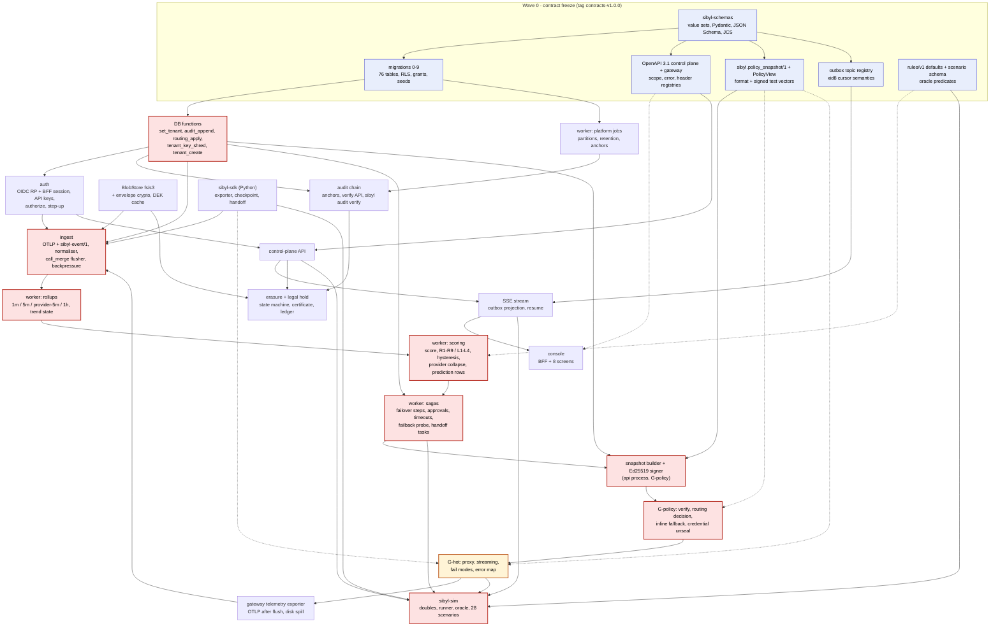

# Sibyl — Phased roadmap (Step 6, consolidated)

2026-10-10 · Chair's consolidated contract for Step 6. Sources: `sprint-prioritizer.md` (SP), `chief-architect.md` (CA), `product-manager.md` (PM), `project-shipper.md` (PS), `SYNTHESIS.md` (rulings R52–R71). Authority order: `DECISIONS.md` (D1–D40) > SYNTHESIS rulings > this document > member reports. Where members differed, the SYNTHESIS ruling is applied and tagged inline, e.g. "(R53)". Choices the SYNTHESIS did not name are tagged "(editor)". Every identifier is `sibyl*` (D19).

---

## 0. Headline

1. **Phase 1 as specified is about 230 engineer-days** (204 across lanes + 26 for the wave 0 contract freeze), roughly 3× the Step 1/2 estimate of ~75. The growth follows from founder decisions taken after Step 1: multi-tenant RLS + OIDC (D1), an in-line gateway (D2), automatic tier-gated failover with approvals (D6, D13), erasure (D17), ~110 control-plane routes and a 28-scenario harness. It is not an estimating miss.
2. **It does not fit ~20 working days.** The adopted cut line (Tier A + Tier B, R53) brings Phase 1 to **182 E: 27 working days P50, 32 P80** (R52). The chief-architect's ~21-day sequencing view is the **stretch**, reached only if wave 0 closes early and throughput holds.
3. **Phase 1.5 (~7 working days) is a gate, not a parking lot** (R54). It restores everything cut and adds 5 consecutive green nightlies, a tested off-host restore and an external security assessment with no open CRITICAL/HIGH, all before a design partner's first production call.
4. **The failover story is demo-able at day 23 (M2).** Phase 1 exits at day 27 (M4). Demo freeze and `v0.1.0` (M5) land inside the P80 buffer (R64).
5. **Three demo-killers are never cut:** automatic failover through the gateway with the task still completing; a handoff packet a human completes in the operator queue; the hash-chained audit with `sibyl audit verify` and a readable decision record. Verdicts, fail-open/closed and the secrets scrub are not on screen but are equally uncuttable.

---

## 1. Phases

Legend. **Phase:** 1 = Step 7 build · 1.5 = cut from Phase 1 and rebuilt on localhost straight after the Phase 1 exit · 2 = "First design partner" · 3 = "Sellable product". **Value (PM §2.4):** MD = must-demo · DP = must-have before a design partner's traffic · NH = nice-to-have. **Trace:** the decision, ruling or cut that places the item.

### 1.1 Phase 1: "Governed failover on localhost"

| # | Capability | Phase | Value | Rationale | Trace |
|---|---|---|---|---|---|
| 1 | docker-compose stack: postgres 17, api, ingest, worker, gateway, console, dex, caddy, BlobStore `fs` | 1 | MD | Localhost now; Postgres is the only stateful component, so the cloud move is mechanical | D4, D10, ADR-3/4/5 |
| 2 | Multi-tenant shared schema, RLS FORCE, `set_tenant()` per tx, generated isolation test per table | 1 | MD | Commercial from day one; isolation is a CRITICAL harness gate; northstar is the on-screen proof | D1, ADR-7 |
| 3 | Tenant CLI; demo tenants meridian / northstar / sandbox; dex personas with demo role bindings | 1 | MD | No tenant lifecycle routes in Phase 1. Platform Admin = `owner`, On-call Operator = `operator` + `security_admin`, Compliance Auditor = `auditor` | D29, R56 |
| 4 | OIDC relying party (PKCE), BFF session cookie, JWT path, **step-up** | 1 | DP | Step-up guards kill release, erasure, credentials; stays per security veto | D1, ADR-8, R53 |
| 5 | API keys: `<resource>:<verb>` scopes, agent-bound keys, rotate/revoke, **break-glass** `killswitch:pull` | 1 | DP | Machine principals; break-glass works while the IdP is down; stays per security veto | D20, D30–D32, D34, R53 |
| 6 | Identity management API (users, invitations, memberships, issuers, groups) | **1.5** | NH | Dex is static in the demo; CLI + seed cover Phase 1 | cut A6 |
| 7 | Registry: agents, lifecycle, identity (allowed tools/models/providers), immutable versions, claim of provisional agents | 1 | MD | Inventory is the first governance question every buyer asks | D8 |
| 8 | Tools, data sources, business processes, declared dependency edges | 1 | MD | Feeds the D22 predicate; the incident card lists affected agents and their declared business processes (editor: the computed blast-radius route is cut, the declared list is not) | D22, PM B3 |
| 9 | AI-BOM (CycloneDX 1.6) and computed blast radius (`/blast-radius`) | **1.5** | NH | No demo step depends on the computed route | cut A1 |
| 10 | Providers, models, vendored price catalogue, discovered models | 1 | MD | Cost derivation; alt-model/provider targets | ADR-2 |
| 11 | Vaulted fallback credentials (envelope encryption, X25519 sealed bundle, SSRF-checked verify probe); demo mode allows them only for allowlisted `sibyl-sim` doubles | 1 | MD | Cross-provider failover (S-01) and S-15 need them; exercises the real ADR-10 path | D11, R55 |
| 12 | Capture policy as an explicit onboarding step, redaction profiles, **unconditional secrets scrub**, retention 30 d default / ≤ 365 | 1 | DP | The CISO's second question | D7, D12, D28 |
| 13 | Continuity plans (RTO/RPO tier defaults), fallback chains, four-eyes on tier 1 | 1 | MD | Inputs to automatic failover | D13, D23, R36, R38 |
| 14 | Gateway: OpenAI-compatible `/v1/chat/completions` (streaming), `/v1/embeddings`, `/v1/models`; signed TTL snapshot; fail-open/closed matrix; inline fallback + breaker; per-agent limits; OTLP emitter with spill; kill acks; CI latency gate. Built as two lanes, G-hot and G-policy, joined by `PolicyView` | 1 | MD | The gateway is core; split shortens the duration critical path | D2, D16, ADR-1/2/9, R62 |
| 15 | Gateway Anthropic dialect translation | **1.5** | NH | Cross-provider failover shown openai-stub → ollama-stub; the anthropic double speaks OpenAI-compatible in Phase 1 | cut B2 |
| 16 | Ingest: `/v1/otlp/traces`, `/v1/otlp/logs`, `/v1/events`; 11-step normaliser; semconv 1.37; three-layer idempotency; `call_merge`; backpressure; heartbeat/gap; auto-register in its own short transaction | 1 | DP | One wire contract; partners keep OpenLLMetry/OpenInference | ADR-11, D25, R27, R28, R61 |
| 17 | BlobStore `fs` + `s3` adapters; per-tenant payload DEK | 1 | DP | `s3` coded now so the cloud move is configuration | D14, ADR-5 |
| 18 | Python `sibyl-sdk` core: `init`, `agent`, `tool`, `checkpoint`, `handoff`, `feedback`, `outcome`, openai + anthropic auto-instrumentation incl. streaming, scrub pipeline, two-lane exporter, policy poll + `SibylKilled` | 1 | MD | Only route to checkpoint-fidelity handoff (demo-killer #2) | D2, D35 |
| 19 | SDK `mcp` + `httpx` instrumentation, disk spool + replay, fork safety | **1.5** | NH | In-memory retry covers S-19's 90 s backpressure | cut A3 |
| 20 | TypeScript SDK interface sketch (types only) | 1 | NH | Reserves the shape | D35 |
| 21 | Health score `100 − Σ penalty`, tier caps, bands with dead-band, hysteresis, cooldown, flap suppression, cold start | 1 | MD | The decision record is this; explainability is a CRITICAL gate | ML §3, R51 |
| 22 | Detected rules R1–R9 incl. **R6–R8 silent degradation**, `tool_loop`, `quality_proxy`, provider-incident collapse | 1 | MD | Automatic handoff on detected failure covers all tiers; R6–R8 stay | D6, D13, R37, R53 |
| 23 | Leading rules **L1–L4 + provider-status leading facet**; 15 m and 1 h horizons; tier gating; `"0.60"` band only if the D36 gate passes | 1 | DP | The D6-named indicators: error/latency trend, rate-limit proximity (L3), budget proximity (L4), provider status | D6, D13, D36, D39 |
| 24 | L5 `fallback_pressure`, L6 `refusal_trend`, L7 `continuity_unverified`, leading `context_saturation` / `credential_expiry` / `model_deprecation`, `drift_cusum`, peer baselines, `agent_risk`, 24 h horizon | **1.5** | NH | Not D6-named; S-08 still detects via R6; S-12 waits for 1.5 | cut B1 |
| 25 | Routing state machine (`routing_apply()` sole legality source), failover saga, incident actions | 1 | MD | Demo-killer #1 | D6, R24, R25 |
| 26 | Approvals with timeout; D22 forced hold; four-eyes; 30-min operator hold after undo | 1 | MD | Tier-1 gating is a CRITICAL gate | D13, D21, D22, R36 |
| 27 | Kill switch (session + break-glass), anchor ≤ 10 s, gateway 403 on any snapshot, SDK `SibylKilled`; second tenant-wide kill within 10 min needs a different owner | 1 | MD | Kill beats everything | D20, D34 |
| 28 | Failback: probe after 5 healthy minutes, then operator or automatic `fail_back` straight to `active` | 1 | NH | Closes the incident loop | ML §9.4 |
| 29 | Failback canary ramp 10 → 100 % with breach revert and backoff | **1.5** | NH | S-25 runs probe → active | cut A4 |
| 30 | Operator queue: claim / extend / release / complete / return; packet view `sibyl-handoff/1` | 1 | MD | Demo-killer #2; standalone queue | D9 |
| 31 | Alerts: ack / silence / close with **mandatory verdict**; unverdicted resolved queue | 1 | DP | The partner's own labels; Phase 2 learning depends on them | D24, D33 |
| 32 | Hash-chained audit (`audit_append()`), hourly Ed25519 anchors, `POST /audit/verifications`, export with anchor-first, offline `sibyl audit verify` | 1 | MD | Demo-killer #3 | D8, D27, R33 |
| 33 | Erasure: tenant + agent scope, crypto-shred, certificate (JCS JSON + sha256), manual legal holds; **CLI/API only** | 1 | DP | DPA precondition; D17 promise | D17, D26, cut B3 |
| 34 | **Off-DB erasure ledger** (BlobStore, separate prefix, hash-chained) + re-shred step in the restore runbook | 1 | DP | Prevents a pre-erasure backup from resurrecting erased data | R63 |
| 35 | Subject-scope erasure, certificate PDF, `/exports`, `sibyl ml export`, auto legal hold on provider incident | **1.5** | NH | Not part of the per-tenant D17 promise | cuts A8, B4 |
| 36 | Read surfaces: fleet health, health + history, risk, metrics, events, traces, payload reveal (audited), SSE with outbox resume | 1 | MD | Console and harness oracle read through these | API §5.10, §7 |
| 37 | Declared `risk_class` on the registry + the single "deployed and unclassified" finding | 1 | MD | Carries the governance claim without legal-advice risk | R53 |
| 38 | Risk-assessment suggestion rubric (`GET /agents/{id}/risk-assessment`, findings list) | **2** | NH | Invites "is this legal advice?" before counsel exists | R53 |
| 39 | Console, 8 screens: fleet map, agent detail, incidents + approval card, queue + packet, alerts + verdict queue, audit viewer + verify + export, onboarding wizard, kill with step-up | 1 | MD | The demo is visual | D8, D9, D29 |
| 40 | Console admin editors (alert rules, continuity plan, fallback chain, providers/credentials, users/OIDC/groups) and erasure/hold screens | **1.5** | NH | API + CLI cover them | cuts A2, B3 |
| 41 | `sibyl-sim`: runner, 23 actors, provider + status-feed doubles, oracle (12 predicates), personas, **28 scenarios single seed**, goldens, PR smoke, nightly; dev-only | 1 | MD | Phase 1 exit = CRITICAL gates green | D3, D38, R45, R46 |
| 42 | Harness tier-swap variants (12), three seeds, S-24 60-min soak, nightly report generator | **1.5** | DP | Worst-of-three-seeds confidence returns in 1.5 | cut A5 |
| 43 | Ops: same-host PITR (pgBackRest), `/metrics` with `sibyl_*`, four cause-based pages to inbox, runbooks per ML §9.4, quickstart | 1 | DP | Single operator, business hours | D18, R47 |
| 44 | Prometheus rule files + automated weekly restore test | **1.5** | NH | Manual restore runbook on localhost | cut A7 |
| 45 | Tier SLO defaults 99.5 / 99.0 / 98.0 % agent-minutes | 1 | DP | Constants in `scoring_config` | D40 |

### 1.2 Phase 1.5: "Close the cuts" (localhost, ~7 working days) — a gate (R54)

| Lane | Brings back (rows from §1.1) | E | Directories |
|---|---|---|---|
| R/A | AI-BOM + blast radius (9); identity admin API (6) | 7 | `api/registry`, `api/tenancy` |
| G/K | Anthropic dialect (15); SDK mcp/httpx, spool, fork safety (19) | 8 | `services/gateway`, `packages/sibyl-sdk` |
| H/P/S/U | L5–L7 and extra leading rules, baselines, `agent_risk`, 24 h (24); canary ramp (29); subject erasure, PDF, `/exports`, auto-hold (35) | 17 | `worker/predict`, `worker/scoring`, `worker/failback`, `api/governance` |
| C/M/O | Admin editors + erasure/hold UI (40); variants, 3 seeds, soak, report (42); Prometheus rules + automated restore test (44) | 16 | `apps/console`, `apps/sibyl-sim`, `ops` |

48 E across 4 lanes ≈ 6 days of lane work + 1 gate day. Cut items need no new migrations: all tables exist from wave 0 (R59).

**Phase 1.5 exit gate (R54, PM §5.3), all required before a design partner's first production call:**
- Every DP-ranked capability complete.
- Full nightly suite (variants × 3 seeds) green for **5 consecutive nights**; S-12 and S-25 (canary) pass; admin editors pass Playwright and visual regression.
- **Off-host backup with a tested restore** (Phase 2 step C1, pulled forward as a gate condition).
- **External security assessment** (D18) with no open CRITICAL/HIGH. Funding sequence is open question 3 (§12).
- A signed pilot agreement (business gate, PM).

### 1.3 Phase 2: "First design partner"

| # | Capability | Rationale | Trace |
|---|---|---|---|
| 1 | **Off-host backup first**, then cloud: managed Postgres, S3 BlobStore, Helm, KMS | Same-host PITR was only acceptable on localhost | D4, D14, D18 |
| 2 | External security assessment before the first paying tenant | Credential custody (D11) is the largest new obligation | D18 |
| 3 | Notifications: email, Slack, Teams webhooks (ADR-14) | Standalone queue in Phase 1 | D9 |
| 4 | Anthropic-native `/v1/messages` inbound | One dialect on the hot path in Phase 1 | D16 |
| 5 | TypeScript SDK implementation | Interface frozen in Phase 1 | D35 |
| 6 | Sidecar gateway packaging; per-installation gateway identity | Sibyl-hosted gateway in Phase 1 | D14, D31, R26 |
| 7 | Learned layer per tenant **in shadow**, with model card and a reported verdict count; promotion only when the D37/R42 floors are met, triggered by volume, not date | A 90-day pilot will probably not reach ≥ 300 verdicts | D36, D37, R42, R68 |
| 8 | Per-agent threshold adaptation from verdicts | Needs real-tenant verdict volume | R67 |
| 9 | LLM-as-judge, tenant opt-in | No paid APIs in Phase 1 | ML §5.9, D10 |
| 10 | Customer-run drills behind a real feature flag | `sibyl-sim` dev-only until then | D38, R46 |
| 11 | Per-agent `slo_target` | Tier defaults in Phase 1 | D40 |
| 12 | EU AI Act `risk_assessment` table + suggestion rubric + route | Moved from Phase 1 | ML §6.2, R53 |
| 13 | Shared rate-limit counters (Valkey, BSD); multi-replica api/ingest/worker | Per-replica counters in Phase 1 | ADR-4 |
| 14 | Real provider calls on by default for the partner's agents | Synthetic in Phase 1 | D3 |
| 15 | LiteLLM coexistence: "Sibyl in front, LiteLLM as an OpenAI-compatible upstream", retries disabled on one side; documented and compatibility-tested; no provider-breadth work | Many prospects already run LiteLLM | R69 |
| 16 | External anchoring of hourly anchors (RFC 3161 TSA or transparency log, zero-cost first) | Strengthens ADR-12 evidence | CA §6.2 |

### 1.4 Phase 3: "Sellable product"

| # | Capability | Rationale | Trace |
|---|---|---|---|
| 1 | Region-pinned stacks; residency becomes a contractual promise | Declared field until then | D17 |
| 2 | SOC 2 readiness, then Type I | Buyer vendor-risk file | D1 |
| 3 | ITSM integrations (ServiceNow, Jira Service Management) | Standalone queue first | D9 |
| 4 | Billing and metering (agent-minutes, the D40 unit) | Commercial product | D1 |
| 5 | Compliance report packs: NIST AI RMF + ISO/IEC 42001 first, EU AI Act second (open question 4) | Phase 1 audit + verdicts are the evidence base | D1, D8 |
| 6 | Continuity-template marketplace | Needs a tenant base | chair |
| 7 | SAML + SCIM through the RP layer | OIDC first | ADR-8 |
| 8 | Dedicated-database tenant tier | UUIDv7 + no cross-tenant FKs keep it possible | ADR-7 |
| 9 | `TimeSeriesStore` on ClickHouse past ~5–10k events/s | Postgres ceiling | ADR-3 |
| 10 | Temporal port of the saga, only if needed | Steps are activity-shaped | ADR-6 |
| 11 | Executive and compliance dashboard views | Ops + audit views first | Step 1 §5 |

### 1.5 What each phase earns (PM §1.3)

- **Phase 1:** "Sibyl keeps an AI-dependent task alive through a provider failure, hands the unfinishable part to a human with context, and proves every step." Audience: design-partner prospects. Proof: the demo plus the nightly `sibyl-sim` gate report.
- **Phase 2:** "On one real customer's traffic, Sibyl completed tasks that would otherwise have failed, with zero false failovers on tier 1, and their risk officer accepted the evidence."
- **Phase 3:** "A regulated company can buy, deploy, pass vendor-risk review and use Sibyl's evidence in its AI compliance programme without the founder in the room."

---

## 2. Estimate and wall-clock

### 2.1 Unit and conversion assumption (SP §2.1)

- **E** = one senior-engineer-equivalent focused day **including tests** (~40 % of each figure is test code). Same unit as Step 1.
- **Lane throughput:** one AI-agent lane against frozen contracts with TDD delivers **2.0 E/working day at P50** (1.6 P80, 3.0 optimistic). Time goes into test-fix loops, integration against merged code and waiting on answers.
- **Supervision cap:** the founder is the single operator (D18). At most **six concurrent lanes** (also the council wave limit), so ~12 E/day P50. Gates are serial in his attention: **1 day per gate**.
- **Integration overhead:** ~12 % on lane effort, absorbed by slot slack and a reserve slot.
- **Utilisation:** the recommended schedule supplies ~266 E of lane capacity for 182 E of demand (68 %). The difference is the buffer.

### 2.2 Per-lane estimate

| Lane | Owns | E full | Cuts | E adopted |
|---|---|---|---|---|
| **W0** contract freeze | schemas, migrations, kernel, OpenAPI, compose, CI | 26 | — | 26 |
| **A** auth & tenancy | `api/{auth,tenancy,keys}`, `cli/{tenant,keys}.py` | 13 | A6 −4 | 9 |
| **R** registry & policy | `api/{registry,policy,credentials}`, `cli/seed.py` | 20 | A1 −3 | 17 |
| **G-hot** gateway hot path (R62) | `services/gateway/sibyl_gateway/{proxy,limits,telemetry}/`: proxy + streaming passthrough, fail-mode matrix, error map, limits/budget/inflight, OTLP emitter + spill + kill acks, latency bench gate | 20 (as one lane) | B2 −4 | 8 |
| **G-policy** gateway policy (R62) | `services/gateway/sibyl_gateway/{policy,routing,credentials}/`, `api/snapshot`: snapshot builder + Ed25519 signing + verify order + SSE refresh, routing decision, inline fallback + breaker, X25519 credential bundle | (incl. above) | — | 8 |
| **I** ingest & blob | `ingest/`, `core/blob/{fs,s3}.py` | 13 | — | 13 |
| **K** SDK | `packages/sibyl-sdk/` | 13 | A3 −4 | 9 |
| **D** sim doubles | `apps/sibyl-sim/sim/{doubles,status_feed}/` | 4 | — | 4 |
| **H** health engine | `worker/{rollup,scoring,status_poller}` | 20 | B1 −2; 4 E → P | 14 |
| **V** reads & SSE | `api/{reads,sse}` | 7 | — | 7 |
| **S** saga & operations | `worker/{saga,approvals,failback,handoff}`, `api/{incidents,approvals,killswitch,queue}` | 20 | A4 −3; 2 E → P | 15 |
| **P** prediction & alert loop | `worker/{predict,alerts}`, `api/alerts` | 9 | B1 −4; +4 from H; +2 from S | 11 |
| **U** audit & governance | `api/governance`, `worker/housekeeping`, `sibyl-sdk/.../cli/audit.py` (W2), erasure ledger (R63) | 16 | A8 −4; B4 −2 | 10 |
| **C** console | `apps/console/` | 26 | A2 −7; B3 −3 | 16 |
| **M** harness | `apps/sibyl-sim/` except doubles | 16 | A5 −5 | 11 |
| **O** ops | `deploy/compose` (post-W0), `ops/`, `docs/quickstart.md` | 7 | A7 −3 | 4 |
| **Total lanes** | | **204** | −48 | **156** |
| **Grand total incl. W0** | | **230** | | **182** |

The G-hot / G-policy split of the 16 E gateway figure is an editor allocation of SP's line items along R62's boundary (G-hot: proxy, streaming, fail modes; G-policy: snapshot verify, routing decision, inline fallback). Telemetry export sits with G-hot because it rides the request path (editor).

### 2.3 Wall-clock

| Scope | P50 (2.0) | Optimistic (3.0) | P80 (1.6) |
|---|---|---|---|
| Full scope (230 E) | 32 | 25 | 38 |
| **Adopted: Tier A + B (182 E)** | **27** | 21 | **32** |
| Deep: + Tier C (164 E), rejected | 24 | 18 | 28 |

Derivation (adopted, P50): W0 4 → G0 → W1 9 → G1 → W2 8 → G2 → W3 hardening 3 → G3 = **27**. **Plan to 27, commit to 32, report ~21 as the stretch** (R52). CA's ~21 days assumes wave 0 closing on day 3, the gateway split, and gate tuning overlapping M3.

---

## 3. Cut lines

### 3.1 Adopted: Tier A (depth only) + Tier B (chair ruling) + PM cut 1 (R53)

| Rank | Cut | Moves to | E saved | Demo impact |
|---|---|---|---|---|
| A1 | AI-BOM + computed blast radius | 1.5 | 3 | None in the failover story; incident card lists declared processes |
| A2 | Console admin editors | 1.5 | 7 | S-04 threshold edit via API/CLI; plans and chains read-only |
| A3 | SDK breadth (mcp, httpx, spool, fork safety) | 1.5 | 4 | None; S-19 passes on in-memory retry |
| A4 | Failback canary ramp | 1.5 | 3 | S-25 shows probe → active in one step |
| A5 | Harness breadth (variants, 3 seeds, 60-min soak, report generator) | 1.5 | 5 | Gates judged on one seed (confidence, not function) |
| A6 | Identity admin API | 1.5 | 4 | None (dex personas are static) |
| A7 | Ops depth (Prometheus rules, automated restore test) | 1.5 | 3 | None; restore runbook is manual |
| A8 | Governance extras (subject erasure, PDF, `/exports`, `sibyl ml export`) | 1.5 | 4 | Erasure demo uses tenant/agent scope; certificate is JSON + sha256 |
| B1 | Prediction depth (L5–L7, extra leading rules, `drift_cusum`, baselines, `agent_risk`, 24 h) | 1.5 | 6 | D6 indicators stay (L1–L4 + provider status); S-12 → 1.5 |
| B2 | Anthropic dialect translation | 1.5 | 4 | Alt-provider = openai-stub → ollama-stub |
| B3 | Erasure/hold console screens | 1.5 | 3 | Erasure driven by CLI/API |
| B4 | Auto legal hold on provider incident | 1.5 | 2 | Holds placed manually |
| PM-1 | Risk-assessment suggestion rubric | **2** | (inside ML §6.2 scope) | Declared `risk_class` + "deployed and unclassified" stays |

### 3.2 Buyer-side cuts not adopted (R53)

| PM rank | Proposed cut | Ruling |
|---|---|---|
| 2 | Silent-degradation rules R6–R8 | **Stay in Phase 1.** R37 gates silent degradation; cheap with the rules engine already built |
| 3 | Leading rules except L3/L4 | Partly adopted via B1: L1–L4 + provider-status facet stay |
| 4–7 | Canary, return-to-agent / replay, admin UI, non-CRITICAL scenarios | Canary and admin UI adopted (A4, A2); return-to-agent stays in the queue lane; all 28 scenarios stay at one seed |
| 8 | Break-glass key, step-up | **Stay.** D20 and the security veto |
| 9 | Backup-agent failover | Stays; S-26 is a CRITICAL approval-gating scenario |

### 3.3 Tier C: rejected

| Cut | E | Why rejected |
|---|---|---|
| C1 Harness to 18 scenarios | 4 | Removes silent-degradation, gap and prompt-injection proof |
| C2 Erasure to 1.5 | 6 | Reverses D17; not offered (R53) |
| C3 Console to 5 screens | 5 | Loses onboarding wizard and verdict queue UI |
| C4 Gateway inline fallback | 3 | Kept as the first emergency lever only if the latency gate fails (§8.2) |

An overrun does **not** apply Tier C automatically. Wave 0 past 5 days triggers a re-plan presented to the founder (R65).

### 3.4 Scenario impact of the adopted line

| Scenario | Phase 1 | Note |
|---|---|---|
| S-01 hard outage | yes | Alt-provider openai-stub → ollama-stub (B2); vaulted creds via R55 |
| S-02 / S-03 rate-limit ramps | yes | L3 kept |
| S-04 latency creep | yes | Threshold edit via API (A2) |
| S-05 / S-06 cost, budget | yes | L4 kept |
| S-07 flapping | yes | Exactly one automated failover |
| S-08 refusals | yes | R6 detection only; L6 early warning in 1.5 |
| S-09 / S-10 truncation, schema | yes | R7/R8 |
| S-11 tool loop | yes | |
| S-12 context saturation | **1.5** | B1 |
| S-13 correlated failure | yes | |
| S-14 model deprecation | yes | Detected path; leading facet in 1.5 |
| S-15 fallback not viable | yes | R55 |
| S-16 / S-17 status lies / late | yes | |
| S-18 / S-19 gap, backpressure | yes | In-memory retry (A3) |
| S-20 undo + hold | yes | |
| S-21 / S-22 isolation | yes | CRITICAL |
| S-23 prompt injection | yes | |
| S-24 baseline / soak | 10 min | 60-min soak in 1.5 (A5) |
| S-25 fail-back | probe → active | Canary in 1.5 (A4) |
| S-26 / S-27 / S-28 four-eyes, D22, kill | yes | CRITICAL |
| Tier-swap variants × 3 seeds | **1.5** | A5 |

---

## 4. Step 7 build plan

### 4.1 Repo tree and directory ownership

`uv` workspace monorepo (ADR-13). The repository is already under git with Steps 1–6 committed (R66); its directory name is legacy and is renamed separately. Wave 0 writes the ownership table to `docs/council/build/LANES.md`. Registries, OpenAPI documents and golden fixtures live inside `sibyl-schemas`, published Apache-2 alongside the SDK (R70). Console and simulator paths follow CA's ADR-13 layout (`apps/`) (editor).

```
<repo root>
├── pyproject.toml  uv.lock  .importlinter  Makefile  .pre-commit-config.yaml   [W0-INF → steward]
├── packages/
│   ├── sibyl-schemas/                                                            [W0-SCH → steward, frozen, Apache-2]
│   │   ├── registry/   enums, scopes, errors, headers, outbox_topics, audit_actions,
│   │   │               state_edges, gateway_decisions, otlp_mapping, env (*.yaml)
│   │   ├── openapi/    control-plane.yaml, gateway.yaml                          (contract-first)
│   │   ├── rules/v1/   defaults.yaml                                             (H/P read)
│   │   ├── jsonschema/ sibyl-event-1.json … sibyl-ingest-response-1.json         (exported, drift-tested)
│   │   ├── src/sibyl_schemas/{values.py, canonical.py, scrub/, models/}
│   │   ├── fixtures/   events, otlp, call_merge, snapshot, jcs, audit_chain, health,
│   │   │               handoff, checkpoint, rollup
│   │   └── generated/  sql/ ts/ py/                                              (committed; regen-diff in CI)
│   └── sibyl-sdk/
│       ├── src/sibyl/{__init__.py, _client.py, _exporter.py, _policy.py, _scrub.py,
│       │              _instrument/, checkpoint.py, handoff.py}                    [K]
│       ├── src/sibyl/cli/audit.py                                                [U, W2]
│       └── tests/                                                                [K]
├── services/
│   ├── control/
│   │   ├── migrations/                                                           [W0-DB → steward; slots 10+ by request]
│   │   ├── src/sibyl_control/
│   │   │   ├── core/{db.py, authz.py, problems.py, idempotency.py, etag.py, paging.py,
│   │   │   │         ratelimit.py, audit.py, outbox.py, crypto/, blob/base.py}     [W0-KER → steward]
│   │   │   ├── core/blob/{fs.py, s3.py}                                          [I]
│   │   │   ├── api/app.py, api/routers.py (pre-registered includes)               [W0-KER → steward]
│   │   │   ├── api/{auth, tenancy, keys}/                                        [A]
│   │   │   ├── api/{registry, policy, credentials}/                              [R]
│   │   │   ├── api/snapshot/                                                     [G-policy]
│   │   │   ├── api/{reads, sse}/                                                 [V]
│   │   │   ├── api/{incidents, approvals, killswitch, queue}/                    [S]
│   │   │   ├── api/alerts/                                                       [P]
│   │   │   ├── api/governance/ (audit, exports, erasure, holds)                   [U]
│   │   │   ├── ingest/                                                           [I]
│   │   │   ├── worker/main.py, worker/loops.py (pre-registered loop table)        [W0-KER → steward]
│   │   │   ├── worker/{rollup, scoring, status_poller}/                          [H]
│   │   │   ├── worker/{predict, alerts}/                                         [P]
│   │   │   ├── worker/{saga, approvals, failback, handoff}/                      [S]
│   │   │   ├── worker/housekeeping/ (partitions, retention, anchors, erasure_exec, erasure_ledger) [U]
│   │   │   └── cli/{tenant.py, keys.py} [A] · cli/seed.py [R]
│   │   └── tests/{contract/ [W0 → steward], seams/ [M], <mirror of src>/ [owning lane]}
│   └── gateway/
│       ├── src/sibyl_gateway/{proxy, limits, telemetry}/                          [G-hot]
│       ├── src/sibyl_gateway/{policy, routing, credentials}/                      [G-policy]
│       ├── src/sibyl_gateway/policy_view.py   (PolicyView protocol, frozen W0)    [W0-SCH → steward]
│       └── tests/  bench/                                                        [G-hot / G-policy by path]
├── apps/
│   ├── console/{app/, components/, lib/bff/, styles/, tests/e2e/, tests/visual/}  [C]
│   └── sibyl-sim/
│       ├── sim/{doubles/, status_feed/}                                          [D (W1) → M (W2)]
│       └── sim/{cli.py, runner.py, actors/}, oracle/, scenarios/, golden/, reports/ [M]
├── deploy/compose/{docker-compose.yml, dex/, caddy/, env/}                        [W0-INF → O (W2)]
├── ops/{prometheus/, backup/, runbooks/}                                         [O]
├── ci/                                                                           [W0-INF → O (W2)]
└── docs/ (council: chair; docs/quickstart.md: O)
```

Ownership rules:
1. **One directory, one owner per wave.** Ownership moves only at a gate (D → M, K → U for `cli/audit.py`, W0-INF → O).
2. **Steward-owned files** (`pyproject.toml`, `uv.lock`, `sibyl-schemas/`, `migrations/`, `core/`, `routers.py`, `loops.py`, `policy_view.py`, `tests/contract/`) change only through a change request that the contract steward (chief-architect role, run by the chair session) applies **at the gate**. Inside a wave, a lane works against the frozen version and records its assumption.
3. Every API module ships in wave 0 as a 501 stub already registered in `routers.py`; every worker loop is pre-registered in `loops.py`. No lane edits the app factory.
4. A lane needing another lane's path files a seam issue; it never edits the path. CODEOWNERS enforces this.
5. A lane needing a column requests a numbered migration slot (10, 11, …) from the steward and receives it at the next gate.

### 4.2 Wave 0: contract freeze (days 1–4, 26 E, steward-led) (R65)

Rule: no build lane starts until the artefacts below are merged, validated and tagged `contracts-v1.0.0`. After the tag, additive changes go through a contract-change PR (chief-architect + every consuming lane owner, ≤ 24 h). Breaking changes need the chair and, in Phase 1, effectively never happen. Partial `rc.N` tags per artefact let a lane start on a frozen subset (CA T10).

| Sub-lane (E) | Artefact | Author → reviewers | Validation | Done when |
|---|---|---|---|---|
| **W0-SCH (6)** | W0-1 **frozen value sets** `registry/enums.yaml` incl. Step 4/5 additions; generators emit SQL CHECKs, Python `Literal`s, OpenAPI enums, TS unions | database-architect → backend-architect, ai-engineer | Regen-diff test | Every enum resolves to one key |
| | W0-5 **document JSON Schemas**: `sibyl-event/1` (`agent_id` nullable only for `provider.status`, `observation.gap`), `sibyl-handoff/1`, `sibyl-checkpoint/1`, `sibyl-health/1`, `sibyl-feature-snapshot/1`, `sibyl-ingest-response/1`; OTLP mapping spec; golden corpus incl. OTLP from three instrumentors | ai-engineer → backend-architect, qa-expert | Meta-validation; Pydantic export drift test; every fixture verdict asserted | Each event type has a valid and a negative fixture |
| | W0-6 **policy snapshot** `sibyl.policy_snapshot/1`: RFC 8785 body, detached Ed25519 envelope, monotonic `version`, `ttl_s=60`, `grace_s=300`; X25519 sealed credential bundle; `/.well-known/sibyl-keys.json` with `next_key`; **`PolicyView` protocol** (R62) | backend-architect → security-auditor | Test vectors incl. one tampered variant per cause, run in control and gateway CI; 2,000 agents ≤ 2 MiB, verify ≤ 20 ms | Both sides agree byte for byte |
| | W0-10 **audit taxonomy + JCS vectors**; floats forbidden in audit `detail` | security-auditor → database-architect | Server and offline verifier give identical verdicts | Same verdicts on all chain vectors |
| | W0-12 **scoring contract** `rules/v1/defaults.yaml`, `scoring_config` seed | ai-engineer → sre-engineer, qa-expert | Rule unit fixtures generated from YAML | Seeds load via `tenant_create()` |
| | W0-13 **harness contract**: scenario schema, labels schema, oracle predicate list, golden canonicalisation | qa-expert → ai-engineer, chief-architect | 28 scenarios + 12 variants validate as stubs | Each `expect` key maps to a predicate |
| | Secrets-scrub registry with 60-secret + false-positive corpora | security-auditor | Corpus 60/60, 0 false positives | Versioned 1.0.0 |
| **W0-DB (10)** | W0-2 **Alembic migrations 0–9, sibyl-named, Step 4/5 amendments folded in** (R59): all **76 tables** (73 Phase 1 + 3 Phase 2 ML tables created empty); six roles (`sibyl_app`, `sibyl_ingest`, `sibyl_worker`, `sibyl_audit`, `sibyl_routing`, `sibyl_migrate`); `xid xid8` on `outbox` and `events` (R60); function bodies `set_tenant`, `audit_append`, `routing_apply`, `tenant_create`, `tenant_key_shred`; seeds `state_edge`, `role_permission`, `audit_action`, `model_catalog` | database-architect → security-auditor, backend-architect | Apply as non-superuser `sibyl_migrate` on PG 17; isolation generator over **65 tenant tables** (76 − 11 allowlist); audit-chain test; invariants; golden `schema.sql`; migration lint; erasure-coverage generator | Isolation and chain gates green |
| | W0-7 **outbox topic registry**: ~12 coarse topics, fine `event_type`, two NOTIFY channels `sibyl_policy` / `sibyl_outbox`, commit-ordered `(xid, id)` cursor semantics (R58, R60) | database-architect → backend-architect, sre-engineer | Every SSE `event:` maps to one row; CHECK generated | SSE table and CHECK generated, not copied |
| | W0-11 **state machines as data** for routing, failover, approval, handoff task, alert, erasure request, tenant key, kill switch, agent lifecycle | backend-architect → qa-expert | Generated diagrams equal committed; every edge has a scenario id or `untested_reason` | Coverage matrix has no blank rows |
| | Erasure cascade over all tenant tables incl. the 14 Step 4/5 tables (X4); **erasure ledger format** (R63) | database-architect → security-auditor | Generated cascade-coverage test | Every tenant table in cascade or keep-list |
| **W0-KER (7)** | W0-3 **OpenAPI 3.1 control plane**, complete for Phase 1, every operation with `operationId`, `x-sibyl-scope`, `x-sibyl-audit`, idempotency/If-Match, problem codes; policy routes at `/api/v1/policy/{snapshot,keys}` (R58) | backend-architect → security-auditor, technical-writer | Spectral custom rules; `oasdiff` zero breaking after freeze; Prism mock boots; TS client compiles | Route count reconciles with API §5 |
| | W0-4 **gateway data-plane contract**: `gateway.yaml`, `registry/headers.yaml`, routing decision table as data | backend-architect → sre-engineer, security-auditor | Decision table total (property test) | G-hot and G-policy import, not re-encode |
| | W0-8 **error-code registry** incl. SQLSTATE map | backend-architect → technical-writer | Every `RAISE` maps; no literal codes (lint) | Docs page generated |
| | W0-9 **scope catalogue + authz table** (36 scopes) | security-auditor → backend-architect | Generated deny-by-default matrix test, incl. out-of-group = 404 | Runs against Prism in W0, real api from W1 |
| | `sibyl_control.core` kernel (tx + `set_tenant`, `authorize()`, problem+json, idempotency, ETag, paging, rate limit, audit receipt, key verification, outbox writer, envelope crypto, BlobStore interface); 501 stubs; **authz red wall** + **audit-completeness** tests (all red); frozen `RiskDocument` / `prediction` types so S does not wait for P | backend-architect | OpenAPI lints; one red test per route | Mocks serve every route |
| **W0-INF (3)** | W0-14 **repo + CI skeleton**: uv workspace, import-linter (gateway/SDK → schemas only; sim imports SDK + schemas only), CODEOWNERS, compose with healthchecks and `sim` profile, `registry/env.yaml` → `.env.example`, worktree script with port offsets | deployment-engineer → sre-engineer | Local CI run ≤ 10 min (R71) | Cross-lane PR fails CODEOWNERS |
| | W0-15 **gateway latency benchmark harness** with a null-proxy floor (p95 < 15 ms, p99 < 50 ms gate) | sre-engineer → backend-architect | Floor measured | Known before the first gateway PR |
| | Dex seed: 3 tenants × personas with R56 bindings | deployment-engineer | Three logins work | — |
| | **Quickstart fixes** (R57): two keys, chaos via `sibyl-sim` only, live view via console + `GET /api/v1/events/stream`, tier-2 "20 s" | technical-writer | Nightly docs test fails on any `TBC` | — |

**Wave 0 day plan (4 days, R65):**

| Day | Work | Exit |
|---|---|---|
| 1 | W0-1 enums and W0-14 skeleton first; W0-8/9/10/11 drafted in parallel; generators emit SQL, Python, TS; W0-15 null-proxy floor | `registry/*.yaml` at `rc.1` |
| 2 | W0-2 tables, RLS, grants, seeds; W0-3 paths; W0-5 schemas + corpus; W0-6 vectors + `PolicyView` | Schemas and vectors green |
| 3 | W0-2 function bodies (critical path: `audit_append`, `routing_apply`); isolation, chain, invariants green; W0-7 cursors; W0-12/13 seeds and stubs; quickstart fixes | All CI gates green on `rc.2` |
| 4 | Freeze review (2 h, on generated artefacts); drift X1–X9 closed (§8.3); R55–R63 fixes verified; tag `contracts-v1.0.0` | **G0** |

**Freeze-review checklist** (each yes, or the tag waits):
1. Isolation test enumerates all 65 tenant tables and passes; allowlist equals DATAMODEL §3's 11 names.
2. Migrations apply as non-superuser on PG 17; `schema.sql` golden committed; extension allowlist `pgcrypto, pg_trgm, btree_gin, citext, pgaudit`; no `pgvector` (R58).
3. `audit_append` and `routing_apply` pass chain vectors and the `state_edge` legality table.
4. OpenAPI complete; every operation has scope, audit and problem codes; Spectral clean; Prism boots; console TS client compiles.
5. Snapshot vectors verify identically in control and gateway CI; `PolicyView` frozen.
6. Every SSE event maps to an outbox registry row; two NOTIFY channels; `xid8` cursors.
7. Every error code in `errors.yaml`; every SQL `RAISE` maps.
8. Erasure cascade covers or explicitly keeps every tenant table; ledger format defined.
9. All 28 scenarios + 12 variants validate as stubs; every `state_edge` row has a scenario or `untested_reason`.
10. CODEOWNERS and import-linter enforce paths and package boundaries.
11. Demo-mode credential rule (R55) encoded in seed and chain validation; dex bindings (R56) seeded; quickstart (R57) has no `TBC`.

### 4.3 Waves and slots

Six slots per wave. A slot whose lane finishes early takes the next lane listed. Every slot runs in a separate worktree (§4.6).

**Wave 1: foundations (days 5–13, 9 days, ≤ 18 E per slot)**

| Slot | Lane(s) | E | Builds on | Hands off |
|---|---|---|---|---|
| 1 | **G-hot** → reserve / fix | 8 | W0-4 decision table, W0-15 bench, `PolicyView` with signed fixture snapshots; D's doubles from ~day 7 | Proxy passing the bench gate |
| 2 | **H** health engine | 14 | W0-DB, W0-SCH event fixtures; I's real events only at G1 | `health_snapshot`, `alert` rows, `health.transition` outbox |
| 3 | **R** registry & policy (+ seed CLI) | 17 | Kernel and test principals | Agents, plans, chains, credentials (R55); `sibyl seed` |
| 4 | **D** sim doubles → **I** ingest & blob | 4 + 13 | W0-SCH, W0-DB, blob interface | Doubles for G; events, payload refs, `call_merge` |
| 5 | **A** auth & tenancy → **V** reads & SSE | 9 + 7 | Kernel | Sessions, keys, break-glass; read routes + SSE |
| 6 | **G-policy** → **K** SDK | 8 + 9 | W0-6, `PolicyView`; I via HTTP fixtures until it merges | Signed snapshot route, routing decision, inline fallback; `sibyl-sdk` 0.1 |

Slot packing for the R62 split is an editor choice: D moves first in slot 4 so the gateway lanes have doubles early, and G-policy precedes K so the snapshot path is ready by mid-wave.

**G1 gate (day 14) → M1.**

**Wave 2: the loop closes (days 15–22, 8 days, ≤ 16 E per slot)**

| Slot | Lane(s) | E | Depends on | Hands off |
|---|---|---|---|---|
| 1 | **S** saga & operations | 15 | H alerts, R plans, G snapshot propagation, A step-up (all G1); frozen `prediction` contract | Incidents, approvals, kill, undo/hold, failback probe, handoff tasks, queue API |
| 2 | **P** prediction & alert loop | 11 | H (G1) | L1–L4 + facet, tier gating, D36 band gate, `prediction`, `/risk`; alert actions + verdicts |
| 3 | **U** audit & governance → **O** ops | 10 + 4 | Kernel audit; I blob + tenant key | Audit, anchors, verify, export + offline CLI; erasure + certificate + ledger (R63); holds; housekeeping; PITR, pages, runbooks, quickstart |
| 4 | **C** console | 16 | W1 APIs (G1); S/P/U against W0 mocks until G2 | 8 screens, Playwright demo flow, visual regression, axe |
| 5 | **M** harness | 11 | G, I, K, D, V (G1) | Runner, actors, oracle, personas, 28 scenarios, goldens, smoke suite |
| 6 | Reserve / fix lane | ≤ 16 | — | Overflow or G1 HIGH findings, inside the owning lane's directory under a delegated-ownership note |

**S-01 thin slice end to end on day 2 of wave 2 (day 16):** one hard-coded tier-3 agent through ingest → rollups → scoring → saga → snapshot → gateway → oracle on SSE (CA §1.2). The nightly suite runs on whatever exists from wave 2 day 1, so gates are tuned continuously.

**G2 gate (day 23) → M2.** M3's code merges here too.

**Wave 3: hardening (days 24–26, no new capability).** M runs the nightly full suite and the D36 measurement; C polishes the demo flow and visual baselines; O runs the restore drill (incl. erasure ledger re-shred, R63) and the quickstart dry run; any lane fixes findings in its own directories. **M3 accepted day 25** (two green nightlies). **G3 gate (day 27) → M4 = Phase 1 exit.**

### 4.4 Dependency graph

Solid arrows: cannot be integration-tested without. Dotted: builds against a fixture or mock of. Red: integration critical path. Amber: duration critical path before the split (R62).



**Integration critical path:** schemas → migrations → `audit_append`/`routing_apply` → ingest → rollups → scoring → saga → snapshot signer → G-policy → G-hot honours the route → `sibyl-sim` oracle sees it on SSE. `audit_append` and `routing_apply` bodies are the first critical-path items of the whole build.

**Schedule critical path (adopted calendar):** W0 (4) → H (W1) → G1 → S (W2) → G2 → W3 (3) → G3 = **27 days**. With the gateway split, H → S is the binding chain; the gateway is no longer on it (R62).

### 4.5 Calendar (adopted line, P50, working days)

```mermaid
gantt
  title Phase 1 calendar (adopted line, P50, working days)
  dateFormat X
  axisFormat %s
  section Wave 0
  Contract freeze (W0-SCH, DB, KER, INF)   :w0, 0, 4
  M0 contracts frozen                      :milestone, m0, 4, 0
  section Wave 1
  Slot 1 G-hot then reserve                :s11, 4, 13
  Slot 2 H health engine                   :crit, s12, 4, 11
  Slot 3 R registry and policy             :s13, 4, 13
  Slot 4 D doubles then I ingest           :s14, 4, 13
  Slot 5 A auth then V reads and SSE       :s15, 4, 12
  Slot 6 G-policy then K SDK               :s16, 4, 13
  Gate G1                                  :g1, 13, 14
  M1 traffic seen, health explained        :milestone, m1, 14, 0
  section Wave 2
  Slot 1 S saga and operations             :crit, s21, 14, 22
  Slot 2 P prediction and alerts           :s22, 14, 20
  Slot 3 U governance then O ops           :s23, 14, 21
  Slot 4 C console                         :s24, 14, 22
  Slot 5 M harness                         :s25, 14, 20
  Slot 6 reserve and fix                   :s26, 14, 22
  S-01 thin slice end to end               :crit, t1, 15, 16
  Gate G2                                  :g2, 22, 23
  M2 detected failover, handoff, audit     :milestone, m2, 23, 0
  section Wave 3
  Hardening, nightlies, D36, restore drill :crit, h3, 23, 26
  M3 prediction and approvals accepted     :milestone, m3, 25, 0
  Gate G3                                  :g3, 26, 27
  M4 Phase 1 exit                          :milestone, m4, 27, 0
  section Buffer to P80
  Rehearsals, demo freeze, v0.1.0 (M5)     :b1, 27, 32
```



Day indices are 0-based in the chart (day 4 = end of SP's day 4). The buffer row is the P80 envelope; M5 lands inside it (R64).

### 4.6 Worktree isolation

| Lanes | Worktree | Why |
|---|---|---|
| A, R, I, H, V, S, P, U, G-policy | **Mandatory** | Share `services/control`, its lockfile, `conftest.py` and test database (G-policy owns `api/snapshot`) |
| G-hot | **Mandatory** | Shares `services/gateway` with G-policy |
| K, D, M, C | Recommended | Separate trees; compose and Playwright stacks need port offsets |

Mechanics: `../sibyl-wt/<lane>` on branch `lane/<wave>-<lane>`; `COMPOSE_PROJECT_NAME=sibyl_<lane>`; host ports offset by 100 × slot; one disposable Postgres per worktree for the isolation generator.

### 4.7 TDD expectations

| Lane | Red first | Coverage |
|---|---|---|
| API lanes (A, R, V, S, P, U, G-policy snapshot) | W0 authz red wall (401/403/404-not-403 cross-tenant, object rules, step-up) and audit-completeness tests turn green route by route; one negative test per 409/422 code | ≥ 80 % per module |
| W0-DB and every migration slot | Isolation generator + invariants before DDL | 65/65 tenant tables |
| H, P | Rule unit tests generated from `rules/v1/defaults.yaml`; property tests (monotone, Σ penalty = 100 − score, cooldown) before the evaluator | ≥ 85 % |
| S | One test per `state_edge` row and per 409 code before saga steps; idempotent replay of every step | ≥ 85 % |
| I | Golden OTLP → `sibyl-event/1` and replay idempotency before the normaliser; auto-register transaction boundary (R61) | ≥ 80 % |
| G-hot / G-policy | Fail-mode matrix as a parametrised test before routing code; bench in CI from the first commit; snapshot vectors | ≥ 80 % + bench gate |
| K | API §8.7 unit list as stubs first | ≥ 85 % |
| C | Playwright specs from milestone acceptance tables against W0 mocks; visual baselines at 320/768/1024/1440 | ≥ 80 % for `lib/` |
| M | Predicate unit tests and double conformance before scenarios; determinism (same seed ⇒ same `event_id`s) | ≥ 80 % for `oracle/` |

Each lane hand-back includes the red-run and green-run summaries.

### 4.8 Seam tests (CA §3)

Every seam has one producer-owned golden fixture set in `sibyl-schemas/fixtures/`; both sides run it in their own CI job.

| # | Seam | Catches | Runs |
|---|---|---|---|
| S1 | SDK, gateway exporter → ingest | Attribute drift, non-deterministic `event_id`, content in `attrs` | PR |
| S2 | SDK ↔ gateway → `call_merge` | Double capture, wrong authority, late contribution | PR |
| S3 | snapshot signer → gateway verifier | JCS mismatch, `next_key`, stale version | PR |
| S4 | `routing_apply` → snapshot → gateway decision | Transition-to-wire mismatch (e.g. `killed` must 403 on a stale snapshot) | PR, real PG |
| S5 | `events` → rollups | Out-of-order commits skipped (R60) | PR, real PG |
| S6 | rules → `sibyl-health/1` → console | Factor arithmetic, unknown factor kind crashes | PR |
| S7 | every handler and step → `audit_append` | Missing audit row, wrong verb, floats | PR |
| S8 | OpenAPI → console BFF | Contract drift; Schemathesis stateful links | PR / nightly |
| S9 | outbox → SSE → console, gateway | Emit before commit, resume skips, silent drop | PR, real PG |
| S10 | saga ↔ api actions | `undo` vs worker race; replay after 24 h | PR, real PG |
| S11 | SDK handoff/checkpoint → queue | Fidelity wrong; 64 KB inline/blob boundary | PR |
| S12 | migrations → RLS on every tenant table | Missing FORCE; pooled-connection tenant leak (T1) | PR |
| S13 | erasure → every table and BlobStore | Table missed by cascade; cached DEK; canary plaintext; ledger re-shred (R63) | PR / nightly |
| S14 | `sibyl-sim` → public API only | Oracle reaching into Postgres | PR |
| S15 | ingest load ↔ kill switch | Kill-switch apply p99 < 1 s while S-19 backpressure runs (R61) | nightly |

S4, S5, S9, S10 need a real Postgres on every PR (one container, ≤ 4 min). S15 is added by R61 (editor numbering).

### 4.9 Merge and verify gate (after every wave, 1 day)

1. **Lane self-check** in its worktree: unit + contract green, coverage met, ruff/mypy/eslint/tsc clean, import-linter clean, files < 800 lines.
2. **Steward merge** into `integration/wN` in dependency order (W1: D, I, K, A, V, R, H, G-policy, G-hot; W2: P, S, U, O, M, C). Queued change requests applied here.
3. **Full suite on the merged tree:** contract (authz wall, audit completeness, OpenAPI conformance), RLS generator, invariants, seam tests, gateway bench, `sim suite --tier smoke` (from G1), Playwright (from G2), nightly full suite (from G2).
4. **Three reviewers in parallel on the merged diff:** `test-automator`, `ecc:code-reviewer`, `security-auditor`. **CRITICAL blocks the gate. HIGH is fixed by the owning lane before the next wave. MEDIUM is logged.**
5. **Commit:** the chair commits each lane locally as its own commit after the gate passes (R66).

### 4.10 Commit mechanics, review cadence and CI (R66, R71)

- Council members never commit. Lanes hand back uncommitted worktrees.
- The chair commits each lane **locally** after its gate passes. The founder reviews at each milestone M0–M5 (open question 5). **Nothing is pushed without his explicit approval.** Milestone tags `v0.1.0-mN` are local until he approves a push.
- **CI during Phase 1 runs locally** (`make ci`, pre-commit, nightly via a local scheduler). Once a private remote exists: PR suite on free hosted minutes; nightly on a self-hosted runner on the founder's **personal** machine, never employer infrastructure (D1).
- Wave 0 does not run `git init`; the repository already exists (R66).

---

## 5. Milestones (R64)

Scenario IDs from ML §8.2. Routes from API.md. Security tests ST1–ST5 (isolation, authz matrix, secret never leaks, declared fail mode, audit completeness) and API threats T1–T15 from `api/security-auditor.md`. Phase 1 gates are judged on **one seed** (A5); worst-of-three returns in Phase 1.5.

### M0: Contracts frozen (day 4, G0)

- **Entry:** Steps 1–6 accepted; R55–R63 fixes and PS blockers B1–B5 resolved in the contracts.
- **Exit:** §4.2 freeze checklist all yes; tag `contracts-v1.0.0`.
- **Demo slice:** stage setup only (three persona logins, empty console).

| # | Acceptance |
|---|---|
| 0.1 | `docker compose up` cold ≤ 10 min; every `/healthz` 200; dex login works for admin / operator / auditor with R56 bindings |
| 0.2 | Migrations on empty PG 17 as non-superuser; isolation generator 65/65; chain test detects `content_mismatch`, `gap`, `signature_invalid`; invariants pass |
| 0.3 | Every route declares `x-sibyl-scope` + `x-sibyl-audit`; red wall has one failing test per route |
| 0.4 | `sibyl-schemas` fixtures validate; scrubber 60/60, 0 false positives; snapshot vectors agree on both sides |

### M1: Traffic seen, health explained (day 14, G1)

- **Entry:** M0.
- **Exit:** capture-policy gate; API keys incl. D32 refusal; gateway passthrough with signed snapshot and fail modes; SDK core; ingest with merge; registry + continuity plans; rollups; health with factors; console fleet map + agent detail; S-24 and S-21 runnable.
- **Demo slice:** 0:00–3:00 and the northstar half of 11:00–12:00.

| # | Acceptance | Evidence |
|---|---|---|
| 1.1 | sandbox with no capture policy: `POST /v1/otlp/traces` → 403 `capture_policy_missing`; after `POST /api/v1/capture-policies` ingest accepts; `capture.policy_set` precedes `api_key.created` in the audit | D12 |
| 1.2 | `sibyl seed` → `GET /api/v1/agents` returns 20 meridian agents, `routing.state=active`, `asset.created` from the service layer | DATAMODEL §8 |
| 1.3 | `POST /v1/chat/completions` (streaming and not) to the doubles: `X-Sibyl-Route: primary`, `X-Sibyl-Policy-State: fresh`; fail-mode cases pass (ST4); **bench p95 < 15 ms, p99 < 50 ms at 200 streams, scrubber and encryption on** | API §3.4–3.5, ADR-1 |
| 1.4 | SDK + gateway on one call → one `gen_ai.request` event; SDK-only and gateway-only agents both produce events | API §8.6, S2 |
| 1.5 | `GET /api/v1/agents/{id}/health` returns `sibyl-health/1`; Σ penalty = 100 − score ± 1 on every snapshot | explainability |
| 1.6 | S-01 detection half: R3 within 3 calls, R1 critical; `GET /api/v1/alerts` lists them; `GET /api/v1/events/stream` emits `alert.fired`, `health.transition` | S-01 |
| 1.7 | S-21: northstar zero alerts, scores ≥ 90, silent SSE; S-24 (10 min) zero alerts above `info` | S-21, S-24 |
| 1.8 | Break-glass key: `POST /api/v1/kill-switches` with a `killswitch:pull` key → 201, `access.break_glass` audit | D20 |
| 1.9 | ST1, ST2, ST3 (canary secret absent everywhere) for gateway, ingest, api; quickstart §1.1–1.4 pass as a docs test | security, R57 |

### M2: Detected failover, handed off, audited (day 23, G2)

- **Entry:** M1; gateway bench passed (or the §8.2 escalation recorded).
- **Exit:** R1–R9 with hysteresis, cooldown, provider-incident collapse; `routing_apply()` and the saga (alt-model, alt-provider with vaulted creds per R55, human queue); snapshot bump honoured < 2 s; audit chain, anchors, verifications, exports, offline verify; failback probe.
- **Demo slice:** 3:00–5:00, 6:30–9:00 and 9:00–11:00 minus approvals.

| # | Acceptance | Evidence |
|---|---|---|
| 2.1 | S-01 end to end: automatic alt-provider/alt-model failover on all tiers; one `provider_incident` collapsing ≥ 2 agents; `X-Sibyl-Route: failover`; saga `done` ≤ 30 s p95 | S-01, `GET /api/v1/incidents/{id}` |
| 2.2 | S-11: tool loop → automatic handoff, `fidelity=checkpoint`; the On-call Operator `claim` → `complete` via `POST /api/v1/handoff-tasks/{id}/actions`; packet at `GET …/packet` | S-11, D9 |
| 2.3 | S-13 (one incident, seven suppressed), S-14, S-15 (`target_not_viable`), S-16, S-17 | scenarios |
| 2.4 | S-07: exactly one automated failover across the flap | S-07 |
| 2.5 | S-20: `undo` → `operator_hold_until`; rule actors blocked 30 min; `clear_hold` resumes | D21 |
| 2.6 | S-26: tier-1 backup-agent step waits for approval on detected failure; self-approval → 409 `self_approval` | D13, R36 |
| 2.7 | S-28: kill during S-01 → no saga progresses; gateway 403 `sibyl_agent_killed`; SDK `SibylKilled` ≤ 20 s; release only after step-up; break-glass anchor ≤ 10 s; kill apply p99 < 1 s under ingest load (S15) | D20, R61 |
| 2.8 | S-25 reduced: primary healthy 5 min → probe → `fail_back` → `active` | A4 |
| 2.9 | `POST /api/v1/audit/verifications` ok over the run; the Compliance Auditor reads `GET /api/v1/audit/events`, writes 403; `POST /api/v1/audit/exports` → `sibyl audit verify` ok offline | D8, R33 |
| 2.10 | ST5 (one audit row per state change; UPDATE rejected; tamper detected); T2, T3, T8, T10 | security |
| 2.11 | Playwright: fleet → agent detail → incident → queue → audit | console |

### M3: Sees it coming, asks before it acts (code at G2; accepted day 25)

- **Entry:** M2.
- **Exit:** L1–L4 + provider-status facet; tier gating per D13 + clarification and D39; approvals with timeout and D22 forced hold; quarantine; mandatory verdicts and unverdicted queue; runbook links on every transition.
- **Demo slice:** 5:00–6:30 and the verdict beat in 6:30–8:00.

| # | Acceptance | Evidence |
|---|---|---|
| 3.1 | S-02: L3 fires ≥ 6 min before the first 429; tier 2 `degrade_then_auto` (20 s) then shift; tier 3 auto | D39 |
| 3.2 | S-03: tier 1 → `awaiting_approval`, `requested_by_kind=rule`; timeout 600 s → `hold` → `degraded`; countdown card | D13 |
| 3.3 | S-04, S-05, S-06 | scenarios |
| 3.4 | S-27: tier-1 PII agent with plan `fail_safe` → forced `hold`, audit `hold_forced_d22`; `PUT …/continuity-plan` with `fail_safe` → 422 `fail_safe_forbidden` | D22 |
| 3.5 | **D36 measurement** on two nightlies: `rules/v1` precision/recall at 15 m reported. ≥ 75 % / ≥ 60 % enables `"0.60"` on tiers 2–3; otherwise Phase 1 ships `"0.90"` only. Either outcome passes M3; the report is the deliverable | D36, R41 |
| 3.6 | Closing without a verdict → 422 `verdict_required`; hysteresis-resolved alerts land in the unverdicted queue; verdicted share ≥ 90 % | D24, D33 |
| 3.7 | `GET /api/v1/agents/{id}/risk` returns 15m/1h with `rules_source=rules/v1`; 24 h reads abstained until 1.5 | B1 |
| 3.8 | **Approval-gating correctness 100 %** (CRITICAL); T7, T9, T12, T14; nonce CSP and no `dangerouslySetInnerHTML` (lint) | security |

### M4: Governance closure, Phase 1 exit (day 27, G3)

- **Entry:** M3.
- **Exit:** erasure (tenant + agent scope, CLI/API), legal holds, erasure ledger + re-shred (R63), retention drops, silent-degradation rules green, full nightly suite (28 scenarios, one seed), manual PITR restore drill.
- **Demo slice:** the whole script except the M5 rehearsal requirement.

| # | Acceptance | Evidence |
|---|---|---|
| 4.1 | Agent-scope erasure: `POST /api/v1/erasure-requests` → approval by a different owner after step-up → certificate lists shredded keys, `erasure` anchor, `backups_expire_at = completed_at + 7 d`; payload reads → 410 `payload_shredded`; chain still verifies. Tenant scope on sandbox: ingest 429 `tenant_erasing` during execution | D17, D26 |
| 4.2 | A legal hold blocks erasure (`hold_blocked`); release re-evaluates | API §5.12 |
| 4.3 | **Restore drill with erasure ledger:** an erasure after a backup, restore, ledger re-shred, **zero resurrected rows** | R63 |
| 4.4 | **CRITICAL gates green** on the nightly full suite: approval gating 100 %, explainability 100 %, isolation leaks 0 (S-21, S-22, RLS fuzz) | ML §8.3 |
| 4.5 | HIGH gates reported against targets; a miss becomes a Phase 1.5 ticket unless it is on tier 1 | ML §8.3 |
| 4.6 | S-08, S-09, S-10, S-16, S-22, S-23 green; T5, T6, T11, T15 | scenarios, security |
| 4.7 | Demo script end to end on a fresh `docker compose up` from the quickstart, ≤ 20 min including setup | §7 |
| 4.8 | Four cause-based alerts fire to the inbox in a forced test | D18, R47 |

### M5: Demo freeze and `v0.1.0` (inside the P80 buffer, by day 32)

- **Entry:** M4. No new features; fixes for failing gates only.
- **Exit:** everything in §6 green on one tagged build. Three dress rehearsals from cold, **two consecutive with no fallback used**. Recorded fallback video produced. Tag `v0.1.0` locally; pushing it, and publishing `sibyl-sdk` 0.1.0 to PyPI, need the founder's explicit approval and the package-name answer (open question 7).

### 5.1 Go/no-go checklist (every milestone; the founder, 15 min, written)

- [ ] Milestone acceptance scenarios green, two consecutive nightlies (M2+)
- [ ] PR smoke ≤ 20 min and green; no quarantined scenario older than 7 days; fewer than 3 quarantines this week
- [ ] Coverage ≥ 80 % per package touched (SDK ≥ 85 %)
- [ ] ST1–ST5 green for every service that exists at this milestone
- [ ] Local security gates (Semgrep, Bandit, gitleaks, pip-audit/osv-scanner, Trivy) show zero unwaived HIGH/CRITICAL
- [ ] Licence gate green
- [ ] Demo slice rehearsed once from cold `docker compose up`
- [ ] Quickstart sections for this slice pass as docs tests
- [ ] No post-freeze contract change without a D-log entry
- [ ] Risk register updated
- [ ] Decision recorded as **Go**, **Go-with-carry** (MEDIUM only, ticketed) or **No-go** in `docs/council/build/milestones/Mn.md`

**Automatic No-go:** any CRITICAL gate misses once, or a HIGH gate misses on two nightlies.

---

## 6. Phase 1 "done" definition

Phase 1 is done when all six blocks are green on the **same tagged build**.

### 6.1 Harness gates (one seed, three consecutive nightlies)

| Gate | Threshold |
|---|---|
| CRITICAL: approval gating, explainability completeness, isolation leaks | 100 % / 100 % / 0, every run |
| HIGH: false-failover, missed-failover, RTO attainment | Per-tier table in ML §8.3 |
| MEDIUM: TTD, lead time, detection and prediction P/R | Met, or carried with a ticket and not on its second miss |
| S-24 (10 min; 60-min soak in 1.5) | 0 alerts above `info`; no `events_rejected`; no duplicate `call_id`; worker lag < 2 ticks |
| S-07 | Exactly 1 automated failover |
| Persona loop | Verdicted ≥ 90 %, backlog drained to 0, label agreement ≥ 95 %, Compliance Auditor writes 0 |
| D36 / R41 | `"0.60"` automates on tiers 2–3 only if P ≥ 75 % and R ≥ 60 % at 15 m; otherwise `"0.90"` only, stated in release notes |
| Gateway benchmark | p95 < 15 ms, p99 < 50 ms at 200 streams, scrubber and encryption on; 100 % fail-open conformance |
| SDK | p99 wrapper overhead < 1 ms; kill → `SibylKilled` ≤ 20 s; in-memory retry closes `observation.gap` (spool in 1.5) |
| Budget | PR ≤ 20 min, nightly ≤ 3 h on the reference machine |

### 6.2 Security: STRIDE items closed by named tests

| Must close | Threat | Closing evidence |
|---|---|---|
| #1, T6 | Key theft, replay, brute force | Hashed keys with prefix lookup; uniform 401; 60/min per-IP 401 limit; revocation ≤ 5 s |
| #2, T4, T13 | Secrets in telemetry, SSE leakage, SDK exfil | ST3 canary; 60-secret + false-positive corpora; header allowlist CHECK |
| #3, T8 | Fail-open abuse, forged or stale snapshot | ST4; Ed25519 verify, monotonic version, `killed` sticky on expiry |
| #4, T1, #20 | Credential theft, SSRF, TLS downgrade | `is_allowlisted_base_url()` + DNS re-resolve test; redirects off; `http://` only with dev flag (disables vault); demo creds only to `sibyl-sim` doubles (R55) |
| #5, #6, T11 | RLS bypass, collisions, existence oracle | ST1 as non-superuser; two-tenant same-slug test; uniform 404 |
| #8 | Stored prompt injection rendered | Lint ban on `dangerouslySetInnerHTML`; untrusted-content frame snapshot; nonce CSP Playwright test |
| #10, T9, T14 | Failover abuse, self-dealing, kill abuse | S-26, S-28; `self_approval` 409; D34 second-owner rule |
| #12, #13, T2, T10 | Audit tampering, ordering, unattributed actions | ST5; UPDATE/DELETE rejected; tamper detected; `X-Sibyl-Audit-Receipt` |
| #14, #15, T12 | Session hijack/CSRF, role escalation | ST2 matrix; CSRF on every state change; step-up on kill, credentials, keys |
| #16 | SDK supply chain | Hash-pinned locks, SBOM, cosign on images; Trusted Publishing when published |
| T3, T5, T7, T15 | Idempotency replay, OTLP amplification, agent widening, erasure bypass | Contract tests per API §10.2 |
| — | Erasure resurrection on restore | R63 drill (§6.5) |

Accepted residuals, published in "Known limits": an attacker with DB write and the anchor key can rewrite the current hour; the hosted gateway holds fallback credentials for every tenant it fronts; subject-level erasure is deletion by reference; single region, residency declared not promised; business-hours response (D18). Phase 1 sign-off is a self-run `/cso` plus a security-auditor review of the merged diff; the external assessment belongs to the Phase 1.5 gate (R54).

### 6.3 Documentation as tests

- **Quickstart executed nightly** against `sandbox`: every fenced block in order; fails on non-zero exit, mismatched annotated output, or any remaining `TBC` (R57).
- One runbook page per ML §9.4 hook, linked from the console; CI fails if a hook has no page.
- API reference generated from OpenAPI; SDK reference from `sibyl/__init__.pyi`.
- Operator runbook (approvals, undo/hold, kill, queue, verdicts); backup/restore runbook incl. erasure re-shred; "Known limits"; licence page.

### 6.4 Licence inventory (D15)

- Generated (Syft CycloneDX per image, `pip-licenses`, `license-checker`), merged into one docs table.
- **Deny list** for anything bundled: AGPL, SSPL, BUSL, RSAL, Elastic, Commons Clause, GPL; LGPL needs explicit review. Excludes MinIO, Redis ≥ 7.4, Zitadel, Timescale TSL, Grafana, Garage. `asyncpg` over `psycopg` (R44).
- Three classes listed separately: bundled (gating), build/CI-only (allowed, listed), operator tooling (allowed, not distributed).
- `sibyl-sdk` and `sibyl-schemas` are Apache-2 with NOTICE; their runtime closure must be permissive (R70).
- CI fails on any new deny-listed or `UNKNOWN` licence; waivers recorded in the D-log.

### 6.5 Backup, restore and erasure safety (D18, R63)

- pgBackRest WAL archiving to a second physical disk (external SSD counts), RPO 1 min; restic for the `fs` BlobStore. KEK, anchor signing key and pepper escrowed offline in two places, never next to backups.
- **Erasure ledger:** every `erasure` anchor and shred record is appended to a hash-chained ledger in BlobStore under a separate prefix, outside Postgres. The restore runbook **re-applies every ledger entry after the restore point before the stack serves traffic.**
- **Drill** (manual in Phase 1, automated weekly in 1.5): restore a scratch copy to PITR T → run the next release's migrations → `sibyl audit verify` every tenant chain against off-DB anchor exports → re-shred from the ledger → assert zero resurrected rows (seeded erasure after the backup) → S-01 smoke on the restored stack → record duration (target ≤ 30 min).
- Done requires **two consecutive passing drills**, one performed by following the runbook alone.

### 6.6 Demo

Three rehearsals from cold, two consecutive with no fallback, recorded fallback chapters, preflight green (§7).

---

## 7. Demo script: "Governed failover on localhost" (12 minutes)

### 7.1 Stage and pre-roll

One laptop running the full compose stack with the `sim` profile. Real providers off (D3). Wi-Fi off after preflight. Console at 1440 px, 125 % zoom. Three browser profiles (Platform Admin `owner`, On-call Operator `operator` + `security_admin`, Compliance Auditor `auditor`; R56), two terminals with commands pre-typed. **Demo stack and harness stack are separate** (the harness asserts `sandbox` is empty).

Conductor: `sibyl-sim demo run --script scenarios/demo/phase1-demo.yaml --seed <rehearsed seed>`. No clock override exists (R45), so slow scenarios start before the curtain; backstops inject anything not triggered live by its deadline.

| Pre-roll | Conductor action | Purpose |
|---|---|---|
| T-25 | `docker compose --profile sim up -d`; `sibyl-sim demo preflight` | Cold start incl. warm-up ≤ 10 min |
| T-20 | S-24 baseline traffic for meridian (20 agents; tiers 3/7/10) and northstar (3) | Past cold start; proves quiet |
| T-12 | S-27 on one tier-1 PII agent with plan `fail_safe` | Forced-hold card already visible at 0:00 |
| T-3 | S-03 rate-limit ramp on one tier-1 agent | Approval card up by ~5:00, cannot expire before ~8:30 |
| T-3 | S-11 tool loop on a tier-1 SDK agent | Packet waiting in the On-call Operator's queue |
| 3:15 | Backstop: S-01 on the anthropic double (OpenAI-compatible surface in Phase 1, B2) | Keeps the timeline intact |
| 12:00 | S-01 recovery: probe → `fail_back` → `active` (A4) | Q&A material |

**Preflight** fails loudly unless: all services healthy; every gateway snapshot fresh; 20 meridian agents non-provisional, coverage ≥ 0.8; no open alerts above `info` except pre-rolled ones; northstar 3 agents ≥ 90; sandbox zero rows; exactly 7 meridian agents on the anthropic double, ≥ 1 tier 1; three dex logins work; free disk > 30 %; NTP synced before Wi-Fi goes off.

### 7.2 Minute by minute

| Time | Persona · tenant · driver | Show | Proof point | Can go wrong → fallback |
|---|---|---|---|---|
| 0:00–1:00 | Platform Admin · meridian · S-24 (+ S-27 held) | Fleet map, 20 tiles by provider, all green except one grey "hold (forced, D22)". Each agent shows owner, tier, declared risk class | A tier-1 PII agent whose approval timed out was **not** moved without a human | Stray warm-up alert → open its factor list, name it, move on |
| 1:00–3:00 | Platform Admin · sandbox · quickstart zero-code path | Empty registry; key mint → `403 capture_policy_missing`; capture policy (`full` pre-selected, scrub always on); mint **tenant-level `gateway:proxy` key** (R57); OpenAI client changes only `base_url`, key header and `X-Sibyl-Agent: quote-worker`; agent appears `discovered` in ~5 s with the request-only badge; promote to tier 2 with a continuity plan | Zero code, governed in under two minutes; honest-limit badge visible | Snapshot not yet fresh → wait ≤ 5 s, else pre-made `quote-worker-b`, else recorded clip |
| 3:00–5:00 | Platform Admin · meridian · S-01 grouped as S-13 | `sibyl-sim chaos --tenant meridian --provider anthropic --fault outage` (R57: chaos only via `sibyl-sim`); seven tiles collapse into **one provider incident card** listing affected agents and their declared business processes; tier-2 agent detail shows Σ penalty = 100 − score; tier 1 fails over ≤ 60 s, tier 2 ≤ 90 s, tier 3 ≤ 120 s; `curl -i` shows `X-Sibyl-Route: fallback:openai/<model>` | Detected failure is automatic on every tier; one alert per outage; caller code unchanged and unbroken | Tier 3 late → narrate its 2-minute budget; saga stuck or route lag → recorded clip, file HIGH |
| 5:00–6:30 | Platform Admin, then On-call Operator · meridian · S-03, S-26 | S-03 card: "predicted: rate_limit in ~15 m (rules/v1, medium)", L3, 600 s countdown, timeout `hold`. The Platform Admin requests a tier-1 **backup-agent** failover → `awaiting_approval`; the Platform Admin approves → **409 `self_approval`**; the On-call Operator approves both | Governance, not just automation; tier gating and requester ≠ approver are CRITICAL gates | S-03 card absent → show S-26 first, return at 6:15; else narrate from the S-27 card |
| 6:30–8:00 | On-call Operator · meridian · S-11 (+ S-01 handoffs) | Packet: goal, steps done with 4 KB previews, pending steps, side-effect class, why (`tool_loop`), `fidelity=checkpoint`, inside the untrusted-content frame; claim and complete; close the alert **without a verdict** → **422 `verdict_required`**; close with `tp` | A handoff a human can act on; the verdict loop that feeds Phase 2 | Packet late → header strip "detection delayed ~N s"; use the S-01 handoff tasks |
| 8:00–9:00 | On-call Operator · meridian · S-20, S-28 | Undo on a tier-2 failover with reason → "automation paused until hh:mm", `hold_suppressed_count` climbs; kill switch on a second agent → step-up (~15 s) → "applied on 1/1 gateways"; gateway 403; SDK `SibylKilled` ≤ 20 s | The human always wins; every override is attributable | Step-up fails twice → skip kill, show recorded clip in Q&A |
| 9:00–11:00 | Compliance Auditor · meridian · audit, S-27 evidence | Audit viewer filtered by the S-01 incident: `alert.fired` → `incident.opened` → `routing.transition` ×N → `approval.*` → `handoff.*` → `hold.placed` → `killswitch.pulled`; `hold_forced_d22`; denied self-approval; the agent's declared risk class and the "deployed and unclassified" finding on one agent (R53); export (anchor written first); `sibyl audit verify export.jsonl --anchor anchor.json --public-key sibyl-audit.pub` → `chain ok`; one edited byte → fails at `seq N` | Tamper-evident, verifiable offline without trusting the database (ADR-12) | Export slow → `POST /audit/verifications` in console, offline verify on the T-25 export |
| 11:00–12:00 | Compliance Auditor → close · northstar | Zero alerts, scores ≥ 90, zero transitions throughout (S-21); last night's gate report: 28 scenarios, every CRITICAL row 100 % | "What you saw is one of 28 scenarios that run every night" | Static report; none |
| Epilogue (+2 min) | On-call Operator requests, Platform Admin approves · sandbox | Tenant-scope erasure via CLI/API (B3): the On-call Operator (`security_admin`) requests, the Platform Admin (`owner`, step-up) approves; certificate shows shredded key versions, `erasure` anchor, `backups_expire_at = +7 d`; ledger entry written (R63); resets sandbox | Credible deletion answer for a DPA | — |

The live view uses the console and `curl -i` to the gateway; raw SSE (ids and versions only) is not shown on screen (R57).

### 7.3 Global fallbacks

- Recorded run chaptered per segment from the last clean dress rehearsal with the same seed (OBS: operator tool, not bundled).
- Three dress rehearsals from cold; **two consecutive with no fallback** are required for M5.
- Never demo on a build that has not passed that night's full suite; demo builds pinned by image digest.

---

## 8. Risks and contract drift

### 8.1 Technical risks (CA T1–T10)

| # | Risk | Owner lane | Trigger | Mitigation | By |
|---|---|---|---|---|---|
| T1 | RLS + pooled connections: queries outside a transaction see `current_tenant() = NULL` → silent empty results; session `SET` leak; LISTEN on pooled conn; DEFINER without `search_path` | W0-DB, A | API returns `[]` for seeded data | `TenantTx` as the only connection path (lint); `app.tenant_strict` raises in dev/CI; 1,000-cycle pooled test; dedicated LISTEN connection; `SET search_path = sibyl, pg_temp` on every DEFINER | W0 / W1 week 1 |
| T2 | Outbox/rollup cursors skip rows committed out of order → missed detection | W0-DB, H, V | S5/S9 fail; reconciliation query finds orphan events | **`xid8` commit-ordered cursors with `pg_snapshot_xmin` horizon** for outbox, rollups, SSE; `Last-Event-ID = <xid>|<id>`; nightly reconciliation (R60) | W0 |
| T3 | NOTIFY/SSE throughput on one Postgres | W0-DB, V | Commit p99 > 50 ms in soak; SSE lag > 2 s | Two channels, constant payload, statement-level trigger; NOTIFY as wake-up hint with 2 s poll (R58) | W1 / M2 |
| T4 | Python gateway streaming latency | G-hot | Null-proxy floor > 5 ms; PR moves p95 > 2 ms | Bench gate per PR; byte passthrough; non-blocking telemetry ring; uvloop + httptools; escalation ladder → raw httpcore → `SO_REUSEPORT` → Phase 2 rewrite behind frozen contracts | W1, continuous |
| T5 | Hash-chain lock contention; ingest auto-register blocks the kill switch | W0-DB, I | Kill p95 > 1 s in S-28; `deadlock_detected` | Lock order `routing_state` → `tenant` → audit lock (tested); **auto-register in its own short transaction** (R61); ingest tx ≤ 5 s; S15 seam test | W0 / M2 |
| T6 | Crypto-shred correctness: cached DEKs; inline rows outside shred; shared `raw_batch` | U, I | S13 decrypt probe succeeds; canary found | DEK cache TTL ≤ 60 s + invalidation on erasure; wait TTL before `objects_deleted`; certificate discloses inline rows/backups; S13 nightly with canaries; idempotent prefix delete; **ledger re-shred on restore** (R63) | W1 / M4 |
| T7 | Clock and hysteresis determinism in `sibyl-sim` | M, H | Same seed gives different alert sets | Align injections to minute + 5 s; golden canonicalisation ±1 tick; `invalid_environment` on worker lag; fixed tick per scenario; calibrated runner | W1 / first nightly |
| T8 | Snapshot rebuild storms on correlated failover | G-policy | Transition-to-honour p95 > 2 s in S-13 | 200 ms per-tenant debounce; per-tenant blocks; ETag/304 + single-flight fetch; size budget test | M2 |
| T9 | One laptop Postgres carries everything incl. nightly stacks | O, M | OOM, disk > 80 %, `no_partition` | Tuned compose PG; partition-ahead at migrate time + hourly; 4 × 2 batches under 32 GB; disk alarm | W1 |
| T10 | Wave 0 authoring bottleneck; post-freeze churn | Steward | W0 untagged by day 4; > 3 change PRs/week | Generators over copies; day-1 author split; `rc.N` partial tags; X1–X9 closed before the tag | W0 |

### 8.2 Schedule risks (SP §7)

| Risk | Owner | Trigger | Mitigation |
|---|---|---|---|
| Lane throughput below plan | sprint-prioritizer | W0 > 5 days or G1 slips > 2 days | **Re-plan presented to the founder; no automatic cuts** (R65) |
| Contract churn after G0 | chief-architect (steward) | > 3 change requests in one wave | Batch at gates; lanes proceed on recorded assumptions |
| Gateway misses the latency gate | G-hot | Bench p95 > 15 ms at G1 | T4 ladder; then C4 (inline fallback) as the one Tier C lever, never the proxy; needs a chair ruling |
| Scoring on the critical path | H | H not merged by day 13 | Slot 4 slack takes alert-upsert work; P absorbs remaining detected rules |
| Founder attention (D18) | chair | > 2 h/day of lane questions | Two batched Q&A windows per day; lanes proceed on documented defaults |
| Harness wall-time at 1× (R45) | M | Smoke > 12 min | Keep the 6-scenario smoke set; rest nightly |
| Console scope creep | C | > 8 screens | Admin editors are 1.5 by rule; polish only on the 8 screens |
| Verdict loop never exercised by real humans before Phase 2 | product-manager | Phase 1 exit with persona verdicts only | Design-partner onboarding starts the D37 count from day one |

### 8.3 Contract drift resolved in wave 0 (R58)

| # | Drift | Resolution |
|---|---|---|
| X1 | Outbox CHECK has 6 topics; SSE emits ~25 event types; two spellings of anchor-now | ~12 coarse topics (`policy`, `killswitch`, `graph`, `health`, `alert`, `provider_incident`, `incident`, `approval`, `handoff`, `erasure`, `audit`, `agent`) with fine `event_type`; one spelling `audit.anchor_now` |
| X2 | NOTIFY channel = topic vs api LISTEN on `policy_changed, outbox` | Exactly two channels: `sibyl_policy` (policy, killswitch) and `sibyl_outbox` (all others); constant payload |
| X3 | `/v1/policy/keys` vs `/api/v1/policy/keys`; ARCHITECTURE still shows `/v1/policy/snapshot` | `/api/v1/policy/{snapshot,keys}` + `/.well-known/sibyl-keys.json` |
| X4 | Erasure cascade omits 14 Step 4/5 tables | Generated cascade-coverage test; each table placed in cascade or keep-list |
| X5 | `health_snapshot` every tick vs write-on-change | Write-on-change + 60 s heartbeat (R51) |
| X6 | Demo mode forbids vaulted credentials that S-01/S-15 need | Allowed only for allowlisted `sibyl-sim` doubles; else `409 demo_mode` (R55) |
| X7 | Four roles renamed vs six defined; `pgaudit` / `pgvector` inconsistent | Rename all six roles; allowlist `pgcrypto, pg_trgm, btree_gin, citext, pgaudit`; `pgvector` removed until Phase 3 (R58) |
| X8 | ARCHITECTURE §5 lists `/v1/messages`, `/v1/metrics`, `/v1/traces` | API.md wins; ARCHITECTURE §5 marked superseded |
| X9 | `ingest_batch_seen` 3-day partitions unknown to the partition job | `partition_registry.grain ∈ {day, 3day, month}`; partition-ahead test |

---

## 9. Accepted debt and architecture deltas

### 9.1 Phase 1 debt, each with a named payback (CA §5.1)

| # | Debt | Paid back | Mechanism |
|---|---|---|---|
| P1-1 | Same-host PITR | **Phase 1.5 gate / Phase 2 first task** | pgBackRest `repo2` to S3-API storage; off-host restore drill |
| P1-2 | BlobStore `fs` default | Phase 2 | `BLOB_BACKEND=s3`; sha256-verified copy |
| P1-3 | KEK and signing keys from env/files | Phase 2 | KMS KEK, rewrap job, `kid` rotation |
| P1-4 | Self-hosted PG, no pooler | Phase 2 | Managed PG; transaction-mode pooler; direct LISTEN connection; `statement_cache_size=0` |
| P1-5 | Per-replica rate-limit counters | Phase 2 | Valkey (BSD-3) |
| P1-6 | Sibyl-hosted gateway only, one key per fronted tenant | Phase 2 | Sidecar packaging, per-installation key |
| P1-7 | dex is the only tested IdP | Phase 2 | Keycloak + partner IdP conformance; SAML/SCIM Phase 3 |
| P1-8 | Inline content rows outside crypto-shred (≤ 64 KB) | Phase 2 | Move `checkpoint.state`, `handoff_task.packet`, `idempotency_record` bodies to BlobStore |
| P1-9 | Single worker process | Phase 2 | Per-tenant advisory-lock sharding; chaos test |
| P1-10 | `rules/v1` only | Phase 2 | Shadow learned layer (R68) |
| P1-11 | OpenAI-compatible inbound only | Phase 2 | `/v1/messages` dialect |
| P1-12 | TS SDK is a sketch | Phase 2 | `@sibyl/sdk` from `sibyl-schemas` |
| P1-13 | CLI tenant lifecycle, no notifications, no metering | Phase 2 / 3 | Notifier loop; self-serve + billing |
| P1-14 | Residency declared, not enforced | Phase 3 | Region-pinned stacks |
| P1-15 | Business-hours SLO, single operator | Phase 2 exit | On-call or managed alerting; external assessment |
| P1-16 | Helm chart skeleton | Phase 2 | Real chart; compose stays the dev profile |

### 9.2 Cloud migration path (ordered, each step reversible)

Preconditions held true in CI throughout Phase 1: migrations as non-superuser; extensions only from the allowlist; no local filesystem state except BlobStore `fs` and the gateway spill directory; config only via `SIBYL_*` env; every process stateless and idempotent on restart.

1. **Off-host backup** (P1-1), restore drill. Gates everything after it.
2. **Object storage** (P1-2): flip new writes to S3, copy, verify, retire `fs`.
3. **Key custody** (P1-3): KMS KEK, rewrap DEKs, move signing keys, rotate `kid` with overlap.
4. **Managed Postgres 17** (P1-4): logical replication (partition DDL replayed first), roles without `SUPERUSER`/`BYPASSRLS`, isolation suite on the target before cutover.
5. **Kubernetes packaging** (P1-16): Helm, HPA, Valkey, ingress/TLS, KMS-backed secrets.
6. **Sidecar gateway** (P1-6).

### 9.3 Frozen across Phases 1–3

Wire contracts `sibyl-event/1`, `sibyl-handoff/1`, `sibyl-checkpoint/1`, `sibyl-health/1`, `sibyl.policy_snapshot/1`, `sibyl-ingest-response/1` (additive only); `/api/v1` additive only; no synchronous control-plane call on the hot path; kill beats fail-open; `state_edge` + `routing_apply()` as the one legality source; audit `chain_version = 1`; `<resource>:<verb>` scopes (D30); `tenant_id` + FORCE RLS for shared deployments; no cross-tenant pooling (D37).

### 9.4 ADR deltas

| ADR | Phase 2 | Phase 3 |
|---|---|---|
| 1 Python gateway | Unchanged unless the T4 ladder reaches rewrite; sidecar uses the same image | Optional Go/Rust data plane behind frozen contracts |
| 2 Own gateway, dialects | **Amended:** `/v1/messages` inbound | More upstream dialects |
| 3 Postgres partitions | Managed PG, same schema | ClickHouse `TimeSeriesStore` past ~5–10k events/s |
| 4 Outbox event bus | Valkey counters; notifier consumer | NATS JetStream if fan-out outgrows the outbox |
| 5 BlobStore + envelope | S3 default; KMS; inline bodies to BlobStore | Per-region buckets; optional per-subject keys |
| 6 Postgres sagas | Unchanged | Temporal only if long multi-party human steps need it |
| 7 Shared schema + RLS | Pooler | **Amended:** dedicated-DB tier, region-pinned stacks |
| 8 OIDC RP only | Real tenant IdPs tested | SAML broker, SCIM |
| 9 Fail modes + signed snapshot | **Amended for sidecar:** per-installation identity (revisits R26), longer grace, egress-only pull | Unchanged |
| 10 Credential custody | **Amended:** sidecar key-less mode; KMS | BYOK |
| 11 OTel GenAI | Semconv bump per D25; TS SDK | Unchanged |
| 12 Hash-chained audit | External anchoring (TSA or transparency log) | Report packs and SOC 2 exports read the chain |
| 13 uv monorepo | `packages/sibyl-sdk-ts`, real `deploy/helm`, notifier loop; registries/OpenAPI/fixtures in `sibyl-schemas` (R70) | `services/metering`, `services/integrations` |

New ADRs expected. **Phase 2:** ADR-14 notifications, ADR-15 learned-layer serving, ADR-16 cloud topology, ADR-17 sidecar gateway, ADR-18 customer-run drills. **Phase 3:** ADR-19 region-pinned stacks, ADR-20 metering and billing, ADR-21 ITSM integrations, ADR-22 report packs.

---

## 10. Phase 2 plan: "First design partner"

### 10.1 Hosting shape (open question 2)

Council default: **partner #1 self-hosts single-tenant in their own cloud via Helm** (k3s on one VM is acceptable); Sibyl-hosted multi-tenant from partner #2 onward. This keeps partner data out of a single operator's custody and shortens their security review. The Helm chart is needed either way, and Sibyl's own off-host backup (C1) is needed either way for Sibyl's demo and test estates. Steps C2–C11 below apply in full to the Sibyl-hosted path; for a self-hosted partner, C3, C4, C9 and C11 apply to the partner's environment and the rest is their infrastructure.

### 10.2 Cloud cutover C0–C13 (PS §4)

Principle: move durability off the host first, then compute. Phase 1 holds synthetic data only, so cutover is a fresh install plus re-seed.

| Step | What | Exit check | Rollback |
|---|---|---|---|
| C0 | AWS account on the credits-based free plan (verify terms at signup); root MFA; IAM Identity Center; CloudTrail; Budgets alerts at $1/$10/$25; apply for startup credits | Budget alert fires on a test | Close the account |
| **C1** | **Off-host backup first** (D18): pgBackRest `repo2` + restic to an S3-API bucket off host; zero-budget options Cloudflare R2 or Backblaze B2 free tiers; object lock where offered; KEK escrow stays offline; **erasure ledger replicated** (R63) | Restore onto a clean machine passes the §6.5 drill | Local repo stays authoritative |
| C2 | IaC with OpenTofu (MPL-2); single region; avoid NAT gateway | `tofu plan` clean | `tofu destroy` |
| C3 | Signed images (cosign) pinned by digest | Pull + verify | Previous digests kept |
| C4 | Helm chart rehearsed on k3d/kind running the nightly suite | Suite green on k3d | Compose stays reference |
| C5 | Compute: one VM under credits running k3s; EKS deferred until a paying tenant | ST1–ST5 + smoke green | Delete node |
| C6 | Managed PG 17 single-AZ under credits (or self-managed on k3s); non-owner app roles; ST1 as app role; logical exports to C1 bucket | Snapshot restore + chain verify | `DATABASE_URL` back |
| C7 | BlobStore → S3; sha256 per object; lifecycle per D27/D28 | Payload reveal works; erasure shreds in S3 | `BLOB_BACKEND=fs` |
| C8 | KEK and signing keys into KMS (~$1/key/month, deferrable to first paying tenant); hourly anchors copied to an object-lock bucket in a separate account | Rotation drill | Previous `kid` in JWKS |
| C9 | Edge/TLS: Caddy or ingress-nginx + Let's Encrypt; DNS on Cloudflare free; domain name costs money; mTLS gateway ↔ api | TLS A grade, HSTS | DNS TTL 60 s set 48 h before |
| C10 | Ops plane: Prometheus + Alertmanager; four pages + burn-rate to inbox; status page on separate infra | Synthetic page fires end to end | — |
| C11 | Parallel run ≥ 7 nights, gates equal to compose on the worst seed; weekly restore in cloud | 7 green nights; 1 green cloud restore | Keep compose warm |
| C12 | First partner traffic: change freeze ±48 h, Tuesday or Wednesday, business-hours window | 72 h no Sev1 | Partner eject |
| C13 | External assessment before the first **paying** tenant: gateway, api, console, isolation, credential vault; ZAP + `/cso` beforehand; Critical/High fixed and retested before invoicing. Funding per open question 3 | Zero open Critical/High | No paid contract until closed |

**Rollback:** before C12, tear down; compose stays warm for 14 days after C12. After C12, fail-open agents keep serving on the last snapshot; the **eject runbook** restores the partner's original `base_url` and key (two-line change, rehearsed at onboarding); the SDK works without the gateway. Trigger: any Sev1 unmitigated within 2 business hours, any isolation failure, or failed fail-open conformance.

**Costs that are not avoidable** (founder budget conversation): external assessment (largest; quote-dependent); domain name; legal review of DPA/terms/privacy; later SOC 2 auditor and insurance. Deferrable: KMS, compute after credits, EKS/NAT/multi-AZ.

### 10.3 Design-partner profile (PM §3)

| Attribute | Target |
|---|---|
| Industry | Financial services (lending, insurance, payments, broking), healthtech operations, BPO/CX, logistics with customer-facing agents |
| Size | 500–5,000 employees; AI platform team of 2–10 |
| Estate | 10–60 production LLM workflows; ≥ 3 tier-1; ≥ 2 providers |
| Stack fit | OpenAI-compatible clients or base-URL switchable; Python for tier-1 agents |
| Pain | A provider outage, rate-limit storm or deprecation in the last 6 months with describable business impact |
| Regulatory pressure | Operational-resilience or AI-governance expectations (e.g. DORA for EU financial entities; regulated Indian entities, status of RBI guidance unverified); enterprise clients sending AI questionnaires |
| Disqualifiers | Mainly black-box SaaS agents; needs SOC 2 Type II pre-pilot; needs 24/7 support; wants a tracing/eval tool |

EU AI Act timing is a weak 2026–27 urgency message (Annex III obligations reportedly moved to December 2027 under a provisional agreement; publication unverified). Lead with reliability pain and operational-resilience evidence.

**Partner commits:** named sponsor; one engineer ~4 h/week for 90 days; two operators working the queue; one risk/audit reviewer at day 45 and 90; traffic ramp (observe-only weeks 1–2, failover on tiers 2–3 from week 3, tier 1 under approvals; ≥ 60 % of LLM calls by day 60); a verdict on every alert; monthly drill; fortnightly feedback; anonymised incident notes; reference rights; NDA, DPA, pilot agreement.

**Partner gets:** free 90-day pilot and founding-partner pricing; direct founder access, business-hours support stated up front; two roadmap picks; self-hosted deployment with full export and an erasure certificate on exit; Apache-2 SDK and OTLP (no instrumentation lock-in); a per-tenant learned model in shadow with a model card once verdict volume allows (R68).

### 10.4 Pilot success criteria (written at kickoff)

| # | Criterion | Threshold |
|---|---|---|
| 1 | Verified governed coverage | ≥ 60 % day 60, ≥ 80 % day 90 |
| 2 | Sibyl-caused production incidents | 0 |
| 3 | Gateway overhead p95 on their traffic | ≤ 15 ms |
| 4 | Continuity proven | ≥ 1 real or drilled failover per tier-1 agent; tier-1 tasks completed despite failure ≥ 90 % |
| 5 | False automated failovers, tier 1 | 0 |
| 6 | Alert precision from their verdicts; verdicted share | ≥ 70 %; ≥ 90 % |
| 7 | Operator usefulness | Median packet → complete ≤ 10 min; ≤ 10 % returned as insufficient |
| 8 | Evidence accepted | Risk/audit owner states in writing the export is usable |
| 9 | Retention signal | Sponsor would be "very disappointed" without Sibyl |
| 10 | Commercial signal | Signed intent at a stated price band, or a named reason why not |

### 10.5 Finding the first partner with zero budget

**Precondition: entity and IP clearance (open question 6, founder-only) before any outreach.**

| Channel | Action | Expected yield [estimate] |
|---|---|---|
| Founder's peer network | 30 direct messages asking "how do you handle provider outages?" | 10 conversations |
| Content with proof | 3-minute demo video + write-up using S-01/S-13 numbers | 3–5 inbound |
| Public incident timing | Same-week note with a reproducible `sibyl-sim` scenario after a major provider outage | Spikes of interest |
| Open-source SDK | Publish `sibyl-sdk`; contribute to OTel GenAI conventions | Engineer credibility |
| Framework communities | LangGraph and OpenAI Agents SDK example integrations | Engineer-led leads |
| Risk/compliance circles | 30-min "AI operational resilience evidence" talk | 1–2 CRO-side introductions |

Funnel target [estimate]: 40 touches → 15 conversations → 6 demos → 3 qualified → 1 signed pilot within 8 weeks of the Phase 1.5 exit. **Five discovery conversations start during Phase 1** to validate the handoff-packet fields (D5 still open) and the demo beats.

### 10.6 Phase 2 launch readiness (PS §5.1)

- **Product:** C0–C12 done, C13 scheduled; notifications live; `/v1/messages`, TS SDK, sidecar behind release flags with their own scenarios; learned layer in shadow only, rollback to `rules/v1` tested (R68); judge off by default; drills behind a flag; per-agent `slo_target`; LiteLLM coexistence documented and tested (R69).
- **Onboarding:** unpaid 8–12 week pilot agreement with written criteria; tenant on their IdP (no dex in production); 90-minute workshop recording `capture_mode`, retention, tiers, continuity plans, fail modes, agent-bound tier-1 keys, vaulted creds only where wanted; two weeks of watch mode (`preemptive_mode=approval`); eject runbook rehearsed; verdict cadence agreed.
- **Single-operator support:** published business hours; severity table (Sev1 ≤ 1 business hour first response); one shared alias + one Slack Connect channel; change freezes announced a week ahead during absences; runbooks a stranger can follow; hiring trigger at ≥ 3 tenants or any 24×7 ask.
- **Status and incident comms:** status page on separate infra (Upptime or Gatus); templates; postmortem within 5 business days; breach procedure confirmed by counsel; one tabletop before C12.
- **Legal:** pilot agreement/terms from a contracting entity; DPA with sub-processors and residency stated as declared; privacy and acceptable-use policies; security overview; SDK Apache-2 + NOTICE and the proprietary core licence.

### 10.7 Release cadence and versioning (PS §6, R70)

- **`sibyl-sdk` and `sibyl-schemas`** both Apache-2 on PyPI (the SDK depends on the schemas). SemVer **0.x until the first paying tenant**, then 1.0 with ≥ 180 days of overlap for breaking changes. The control plane accepts the **current and previous two SDK minors**; ingest records `sdk.version`. Trusted Publishing, PEP 740 attestations, SBOM, Keep a Changelog. Phase 1: TestPyPI per milestone, `0.1.0` at M5 only with the founder's approval and the name question answered (open question 7).
- **Core** (gateway, api, ingest, worker, console, chart): one SemVer `0.MINOR.PATCH` across images and chart; milestone tags `v0.1.0-mN`, Phase 1 done `v0.1.0`; expand/contract migrations; gateway N-1 accepts snapshots from api N; semconv bump only at code freeze (D25). Phase 2 runs a weekly Tuesday/Wednesday release train on exact digests that passed the nightly suite. Every release goes through `/ship` with the founder's explicit approval.

---

## 11. Phase 3 and go-to-market

### 11.1 Competitive line (PM §4)

**Those tools tell you what your AI did; Sibyl decides what happens next when it fails, routes the unfinishable part to a person, and proves both.**

| Tool | Status 2026 (public sources) | Where it stops relative to Sibyl |
|---|---|---|
| Langfuse | Core MIT; acquired by ClickHouse (Jan 2026) | Not in the request path; no routing, approvals, handoff or tier semantics |
| Arize Phoenix | ELv2 (source-available) | Observability and evals only; ELv2 excluded by D15 |
| OpenLLMetry | Apache-2; reported ServiceNow acquisition [unverified] | Instrumentation, not a backend; **an input to Sibyl via OTLP** |
| Helicone | Apache-2; acquired by Mintlify (Mar 2026), reported maintenance mode | Static fallback chains; no queue, approvals or evidence |
| LiteLLM | MIT core; enterprise features commercial [split unverified] | **Closest gateway overlap**; request-level config fallbacks; no explainable health, tier gating, human handoff or decision record. Coexists per R69 |

Adjacent commercial: ServiceNow AI Control Tower (most dangerous in ServiceNow estates; integrate via ITSM in Phase 3 rather than fight), Microsoft Agent 365 [scope unverified], Datadog/Arize AX/LangSmith, Portkey/Kong/cloud gateways [approval features unverified], Credo AI / Holistic AI / watsonx.governance (assessment-driven governance, not in the request path).

**Never out-build them on:** trace waterfall and session replay, evals and prompt playgrounds, prompt management, provider breadth and caching, instrumentation libraries, line-item cost dashboards. **Build to win on:** continuity policy and state machine, handoff packet and operator queue, approvals and kill switch, explainable health and the decision record, audit chain and evidence export, registry semantics. Tell partners to keep their observability tool.

### 11.2 North star and metrics (PM §5)

**North star: verified governed coverage** = production AI calls in the last 7 days through Sibyl from agents with an owner, a tier, a declared risk class other than `unclassified`, and a fallback exercised by a real failover or drill in the last 30 days, ÷ all production AI calls Sibyl can see for the tenant. **Counter-metrics** (any red blocks claiming progress): false automated failovers, Sibyl-caused incidents, gateway overhead p95, unverdicted backlog.

| Phase | Product | Business |
|---|---|---|
| 1 | Demo B1–B8 clean on 10 consecutive fresh-clone runs; CRITICAL 100 %; HIGH met; time to first trace < 30 min for an outside engineer; compose up to green < 2 min; gateway p95/p99 < 15/50 ms; 5/5 packets understood | ≥ 5 discovery conversations; ≥ 2 qualified prospects |
| 1.5 | DP capabilities 100 %; 5 green nights; assessment clean; off-host restore passed | 1 signed pilot |
| 2 | Coverage ≥ 60 % / 80 %; tier-1 tasks completed ≥ 90 %; false failovers 0 / ≤ 2 % / ≤ 5 %; precision ≥ 70 %; MTTD < 60 s; Sibyl-caused incidents 0; learned layer in shadow (R68) | Evidence accepted in writing; conversion intent; 1 case study; ≥ 3 qualified prospects; founder support ≤ 6 h/week by day 60 |
| 3 [hypothesis] | Median coverage ≥ 75 %; time to value < 1 day self-serve; ≥ 50 % of tenants export a pack per quarter | 3–5 paying tenants; logo retention ≥ 90 %; NRR ≥ 110 %; cycle ≤ 90 days; support ≤ 2 h/week/tenant |

### 11.3 Pricing hypotheses (Phase 3 only, all unvalidated)

- **Value metric:** platform fee + per governed agent, tier-weighted (tier 1 = 3 units, tier 2 = 2, tier 3 = 1), with an included event band and overage. Per-call and per-token pricing rejected (competes with observability, punishes adoption).
- **Packages [unvalidated]:** Developer (free, self-hosted, ≤ 10 agents, 30-day audit) · Team (~USD 1–2k/month + ~USD 40–80 per unit) · Business (~USD 4–6k/month, annual) · Enterprise (custom, floor ~USD 75k/year). Add-ons: compliance packs, extended audit retention, templates.
- **Founding-partner terms [hypothesis]:** free pilot; 50 % off for 24 months if converted within 60 days; per-agent price lock.
- **Never paywalled:** the SDK, OTLP ingest and the kill switch (D15). No prices published before three pricing conversations with qualified prospects; validate with Van Westendorp at pilot day 60.

---

## 12. Open questions for the founder

### Council defaults (say "continue" to adopt)
1. **R52/R53 size and cut line:** plan Phase 1 at 27 working days P50 (32 P80) with Tier A+B cuts and a 7-day Phase 1.5 gate, rather than forcing 20 days through Tier C. Default yes.
2. **Design-partner hosting:** partner #1 self-hosts single-tenant in their own cloud via Helm (k3s on one VM is fine); Sibyl-hosted multi-tenant from partner #2. Keeps partner data out of a single operator's custody. Default yes.
3. **External security assessment funding:** sequence it as unpaid pilot → assessment → first invoice funds it, keeping D10 intact until revenue. Default yes.
4. **First wedge:** pick the partner first and let geography follow; ship NIST AI RMF + ISO/IEC 42001 mappings first, the EU AI Act pack second. Default yes.
5. **Review cadence in Step 7:** chair commits locally at each wave gate; you review at each milestone M0–M5. Default yes.

### Founder-only (no default; these need you)
6. **Entity and IP clearance.** Pilot agreements, the DPA and terms need a contracting entity, and prospects' legal teams will ask who owns the IP. This precedes any outreach.
7. **Package names.** Reserving `sibyl-sdk` and `sibyl-schemas` on PyPI and the `@sibyl` npm scope needs your accounts and is public. Approve reserving them during wave 0, with a fallback such as `sibyl-ai-*` if taken? Availability has not been checked.

## Next
Step 7 — build Phase 1, starting with wave 0 (4 days: schemas, folded migrations, OpenAPI, `PolicyView`, fixtures, R55–R63 fixes, quickstart update). Waits for the founder's review of Step 6.
