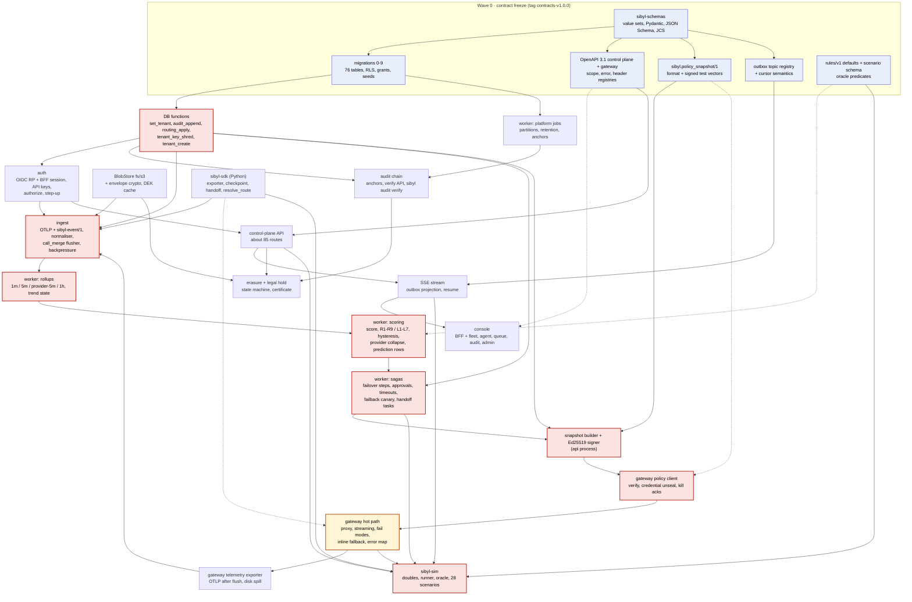

# Step 6 · chief-architect: technical sequencing, Wave 0 contract freeze, risks, debt

Member report, 2026-10-10. Inputs: `roadmap/CHAIR-INITIAL.md`, `DECISIONS.md` (D1–D40), `architect/ARCHITECTURE.md` (ADR-1…13), `api/API.md` §1–§2, §6–§7, §11–§12, `api/SYNTHESIS.md`, `ml/ML.md` §7, §8, §10, `datamodel/DATAMODEL.md` (§3 inventory, §5 functions, §6 write paths, §7 migrations, §9).

Scope of this report: **technical sequencing only**. The sprint-prioritizer owns scope, estimates and lane staffing. Day counts below are architect's sequencing estimates, given only to show which path is critical. Where they disagree with the sprint-prioritizer's numbers, the sprint-prioritizer's numbers apply and the critical-path argument should be re-run on them.

Paths follow ADR-13, renamed per D19: `packages/sibyl-schemas`, `packages/sibyl-sdk`, `services/gateway`, `services/control` (api, ingest, worker entrypoints, Alembic), `apps/console`, `apps/sibyl-sim`, `deploy/compose`. One amendment to ADR-13 is proposed: machine-readable **registries, the OpenAPI documents and the golden fixtures live inside `packages/sibyl-schemas`** (`registry/`, `openapi/`, `fixtures/`). That keeps "one shared package" true and gives every lane the same import path for the contract.

---

## 1. Phase 1 dependency graph

### 1.1 Graph

Solid arrows mean "cannot be integration-tested without". Dotted arrows mean "builds against a fixture or mock of". Red nodes form the **integration critical path**. The gateway (amber) is the **duration critical path**.



### 1.2 The two critical paths

**Integration critical path.** This is the chain that must work end to end before milestone M2, "detected failover + audit", can be demonstrated:

`schemas → migrations → DB functions (audit_append, routing_apply) → ingest → rollups → scoring → saga write_routing → snapshot builder → gateway policy client → gateway honours route → sibyl-sim oracle sees it on SSE`.

Every node except the last can be built on fixtures in parallel. The path is critical because **integration bugs compound along it**. A wrong `received_at` cursor in rollups shows up as a missed alert three nodes later. Mitigation: each arrow has a seam test with a golden fixture (§3). The chain should first run end to end on one hard-coded scenario (S-01, one tier-3 agent) on **day 2 of Wave 2**, not at the end.

**Duration critical path.** ARCHITECTURE §9 sizes the gateway at 16–18 dev-days. That is the longest single unit of work, and it does not split well below two people. With Wave 0 at about 3 days and the gate-tuning tail at about 4 days, a single-owner gateway lane gives roughly 3 + 17 + 4 ≈ 24 working days. That exceeds the chair's ~20-day line. Two remedies, in order of preference:

1. **Split the gateway into two lanes with disjoint files.**
   - G-hot owns `services/gateway/sibyl_gateway/{proxy,dialects,routing,limits}/`: streaming relay, routing decision, fail modes, breaker, inline fallback, error map, latency benchmark.
   - G-policy owns `services/gateway/sibyl_gateway/{policy,credentials,telemetry}/`: snapshot fetch/verify/hold, SSE invalidation client, X25519 credential unseal, kill acks, OTLP exporter with spill.

   The seam between them is an in-process `PolicyView` protocol, frozen in Wave 0 (§2, W0-6). Each half is about 9 days.
2. **Apply ARCHITECTURE §9's cut order** if the split still slips: cross-dialect translation first, then inline fallback, never the proxy itself. Cutting Anthropic translation keeps S-01 green only if the alternate-provider double speaks the OpenAI-compatible dialect. `sibyl-sim` must then label S-01 accordingly.

**Gate-tuning tail.** The §8.3 acceptance gates are judged on the worst of three seeds. A tuning iteration costs one `sim suite --tier full` run, which takes about 90 minutes on 8 parallel stacks. Calendar time is therefore bounded by iterations, not code. Budget at least 6 iterations (about 2 days of machine time, interleaved with fixes) after M3 and before the M4 sign-off. The nightly suite should start running on whatever exists from the first day of Wave 2. Gates get tuned continuously, not in a final sprint.

### 1.3 Integration checkpoints (entry criteria per milestone)

| Milestone (chair) | Technical entry criteria | Seams that must be green (§3) |
|---|---|---|
| **M1** ingest → registry → health visible | Migrations applied as non-superuser. `tenant_create()` seeds 3 tenants. SDK and gateway spans land in `events` via `call_merge`. Rollups produce `agent_metrics_1m/5m`. `GET /agents/{id}/health` returns a valid `sibyl-health/1`. Console fleet view renders against the real api | S1, S2, S5, S8, S12 (isolation over all 76 tables) |
| **M2** detected failover + audit | S-01 passes on all tiers. `routing_apply` → outbox → snapshot re-sign → gateway honours in p95 < 2 s. `X-Sibyl-Route: failover` observed by the oracle. Every transition has an audit row. `sibyl audit verify` is ok offline | S3, S4, S6, S7, S9 |
| **M3** prediction + approvals + queue | L1–L7 fire with lead time on S-02/S-04. Tier-1 approvals, timeouts, D22 forced hold (S-27), four-eyes (S-26), undo + operator hold (S-20), handoff packets with `fidelity` (S-11). Queue claim/complete in console | S10, S11 |
| **M4** erasure + harness gates | Tenant and agent erasure with certificate. Shred verified by the decrypt-fails probe. Full nightly suite green on CRITICAL gates (approval gating, explainability, isolation) and within HIGH gates | S13, S14, plus every seam re-run in the nightly |

### 1.4 Lane interfaces (input to the sprint-prioritizer's lane plan)

This is a proposed cut by **seam**, not by staffing. Each candidate lane owns disjoint paths and talks to the others only through a Wave 0 artefact. The sprint-prioritizer may merge candidates into fewer lanes. Two candidates should **not** be split across lanes: one lane owns `audit_append`/`routing_apply` bodies, and one lane owns the worker's evaluate loop end to end.

| Candidate lane | Owns (write) | Provides (frozen interface) | Consumes | Builds on before integration |
|---|---|---|---|---|
| **DB/platform** | `services/control/sibyl_control/db/`, `services/control/alembic/`, `services/control/sibyl_control/blob/`, `deploy/compose/postgres/` | `TenantTx`, `audit_append`/`routing_apply`/`tenant_key_shred` wrappers, `BlobStore` protocol, DEK cache | W0-1, W0-2, W0-7, W0-10 | Itself (Wave 0 owner) |
| **Auth + API** | `services/control/sibyl_control/api/` (routers, authz, BFF contract), `…/api/sse.py`, `…/api/snapshot/` | OpenAPI-conformant routes, SSE stream, signed snapshots | DB/platform, W0-3, W0-6, W0-8, W0-9 | Real DB from day 1 (migrations exist) |
| **Ingest** | `services/control/sibyl_control/ingest/` | `events`, `call_merge` flush, `payload_refs`, `observation.gap` synthesis | DB/platform, W0-5, W0-8 | W0-5 corpus |
| **Worker** | `services/control/sibyl_control/worker/` (rollup, evaluate, saga, platform jobs, anchors) | `agent_metrics_*`, `health_snapshot`, `alert`, `failover`, `approval`, `handoff_task`, anchors | DB/platform, W0-7, W0-11, W0-12 | `fixtures/rollup/*.sql` + inserted `events` |
| **G-hot** / **G-policy** | `services/gateway/sibyl_gateway/{proxy,dialects,routing,limits}/` / `…/{policy,credentials,telemetry}/` | Data-plane behaviour per W0-4; OTLP export | W0-4, W0-6 (`PolicyView`), W0-15 | Signed fixture snapshots + provider doubles |
| **SDK** | `packages/sibyl-sdk/` (incl. `sibyl audit verify`, `sibyl replay` CLIs) | Public API stub (API §8.2), exporter, checkpoint/handoff | W0-5, W0-6 (resolve_route), W0-10 | W0-5 corpus; Prism for kill-switch poll |
| **Console** | `apps/console/` | Screens + BFF (session, CSRF, step-up) | W0-3 TS client, Prism mock, `fixtures/health/` | Prism mock until M1 |
| **Sim/QA** | `apps/sibyl-sim/`, `tests/seams/`, `tests/e2e/`, CI workflow files | Doubles, runner, oracle, goldens, nightly report | Public API + SSE only, SDK, W0-13 | Its own doubles; real stack from Wave 2 |
| **Erasure** (small; can fold into Worker or Auth + API) | `…/api/erasure/`, `…/worker/erasure/` | Erasure state machine, certificate | DB/platform (`tenant_key_shred`), Blob | Real DB |

Cross-lane rule: a lane needing a change in another lane's paths files a seam issue. It never edits the path. CODEOWNERS (W0-14) makes this mechanical.

### 1.5 Wave timeline (architect's sequencing view)

Working days, assuming the gateway split (§1.2) and six concurrent streams per wave. Bars show when a component must be integration-ready, not effort.

```mermaid
gantt
  title Phase 1 sequencing (architect view, working days)
  dateFormat X
  axisFormat %s
  section Wave 0
  Registries, enums (W0-1, W0-7..11)        :w01, 0, 1
  Migrations + DB function bodies (W0-2)    :w02, 0, 3
  OpenAPI, snapshot, schemas (W0-3..6)      :w03, 1, 3
  Freeze review + tag                       :milestone, w0t, 3, 0
  section Wave 1 (fixtures)
  Auth + API core, snapshot signer          :a1, 3, 11
  Ingest + normaliser                       :i1, 3, 9
  Worker rollups -> scoring                 :k1, 3, 11
  G-hot (bench gate per PR)                 :g1, 3, 12
  G-policy                                  :g2, 3, 11
  SDK                                       :s1, 3, 9
  Console on Prism                          :c1, 3, 13
  Sim doubles + runner                      :m1, 3, 10
  section Wave 2 (integration)
  S-01 thin slice end to end                :crit, t1, 11, 12
  M1 health visible                         :milestone, mm1, 12, 0
  Sagas, approvals, queue                   :k2, 11, 16
  M2 detected failover + audit              :milestone, mm2, 14, 0
  section Wave 3 (hardening)
  Erasure + certificate                     :e1, 14, 18
  M3 prediction + approvals + queue         :milestone, mm3, 17, 0
  Gate tuning (nightly iterations)          :crit, gt, 15, 21
  M4 erasure + gates green                  :milestone, mm4, 21, 0
```



Reading it: about 21 working days with the split and no slippage. The chair's ~20-day line holds only if Wave 0 really closes on day 3 and gate tuning overlaps M3. Both depend on T10 and T7.

---

## 2. Wave 0 contract freeze

**Rule.** No build lane starts until the artefacts below are merged, CI-validated and tagged `contracts-v1.0.0`. After the tag:

- **Additive changes** (new optional field, new enum value marked `x-extensible-enum`, new route) go through a contract-change PR. It needs chief-architect approval plus every consuming lane's owner. Turnaround is 24 h at most.
- **Breaking changes** need the chair. During Phase 1 that means "never", unless a CRITICAL gate cannot otherwise pass.
- Lanes treat `packages/sibyl-schemas/**` as read-only. CODEOWNERS enforces this.

**Duration.** About 3 working days with four authors in parallel. Day 1 covers value sets and registries. Day 2 covers migrations, OpenAPI and JSON Schemas. Day 3 covers the review session, fixes and the tag. The review is one session where the chair, chief-architect and each lane lead walk the generated artefacts, not the prose.

### 2.1 Artefacts

| ID | Artefact (path under `packages/sibyl-schemas/` unless stated) | Author | Reviewer(s) | CI validation | Done when |
|---|---|---|---|---|---|
| W0-1 | **Frozen value sets**: `registry/enums.yaml`, the single source for every CHECK set in DATAMODEL §4.0 plus the Step 4/5 additions (scopes, `events_rejected.reason`, `audit_anchors.kind += break_glass`, `payload_refs.kind += model_artifact, model_card, feature_snapshot`, `label_strength`, `preemptive_mode`, `alert_rule.scope += platform`). Generators emit Python `Literal`s, SQL CHECKs, OpenAPI enum components and TS unions | database-architect | backend-architect, ai-engineer | Generator round-trip test: the generated outputs are committed, and CI fails if regeneration yields a diff | Every enum used anywhere resolves to one `enums.yaml` key |
| W0-2 | **Alembic migrations 0–9, sibyl-named, with Step 4/5 amendments folded in** (not appended as 10/11, because no database exists yet). All **76 tables**: the 62 base tables, 2 from Step 4, 9 Step 5 core tables and 3 Phase-2 tables created empty, so the isolation and erasure generators cover them from day one. Roles `sibyl_app`, `sibyl_ingest`, `sibyl_worker` (LOGIN) and `sibyl_audit`, `sibyl_routing` (NOLOGIN owners), plus `sibyl_migrate`. Seeds: `state_edge` for all nine machines, `role_permission` from the API §2.2 scope catalogue, `audit_action` taxonomy, `model_catalog`. Function **signatures** are binding. Function **bodies** for `audit_append`, `routing_apply`, `tenant_key_shred` and `tenant_create` are Wave 0 too, because every lane's integration tests call them (≈ 1.5 days of the 3) | database-architect | security-auditor (grants, RLS, SECURITY DEFINER `search_path`), backend-architect (`routing_apply`, `state_edge`) | (a) `alembic upgrade head` on empty PG 17 **as a non-superuser `sibyl_migrate`** (emulates RDS/Cloud SQL). (b) DATAMODEL §7 gates 1–3: generated per-table isolation test, audit chain test, schema invariants. (c) `pg_dump --schema-only` golden `schema.sql` committed and diffed. (d) Migration lint script: `lock_timeout` set, `CONCURRENTLY` in autocommit blocks, no data migration > 5k rows. (e) Erasure-coverage generator (S13) | Isolation test enumerates 76 − 11 allowlist = 65 tenant tables and passes |
| W0-3 | **OpenAPI 3.1, control plane, complete for Phase 1**: `openapi/control-plane.yaml`, about 85 routes from API §5 plus §5.13 gateway control routes and the §10.2 additions. Every operation declares `operationId`, `x-sibyl-scope`, `x-sibyl-key-scope` (if M), `x-sibyl-audit`, `Idempotency-Key`/`If-Match` where §2.5–§2.6 require them, problem codes per status, and pagination envelope and ordering. Component schemas come from W0-1/W0-5. **Contract-first**: hand-authored paths, generated components | backend-architect | security-auditor (scopes, step-up, A-marked audits), technical-writer (examples) | Spectral ruleset (custom rules for the `x-sibyl-*` extensions, every 4xx/5xx references `Problem`, every POST that transitions declares `Idempotency-Key`). Every `x-sibyl-scope` ∈ W0-9. Every problem code ∈ W0-8. `oasdiff breaking` against the tag (zero after freeze). Prism mock boots. `openapi-typescript` emits the console client. **From Wave 1 on**: FastAPI-generated spec diffed against the contract (must be equal modulo descriptions) | Route count reconciles with API §5's tables. The 11-operation skeleton in §11 is superseded |
| W0-4 | **Gateway data-plane contract**: `openapi/gateway.yaml` (`/v1/chat/completions`, `/v1/embeddings`, `/v1/models`, `/healthz`, `/readyz`), `registry/headers.yaml` (`X-Sibyl-*` request/response, §3.3–§3.4, with stripping rules) and the routing decision table §3.5 as data (`registry/gateway_decisions.yaml`: snapshot state × fail_mode × routing state → status, code, `X-Sibyl-Route`) | backend-architect | sre-engineer, security-auditor | Decision table is total (property test: every combination has exactly one row). Every code ∈ W0-8 | G-hot and G-policy both import the table rather than re-encoding it |
| W0-5 | **Document JSON Schemas (2020-12)**, exported from Pydantic and committed: `sibyl-event/1` (all event types; `agent_id` nullable only for `provider.status` and `observation.gap`), `sibyl-handoff/1`, `sibyl-checkpoint/1`, `sibyl-health/1`, `sibyl-feature-snapshot/1`, `sibyl-ingest-response/1`. Plus the **OTLP mapping spec** (`registry/otlp_mapping.yaml`: semconv 1.37 attribute → column, legacy maps, required attributes) | ai-engineer | backend-architect, qa-expert | `check-jsonschema` meta-validation. Export-drift test (Pydantic → JSON equals committed). **Golden corpus** `fixtures/events/{valid,invalid}/*.json` (at least one valid and one invalid per event type, plus OTLP protobuf fixtures from three instrumentors), and every fixture's expected verdict is asserted | Every event type in `enums.yaml` has a valid fixture and a negative fixture |
| W0-6 | **Policy snapshot format** `sibyl.policy_snapshot/1`: body schema (tenant blocks, agent routes, fallback chains, key `prefix → hash` map incl. rotation grace, kill set, `degraded_mode`, `canary_pct`, limits). RFC 8785 canonicalisation, detached Ed25519 signature envelope `{kid, alg, sig, body}`, `version` (global sequence), `issued_at`, `ttl_s=60`, `grace_s=300`. Sealed credential bundle (X25519 sealed box per gateway key, ≤ 300 s). `/.well-known/sibyl-keys.json` format with `next_key`. The in-process `PolicyView` protocol (§1.2) | backend-architect | security-auditor | **Test vectors** `fixtures/snapshot/*.json`: one valid snapshot plus one tampered variant per verification cause (`unknown_kid`, `bad_signature`, `non_monotonic`, `future_issued`, `bad_ttl`). The signer (control) and verifier (gateway) both run the vectors in their own CI jobs. Size budget test: 2,000 agents across 3 tenants yields a signed body ≤ 2 MiB, and verify takes ≤ 20 ms on the reference runner | Both sides agree on all vectors byte for byte |
| W0-7 | **Outbox topic registry** `registry/outbox_topics.yaml`. Each topic gets: channel, `event_type`s, payload schema (≤ 8 KB, refs only), producer(s), consumer group(s), whether it NOTIFYs, SSE visibility (session vs key `routing:read`). It **reconciles the drift listed in §2.4**. Cursor semantics are fixed here (§4, risk T2) | database-architect | backend-architect, sre-engineer | Every SSE `event:` in API §7 maps to exactly one registry row. The outbox `topic` CHECK is generated from it. Every producer call site in code references a registry constant (lint) | SSE table and CHECK set are generated, not hand-copied |
| W0-8 | **Error-code registry** `registry/errors.yaml`. RFC 9457 control-plane and ingest codes, gateway OpenAI-envelope codes, the 409 vocabulary (§6.4), `events_rejected.reason`, and the **SQLSTATE map**: custom `SB0xx` codes raised by `routing_apply`, `audit_append`, `trg_state_edge` and `tenant_key_shred` → problem code + HTTP status | backend-architect | technical-writer | Every code referenced in W0-3 and W0-4 exists. Every `RAISE … USING ERRCODE` in migrations maps to a row (grep test). Docs page generated | No string literal error codes in service code (lint) |
| W0-9 | **Scope catalogue + route authz table**: `registry/scopes.yaml` (36 scopes; roles × scopes; G, A, ↑ and M flags; exclusive `killswitch:pull` rule) generating the `role_permission` seed and the `api_key.scopes` CHECK | security-auditor | backend-architect | Generated **deny-by-default authz test**: for every OpenAPI operation × every role/key-scope combination, assert allow/deny per the table, including the "out-of-group = 404" rule. Routes without `x-sibyl-scope` fail the build | Matrix test runs against the Prism mock in Wave 0 and the real api from Wave 1 |
| W0-10 | **Audit taxonomy + JCS vectors**: `registry/audit_actions.yaml` (action, allowed actor types, `required_fields`, criticality) generating the `audit_action` seed. `fixtures/jcs/*.json` (RFC 8785 cases incl. unicode, key ordering, large integers; **floats are forbidden in audit `detail`**, money and ratios are strings). Chain vectors: a 10-row chain plus `content_mismatch`, `gap` and `signature_invalid` variants | security-auditor | database-architect | `audit_append` accepts every vector's canonical bytes. The offline `sibyl audit verify` (SDK CLI) and the server verify produce identical verdicts on all chain vectors | Same verdicts from both verifiers |
| W0-11 | **State machines as data**: `registry/state_edges.yaml` for `routing`, `failover`, `approval`, `handoff_task`, `alert`, `erasure_request`, `tenant_key`, `kill_switch` and `agent.lifecycle`, generating the `state_edge` seed and the Mermaid diagrams in docs | backend-architect | qa-expert (maps every edge to ≥ 1 scenario, ML §8.2 coverage matrix) | Generated diagrams equal the committed ones. Every edge has a scenario id or an explicit `untested_reason` | Coverage matrix has no blank rows |
| W0-12 | **Scoring contract**: `rules/v1/defaults.yaml` (seed thresholds, per-tier caps, hysteresis, cooldown, band edges, dead-band), `scoring_config` seed and the `agent_window_stats` fixture format | ai-engineer | sre-engineer, qa-expert | Rule unit fixtures are generated from the YAML (ML §8.4). A threshold edit without a fixture edit fails | Seeds load through `tenant_create()` |
| W0-13 | **Harness contract**: `apps/sibyl-sim/scenarios/schema.json` (scenario YAML), `labels/<run_id>.jsonl` schema, oracle predicate list, golden canonicalisation rules (id stripping, tick tolerance) | qa-expert | ai-engineer, chief-architect | All 28 scenarios plus 12 variants validate against the schema (as stubs with `expect` blocks) | Each `expect` key maps to one predicate |
| W0-14 | **Repo and CI skeleton**: uv workspace; import-linter contracts (gateway and SDK import `sibyl_schemas` only; nothing imports `services/*`); CODEOWNERS per lane path; `deploy/compose` with healthchecks and the `sim` profile; `registry/env.yaml` (every `SIBYL_*` variable, default, secret flag, owning service) generating `.env.example` | deployment-engineer | sre-engineer | CI pipeline runs all Wave 0 gates in ≤ 10 min. Compose `up` reaches healthy with stub services | A lane PR that touches another lane's paths fails CODEOWNERS |
| W0-15 | **Gateway latency benchmark harness** before any gateway code: provider double with configurable TTFB and chunk cadence, 200 concurrent streams, a pinned reference runner spec, and the output format for the p95/p99 overhead gate (ADR-1: p95 < 15 ms, p99 < 50 ms) | sre-engineer | backend-architect | Harness benchmarks a **null proxy** (raw httpx relay) to record the floor | The floor is known before the first gateway PR |

The authoring load lands mostly on database-architect (W0-1, -2, -7) and backend-architect (W0-3, -4, -6, -8, -11). Day 1 must therefore start with W0-1, because everything else generates from it. If database-architect's 1.5 days of function bodies slips, Wave 0 slips. **That makes `audit_append` and `routing_apply` the first critical-path items of the whole build.**

### 2.2 Wave 0 schedule and freeze-review checklist

| Day | Morning | Afternoon | Exit |
|---|---|---|---|
| 1 | W0-1 enums and W0-14 skeleton land first. W0-8/9/10/11 registries drafted in parallel | Generators emit SQL CHECKs, Python and TS. W0-15 null-proxy floor measured | `registry/*.yaml` merged as `rc.1`; CI runs generators |
| 2 | W0-2 migrations 0–9 (tables, RLS, grants, seeds). W0-3 paths. W0-5 schemas + corpus. W0-6 vectors | W0-2 function bodies; isolation, audit and invariants gates green. W0-7 cursor decision (Q2). W0-12/13 seeds and scenario stubs | All CI gates green on `rc.2` |
| 3 | Freeze review (2 h) on generated artefacts | Fixes; drift X1–X9 closed; tag `contracts-v1.0.0` | Lanes fan out |

Freeze-review checklist (each item answered yes or the tag waits):

1. Isolation test enumerates every tenant table (65) and passes. The allowlist literal equals DATAMODEL §3's 11 names.
2. Migrations apply as non-superuser on PG 17; `schema.sql` golden committed.
3. `audit_append` and `routing_apply` pass the chain vectors and the `state_edge` legality table for every routing edge.
4. OpenAPI: every route from API §5 present, every operation has scope, audit and problem codes, Spectral clean, Prism boots, TS client compiles in `apps/console`.
5. Snapshot vectors verify identically in the control and gateway CI jobs.
6. Every SSE event maps to an outbox registry row; NOTIFY channels fixed; cursor semantics decided.
7. Every error code is in `errors.yaml`; every SQL `RAISE` maps.
8. Erasure cascade covers or explicitly keeps every tenant table.
9. All 28 scenarios + 12 variants validate as stubs; every `state_edge` row has a scenario or an `untested_reason`.
10. CODEOWNERS and import-linter contracts enforce lane paths and package boundaries.

### 2.3 Fixture layout (the seam contract on disk)

```
packages/sibyl-schemas/
  registry/      enums, scopes, errors, headers, outbox_topics, audit_actions,
                 state_edges, gateway_decisions, otlp_mapping, env   (*.yaml, source of truth)
  openapi/       control-plane.yaml, gateway.yaml                    (contract-first)
  jsonschema/    sibyl-event-1.json … sibyl-ingest-response-1.json   (exported, drift-tested)
  fixtures/
    events/{valid,invalid}/   otlp/{sdk,gateway,openllmetry,openinference}/*.pb
    call_merge/   snapshot/   jcs/   audit_chain/   health/   handoff/   rollup/
  generated/     sql/ (CHECKs, seeds)  ts/ (types)  py/ (Literals)   (committed, regen-diff in CI)
```

### 2.4 Contract drift found while reading (fix inside Wave 0)

| # | Drift | Sources | Resolution proposed |
|---|---|---|---|
| X1 | Outbox `topic` CHECK has 6 topics, but SSE emits about 25 event types plus `anchor_now` / `audit.anchor_now` (two spellings) | DATAMODEL §4.9, API §7, API §12.3, api/SYNTHESIS amendment 3 | Coarse `topic` (`policy`, `killswitch`, `graph`, `health`, `alert`, `provider_incident`, `incident`, `approval`, `handoff`, `erasure`, `audit`, `agent`) with fine `event_type` (the SSE `event:` name). One spelling: `audit.anchor_now` |
| X2 | `trg_outbox_notify` notifies on `channel = topic`, but api LISTENs on `policy_changed, outbox` | DATAMODEL §4.9, API §7 | NOTIFY on exactly two channels, `sibyl_policy` (topics `policy` and `killswitch`) and `sibyl_outbox` (all others). Payload is constant per transaction so Postgres coalesces duplicates (risk T3) |
| X3 | Keys route spelled `/v1/policy/keys` (R33) vs `/api/v1/policy/keys` (API §2.9). ARCHITECTURE §4 sequence still shows `/v1/policy/snapshot` | api/SYNTHESIS R33, API §1, §2.9 | `/api/v1/policy/{snapshot,keys}` plus `/.well-known/sibyl-keys.json`. `/v1/*` on the api host stays unused (B5) |
| X4 | Erasure cascade (§6.5) predates Steps 4–5. It omits `idempotency_record` (holds stored response bodies), `ingest_batch_seen`, `agent_metrics_5m`, `provider_metrics_5m`, `agent_trend_state`, `agent_baseline`, `scoring_config`, `prediction`, `health_1h`, `agent_risk`, `rollup_job`, `ml_model`, `ml_prediction_shadow`, `risk_assessment` | DATAMODEL §6.5 vs ML §7.3, API §12 | Generated cascade-coverage test (S13). database-architect places each table in the cascade or the keep-list |
| X5 | `health_snapshot` written "every tick (R17)" vs write-on-change + 60 s heartbeat | DATAMODEL §1, ML §7.1/§10.4 | Write-on-change. Chair confirms ML §10.4.4 |
| X6 | `SIBYL_DEMO=1` "forbids active `provider_credential` rows", yet S-01 needs alternate-provider failover on all tiers, and API §3.2 skips cross-provider steps without `credential_id`. S-15 needs a revoked credential | DATAMODEL §8, API §3.2, ML §8.2 | Open question Q4 |
| X7 | Role rename list names four roles; DATAMODEL defines six (`*_worker` and `*_routing` missing). `pgaudit` is referenced but not on the extension allowlist; ARCHITECTURE §7 lists `pgvector`, DATAMODEL reserves it for Phase 3 | API §12.8, DATAMODEL §0/§5/§7 | Rename all six. Drop the pgaudit reference (convention is enforced by the pooler test, not pgaudit). Allowlist = `pgcrypto, pg_trgm, btree_gin, citext` |
| X8 | ARCHITECTURE §5 still lists gateway `/v1/messages` and ingest `/v1/metrics`, `/v1/traces` | ARCHITECTURE §5 vs API §3.1, §4.1, D16 | API.md wins. ARCHITECTURE gets a "superseded by API.md" note |
| X9 | `ingest_batch_seen` uses 3-day partitions; the partition job knows only daily and monthly grains | API §12.2, DATAMODEL §6.6 | `partition_registry.grain ∈ {day, 3day, month}`. Partition-ahead test covers it |

---

## 3. Integration risks between lanes and the seam tests that catch them

The principle: every seam has **one producer-owned golden fixture set in `packages/sibyl-schemas/fixtures/`**, and **both** sides run it in their own CI job. A seam test failing on one side only means that side drifted. Nobody argues about whose interpretation is right. The fixture is.

| # | Seam (producer → consumer) | What goes wrong | Seam test | Fixture / generator | Runs |
|---|---|---|---|---|---|
| S1 | SDK, gateway exporter → ingest normaliser | Attribute naming drift (`gen_ai.provider.name` vs legacy `gen_ai.system`); non-deterministic `event_id` breaks replay idempotency; content leaking into `attrs` | **Producer**: SDK and gateway serialise canonical scenarios and assert byte equality with fixtures. **Consumer**: ingest accepts every valid fixture, rejects every invalid one with the exact `reason`, yields identical `event_id`s on replay, and `attrs` has no content keys (R19 CHECK) | W0-5 corpus + OTLP protobufs from SDK, gateway, OpenLLMetry, OpenInference | PR |
| S2 | SDK ↔ gateway → `call_merge` (two-author call) | Double capture, wrong authority side wins, `X-Sibyl-Call-Id` not reused, late contribution misfiled | Paired fixtures `{sdk_part, gateway_part, expected_event}` over all authority-table rows × capture-mode combinations (most restrictive wins); flusher run at `flush_due_at` | `fixtures/call_merge/*.json` | PR |
| S3 | api snapshot signer → gateway verifier | Canonicalisation mismatch (JCS key order, number formatting); key rotation `next_key` not honoured; stale version accepted | W0-6 vectors on both sides + Hypothesis: random snapshot → sign → verify; single-byte mutation → specific cause | W0-6 | PR |
| S4 | `routing_apply` → snapshot projection → gateway decision | A state or target kind projects to a route the gateway handles differently (e.g. `failed_over` + `human_queue` must be 503 `sibyl_agent_handed_off`; `killed` must 403 on a stale snapshot) | **Transition-to-wire table test**: for every `state_edge(routing)` row × fail_mode × snapshot age, drive `routing_apply` on a real DB, build and sign the snapshot, feed it to the gateway with a provider double, and assert status, error code, `X-Sibyl-Route` and `X-Sibyl-Routing-State` against W0-4 | Generated from W0-4 + W0-11 | PR (DB container) |
| S5 | ingest `events` → worker rollups | Cursor skips rows committed out of order (risk T2); late events not dirtying the right bucket; replace-not-add violated | Concurrency test: two ingest transactions, the earlier-started one committing last, then the rollup tick. Assert the bucket counts equal a from-scratch recompute. Late-event fixture (> 120 s) dirties its true bucket | `fixtures/rollup/*.sql` | PR |
| S6 | worker rules → `sibyl-health/1` → api → console | Factor arithmetic (Σ penalty = 100 − score ± 1) broken by a later rule; console renders an unknown factor kind | Property tests (ML §8.4); the console renders every golden `sibyl-health/1` document (Playwright snapshot at 1440 and 375 widths); unknown `factor.kind` renders a generic row, never crashes | `fixtures/health/*.json` from W0-12 seeds | PR |
| S7 | every handler and worker step → `audit_append` | Missing audit row; wrong action verb; floats in `detail`; JCS bytes ≠ jsonb | DATAMODEL gate 2, **generated from OpenAPI `x-sibyl-audit`** and the worker step registry: each runs once and `max(seq)` rises by exactly 1 with the declared action | W0-3 + W0-10 | PR |
| S8 | api (OpenAPI) → console BFF | Field renamed in FastAPI model but not in contract; console relies on undocumented field | FastAPI-spec ≡ contract diff (W0-3). Console uses only the generated TS client (lint bans raw `fetch` to `/api/v1` outside it). **Schemathesis** runs the real api from the contract with stateful links (create agent → register key → incident) | W0-3 | PR (fast) / nightly (stateful) |
| S9 | outbox → SSE → console and gateway | Event emitted before commit; resume from `Last-Event-ID` skips or duplicates; slow consumer silently drops | SSE resume test under concurrent out-of-order commits (shares the T2 harness). `reset` on 1,001-event overflow. Gateway with `routing:read` key never sees non-allowlisted events | W0-7 | PR |
| S10 | worker saga ↔ api actions (one write path, R24) | Race between `undo` and a worker step; double transition on idempotency replay past 24 h; approval decided after expiry | Deterministic interleaving tests: api action and worker step on two connections with an injected pause between `FOR UPDATE` and commit. Replay of the same `Idempotency-Key` after deleting `idempotency_record` still yields one transition (`routing_apply` key) | `tests/seams/saga_interleavings.py` | PR |
| S11 | SDK `handoff()` / `checkpoint()` → ingest → worker packet assembler → queue | Packet `fidelity` wrong for zero-code agents; checkpoint > 64 KB inline vs BlobStore boundary | Fixtures at 63 KB, 64 KB and 65 KB; a gateway-only agent always yields `request_only` | `fixtures/handoff/*.json` (W0-5) | PR |
| S12 | migrations → every tenant table (RLS) | New table without RLS/FORCE; index not leading with `tenant_id`; session-level `SET` leaking across pooled connections | DATAMODEL gate 1 over all 76 tables + **pooled-connection test** (risk T1) | Generated from `information_schema` | PR |
| S13 | erasure → every tenant table and BlobStore | New table missed by the cascade (X4 already shows this); DEK still cached in a running process; shared `raw_batch` objects left behind | Generated **cascade-coverage test**: every tenant-scoped table is in the cascade list or the keep-list, else fail. End-to-end: erase `sandbox-copy` tenant, then attempt to decrypt every `payload_refs` row (must fail), scan BlobStore prefix (empty) and scan `pg_dump --data-only` for seeded plaintext canaries (absent outside `audit_events` hashes) | Generated + canary seed | PR (coverage) / nightly (e2e) |
| S14 | sibyl-sim oracle → public API and SSE only | Oracle reaching into Postgres hides API gaps; scenario labels drift from the predicate list | import-linter: `apps/sibyl-sim` imports `sibyl_sdk`, `sibyl_schemas` only, and has no DB driver in its lockfile. Scenario schema validation (W0-13) | W0-13 | PR |

Seams S4, S5, S9 and S10 need a real Postgres. They run in the per-PR "db-seams" job (one PG container, ≤ 4 min). Running this job on every PR, not nightly, is the single most valuable CI investment for Phase 1.

---

## 4. Top 10 technical sequencing risks for Phase 1

Owner lane names are generic; the sprint-prioritizer maps them to lane ids. "Trigger" is the observable signal that the risk is materialising. "By" is the latest point the mitigation must land.

| # | Risk | Owner lane | Trigger | Mitigation | By |
|---|---|---|---|---|---|
| T1 | **RLS + pooled connections.** `set_tenant()` is transaction-local, so any query outside an explicit transaction (asyncpg autocommit) sees `current_tenant() = NULL`. RLS fails closed, which means **silent empty results**, not errors. Other failure modes: a session-level `SET` leaking a tenant to the next borrower; asyncpg's statement cache interacting with a future PgBouncer; `LISTEN` on a pooled connection; a SECURITY DEFINER function without a pinned `search_path` | platform/DB | Isolation test green but an API returns `[]` for seeded data; any `SET app.tenant_id` outside `set_config(…, true)`; a pooled LISTEN connection | (a) One `TenantTx` context manager is the only way to get a connection: it opens the transaction and calls `set_tenant` first. A lint bans `pool.acquire()` outside it. (b) In dev and CI, `current_tenant()` raises instead of returning NULL when `app.tenant_strict = on`; prod keeps fail-closed NULL. Bugs surface loudly in tests and stay safe in prod. (c) Pooled-connection test: 1,000 randomised borrow/return cycles across two tenants asserting zero cross-reads. (d) A dedicated non-pooled LISTEN connection per api process. (e) Every SECURITY DEFINER has `SET search_path = sibyl, pg_temp` (schema-invariant check) | Wave 0 (b, e); Wave 1 week 1 (a, c, d) |
| T2 | **Outbox and rollup cursors skip rows committed out of order.** Cursors key on `(created_at, id)` and `received_at`, both stamped at INSERT time, not at commit. A 10 s ingest transaction (§4.2 server timeout) can commit after a later one has already advanced the rollup cursor past a 2 s watermark. Events are lost from rollups, SSE resume skips events, and detection is silently missed | platform/DB + worker | S5/S9 concurrency test fails; nightly shows `events` rows with no `agent_metrics_1m` contribution (reconciliation query) | **Commit-order-safe horizon.** Add `xid xid8 DEFAULT pg_current_xact_id()` to `outbox` and `events`. Consumers read only rows with `xid < pg_snapshot_xmin(pg_current_snapshot())`, so every row below the horizon is committed or aborted. The cursor becomes `(xid, id)` for outbox and SSE (`Last-Event-ID = <xid>|<id>`). The rollup dirty set uses the same horizon instead of `now() − 2 s`. Cheap fallback if xid8 is rejected: watermark = `now() − (ingest_tx_timeout + 2 s)` with the ingest transaction capped at 5 s (adds about 5 s to TTD, still inside the 60 s tier-1 gate). Nightly reconciliation query either way. Amends DATAMODEL §6.2 and API §7 event-id format (Q2) | Wave 0 (decision in W0-7) |
| T3 | **NOTIFY and SSE throughput on one Postgres.** `NOTIFY` takes a database-wide lock at commit, so high-frequency notifying transactions serialise commits across all tenants. Outbox writes from ingest (`agent.discovered`), worker (`health.transition`, `alert.*`) and api share it. One `LISTEN` per api process fans out to ≤ 20 streams per session | platform/DB + api | p99 commit latency > 50 ms under S-24 soak; `pg_stat_activity` waits on `object 0 of class 1262`; SSE lag > 2 s | (a) NOTIFY only on two channels with a constant payload. Postgres de-duplicates identical notifications within a transaction, so one per transaction. (b) The `sibyl_outbox` channel is a wake-up hint; the 2 s poll is the delivery mechanism. (c) Statement-level, not row-level, notify trigger. (d) Soak test S-24 at 200 calls/s asserts commit p99 and SSE end-to-end lag < 2 s p95. (e) ADR-4 exit criterion unchanged (Valkey or NATS at > 5k events/s) | Wave 1 (a–c); M2 (d) |
| T4 | **Streaming passthrough latency in the Python gateway.** ADR-1 bets p95 < 15 ms / p99 < 50 ms overhead at 200 streams. Risks: per-chunk `await` overhead, httpx pool contention, JSON parsing on the hot path, a telemetry queue that contends with the relay, disk spill under ingest backpressure, `uvloop` absent | G-hot | W0-15 null-proxy floor already > 5 ms; any PR moving p95 by > 2 ms; spill I/O visible in the flame graph | (a) Benchmark gate on every gateway PR from the first commit. (b) Byte passthrough for the same dialect: no per-chunk JSON parse; usage is read from the final chunk only. (c) Telemetry enqueue is a non-blocking ring buffer; spill runs in a separate task with a bounded queue. (d) uvloop + httptools, pinned. (e) Escalation ladder if the gate fails at the end of Wave 1: profile → raw httpcore → multi-process (`SO_REUSEPORT`) → declare Phase 2 rewrite of `services/gateway` only. The frozen contracts (W0-4, W0-6, OTLP) make the rewrite bounded (ADR-1) | Wave 1, continuous |
| T5 | **Hash-chain contention and lock ordering.** `audit_append` serialises a tenant on an advisory lock until commit. `routing_apply` also takes the `routing_state` row lock and the `tenant` row lock. Ingest's auto-register (DATAMODEL §6.1 step 3) calls `audit_append` and `routing_apply` **inside the batch transaction (≤ 10 s)**, so one slow ingest batch blocks every audited action for the tenant, **including the kill switch**. A handler that audits before calling `routing_apply` acquires locks in the opposite order from `routing_apply` itself, which can deadlock | platform/DB + ingest | Kill-switch p95 > 1 s in S-28; `deadlock_detected` in any log; audit lock wait > 100 ms (`pg_locks` sampling in soak) | (a) **Lock-order rule, enforced by test**: `routing_state` → `tenant` → audit lock. `audit_append` is always the last call in a handler, and `routing_apply` performs its own. A static check flags handlers calling `audit_append` before `routing_apply`. (b) **Ingest auto-register moves to its own short transaction** before the batch transaction (or to the worker via `outbox(agent.discovered)`). The batch transaction then never takes the audit lock (Q5). (c) Ingest transaction capped at 5 s. (d) S-28 asserts kill-switch apply p95 < 1 s while S-19 backpressure runs concurrently | Wave 0 (rule, Q5); M2 (d) |
| T6 | **Crypto-shred correctness.** Processes cache unwrapped DEKs, so after shred a running ingest or api can still encrypt or decrypt with a "shredded" key. Inline content in Postgres rows (`checkpoint.state`, `handoff_task.packet`, `idempotency_record` responses) is outside crypto-shred (U3) and survives in WAL and backups. A `raw_batch` object shared by many events must be deleted exactly once. The fs adapter's delete is not atomic with the row state | erasure + platform | S13 decrypt probe succeeds; canary plaintext found; erasure certificate counts ≠ re-read counts | (a) DEK cache TTL ≤ 60 s plus immediate invalidation on `outbox(erasure.step)` and on `tenant.status = erasing` (checked per batch already). (b) After `keys_shredded`, the worker waits for max cache TTL before `objects_deleted`. (c) Certificate text states that inline rows and backups expire at `backups_expire_at` (D26, U3). (d) S13 end-to-end nightly with canaries in every content-bearing column. (e) BlobStore delete is idempotent and keyed by prefix; verification re-lists the prefix | M4; (a) in Wave 1 |
| T7 | **Clock and hysteresis determinism in sibyl-sim.** No product clock override (R45), so bucket alignment depends on when a run starts relative to the minute boundary. Hysteresis 2-in/6-out and 10-minute cooldowns shift by a tick and goldens flake. A loaded CI runner makes the worker skip ticks (§7.4 skip-not-queue), so TTD gates miss on the worst seed. UUIDv7 ids differ per run | sim + worker | The same seed and build give different alert sets; gate misses correlate with runner load; quarantine count ≥ 3 per week (ML §8.4 release block) | (a) Scenario runner aligns injection start to `minute boundary + 5 s` and records the offset in labels. (b) Golden canonicalisation strips ids and rounds to ticks; tolerances ±1 tick (W0-13). (c) Worker lag is a scenario precondition: the oracle fails a run as `invalid_environment` (not a gate miss) if `observation.gap(cause=worker_lag)` appears. (d) `SIBYL_EVAL_TICK_S` fixed per scenario; 6× speed-up only for count-based scenarios (R45). (e) Dedicated nightly runner class pinned in W0-14; 8 stacks only if the runner passes a calibration scenario | Wave 1 (a–c); first nightly (e) |
| T8 | **Snapshot rebuild storms and propagation SLO.** One provider incident fails over N agents. Each `routing_apply` bumps `routing_version` and NOTIFYs, giving N rebuilds and N signatures, and the gateway re-fetches N times inside the 2 s target. The snapshot grows with agents × chain steps × key hashes. Multiple api replicas in Phase 2 would race to sign | api (snapshot) + G-policy | p95 transition-to-honour > 2 s in S-13 (7 agents) or S-01 collapse; snapshot > 2 MiB; signer CPU > 30 % | (a) Debounce: the builder coalesces NOTIFYs for 200 ms per tenant, then signs once at the latest `routing_version`. (b) Per-tenant blocks, re-signed only for the changed tenant (R26 already shapes this). (c) ETag/304 on fetch; gateway fetch single-flight. (d) Phase 2 multi-replica: `pg_try_advisory_lock('snapshot:'||tenant)` so one signer per tenant; the global version sequence already guarantees monotonicity. (e) Size budget test in W0-6 | M2 |
| T9 | **One Postgres on one laptop carries everything**, including 8 parallel compose stacks nightly. At 20 agents the demo writes about 3 M events/day plus rollups, health and WAL. The nightly runs 8 Postgres instances. Partition-ahead failure means inserts error at midnight (`no_partition`) | platform/SRE | Nightly OOM or disk > 80 %; `events_rejected(no_partition)` > 0; autovacuum lag on 1m/5m tables | (a) Compose Postgres tuned per profile (`shared_buffers`, `max_wal_size`, `fillfactor 70` on rollups, ML §7.5). (b) Partition job runs at migrate-time once (creates 7 days ahead) and then hourly. A test advances the partition clock past midnight. (c) Nightly runs 4 stacks × 2 batches if the runner has < 32 GB. (d) Disk budget alarm in the soak test | Wave 1 |
| T10 | **Wave 0 authoring is a two-person bottleneck, and contract churn after freeze.** 76 tables, 85 routes and 9 registries rest mostly on database-architect and backend-architect. Every drift found after the tag costs a contract-change PR across lanes | chief-architect | Wave 0 not tagged by end of day 3; > 3 contract-change PRs per week in Wave 1 | (a) Generators over hand-copies (every registry emits SQL, Python, OpenAPI and TS). (b) Day-1 split: database-architect on W0-1/2/7, backend-architect on W0-3/4/6/8/11, security-auditor on W0-9/10, ai-engineer on W0-5/12, qa-expert on W0-13, sre and deployment on W0-14/15. (c) Lanes may start Wave 1 on **frozen subsets**: e.g. the console starts once W0-3 is tagged even if W0-12 is in review. A partial tag `contracts-v1.0.0-rc.N` per artefact is allowed. (d) Drift X1–X9 resolved before the tag, not discovered in Wave 2 | Wave 0 |

### 4.1 T2 reference shape (load-bearing; proposed for DATAMODEL §6.2 and API §7)

```sql
-- outbox and events gain a commit-order key (additive column, default fills it)
ALTER TABLE sibyl.outbox ADD COLUMN xid xid8 NOT NULL DEFAULT pg_current_xact_id();
ALTER TABLE sibyl.events ADD COLUMN xid xid8 NOT NULL DEFAULT pg_current_xact_id();

-- consumer: everything below the horizon is committed or aborted, never in flight
SELECT … FROM sibyl.outbox
 WHERE tenant_id = $t
   AND (xid, id) > ($last_xid, $last_id)
   AND xid < pg_snapshot_xmin(pg_current_snapshot())
 ORDER BY xid, id
 LIMIT 1000;
```

Notes:
- The index becomes `(tenant_id, xid, id)` on outbox, and a BRIN on `(xid)` per events partition.
- `pg_snapshot_xmin` is held back by any long transaction in the database, including other tenants'. That is the price of correctness. The ingest transaction cap (T5c, 5 s) bounds it, and the `rollup_lag_s` SLI exposes it.
- Wraparound is not a concern with `xid8` (64-bit).

Carried forward and watched, not top-10: credential custody (R1/ADR-10). It is narrow in Phase 1 because `SIBYL_DEMO=1` and only stub providers are used, but the X25519 sealing path must still be exercised (Q4). OIDC step-up through the dex BFF flow is a console–api seam, covered by S8 stateful tests.

---

## 5. Technical debt deliberately accepted, per phase

Accepted means: written down, owned, and with a named payback trigger. Nothing here is accidental.

### 5.1 Phase 1 debt and its payback

| # | Debt accepted in Phase 1 | Why acceptable now | Risk while carried | Paid back in | Payback mechanism |
|---|---|---|---|---|---|
| P1-1 | Single host, same-host PITR (pgBackRest repo on the same disk) | D18, D4, D10 | Host loss = data loss beyond the last copy | **Phase 2, first task** | pgBackRest `repo2` to S3-API storage (same adapter config as BlobStore); weekly off-host restore drill running the next release's migrations |
| P1-2 | BlobStore `fs` adapter as default | D10; the S3 adapter is already coded and tested in Phase 1 (ADR-5) | Volume on the same disk as Postgres | Phase 2 | `BLOB_BACKEND=s3`; copy job keyed by object path with sha256 verification against `payload_refs`; the path layout `tenant/{id}/…` is identical |
| P1-3 | Master key (KEK) and snapshot/anchor signing keys from env/files on the host | D10, no KMS | Host compromise exposes both the DB and the keys, so tamper-evidence is lost (ADR-12 consequence) | Phase 2 | KMS-wrapped KEK; rewrap job over `tenant_key.wrapped_dek`; signing through KMS or a sealed signer process; `kid` rotation path already in W0-6 |
| P1-4 | Self-hosted Postgres 17 in compose; no pooler | D4 | Connection count is bounded by the process count only | Phase 2 | Managed Postgres (§5.2). Pooler in transaction mode for api/ingest/worker; LISTEN on a dedicated direct connection (T1d); asyncpg `statement_cache_size=0` behind the pooler |
| P1-5 | Rate-limit counters per gateway replica | One replica in Phase 1 | Effective limit × N with N replicas | Phase 2 (second gateway replica) | `RATELIMIT_BACKEND=valkey` (BSD-3, D15-compatible) |
| P1-6 | Sibyl-hosted gateway only, one tenant key per fronted tenant (R26) | D14 | Customers must route traffic through Sibyl's network | Phase 2 | Sidecar packaging of the same image (§6); per-installation key; snapshot pulled from the tenant's network |
| P1-7 | dex as the only tested IdP | D10 | Real IdP quirks (Entra `iss` per tenant, Okta groups) unknown | Phase 2 | Conformance tests against Keycloak plus one design-partner IdP; SAML and SCIM in Phase 3 |
| P1-8 | Inline content in Postgres rows outside crypto-shred (U3) | Bounded ≤ 64 KB; hard-deleted in the cascade; certificate discloses it | Content lives in WAL and backups for `backup_retention_days` (7) | Phase 2 | Move `checkpoint.state`, `handoff_task.packet` and `idempotency_record` bodies to BlobStore under the tenant DEK. Rows keep refs only |
| P1-9 | Single worker process; tenant sharding is designed but unexercised | Phase 1 scale | One crash pauses all tenants' evaluation (`observation.gap` makes it visible) | Phase 2 | Two or more workers with `pg_try_advisory_lock('worker:'||tenant)`; chaos test killing one mid-saga |
| P1-10 | `rules/v1` only; no learned layer | D36–D37 | Prediction quality capped at the rule level | Phase 2 | Shadow, then promotion per ML §8.5 |
| P1-11 | OpenAI-compatible inbound dialect only; Anthropic translated upstream | D16 | Anthropic-native SDK users must switch client | Phase 2 | `/v1/messages` as a second inbound `Dialect` |
| P1-12 | TypeScript SDK is an interface sketch | D35 | JS agents gateway-only (`request_only` packets) | Phase 2 | `@sibyl/sdk` generated from `sibyl-schemas` JSON Schemas |
| P1-13 | Tenant lifecycle is CLI-only; no notifications; no metering | D9, scope | Manual onboarding; operator must watch the console | Phase 2 (notifications), Phase 3 (self-serve, billing) | Outbox consumer `notifier` loop (§6) |
| P1-14 | Residency is a declared field, not enforced (D17) | No multi-region infra | Sales must not promise residency | Phase 3 | Region-pinned stacks |
| P1-15 | Business-hours SLO, single operator, burn-rate to inbox (D18) | D18 | No out-of-hours response | Phase 2 exit (first paying tenant) | On-call rota or managed alerting; external security assessment before the first paying tenant (D18) |
| P1-16 | Helm chart is a skeleton only | D4 | Cloud move needs packaging work | Phase 2 | Real chart; compose stays as the dev profile |

### 5.2 Phase 1 → Phase 2 cloud migration path (ordered)

Preconditions kept true throughout Phase 1, checked in CI so the migration stays mechanical:

1. **Migrations run as a non-superuser** (W0-2a). No `ALTER SYSTEM`, no superuser-only extension, no `COPY … FROM PROGRAM`, no reliance on `pg_read_all_stats`.
2. **Extensions only from the managed-PG allowlist** (`pgcrypto`, `pg_trgm`, `btree_gin`, `citext`).
3. **No local filesystem state** except the BlobStore `fs` adapter and the gateway's telemetry spill directory (an ephemeral volume; loss = observation gap, never data loss).
4. **Config only via `SIBYL_*` env** (W0-14 registry). No config files baked into images.
5. **Every process is stateless and idempotent on restart** (`SKIP LOCKED`, advisory locks, cursors in `consumer_offsets`).

Steps, each independently reversible:

1. **Off-host backup** (P1-1). pgBackRest `repo2` to S3-API storage, then a restore drill. This is a D18 obligation and gates everything after it.
2. **Object storage** (P1-2). Flip `BLOB_BACKEND=s3` for new writes, copy historical objects, verify by sha256, then retire `fs`.
3. **Key custody** (P1-3). KMS KEK, rewrap DEKs, move signing keys, rotate `kid` (both keys published in `/.well-known/sibyl-keys.json` during overlap).
4. **Managed Postgres 17** (P1-4). Logical replication from compose PG to RDS (or the D14 alternative): `pg_dump --schema-only` restore → publication on all tables → catch-up → read-only window → cutover via `DATABASE_URL`. Partition DDL must be replayed on the target before subscription, since logical replication does not create partitions. The worker's partition-ahead job runs once against the target first. Roles are recreated without `SUPERUSER`/`BYPASSRLS`, then the isolation suite runs against the target **before** cutover.
5. **Kubernetes packaging** (P1-16). Helm chart with gateway Deployment + HPA, api/ingest/worker Deployments, Valkey (P1-5), Ingress/TLS, and Secrets from the KMS-backed store.
6. **Sidecar gateway** (P1-6). Same image, tenant-network deployment mode (§6).

---

## 6. Phase 2 and Phase 3 architecture deltas

### 6.1 Frozen across Phases 1–3 (change requires a v2 contract and founder sign-off)

- **Wire contracts**: `sibyl-event/1`, `sibyl-handoff/1`, `sibyl-checkpoint/1`, `sibyl-health/1`, `sibyl.policy_snapshot/1`, `sibyl-ingest-response/1`. Additive only (new optional fields, `x-extensible-enum` values).
- **`/api/v1`** additive only. Gateway `/v1/*` stays OpenAI-shaped (plus `/v1/messages` in Phase 2).
- **Hot-path rule**: no synchronous control-plane call on the request path; signed, monotonic, expiring snapshot; kill beats fail-open (ADR-9).
- **One legality source** for routing: `state_edge` + `routing_apply()`. New states and edges are additive.
- **Audit chain format** `chain_version = 1` (envelope keys, hash construction). Phase 2 anchoring adds evidence; it does not change the chain.
- **Scope grammar** `<resource>:<verb>` (D30). **Tenant isolation model** `tenant_id` + FORCE RLS for shared deployments (ADR-7).
- **No cross-tenant pooling** of signals or models (D37).

### 6.2 ADR deltas

| ADR | Phase 2 delta | Phase 3 delta |
|---|---|---|
| 1 · Python everywhere, gateway latency gate | Unchanged unless T4's ladder reaches "rewrite". Sidecar uses the same image | Optional Go/Rust data plane behind the frozen contracts if per-tenant throughput demands it; the decision is made from Phase 2 benchmark data |
| 2 · Own gateway, `Dialect` adapters | **Amended**: second inbound dialect `/v1/messages` (D16 lifted) | More upstream dialects (Gemini, Bedrock) as adapters |
| 3 · Postgres partitions, no Timescale | Managed Postgres (§5.2); same schema | `TimeSeriesStore` second implementation (e.g. ClickHouse, Apache-2) only past ~5–10k events/s sustained per stack |
| 4 · EventBus on Postgres outbox | Valkey for shared rate-limit counters (P1-5). Outbox unchanged. New consumer: notifier | NATS JetStream (Apache-2) if notification and ITSM fan-out or replay needs exceed the outbox |
| 5 · BlobStore + envelope encryption | S3 default; KMS KEK; inline bodies move to BlobStore (P1-8) | Per-region buckets for region-pinned stacks; optional per-subject keys if subject-level crypto-shred becomes contractual |
| 6 · Postgres-backed sagas | Unchanged | Temporal (MIT) only if ITSM or notification workflows need long-running multi-party human steps; saga steps are already activity-shaped |
| 7 · Shared schema + RLS | Unchanged; pooler (P1-4) | **Amended**: dedicated-database tier and region-pinned stacks (residency promise, D17); UUIDv7 and no cross-tenant FKs make per-tenant extraction a dump/restore |
| 8 · OIDC RP only | Real tenant IdPs tested (P1-7) | SAML via a broker, SCIM provisioning |
| 9 · Fail modes + signed snapshot | **Amended for sidecar**: per-installation gateway identity (revisits R26), longer configurable grace for tenant-network deployments, snapshot pull through egress-only HTTPS | Unchanged |
| 10 · Credential custody | **Amended**: sidecar key-less mode (fallback keys stay in the tenant network, referenced by handle); KMS for vaulted keys | BYOK / customer-managed KEK |
| 11 · OTel GenAI as wire contract | Semconv bump per D25; TS SDK | Unchanged |
| 12 · Hash-chained audit + anchors | External anchoring of hourly anchors (RFC 3161 TSA or a transparency log; zero-cost options first) | Compliance report packs (EU AI Act, NIST AI RMF, ISO 42001) and SOC 2 evidence exports read the chain; no format change |
| 13 · uv monorepo | Adds `packages/sibyl-sdk-ts`, real `deploy/helm`, `services/control` gains a `notifier` loop | Adds `services/metering` (usage from rollups, never the hot path) and `services/integrations` (ITSM connectors) |

### 6.3 New ADRs expected

- **Phase 2**:
  - ADR-14 Notifications: outbox consumer, HMAC-signed webhooks, reuse of the `base_url` SSRF allowlist, per-tenant rate limits.
  - ADR-15 Learned-layer serving: in-worker model, `ml_model` registry, shadow table, promotion gate ML §8.5, rollback via `SIBYL_PREDICTION_SOURCE`.
  - ADR-16 Cloud deployment topology: managed PG + pooler policy, Helm, KMS, backup topology.
  - ADR-17 Sidecar gateway: identity, key-less credentials, update channel.
  - ADR-18 Customer-run drills (D38): real feature flag, tenant-scoped chaos at the provider double only, never in production traffic paths.
- **Phase 3**:
  - ADR-19 Region-pinned stacks and residency enforcement.
  - ADR-20 Metering and billing.
  - ADR-21 Integrations framework (ITSM).
  - ADR-22 Report-pack generation and evidence model.

---

## 7. Open questions for the chair

1. **Fold Step 4/5 amendments into base migrations 0–9** (sibyl-named, 76 tables, 3 Phase-2 tables created empty) instead of appending migrations 10/11? Default: **fold**. No database exists yet, and the generators then cover every table from day one.
2. **Commit-order-safe cursors (T2)**: adopt `xid8` + `pg_snapshot_xmin` horizons for outbox, SSE `Last-Event-ID` and the rollup dirty set, amending DATAMODEL §6.2 and API §7? Default: **yes**. The fallback is a 5 s ingest transaction cap with a `timeout + 2 s` watermark.
3. **Outbox topic model (X1, X2)**: about 12 coarse topics with fine `event_type`, and NOTIFY on only `sibyl_policy` and `sibyl_outbox` channels with constant payloads? Default: **yes**.
4. **Demo-mode credentials (X6)**: allow vaulted `provider_credential` rows under `SIBYL_DEMO=1` **only** when `base_url` resolves to a registered `sibyl-sim` provider double, seeded through the API by the sim, so S-01/S-15 exercise the real X25519 sealing path? Default: **yes**. The alternative is that S-01 tests alternate-model only, which leaves ADR-10's code path untested in Phase 1.
5. **Ingest auto-register out of the batch transaction (T5)**: discovery (`agent` insert, `routing_apply(register)`, `asset.discovered` audit) runs in its own short transaction before the batch, so a slow batch can never block the kill switch's audit lock. This amends DATAMODEL §6.1 step 3. Default: **yes**.
6. **Gateway lane split (§1.2)**: two lanes (G-hot / G-policy) with the `PolicyView` seam frozen in W0-6, to bring the duration critical path under ~20 working days? Default: **yes, if the sprint-prioritizer's staffing allows a seventh concurrent stream across waves (max 6 per wave holds)**. Otherwise apply the ARCHITECTURE §9 cut order and accept about 24 days.
