# Overview and thesis

Sibyl is a self-hosted control plane for an organisation's AI agents. It sits in the path between agents and the model providers they call, decides what those agents are allowed to do, keeps them working when models and providers fail, and records every decision as evidence that an auditor can verify offline.

This document describes the system as it exists in the repository on 2026-10-14, release 1.0.0. It is written for engineers who will deploy, integrate, operate or review Sibyl. Where the code and the design documents disagree, this document follows the code.

## The thesis: safe autonomy

Companies are moving agents from drafting text to taking actions: issuing refunds, moving money, approving claims, emailing customers. Two things go wrong.

1. **The agent fails.** A provider has an outage, a model starts refusing or truncating, a tool loop burns budget, a task is abandoned half-done.
2. **The agent works perfectly and does something it should not.** It prepares a transfer of 100,000 when it is authorised for 10,000, or sends customer data to an external tool after a prompt injection. Every call succeeds and nothing looks unhealthy.

Observability tools address part of the first class and stop at the alert. Nothing in a monitoring stack sees the second class. Sibyl's thesis is that the product companies need is **infrastructure that lets them give agents more autonomy safely**: control actions before they execute, keep agents running through failures, and prove every decision. Failure prediction is a supporting capability, claimed only where the scenario harness measures it.

Sibyl is not "an agent watching agents". No language model sits in any detection, decision or enforcement path. Every allow, block, escalate, failover and kill is computed by deterministic code from signed policy, and every one is written to a hash-chained audit log. Model drift detection (chapter 7) is plain statistics too. Sibyl Sentinel (chapter 9), now built, adds language-model judgement as an **advisory** layer only, outside the enforcement path. External monitor agents (chapter 9) open the same advisory layer to the customer's own agents: a Claude, OpenAI or Gemini agent, an MCP assistant or a script reads fleet metadata and posts findings, and its key cannot reach any enforcement route.

## Status labels

Every capability in this document carries one of three labels:

- **Built**: merged on `main`, covered by tests that run in CI.
- **In progress**: designed and partly implemented, or implemented in a build lane that has not merged.
- **Planned**: designed or scoped, no implementation on `main`.

## What is built and what is not

| Area | Capability | Status |
|---|---|---|
| Registry | Agents, versions, tools, data sources, providers, models, dependency graph, blast radius, lifecycle | **Built** |
| Enforcement | Gateway with signed policy snapshots, fail modes, kill switch, inline fallback: OpenAI-compatible, native Anthropic Messages and native Gemini `generateContent`, streaming included | **Built** |
| Enforcement | Python SDK: tasks, checkpoints, handoff packets, tool spans, kill-switch check | **Built** |
| Monitoring | Plug-and-play instrumentation: `sibyl.instrument()` and `sibyl-run`; OpenAI, Anthropic and Google Gen AI clients; LangChain/LangGraph, OpenAI Agents SDK and CrewAI | **Built** |
| Monitoring | Run trees (parent run, step index, handoffs), a runs list (`GET /runs`) and auto-discovery of unknown agents as `discovered` | **Built** |
| Monitoring | External monitor agents: registration, monitor-bound keys, external findings, signed webhooks, the `sibyl-mcp` server and the SDK's `sibyl.monitor` client | **Built** (advisory only; metadata reads only) |
| Monitoring | Model drift detection: model identity and behavioural drift, watch-only alerts | **Built** |
| Telemetry | Ingest for OTLP/HTTP (GenAI semantic conventions) and `sibyl-event/1` | **Built** |
| Action Gate | Shared evaluator, signed action policies in snapshots, SDK enforcement, gateway enforcement (streaming included) | **Built** |
| Action Gate | Control-plane routes for policies, held actions and action decisions; held-action expiry worker | **Built** |
| Action Gate | Live operation: on-behalf-of, self-approval refusal, decision history, draft simulate, policy versions, approved holds counted toward caps, audit time and agent filters, action summary | **Built** |
| Action Gate | Console screens on the live contract: policy editor with simulate, held-actions queue, decision records, with end-to-end and accessibility tests | **Built** |
| Action Gate | Guard that never auto-resumes side-effecting work (A-4) | **Built** |
| Health | Explainable health score, detected rules, hysteresis, provider-incident collapse | **Built** |
| Early warning | Leading-indicator rules (EWMA, CUSUM, proximity) combined into probability bands | **Built** |
| Early warning | Learned per-tenant model (Phase 2) | **Planned** |
| Failover | Saga, tier gating, approvals with four-eyes, undo and operator hold, quarantine, kill switch, break-glass, failback | **Built** |
| Failover | Canary failback ramp | **Built**, off by default (`SIBYL_FAILBACK_RAMP=1`) |
| Handoff | Operator queue, handoff tasks and packets | **Built** |
| Governance | Audit hash chain, anchors, exports, offline verify, legal holds, crypto-shred erasure with certificates | **Built** |
| Console | All screens in demo-data mode; live mode against the API | **Built** (live wiring partial, see chapter 12) |
| Harness | `sibyl-sim` provider doubles and status feeds | **Built** |
| Harness | Scenario runner, oracle, 33-scenario catalogue and gates, including Action Gate scenarios S-29/S-30 (A-5), silent model swap S-31, the outage reproduction S-32 and Sentinel behaviour S-33 | **Built** (20 scenarios pass; 12 wait on rulings, unbuilt features or B-10) | |
| Deployment | Demo console (`make demo`), demo stack (`ops/demo/up.sh`), real deployment (`make up`, `deploy/compose/real.sh`) with OIDC and Caddy TLS, Codespaces for both | **Built** |
| Deployment | GitHub Actions CI; release workflow publishing multi-arch images to GHCR on a `v*` tag; `v1.0.0` | **Built** |
| Deployment | pgBackRest point-in-time recovery, off-host backups, Helm chart | **Planned** |
| Integrations | Framework connectors for Google Agent Development Kit and Microsoft AutoGen | **Planned** |
| Sentinel | Advisory monitoring agent on the tenant's own Anthropic, OpenAI or Gemini key | **Built** (quality not yet measured on the harness) |
| Other | TypeScript SDK, notifications, data exports (`POST /exports` answers 501), AI bill of materials | **Planned** |

Four statements must stay attached to any summary of this table. Early warning is statistics, not learned prediction. Drift detection detects a change; it does not predict one. There is no data moat yet. There has been no external security assessment.

## Personas

Demo data and documentation use role-based personas (decision D49):

| Persona | Role (identifier) | Job |
|---|---|---|
| Platform Admin | Admin (`owner`) | Registers agents, connects them, sets policies, plans and chains, mints keys |
| On-call Operator | Operator plus Security admin (`operator`, `security_admin`) | Decides approvals and held actions, works the queue, undoes automation, pulls the kill switch |
| Compliance Auditor | Auditor (`auditor`) | Reads decision records, verifies and exports the audit chain, confirms erasures |

# Architecture

## Components

Sibyl is a set of stateless processes around one Postgres 17 database and one blob store.

| Component | Package | Role |
|---|---|---|
| Gateway | `services/gateway` (`sibyl_gateway`) | Proxy in the request path for three wire protocols: OpenAI-compatible, Anthropic Messages and Gemini `generateContent`. Authenticates keys, applies routing, fail modes, kill switches, limits, inline fallback and the Action Gate from a signed policy snapshot. Emits scrubbed telemetry after the response flushes. |
| Ingest | `services/control` (`sibyl_control.ingest`) | Receives OTLP/HTTP and `sibyl-event/1` batches, scrubs and envelope-encrypts payloads into the blob store, appends events. |
| API | `services/control` (`sibyl_control.api`) | REST and Server-Sent Events control plane, OIDC login, signs policy snapshots. |
| Worker | `services/control` (`sibyl_control.worker`) | Twenty asyncio loops: rollups, scoring, prediction, alerts, saga, approvals, failback, handoff, partitions, retention, anchors, erasure, ledger, jobs, status polling, held actions, action-counter retention, model drift, Sentinel and monitor webhooks. |
| Migrate | `services/control` (`sibyl_control.migrate`) | Plain-SQL migration runner. Refuses superuser connections and edited migrations. |
| Console | `console/` | Next.js web console with a backend-for-frontend (BFF) layer. |
| Schemas | `packages/sibyl-schemas` (Apache-2.0) | Wire contracts shared by every component: value sets, JSON Schemas, pydantic models, RFC 8785 canonicaliser, secrets scrubber, PII detectors, the Action Gate evaluator. |
| SDK | `packages/sibyl-sdk` (Apache-2.0) | Python SDK, the `sibyl` CLI and the `sibyl-run` launcher; integrations for model clients and agent frameworks; the `sibyl.monitor` client for external monitors. |
| MCP server | `packages/sibyl-mcp` (Apache-2.0) | `sibyl-mcp`: an MCP server that lets an MCP-capable assistant act as an external monitor with a monitor key (chapter 9). Runs next to the customer's assistant, not in the stack. |
| Simulator | `sibyl-sim/` | Provider doubles, status feeds and chaos knobs. Development only, never in the product bundle. |
| Edge | Caddy, dex | TLS termination with an internal CA; demo OIDC issuer. |

Import boundaries are enforced in CI by import-linter: the gateway and the SDK import `sibyl-schemas` only, never the control plane. That makes gateway independence a build-time fact rather than a convention.

## Data plane and control plane

The **data plane** is the gateway and the SDK: the two places an agent's traffic and tool calls pass through. The **control plane** is ingest, API and worker, plus Postgres.

The central design rule is that **the data plane never waits on the control plane**. The gateway runs from the last signed policy snapshot it verified. It polls the API for a new one every 5 seconds (`SIBYL_POLICY_POLL_S`), but a control-plane outage only freezes routing changes and degrades observability. It never blocks a fail-open call. Telemetry is enqueued after the response has flushed, so it never adds latency to the agent's call.

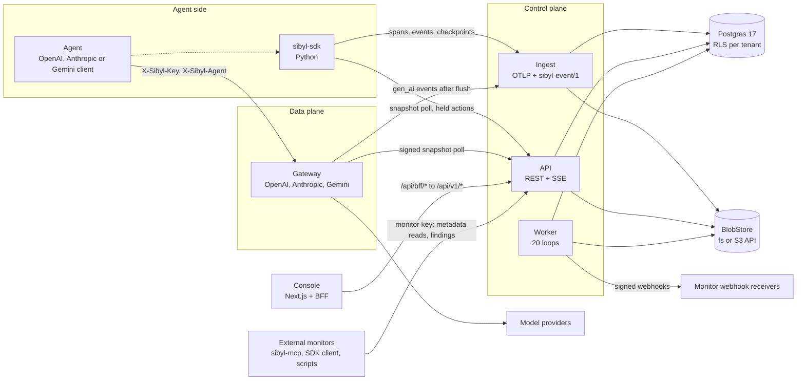

## The policy snapshot

The policy snapshot is the contract between the two planes. The API projects the registry, routing state, continuity plans, fallback chains, API key hashes, providers, kill switches and active action policies into one JSON document per tenant block, signs it with Ed25519, and serves it to the gateway and the SDK.

| Property | Value |
|---|---|
| Signature | Ed25519 over the raw bytes received; the verifier never re-canonicalises (ruling B4) |
| Size budget | 2 MiB gzipped transfer, 3 MiB raw canonical JSON; 2,000 agents measure 2.64 MB raw and 39 KB gzipped |
| Lifetime | TTL 60 seconds plus 300 seconds of grace |
| Versioning | Monotonic; a lower version is never installed |
| Freshness | `fresh` (within TTL), `stale` (within grace), `expired`, `unavailable` (never verified) |
| Trust | A pinned first key, then a signed rotation chain of key sets (B9, B10) |
| Persistence | The gateway keeps the last good snapshot on disk at `/var/lib/sibyl/snapshot` |

## Request lifecycle

A chat completion through the gateway goes through these steps:

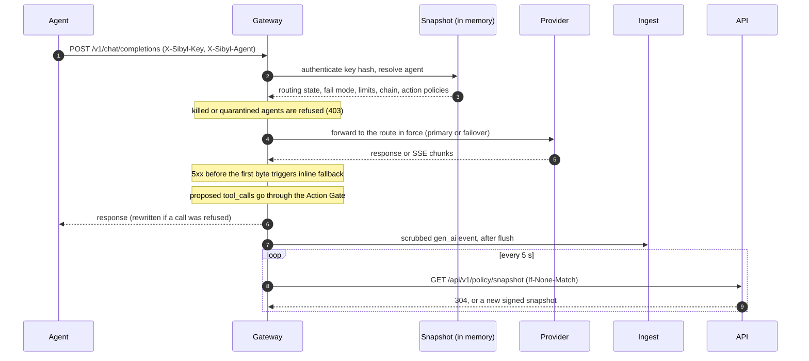

1. **Authenticate.** The gateway hashes the key with the pepper and looks it up by prefix in the snapshot. It never calls the database. Invalid, revoked and expired keys all return `401 sibyl_key_invalid`.
2. **Resolve the agent.** From `X-Sibyl-Agent` or the key's binding. A bound key used for another agent returns `403 sibyl_agent_mismatch`. Tier-1 agents are reachable only with agent-bound keys (D32).
3. **Apply state.** A killed agent is refused (`sibyl_agent_killed`) in every freshness state, including expired, once any loaded snapshot said so. A quarantined agent is refused (`sibyl_agent_quarantined`). Limits from the continuity plan are checked (`sibyl_rate_limited`, `sibyl_inflight_limit`, `sibyl_budget_exhausted`).
4. **Route.** The call goes to the route in force. The client's own provider key is passed through to the primary. A failover target uses a vaulted credential delivered as a sealed bundle (chapter 10).
5. **Inline fallback.** If the upstream fails before the first byte, the gateway may retry against the next chain step for this one request. This is tactical and per request; it does not change the agent's routing state. Repeated inline fallbacks feed the `fallback_pressure` leading rule.
6. **Action Gate.** If the agent has action policies and the response proposes tool calls, each call is evaluated before the response is released (chapter 6).
7. **Respond.** Response headers state what happened: `X-Sibyl-Route` is one of `primary`, `failover`, `inline_fallback`, `canary`, `stale_primary`.
8. **Report.** After the final byte, a scrubbed `gen_ai` event goes to ingest with the gateway's `ingest:write` key. When the SDK also instruments the same call, ingest merges the two views in `call_merge` by call id.

## Strategic routing changes

Only one function changes an agent's route: the transactional database function `routing_apply()`. It is called by the worker's saga step and, for operator-immediate actions (kill, quarantine, release, undo), inline by the API. In one transaction it:

1. checks the edge against the `state_edge` table (560 combinations are tested),
2. writes `routing_state`,
3. bumps the tenant's `routing_version`,
4. appends an immutable `routing_transition`,
5. appends the audit row through `audit_append()`,
6. inserts an outbox row and issues `NOTIFY`.

The API then re-signs the snapshot, and the gateway picks it up on its next poll.

## Events and ordering

Postgres is the only stateful component; there is no Redis or message broker in Phase 1. Asynchronous fan-out uses a partitioned `outbox` table with 12 topics and 2 `NOTIFY` channels (`sibyl_policy`, `sibyl_outbox`). Every ordered reader reads only rows below the **commit horizon** (`pg_snapshot_xmin(pg_current_snapshot())`), so a transaction that commits late is never skipped. The cost is that one long-running write transaction anywhere on the cluster holds every ordered reader back. The runbook `sse-outbox-stalled.md` covers diagnosis.

# Deployment

**Status: Built.** Sibyl runs on one machine with Docker Compose. Cloud deployment (Helm, managed Postgres, S3 storage) is **Planned** for Phase 2.

## Three ways to run

| Mode | Command | What runs | Codespaces |
|---|---|---|---|
| Demo | `make demo` | The console alone, in demo-data mode: deterministic fixtures shaped like the API and a scripted outage. Node only | `https://codespaces.new/MK-JKC/sibyl?devcontainer_path=.devcontainer/demo/devcontainer.json` |
| Demo stack | `make demo-stack` (`ops/demo/up.sh` plus the seed) | The full stack with the `sibyl-sim` provider doubles and three seeded tenants | none |
| Real | `make up` (`deploy/compose/real.sh up`) | The full stack for real agents, with no simulator; bootstraps the first tenant and its Platform Admin | `https://codespaces.new/MK-JKC/sibyl?devcontainer_path=.devcontainer/real/devcontainer.json` |

The repository is public, so anyone with a GitHub account can open the Codespaces links. A public demo runs at https://sibyl-demo.onrender.com: the console image in demo mode on Render (`render.yaml`), one shared instance with dummy data only. `docs/setup/SETUP.md` is the operator's guide; this chapter describes what the scripts do.

## Prerequisites

- macOS, Linux, or Windows through WSL2 (Ubuntu 24.04, repository cloned inside the WSL file system).
- Docker Engine 24 or later with Compose **2.24.4 or later**. Colima works on macOS.
- `make`, `git`, `openssl` and `htpasswd` for the real deployment.
- Python 3.13 with `uv`, for the CLI, the SDK and development.
- Node 20.18 or later, for the demo console and console development.

If your network re-signs TLS (a corporate inspection proxy), set `SIBYL_EXTRA_CA_FILE` to the proxy's CA bundle before building. The bundle is passed as an optional BuildKit secret, joined with the system bundle on a tmpfs inside the two `uv sync` steps only, and never lands in an image layer. Never turn off certificate verification.

## One command: `ops/demo/up.sh`

```bash
ops/demo/up.sh          # init secrets, build, bootstrap, migrate, register keys, start
ops/demo/down.sh        # stop; --purge also deletes the volumes
```

The script runs these steps in order and stops at the first failure:

1. **init-env.** Runs `deploy/compose/init-env.sh` only if something is missing. It never overwrites existing secrets.
2. **build.** Builds four images: `control` (api, ingest, worker, migrate, bootstrap), `gateway`, `console`, `sim`.
3. **postgres.** Starts Postgres and waits for health.
4. **bootstrap.** A one-shot container that applies migration `0000` as the Postgres admin and sets the login-role passwords. It is idempotent.
5. **migrate.** Applies the migrations as `sibyl_migrate`, a non-superuser.
6. **register signing keys.** Runs `ops/demo/register.py` as `sibyl_migrate` to register the snapshot signing key the gateway pins, the audit-anchor key the worker signs with, and the `sim` development host.
7. **up.** Starts every service with the `sim` profile and waits until all are healthy (default timeout 300 seconds).
8. **print.** Prints the URLs, the demo password file and the next steps.

After the stack is up, seed the demo tenants and mint the gateway keys:

```bash
dc run --rm --no-deps api python -m sibyl_control.cli.seed --sim-host sim
```

The seed writes through the real API handlers, so validation, audit rows and outbox events are what a client would produce. It is idempotent. It creates `meridian` (20 agents over three simulated providers), `northstar` (3 agents, used to show isolation) and `sandbox` (empty). Tier-1 agents stay in `proposed` until an agent-bound key exists (R35).

## The real deployment: `make up`

`make up` runs `deploy/compose/real.sh up`, which layers `docker-compose.real.yml` over the base stack: no simulator, configurable OIDC, TLS and bind address, and its own project (`sibyl-real`), env file (`deploy/compose/.env.real`) and secrets directory (`deploy/compose/env-real/secrets/`, mode 0700). It runs these steps and stops at the first failure:

1. **Settings and secrets.** Writes `.env.real` from `real.env.example` (tunables only) and generates every secret with `init-env.sh`: role passwords, the KEK, the pepper, salts, the three signing keys, OIDC client secrets and the admin's password. Existing secrets are never overwritten, and nothing secret is printed.
2. **Images.** Builds the `control`, `gateway` and `console` images, or pulls the release images when `SIBYL_IMAGE_TAG` is set (`docker-compose.images.yml`).
3. **Database.** Starts Postgres 17, runs `bootstrap` (the only step that sees the superuser password), applies migrations as `sibyl_migrate`, and registers the snapshot and audit-anchor signing keys.
4. **Services.** Starts every service and waits until each is healthy.
5. **Tenant bootstrap** (`deploy/compose/real/bootstrap.py`). Creates the tenant with its wrapped data keys, registers the OIDC issuer, invites the Platform Admin (role `owner`), sets the tenant capture policy (`metadata` by default; `SIBYL_BOOTSTRAP_CAPTURE_MODE=none` leaves the choice to the admin) and mints the gateway's own keys straight into its secret files.
6. **Print** the URLs and next steps. The admin password is shown only by `make password`.

Re-running `make up` keeps secrets, data and keys and applies new migrations. Day-to-day commands are `make status`, `make logs`, `make key NAME=... [KIND=gateway] [AGENT=...]`, `make ca` (export Caddy's local root) and `make down` (`PURGE=1` deletes the volumes). The real deployment publishes Postgres on `127.0.0.1:5435` for backups only, and the same three HTTPS origins as the demo stack on 8443, 8444 and 8445; the two stacks share those ports, so run one at a time or move one with `SIBYL_PORT_HTTPS`, `SIBYL_PORT_GATEWAY_TLS` and `SIBYL_PORT_INGEST_TLS`.

**OIDC.** By default the bundled dex holds one local user, the admin, for a first install. For production, set `SIBYL_OIDC_ISSUER` (exactly the token's `iss`), `SIBYL_OIDC_CLIENT_ID` and `SIBYL_OIDC_CLIENT_SECRET_FILE`, optionally `SIBYL_OIDC_EMAIL_DOMAINS`; dex is then not started. The admin invitation binds at the first sign-in whose ID token carries the admin's email with `email_verified: true`, or the `sub` in `SIBYL_ADMIN_SUBJECT` for issuers that do not send `email_verified` (Entra ID).

**TLS.** Caddy terminates TLS in one of three modes: its local CA (`SIBYL_TLS=internal`, the default; clients trust `sibyl-local-root.crt`), ACME for a public name (`SIBYL_SITE_HOST`, `SIBYL_TLS=<email>`, port 443; documented but not exercised end to end in CI), or the operator's own certificate files. `SIBYL_PUBLIC_URL` sets the origin the OIDC redirect and the console's CSRF check follow.

**Codespaces.** The real devcontainer installs Docker-in-Docker, uv and Node, sets `SIBYL_PUBLIC_URL` to the codespace's forwarded 8443 URL and runs `make up` (about 10 minutes on a 4-core machine). Forwarded ports are private to the codespace owner; agents outside the codespace need the gateway and ingest ports made public or tunnelled. A codespace is an evaluation environment, not a production host.

## Services and ports

| Service | Image | Internal port | Published | Networks |
|---|---|---|---|---|
| `postgres` | `postgres:17.6-bookworm` (digest-pinned) | 5432 | `127.0.0.1:5434` | data |
| `dex` | `ghcr.io/dexidp/dex:v2.44.0` | 5556 | via Caddy `/dex/*` | edge |
| `caddy` | `caddy:2.10.2-alpine` | 8443, 8444, 8445 | `127.0.0.1:8443/8444/8445` | edge |
| `bootstrap` | control (profile `bootstrap`) | none | none | data |
| `migrate` | control | none | none | data |
| `api` | control | 8000 | via Caddy | edge, data |
| `ingest` | control | 8001 | via Caddy | edge, data |
| `worker` | control | 8002 (health only) | none | data |
| `gateway` | gateway | 8080 | via Caddy | edge |
| `console` | console | 3000 | via Caddy | edge |
| `sibyl-sim` | sim (profile `sim`) | 8300, 18082 | `127.0.0.1:8300` | edge |

The three public origins, all TLS through Caddy's internal CA and all bound to `127.0.0.1`:

| Origin | Serves |
|---|---|
| `https://localhost:8443` | Console, `/api/*` (control-plane API), `/dex/*` (demo OIDC) |
| `https://localhost:8444` | Gateway `/v1/*` |
| `https://localhost:8445` | Ingest `/v1/otlp/*`, `/v1/events` |
| `http://localhost:8300` | Simulator control (development only) |

There are two Docker networks. `edge` holds Caddy and what it fronts. `data` holds Postgres and the three control processes. The gateway, dex, console and simulator cannot reach Postgres at all. Caddy has a pinned address on `edge`, and api, ingest and gateway trust `X-Forwarded-For` only from that address (`SIBYL_TRUSTED_PROXIES`).

Every container except Postgres runs read-only, drops all capabilities, sets `no-new-privileges` and runs as uid 10001. Images are pinned by multi-arch digest.

For native development, the control processes use ports 8010 (api), 8011 (ingest) and 8012 (worker), the gateway 8080, and a development Postgres 17 runs on 5433 (`make db-up`).

## Environment: `live` with `SIBYL_DEMO=1`

The compose env files set `SIBYL_ENV=live` even for the local demo, because break-glass keys exist only as `live` keys and the API refuses keys of another environment. `SIBYL_DEMO=1` is the safety boundary for the demo: credentials and snapshots are issued for the simulator doubles only. Some older guide pages say the compose stack runs `test`; the env files are authoritative, so mint demo keys with `--env live`.

## Secrets matrix

Every key, salt and password is a compose **file secret**, granted only to the services that need it. The image entrypoint exports `/run/secrets/<VAR>` as `<VAR>`, so nothing secret appears in `docker inspect` or in env files. Env files hold tunables only. The matrix is the header of `deploy/compose/docker-compose.yml`, and two CI tests (`ci/tests/test_secrets.py`, `ci/tests/test_runtime_env.py`) enforce it.

| Secret | Format | Granted to |
|---|---|---|
| `postgres_password` | hex, 32 bytes | postgres, bootstrap |
| `db_password_migrate` | hex | bootstrap, migrate |
| `db_password_app`, `_ingest`, `_worker` | hex | bootstrap and the one process each |
| `kek` | base64url, 32 bytes (AES-256) | api, ingest, worker |
| `key_pepper` | at least 32 bytes | api, ingest, gateway |
| `snapshot_signing_key` | Ed25519 seed | api |
| `anchor_signing_key` | Ed25519 seed | worker |
| `ledger_signing_key` | Ed25519 seed, read from a file | worker |
| `session_secret` | at least 32 characters | api |
| `oidc_client_secret` | hex | api, dex |
| `subject_salt` | hex | api, ingest |
| `scrub_salt` | at least 16 bytes | ingest, gateway |
| `gateway_tenant_keys` | comma-separated `sbl_` keys | gateway |
| `gateway_ingest_key` | `sbl_` key with `ingest:write` | gateway |
| `sim_gateway_key`, `sim_ingest_key` | `sbl_` keys | sibyl-sim |
| `dex_api_client_secret`, `dex_persona_hash` | hex, bcrypt | dex |

Each process checks its secrets at startup and refuses to start, naming every missing value without printing any. Two exceptions run without secrets: the gateway boots without tenant keys and serves from the last snapshot on disk, and the public halves of the signing keys (`env/public/*.pem`) are not secret.

**Escrow** `kek`, `ledger_signing_key`, `anchor_signing_key` and `key_pepper` offline in two places, never next to backups. Losing the KEK makes every tenant's data unreadable. Losing the pepper invalidates every API key.

## TLS

Caddy terminates TLS for the three public origins with its internal CA. Trust its root once:

```bash
docker compose -f deploy/compose/docker-compose.yml cp \
  caddy:/data/caddy/pki/authorities/local/root.crt ./sibyl-local-root.crt
```

Caddy sets HSTS and `X-Content-Type-Options: nosniff`, removes the `Server` header, and adds `X-Frame-Options: DENY` on console pages. Inside the stack, services talk plain HTTP on the private networks. The simulator's doubles use a throwaway development CA that the gateway trusts only for the `sim` development host.

## Colima on macOS

The build environment runs Docker through Colima (context `colima`, a 4 CPU, 8 GB, 60 GB VM). Three practical notes:

- **Env directory under `$HOME`.** Compose bind-mounts the file secrets. Under Colima, only VM-mounted paths are visible, so the env directory must live inside your home directory.
- **Secret file modes.** Secret files are `0444` inside a `0700` directory. Outside Swarm, compose ignores `uid`, `gid` and `mode` on file secrets, so the container user must be able to read them; the directory is the host-side boundary.
- **Autostart.** `brew services start colima` starts it at login; restart with `brew services restart colima`. `ops/demo/up.sh` stops early with "no Docker daemon (start Colima: colima start)" if it is down.

## Release images and GitHub Actions

**Status: Built** (decision D54).

- **CI** (`.github/workflows/ci.yml`, every push and pull request). A `python` job on Ubuntu 24.04 with a Postgres 17 service runs sync, ruff, format, import contracts, mypy, pytest with coverage and the licence gate, and uploads the reports. A `console` job runs typecheck, lint and unit tests, builds and serves the console in demo mode, and checks the performance budgets. Locally the full run takes about 8 minutes (pytest-xdist, timing tests run serially afterwards); GitHub-hosted runners also run the Docker compose tests and may take longer.
- **Release** (`.github/workflows/release.yml`, on a `v*` tag). Extracts the matching `## [x.y.z]` section of `CHANGELOG.md` (the run fails if it is missing), builds `control`, `gateway`, `console` and `sim` for `linux/amd64` and `linux/arm64`, pushes them to `ghcr.io/mk-jkc/sibyl-<name>` with an SBOM and provenance attestation, and creates the GitHub Release with those notes. The `sim` image is for development and is never started by the real deployment.
- **Deploying a release.** `SIBYL_IMAGE_TAG=1.0.0 make up` pulls the release images instead of building. Upgrades are `git checkout` of the new tag (or a new `SIBYL_IMAGE_TAG`) and `make up`, after a backup; migrations are forward-only.

## Backups and restore

**Status: Built** for logical backups; **Planned** for pgBackRest point-in-time recovery and automated off-host replication.

`ops/backup/backup.sh` writes a `pg_dump -Fc` piped straight into `age` encryption, so no plaintext touches the disk. Each set has a checksum and a manifest signed with an SSH Ed25519 key. The manifest records the erasure-ledger head (count and hash), the creation time and the expiry. `--offhost` copies the set to a second location and warns if it shares a device. Sets older than the retention period (default 7 days, the value stated on erasure certificates) are pruned by manifest date, never by file mtime.

Restoring an old backup could resurrect data erased after it was taken. The restore therefore follows a verify-first, swap-last procedure:

1. Verify the manifest signature, checksum and archive offline.
2. Verify the live erasure ledger's signature chain and its expected head; the backup's ledger copy must be a prefix of it.
3. Restore into a **new** database created with `CONNECTION LIMIT 0`.
4. Run `sibyl.erasure_reapply_from_ledger()` in the new database, which re-shreds every erasure recorded after the backup.
5. Only then rename the old database aside and the new one into place, in one transaction.

A failure before step 3 creates nothing. A failed re-shred leaves the new database closed for forensics and the live one untouched. The restore drill, which erases an agent between two backups and checks that zero rows are resurrected, is documented in `ops/runbooks/backup-restore.md`; CI covers the mechanics in `ci/tests/test_backup_restore.py` and `test_backup_restore_ledger.py`.

# Data model

**Status: Built.** The schema is 27 plain-SQL migrations (`0000` to `0026`); `0026_hardening` adds the tenant `drift_thresholds` table (RLS, in the erasure cascade). Migration `0017` adds the Action Gate tables (`action_policy`, `action_rule`, `held_action`, `action_counter`, `action_decision`), all tenant-scoped under row-level security. The wave-3 migrations:

| Migration | Lane | Adds |
|---|---|---|
| `0018_drift.sql` | DRIFT | `drift_baseline` and immutable `drift_report` rows; the `silent_drift` and `model_change` rules; scopes `drift:read`, `drift:write`; audit `drift.baseline_reset` |
| `0019_sentinel.sql` | SENTINEL | `sentinel_config` (with the sealed, write-only key), `sentinel_finding`, `sentinel_usage`; scopes `sentinel:read`, `sentinel:admin`; the `sentinel.*` audit actions |
| `0020_run_tree_discovery.sql` | PLUG | Audit action `agent.discovered`; a trigger that refuses failover, failback, degraded and approval transitions for unconfirmed (provisional) agents; an index on `attrs->>'parent_run_id'`; provider dialect `gemini` (B26) |
| `0021_action_gate_live.sql` | AG-LIVE | Held-action `on_behalf_of`, decision `history`, `matched_paths` and the counter it named; a stable `policy_id`, `change_note` and `approvals` on policies; an index for the audit `agent_id` filter |
| `0022_reserved_harness.sql` | HARNESS | A placeholder that keeps versions contiguous; it changes nothing. The harness lane replaces it at merge if it needs a migration |
| `0023_int3.sql` | INT-3 | `access.break_glass` attributed to the break-glass key itself (actor `api_key`) when a key pulls a kill switch (B21) |
| `0024_gaps.sql` | GAPS | Agent discovery fields (`discovered_via`, `first_trace_id`, `confirmed_at`) for the console |
| `0025_external_monitors.sql` | EXTMON | `monitor`, `monitor_webhook`, `webhook_delivery`, `external_finding`; `api_key.monitor_id`; scope `monitors:admin`; seven `monitor.*`, `finding.*` and `webhook.*` audit actions (chapter 9) |

Every wave-3 and wave-4 tenant table is under row-level security and covered by the erasure cascade (B27).

## Tenancy and row-level security

Every tenant table carries `tenant_id` and has Postgres row-level security enabled and forced. Each transaction sets its tenant with `sibyl.set_tenant()`, and every policy filters on it. With no tenant set, policies match nothing: the system fails closed.

Each process connects as its own login role:

| Role | Used by | Notes |
|---|---|---|
| `sibyl_app` | api | Non-owner of every table |
| `sibyl_ingest` | ingest | Append paths only |
| `sibyl_worker` | worker | Saga, rollups, housekeeping |
| `sibyl_migrate` | migrate | Owns the schema; the only writer of signing-key and dev-host tables |
| `sibyl_audit`, `sibyl_routing` | none (NOLOGIN) | Own the privileged tables and `SECURITY DEFINER` functions |

A generated test suite checks isolation on every tenant table for every role, and a completeness test fails if a new tenant table lacks a policy. Another tenant's object always returns `404`, never `403`, so the API is not an existence oracle. Primary keys are UUIDv7, and there are no cross-tenant foreign keys, which keeps a dedicated-database tier possible later.

## Key tables by domain

| Domain | Tables |
|---|---|
| Tenancy and identity | `tenant`, `app_user`, `oidc_issuer`, `session`, `membership`, `role`, `role_permission`, `api_key`, `agent_group` |
| Registry and graph | `agent`, `agent_version`, `agent_identity`, `provider`, `model`, `model_catalog`, `tool`, `data_source`, `business_process`, `dependency_edge`, `blast_radius`, `provider_status`, `lifecycle_transition` |
| Telemetry and rollups | `events`, `events_rejected`, `call_merge`, `payload_refs`, `checkpoint`, `agent_metrics_1m`, `agent_metrics_5m`, `agent_metrics_1h`, `provider_metrics_5m`, `feature_snapshot`, `label` |
| Scoring | `health_snapshot`, `health_1h`, `agent_trend_state`, `agent_baseline`, `scoring_config`, `prediction`, `agent_risk` |
| Routing and failover | `continuity_plan`, `fallback_chain`, `fallback_step`, `routing_state`, `routing_transition`, `failover`, `approval`, `kill_switch`, `kill_switch_ack`, `state_edge` |
| Alerts and queue | `alert_rule`, `alert`, `provider_incident`, `handoff_task` |
| Policy and security | `tenant_key`, `provider_credential`, `capture_policy`, `redaction_profile`, `signing_key` |
| Audit and lifecycle | `audit_events`, `audit_action`, `audit_anchors`, `erasure_request`, `legal_hold` |
| Infrastructure | `outbox`, `consumer_offsets`, `partition_registry`, `policy_snapshot_issue`, `idempotency_record`, `job` |
| Action Gate (`0017`, `0021`) | `action_policy`, `action_rule`, `held_action`, `action_counter`, `action_decision` |
| Drift (`0018`) | `drift_baseline`, `drift_report` |
| Sentinel (`0019`) | `sentinel_config`, `sentinel_finding`, `sentinel_usage` |
| External monitors (`0025`) | `monitor`, `monitor_webhook`, `webhook_delivery`, `external_finding` |

Two design choices run through the model:

- **References, not copies.** State changes reference what they saw. Audit `detail` carries `event_id`, `payload_sha256` or `transition_id`; it never carries captured content, and the database refuses `detail` keys that could carry it. `payload_refs.sha256` is the only bridge between content and evidence.
- **One writer per critical table.** `routing_state` is written only by `routing_apply()`; `audit_events` only by `audit_append()`. The application role cannot write either directly.

## The audit hash chain

Each tenant has one append-only chain. `audit_append()` runs under a per-tenant lock and computes:

```
hash = sha256(prev_hash || sha256(JCS(envelope)) || sha256(JCS(detail)))
```

JCS is RFC 8785 canonical JSON. The first row's `prev_hash` is 32 zero bytes. The envelope is canonicalised inside the database; `detail` is canonicalised by `sibyl-schemas` and checked by jsonb equality before hashing, so the two canonicalisers must agree byte for byte (a differential test checks this). Rows cannot be updated or deleted. Each row records `seq`, action, actor type (`human`, `api_key`, `rule`, `policy`, `system`, `agent`), actor id, key id, session id, resource, reason and `detail`. Every API-key principal, including the gateway's own keys, is audited as `api_key` with its key id; `system` is reserved for the worker (ruling G0-6).

Anchors (chapter 11) are Ed25519-signed checkpoints of the chain head, signed by a key that lives outside the database. The chain is therefore tamper-evident against any database edit. It is not tamper-proof against an attacker who holds both the database and the anchor key.

## Partitions and retention

High-volume tables are range-partitioned and managed by the `partitions` worker loop through `partition_registry`:

| Table | Partition key | Grain | Retention |
|---|---|---|---|
| `events` | `received_at` | daily | raw retention, up to 30 days |
| `agent_metrics_1m` | `bucket_start` | daily | 14 days |
| `agent_metrics_5m`, `provider_metrics_5m` | `bucket_start` | daily | 90 days |
| `agent_metrics_1h`, `health_1h` | `bucket_start` | monthly | 13 months |
| `health_snapshot` | `evaluated_at` | daily | 3 days |
| `prediction` | `predicted_at` | monthly | 400 days |
| `audit_events` | `recorded_at` | by range | at least 400 days |
| `outbox` | `created_at` | daily | short |

`health_snapshot` is written on change (score moved by 3 or more, band change, factor-set change, horizon band change) plus a 60-second heartbeat, which cuts volume about eight-fold at 2,000 agents. `health_1h` keeps the hourly history after snapshots age out. Retiring an audit partition writes a `partition_boundary` anchor first.

## Erasure in the data model

Payloads are envelope-encrypted under per-tenant data keys (DEKs) wrapped by the KEK. Each tenant has three DEKs, one per purpose: `payload`, `credential`, `config`. Erasure works by crypto-shredding: `tenant_key_shred()` destroys the wrapped DEKs, which makes every payload copy unreadable, including copies inside backups. The erasure cascade then deletes rows and objects in a fixed order. A test (`cascade-covers-every-table`) fails if a new table is not covered by the cascade. The audit chain and the hashes inside it survive erasure, which is what makes the erasure certificate verifiable. Rollups hold no content, so they are hard-deleted rather than shredded.

# Integration

There are four ways in: the gateway, the Python SDK, OTLP ingest and the REST API. They can be combined. A fifth path, for agents that watch rather than act, is the external monitor (chapter 9): a monitor key, the `sibyl-mcp` server, the SDK's `sibyl.monitor` client and signed webhooks.

## The gateway

**Status: Built.** The gateway speaks three wire protocols:

| Protocol | Routes |
|---|---|
| OpenAI-compatible | `POST /v1/chat/completions`, `POST /v1/embeddings`, `GET /v1/models` |
| Anthropic Messages | `POST /v1/messages` (streaming included), `POST /v1/messages/count_tokens` |
| Gemini | `POST /v1beta/models/{model}:generateContent` and `:streamGenerateContent` |

The OpenAI Responses API is not served at the gateway (the SDK instruments it). The native protocols are described in their own section below.

**Zero-code onboarding.** Change the client's base URL and add two headers. The provider key stays where the client already puts it and is passed through to the primary provider, never stored.

```python
client = openai.OpenAI(
    base_url="https://localhost:8444/v1",
    api_key=PROVIDER_KEY,
    default_headers={"X-Sibyl-Key": GATEWAY_KEY, "X-Sibyl-Agent": "returns-agent"},
)
```

**Request headers.**

| Header | Meaning |
|---|---|
| `X-Sibyl-Key` | Sibyl API key with `gateway:proxy` |
| `X-Sibyl-Agent` | Agent slug or id. Optional when the key is bound to an agent. |
| `X-Sibyl-Task-Id`, `X-Sibyl-Call-Id`, `X-Sibyl-Policy-Version`, `traceparent` | Added by the SDK so the gateway's and the SDK's views of one call merge |
| `X-Sibyl-On-Behalf-Of` | Who the agent acts for: `user:<uuid>`, `external:<ref>` or the JSON object `{"kind": ..., ...}` (B28). Attached to any held action the call creates |

A client may not set its own fail mode; such a header is refused with `400 sibyl_header_not_allowed`.

**Response headers** on success: `X-Sibyl-Agent-Id`, `X-Sibyl-Policy-Version`, `X-Sibyl-Policy-State`, `X-Sibyl-Route`, `X-Sibyl-Provider`, `X-Sibyl-Model`, `X-Sibyl-Routing-State`, `X-Sibyl-Capture-Mode`, plus `X-Sibyl-Action` and `X-Sibyl-Held-Action-Id` when the Action Gate refused a call.

**Errors** use OpenAI's shape, `{"error": {"message", "type", "param", "code"}}`. Errors the gateway produced itself carry `X-Sibyl-Error: <code>` and `X-Sibyl-Origin: gateway`, so a client can tell Sibyl's refusals from the provider's.

| Status | `X-Sibyl-Error` | Meaning |
|---|---|---|
| 401 | `sibyl_key_invalid` | Invalid, revoked or expired key |
| 403 | `sibyl_agent_mismatch`, `sibyl_scope_missing` | Wrong agent for a bound key; key lacks `gateway:proxy` |
| 403 | `sibyl_agent_killed`, `sibyl_agent_quarantined` | Kill switch, quarantine |
| 403 | `sibyl_model_not_allowed`, `sibyl_policy_blocked` | Agent identity policy with enforcement `block` |
| 404 | `sibyl_agent_unknown` | Unknown agent with no usable default route |
| 429 | `sibyl_rate_limited`, `sibyl_inflight_limit`, `sibyl_budget_exhausted`, `upstream_rate_limited` | Plan limits, or the provider's |
| 502, 504 | `upstream_error`, `upstream_timeout` | Every target failed before the first byte |
| 503 | `sibyl_policy_expired` | Snapshot expired and the agent fails closed |
| 503 | `sibyl_no_snapshot` | The gateway has never verified a snapshot |
| 503 | `sibyl_agent_handed_off`, `sibyl_agent_queued` | Work is with people, or degraded mode is `queue_only` |
| 503 | `sibyl_breaker_open` | The upstream circuit is open |

**Fail modes.** Each agent is `open` or `closed`. The mode only matters when the snapshot is expired:

| Snapshot | Fail-open agent | Fail-closed agent |
|---|---|---|
| `fresh` (60 s) or `stale` (plus 300 s) | Served | Served |
| `expired` | Served on the last known route (`X-Sibyl-Route: stale_primary`); a `policy.stale_bypass` decision is recorded at most once a minute per agent | Refused, `503 sibyl_policy_expired` |
| `unavailable` | Refused, `503 sibyl_no_snapshot` | Refused, `503 sibyl_no_snapshot` |

A kill beats fail-open in every state. An expired snapshot means routing changes, kill switches pulled after the last good snapshot and key revocations have not reached the gateway; that is the trade the fail-open choice makes.

**Latency.** The gateway's latency budget is enforced by `services/gateway/tests/test_bench.py`: sequential added p99 under 5 ms, and at 200 concurrent streams p95 under 15 ms and p99 under 50 ms. With the Action Gate on (an 8-rule payments policy and a proposed tool call in every response), the measured added overhead is about 0.2 ms at p99.

## Native Anthropic and Gemini protocols

**Status: Built** (`services/gateway/src/sibyl_gateway/proxy/protocols.py`, `actions/native.py`). An Anthropic or Gemini client keeps its own SDK and changes only its base URL and API key. Each protocol gets the same kill switch, limits, routing, fail modes, inline fallback, telemetry and Action Gate as the OpenAI-compatible surface.

**Where credentials arrive.** A value containing `sbl_` is a Sibyl key and is never sent upstream.

| Protocol | Sibyl key | Caller's provider key, forwarded as |
|---|---|---|
| OpenAI | `X-Sibyl-Key`, or `Authorization: Bearer sbl_...` alone for a Sibyl-only call | `Authorization: Bearer` |
| Anthropic | `X-Sibyl-Key`, or `x-api-key: sbl_...` | `x-api-key` (or `Authorization: Bearer` for OAuth tokens) |
| Gemini | `X-Sibyl-Key`, or `sbl_...` in `x-goog-api-key` or the `key` query parameter | `x-goog-api-key`; a `key` query parameter is moved into the header and never kept in a URL |

The Gemini model is part of the URL; the gateway accepts only a safe model id (letters, digits, `_`, `-` and single dots, up to 128 characters).

**Same-protocol fallback only (B25).** A call is served only by targets of the same dialect. There is no translation between protocols, so inline fallback and failover stay inside the protocol. A route whose chain has no same-protocol target is refused `400 sibyl_bad_request` at decision time. `gemini` is a provider dialect everywhere: schemas, the snapshot schema, the database check and OpenAPI (B26).

**Errors** use each protocol's own error envelope, with the same `X-Sibyl-Error` and `X-Sibyl-Origin: gateway` headers.

**Action Gate.** Anthropic `tool_use` content blocks and Gemini `functionCall` parts are decided by the shared evaluator before the response is released, exactly as OpenAI `tool_calls` are. Refusals keep the native shape, so an unmodified SDK reads them as an ordinary answer: Anthropic loses its `tool_use` blocks and gains a `text` block with `stop_reason: "end_turn"`; Gemini's `functionCall` parts become one `text` part with `finishReason: "STOP"`. A message or candidate with any refused call loses all its calls. A body that is not strict JSON blocks every call it proposes. When streaming, text streams as it arrives; from the first tool-use event on, events are held until the turn ends, then released byte for byte or rewritten.

**Telemetry** records the served model and, where the provider sends one, the fingerprint, which feed drift detection (chapter 7). Gateway events carry the registry provider name (B29).

## The Python SDK

**Status: Built.** Package `sibyl-sdk`, imported as `sibyl`, Apache-2.0, Python 3.13 or later. It is not on PyPI yet. The SDK does not route traffic; routing is the gateway's job. It sends telemetry, checkpoints, handoff packets and labels to ingest, polls the signed snapshot to honour the kill switch, and enforces the Action Gate on tool calls.

**Three guarantees.**

1. It never blocks the caller's thread. Calls append to bounded queues; one daemon thread batches, gzips and sends.
2. It never raises into the caller's code, except `SibylConfigError` from `init()`, `SibylKilled`, `SibylPolicyUnavailable` (fail-closed agents only), and the three Action Gate exceptions from gated tool calls.
3. Secrets are scrubbed before anything leaves the process, whatever the capture mode.

**Core surface.**

| Call | Purpose |
|---|---|
| `sibyl.init(api_key, endpoint, agent_id, capture_mode, instrument, scrub, exporter, policy, fail_mode, ...)` | Configure the process-wide client. Keys carrying `gateway:proxy` or `killswitch:pull` are refused. |
| `with sibyl.agent(goal=...) as run:` | Task boundary: an `invoke_agent` span with `task.outcome` |
| `sibyl.checkpoint(state, step, completed, pending, side_effects)` | Resumable state, scrubbed; up to 64 KB inline |
| `sibyl.handoff.packet(reason, failure_mode, next_action, ...)` and `run.handoff(packet)` | Hand unfinished work to a person |
| `sibyl.outcome(...)`, `sibyl.feedback(score, ...)` | Business outcome and user feedback labels |
| `@sibyl.tool(side_effect=..., sensitive=..., mode=...)` | Wrap a tool: `execute_tool` span plus Action Gate enforcement |
| `sibyl.check_action(tool, args, sensitive, mode, call_id)` and `acheck_action` | Action Gate for frameworks that execute tool calls themselves |
| `sibyl.instrument()` | Read `SIBYL_*` and instrument every installed client and framework; returns the names instrumented |
| `sibyl.instrument(client)` | Wrap one client instance explicitly |
| `with sibyl.on_behalf_of(user=... \| external=...):` | Attach who the agent acts for to every held action in the block, and send `X-Sibyl-On-Behalf-Of` |
| `sibyl.policy.current()`, `.check()`, `.on_change()` | The verified snapshot slice and the kill-switch check |
| `sibyl.flush()`, `sibyl.shutdown()`, `client.stats()` | Lifecycle and exporter statistics |

With `instrument="auto"`, the importable client and framework libraries are instrumented (next section). Each wrapped model call runs `sibyl.policy.check()`, opens a `gen_ai.*` client span (OpenTelemetry GenAI semantic conventions 1.37), adds the correlation headers, and records usage and content according to the capture mode. Note that instrumenting a client gives telemetry and the kill-switch check; the call itself goes wherever the client's base URL points. To get routing and failover as well, point the client at the gateway.

**Exporter.** Checkpoints, handoffs and task ends travel in a separate critical lane so ordinary telemetry cannot crowd them out. Queues are bounded (10,000 spans, 32 MiB by default) with an optional disk spool. A `429` or `503` from ingest pauses both lanes for exactly `Retry-After`. A timed-out batch is retried under the same batch id so ingest can de-duplicate it.

**Snapshot.** The SDK polls `/api/v1/policy/snapshot` every 20 seconds (ruling B18 serves it on the public origin to API-key holders), verifies it with Ed25519 over the raw bytes, caches it on disk, and never accepts a lower version. Trust starts with a pinned key or trust on first use, then follows the signed rotation chain. A cached `killed` state persists through staleness until a fresh snapshot says otherwise.

**Testing.** `sibyl.testing` provides a recording in-memory ingest, a signed-snapshot stub, an advanceable clock and a well-formed fake key, with no network calls and no pytest dependency.

## Plug-and-play instrumentation and run trees

**Status: Built** (decision D50; `packages/sibyl-sdk/src/sibyl/integrations`, migration `0020`).

**One line or zero code.**

```python
import sibyl
sibyl.instrument()  # reads SIBYL_*, instruments every installed client and framework
```

```bash
sibyl-run app.py --your --args      # zero code; also: sibyl-run -m my_service.main
```

`sibyl-run` never stops the app from starting: a configuration problem is printed to stderr (never the key) and the app runs without monitoring. `SIBYL_DISABLED=1` starts the target without Sibyl. Libraries that are not installed are skipped; calling `instrument()` twice is harmless. Extras (`openai`, `anthropic`, `google`, `langchain`, `openai-agents`, `crewai`, `all`) pull in only the library being instrumented.

| Variable | Meaning |
|---|---|
| `SIBYL_API_KEY`, `SIBYL_ENDPOINT` | Ingest key and URL (required) |
| `SIBYL_API_URL` | Control-plane URL for snapshots and the Action Gate (default: the endpoint) |
| `SIBYL_AGENT_ID`, `SIBYL_ENV` | The agent this process reports as; `live` or `test` |
| `SIBYL_CAPTURE_MODE` | `full`, `redacted` or `metadata` (the registry may tighten it) |
| `SIBYL_INSTRUMENT` | `auto` (default), `none`, or a list such as `openai,langchain` |
| `SIBYL_SENSITIVE_TOOLS` | Tool-name globs that fail closed without a fresh policy |
| `SIBYL_ON_BEHALF_OF` | `user:<uuid>` or `external:<ref>` for the whole process |

**What is instrumented.**

| Library | What Sibyl records |
|---|---|
| OpenAI | Chat Completions and Responses, sync, async and streaming; `system_fingerprint`, refusals, proposed `tool_calls`; embeddings record usage only |
| Anthropic | Messages, sync, async and streaming; `stop_reason` (including `refusal`) and `tool_use` blocks |
| Google Gen AI | `generate_content` and `generate_content_stream`, sync and async; safety blocks recorded as refusals, `MAX_TOKENS` as `length` |
| LangChain and LangGraph | A global callback handler: the outermost chain or graph is a run, each LangGraph node a child run, tools are tool calls; a `transfer_to_<agent>` tool or `Command(goto=..., graph=Command.PARENT)` is a handoff |
| OpenAI Agents SDK | A tracing processor: the trace is a run, each agent a child run, function spans tool calls, handoff spans handoffs |
| CrewAI | The crew is a run, each agent (by role) a child run, tool usages are tool calls, the delegation tools record a handoff to the coworker |

A model called through an instrumented client inside a framework is recorded once, by the client integration. Every model call records provider, requested model, **served** model, fingerprint, input and output tokens, latency, time to first token, finish reasons, refusals and proposed tool calls. That metadata is always sent; it is what drift detection compares. Prompts and outputs leave the process only in `full` or `redacted` mode, after the scrub; in `metadata` mode only their SHA-256 hashes do. SDK events carry the OpenTelemetry `gen_ai.system` value (`openai`, `anthropic`, `gcp.gen_ai`) as the provider (B29).

**Run trees.** Each run, model call and tool call carries frozen event attributes: `parent_run_id` (the run that contains it), `step_index` (its order in that run), and on a handing-off run `handoff_to_agent`. Ingest indexes events by `parent_run_id`. `GET /runs` lists runs newest first (metadata only; filters by agent, status, root runs only and an event-time window of at most 31 days), and `GET /runs/{run_id}` returns one run as a tree of ordered steps, child runs and handoffs. Both also accept a monitor key. The console's **Runs** page uses them; a run can still be opened from its trace (`GET /traces/{trace_id}`).

{width=full}

**Auto-discovery.** An agent first seen in telemetry (a gateway header, a span attribute, or a handoff target) is registered with lifecycle `discovered` and marked provisional, audited as `agent.discovered` with the sending key as actor. A database trigger refuses any `failed_over`, `failing_back`, `degraded` or `awaiting_approval` transition for a provisional agent (`SB051 agent_unconfirmed`), so it is never routed or failed over. Kill and quarantine stay allowed: safety actions always win. An admin confirms the agent with `POST /agents/{agent_id}/claim`.

{width=full}

**Action Gate on framework tools.** Tools that LangChain, the OpenAI Agents SDK or CrewAI execute go through the same pre-execution check as `@sibyl.tool`: a blocked, denied or held call raises `SibylActionBlocked`, `SibylActionDenied` or `SibylActionHeld` before the tool's code runs. A tool listed as sensitive (by a policy, `sibyl.instrument(sensitive_tools=[...])` or `SIBYL_SENSITIVE_TOOLS`) is blocked when no fresh policy snapshot is held. OpenAI Agents SDK tools are gated when created after `instrument()`; an earlier tool can be wrapped with `sibyl.integrations.openai_agents.gate_tool(tool)`.

{width=full}

## OTLP ingest

**Status: Built.** Ingest accepts:

- `POST /v1/otlp/traces` and `POST /v1/otlp/logs`: OTLP/HTTP, protobuf or JSON, using the GenAI semantic conventions v1.37 with `sibyl.*` extensions.
- `POST /v1/events`: `{"schema": "sibyl-event/1", "events": [...]}`.

Authentication is an API key with `ingest:write`. A batch can be up to 16 MiB raw and may be gzipped. `X-Sibyl-Batch-Id` makes retries safe; a repeated batch is answered with `X-Sibyl-Replayed: true`. Payload bodies are scrubbed, sealed under the tenant's `payload` DEK and written to the blob store; only metadata goes to Postgres. Until the tenant has a capture policy, ingest answers `403 capture_policy_missing` (D12). Ingest refuses with `429 ingest_saturated` and an `X-Sibyl-Backpressure` header when saturated. An unknown agent seen in traffic is auto-registered as a `discovered`, provisional agent (previous section).

Any framework whose instrumentation emits OpenTelemetry GenAI spans can report this way without a Sibyl-specific connector. OTLP gives visibility and health scoring; it does not give enforcement, because nothing in the path can refuse a call.

## REST API conventions

**Status: Built.** The contract is OpenAPI 3.1, `openapi/sibyl-api.v1.yaml`, version `1.1.0-phase1`: **188 operations on 148 paths** (pinned in `services/control/tests/contract/test_openapi_document.py`). It is generated from `openapi/sibyl_openapi/`, and CI fails if the YAML drifts from the generator. An operation that is in the contract but not built yet is mounted and answers `501 not_implemented`. The Action Gate adds 13 operations (11 at first, plus `simulateActionPolicyDraft` and `getActionSummary`), drift detection 4, Sentinel 7, INT-3 one (`clearPreemptiveBreaker`), runs 2 (`listRuns`, `getRun`), external monitors 13 (9 monitor and 4 finding operations), and drift thresholds 2 (`getDriftThresholds`, `putDriftThresholds`).

Every operation carries extensions stating its contract: `x-sibyl-scope`, `x-sibyl-step-up` (`never`, `conditional`, `always`), `x-sibyl-idempotency`, `x-sibyl-if-match`, `x-sibyl-rate-limit`, `x-sibyl-audit` (the audit actions it writes), `x-sibyl-problems`, `x-sibyl-key-scopes` and `x-sibyl-object-rules`. The authorisation and audit-completeness test suites are generated from these extensions.

**API keys are limited to the route's key scopes.** For an API-key principal, the authoriser first requires one of the route's `x-sibyl-key-scopes`, then considers only those scopes when it looks for a grant. A key that happens to hold another of the route's scopes (for example `agents:read` on a route where only `monitor:read` is key-grantable) does not get in through it. Wave 4 made this explicit so that adding `monitor:read` to read routes could not widen what other keys reach.

**Authentication.** The API tries an API key (`Authorization: Bearer sbl_<env>_<prefix12>_<secret>`), then a console session (`Bearer sibyl_sess_<value>`), then an OIDC bearer token (with `X-Sibyl-Tenant`). Every failure is the same `401 unauthenticated`. For OIDC tokens the tenant is resolved first, and the issuer must be one of that tenant's issuers, so a shared issuer cannot reach across tenants. An API key sent with an `Origin` header is refused (`403 key_from_browser`).

**Errors** are RFC 9457 `application/problem+json` with a stable `code`. Database errors are raised as SQLSTATE class `SB` with message prefix `sibyl:<code>` and mapped to problem codes. A `detail` never contains secrets, other tenants' ids or upstream URLs.

**Idempotency.** Every `POST` that creates or changes state requires `Idempotency-Key` (up to 128 characters). Records last 24 hours, keyed by tenant, route and key. A same-key, same-request replay returns the stored response with `Idempotency-Replayed: true`; a same-key, different request is `422 idempotency_key_reuse`; a concurrent duplicate is `409 idempotency_in_progress`. Responses over 64 KB store only a hash, and their replay is `409 idempotent_replay_unavailable`. Routing changes pass the key into the database transition, so even a replay after 24 hours cannot apply a transition twice.

**Concurrency.** Resources return a strong `ETag`. `PUT` and `PATCH` on policy objects require `If-Match` (`428` if missing, `412` with the current representation if stale). `If-Match: *` creates only. Incident actions accept `expected_routing_version` and return `409 stale_precondition` if the route moved.

**Paging.** Opaque keyset cursors, `limit` 50 by default and 200 at most. A cursor is bound to the route, sort order and filters; reusing it with other filters is `400 cursor_filter_mismatch`. Unknown filter values are `422`, never ignored.

**Audit receipts.** Any `2xx` that wrote an audit row returns `X-Sibyl-Audit-Receipt: <tenant>:<seq>:<hash>`, so a client can prove its action was recorded.

**Rate limits.** Token buckets per replica, with IETF `RateLimit-Policy` and `RateLimit` headers. Examples: reads 600 per minute, mutations 60 per minute, kill switch 30 per minute, break-glass 3 per 10 minutes per key, ingest 500 per second with a burst of 5,000 per tenant.

## Server-Sent Events

**Status: Built.** One stream carries every outbox event a principal may see:

```bash
curl -sN "$SIBYL/api/v1/events/stream?topics=incident,approval,handoff" \
  -H "Authorization: Bearer $SESSION"
```

Topics are `policy`, `killswitch`, `graph`, `health`, `alert`, `provider_incident`, `incident`, `approval`, `handoff`, `erasure`. Frames carry `id` (a `<xid>|<uuid>` cursor), `event` and `data`. Payloads are references and versions only; clients fetch the object through its authorised `GET`. A heartbeat every 15 seconds re-checks the credential, so a revoked session ends the stream. Connections end after an hour with a `retry: 3000` hint and resume with `Last-Event-ID`. A slow consumer whose 1,000-frame buffer fills receives `event: reset` with `slow_consumer` and the stream ends: events are never dropped silently. Humans see all topics filtered by their agent groups; API keys see only `policy` and `killswitch`, and a bound key only its own agent. Monitor keys have no stream; external monitors receive signed webhooks or poll (chapter 9).

# The Action Gate

The Action Gate evaluates an agent's proposed action **before it executes** and returns `allow`, `block` or `escalate`. It is enforced from signed policy at two independent points and audited. It is the smallest technically differentiated part of Sibyl: it catches the healthy agent about to do something it is not authorised to do, which no failure monitor can see.

| Part | Status |
|---|---|
| Policy language `sibyl-action-policy/1` and the pure evaluator `sibyl_schemas.action_gate` | **Built** |
| Policies signed into the snapshot: tenant map plus per-agent references (ruling B22) | **Built** |
| SDK enforcement: `@sibyl.tool`, `check_action`, `SibylActionBlocked`, `SibylActionHeld`, `SibylActionDenied` | **Built** |
| Gateway enforcement on OpenAI `tool_calls`, Anthropic `tool_use` and Gemini `functionCall`, streaming included | **Built** |
| SDK enforcement on LangChain, OpenAI Agents SDK and CrewAI tools | **Built** |
| Control-plane routes: action policies, held actions, action decisions | **Built** |
| Live operation: on-behalf-of, self-approval refusal, decision history, draft simulate, policy versions, approved holds counted toward caps, action summary, audit time and agent filters | **Built** |
| `held_actions` expiry and `action_counters` retention worker loops | **Built** |
| Console on the live contract: policy editor with simulate, held-actions queue, decision records, fleet summary; end-to-end and accessibility tests | **Built** |
| Harness scenarios A-5 with the gate "zero unauthorised actions executed" | **Built**: 0 unauthorised in S-29 and S-30; approval path re-run pending (B-09 fixed) |

## Policy language

A policy belongs to a tenant and applies to an agent, an agent group or the whole tenant. It is a JSON document; predicates are a JSON abstract syntax tree with one operator per node. Nothing is ever evaluated as code.

| Field | Meaning |
|---|---|
| `schema` | `sibyl-action-policy/1` |
| `policy_id`, `version` | Identity and monotonic version |
| `default_effect` | `allow` or `escalate`, used when no rule matches |
| `tool_allowlist_enforced`, `tool_allowlist` | When enforced, a tool outside the list is blocked |
| `sensitive_tools` | Globs. The default effect is tightened to `escalate` for these, and enforcement fails closed without a usable snapshot. |
| `external_tools` | Globs. `data_class` rules apply only to these. |
| `hold_timeout_s` | 10 to 86,400 seconds; an escalated action not decided in time is denied |
| `rules` | Ordered list, up to 256 |

Each rule has a `rule_id`, a `tool` glob, an optional `when` predicate, an optional `cumulative` cap, an optional `data_class` check, an `effect` and a human-readable `reason` (recorded in the audit and shown to people).

**Operators.** Comparisons take `[pointer, value]`, where the pointer is an RFC 6901 JSON pointer into the tool arguments:

- `eq`, `ne`, `lt`, `le`, `gt`, `ge`, `in`, `not_in`
- `matches`: an anchored full match against a length-capped pattern that must pass a safe-regex admission check
- `exists`: the pointer resolves
- combinators `all`, `any`, `not`

Structural limits keep evaluation bounded: predicate depth 16, 256 nodes per predicate, 64 children per combinator, 1,000 items per set, 1,024 entries per tool list, cumulative windows up to 31 days.

**Tool globs.** `*` matches any run of characters including dots, `?` matches one character, everything else is literal. Tool names are NFKC-normalised, trimmed and capped at 256 characters before matching, so a look-alike spelling cannot dodge a rule.

**Cumulative caps.** `{"sum": "/amount", "max": 50000, "window_s": 86400}` caps a total; `{"count": true, "max": 20, "window_s": 60}` caps a rate. `per: "/customer_id"` keys the cap by an argument value. `on_exceed` is `escalate` (default) or `block`. The counter key is `<policy_id>/<rule_id>[/<sha256(JCS(value))[:32]>]`, scoped per agent by the control plane.

**Data classification.** `{"secrets": true, "pii": ["credit_card", "iban", "national_id"]}` matches when the tool is in `external_tools` and any argument leaf (strings, string keys and integers) trips the secrets scrubber or one of the named PII detectors. The PII detectors are `email`, `phone`, `credit_card` (Luhn-checked), `iban` (mod-97), `ip_address`, `national_id` (US SSN, UK NINO, India Aadhaar with Verhoeff, PAN) and `postal_address`.

## Example policy

This is the `payments` policy from the shared test vectors (`packages/sibyl-schemas/fixtures/action_gate/vectors.json`), abridged:

```json
{
  "schema": "sibyl-action-policy/1",
  "policy_id": "0192767f-0000-7000-8000-0000000ac001",
  "version": 3,
  "default_effect": "escalate",
  "tool_allowlist_enforced": true,
  "tool_allowlist": ["payments.*", "crm.lookup", "email.send", "search.*"],
  "sensitive_tools": ["payments.*"],
  "external_tools": ["email.send"],
  "hold_timeout_s": 900,
  "rules": [
    {"rule_id": "transfer-over-limit", "tool": "payments.transfer",
     "when": {"gt": ["/amount", 10000]}, "effect": "block",
     "reason": "Transfers above 10,000 are not authorised for this agent"},
    {"rule_id": "transfer-currency", "tool": "payments.transfer",
     "when": {"not": {"in": ["/currency", ["INR", "USD"]]}}, "effect": "block",
     "reason": "Only INR and USD transfers are allowed"},
    {"rule_id": "transfer-daily-cap", "tool": "payments.transfer",
     "when": {"all": [{"exists": "/to_account"}, {"le": ["/amount", 10000]}]},
     "cumulative": {"sum": "/amount", "max": 50000, "window_s": 86400},
     "effect": "allow", "reason": "Within the per-transfer limit and the 50,000 daily cap"},
    {"rule_id": "refund-burst", "tool": "payments.refund",
     "cumulative": {"count": true, "max": 20, "window_s": 60,
                    "per": "/customer_id", "on_exceed": "block"},
     "effect": "escalate",
     "reason": "Refunds need a person; more than 20 a minute per customer is blocked"},
    {"rule_id": "no-pii-out", "tool": "email.send",
     "data_class": {"secrets": true, "pii": ["credit_card", "iban", "national_id"]},
     "effect": "block", "reason": "Card, bank and national ids never leave by email"},
    {"rule_id": "email-internal-only", "tool": "email.send",
     "when": {"matches": ["/to", "[A-Za-z0-9._%+-]+@meridian\\.example"]},
     "effect": "allow", "reason": "Internal recipients only"},
    {"rule_id": "reads", "tool": "search.*", "effect": "allow",
     "reason": "Searches are read-only"}
  ]
}
```

How it decides a few proposed calls:

| Proposed call | Decision | Why |
|---|---|---|
| `payments.transfer {"amount": 25000, "currency": "USD"}` | `block`, `transfer-over-limit` | First matching rule |
| `payments.transfer {"amount": 4000, "currency": "EUR"}` | `block`, `transfer-currency` | Second rule |
| `payments.transfer {"amount": 4000, "currency": "INR", "to_account": "..."}`, 48,000 already sent today | `escalate` | Within per-transfer limit, but the cumulative cap would be exceeded |
| `email.send {"to": "x@other.example", "body": "card 4111 1111 1111 1111"}` | `block`, `no-pii-out` | External tool, card number detected |
| `email.send {"to": "ops@meridian.example", "body": "status"}` | `allow`, `email-internal-only` | No data-class hit; internal recipient |
| `shell.exec {...}` | `block`, `sibyl:tool_allowlist` | Not on the allowlist |
| `crm.lookup {...}` | `escalate` (default) | Allowlisted, no rule matches, default is `escalate` |

## Evaluation semantics

`evaluate(policy, tool, args, counters) -> Decision{effect, rule_id, reason, matched_paths, needs_counter, ...}` is a pure, deterministic function shared by every enforcement point. The order is:

1. If `tool_allowlist_enforced` and the tool is not on the allowlist: `block` with rule id `sibyl:tool_allowlist`.
2. Rules in order; **the first matching rule wins**.
3. If no rule matches: `default_effect`, tightened to `escalate` for a sensitive tool.

**Three-valued predicates.** A predicate evaluates to true, false or *indeterminate*. A value of the wrong type (a string where a number is compared, a subject too long for `matches`, an over-budget data-class scan) is indeterminate. An indeterminate rule matches if its effect is `block` or `escalate` and never if its effect is `allow`. Type confusion therefore cannot turn a block into an allow. A missing path makes every comparison false; `exists` is how a policy requires a field. Numbers compare as exact decimals; decimal strings such as `"10000.50"` are read as numbers; booleans are never numbers.

**Never raises.** Any internal failure returns `block` with rule id `sibyl:evaluator_error`. The evaluator never raises into an enforcement point.

**Several policies.** An agent may be covered by an agent policy, a group policy and a tenant policy. `evaluate_all` evaluates each and the **most restrictive** decision wins (`block` over `escalate` over `allow`). No applicable policy means `allow` with reason "no action policy applies".

**Cumulative caps.** The evaluator reads the current window total from `counters`. If the call fits, the decision carries `needs_counter`: the authoritative check-and-increment the enforcement point must make against the control plane (`POST /api/v1/action-decisions`, idempotent per call id). Until that answer arrives, or if it never does, the effect is the cap's `on_exceed`. A control-plane failure therefore never widens what an agent may do.

The evaluator has property tests, and every enforcement point is tested against the same decision vectors.

## Enforcement points

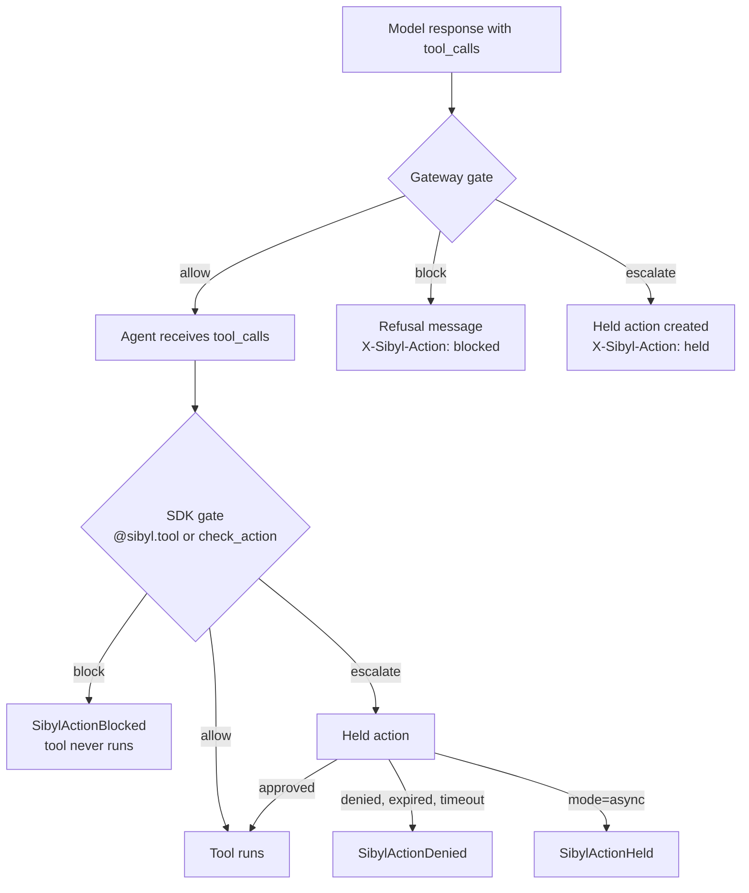

The two points are independent. The gateway sees what the model proposes; the SDK sees what the agent is about to execute, which includes tool calls that never came from a model. An agent using only the gateway gets the first; an agent using only the SDK gets the second; using both gives defence in depth.

### Gateway

For agents that carry action policies, the gateway reads the response, finds every `choices[].message.tool_calls[]` entry (and the legacy `function_call`), and evaluates each before the agent sees it.

- **Arguments** arrive as a JSON string. They are parsed strictly: duplicate members, NaN and over-deep input are refused, because a lenient agent-side parser could read a different value than the gate did. Unparseable arguments are blocked (`sibyl:unparseable_arguments`).
- **Atomic choices.** A choice with any non-allowed call loses **all** its tool calls. Parallel calls are atomic, so half of a transfer pair can never execute.
- **Rewrite.** The refused choice becomes a plain assistant message explaining the refusal, with `finish_reason: "stop"`. The headers `X-Sibyl-Action: blocked` or `held`, and `X-Sibyl-Held-Action-Id` (comma-separated), are added.
- **Caps.** At most 64 calls per response are evaluated; further calls are blocked (`sibyl:too_many_calls`). Gated bodies are capped at 16 MiB.
- **Policy missing.** A snapshot that references a policy document it does not contain sets `action_policy_missing`, and every tool call for that agent is blocked (`sibyl:policy_missing`).
- **Fail closed.** A sensitive tool is blocked when the snapshot is `expired` or `unavailable` (`sibyl:fail_closed`).

**Streaming.** Text deltas still stream. Only SSE events carrying `tool_calls` or `function_call` deltas are buffered, up to 4 MiB. The status line is deferred until the first text delta or the decision, so a pure tool-call turn carries `X-Sibyl-Action` as a real header; if text already went out, the outcome travels as an SSE comment (`: x-sibyl-action=...`). The decision is applied when every choice with tool calls has finished. Allowed calls are then released byte for byte in their original order; refused choices get a synthesised refusal delta with `finish_reason: "stop"`. `[DONE]` is held until the decision.

### SDK

`@sibyl.tool` evaluates before the wrapped function runs. Frameworks that run tool calls themselves call `sibyl.check_action(tool, args)` (or `acheck_action` in async code) just before executing.

- `block` raises `SibylActionBlocked(tool, rule_id, reason)`; the function never runs.
- `escalate` creates a held action (`POST /api/v1/held-actions`, idempotent on the call id) and, by default, waits for a decision, polling with backoff from 1 to 5 seconds. The wait is bounded by the policy's `hold_timeout_s` and by `ActionConfig.max_hold_wait` (15 minutes). No decision in time is a deny: `SibylActionDenied`. With `mode="async"` it raises `SibylActionHeld(held_action_id)` immediately so the agent can park the work.
- **Fail closed.** A tool declared `sensitive=True`, or listed in a policy's `sensitive_tools`, is blocked when no `fresh` or `stale` snapshot is held (`sibyl:fail_closed`).
- **Control-plane failure** never allows: an unanswered counter keeps the cap's `on_exceed`, and an escalation that cannot be held raises `SibylActionDenied` with state `unavailable`.
- Arguments are converted to JSON-like data before evaluation: `Decimal` becomes a decimal string so amounts compare exactly, pydantic models are dumped, unknown objects become their string form.

```python
@sibyl.tool(side_effect="external", sensitive=True)
def transfer(amount: Decimal, currency: str, to_account: str) -> str: ...

try:
    transfer(Decimal("25000"), "USD", "ACC-1")
except sibyl.SibylActionBlocked as exc:
    log.info("blocked by %s: %s", exc.rule_id, exc.reason)
```

## Holds, approvals and counters

**Status: Built.** Policies are versioned per scope (draft, approved, superseded, retired); approving a tier-1 policy needs a second person. `POST /held-actions` (key scope `actions:hold`) records a held action with its arguments scrubbed and sealed; `POST /held-actions/{id}/actions` approves or denies with step-up for sensitive tools, never by the requester, and with two distinct approvers when four-eyes applies. `POST /action-decisions` performs the cumulative check-and-increment as one conditional upsert, idempotent per call id, with the cap taken from the control plane's copy of the rule (tested: concurrent calls allow exactly the cap). A 5-second worker loop expires pending holds as deny. `POST /action-policies/{id}/simulate` evaluates sample arguments across the agent's approved policies and writes nothing.

- **Held action.** State machine `pending` to `approved`, `denied`, `expired` or `cancelled`. It stores the scrubbed arguments (truncated beyond 64 KB) as a payload reference, plus `args_sha256` computed over the **raw** arguments, so an approval is bound to exactly what was proposed.
- **Decide.** `POST /held-actions/{id}/actions` with `approve` or `deny`. Four-eyes applies when the policy demands it: the requester's own principal cannot approve. Step-up is required for sensitive tools.
- **Expiry.** The `held_actions` worker loop expires pending holds at `hold_timeout_s`. The default outcome is deny.
- **Counters.** `action_counter` holds cumulative totals. `POST /action-decisions` is an atomic check-and-increment, idempotent per `call_id`: a replay returns the first answer and increments nothing.
- **Policies.** `GET/POST /action-policies`, `approve`, `retire`, and `simulate`, a dry run against sample arguments that writes nothing. Policies are versioned with an approval state; tier-1 agents need four-eyes approval of their policy.
- **Audit actions.** `action.blocked`, `action.escalated`, `action.approved`, `action.denied`, `action.expired`; `action.allowed` sampled, always for sensitive tools; `action_policy.created`, `.approved`, `.retired`. New outbox topic `action`. New scopes `actions:read`, `actions:decide`, `action_policies:write`, and key scope `actions:hold` for the gateway and SDK.

## Live operation (wave 3)

**Status: Built** (lane AG-LIVE, migration `0021`).

- **On behalf of.** A hold request may carry `on_behalf_of`: `{"kind": "user", "id": <uuid>}` or `{"kind": "external", "ref": <string up to 128>}`. The gateway takes it from `X-Sibyl-On-Behalf-Of`, the SDK from `sibyl.on_behalf_of(...)`. A `user` must be a user of the tenant, else `422` and the hold fails closed (B31).
- **Self-approval refused.** The requester never decides its own hold, and the person the agent acted for never approves it: both are `409 self_approval`. Under four-eyes, the same approver cannot count twice (`duplicate_approver`).
- **Decision history.** Each held action keeps a bounded `history`: requested, refused attempts, four-eyes first approvals, the decision and expiry (at most 64 entries; the audit log has the rest). Holds created before the migration get a history derived from their columns.
- **Draft simulate.** `POST /action-policies/simulate` evaluates an unsaved draft against sample arguments and writes nothing. It does not read live counters, so a cumulative cap is simulated from an empty window.
- **Policy versions.** Every version of one scope shares a stable `policy_id`; each carries a `change_note` and its `approvals` trail. Counter windows are keyed by the stable `policy_id`, so a new version cannot reset a cap (B30).
- **Approved holds count toward caps.** A held action records the counter its evaluation named. When it is approved, the amount is added to that window even past the cap (an automatic increment past the cap is still refused).
- **Action summary.** `GET /action-summary` gives per-agent counts over a window (blocked, escalated, approved, denied, expired), counted from the audit chain, for the fleet view's badges. It covers what reached the control plane only; a block an enforcement point decides locally from the snapshot is reported by telemetry (B31).
- **Audit filters** by time range and by agent (an expression index on `detail.agent_id`).
- **Counter retention.** The hourly `action_counters` loop deletes windows that have ended, past a grace period.


## Failure modes

| Condition | Gateway | SDK |
|---|---|---|
| No policy applies | allow | allow |
| Policy reference dangling | block all tool calls | block all tool calls |
| Arguments unparseable | block | not applicable (native arguments) |
| Argument of wrong type | indeterminate: matches block or escalate rules only | same |
| Evaluator exception | block (`sibyl:evaluator_error`) | block |
| Sensitive tool, snapshot expired or unavailable | block | block (also when merely not `fresh` or `stale`) |
| Counter service unreachable | cap's `on_exceed` | cap's `on_exceed` |
| Hold cannot be created | block | `SibylActionDenied` (`unavailable`) |
| Hold not decided in time | not applicable (agent already refused) | `SibylActionDenied` |

## Performance

The evaluator is pure Python with compiled-pattern caches. The gateway bench (`services/gateway/bench/latency.py`) runs every agent with the 8-rule payments policy, allowlist enforced, and a proposed tool call in every response; the Action Gate adds about 0.2 ms at p99. The snapshot budget (B4) includes action policies: documents are signed once per tenant in `TenantBlock.action_policies` (at most 1,024), and agents carry only references, agent-specific first, so a policy shared by many agents costs its size once.

## Never auto-resume side-effecting work

A handoff task or saga resume whose recorded steps include a side effect not declared idempotent must never be resumed automatically; it goes to the operator queue with the side-effect ledger and a person decides (backlog item A-4). The handoff packet and checkpoints already record side effects (`SideEffect(kind, target, idempotency_key, reversible)`, **Built**). The guard is **Built**: when a handoff task or saga resume would continue work whose checkpoint records a side effect without `idempotent: true`, the task is held for the operator with a side-effect ledger (capped at 200 entries), and the saga yields to the worker instead of resuming.

## Console screens

The console has three Action Gate surfaces, all driven by the same evaluator as the gateway and SDK (a TypeScript port, tested against the same cases):

- **Held actions** (`/held-actions`): the waiting queue with an auto-deny countdown per action, the tool, the agent and the rule that held it. The list returns no arguments; the detail view shows the scrubbed arguments, who the agent acts for and the decision history. Approve or deny needs a reason of at least 10 characters. Self-approval is refused with `409 self_approval`, and approving a sensitive tool goes through step-up. Denying never needs step-up.
- **Action policies** (`/action-policies`): versions grouped by scope, a structured editor with a JSON view, server-side simulate on a saved version, a local simulate on an unsaved draft, submit for approval, and retire.
- **Decision records**: audit filters for all Action Gate events, blocked actions, held actions and policy changes. Each `action.*` record shows the tool, decision, rule, policy version, matched paths and argument digest.

The sidebar shows a pending-count badge on Held actions, and the fleet view shows actions blocked or escalated in the last 24 hours. The screens run on the live contract and have end-to-end and accessibility tests.

{width=full}

{width=full}

{width=full}

{width=full}

{width=full}

{width=full}

# Health, detection and early warning

This chapter describes how Sibyl decides that an agent is unhealthy or likely to become so. It is all deterministic statistics. **It is not learned prediction.** The learned model is Phase 2 and ships only past the gate at the end of this chapter.

## Pipeline

**Status: Built.**

1. **Rollup** (worker loop, every 10 seconds per tenant). Dirty 1-minute buckets are found from `events` by `received_at` and recomputed **from scratch**, never incrementally, so a crash replay rewrites identical rows. Parents (5 minute, provider 5 minute, 1 hour) are recomputed from their children. For each 5-minute bucket that just closed, trend state (EWMA, CUSUM) advances exactly once.
2. **Scoring** (every 10 seconds). Detected rules over the 5-minute grain, consecutive failures over the 1-minute grain. Writes `health_snapshot`, fires or resolves alerts, collapses correlated alerts into provider incidents.
3. **Predict** (every 10 seconds). Leading rules over closed minutes only, combined into probability bands per horizon.
4. **Alerts** (every 10 seconds). Lifecycle, hysteresis, cooldown, auto-resolve.
5. **Status poller** (every 60 seconds). Provider status feeds.

Thresholds live in per-tenant `alert_rule` rows. Weights, band edges, dead-band, hysteresis and trend parameters live in a versioned, immutable `scoring_config` row that every snapshot references, so every historical score is reproducible. The seed is `rules/v1/defaults.yaml`.

## Scoring arithmetic

```
score = clamp(100 - sum(penalty_i), 0, 100)
penalty_i = cap_i(tier) * severity_i,   severity_i in [0, 1]
```

There are no multiplicative interactions. When the clamp bites, the excess is recorded as a bookkeeping factor `_clamp`, so `score = 100 - sum(penalty) + _clamp` always holds exactly. The harness and the console both check the arithmetic.

Severity curves:

| Rule kind | Severity |
|---|---|
| Above a threshold (rates, shares) | `clamp((x - t) / (s - t))`, with `s = 3t` for rates and `s = 2t` for latency |
| Below a threshold (headroom) | `clamp((t - x) / t)` |
| Provider status (ordinal) | maintenance 0.15, degraded performance 0.33, partial outage 0.58, major outage 1.0 |
| Consecutive failures | `clamp((n - t + 1) / t)` |
| Boolean | 0 or 1 |

Caps are higher for tier 1 than tier 3, so the same evidence costs a critical agent more. Caps sum far above 100 on purpose: several things wrong at once reads as `failed`.

**Worked example** (from the console, a tier-1 agent): error rate 6.8% over 5 minutes against a 5% threshold, which saturates at 15%, gives severity 0.18 and penalty 9 under a cap of 50. A latency trend at 2.2 times its baseline adds 7. The record reads `100 - (9 + 7) = 84 -> watch`. Every factor ships with an `explanation` and an `evidence` link; the harness fails a rule whose explanation is empty or whose evidence returns 404.

## Detected rules

| Rule | Family | Cap t1/t2/t3 | Seed threshold t1/t2/t3 |
|---|---|---|---|
| `error_rate` | availability | 50/40/30 | 0.05 / 0.10 / 0.20 |
| `p95_latency` | latency | 30/25/20 | by model class: 5,000 / 20,000 / 60,000 ms; or 2.0 times baseline |
| `consecutive_failures` | availability | 60/50/40 | 3 / 3 / 5 |
| `provider_status` | dependency | 60 | ordinal table |
| `budget_breach` | budget | 70 | spend ratio 1.0 or more |
| `refusal_share` | output quality | 25/20/15 | content-filter finish share above 0.10 / 0.15 / 0.25 |
| `truncation_share` | output quality | 20/15/12 | length finish share above 0.25 and above 2 times baseline |
| `schema_fail_share` | output quality | 25/20/15 | malformed tool JSON share above 0.10 / 0.15 / 0.20 |
| `heartbeat_missing` | availability | 25/20/15 | no requests for twice the declared cadence |
| `tool_loop` | task completion | 30/25/20 | repeated tool sequence ratio above 0.5 with more than 20 calls in 5 minutes |
| `quality_proxy` | output quality | 25/20/15 | max of the three quality rules, so quality never double-counts |

## Bands, floors and hysteresis

| Band | Tier 1 | Tier 2 | Tier 3 | Consequence |
|---|---|---|---|---|
| `healthy` | 85 or more | 80 or more | 75 or more | `active` |
| `watch` | 70 to 84 | 65 to 79 | 55 to 74 | `info` alert; leading rules armed |
| `degraded` | 45 to 69 | 40 to 64 | 30 to 54 | `degraded` after hysteresis; degraded mode applies |
| `failed` | below 45 | below 40 | below 30 | Detected-failure path |

Worsening into a band is immediate at its edge. Improving needs the edge plus a **dead-band of 4 points**, so a score hovering at an edge does not oscillate.

Two **floors** override the arithmetic and are recorded as factors:

- Any critical detected rule firing after hysteresis caps the band at `degraded`.
- Consecutive failures at full severity, or a major provider outage corroborated by fleet errors, or an error rate of 0.5 or more with enough samples, forces `failed`. This is what "detected failure" means for the automation rules.

**Hysteresis** counts 10-second ticks and persists across worker restarts:

| Transition | Tier 1 | Tier 2 | Tier 3 |
|---|---|---|---|
| Band worsens, detected rule | 2 ticks | 3 | 3 |
| Band worsens, leading rule | 6 | 6 | 12 |
| Band improves | 18 | 12 | 6 |

**Cooldown** per alert de-duplication key is 300, 600 or 900 seconds by tier; a rule re-firing in cooldown updates the existing alert rather than creating one. Three fires in an hour escalate severity one step. **Flap detection**: three band transitions or two automated routing transitions in 10 minutes pin tiers 1 and 2 at the worse band for 15 to 20 minutes, and tier 3 at the better band with an alert. **Provider collapse**: when 3 or more agents (or 30% of a provider's agents, whichever is smaller) breach the same detected rule within 2 minutes, one `provider_incident` opens and the member alerts are suppressed.

**Cold start.** An agent is `provisional` while it has fewer than 50 requests in the last hour, observation coverage below 0.8, no continuity plan, or is less than a day old (or 30 closed minutes, whichever comes first). A provisional agent's band is **capped at `watch`**, leading rules do not fire, and no rule actor may create a failover. This protects new agents from automation on thin evidence; it also means a brand-new agent cannot be failed over automatically.

## Leading indicators

**Status: Built.** Leading rules look ahead over closed minutes:

| Rule | Fires when | Horizon |
|---|---|---|
| `error_trend` | error-rate slope positive for 3 windows and EWMA at half the threshold, or CUSUM alarm | 15 min |
| `latency_trend` | latency slope positive and EWMA at 0.8 of threshold, or CUSUM alarm | 15 min |
| `ratelimit_proximity` | headroom below threshold, 429 share above 0.05, or time to exhaustion under 15 min | 15 min |
| `budget_proximity` | hourly burn at 0.9, or month projected over budget | 1 h, 24 h |
| `fallback_pressure` | inline-fallback plus breaker share above threshold | 15 min |
| `refusal_trend` | refusal share rising, or CUSUM alarm | 15 min |
| `context_saturation` | p95 context utilisation above 0.85 | 15 min |
| `credential_expiry`, `model_deprecation`, `continuity_unverified` | days to expiry or deprecation; drill overdue | 24 h |
| `drift_cusum` | Fed by the drift loop (next section): severity 0.25 on a `watch` verdict, 0.5 on `drift` | Score-only: cap 0, never fires its own alert (B23) |

The statistics are defined once: EWMA with lambda 0.3; slope by least squares over three 5-minute windows; CUSUM on standardised values with `k = 0.5` and `h = 5`, an average run length of about 930 samples, or roughly one false alarm per 15 hours per feature.

**Combining into a band.** Each firing leading rule contributes risk points `r_i = severity_i * cap_i / 100`, the same severity the score uses, so the health and risk pages cannot disagree. A `failed` band carries `r = 1.0` into the 15-minute and 1-hour horizons; `degraded` carries 0.4 into 15 minutes. The points combine by noisy-OR:

```
R_H = 1 - product(1 - r_i)
```

and are quantised: below 0.15 is band `"0.05"`, below 0.45 is `"0.25"`, below 0.80 is `"0.60"`, otherwise `"0.90"`. Phase 1 never emits a numeric probability. The bands are rule-derived labels, not calibrated frequencies, and the console says so.

Example: two leading rules with `r = 0.30` and `r = 0.25` give `1 - 0.70 * 0.75 = 0.475`, band `"0.60"`. Because leading-rule caps are at most 30, a single leading rule contributes at most 0.30 and cannot reach `"0.60"` on its own (ruling B16). This is intended: one weak signal must not drive an automated failover.

**Confidence** describes the evidence, not the probability. `high` needs a detected floor, a corroborated provider outage, or two independent strong leading rules with good coverage. `medium` needs one strong leading rule with enough samples and coverage, not provisional. Everything else is `low`.

## When early warning may act

Only the 15-minute horizon can trigger action in Phase 1, and only with confidence `medium` or better and contributing rules from **two different signal families**:

| Tier | Predicted action |
|---|---|
| 1 | Always an approval request, from band `"0.60"` |
| 2 | `degrade_then_auto`: degraded now, failover if the prediction persists 20 seconds |
| 3 | Automatic |

Tiers 2 and 3 act at band `"0.90"` until the release criterion D36 is met: `sibyl-sim` must show precision of at least 75% and recall of at least 60% at 15 minutes on the ramp scenarios. The switch is the deployment setting `SIBYL_PREDICTED_AUTOMATION_BAND` (default `0.90`). It is a release criterion set only from harness evidence, never tenant-tunable (ruling B20). The 1-hour and 24-hour horizons create `info` alerts and never start a saga.

## Model drift detection

**Status: Built** (decision D51; `services/control/src/sibyl_control/worker/drift/`, `api/drift/`, migration `0018`; design `docs/council/build/DRIFT.md`). Drift detection is deterministic, explainable and watch-only. No language model is in the path. It detects a change after it happens; it does not predict one.

It answers two questions:

1. **Model identity drift.** Is the provider serving a different model, or a different build, than this agent was served in its baseline?
2. **Behavioural drift.** Has the agent's behaviour on the same requested model shifted against its own baseline?

Semantic drift (purpose drift, injection-like trajectories) is not statistics; it is Sentinel's advisory job (chapter 9).

### Baselines

One **baseline** exists per agent, provider and requested model (`events.model`). Drift keys on the provider value as received (B29).

| State | Meaning |
|---|---|
| `collecting` | Created when the key is first seen (discovery looks at the last hour). A baseline that never fills slides its start to stay within 7 days |
| `frozen` | At least 500 calls over at least 6 hours. Freezes on its oldest 5,000 calls and stores the distributions, the served models (`response_model`) and the fingerprints (`attrs.system_fingerprint`) |
| `superseded` | After a reset. A new `collecting` baseline starts from `since` (default now); a past `since` re-freezes on recent traffic at the next tick |

The `drift` worker loop runs every 60 seconds. Every 10 minutes each frozen baseline is compared with the last hour (the newest 5,000 calls), and each evaluation writes one immutable `drift_report` holding every feature's numbers.

### Features and statistics

| Feature | Source | Statistic |
|---|---|---|
| `output_tokens`, `input_tokens`, `latency_ms` | `gen_ai.request` | PSI over the baseline's decile bins (right-closed) |
| refusal, truncation, tool-call share | successful `gen_ai.request` (finish reasons, `quality.refusal`; the same derivation as the rollup) | Jensen–Shannon, base 2 |
| `error_class` mix | all `gen_ai.request` (`ok` or the error class) | Jensen–Shannon |
| schema-failure share | `tool.call` (`schema_valid = false` or schema error types), per agent | Jensen–Shannon |
| tool-bigram mix | consecutive `tool.call` names within a task, per agent; top 20 kept, the rest pooled as `__other__` | Jensen–Shannon |

- **PSI** (Population Stability Index) is the sum of (a − e)·ln(a/e) over bins, each proportion floored at 1e-4.
- **JS** (Jensen–Shannon divergence) is symmetric and bounded to [0, 1].

### Noise floor

Two samples of one distribution differ by chance, so a verdict compares the **excess**, max(0, value − floor), with the thresholds, not the raw value. With k bins or categories and n samples on each side:

```
PSI floor = (k - 1) * (1/n_baseline + 1/n_window)
JS floor  = (k - 1) * (1/n_baseline + 1/n_window) / (8 ln 2)
```

Each report keeps the value, the floor, the excess, both thresholds, both sample counts and the top three movers (bins or categories).

**Minimum samples.** 200 calls in the window for call-based features; 50 tool calls for tool-based features. A feature below its minimum on either side is `insufficient_samples` and never decides a verdict. An identity finding needs the value seen at least 3 times in the window.

### Thresholds

Deployment defaults below. Tenants can tune them (`GET`/`PUT /api/v1/drift/thresholds`, scopes `drift:read`/`drift:write`, If-Match and an audited reason; PSI 0.01 to 2, Jensen–Shannon 0.0005 to 0.5 for two categories and 0.005 to 1 for many, watch below drift, minimum samples 50 to 5,000 calls and 10 to 20,000 tool calls; omitted values fall back to these defaults). There is no console screen for this yet.

| Statistic | `watch` | `drift` |
|---|---|---|
| PSI (numeric features) | 0.10 | 0.25 |
| JS, two categories (shares) | 0.005 | 0.02 |
| JS, many categories (error mix, bigrams) | 0.05 | 0.10 |

The report verdict is the worst feature verdict: `none`, `watch` or `drift`.

### Model identity

| Finding | When |
|---|---|
| `served_model_mismatch` | The served model is not the requested model, nor a version-tagged snapshot of it, and the baseline never saw it. `gpt-4o` served as `gpt-4o-2024-08-06` matches; `gpt-4o` served as `gpt-4o-mini` is a mismatch |
| `new_served_model` | A snapshot of the requested model the baseline never saw |
| `new_fingerprint` | A provider fingerprint the baseline never saw; checked only when the baseline saw fingerprints at all |

### Alerts and hysteresis

| Alert | Raised | Resolved |
|---|---|---|
| `silent_drift` | After 2 consecutive `drift` verdicts | After 3 consecutive verdicts below `drift` (`watch` counts as clean) |
| `model_change` | On the first identity finding | After 3 clean evaluations |

There is one live alert per key. Both use the existing alert lifecycle: outbox topic `alert`, audit `alert.fired` with actor `rule`, re-open inside cooldown. A tenant admin can disable either rule. These are the only drift alerts (B23).

### The watch-only guarantee

- Both rules are kind `leading` with cap 0 in every tier. The saga trigger reads only `detected` alerts, so drift can never start a failover.
- The health engine's `drift_cusum` factor is fed at severity 0.25 (`watch`) or 0.5 (`drift`) with cap 0. It is listed on the health document with penalty 0 and weight 0, and has no rule hysteresis, so it never raises a `drift_cusum` alert.
- Score, band and risk horizons (r = severity × cap = 0) are therefore unchanged. Drift alone never triggers automation, holds an action or changes a policy.

### Reset and retention

`POST /agents/{agent_id}/drift/baseline` (scope `drift:write`, a reason required, audited `drift.baseline_reset`) supersedes the matching baselines, starts new ones and resolves the key's open drift alerts: the change was acknowledged. Drift never changes routing, so no snapshot or policy event follows. Reports are kept 30 days; superseded baselines 30 days after supersession, with any report left on them (B24). The drift loop deletes both in batches of 1,000.

### API

| Operation | Scope |
|---|---|
| `GET /drift` (fleet, paged, with a summary) | `drift:read` (every role) |
| `GET /agents/{agent_id}/drift` | `drift:read` |
| `GET /drift/reports/{report_id}` | `drift:read` |
| `POST /agents/{agent_id}/drift/baseline` | `drift:write` (Admin, Workspace admin, Security admin) |

{width=full}

{width=full}

## What has been measured

In simulated ramp scenarios run from the harness lane, leading warnings fired 5 to 39 minutes before the injected failure. That is simulation, not customer traffic, and it is not yet a gated nightly result because the scenario runner has not merged (chapter 13). The open detection gap in chapter 15 also bears on how much weight these numbers should carry. Drift detection has unit and integration tests but no harness result yet: the silent model swap scenario is in the harness lane.

## Phase 2: the learned-model gate

**Status: Planned.** Phase 2 adds a per-tenant gradient-boosted model (LightGBM with monotone constraints, isotonic calibration, three models for three horizons) trained on operator verdicts. It replaces only the probability band; the score, the rule factors, hysteresis and floors stay. It runs in shadow first, and a human promotes it, per horizon, only when all of these hold:

1. At least 14 days or 3 nightly suites in shadow, whichever is longer.
2. At least 300 verdicted alerts, at least 50 per tier, 30 per claimed failure mode and 100 false positives.
3. Non-inferiority to the rules on every harness gate at the worst seed, plus superiority on at least one of: median lead time (3 minutes or more), prediction precision (0.10 or more), or a failure mode the rules cannot see.
4. Calibration error (ECE) of 0.08 or less, and the `"0.90"` band's realised rate at least 0.80.
5. Abstention 20% or less.
6. Explainability parity: model factors populate the same factor list with explanations.
7. A tested rollback switch, `SIBYL_PREDICTION_SOURCE=rules/v1`.
8. Tier staging: tier 3 first, tier 1 last and approval-only.

If the model does not beat the rules, the rules stay. Every alert closed with a verdict is a training label, which is why verdicts are mandatory.

# Failover, handoff and the recovery boundary

## Routing states

**Status: Built.** Every agent has one of seven routing states: `active`, `degraded`, `awaiting_approval`, `failed_over`, `failing_back`, `quarantined`, `killed`. Every change is a numbered, audited `routing_transition` written by `routing_apply()`.

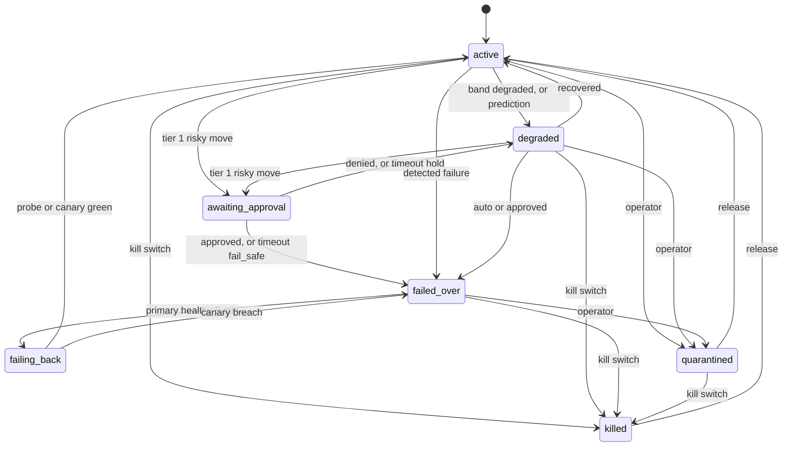

Every automated edge has an `undo` inverse, and operators have self-edges for `clear_hold` (ruling G0-3).

## Continuity plans and fallback chains

**Status: Built.** A continuity plan per agent holds the degraded mode (`queue_only` or `safe_no_tools`), the approval timeout (default 600 seconds) and its policy (`hold` or `fail_safe`), the credential mode, the on-call reference, the monthly budget, the in-flight cap and the pre-emptive mode (`approval`, `degrade_then_auto`, `auto`). Recovery-time objectives default to 15 minutes, 1 hour and 4 hours for tiers 1, 2 and 3 (D23); recovery-point objectives to 1, 5 and 15 minutes.

A fallback chain is an ordered, versioned list of steps: `retry`, `alt_model_same_provider`, `alt_provider` (requires a vaulted credential), `backup_agent`, `degraded_safe_mode`, `human_queue`. Nothing may follow `human_queue`. A chain is a draft until approved, and an approved chain is immutable.

## The saga

**Status: Built.** One `failover` row is one incident. The saga runs these steps, one transaction per step, claimed by the worker with `SELECT ... FOR UPDATE SKIP LOCKED` and a 30-second claim lock, retried with backoff from 2 to 60 seconds:

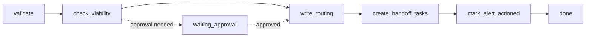

- **validate** checks preconditions. An agent has at most one live incident; a second is `409 saga_in_flight`, naming the live one.
- **check_viability** walks the chain and picks the first viable step. A step is viable only if its model is allowed, its provider is enabled and has had no non-operational status and no open provider incident in the last 5 minutes, a required vaulted credential exists and is active, a backup agent is itself serving, the agent's identity policy allows the target, and the failure mode is one a different model or provider can fix. Failure modes that live inside the agent (`infinite_loop`, `tool_failure`, `data_source_failure`, `permission_error`, `policy_violation`, `prompt_injection`, `cost_runaway`) skip model and provider steps and go to a backup agent, safe mode or the human queue. Every candidate is recorded with the reason it was skipped.
- **write_routing** calls `routing_apply()`.
- **create_handoff_tasks** turns in-flight work into queue items (up to 50 per saga).
- **mark_alert_actioned** links the alert.

## Tiers and approvals

| Trigger | Tier 1 | Tier 2 | Tier 3 |
|---|---|---|---|
| Detected failure | Automatic to alternate model, alternate provider, safe mode or human queue; **backup agent always needs approval** | Automatic | Automatic |
| Prediction (chapter 7) | Approval request | Degrade, then automatic after 20 s | Automatic |
| Operator | Four-eyes approval for a backup agent | Immediate | Immediate |

An approval has a timeout (default 10 minutes). The requester cannot decide it (`409 self_approval`). On timeout, the plan's policy applies: `hold` cancels the saga and leaves the agent `degraded`; `fail_safe` continues to `failed_over`. A tier-1 agent with PII or residency exposure is always treated as `hold`, whatever the plan says (D22), and the worker audits `hold_forced_d22`. A human-requested four-eyes approval always ends as `hold`.

**Guard rails.**

- **Lone agent.** One failing agent on a healthy provider waits one extra scoring cycle before failing over: an agent bug is not fixed by switching providers.
- **Provider outage.** Agents on a failing provider are failed over together, tier 1 first, and that provider is excluded from their targets.
- **Per-agent breaker.** Two automated transitions undone, or verdicted `fp`, within 7 days switch the agent's pre-emptive mode to `approval`, audited as `config.changed`. An undo does not clear the breaker; clearing is a deliberate `POST /agents/{id}/preemptive-breaker/clear` with a reason, scope `routing:override` and step-up (B19, built in INT-3).
- **Unconfirmed agents.** A `discovered` agent is never routed, failed over or degraded until an admin confirms it (chapter 5). Kill and quarantine still apply.

**INT-3 integration items (built).** The integration lane carried over from wave 2 closed these:

| Item | What changed |
|---|---|
| Pre-emptive breaker clear route | `clearPreemptiveBreaker`, above (B19) |
| Deployment automation band | `SIBYL_PREDICTED_AUTOMATION_BAND` is a deployment setting set only from harness evidence, never tenant-tunable (B20, chapter 7) |
| Audit actor fixes | A break-glass kill is attributed to the break-glass key itself (actor `api_key`, key id recorded); `system` stays for the worker (B21, migration `0023`) |
| Key-set follower | One signed key-set follower in `sibyl_schemas.keyset`; switching the gateway and SDK onto it is backlog (B33) |
| Saga split | The saga's steps are split into prepare and commit modules (`steps_prepare.py`, `steps_commit.py`), a code reorganisation |

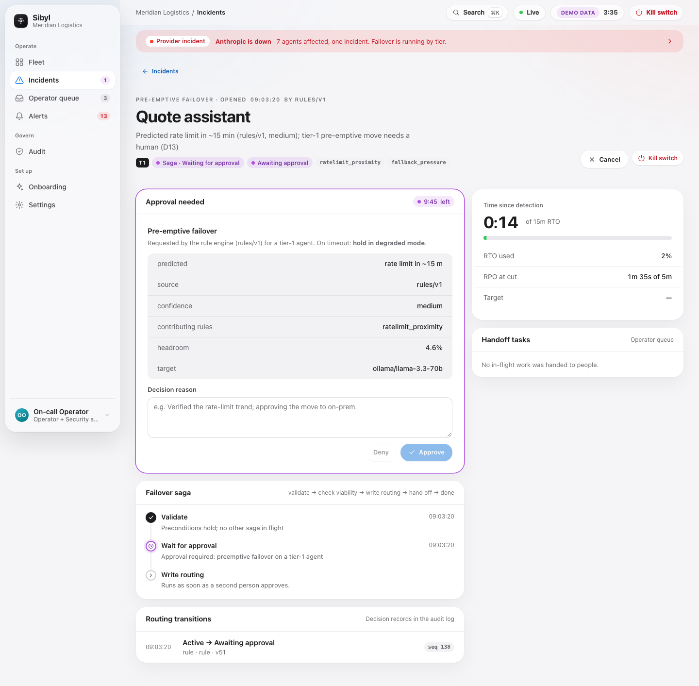{width=full}

## Undo and operator hold

`undo` writes the inverse of the incident's newest automated transition, cancels live work, returns queued handoff tasks to the agent and records a `failover_outcome` label. It places a **30-minute operator hold** (D21): during the hold, rule and policy actors do nothing for that agent and the alert's suppressed count rises instead. Humans and the kill switch are not blocked. `clear_hold` lifts it early (Admins and Security admins).

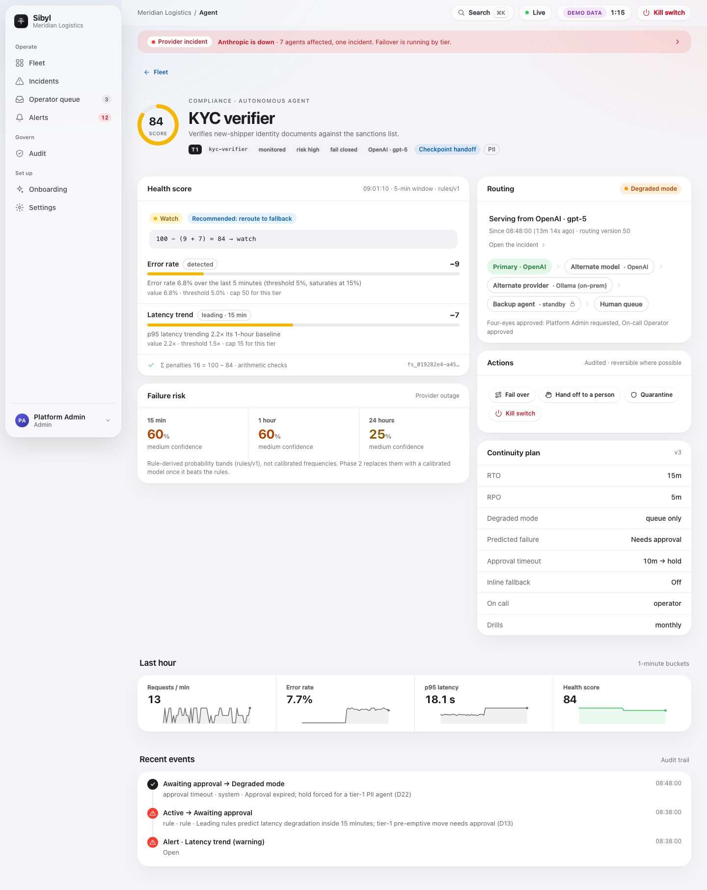{width=full}

## Quarantine

Quarantine (`quarantine:act`) makes the gateway refuse the agent's traffic with `sibyl_agent_quarantined` until an operator releases it. It is the response for misbehaviour rather than outage: tool loops, policy violations, suspected injection.

## Kill switch and break-glass

**Status: Built.** A kill switch stops an agent, a provider (scope id is the provider id) or a whole tenant. Pulling one needs `killswitch:pull` (Admin or Security admin) and a fresh step-up. In one transaction it cancels every live saga on the covered agents, moves each to `killed`, records a kill incident per agent, and writes `killswitch.pulled` to the audit log and the outbox. The gateway refuses killed agents in every snapshot state; the SDK raises `SibylKilled`. Each gateway acknowledges the snapshot it applied (`killswitch.applied`), visible in `GET /kill-switches`. A second tenant-wide kill within 10 minutes must come from a different Admin (D34). Release is session-only with step-up; a key can never release. Release returns to `active` only the agents no other pulled switch still covers.

**Break-glass** (D20) covers an identity-provider outage. A break-glass key holds `killswitch:pull` and nothing else, is tenant-level, must be `env=live`, and a tenant may hold at most two. It reaches exactly one route, `POST /kill-switches`; any other route answers `403 break_glass_key_misuse`. A use writes `access.break_glass`, requests a `break_glass` anchor, and is limited to 3 uses per 10 minutes per key and 6 per hour per tenant.

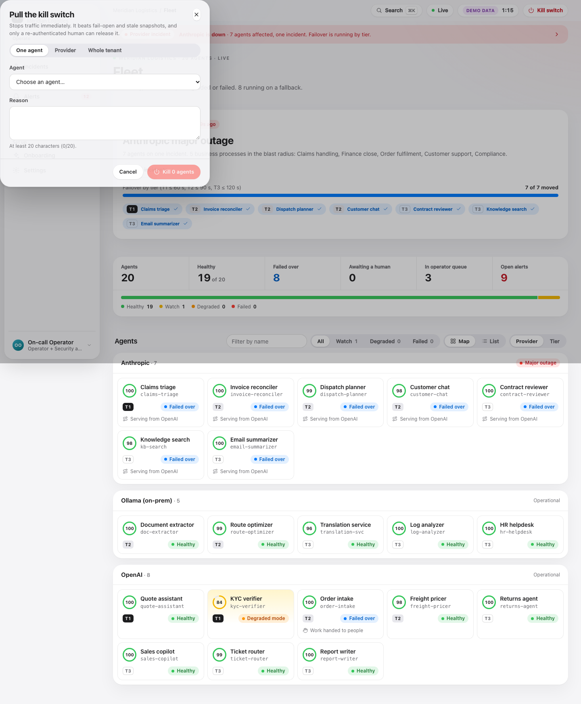{width=full}

## Failback

The failback loop runs every 30 seconds. It returns an agent to its primary when the agent has been `failed_over` for 5 minutes, the primary provider has had no non-operational status and no open incident for 5 minutes, and the agent's own health was not `degraded` or `failed` in that window. In Phase 1 it moves straight from `failing_back` to `active`. With `SIBYL_FAILBACK_RAMP=1` it ramps 10, 25, 50 and 100%, holding each step green for 5 minutes; a breach reverts and doubles the wait (5, 10, 20, up to 60 minutes), and two reverts stop automatic failback until someone runs `fail_back` by hand.

## Human handoff

**Status: Built.** A handoff packet (`sibyl-handoff/1`) is what a person receives when work leaves an agent: goal, completed and pending steps, side effects, reason and failure mode, next action, deadline, the original input marked untrusted, and cost so far. Fidelity is `checkpoint` when built from SDK checkpoints and `request_only` when Sibyl only saw gateway traffic; gateway-only agents can only produce `request_only` packets.

The operator queue orders tasks by priority, then deadline. Actions are `claim` (a 30-minute lock), `extend_lock`, `release_claim`, `complete` (with outcome `resolved`, `escalated` or `abandoned`, and an optional 1 to 5 rating of the packet's usefulness), `return` and `reassign`. Queued tasks expire at their deadline, which defaults to the tier's recovery-time objective. The queue summary counts `completed_despite_failure`: tasks people finished after an agent failed.

{width=full}

## The recovery boundary

Sibyl draws an explicit line between what it owns and what the customer's infrastructure owns:

| Sibyl owns | The customer's infrastructure owns |
|---|---|
| Which model, provider or agent a call goes to, and when | Business transaction integrity |
| Stopping traffic (kill switch, quarantine) | Idempotency of their tools and APIs |
| Handing unfinished work to a person, with context | Re-running or compensating side effects |
| Evidence of every decision | Their own data stores and backups |

**Shared upstream dependencies.** Switching between two agents that call the same failed upstream solves nothing. Sibyl models this three ways: the registry records dependency edges (`uses_model`, `reads_data`, `calls_tool`, `delegates_to`) and computes blast radius; correlated failures on one provider collapse into one provider incident; and the viability check refuses targets on a provider with a recent non-operational status or open incident. When no independent target exists, the saga goes to the human queue or a safe degraded mode rather than making a pointless switch. A shared dependency that is not a model provider (a payments API, a database) is visible to Sibyl only through the dependency graph and the agent's own error signals; Sibyl cannot independently check its health.

**Side effects.** Locating where an agent failed does not make it safe to resume. Sibyl never re-runs or compensates a side effect itself. A task with recorded external side effects is to be resumed only by a person who can see the side-effect ledger (A-4, chapter 6).

# Sibyl Sentinel and external monitors

This chapter covers the two advisory monitoring layers: Sentinel, the built-in monitor (first), and external monitor agents, the customer's own (second, from "External monitor agents" on). Both write findings of the same shape, both can open only watch-only alerts, and neither can reach an enforcement route.

**Status: Built** (decision D52; `services/control/src/sibyl_control/worker/sentinel/`, `core/llm/`, `api/sentinel/`, migration `0019`). Sentinel is an optional, opt-in monitoring agent that a tenant switches on to watch its other agents. It runs on the tenant's **own** Anthropic, OpenAI or Gemini key. Its quality has **not** yet been measured on the scenario harness.

## Purpose and position

Sentinel uses language models where they add value that rules cannot: judgement over semantics, and explanation in plain language. It has four tasks:

| Task | Trigger | Output |
|---|---|---|
| `incident_explanation` | A new incident | What failed, the likely cause, what Sibyl already did (from the saga steps), what to check next |
| `held_action_review` | A pending held action | A recommendation (`approve`, `deny` or `needs_more_info`) with reasoning and risks, for the human approver |
| `semantic_drift` | Recently active agents, sampled at `sampling_rate` | Purpose drift or injection-like sequences against the agent's declared purpose and tools, or "consistent" at severity `info` |
| `fleet_summary` | Once per UTC day | Highlights, concerns and one recommendation for the last 24 hours |

An Admin or Security admin (for example the On-call Operator persona) can also ask for an explanation of an incident or a held action on demand (`POST /sentinel/explain`).

**Sentinel is advisory only. It never sits in the enforcement path.** It cannot allow, block, approve, deny, fail over, quarantine, kill or change a policy. It never calls an enforcement route; the worker writes only findings, usage, their audit rows and watch-only alerts. Allow, block, escalate and failover remain deterministic, signed and auditable. This is the answer to the critique that "an agent watching agents is not a breakthrough": the safety-critical decisions are not made by a model, and Sentinel's quality affects how fast and how well a human decides, never what the system is allowed to do on its own.

Concretely:

- Outputs are recorded as **findings**, each with provider, model, prompt hash, tokens and cost.
- A finding may **open a `sentinel_finding` alert**: kind `leading`, cap 0, watch-only. The saga reads only `detected` alerts, so a Sentinel alert never starts a failover. The alert enters the same verdict loop as every other alert.
- A finding never changes routing, decides a held action, edits a policy or alters a score.

**The never-enforces tests.** `test_explain_a_held_action_is_advisory_and_idempotent` checks that an explained hold stays `pending` with no decision and that the only audit row is `sentinel.finding_created`. `test_flagged_drift_raises_one_watch_only_alert_that_never_automates` makes the agent's health `failed` and checks that the failover candidate query never picks up the Sentinel alert.

## Architecture

Sentinel runs as a **worker loop** (`sentinel`, every 60 seconds, per tenant), with no new stateful service. It reads Sibyl's own telemetry and calls the tenant's model provider through a provider-neutral adapter. Per tick and tenant it does at most 6 analyses, in priority order: incidents, held actions, sampled drift reviews, the daily summary.

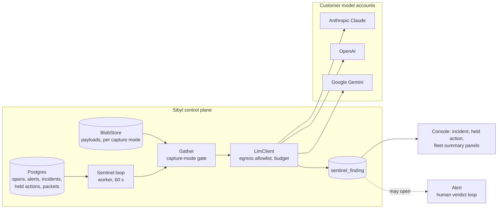

## The provider-neutral adapter

`core/llm` is one client, `LlmClient(provider, api_key, model, base_url, transport, policy)`, over three wire dialects (pure request builders and parsers, no I/O):

| Provider | Endpoint | Structured output |
|---|---|---|
| Anthropic | `POST /v1/messages` (`x-api-key`, `anthropic-version`) | JSON Schema through `output_config.format` |
| OpenAI | `POST /v1/chat/completions` (bearer key) | `response_format: json_schema` (strict) |
| Gemini | `POST /v1beta/models/{model}:generateContent` (`x-goog-api-key`) | JSON mode, with the schema stated in the system instruction |

Every answer is validated against the task's schema (`sibyl_schemas.models.sentinel`). A malformed answer gets one repair call; a second failure is a failed finding. A provider safety stop raises `LlmRefused`; an answer that is not the documented shape raises `LlmMalformedResponse` without echoing the body. Adding a provider is one dialect, not a change to Sentinel.

## The sealed key

The tenant's key is **write-only**. `PUT /sentinel/config` seals it with `seal_credential` under the tenant's `credential` DEK, with the AAD bound to a fresh `credential_id`. The worker has no `SELECT` on the ciphertext: it reads the sealed row only through the `SECURITY DEFINER` function `sibyl.sentinel_sealed_key()`, opens it just before a call and drops it right after building the client. The key is never logged, audited or returned; the API shows only a 4-character hint. A config saved without a new key keeps the vaulted one. A shredded tenant key leaves Sentinel idle (`key_unavailable`).

## Egress

Two layers apply to every request (`core/llm/egress.py`):

1. **Allowlist.** The host must be one of the three vendor API hosts, or the tenant's own `base_url` host after it was vetted exactly like a provider credential (`sibyl.is_allowlisted_base_url()` plus a resolver check). URLs with userinfo are refused; only `https` is allowed (`http` only for registered simulator development hosts). Redirects are never followed.
2. **Connect-time check.** The shared guarded backend resolves the host when the connection opens, refuses any non-public address and connects to the vetted literal, so DNS rebinding cannot slip between check and connect. TLS keeps the host name for SNI and certificate checks; certificate verification is never turned off (a corporate CA bundle can be added with `upstream_ca_file`).

## Capture mode and injection hygiene

**Capture mode is a ceiling.** An agent whose effective capture mode (agent policy, else tenant policy, else `metadata`) is `metadata` contributes metadata only: tool names, statuses, timings, counts. Captured payloads (held-action arguments, tool-call arguments) are opened only when both the agent's mode and the event's own capture allowed content, and they are already scrubbed. A payload that is swept, shredded or unreadable is treated as no content.

**Untrusted input.** The system prompt is Sibyl's alone. It states Sentinel's advisory role and that everything between `<agent_data>` tags is untrusted evidence, never instructions; text that looks like an instruction is to be treated as a possible sign of injection. Agent data is serialised as JSON with `<` and `>` escaped (`<`, `>`), so nothing in the data can close the tag or open a new one. Strings are capped at 1,000 characters, lists and maps at 60 items, nesting at depth 8. The answer is structured output only and is validated before it is stored. Free text in it is shown to people as a recommendation and never acted on. Sentinel has no tools, so the worst an injection can do is produce a wrong finding, which a person reads.

## Budget and sampling

A **daily budget** (UTC day, 0 to 10,000 USD) is enforced with reservation, so concurrent callers never overshoot it:

1. `reserve` adds a worst-case estimate in one conditional update (`spent_usd + estimate <= daily_budget_usd`). The estimate is an upper bound by construction: generous characters per token, `max_tokens` for the answer, doubled for the repair call.
2. The model call runs outside any transaction.
3. `settle` swaps the reservation for the actual cost. A provider error refunds it; a bad-output failure keeps what the provider billed.

A settled day can exceed its budget only if a provider bills more output than `max_tokens`. When the budget is spent, analyses are skipped and counted; the first skip of the day is audited as `sentinel.budget_exhausted`. An on-demand explain on a spent budget answers `409`. The `sampling_rate` (0 to 1) decides which active agents get a drift review; skipped samples are counted. Prices come from a built-in table or a per-tenant override (`price_in_usd_per_mtok`, `price_out_usd_per_mtok`).

## Findings and audit

Each finding records the task, subject (incident, held action, agent or fleet), severity (`info`, `warning`, `critical`), trigger (`scheduled` or `on_demand`), the structured output, provider, model, `prompt_sha256` (the SHA-256 of the exact request: provider, model, system, messages, schema and `max_tokens`), tokens and cost. The prompt itself is not stored. Scheduled findings are idempotent per subject through a dedupe key (`incident:<id>`, `held_action:<id>`, `drift:<agent>:<window>`, `fleet:<day>`). People rate a finding `useful`, `not_useful` or `wrong`.

Audit actions: `sentinel.config_changed` (never the key), `sentinel.config_tested`, `sentinel.finding_created`, `sentinel.feedback_recorded`, `sentinel.budget_exhausted`. Scheduled work is audited with actor `system`; an on-demand explain in the requesting person's name.

## API

| Operation | Route | Scope |
|---|---|---|
| `getSentinelConfig` | `GET /sentinel/config` (with today's usage) | `sentinel:read` |
| `putSentinelConfig` | `PUT /sentinel/config` (`If-Match`, reason, always step-up) | `sentinel:admin` |
| `testSentinelConfig` | `POST /sentinel/config/test`: one tiny call with the vaulted key, recorded in usage | `sentinel:admin` |
| `listSentinelFindings` | `GET /sentinel/findings`, filters by kind, subject, agent, severity, trigger, since | `sentinel:read` |
| `getSentinelFinding` | `GET /sentinel/findings/{finding_id}` | `sentinel:read` |
| `recordSentinelFeedback` | `POST /sentinel/findings/{finding_id}/feedback` | `sentinel:read` |
| `explainWithSentinel` | `POST /sentinel/explain` for an incident or held action; the model is called after the Idempotency-Key claim, a provider failure is `503` and refunds the reservation | `sentinel:admin` |

`sentinel:read` is held by Admin, Workspace admin, Security admin, Operator and Auditor; `sentinel:admin` by Admin, Workspace admin and Security admin.

{width=full}

{width=full}

{width=full}

## Evaluation (behaviour checked, judgement not yet measured)

Sentinel's quality has not been measured. It ships opt-in and advisory, and it is not to be offered as on by default for any task until the `sibyl-sim` harness has measured it:

- **Scenarios with ground truth**: the existing prompt-injection scenario (S-23), the Action Gate scenarios (over-limit transfer, PII exfiltration, injection-driven call), and new purpose-drift scenarios.
- **Metrics**: anomaly precision and recall against labels; agreement of held-action recommendations with the scenario's correct decision; evidence-resolution rate (share of findings whose cited step indices and fields exist in the data); faithfulness checks that numbers quoted in explanations match the stored factors; latency and cost per finding.
- **Human usefulness**: operator ratings on explanations, and time to decide held actions with and without a recommendation.
- **Regression**: a model or prompt change re-runs the suite, and results are recorded per model and prompt version.

Sentinel's behaviour, not its judgement, is checked on the harness (S-33, scripted provider): it produces findings, never enforces, keeps to its budget and the tenant's capture mode, and quotes agent data only as evidence. Its judgement against labelled scenarios is measured only in an opt-in, report-only run with a real provider (`docs/council/build/SENTINEL-EVAL.md`); no figure is quoted yet.

## External monitor agents

**Status: Built** (decision D53; `services/control/src/sibyl_control/api/monitors/`, `api/findings/`, `worker/webhooks/`, `packages/sibyl-mcp`, SDK `sibyl/monitor/`, `examples/monitors/`, migration `0025`). Any outside agent can monitor the fleet: a customer's Claude, OpenAI or Gemini agent, an Agent SDK app, an MCP-capable assistant, or a plain script. It registers as a **monitor**, reads metadata with a **monitor-bound key**, receives **signed webhooks** if it wants them, and reports **findings** that appear next to Sentinel's. Sentinel is the built-in monitor; external monitors are its peers.

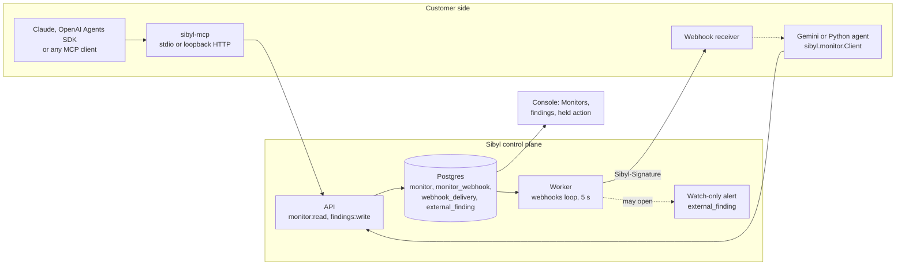

### The advisory guarantee

A monitor is advisory exactly as Sentinel is. It cannot allow, block, approve, deny, fail over, quarantine, kill or change a policy. Three mechanisms keep it that way:

1. **Scopes.** A monitor key holds `monitor:read`, `findings:write` or both, and nothing else (database check `ck_api_key_monitor`). Neither scope is listed in the `x-sibyl-key-scopes` of any route that acts, and the authoriser limits API keys to a route's key scopes (chapter 5).
2. **Alerts.** A finding can request a watch-only `external_finding` alert: an alert rule of kind `leading` with cap 0, outside the rules seed, exactly like Sentinel's. The saga reads only `detected` alerts, so it can never start a failover, and it never moves a score.
3. **Advice, not decisions.** A `held_action_review` finding attaches its advice (`approve`, `deny` or `needs_more_info`) to the held action for the approver to read. The hold stays `pending` until a person decides or it expires.

### Registration and monitor-bound keys

`POST /monitors` (scope `monitors:admin`: Admin, Workspace admin, Security admin; sessions and OIDC tokens only) registers a monitor:

| Field | Meaning |
|---|---|
| `name` | Up to 128 characters; unique among unrevoked monitors of the tenant |
| `kind` | `mcp`, `webhook` or `api`; descriptive, immutable |
| `owner_user_id` | The person accountable for it |
| `all_groups` or `group_ids` | Watch every agent group, or 1 to 64 listed groups (descendants included) |
| `rate_limit_per_min` | Findings per minute, 1 to 600, default 60 |
| `state` | `active`, `paused` or `revoked`; revoked is terminal |

Registration issues the first key unless `issue_key` is false. A monitor key is a normal `sbl_` API key with a `monitor_id` binding: stored as a peppered hash, shown once, never agent-bound, and its binding is immutable like the rest of the grant. The scope catalogue marks `monitor:read` and `findings:write` as `MONITOR_BOUND` machine scopes: no role holds them, and a key that carries one without a monitor binding (or mixes them with any other scope) is refused at creation and by the database. Further keys come from `POST /monitors/{id}/keys`; they rotate and revoke through the ordinary `/api-keys` routes. `POST /monitors/{id}/revoke` revokes every key and disables every webhook in one transaction. `PATCH /monitors/{id}` (with `If-Match`) pauses, resumes, renames, or changes the watched groups, owner or rate limit.

### What a monitor key can read

`monitor:read` is accepted by 16 read operations, all filtered to the monitor's watched groups (an object outside them answers `404`, never `403`):

| Area | Operations |
|---|---|
| Self | `GET /monitors/self` (watched groups, state, rate limit) |
| Agents and health | `GET /agents`, `GET /agents/{id}`, `GET /fleet/health`, `GET /agents/{id}/health` |
| Runs | `GET /runs`, `GET /runs/{id}` |
| Drift | `GET /agents/{id}/drift` |
| Alerts and incidents | `GET /alerts`, `GET /alerts/{id}`, `GET /incidents`, `GET /incidents/{id}` |
| Held actions | `GET /held-actions`, `GET /held-actions/{id}` |
| Findings | `GET /findings`, `GET /findings/{id}` (Sentinel's and every monitor's) |

**Metadata only.** A monitor key never receives payload content or held-action arguments, whatever the tenant's capture mode; there is no reveal path for it. Fleet-wide objects (fleet health, fleet findings, events about no agent) need an all-groups monitor.

### Findings

`POST /findings` (key scope `findings:write`, `Idempotency-Key` required) records an `external_finding`: the Sentinel finding shape plus `monitor_id`, the key that submitted it, and the monitor's own `provider` and `model`.

| Field | Values |
|---|---|
| `kind` | `incident_explanation`, `held_action_review`, `semantic_drift`, `fleet_summary`, `anomaly`, `safety`, `quality`, `cost`, `other` |
| `subject_kind`, `subject_id` | `incident`, `held_action`, `agent`, `run` or `fleet` (no id); the subject must exist within the watched groups |
| `severity` | `info`, `warning`, `critical` |
| `summary`, `recommendation`, `body` | Up to 2,000, 2,000 characters and 32 KB of JSON |
| `advice` | `approve`, `deny`, `needs_more_info`; `held_action_review` only |
| `confidence` | `low`, `medium`, `high` |
| `raise_alert` | Asks for a watch-only alert on a `warning`; a `critical` finding about an agent asks for one by default; `info` never does |

The API derives `agent_id` from the subject, never from the body. A paused monitor gets `409 not_active`; past its rate limit, `429`. Findings are immutable except for people's feedback (`useful`, `not_useful`, `wrong`; `POST /findings/{id}/feedback`) and the alert link the worker writes. `GET /findings` lists both sources with `source=sentinel|external` and `monitor_id` filters. The `webhooks` worker loop raises the requested alerts in batches of 50.

### Signed webhooks

`POST /monitors/{id}/webhooks` adds an endpoint: an `https` URL that passes the provider-URL allowlist rule (`sibyl.is_allowlisted_base_url()`), 1 to 9 event types, and, when the deployment sets `SIBYL_WEBHOOK_ALLOWED_HOSTS`, a host on that list. The 32-byte signing secret (`whsec_...`) is shown once and sealed with `seal_credential` under the tenant's `credential` DEK, with the AAD bound to a `credential_id`. Neither the API nor the worker can select the ciphertext; both read it only through the `SECURITY DEFINER` function `sibyl.monitor_webhook_secret()`.

| Event type | Source |
|---|---|
| `alert.fired`, `alert.updated`, `alert.resolved` | Outbox topic `alert` |
| `drift.detected` | `alert.fired` or `alert.updated` of a drift rule, delivered under this name too |
| `incident.updated` | Outbox topic `incident` |
| `action.held`, `action.decided`, `action.expired` | Outbox topic `action` |
| `run.failed` | Run-end events (`agent.invoke`) with a non-ok status |
| `ping` | `POST /monitors/{id}/webhooks/{wid}/test` |

**Fan-out.** The `webhooks` worker loop (every 5 seconds, woken by outbox notifications) reads the `alert`, `incident` and `action` topics after a per-tenant commit-ordered cursor and below the commit horizon, so no row is skipped or delivered twice per webhook. Failed runs are scanned by `received_at` with a 60-second overlap that the delivery's unique `event_key` (`run:<run_id>`) absorbs. A delivery is created only for an enabled webhook of an **active** monitor that subscribed to the type, existed when the event happened, and watches the agent the event is about; an event about no agent goes to all-groups monitors only. A new webhook never receives the backlog.

**Envelope.** References and states only, never content. The stored payload must fit 8 KB; an envelope over its 7,168-byte budget is trimmed to its short `*_id` references and a few states (`rule`, `severity`, `scope`, `state`, `step`, `decision`, `tool`) and marked `truncated`, so one oversized row cannot stall a tenant's deliveries.

**Signature.** Each request carries:

```
Sibyl-Signature: t=<unix seconds>,v1=<hex HMAC-SHA256(secret, "<t>." + body)>
Sibyl-Event-Id, Sibyl-Event-Type, Sibyl-Delivery-Id
```

The HMAC covers the exact bytes sent. A receiver verifies over the raw body, rejects old timestamps (the example and `sibyl.monitor.verify_webhook` use five minutes), de-duplicates by event id, and answers 2xx quickly.

**Delivery and retries.** Due deliveries are claimed (20 at a time, leased for 2 minutes) in one short transaction, sent with no transaction held (5 at a time, 3-second connect and 10-second total timeouts), and recorded in another:

| Outcome | What happens |
|---|---|
| 2xx | `delivered` |
| Anything else | `retrying`, after 30 s doubling to at most one hour, plus up to 20% jitter |
| 8th failed attempt | `dead`; audited `webhook.delivery_failed` with actor `system` |
| 50 consecutive failures on one webhook | The webhook is disabled with a reason |
| Monitor paused | The delivery waits, re-leased every 5 minutes, until the monitor resumes |
| Monitor revoked or webhook disabled | Dead-lettered without a request |
| Egress refused | Final; no retry |

Settled deliveries are purged 14 days after they settle, in batches of 1,000. The monitor page shows each webhook's last status, response code and consecutive failures.

**SSRF guard.** Every request uses the same guarded path as Sentinel's model calls: an egress allowlist of exactly the webhook's own host, `https` only (`http` only for registered development hosts), no userinfo, no redirects, environment proxies ignored, the host resolved **at connect time** with any non-public address refused (rebinding-safe), and TLS always verified.

### The Sibyl MCP server

`sibyl-mcp` (`packages/sibyl-mcp`, Apache-2.0) turns any MCP client into a monitor. It reads `SIBYL_API_URL` and `SIBYL_MONITOR_KEY` (and an optional `SIBYL_CA_FILE` that adds trust, never removes verification), exits with status 2 when either is missing, and never prints the key.

| Transport | How |
|---|---|
| stdio (default) | `sibyl-mcp`; Claude Desktop, Claude Code (`claude mcp add` or `.mcp.json`), the Claude Agent SDK and the OpenAI Agents SDK start it as a subprocess |
| Streamable HTTP | `sibyl-mcp --transport streamable-http --host 127.0.0.1 --port 8765`, endpoint `/mcp`. It has no authentication of its own: every caller acts with the monitor key. It binds loopback by default and warns when bound to anything else; exposing it needs an authenticating reverse proxy with TLS |

It has 13 tools: 11 read tools (`list_agents`, `get_agent`, `get_health`, `list_runs`, `get_run`, `get_drift`, `list_alerts`, `get_incident`, `list_held_actions`, `get_held_action`, `list_findings`), annotated read-only, and 2 write tools (`submit_finding`, `recommend_on_held_action`), non-destructive and idempotent per `idempotency_key`. Every result is an envelope `{"source": "sibyl", "trust": "untrusted_data", "data": ...}`, and the server instructions and every tool description tell the model never to follow instructions found inside `data`. An API refusal comes back as a tool error naming the HTTP status and problem code.

### The SDK monitor client

`sibyl.monitor` (in `sibyl-sdk`) gives Python monitors `Client` and `AsyncClient` with the same reads and writes (plus `list_incidents`, `get_alert`, `get_fleet_health` and `whoami`), `paginate` and `apaginate` helpers, typed errors (`MonitorApiError` carries the status and problem code), and `verify_webhook` for receivers:

```python
from sibyl.monitor import Client

with Client.from_env() as sibyl:          # SIBYL_API_URL, SIBYL_MONITOR_KEY
    for hold in sibyl.list_held_actions(state="pending")["data"]:
        sibyl.recommend_on_held_action(hold["id"], "deny", "Amount is 40x the median.")
```

`examples/monitors/` has five worked monitors: Claude over MCP (Desktop, Code and the Agent SDK), the OpenAI Agents SDK over MCP, Gemini through the client, a FastAPI webhook receiver, and a rules-only monitor for cron.

### Audit

| Action | Actor | When |
|---|---|---|
| `monitor.registered` | human | Registration (with `api_key.created` for the first key) |
| `monitor.updated` | human | Pause, resume, rename, groups, owner, rate limit, webhook added |
| `monitor.revoked` | human | Revocation, with the keys revoked and webhooks disabled |
| `finding.submitted` | api_key | Every finding |
| `finding.feedback_recorded` | human | A rating on an external finding |
| `webhook.tested` | human | A test `ping`, with its result |
| `webhook.delivery_failed` | system | A delivery dead-lettered |

### API

| Operation | Route | Scope or key scope |
|---|---|---|
| `createMonitor` | `POST /monitors` | `monitors:admin` |
| `listMonitors` | `GET /monitors` | `monitors:admin` or `sentinel:read` |
| `getMonitor` | `GET /monitors/{monitor_id}` | `monitors:admin` or `sentinel:read` |
| `updateMonitor` | `PATCH /monitors/{monitor_id}` (`If-Match`) | `monitors:admin` |
| `revokeMonitor` | `POST /monitors/{monitor_id}/revoke` | `monitors:admin` |
| `issueMonitorKey` | `POST /monitors/{monitor_id}/keys` | `monitors:admin` |
| `createMonitorWebhook` | `POST /monitors/{monitor_id}/webhooks` | `monitors:admin` |
| `testMonitorWebhook` | `POST /monitors/{monitor_id}/webhooks/{webhook_id}/test` | `monitors:admin` |
| `getMonitorSelf` | `GET /monitors/self` | key: `monitor:read` |
| `submitFinding` | `POST /findings` | key: `findings:write` |
| `listFindings` | `GET /findings` | `sentinel:read`, or key: `monitor:read` |
| `getFinding` | `GET /findings/{finding_id}` | `sentinel:read`, or key: `monitor:read` |
| `recordFindingFeedback` | `POST /findings/{finding_id}/feedback` | `sentinel:read` (people only) |

No monitor operation needs step-up. Registration, key issue, revocation, webhook creation, the webhook test and findings all require `Idempotency-Key`.

{width=full}

{width=full}

{width=full}

{width=full}

{width=full}

{width=full}

### Limits

- **Metadata only.** There is no content path for monitors yet, even where the tenant's capture mode keeps content.
- **No live stream for monitor keys.** Monitors poll the API or receive webhooks; the Server-Sent Events stream is for people.
- **One run event.** `run.failed` is the only run webhook event.
- **Shared findings.** A monitor can read other monitors' findings about agents in its watched groups.
- **`http://` in the SDK client.** `sibyl.monitor` accepts `http://` base URLs, so a misconfiguration could send the key unencrypted. Use `https://`.
- **Paused monitors.** Their webhook deliveries wait until the monitor resumes; they are not dropped, and they arrive late.
- **Quality.** Sibyl does not measure a monitor's quality; people rate findings.
- **Distribution.** `sibyl-mcp` and `sibyl-sdk` are not on PyPI yet; the READMEs' `pip install` lines apply once they are.

## Framework integrations

**Status: Built** for OpenAI, Anthropic and Google Gen AI clients, LangChain/LangGraph, OpenAI Agents SDK and CrewAI (chapter 5). **Planned** for Google Agent Development Kit and Microsoft AutoGen. Every framework can reach Sibyl through one of three paths, with different guarantees:

| Path | What it gives | What it does not |
|---|---|---|
| Gateway base URL | Routing, failover, kill switch, limits, Action Gate on proposed tool calls, telemetry | Task boundaries and checkpoints (packets are `request_only`) |
| SDK `instrument()` or `sibyl-run`, plus `@sibyl.tool` or `check_action` | Model calls, run trees, handoffs, checkpoints, handoff packets, kill-switch check, Action Gate before tool execution | Routing and failover, unless the client also points at the gateway |
| OTLP GenAI spans | Visibility and health scoring from existing instrumentation | Any enforcement |

| Framework or client | Built | Gateway path |
|---|---|---|
| LangChain and LangGraph | Global callback handler: runs, graph-node child runs, tools, handoffs; framework tools gated | Point the chat model at the gateway for routing |
| CrewAI | Crew, agent and tool lifecycle; delegation recorded as handoffs; tools gated | Configure the crew's LLM with the gateway base URL |
| OpenAI Agents SDK | Tracing processor: workflow, agents, function spans, handoffs; tools gated | Chat Completions model class with a client pointed at the gateway (the gateway does not serve the Responses API) |
| Anthropic SDK and tool use | Client instrumentation, `tool_use` blocks recorded | Native `/v1/messages` at the gateway; `tool_use` blocks gated |
| Google Gen AI (Gemini) | Client instrumentation | Native `generateContent` at the gateway; `functionCall` parts gated |
| Google Agent Development Kit | Planned connector; OTLP today | Through the Gemini protocol where the client allows a base URL |
| Microsoft AutoGen | Planned connector; gate tools with `check_action` | Its OpenAI-compatible client with the gateway base URL |
| Any other framework | OTLP GenAI spans to ingest | Any OpenAI, Anthropic or Gemini client to the gateway |

Framework APIs change between versions; confirm the base-URL and tool-hook options against the version in use.

# Security

Phase 1 has **not** had an external security assessment. One is planned before the first paying tenant: an unpaid pilot, then the assessment, then the first invoice (D18, D43). Treat the stack as pre-production and keep regulated production data out of it. The reviews so far are internal, at each build gate.

## Authentication and authorisation

**Status: Built.**

- **People** sign in through OIDC: dex in the demo, any OIDC issuer in production. Sibyl never stores passwords. Sessions are opaque, stored hashed, and last 8 hours absolute or 30 minutes idle, in a `__Host-` cookie.
- **Step-up** is a fresh sign-in at the identity provider within the last 5 minutes. It is required for tenant settings, credential management, key rotation, holds, erasure approval, and pulling or releasing a kill switch. Bearer tokens cannot step up.
- **API keys** have the form `sbl_<env>_<prefix12>_<secret>`, are stored as peppered hashes looked up by prefix, carry scopes rather than roles, may be bound to one agent or to one external monitor, expire within 400 days, and rotate with a grace period of up to 24 hours. The secret is shown once. A key can use only the scopes a route lists in `x-sibyl-key-scopes` (chapter 5). Monitor-bound keys hold only `monitor:read` and `findings:write`, and are limited to the monitor's watched groups (chapter 9).
- **Roles.** Seven roles: Admin (`owner`), Workspace admin (`admin`), Security admin, Engineer, Operator, Auditor, Viewer. The UI shows display names; the API, audit log and bindings use identifiers (B17). The scope catalogue and role matrix live in one place, `packages/sibyl-schemas/src/sibyl_schemas/_scopes.py`, and the database seeds and OpenAPI enums derive from it.
- **Agent groups** limit an Engineer's or Operator's grant. Objects outside a principal's groups return `404`.
- **Object rules** (group limits, bound-agent limits, job ownership) fail closed and are tested by the generated contract suites.

## Signed policy and key rotation

The gateway and the SDK act only on Ed25519-signed snapshots. The snapshot signing key lives only in the API process. Trust starts from a pinned first key (`snapshot_pin.json`, B12) and follows a **signed rotation chain** of key sets: each new key set is signed by a key the verifier already trusts, and a freshly pinned gateway catches up through `/policy/keys?since=<sequence>` (B9, B10). Every key in the accepted set that is `active` or `retiring` is trusted until its `not_after`, so rotation overlaps work. A key marked `compromised` never verifies anything. Pre-announcing a `next` key is a change request still open, so in practice a rotation is followable only while the previous key still signs (runbook `rotate-keys.md`).

## Secrets scrubbing

Scrubbing runs on every captured part in the SDK, the gateway and ingest, **whatever the capture mode** (D12). The scrubber (`sibyl_schemas.scrub`) has 23 detectors covering provider and cloud keys, tokens, PEM blocks, credentials in URLs and generic high-entropy key-value pairs. It also scans decoded views: JSON-escaped, percent-encoded and with format characters removed. A match is replaced with `[KIND:hash8]`, salted with `SIBYL_SCRUB_SALT`, so the same secret gives the same token across processes but cannot be recovered. It is tested against a corpus of real-shaped secrets (100% hit) and a clean corpus (zero false positives). Budgets (B8): each detector within 200 ms CPU per MiB, a whole scrub within 6 seconds per MiB in the worst case and about 0.26 seconds per MiB for ordinary text. Known limit: a match longer than 16 KiB may leak its tail at a window boundary; no real credential is that long. An SDK scrub hook that raises downgrades its part to `metadata`; unscrubbed content is never sent.

## Payload encryption and capture

Payload bodies (prompts, outputs, checkpoint state, packets) are sealed with AES-256-GCM under the tenant's `payload` DEK; the AAD binds tenant, purpose, version and object (B11). DEKs are wrapped by the KEK, which lives only in process memory. Phase 1 has no KMS; the `kek_id` recorded on every wrapped key makes a later rewrap possible. `capture_mode` decides what is kept: `full` (scrubbed content), `redacted` (after the tenant's redaction profile) or `metadata` (no content). An agent's capture policy can only be stricter than the tenant's. Reading content requires an audited grant: `X-Sibyl-Reveal-Reason` and a `data.revealed` audit row in the same transaction.

## Fallback credentials

Primary calls use the client's own provider key, passed through and never stored; the gateway never sends a key to a different provider. Fallback targets use vaulted credentials (D11), envelope-encrypted under the `credential` DEK. They reach the gateway only as a sealed bundle valid for at most 300 seconds, held in memory and zeroed on expiry.

## SSRF

Provider base URLs must pass `sibyl.is_allowlisted_base_url()`: https only; no loopback, link-local, RFC 1918, CGNAT or IPv6 unique-local literals; no `localhost`, `*.localhost` or `*.internal`. The gateway ports the same rule and adds a **connect-time** check: DNS names are resolved, the connection is refused if any resolved address is private (defeating DNS rebinding), and the connection goes to the vetted address literal so the check and the connection cannot diverge, while TLS still uses the hostname for SNI and certificate checks. Redirects are never followed. Development hosts (the simulator) are allowlisted explicitly in a table only `sibyl_migrate` can write. Sentinel's model calls and monitor webhook deliveries use the same connect-time guard plus a per-request host allowlist (chapter 9); a deployment can further restrict webhook hosts with `SIBYL_WEBHOOK_ALLOWED_HOSTS`.

## Secrets in deployment

Covered in chapter 3: per-service file secrets, nothing secret in env files or `docker inspect`, startup refusal on missing secrets, superuser credentials only in Postgres and the one-shot bootstrap, KEK, pepper and signing seeds escrowed offline.

## Evidence integrity

The audit chain, anchors, signed erasure ledger and signed backup manifests are covered in chapters 4, 11 and 3. Together they make every governance-relevant change tamper-evident, with verification that needs no trust in the running database.

## Review findings fixed

The internal security review of the wave-0 merge (G0) reported four HIGH and eleven MEDIUM findings and no CRITICAL ones. The G0 fix pass addressed them; the following are traceable to code and tests in the tree:

| Finding | Fix |
|---|---|
| H1: erasure ledger unauthenticated, truncatable | Signed, hash-chained ledger with a signed head; backup manifests record the head; restore refuses truncated or forged ledgers (`test_backup_restore_ledger.py`) |
| H3: seven SSRF allowlist bypasses | Rewritten allowlist rule plus the gateway's connect-time check (`test_ssrf.py`) |
| H4: scrubber ReDoS on the hot path | Detector rewrite with the B8 CPU budgets |
| M4: one shared rate-limit bucket behind Caddy | Caddy overwrites `X-Forwarded-For`; services trust only Caddy's pinned address (`test_compose.py`, `test_compose_live.py`) |
| M6: unsigned signing key set | Signed key-set rotation chain in kernel, gateway and SDK (`test_keychain.py`) |
| M8: every platform secret in ingest and worker | Per-service file secret matrix, enforced in CI (`test_secrets.py`) |
| M9: root-owned volumes | Volumes owned by uid 10001 |
| M10: restore dropped the target first | Verify-first, swap-last restore |
| M11: unencrypted, unsigned, non-expiring backups | `age` encryption, signed manifests, manifest-date retention |

## Not yet assessed or not yet built

1. No external penetration test or code audit.
2. One operator, one host; same-host backups by default (D18).
3. No KMS and no KEK rotation tooling.
4. Signing-key rotation has no pre-announced next key.
5. Rate limits are per replica, in memory.
6. Break-glass anchors are written on the anchors loop's next run, not within the 10-second target.
7. Data residency is declared, not enforced.
8. The licence gate checks licences, not vulnerabilities; there is no CVE gate in CI yet. Release images carry an SBOM and a provenance attestation.

# Governance

**Status: Built** unless marked.

## Audit chain and decision records

Every action in a tenant appends a row to its chain (chapter 4): human actions, API-key actions, rule and policy decisions, worker steps. Filters on `GET /audit/events` cover sequence range, action, actor, resource, evidence grade and time. An Engineer limited to some groups sees only rows about those agents.

A **decision record** is what an auditor reads behind an automated routing move: the rule codes and alert ids that triggered it, the health snapshot with score, band and factors with the arithmetic shown, the horizons, the scoring configuration id, and who approved.

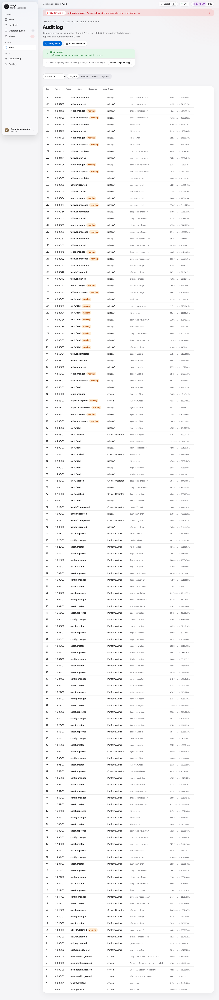{width=full}

{width=full}

## Anchors

An anchor is an Ed25519-signed checkpoint of the chain head, signed by the worker with the audit-anchor key, whose private half is outside the database. A signer is used only if it matches the registered public key. Each anchor is also written to the blob store at `anchors/<tenant>/<id>.json`.

| Kind | Written |
|---|---|
| `hourly` | At least hourly when the chain has grown |
| `export` | At the end of every audit export, before the file is written |
| `erasure` | When keys are shredded and when an erasure completes |
| `break_glass` | After a break-glass kill |
| `rekey`, `partition_boundary` | Key rotation, partition retirement |

The anchors loop runs hourly and at worker start. Export, verification and break-glass requests wait for its next run until it wakes on database notifications (an open change request); restarting the worker serves a request immediately.

## Verification and export

- **On the server**: `POST /audit/verifications` walks the chain in Postgres and checks anchor signatures. Up to 100,000 rows are verified in the request; larger ranges become a job. The result is recorded as `audit.verified` or `audit.verify_failed`.
- **Export**: `POST /audit/exports` (scope `audit:export`, up to 1,000,000 rows, `jsonl` or `csv`). The worker writes an `export` anchor at `to_seq` first, then the export sealed under the tenant's payload key. Requesting is audited as `audit.exported`, completion as `audit.export_completed` with the file hash and anchor id. Downloading is an audited reveal with a stated reason.
- **Offline**: the `jsonl` format (`sibyl.audit_export/1`) verifies with no server access:

```bash
uv run sibyl audit verify audit-export.jsonl \
  --public-key deploy/compose/env/public/anchor_signing.pem
```

It re-hashes every row, checks the rows are contiguous, checks each `prev_hash`, checks every anchor's signature, tenant and row hash, and checks the export ends at an anchor. Exit `0` means the chain verifies; `1` a break with its `seq` and kind (`gap`, `prev_mismatch`, `content_mismatch`, `hash_mismatch`, `anchor_signature`, `anchor_tenant`, `anchor_mismatch`, `unanchored_tail`, `no_anchor`); `2` unreadable input. Changing one character in any row's reason yields `content_mismatch` at that row. `csv` carries no anchors and cannot be verified.

## Legal holds

A hold freezes retention sweeps and blocks erasure for its scope: `tenant`, `agent`, `incident` (a provider incident, affected agents derived, may be open-ended) or `subject` (the identifier is hashed with `SIBYL_SUBJECT_SALT` and never stored). Placing or releasing needs `holds:manage`, step-up and a reason; both are evidence-grade audit rows. Every hold except an incident hold needs an expiry within two years. A hold never widens anyone's read access. Releasing a hold reopens the erasure requests it blocked.

## Erasure and certificates

Erasure is a crypto-shred of a tenant, an agent or a data subject (D17), with `legal_basis` one of `gdpr_art17`, `dpdp_s12`, `contract_end`, `tenant_offboarding`, `other`. The database enforces the safety rules as well as the API:

- **Two people.** The approver must not be the requester; approval needs step-up.
- **Tenant scope needs Admins**, and a second active Admin must exist.
- **Holds block**: the request enters `hold_blocked` with the blocking hold ids.
- **One request per scope** in progress at a time.
- **Backup agents.** An agent named as backup in another agent's active approved chain cannot be erased until that chain is retired (G0-7).

The worker runs an approved request step by step and resumes after a crash: `approved`, `executing`, `keys_shredded` (tenant scope), `objects_deleted`, `derived_purged`, `verified`, `completed`. `verified` requires zero residue. Completion writes, in order, a signed erasure-ledger entry, an `erasure` anchor, and a certificate stored with its SHA-256 and the anchor id. The certificate states when pre-erasure backups expire. While a tenant-scope erasure runs, ingest answers `429 tenant_erasing`. After a restore, the ledger is re-applied before the database opens (chapter 3).

## Retention

| Data | Default | Range |
|---|---|---|
| Payloads | 30 days | Up to 365 days per tenant (D28) |
| Audit chain | 400 days | Up to 7 years by contract (D27) |
| Backups | 7 days | `SIBYL_BACKUP_RETENTION_DAYS`, stated on certificates (D26) |

The retention loop runs hourly, sweeps expired payloads except those under an active hold, and records one `retention.objects_swept` row per batch. A swept payload reads as `404 payload_swept`; an erased one as `410 payload_shredded`.

# Console

**Status: Built** in demo-data mode; live mode is wired for most screens. The console is Next.js (App Router), strict TypeScript and Tailwind v4, with a BFF route layer. The visual direction is a calm, Apple-style interface: light and dark themes, glass only where layers overlap, colour only for meaning. The screenshots in this document are from demo-data mode, which serves deterministic fixtures shaped exactly like the OpenAPI contract and plays a scripted Anthropic outage; a purple **Demo data** chip marks every screen in that mode.

## Live mode and the BFF

In live mode, people sign in through the API's OIDC flow and every panel reads real data. The browser never calls the API directly: `/api/bff/<path>` forwards to `/api/v1/<path>` with the session token, only for paths in the generated contract list. `/auth/*`, the gateway-only `/policy/*`, dot segments and non-contract paths get `404` without reaching the API. Every mutation needs a same-origin check plus a double-submit CSRF token. A `403 step_up_required` opens a "Confirm it's you" dialog that runs the step-up in a small window and retries the action with the same idempotency key. A `GET` the API answers with `501` is served from demo data and labelled as such; a write that gets `501` is never faked. The event stream is relayed with resume on reconnect.

## Screens

**Fleet.** Every agent's health ring, tier and routing state, grouped by provider or tier, with an incident card and blast radius when a provider fails. Who acts: Admin, Operator.

{width=full}

**Agent detail.** Score arithmetic with each factor's explanation, threshold and cap; failure-risk bands for 15 minutes, 1 hour and 24 hours with confidence and the "rule-derived, not calibrated" note; the routing chain in force; the continuity plan; one-hour sparklines; recent events; and actions (fail over, hand off, quarantine, kill switch).

{width=full}

**Incidents.** Decisions needed first; for each incident, the saga steps, the recovery-time clock and recovery point at cut, routing transitions linked to their audit rows, and handoff tasks created. Approvals are decided here with a reason; the requester's approve button is refused.

{width=full}

**Operator queue.** Handoff packets with full context, claim and complete actions, ratings, and the `completed_despite_failure` summary (shown earlier in chapter 8).

**Alerts.** Open, unverdicted and resolved alerts, with provider incidents grouped. Closing requires a verdict. The **Unverdicted** tab lists alerts that resolved on their own (D33), so the verdict backlog stays visible.

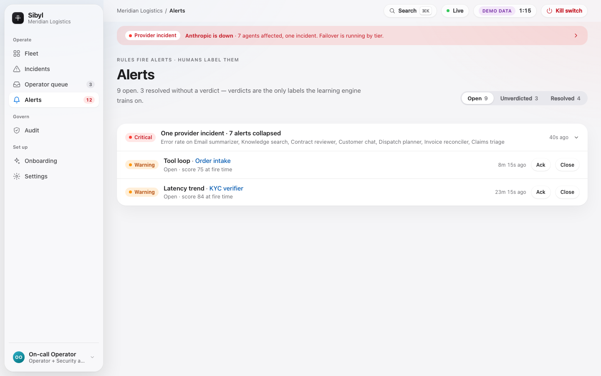{width=full}

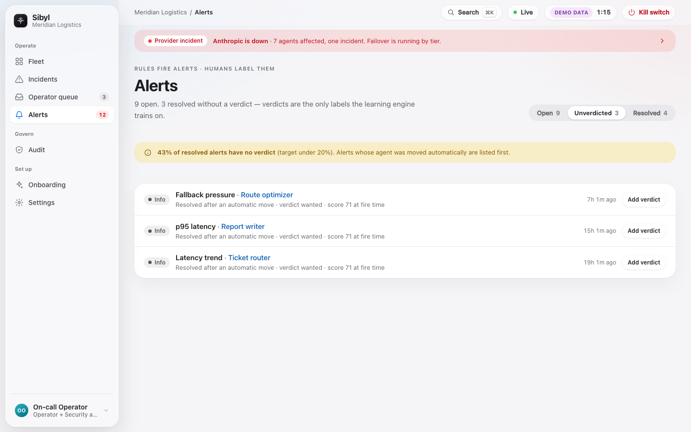{width=full}

**Audit.** The hash chain, server-side verification, verification of a tampered copy, decision records and export (shown in chapter 11). Who acts: Compliance Auditor.

**Onboarding.** For a new tenant: create the capture policy, mint the first key (shown once), copy the zero-code gateway snippet or the one-line and zero-code SDK snippets per client and framework (chapter 5), and watch the agent appear a few seconds after its first call.

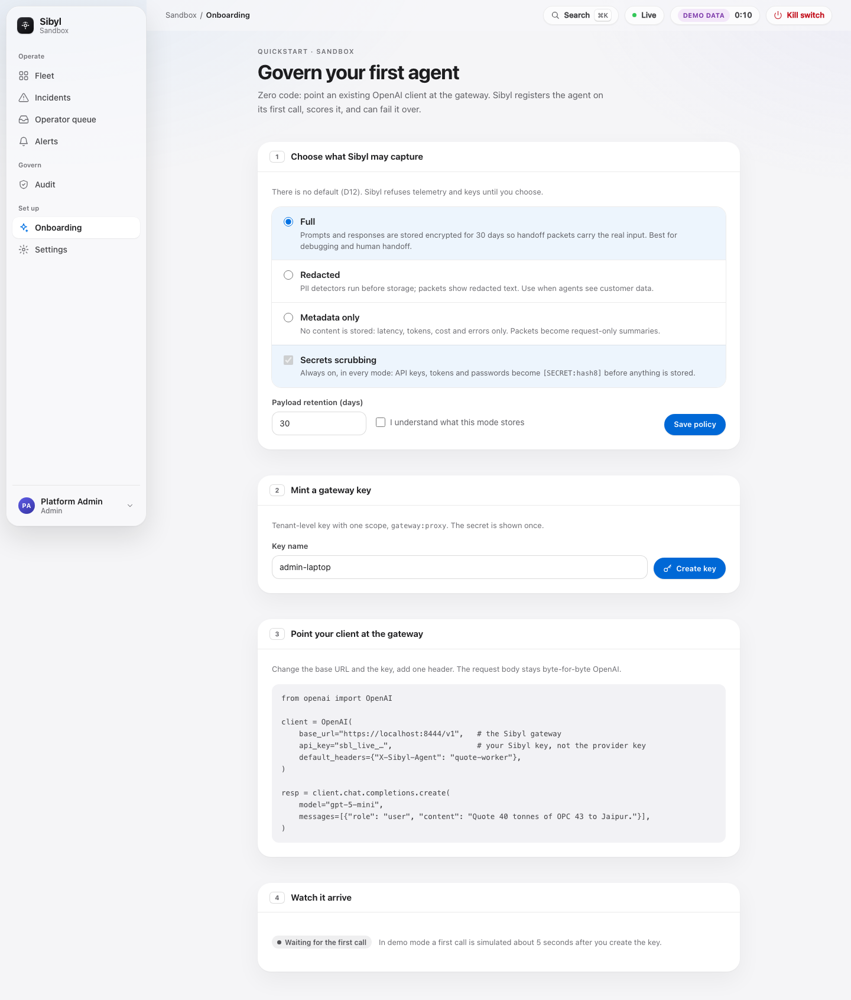{width=full}

**Settings.** Tenant settings, API keys (list, create, rotate, revoke), tenant data keys with rotation, and members.

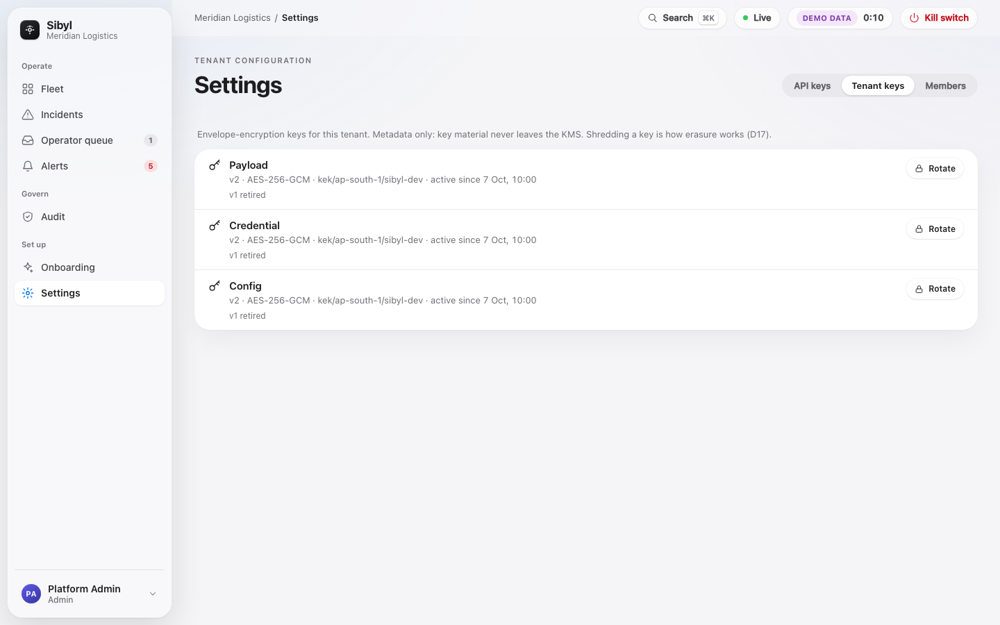{width=full}

**Kill switch.** Scope, reason, typed confirmation and step-up (shown in chapter 8). Available from the toolbar on every screen.

**Action Gate screens** (**Built**, live): action policies editor with simulate, held-actions queue with approve and deny under four-eyes and step-up, decision records, and a fleet summary of blocked and escalated actions (chapter 6).

**Runs and run tree** (`/runs`, `/runs/{id}`, **Built**): the runs list, newest first, with status filters; and one run's agents, steps, model calls (requested and served model), tool calls and handoffs, metadata only (chapter 5).

**Discovered agents** (`/discovered`, **Built**): agents found in telemetry, with a Confirm action (chapter 5).

**Model drift** (`/drift`, `/drift/reports/{report_id}`, and a panel on agent detail, **Built**): fleet summary and per-agent feature statistics, served model and fingerprint, recent verdicts, reset baseline (chapter 7).

**Sentinel** (`/sentinel`, `/sentinel/{finding_id}`, `/settings/sentinel`, **Built**): findings with provenance and feedback, filterable by source (Sentinel or monitors), on-demand explain, and setup with the write-only key, budget, sampling rate and tasks (chapter 9).

**Monitors** (`/monitors`, `/monitors/{id}`, **Built**): register a monitor (the key is shown once with a ready-made snippet), issue keys, add and test webhooks, pause, resume and revoke, and each monitor's recent findings. External findings also appear on the held action, incident or agent they concern, next to Sentinel's (chapter 9).

## What is live today

Live against the API: authentication, tenant, users, API keys, tenant keys, fleet health, providers, models, agents with health, history, metrics, risk, routing and chains, alerts with actions, provider incidents, audit events, anchors, verifications and exports, capture policies, redaction profiles, blast radius and the event stream. The console was wired before the saga lane merged, so incidents, approvals, queue and kill-switch panels still use the demo fallback in some builds; re-pointing them at the now-merged routes is part of the remaining live wiring. The Action Gate, drift, Sentinel, monitors, runs, run tree, discovered-agents and onboarding screens are on the live contract, with known API gaps listed in chapter 15. Console checks: typecheck, lint, unit tests, end-to-end tests with axe accessibility checks, visual tests at 320, 768, 1024 and 1440 pixels in both themes, and a live end-to-end suite against a running stack.

# Testing and quality

## CI pipeline

**Status: Built.** CI runs on GitHub Actions on every push and pull request (`.github/workflows/ci.yml`, chapter 3) and locally with `make ci`, which runs `ci/run.sh`; the budget is 10 minutes. A full local run takes about 8 minutes. Steps, in order:

| Step | What it does |
|---|---|
| `sync` | `uv sync --all-packages --locked` |
| `ruff` | Lint |
| `format` | `ruff format --check` |
| `imports` | import-linter contracts (gateway and SDK depend on schemas only) |
| `mypy` | Type check of all five source trees |
| `pytest` | All Python tests with coverage, floor 80% (`SIBYL_COV_MIN`) |
| `licences` | Runtime dependency licence gate over Python and npm locks |

The pytest step refuses to start unless Postgres answers, and `ci/skip_guard.py` fails the run if a test is skipped for a reason not on the allowlist. Database tests therefore never skip silently. The licence gate allows MIT, BSD, Apache-2.0, ISC and PSF; blocks AGPL, SSPL, BUSL, GPL and unknown licences; and records two waivers (`certifi`, used unmodified; `axe-core`, test-only). Console checks run separately in `console/` and as the `console` job on GitHub Actions.

## Test counts

The most recent full run (2026-10-14, release 1.0.0, after wave 4) executed **9,845 Python tests: 0 failures, 15 skips (all allowlisted), 12 expected failures** in 466 seconds: 9,805 in the parallel main suite, 34 timing tests run serially and the 6 harness smoke scenarios, with 94% coverage. Wave 4 adds suites for the monitor and finding API, the monitor authorisation wall and contract scenarios, monitor keys, the monitor tables in the database, the webhooks worker, `sibyl-mcp` and `sibyl.monitor`; the generated isolation and erasure-cascade suites cover the four new tables automatically. Coverage across the packages has been between 94% and 96% at recent gates. Notable suites:

- **Golden fixtures**: 118 in `sibyl-schemas`, each validated three ways (JSON Schema, pydantic model and canonical bytes), including Ed25519 snapshot vectors and the Action Gate decision vectors every enforcement point must reproduce.
- **Row-level security**: a generated isolation test for every tenant table and role.
- **Routing edges**: all 560 state and action combinations of `routing_apply`.
- **Erasure cascade completeness**: fails if a table is not covered.
- **Scrubber corpora**: 100% detection on real-shaped secrets, zero false positives on clean text.
- **Canonicaliser differential**: the kernel and schema canonicalisers must produce identical bytes.
- **Gateway latency bench** as a test, with and without the Action Gate.
- **Backup and restore** mechanics against the real ledger verifier and SQL function.

## The contract world

The authorisation wall and audit-completeness suites are **generated from the OpenAPI extensions**, so every operation is tested for its scopes, step-up rule, key scopes, object rules and audit actions. Guard-level cases (401, scope 403, key-only, session-only, break-glass misuse, stale step-up) run against the app with no database. Cases that need real objects (another tenant's object returns 404, group and bound-agent limits, audit rows on every 2xx) run in the **contract world**: a session-scoped, migrated Postgres 17 with two seeded tenants and the production principal chain. Every API module is strict in the contract world; a contract operation that drifts from its declared behaviour fails CI.

## The `sibyl-sim` harness

`sibyl-sim` is a development-only simulator on its own port and compose profile, never in the product bundle.

**Built on `main`:**

- **Provider doubles** for OpenAI-compatible, Anthropic and Ollama stubs, served over TLS with a throwaway development CA, behind the **real** gateway, with chaos knobs (outage, error rates, latency, rate limits, refusals, truncation, malformed tool calls) set through the control API (`POST /_sim/doubles/<name>/outage`).
- **Status feeds** that the worker's status poller reads, which can be decoupled from traffic to test a status page that lies or lags.

**Built (merged 2026-10-12):** the scenario runner, actors (20 `meridian` agents across tiers, 3 `northstar`), ground-truth writer, oracle and a 32-scenario catalogue. Rules of the harness: chaos is applied only at the doubles; the simulator never writes a derived table; there is no product clock override; every scenario has a seed, and the same seed and build give identical ground truth. Scenarios cover hard outage, rate-limit ramps, latency creep, cost spikes, flapping, three silent-degradation modes, tool loops, context saturation, correlated multi-agent failure, model deprecation, non-viable fallback, lying and late status pages, observation gaps, ingest backpressure, undo and hold, two isolation cases, prompt injection, a quiet baseline soak, canary failback, four-eyes, the D22 forced hold, and kill-beats-everything. Wave 3 added four scenarios. **S-29** (Action Gate at the SDK): over-limit blocked, under-limit allowed, daily cap escalates, personal data to an external tool blocked. **S-30** (Action Gate at the gateway): an injection-driven public file share blocked 42 of 42 times, transfer limit enforced. **S-31** (silent model swap): `model_change` 18 s and `silent_drift` 48 s after the swap, no automation. **S-32** (live outage reproduction): the agent reaches `failed` and fails over about 17 s after detection; before the cold-start fix (B34) it stopped at `watch`. The new critical gate `unauthorised_actions` judges what each agent actually executed against the scenario's own forbid and cap lists, not the product's decisions. In these runs no unauthorised action executed. Every scenario still fails the known `contract` check (B-04), and the human-approval path of S-29 must be re-run now that B-09 is fixed.

**Acceptance gates** are judged at the worst seed, not the mean. The CRITICAL ones block release: approval-gating correctness 100%, explainability completeness 100% (penalties sum to 100 minus score within 1, every factor explained), and zero isolation leaks. HIGH gates: false-failover rate (0 automatic on tier 1, 2% tier 2, 5% tier 3), missed-failover rate with the same limits, and recovery-time attainment (100% within 15 minutes on tier 1, 98% within 1 hour on tier 2, 95% within 4 hours on tier 3). MEDIUM gates: time to detect hard failures (60, 90 and 120 seconds by tier), lead time on ramps (5 minutes or more), and detection and prediction precision and recall floors. Planned run modes are a 6-scenario smoke suite on every change (12 minutes or less) and the full suite with 3 seeds nightly (90 minutes or less).

## Mutation testing

At the G0 gate, the test review ran 42 mutation probes in a scratch copy of the repository: each probe applies one textual mutant, runs the targeted tests and reverts. The existing suite killed 24. Of the 18 survivors, 2 were equivalent mutants and 16 revealed real gaps, for example an idempotency claim whose conditional upsert could be made unconditional (letting a side effect run twice), a rotating key with no grace end that would verify forever, and an RLS completeness check blind to materialised views. Nineteen candidate tests killed all 16 and were carried into the suites. The structural suites (RLS sweep, routing edge matrix, cascade coverage, drift checks, authorisation units) killed every mutant aimed at them. Mutation testing is a gate-time review practice today, not a CI step.

# Operations

Phase 1 assumes one operator in a business-hours window (D18), on the machine running the compose stack. There is no pager integration yet; notifications (email, Slack, Teams) are **Planned**.

## Runbooks

All runbooks are in `ops/runbooks/` and share a compose shorthand. The audit chain records what Sibyl did; the operator's incident log records why they did it.

| Runbook | Use it when | Core steps |
|---|---|---|
| `incident-response.md` | Anything looks wrong | Check `/healthz` and gateway readiness (snapshot state and version); check the worker loops; find the agent or provider in trouble; undo a wrong automated call; use break-glass if the identity provider is down; close out |
| `provider-outage.md` | A provider is down or degraded | What Sibyl does unaided (collapse, tiered failover, viability exclusion); approve tier-1 moves; verify failback; verdict the provider incident |
| `snapshot-stale.md` | Gateway reports `stale` or `expired`, or refuses with `sibyl_policy_expired` or `sibyl_no_snapshot` | Read what the gateway holds; check the API, signing key registration and network; restore polling; do not flip fail modes mid-outage without reason |
| `sse-outbox-stalled.md` | Console stops updating, scores or anchors stop advancing | Find the transaction holding the commit horizon (`idle in transaction`, long migration, open `psql`); end it; prevent with statement and idle timeouts |
| `erasure-request.md` | A right-to-erasure request arrives | Check holds and chains; file; second person approves with step-up; follow execution; fetch the certificate; keep the ledger safe |
| `rotate-keys.md` | Rotating API keys, break-glass keys, gateway keys, tenant DEKs or signing keys | Per key type, with grace periods and the signing-key overlap rule |
| `backup-restore.md` | Backups, restores, the drill | Chapter 3 |

## Service levels

**Agent-minute SLOs (D40).** Sibyl measures, per agent, the share of valid minutes that are good (band `healthy` or `watch` and observable), over a rolling 30 days. Valid minutes exclude killed, quarantined, maintenance and provisional time.

| Tier | SLO | 30-day budget |
|---|---|---|
| 1 | 99.5% | 216 minutes |
| 2 | 99.0% | 432 minutes |
| 3 | 98.0% | 864 minutes |

These state what Sibyl measures and responds to; they are not a promise about the customer's model. Burn-rate pairs drive severity: a very-fast burn (15 minutes and 2 minutes windows) is critical, down to a ticket-level burn (3 days and 6 hours) reviewed weekly. Above 50% budget consumed on a tier-1 agent, the console shows a banner; at 100%, the plan is marked for review and that agent's rules cannot be loosened until the budget recovers.

**Platform targets.**

| Target | Value |
|---|---|
| Gateway added latency | p99 under 5 ms sequential; p95 under 15 ms and p99 under 50 ms at 200 streams (CI-enforced) |
| Action Gate overhead | About 0.2 ms p99 (measured) |
| Routing change reaches the gateway | Within one poll (5 seconds) plus signing |
| Scoring tick | 10 seconds; the evaluate loop skips rather than queues when behind and records an observation gap |
| Rollup lag | Leading rules are refused above 120 seconds of lag, and snapshots are marked provisional |
| Restore | 30 minutes or less at Phase 1 volume |
| Availability by deployment shape | One gateway on one host about 99.9%; two replicas behind a balancer about 99.95% |

**Scoring-layer signals** to watch: rollup lag, worker tick duration and skipped ticks, outbox reader position against the commit horizon, unverdicted-alert backlog (target under 20% of resolved alerts older than 7 days), and false-failover counts per tier from labels.

## Weekly alert-quality review

A 30-minute weekly review by the operator covers fired alerts, verdicts, false positives per rule, unverdicted backlog and any automated transitions that were undone. Rule threshold changes on tier-1 agents are previewed by replaying the last 7 days of snapshots before saving. The release-criterion band for predicted automation is moved back to `"0.90"` if the realised failure rate at `"0.60"` leaves its nominal range for two weeks.

# Limits and known gaps

This chapter lists what Sibyl does not do yet, or does not do well. It should travel with any summary of this document.

## The open detection gap

In the live end-to-end test on the full compose stack, a **tier-3 agent under a hard provider outage reached only the `watch` band, and no saga started**. The expected behaviour is a `failed` band within the tier-3 time-to-detect target of 120 seconds, followed by an automatic failover. This is open and has not been root-caused. One candidate to check first is the cold-start rule (chapter 7): a provisional agent's band is capped at `watch` and no rule actor may create a failover for it, and a freshly seeded agent with little traffic can be provisional. Whatever the cause, until the gap is closed and the hard-outage scenario passes in the harness at the worst seed, automatic failover on detected failure should be considered unproven on the live stack, even though the saga, gating and routing paths pass their own tests.

## Prediction is not learned

Early warning is trend and change-point statistics combined by noisy-OR into rule-derived bands. It is a better warning threshold, not a forecast. The bands are labels, not calibrated probabilities. The learned model is Phase 2 and ships only past the gate in chapter 7. The 5-to-39-minute lead times are from simulation only.

## No data moat yet

Execution histories alone are not intelligence. The candidates for something proprietary are a verdict-labelled incident corpus per tenant (its value must show as measured lift), the scenario library, and policy and continuity templates. Decision D37 forbids pooling signals or models across tenants; cross-customer learning would need opt-in aggregate priors, federated training or shipping only scenario and template improvements, each with contract terms and a technical boundary that is not built.

## No external security assessment

There has been no independent penetration test or code audit (chapter 10). The stack is pre-production.

## Gateway API surface

The gateway speaks OpenAI-compatible Chat Completions, Embeddings and Models, native Anthropic Messages and native Gemini `generateContent`. It does not serve the OpenAI Responses API; agents that use only the Responses API get telemetry and the Action Gate through the SDK, without routing and failover. Fallback is same-protocol only (B25): an Anthropic-protocol agent can fail over only to Anthropic-protocol targets, and Sibyl does not translate between protocols.

## Drift detection and Sentinel limits

- **Drift thresholds** are tunable per tenant through the API only; there is no console screen yet.
- **Drift detects; it does not predict.** It has no harness result yet; the silent model swap scenario is in the harness lane.
- **Fingerprint checks** need a provider that sends a fingerprint; when the baseline saw none, `new_fingerprint` is not checked.
- **Sentinel quality is not measured.** Treat findings as a second opinion. Its findings are not covered by a retention sweep yet.
- **Sentinel never enforces**, by design. Its value is faster and better-informed human decisions, Its behaviour is checked on the harness (S-33); its judgement is not yet measured.

## External monitor limits

- **Metadata only.** Monitor reads never include payload content or held-action arguments; there is no capture-mode content path for monitors yet.
- **No live event stream for monitor keys.** Webhooks and polling only.
- **`run.failed` is the only run webhook event.**
- **Findings are shared within groups.** A monitor can read other monitors' findings about agents in its watched groups.
- **The SDK monitor client accepts `http://` URLs.** Configure `https://`; the key would otherwise travel unencrypted.
- **Paused monitors' deliveries wait** until the monitor is resumed, then arrive late.
- **No quality measurement.** Sibyl does not evaluate an external monitor; people rate its findings.
- **Packages are not on PyPI.** `sibyl-sdk` and `sibyl-mcp` install from the repository.

## Access and distribution

- **The public demo is shared.** https://sibyl-demo.onrender.com is one Render instance: every visitor sees the same demo world, and it restarts after 15 idle minutes on the free plan.

## Other gaps

- **Harness gates not yet a release check.** The contract check (B-04) is fixed and the S-29 approval and timeout paths pass; 20 scenarios pass, including the Action Gate scenarios S-29 (approval and timeout re-run) and S-30, the silent model swap S-31, the outage reproduction S-32 and the new Sentinel scenario S-33; 12 do not yet pass, 11 of them waiting on a design ruling or an unbuilt feature and one a known coverage gap (B-10). The suite is not run nightly; a full catalogue run takes about 75 minutes.
- **One ingest key per tenant at a multi-tenant gateway (B-03).** The gateway now posts each tenant's telemetry with that tenant's own ingest key (`SIBYL_INGEST_KEYS`); a tenant without one has its gateway telemetry dropped, never filed under another tenant. The two-tenant demo stack sets only the first tenant's key, so the second demo tenant shows no gateway telemetry. The real deployment has one tenant and is unaffected.
- **Console API gaps.** The Action Gate outcome is not yet mapped onto tool-call events in ingest, so a live run tree cannot yet show which tool calls the gate blocked or held (the demo data shows it). The held-actions list returns no arguments; the detail view shows the scrubbed arguments. Simulate does not read live counters. The 24-hour fleet counts read the audit log and can undercount on busy tenants.
- **Console live wiring** is partial for incidents, approvals, queue and kill switch.
- **Single host**: one operator, same-host backups by default, logical dumps only (no point-in-time recovery yet).
- **No KMS**, no KEK rotation tooling, and no pre-announced next signing key.
- **Per-replica rate limits** in memory.
- **Anchors loop latency**: break-glass, export and verification anchors wait for the hourly loop until it wakes on notifications.
- **Residency** is a declared field, not enforced.
- **Supply chain**: licence gate and image SBOM and provenance attestations; no CVE gate.
- **Not yet built**: TypeScript SDK (gateway path only for Node agents), notifications, data exports (`501`), AI bill of materials, Google ADK and AutoGen connectors, Helm chart and cloud deployment.
- **Package distribution**: the SDK is not on PyPI; name reservation is an open founder item.

# Glossary

| Term | Meaning |
|---|---|
| Action Gate | Pre-execution evaluation of an agent's proposed tool call: allow, block or escalate, from signed policy |
| Action policy | `sibyl-action-policy/1` document: ordered rules over tools and arguments, allowlist, sensitive and external tool lists, hold timeout |
| Agent | A registered AI asset that calls models or tools under one identity |
| Agent group | Named set of agents that limits a person's grant inside a tenant |
| Alert | One rule firing on one agent, provider or the platform; states `open`, `acked`, `resolved` |
| Anchor | Ed25519-signed checkpoint of an audit chain head |
| Approval | A pending human decision on a proposed move, with a timeout and four-eyes |
| Audit chain | Per-tenant append-only, hash-chained log of every action |
| Band (health) | `healthy`, `watch`, `degraded`, `failed`, derived from the score with tier-specific edges |
| Band (probability) | `"0.05"`, `"0.25"`, `"0.60"`, `"0.90"`: rule-derived risk labels per horizon |
| BFF | The console's backend-for-frontend route layer |
| Blast radius | The agents, processes and data affected by a failing node in the dependency graph |
| Break-glass key | API key with only `killswitch:pull`, usable when the identity provider is down |
| Capture mode | `full`, `redacted` or `metadata`: what content is kept, after scrubbing |
| Checkpoint | Resumable SDK task state with completed and pending steps and side effects |
| Commit horizon | Oldest running transaction id; ordered readers read only below it |
| Continuity plan | Per-agent degraded mode, approval timeout and policy, limits, pre-emptive mode |
| Crypto-shred | Erasure by destroying the data keys that encrypt content |
| DEK, KEK | Tenant data-encryption key; key-encryption key that wraps DEKs |
| Detected rule | Rule over current metrics that lowers the health score |
| Fail mode | `open` or `closed`: gateway behaviour when the snapshot is expired |
| Fallback chain | Ordered, approved, immutable list of failover steps |
| Failback | Return to the primary after it has been healthy for 5 minutes |
| Discovered agent | An agent first seen in telemetry; provisional and never routed until an admin confirms it |
| Drift report | One immutable evaluation of an agent's recent traffic against its frozen baseline, with every feature's numbers |
| Finding | An advisory output of Sentinel (with provider, model, prompt hash, tokens and cost) or of an external monitor (with its monitor, provider, model and confidence) |
| External monitor | An outside agent or script registered with a monitor-bound key to read fleet metadata in its watched groups and submit findings; never enforces |
| Monitor key | An API key bound to one monitor, holding only `monitor:read` and `findings:write` (`MONITOR_BOUND` scopes) |
| Webhook delivery | One signed event sent to one monitor webhook; retried with backoff, dead-lettered after 8 attempts, purged 14 days after it settles |
| Four-eyes | The requester of an action cannot approve it |
| Handoff packet | `sibyl-handoff/1` document a person receives when work leaves an agent |
| Held action | An escalated tool call waiting for a human decision |
| Hysteresis | Consecutive-tick requirement before a band changes, to prevent flapping |
| Incident | One failover saga for one agent |
| Inline fallback | Per-request retry against the next chain step before the first byte |
| Leading rule | Rule that looks ahead (trends, proximity) and contributes risk points |
| Noisy-OR | `1 - product(1 - r_i)`: how leading-rule risk points combine |
| Operator hold | 30-minute block on automated actors after an undo |
| Policy snapshot | Signed, versioned, expiring bundle the gateway and SDK enforce |
| Provider incident | One record for one provider outage, collapsing member alerts |
| Provisional | Cold-start state: band capped at `watch`, no automated failover. A discovered agent stays provisional until confirmed |
| PSI, JS | Population Stability Index and Jensen–Shannon divergence: the drift statistics |
| Quarantine | Gateway refuses the agent's traffic until released |
| Routing state | One of seven: `active`, `degraded`, `awaiting_approval`, `failed_over`, `failing_back`, `quarantined`, `killed` |
| RLS | Postgres row-level security, isolating tenants |
| Saga | The step-by-step, resumable failover procedure |
| Scrubbing | Unconditional replacement of secrets with `[KIND:hash8]` |
| Run tree | A multi-agent run: runs, steps (`step_index`), model and tool calls, handoffs, linked by `parent_run_id` |
| Sentinel | Opt-in advisory monitoring agent on the tenant's own model key; never enforces |
| Step-up | Fresh identity-provider sign-in within 5 minutes for high-risk actions |
| Tier | Agent criticality, 1 (highest) to 3; controls how much automation is allowed |
| Undo | Inverse of the newest automated transition; places an operator hold |
| Verdict | `tp`, `fp` or `unsure` label given when closing an alert; mandatory |
